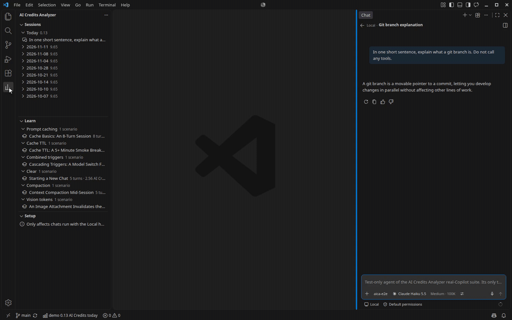
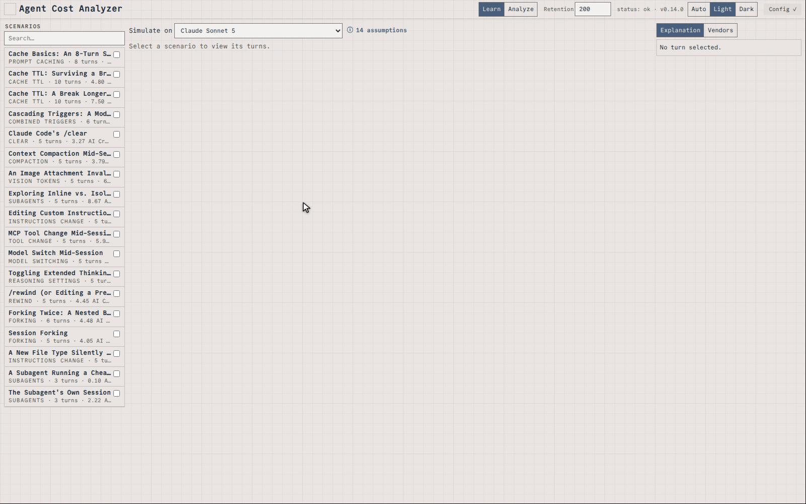
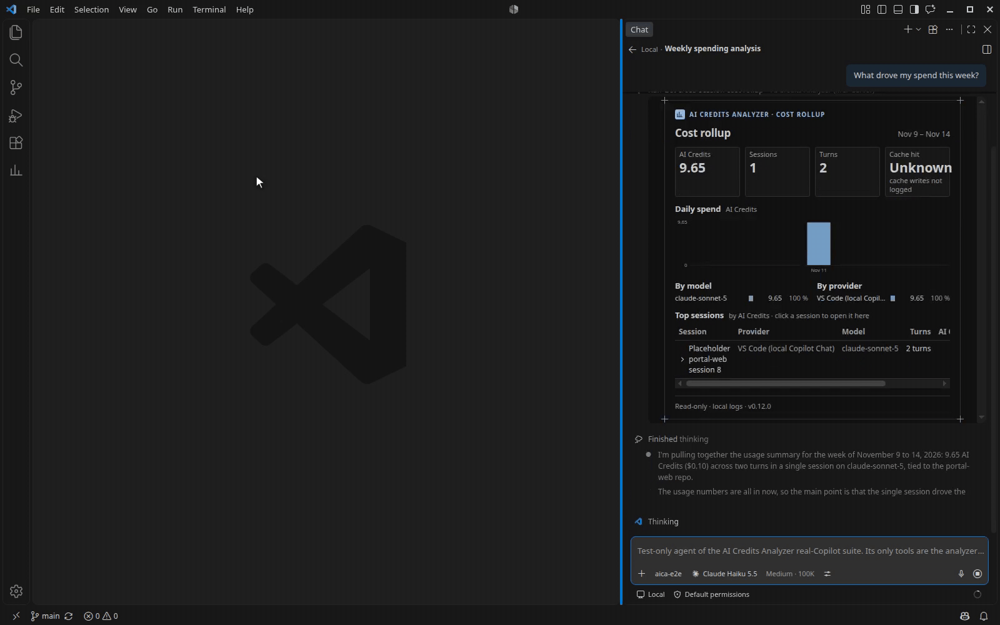

# Agent Cost Analyzer

**Last changed:** 2026-11-14 · **Source:** https://github.com/raulkivi/agent-cost-analyzer

Independent project; not affiliated with or endorsed by GitHub or Microsoft.

See where the tokens and money go when an AI agent writes code for you. This
repository gives you two products that read the logs your coding agents
already write on your own machine and show every session turn by turn:

- **AI Credits Analyzer** is a VS Code extension for GitHub Copilot Chat and
  its AI Credits.
- **Agent Cost Analyzer** is a standalone app for Claude Code, GitHub
  Copilot, the pi coding agent and mitmproxy captures of LLM traffic.

Both run locally and are read-only. Nothing leaves your machine.



## What you can find out

- What a session, a repository or a project cost, and how that changed over
  time.
- Why a cost changed: more usage, a price change, or a different model mix.
- What a real session would have cost on another model.
- Which tool calls failed and why, which commands were risky, and which
  sessions look unusual.
- Which changes would lower your spend: the Savings report ranks them, each
  with an estimated weekly range or "up to" figure. The standalone app covers
  all its sources; the extension covers GitHub Copilot sessions.
- How much of a monthly AI Credits allowance you have used (extension only).
  Set the allowance and the status bar shows the month to date against it,
  with a warning near the limit. The Sessions view shows the same figures
  with the days left.
- How prompt caching, context compaction and model switches change what a
  turn costs. Learn mode explains this with sample sessions, so it is useful
  before you have any data of your own.
- All of the above from an AI chat, through a read-only MCP server (see
  [Ask your AI chat](#ask-your-ai-chat)).

## Which one do I need?

| You use | Install |
|---|---|
| GitHub Copilot Chat in VS Code | AI Credits Analyzer, the extension |
| Claude Code, pi, mitmproxy captures, or several tools at once | Agent Cost Analyzer, the standalone app (it reads Copilot Chat sessions too) |

## Get started: AI Credits Analyzer (VS Code)

1. Install **AI Credits Analyzer** from the
   [VS Code Marketplace](https://marketplace.visualstudio.com/items?itemName=raulkivi.ai-credits-analyzer),
   or from [Open VSX](https://open-vsx.org/extension/raulkivi/ai-credits-analyzer)
   for VSCodium and similar editors. It needs VS Code 1.146 or later and
   GitHub Copilot Chat.
2. Turn on Copilot Chat's debug file logging, so Copilot Chat records token
   and AI Credits data. The extension's **Setup** view has a **Fix** button
   that opens the setting
   (`github.copilot.chat.agentDebugLog.fileLogging.enabled`), and a
   walkthrough opens on first start. Newer chats that run through Copilot's
   Agent Host don't need it.
3. Chat with Copilot as usual, then pick a session in the **Sessions** view.

Full steps, commands and settings: the
[extension guide](docs/vscode-extension-guide.md).

## Get started: Agent Cost Analyzer (standalone app)

The app runs from this repository and needs Node.js 22.18 or newer.

```sh
git clone https://github.com/raulkivi/agent-cost-analyzer.git
cd agent-cost-analyzer
npm install
npm start
```

`npm start` runs the app and opens it in your browser at
http://127.0.0.1:5173. Learn mode works straight away. Switch to Analyze mode
and pick a source (VS Code Copilot Chat, Claude Code, pi or mitmproxy) to see
your own sessions. Claude Code and pi need no setup, because the app reads
their session files directly.




More: [setup and data sources](docs/standalone-app.md) (where each tool keeps
its logs, the Copilot Chat settings, a one-paste setup prompt for an AI coding
agent) and the [User Guide](docs/UserGuide.md) (a screen-by-screen tour).

## Ask your AI chat

Both products include a local, read-only MCP server. Connect it to Claude
Code, Claude Desktop or Copilot Chat and ask "what drove my spend this week?"
or "which commands failed most?". In hosts that support MCP Apps, such as
Claude Desktop and VS Code Copilot Chat, the cost and findings answers also
show interactive views.



- Extension: turn on the `aiCreditsAnalyzer.mcp.enabled` setting. See
  [the MCP server for Copilot agent mode](docs/vscode-extension-guide.md#the-mcp-server-for-copilot-agent-mode).
- Standalone app: see
  [Querying the audit from Claude Code (MCP)](docs/UserGuide.md#querying-the-audit-from-claude-code-mcp)
  and [Interactive views in the chat](docs/UserGuide.md#interactive-views-in-the-chat).

## Privacy and your data

- Everything runs on your machine. Neither product sends your data anywhere
  or reports telemetry.
- They only read: your tools' own session logs (Copilot Chat's session store
  and debug logs, `~/.claude/projects/`, `~/.pi/agent/sessions/`, and
  mitmproxy captures you export yourself). They never change those files or
  your tools' settings.
- Exporting a session for AI advice copies metadata only (token usage, cache
  efficiency, tool usage, AI Credits). It never includes your chat text.

What the extension reads, file by file:
[Privacy and what the extension reads](docs/vscode-extension-guide.md#privacy-and-what-the-extension-reads).

## Learn more

- [User Guide](docs/UserGuide.md): the standalone app, screen by screen.
- [Extension guide](docs/vscode-extension-guide.md): install, use and
  configure the extension.
- [Standalone app setup and data sources](docs/standalone-app.md)
- [Extension changelog](packages/vscode-extension/CHANGELOG.md) and
  [app changelog](CHANGELOG.md)
- [Releases](https://github.com/raulkivi/agent-cost-analyzer/releases)
- [Report a problem or ask a question](https://github.com/raulkivi/agent-cost-analyzer/issues)

## License

[MIT](LICENSE)

Contributing / developer documentation: [CONTRIBUTING.md](CONTRIBUTING.md) and [docs/README.md](docs/README.md).
