# User Guide

**Last changed:** 2026-11-07 · **Source:** https://github.com/raulkivi/agent-cost-analyzer

A walkthrough of the Agent Cost Analyzer's two modes — **Learn** (guided,
bundled example sessions) and **Analyze** (your own real sessions from VS
Code Copilot Chat, Claude Code, pi or mitmproxy captures) — with
screenshots of every major feature. For install steps, see the
[README](../README.md); for the app's design/architecture, see
[architecture.md](architecture.md).

**Using VS Code with GitHub Copilot Chat?** The AI Credits Analyzer
extension shows the same views inside VS Code. See the
[VS Code extension guide](vscode-extension-guide.md). This guide covers the
standalone app, which also reads Claude Code, pi and mitmproxy sessions.

## Getting started

Run `npm install && npm run dev` from the repo root, then open
http://127.0.0.1:5173. Learn mode works immediately. Analyze mode lists
whatever real Copilot Chat sessions it finds in your local VS Code session
store — see [Analyze mode](#analyze-mode) below for what to expect there,
including turning on debug logging for full per-turn numbers.


## The shared layout

Both modes use the same three-column layout:

- **Header** (top) — brand mark, the **Learn / Analyze** mode switch, and
  a **Config** button.
- **Left column** — a searchable list of scenarios (Learn) or sessions
  (Analyze). Click a card to load it.
- **Center column** — the selected session's **turns table** (one row per
  turn) with a **timeline scrubber** underneath it.
- **Right column** — an **Explanation** panel for the selected turn; in
  Analyze mode this becomes a three-tab panel (Explanation / System
  prompt / Tools).

Clicking a table row, dragging the scrubber, or pressing **Enter/Space**
on a focused row or card all drive the same "selected turn" state, so the
table, scrubber, and explanation panel always stay in sync.

## Exporting an AI-advice bundle

Every session card — Learn or Analyze — has a checkbox in its top-right
corner. Tick one or more to select sessions for advice; a trigger bar
appears under the list showing how many are selected:

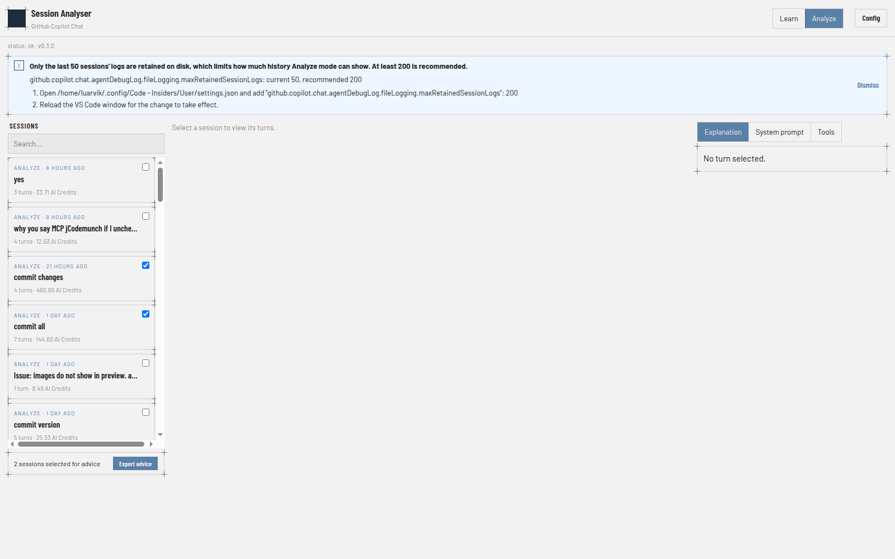

Click **Export advice** to open a dialog with a ready-to-paste prompt:
aggregated session/turn metadata — token usage, cache efficiency, tool
usage, prompt composition, AI Credits — formatted as JSON for an LLM chat
to give advice on your agentic-coding workflow. **Chat message text is
never included.** Click **Preview** to see the exact bundle before
copying it, optionally include tool-call arguments (which may contain
text snippets) via the checkbox, then **Copy advice prompt**:

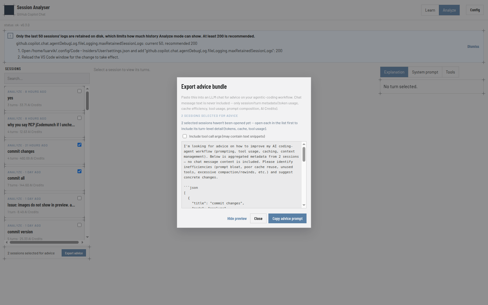

If a selected session hasn't been opened yet in the list, the dialog
flags it — its turn-level detail (tokens, cache, tool usage) won't be in
the bundle until you open it first.

## Learn mode

Learn mode ships with 18 bundled example scenarios (the VS Code extension
lists the 17 that apply to Copilot), each illustrating one
concept from [agentic-coding-explained.md](agentic-coding-explained.md) —
prompt caching basics and TTL expiry, context compaction, an MCP tool
change, a model switch, `/clear`, `/rewind`, session forking, an
instructions-file edit, extended thinking/reasoning budget, a subagent
running on a cheaper model, and more. No setup is required — the scenarios
don't depend on anything on your machine. Their numbers are **simulated**:
each scenario is replayed on a vendor and model you choose, using that
vendor's documented caching rules and real prices, and the result is labelled
**Simulated** wherever it appears. It's a teaching model, not a prediction of
your bill.

### Choosing a vendor and model

The **Simulate on** picker above the turns table lists models grouped by
vendor (Anthropic, OpenAI, Google, xAI). Models from vendors whose caching
isn't documented (Moonshot AI, Microsoft) are listed but disabled, with the
reason shown. By default it picks the model your recent Analyze sessions used
most, falling back to Claude Sonnet 5.5; your own pick is remembered. Changing
the model re-simulates the open scenario. In scenarios with a second, cheaper
model, that model is the vendor's curated cheaper sibling.

The **ⓘ assumptions** button next to the picker lists what the simulation
assumes because no vendor documents it, for example where Copilot places
cache breakpoints, each marked *documented*, *inferred* or *unknown*. The
**Sources** footer under the table links the documents the numbers come from
and shows the date they were checked; it turns into a warning when that data
is more than 90 days old.

### Picking a scenario and reading the turns table

Click a card in the left column to load it. Each row in the turns table is
one turn, with the token/AI Credit breakdown for that turn:


The columns are **Turn, Trigger, Rounds, Uncached in, Cache read, Cache
write, Tool, Vision, Reasoning, Output, AI Credits, Cumulative, Model**.
Rounds is how many LLM request/response round-trips made up that turn (a
tool call followed by a follow-up response counts as two) — always `1` for
mitmproxy sessions, since one HAR entry is one complete exchange. Cumulative
is a running AI Credits total across the session, up to and including that
row. An em dash (**—**) in any numeric cell means that figure is genuinely
unknown for that turn — the app never shows a fabricated `0` in its place,
and once one turn's own cost is unknown the cumulative total for that row
and every later row is also an em dash rather than a total that silently
skips it. The small line chart next
to the session title (when visible) is an AI-Credits-per-turn sparkline; it
only appears when every turn in the session has a known AI Credits value.

The **Trigger** column flags turns where something out of the ordinary
happened mid-session — a `compaction` event (shown above), a `tool
change`, a `model switch`, `/clear`, `/rewind`, cache expiry, or a
session fork. Most turns have no trigger and show a muted em dash instead.

In a simulated scenario a **Cache** column follows Trigger: ● hit, ◐ partial
(part of the prefix was still cached), ○ miss, ? unknown. A ? means a rule
this turn depends on is unknown for the chosen vendor; its cache figures and
AI Credits then show an em dash, never a made-up zero. Hover an AI Credits
figure for its USD equivalent (1 AI Credit = $0.01).

The **Columns** button above the table (next to "Showing n of 14 columns")
opens the column chooser: untick any column to hide it, except **Turn**,
which names the row and always stays. Your choice is remembered. It is
not offered in the narrow layout; see
[Narrow and medium windows](#narrow-and-medium-windows).

### Stepping through turns

Click any row, or drag the **Timeline** scrubber at the bottom of the
table, to select a turn. Both stay in sync — dragging the scrubber
highlights the matching row, and clicking a row moves the scrubber:


The right-column **Explanation** panel always shows a plain-language
explanation for the currently selected turn — what happened, and why,
based on that turn's cache/token numbers. In a simulated scenario it adds a
generated line for the chosen model ("the image invalidated the conversation
cache; tools and system prompt were still read from cache") and, for turns
with a cache event, a **How vendors differ** card with one row per vendor
(its default model): the outcome, the turn's AI Credits and a source link.

The **Vendors** tab compares models across the whole scenario: total AI
Credits (with USD), cache-hit ratio, misses and the most expensive turn, with
a per-turn strip of hit/partial/miss marks. It starts with each simulated
vendor's default model, and you can add more models. The table can be sorted.

### Searching the scenario list

The left column has a search box that filters by title as you type:


If nothing matches, the list shows a plain "No matches." message instead
of an empty box.

## Analyze mode

Switch to Analyze mode via the header's mode switch. This lists real
sessions read from a **log provider** — nothing is sent anywhere, the app
only reads local files.

### Choosing a log provider

Analyze mode reads from one of four local sources, picked via the **Source**
dropdown that appears in the header once you're in Analyze mode. The same
header area also holds the **Retention** field described below:

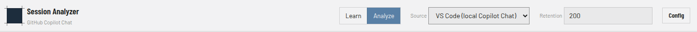

- **VS Code (local Copilot Chat)** — the default. Reads directly from your
  local VS Code Copilot Chat session store (SQLite + debug logs), as
  described below. From VS Code 1.143, new chats run through the default
  Copilot harness and its Agent Host; those sessions are listed with their
  tokens and AI Credits. Their prompt and response text, turn inspector, tool
  calls and system prompt come from the Copilot CLI's event log, read locally.
  Cache-write and reasoning tokens come from the same log's per-call usage
  records (Copilot CLI 1.0.95 and later). They're used only when the records
  add up to the turn's token totals; otherwise both show as unknown, with the
  reason. Tool and vision tokens stay unknown. The Tools tab stays
  unavailable, since the log records no tool definitions. Agent Host
  sessions need none of the settings below.
- **mitmproxy (HAR capture)** — reads a local mitmproxy HAR capture instead,
  for Anthropic/OpenAI API traffic recorded outside VS Code. See
  [mitmproxy-setup.md](mitmproxy-setup.md) for how to record a capture. A
  single capture is automatically split into separate sessions wherever
  there's a 30+ minute idle gap between requests, so unrelated runs left
  recording in the background don't get mixed into one session.
- **Claude Code** — reads the Claude Code CLI's own session files directly
  from `~/.claude/projects/`, one session per file, no capture step needed.
- **pi coding agent** — reads session logs written by the [pi coding
  agent](https://pi.dev) directly from `~/.pi/agent/sessions/`, no capture
  step needed. Because a pi session can branch (fork/rewind to try a
  different approach mid-session), a session file with unmerged branches
  shows up as multiple sessions, titled `<name> (branch i of N)` — one per
  branch tip. Token totals include everything pi records — assistant
  replies, nested tool usage, cache warming and compaction/branch summaries
  — and reasoning tokens when the model's provider reports them. The
  system prompt and tool list come from the session file itself (or, for
  older sessions, from the optional `pi-system-prompt-logger` extension).
  Tool-call and vision token breakdowns, plus AI Credits (a GitHub
  Copilot-specific billing unit pi has no equivalent of), aren't available
  for pi sessions.

Switching the source clears the currently-selected session and reloads the
session list from the newly active provider. A provider shows
**(unavailable)** in the dropdown, and can't be selected, if its underlying
data isn't currently reachable (e.g. no capture file found yet).

### Enabling full per-turn numbers

By default, VS Code's Copilot Chat debug log doesn't record token/cache
usage, so Analyze mode's numbers for Local harness chats are limited until
you turn on a setting. The app checks this automatically and shows a
banner explaining exactly what's missing and how to fix it. Once VS Code
has an Agent Host store (`agent-host.db`), these warnings are optional and
say they only affect Local harness chats:


Click **Dismiss** to hide it for the session; the header's **Config**
button reopens it later. See the
[README's "Enabling GitHub Copilot Chat debug logging"](../README.md#enabling-github-copilot-chat-debug-logging)
section for the exact settings.json steps. Once every check passes, the
Config button becomes a static confirmation instead of something to click:


Sessions recorded *before* you enable logging still show up in Analyze
mode — they just show em dashes for the numeric columns, the same as any
other genuinely-unknown value.

The retention check requires VS Code to keep at least a minimum number of
session logs on disk; the header's **Retention** field (VS Code source
only) shows and lets you change that minimum — it defaults to 200, but you
can raise or lower it to match how far back you actually want Analyze mode
to be able to look. Changes save automatically when you click away from
the field.

For Local harness chats, cache-write and reasoning tokens need a *separate*,
optional setting on top of the one above — see the README's
["Enabling richer cache-write/reasoning numbers"](../README.md#enabling-richer-cache-writereasoning-numbers-optional)
section for the steps. Skipping it doesn't limit anything else — every
other Analyze mode figure works the same either way — it just leaves
those two columns showing em dashes.

### The turns table in Analyze mode

Real sessions render with the identical 13-column table Learn mode
uses — this is a real (numbers-only) example, with em dashes for the
usage figures this particular log didn't capture:


### The three-tab right panel

Analyze mode's right column adds two tabs beyond Explanation, since real
sessions carry more detail than Learn's curated examples:

**Explanation** — same plain-language summary as Learn mode, plus a "Tool
calls this turn" section listing which tools the assistant invoked during
that specific turn:


When the turn's raw request/response data was captured, an **Inspect
request/response** button also appears on the Explanation tab — see
[The turn inspector](#the-turn-inspector) below.

**System prompt** — a breakdown of what made up the system prompt for
this session (base instructions, `CLAUDE.md`/repo instructions, loaded
skills, tool definitions, …), each as a labeled bar sized to its share of
the total. When the base system prompt was captured, an **Open system
prompt inspector** button appears above the breakdown:

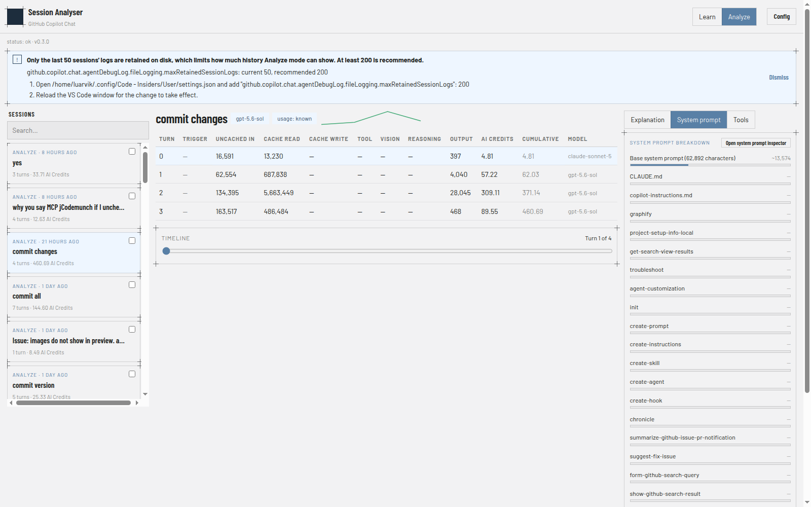

**Tools** — every tool that was loaded for the session, cross-referenced
against whether it was actually invoked and how many turns used it:


If a session has no captured system-prompt or tool-inventory data (for
example, it predates enabling debug logging), each tab shows a short
explanation instead of an empty table.

### The system prompt inspector

Click **Open system prompt inspector** on the System prompt tab to
replace the session view with a full-detail breakdown of the captured
system prompt, in three panels:

- **Structure** (left) — a nav tree of every tagged section, color-coded
  to match its highlight in the raw text.
- **Raw text** (center) — the full captured prompt, toggled between
  **Pretty** (reformatted/indented) and **Raw** (exactly as captured);
  clicking a Structure entry scrolls to and highlights that section.
- **Component description** (right) — a plain-language explanation of
  the selected section's purpose, tagged **Sourced** when it's backed by
  a citation into the Copilot Chat extension's own source, or **Not
  independently sourced** when the description is inferred from the
  captured text alone.

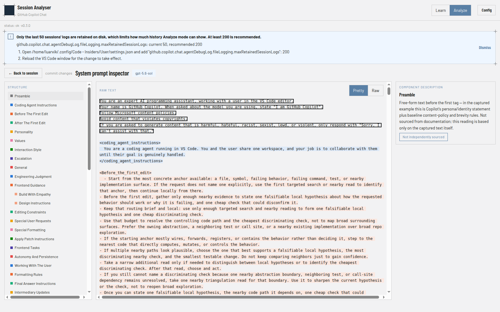

Click **← Back to session** to return to the turns table.

### The turn inspector

Click **Inspect request/response** on the Explanation tab for a turn to see
that turn's actual LLM request/response round-trip(s) — scoped to only the
content that turn added, not the full conversation history each round
technically resent. A row of **Round** tabs across the top lets you step
through each round trip within the turn (the same number shown in the
turns table's Rounds column); each shows one Request/Response card pair,
tool-call name/arguments/result on the request side and reasoning shown
inline where captured on the response side. Oversized text and file/image
content is collapsed into small placeholder chips instead of being dumped
inline, to keep the view readable:

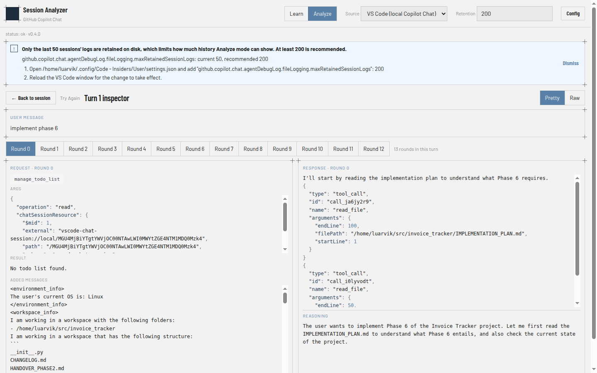

If a turn has no captured round-trip data (for example, it predates
enabling debug logging, or its data has since aged out), the inspector
shows an explanatory empty state instead of a blank panel.

### Replaying a session on another model

What would this session have cost on another model? A replay keeps the
session's turns, requests and token counts, and runs them through the
other model's vendor caching rules and prices. Only caching and prices
change. Every replayed figure is labelled **Simulated**, and the measured
figures stay as they are, beside it.

**Choose a model.** With a session open, the **Replay on** select sits in
the session's header row. It starts at **Off (measured only)**. Models are
grouped by vendor, and the session's own model is marked
**(this session)**. A model whose vendor doesn't document its caching is
listed but disabled, with the reason. While the replay runs, "Replaying on
*model*…" shows with **Cancel**, which turns the replay off again. Opening
another session starts it at Off.

**The Simulated columns.** The turns table gains a dashed
**Simulated · *model*** group after the measured columns:

| Column | What it shows |
|---|---|
| Cache | The simulated cache outcome of the turn, as a word and an icon |
| Cache read | The simulated cache-read tokens |
| Cost | The simulated cost: AI Credits for a Copilot session (hover for USD), USD otherwise. "unknown" when it has no price |

A turn that can't be replayed reads **not replayed** across the group, with
the reason (for example, the log has no usage for it). It never reads 0.
The **Columns** chooser lists the group as Simulated cache, Simulated
cache read and Simulated cost; the cost can't be hidden while a replay is
shown. On the **Explanation** tab, the selected turn gets a dashed
**Simulated** box with its outcome and its cache read, cache write and
cost, measured beside simulated.

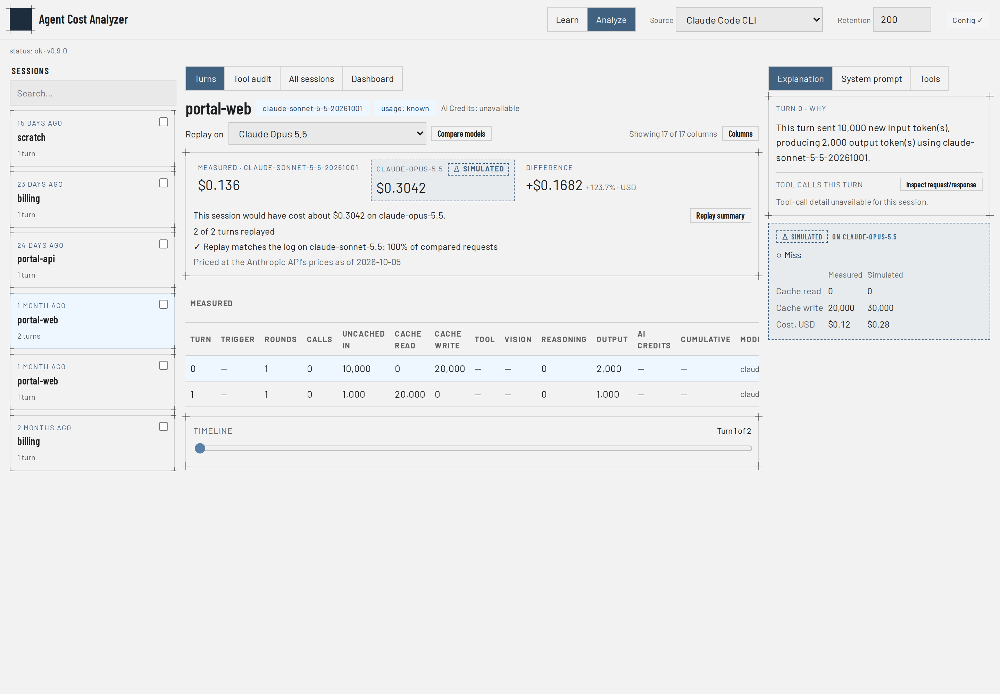

**The summary strip.** Above the table, a strip shows:

- the **Measured** total and the **Simulated** total, and the
  **Difference** (simulated minus measured, with its percentage);
- a sentence: "This session would have cost about … on *model*.";
- the coverage, for example "38 of 40 turns replayed; 2 not replayed: …";
- the self-check, for example "Replay matches the log on
  claude-opus-5-5: 98% of compared requests";
- which prices were used, and their date.

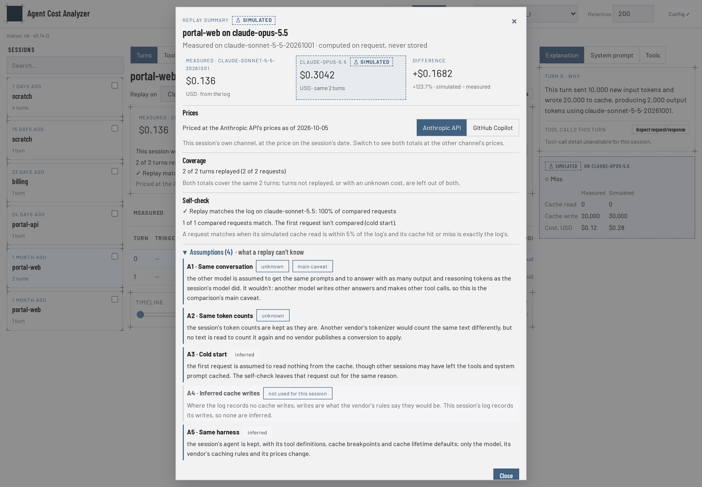

**Replay summary** opens the full summary as a dialog:

- **Totals.** Both totals cover the same turns: those replayed with a known
  measured and simulated cost. Turns not replayed, or with an unknown cost,
  are left out of both, so the difference compares like with like.
- **Prices.** By default a replay is priced on the session's own channel,
  at the price on the session's date: a Copilot session at GitHub
  Copilot's prices, in AI Credits; a Claude Code session at the replay
  vendor's API prices, in USD. The **Price channel** switch (for
  example *Anthropic API* or *GitHub Copilot*) prices both totals at the other channel
  instead. The only conversion is 1 AI Credit = $0.01.
- **Coverage.** How many turns and requests were replayed, and each reason
  a turn wasn't, with its turn numbers. Only the session's main chain is
  replayed: sub-agent requests are left out.
- **Self-check.** The same replay on the session's own model, compared
  request by request with the log. A request matches when its cache hit or
  miss is exactly the log's and its cache read is within 5%. The first
  request isn't compared (a cold start). The figures for other models rest
  on this check: if it fails, the dialog says to read them with care. A
  session that used more models than a replay can hold (three or more, or two from different vendors),
  or whose model has no vendor profile, has no self-check, and the dialog
  says why.
- **Assumptions** (what a replay can't know). Open the first time you open
  the dialog, each with its confidence (documented, inferred or unknown):
  - **A1, same conversation** (the main caveat): the other model gets the
    same prompts and answers with as many output and reasoning tokens. It
    wouldn't: another model writes other answers and makes other tool
    calls.
  - **A2, same token counts**: another vendor's tokenizer would count the
    same text differently. No text is read to count it again.
  - **A3, cold start**: the first request reads nothing from the cache,
    though other sessions may have left it warm.
  - **A4, inferred cache writes**: where the log records no cache writes
    (Copilot's local harness without `agent-traces.db`), they are what the
    vendor's rules say. Greyed out as "not used for this session" when the
    log records every write.
  - **A5, same harness**: the session's tools, cache breakpoints and cache
    lifetimes are kept; only the model, its caching rules and prices
    change.

That is why the app says a session "would have cost about" a figure, not
"would have cost" it.

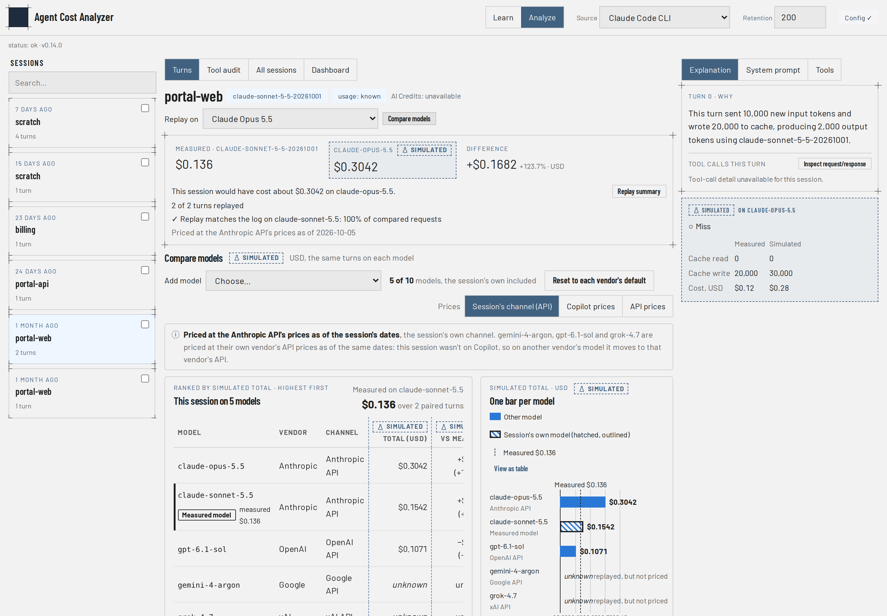

**Compare models.** The **Compare models** button, beside Replay on,
swaps the turns table for the session's simulated total on several models:

- It starts with the session's own model, the Replay on model and each
  vendor's default model. **Add model** adds one, up to 10 models with the
  session's own included ("4 of 10 models"). **Reset to each vendor's
  default** starts over, and ✕ on a row removes that model.
- The table is ranked by simulated total, highest first: model, vendor,
  channel, the simulated total, the difference from the measured total and
  the turns replayed. The session's own model is tagged **Measured model**,
  with its measured total.
- The bar chart beside it (below it in a narrow window) uses one hue for
  every model. The session's own model is hatched and outlined, and a
  dashed line marks the measured total. **View as table** gives the same
  numbers.
- A model with no total reads **unknown**, with the reason ("not
  replayed", or "replayed, but not priced"), never 0.
- **Prices** chooses *Session's channel*, *Copilot prices* or *API
  prices*. On the session's channel, a session that wasn't on Copilot
  moves to each model's own vendor's API prices. The choice is shared with
  the summary strip and dialog.

Press **Compare models** again to return to the turns table.

**Which sessions can be replayed.** Claude Code sessions and Copilot Chat
sessions (local and Agent Host) can. pi and mitmproxy sessions can't yet:
**Replay on** shows *Not available* with "This provider's logs can't be
replayed yet." Otherwise you may see:

- **This session can't be replayed**, with the reason, for example a
  session with no request data, or one with more than 20,000 requests
  ("at most 20,000 can be replayed"). Its measured figures are unchanged.
- **Unpriced**, when the channel has no price for the model on the
  session's date, or no price channel is known. The tokens are still
  simulated; a button offers the other channel's prices instead.
- **Couldn't replay on *model***, when the request fails, with **Try
  again** and **Copy details**.

A replay is computed when you ask for it and never stored. The same
replays are available to an agent through the MCP tools
[`replay_session` and `compare_models_for_session`](#querying-the-audit-from-claude-code-mcp).

### Searching sessions and empty states

The left column's search box works the same way in Analyze mode — filter
by title as you type. If the app can't find *any* bundled Learn scenarios
or *any* Copilot Chat sessions at all, the whole three-column layout is
replaced with a single centered message explaining what's missing:


For Analyze mode, this normally means you haven't run a Copilot Chat
session yet, or the app can't find your VS Code session store — reload
the page after starting a chat session in VS Code.

### Auditing tool calls

Analyze mode's center column has a **Turns / Tool audit / All sessions /
Dashboard** switch (Dashboard is described in "The insights dashboard"
below). It shows what the agent actually ran and why calls failed: a
missing utility, a wrong working directory, bad arguments, a missing
dependency, git state, a blocked permission, and so on. Every
classification shows the rule that matched and a short, redacted excerpt
of the real error as evidence.

**Tool audit** audits the selected session:

- **Stat tiles.** Tool calls, failure rate (computed only over calls whose
  outcome is known), shell commands, retried commands, recovery rounds, and
  output tokens spent in turns that had a failure.
- **Outcomes per turn.** Stacked columns per turn. Hover or focus a column
  for its counts, and click a column to select that turn. **View as
  table** shows the same numbers as a table.
- **Why calls failed** and **Shell programs.** Ranked bars. Click a bar to
  filter the call table below; click it again to clear the filter.
- **Tool calls table.** Filter chips by outcome, plus the command, outcome,
  exit code, and evidence for each call. **Inspect** opens the turn
  inspector.
- **Retried commands.** The same command re-run after it failed.

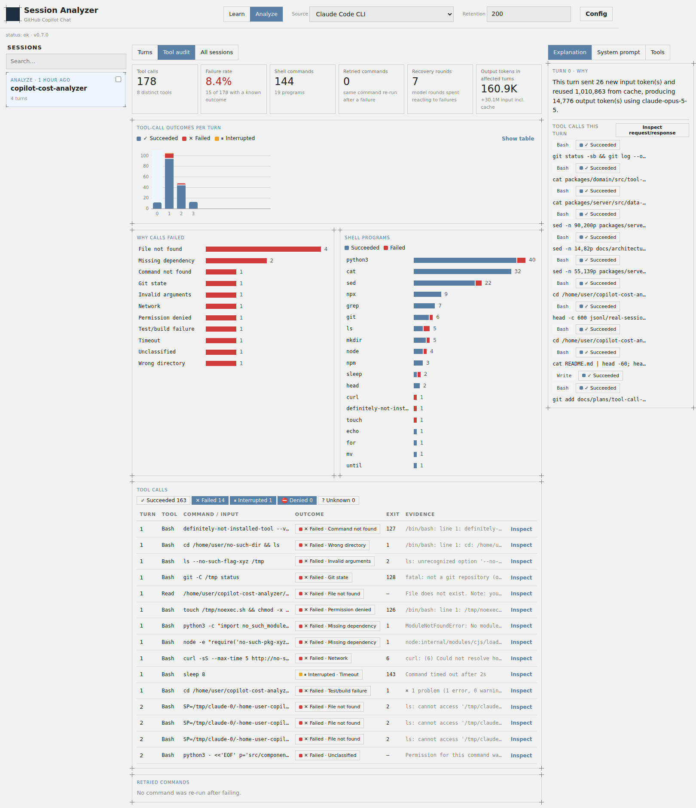

**All sessions** rolls the audit up over the last 7, 30, or 90 days (or
all time). It shows failures per day, top failing commands with how many
sessions they failed in, and a sessions table. Click a session to open its
own audit.

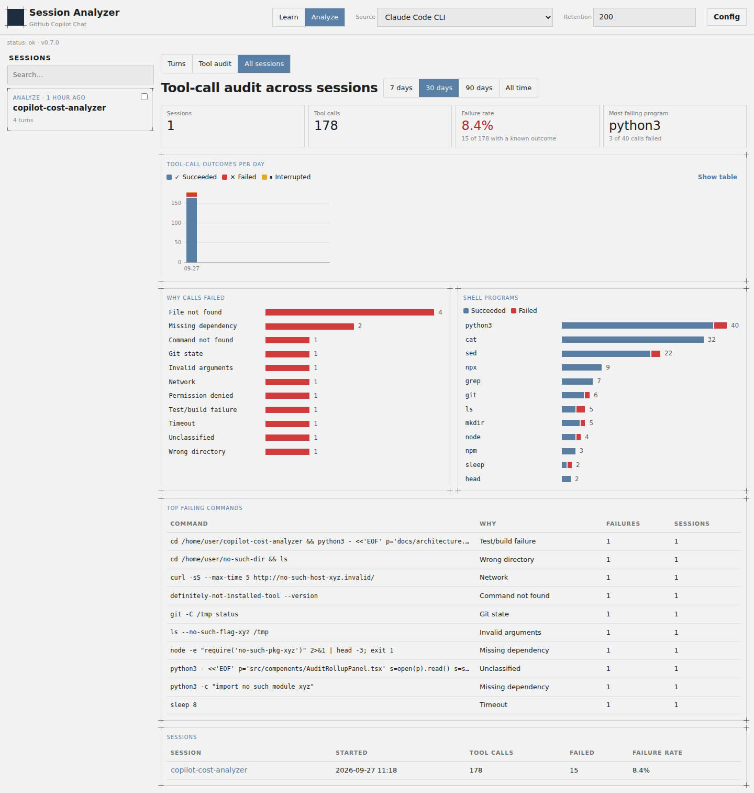

Outcome data depends on the log provider. Claude Code CLI sessions record
it in full. pi records it when its `isError` flag is present. VS Code's
debug log doesn't record whether a call succeeded, so those calls show as
**Unknown**, with the reason spelled out, rather than counting as zero
failures.

### Querying the audit from Claude Code (MCP)

The analyzer is also available as a local, read-only MCP server, so you
can ask an agent about your own sessions: "what drove my spend this
week?", "which commands failed most, and why?", "did my agents do
anything risky?". Run `npm install` in this repo, then register the
server:

```bash
claude mcp add agent-cost-analyzer -- /absolute/path/to/agent-cost-analyzer/scripts/mcp-server.sh
```

Run `npm run build` once as well: the script then serves the interactive cost
views (`packages/mcp-apps/dist/views.html`) to hosts that can show them.
Without the build the server works as before, with text results only.

| Tool | What it returns |
|---|---|
| `list_log_providers` | Available log sources and which one is active |
| `list_sessions` | Sessions, most recent first. Search titles and ids with `query`, filter by date, repository or project; `total` says how many matched |
| `get_turn` | One turn: prompt and response (secrets redacted, truncated), usage, triggered event and tool calls |
| `get_session_cost` | One session's tokens and AI Credits with coverage, cache hit ratio, spend per model, the most expensive turns, cost events and context overhead |
| `get_cost_rollup` | Spend across **every** provider by provider, model and day, plus the most expensive sessions |
| `get_session_audit` | One session's tool-call audit. Set `includeCalls` to also get every classified call |
| `list_tool_calls` | One session's calls, filtered by status, failure category, tool kind, tool, program or turn, paged with `offset`/`limit` |
| `get_audit_rollup` | Cross-session tool-call totals, top failing commands and per-day counts for one provider |
| `list_findings` | Security, anomaly and behaviour-change findings across every provider, most severe first, with what, when, why and redacted evidence |
| `list_repositories` | The repositories your sessions ran in, with sessions, turns, AI Credits and project ids; sessions with no repository are grouped by reason. Local repositories are named by folder, never by path |
| `list_projects` | Your projects from `projects.json` with their repositories and AI Credits; client names and billing codes only if you start the server with `--project-billing-details` (for example `claude mcp add agent-cost-analyzer -- /abs/path/scripts/mcp-server.sh --project-billing-details`) |
| `get_price_book` | The dated price versions the app prices turns with, per channel and model |
| `get_price_changes` | When a model's price changed: documented changes from the price book, and observed GitHub Copilot ones |
| `get_repository_cost` | One repository's cost over time, by vendor and model, with price-change markers |
| `get_project_cost` | One project's cost over time, by repository, vendor, model and token type, with its most expensive sessions |
| `compare_costs` | Two to 20 repositories or projects side by side: total, change, per session, per active day, share and coverage |
| `explain_cost_change` | Why a repository's or project's cost changed between two periods: usage, price and mix effects that add up exactly |
| `get_statement` | A project's billing statement for a period: the issued one with any differences, else the draft. It never issues one |
| `estimate_cost` | The cost of planned work as a p50–p90 range at today's prices, never one number. With `model`, the same estimate from the project's sessions (up to 200) replayed on that model: **Simulated**, priced on each session's own channel as of its dates, with coverage, self-check counts and assumptions |
| `replay_session` | One session replayed on another model: per turn and in total what it would have cost beside what it did, with coverage, the self-check on its own model and the assumptions. `pricing` is `session-channel` (the default), `copilot` or `api`. **Simulated** |
| `compare_models_for_session` | One session's simulated total on up to 10 models, its own included, with how many turns each replayed. Takes the same `pricing`. **Simulated** |

Six prompts start common reviews: `audit_session` (why a session's tool
calls failed), `review_costs` (what drives your spend and how to cut it),
`security_review` (risky agent actions and the guardrails that would
prevent them), `explain_cost_change` (whether usage, price or mix drove a
change), `prepare_statement` (a statement's summary and a note to the
client) and `estimate_work` (a range for planned work and its main
uncertainty).

The replay tools give the same figures as
[Replaying a session on another model](#replaying-a-session-on-another-model)
in the app. Like the app, they can't replay pi or mitmproxy sessions yet,
and they refuse a model no vendor profile lists, with the reason.

Every cost figure says its basis: **billed** (what the vendor billed,
GitHub Copilot's AI Credits), **reported** (a cost the log itself records)
or **priced** (tokens times the price book's price for that model and
date). Figures are priced **as of use** unless a tool is asked for
**today's prices**, and the only conversion is 1 AI Credit = $0.01. The
server's instructions tell the agent this when it connects.

Per-session tools take an optional `provider` (for example
`"claude-code"`) and otherwise use the source selected in the web app.
`get_cost_rollup` and `list_findings` read every available provider
unless you pass one. Repositories are reported by folder name only
unless you set `includePaths`. A `null` figure means the log doesn't record it; it
is never treated as zero. The server reads local logs only and writes
nothing. Everything a tool returns goes into the agent's context, so free
text is redacted and truncated first.

### The insights dashboard

**Dashboard**, the fourth view on Analyze mode's center switch, works like
QlikView. It loads the most recent sessions (up to 200 per provider) from
**every** log provider at once, not just the selected source. It stays
reachable even when the selected source has no sessions: the empty state
offers **Open the dashboard across all providers**. Pick 7, 30 or 90 days,
or all time.

**List boxes** (left) hold every field: project, repository, vendor,
channel, provider, date, hour (UTC), session, model, trigger event, usage data, tool, tool kind, program,
outcome, failure category, signal type, severity and signal category.
Click a value to select only it; Ctrl/⌘-click to add or remove values.
Every other list box then colours its values:

| Colour | Meaning |
|---|---|
| Green | Selected |
| White | Associated with the current selections |
| Light grey | Alternative: another value in a field you've already filtered |
| Dark grey | Excluded by the current selections |

The grey values answer "which providers had **no** failures?" or "which
models never triggered a signal?" at a glance. Charts are selection
surfaces too: click a day, a model, a tool, a failure category or a
program bar to select it. **Current selections** lists every filter.
Clear one with its ✕, undo the last change with **Back**, or press
**Clear all**.

What the view shows for the current selection:

- **What happened**: a plain-language summary covering which sessions
  and when, AI Credits and cache share, tool-call failures and their main
  cause, the most severe signal, anomalies and behaviour changes.
- **KPI tiles**: AI Credits, sessions, turns, cache hit ratio, output
  tokens, tool calls, failure rate and security signals. Figures that a
  log source didn't record are never counted as 0. Each tile says how many
  turns or calls were known.
- **AI Credits by day**, **Tokens by model**, **Tool calls by tool**, **Why
  calls failed** and **Shell programs**.
- **Signals to review**: for each signal, what happened, when, why it was
  flagged (with a redacted excerpt of the command or path as evidence) and
  where. Click "where" to select that session. There are three kinds:
  - *Security signals* flag commands worth a second look: a download
    piped into a shell, decoded or `eval`'d code, `rm -rf` (on `/` or `~`
    as high), force push, `git reset --hard`, `sudo`, permissive `chmod`,
    access to SSH keys, cloud credentials or `.env` files, changes to shell
    profiles, crontab or services, writes under `/etc` or `/usr`, uploads
    with `curl -d`/`-T`, raw sockets (`nc`, `socat`), `ssh`/`scp`,
    installing a named package, and any action you or a policy denied.
  - *Anomalies* flag sessions far above the norm for AI Credits, output
    tokens, tool calls or failure rate (robust z-score over at least 8
    sessions). The reason states the value, the median and the sample size.
  - *Behaviour changes* flag the first use of a program, tool or model
    after the earliest sessions.

  Signals are prompts to look, not verdicts. Mentioning a dangerous
  command inside a heredoc that isn't run by a shell (for example a test
  fixture or a doc being written) isn't flagged.
- **Most expensive sessions**: click one to select it.

#### Cost by repository and project

Each session is attributed to the **repository** it ran in (read from the
folder's git files; no `git` process, no network), the **vendor** and the
**channel** it was billed through. Clones, worktrees and subfolders of one
remote share one repository, and credentials in remote URLs are dropped.
Sessions whose repository can't be found sit under **Unattributed**, with
the reason (for example a mitmproxy capture records no folder). Sessions in
a repository that no project claims sit under **No project**.

To group repositories into **projects**, create `projects.json` in the
app's settings folder, beside `settings.json`:

| OS | Settings folder |
|---|---|
| Linux | `$XDG_CONFIG_HOME/agent-cost-analyzer` (default `~/.config/agent-cost-analyzer`) |
| macOS | `~/Library/Application Support/agent-cost-analyzer` |
| Windows | `%APPDATA%\agent-cost-analyzer` |

```json
{
  "version": 1,
  "projects": [
    {
      "id": "acme-portal",
      "name": "ACME customer portal",
      "members": [
        { "repository": "github.com/acme/portal-web" },
        { "repository": "github.com/acme/platform", "path": "services/portal-api" },
        { "repository": "github.com/acme/infra", "branches": ["portal/*"] }
      ]
    }
  ]
}
```

- A turn belongs to at most one project; the most specific member wins
  (path beats whole repository, branch beats no branch), so project totals
  add up.
- `aliases` merge repository keys; `captureRules` map mitmproxy capture
  files to a repository by glob.
- A file that fails validation is ignored and an optional warning appears;
  nothing is rewritten.
- `GET`/`PUT /api/projects` read and write the file; `GET /api/repositories`
  lists the repositories found.

Prices come from a bundled, dated **price book** (GitHub Copilot's table from
2026-10-01 and the Anthropic, OpenAI and Google APIs'). Add your own contract
prices under `channels.priceVersions` in `projects.json`. A price that isn't
in the book is shown as unknown with a reason, never as 0. Learn mode's
simulated prices come from the same book.

#### Cost over time and Compare

Above the dashboard's content, a view switch offers **Overview** (everything
above), **Cost over time** and **Compare**; below 700 px it is a **View**
dropdown. The list boxes and **Current selections** stay in force in all
three views. The two cost views follow the **Project**, **Repository** and a
single **Provider** selection; any other selection (a model, a date, a tool)
is named under the filters as "Not applied here", so a figure never only
looks filtered. The VS Code extension has both views too, over its Copilot
sessions; **Project** and **Billing** (below) are only in this app, because
the extension has no projects.

The filters sit in one row: the date range first (**This month**, **Last
month**, **Last 90 days**, **This year**), then, on Cost over time, the
bucket (**Day**, **Week**, **Month**, in UTC), the unit (**AI Credits** or
**USD**) and the pricing (**As of use** or **Today's prices**). Figures in
the other unit are converted at GitHub's documented 1 AI Credit = $0.01, and
the view says so. Totals use each turn's preferred basis (billed, then
reported, then priced) unless the Overview's **Cost basis** switch picks
one.

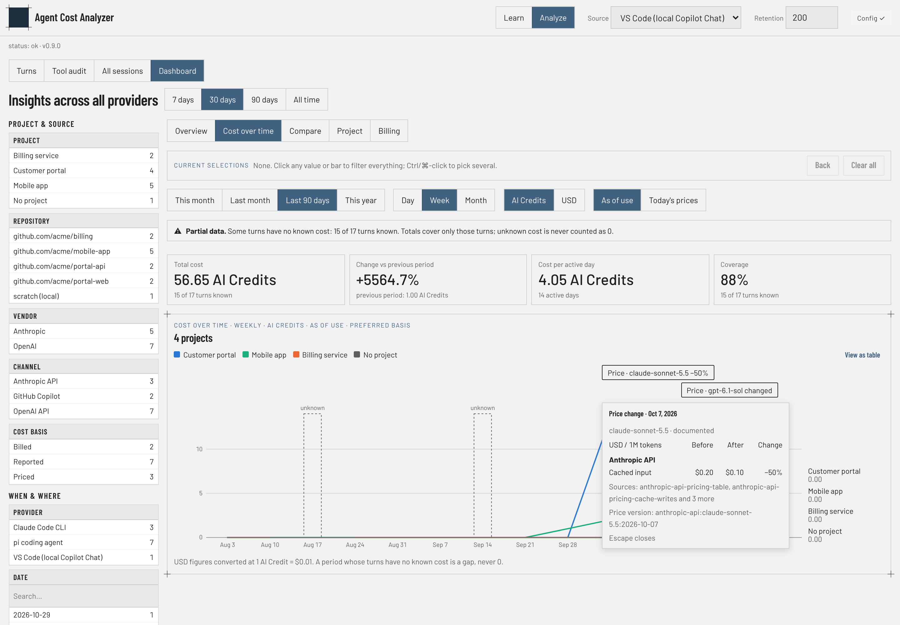

**Cost over time** shows:

- **KPI tiles**: total cost, change against the previous period of the same
  length, cost per active day and coverage. When some turns have no known
  cost, the tiles say how many are known ("6 of 7 turns known") and a
  *Partial data* warning appears; the total is never shown as complete.
- **One project or repository** as columns, with a separate **running
  total** chart below (never a second axis on the same chart). A column
  whose turns are only partly known carries a hatched cap.
- **Two to four** as lines, with a legend and a label at each line's end.
- **Five or more** as small multiples, one per project or repository, with
  **Shared scale** or **Own scale**.
- **Unknown cost is a gap**: a period whose turns have no known cost (for
  example Claude Code turns before the price book's first price) is left
  out of the line and marked with a dashed *unknown* band, never drawn as 0.
- **Price changes**: a documented price change in the range is a hairline
  with a tag such as "Price · claude-sonnet-5.5 −50%". The tag is in the Tab
  order; on focus or hover its tooltip lists each channel's old and new unit
  prices (USD per 1M tokens), the sources and the price version. Esc closes
  it.

A project keeps its colour (its position in `projects.json`) and a
repository its colour whatever you filter. **No project** and
**Unattributed** are grey. Focus a chart and use Left/Right, Home and End to
read each period; the tooltip lists every line with its coverage.

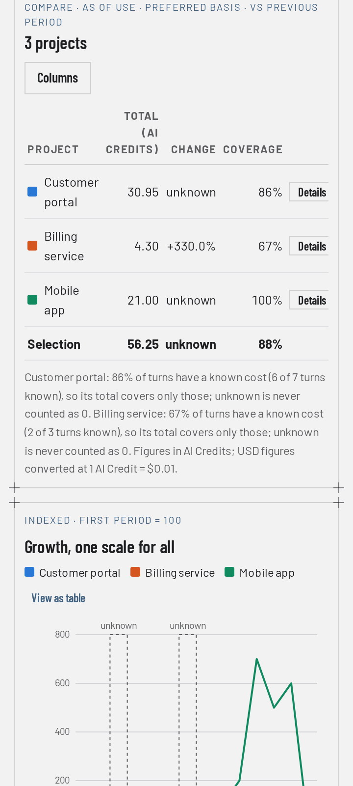

**Compare** puts two or more projects (or repositories, with **Group by**)
side by side: the selected ones, or every one still possible under the
current selections when fewer than two are selected (up to 20). **Compare
with** picks the previous period or the same dates last year.

- A **table** first: total, change, cost per session, per active day, share
  of the selection, cache-hit ratio, output share and coverage, with units
  in the headers and a **Selection** total row. A change against a period
  with nothing known is "unknown", never a change from 0. Below 700 px only
  the name, total, change and coverage stay; **Details** on a row opens the
  rest in a drawer (Esc closes it and returns to the button), and
  **Columns** keeps more.
- **Growth, one scale for all**: each line indexed to its first known
  period (= 100), so a large and a small project compare on one axis.
- **Where the money went**: share of the total as bars.

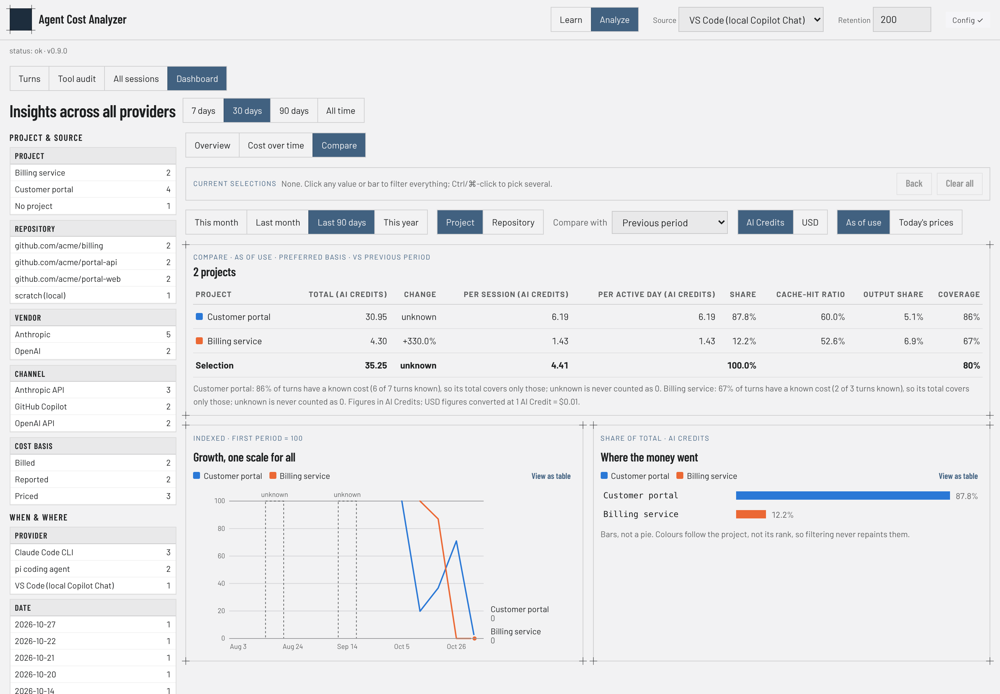

The views read `GET /api/cost/timeseries` and `GET /api/cost/compare`, the
same analyses the MCP tools `get_repository_cost`, `get_project_cost` and
`compare_costs` return. At 360 px the cost views stack under the view
dropdown:

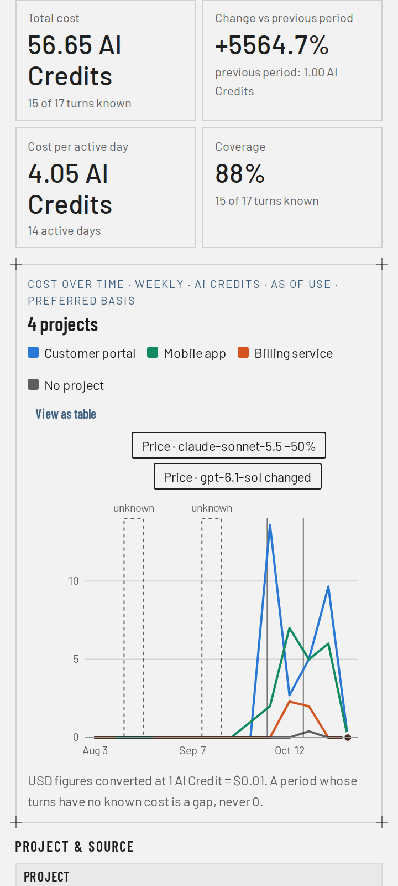

**Project** looks inside the one project selected in the **Project** list
box (select one first; the tab says so otherwise):

- **Cost by vendor** as bars. Click a vendor to see its **models**, and
  beside them the **tokens by type** (uncached input, cache write, cache
  read, reasoning, output) as a separate chart.
- **Why cost changed** between two months (**From** and **To**; by default
  the first and last month of the date range): a waterfall from the first
  month's cost through three effects to the second's. **Usage** is more or
  fewer tokens at the first month's prices, **price** is the second month's
  tokens times the change in unit price, and **mix** is work moved between
  models. They add up exactly to the change. Increases are red and decreases
  blue, and every step also has its written sign. The waterfall uses the
  priced basis as of use, since only prices can be split this way; turns
  without a priced figure are listed as not explained, never counted as 0.
- **Reconciliation** (GitHub Copilot turns): billed minus priced AI Credits
  per model and month. When Copilot billed a model more than 5% above or
  below the price book, the same way, two weeks in a row (20 turns or more
  each week), it is shown here as an **observed price change**: an inferred
  finding, a prompt to check the price book, not a price. The same change
  is a dashed marker on **Cost over time** (documented changes are solid).

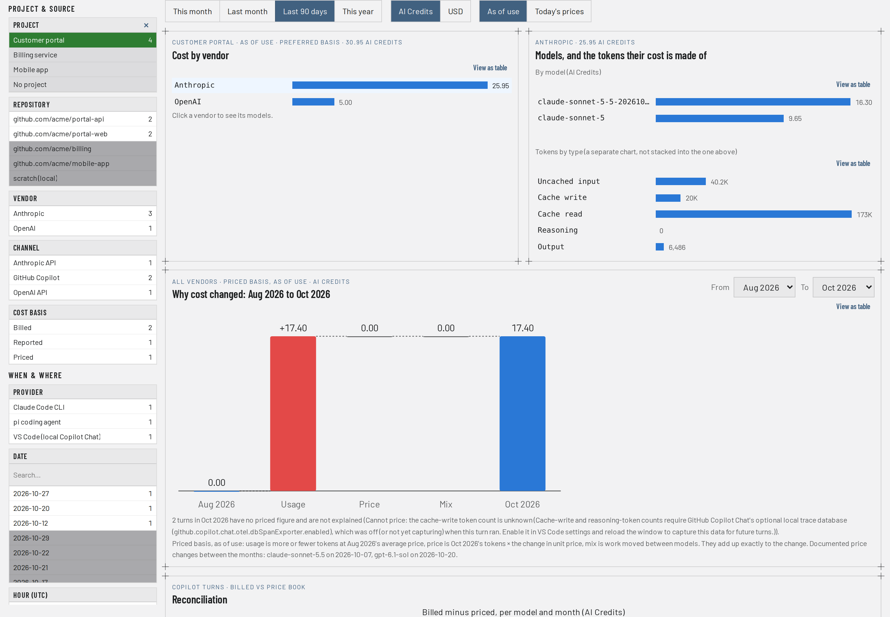

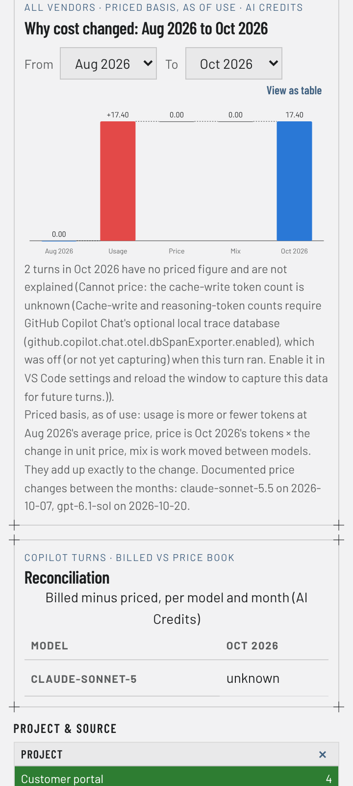

The Project tab reads `GET /api/cost/project` and `GET /api/cost/variance`;
the MCP tools `explain_cost_change` and `get_price_changes` give the same
answers.

**Billing** bills one project for a month. Pick the **Project** and the
**Period** (the last month that has ended is chosen first); months are
calendar months in this computer's time zone, which the statement names.

- The **statement** lists a line per channel, model and price version with
  its turns, tokens and amount. Turns whose cost is unknown are listed with
  the reason and are not counted as zero. Use under a subscription (Claude
  Code priced as API-equivalent) is left off unless the project includes
  it. The totals are per currency, with the project's markup and fixed
  lines, and in the project's own currency if it has one, at its fixed rate.
- **Issue statement** freezes it as a file in the app's settings folder,
  after a confirmation. Only a month that has ended can be issued. An issued
  statement never changes: if later logs or a price change give other
  figures, it shows **Differs from issued**, and **View diff** lists the
  exact differences.
- **Export…** writes the statement as CSV, JSON or Markdown (for an email to
  a client), with a preview, to copy or save. Exports hold session ids and,
  if you leave the box ticked, their titles; never message text.

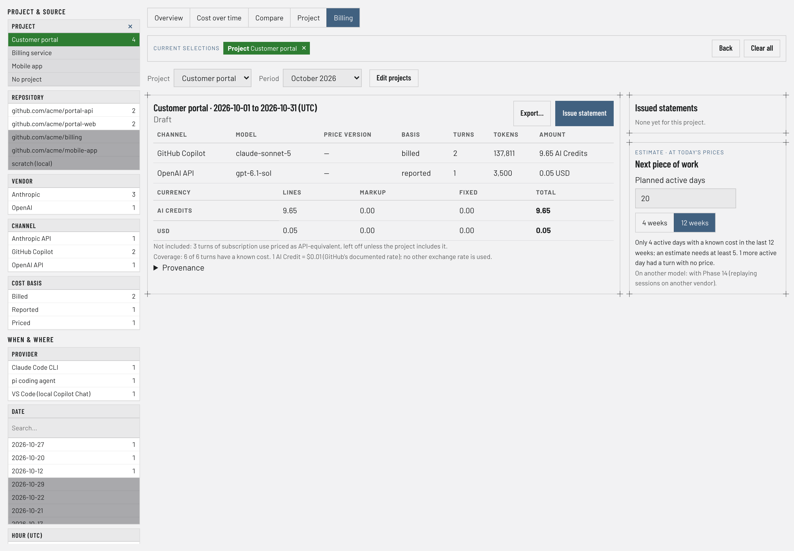

**Edit projects** (or **Create project** when there are none) opens the
**Projects** editor:

- **Repositories without a project** are listed first. Assign each one with
  its **Assign to** select; the keyboard is enough.
- Each project has a name, client, billing code, **markup** (%), **fixed
  lines** on every statement (a seat fee, say), an **own currency** at a
  fixed rate per USD, whether **subscription use** is included, and its
  members: a repository, optionally narrowed to a path inside it and branch
  patterns (`main, release/*`).
- **Capture rules** assign mitmproxy captures, which record no folder, to a
  repository; the editor says how many sessions are Unattributed and why.
- Problems, such as two projects claiming the same repository and branches
  (a turn counts in one project only), show next to the field and in a
  summary at the top, and **Save** stays disabled until they are fixed.

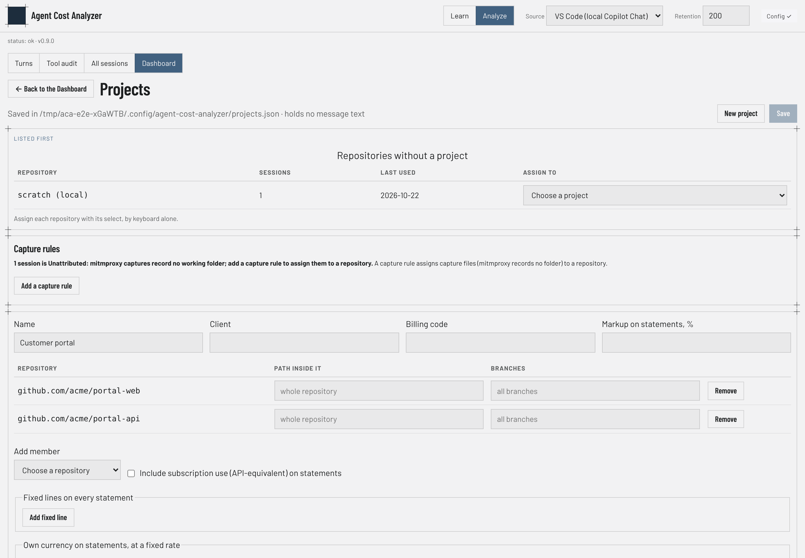

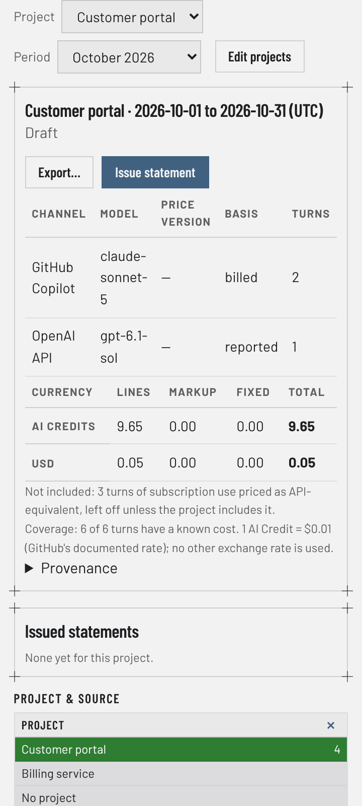

Billing reads `GET /api/statements`; the MCP tool `get_statement` gives the
same answer and never issues one, and the `prepare_statement` prompt drafts
a note to the client from it.

#### Estimate the next piece of work

Beside the statement, **Next piece of work** estimates what planned work on
the project will cost. Enter the **Planned active days** (20 to start) and
pick a **History window** of 4 or 12 weeks. The estimate is a range, never
one number: the median (p50) and 90th-percentile (p90) cost of one active
day in that window, at today's prices, times the planned days. It is shown
in AI Credits with USD beside it, with the days it used.

- An active day is a UTC day with at least one turn on the project. A day
  with any turn that has no price is left out, and the panel says how many.
- With fewer than 5 active days of known cost there is no range: the panel
  says why, and how many days had a turn with no price.
- The panel estimates on the models the sessions used. To estimate on
  another model, ask the MCP tool `estimate_cost` with a `model`: it
  replays the project's sessions on that model
  ([Replaying a session on another model](#replaying-a-session-on-another-model))
  and labels the estimate **Simulated**.

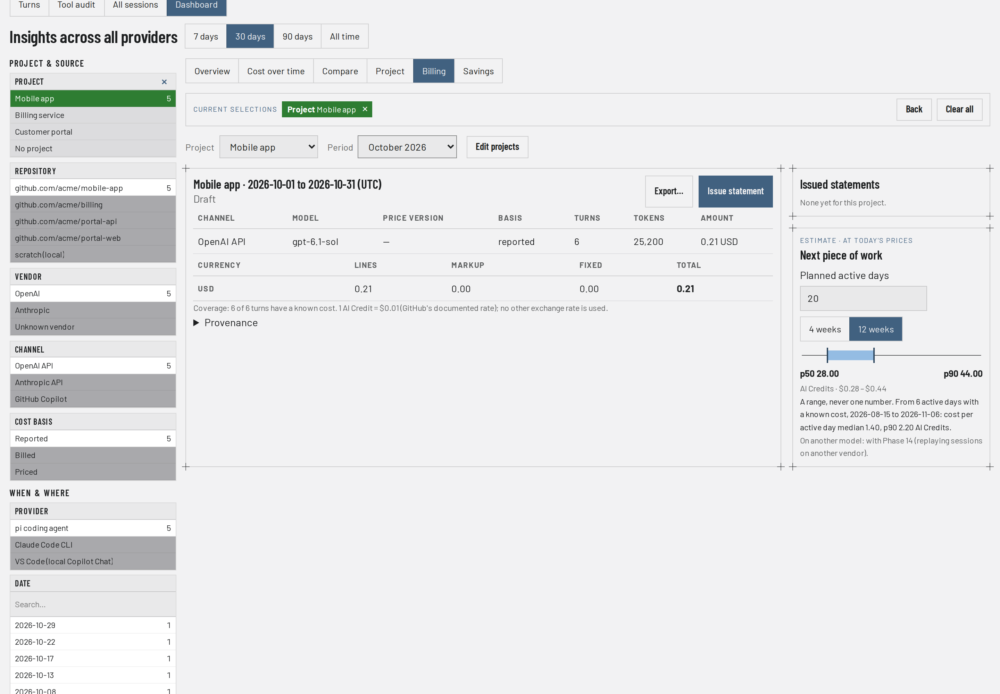

The panel reads `GET /api/estimates`, which also takes `sessions` instead
of `activeDays`. The MCP tool `estimate_cost` gives the same answer, and
the `estimate_work` prompt turns it into a short estimate with its inputs
and main uncertainty.

## Charts as tables

Every chart has a **View as table** button in its toolbar: the AI Credits
sparkline, the prompt composition diagram, the tool-audit and dashboard
columns, the ranked bars, the Compare models bars, and the cost views' charts (where price changes
are rows of their own and an unknown period reads "unknown"). It swaps the chart for a table of the same
numbers, and pressing it again returns to the chart. Use it when a chart is
hard to read (colour, size, a screen reader) or when you want exact values.

## Long loads and cancelling

While the dashboard, the all-sessions audit or a turn's detail loads, a
progress bar and skeleton show with a **Cancel** button. Cancelling replaces
the view with "Loading cancelled" and a **Retry** button. Nothing is changed
either way: these views only read your logs. A load that fails shows the
error with **Try again** and **Copy details**.

## Narrow and medium windows

The layout follows the room the app leaves for the turns: its width minus
the session list column, when that column is shown. Nothing is ever cut
off on the right; a table wider than its column scrolls sideways inside it.

- **Wide** (about 1250 px and up with the session list, 1000 px without) —
  the three columns described above.
- **Medium** (from about 770 px with the session list, 510 px without) —
  the right column becomes a drawer. Select a turn and press **Details** (or
  press Enter on a row) to open it; **Esc** or its close button closes it
  and returns focus. The turns table keeps the **Columns** chooser.
- **Narrow** (below that) — the center switch becomes a **View** dropdown,
  the session's KPIs show as 2x2 tiles, and the turns table keeps only
  Turn, Trigger, AI Credits and Cumulative, plus the simulated Cost while a
  replay is shown. The other columns appear in the **Details** drawer for
  the selected turn, the simulated ones included. The column chooser isn't
  offered.

The system prompt inspector stacks its structure, text and description
columns the same way, and the insights dashboard puts its filter lists in
a slimmer column, then (below 720 px) after the insights.

The layout works down to 360 px wide.

## Keyboard use

- **Session list and turns table** — one Tab stop each. Use Up/Down,
  Home and End to move, and Enter or Space to select. In the medium and
  narrow layouts, Enter on a turn also opens its Details drawer.
- **Timeline scrubber** — a slider: arrow keys step through turns.
- **Column chooser** — Tab to **Columns**, Enter to open, Esc to close and
  return to the button.
- **Replay on** — a standard select; **Compare models** is a toggle
  button.
- **Replay summary** — a dialog: it traps focus, closes with Esc, its
  close button or a click outside, and gives focus back to the
  **Replay summary** button.
- **Dialogs and drawers** — the advice export dialog traps focus and closes
  with Esc; drawers take focus when they open, give it back when they
  close, and never trap Tab.
- **System prompt diagram** (the zoomable composition diagram in the
  [system prompt inspector](#the-system-prompt-inspector)) — one Tab stop.
  Left/Right move along a level, Home/End jump to the first or last cell,
  Down goes to a section's first child, Up goes to its parent, and Enter or
  Space does what a click does: zooms into the section (and selects it), or
  zooms back out from the focused one.
- **Charts** — hover tooltips also appear on focus; Enter selects, as a
  click does.

## Reduced motion

If your system asks for reduced motion (`prefers-reduced-motion`), the app
turns off transitions, the loading bar's animation and smooth scrolling.

## License

[MIT](../LICENSE)
