# User Guide

**Last changed:** 2026-11-19 · **Source:** https://github.com/raulkivi/agent-cost-analyzer

A walkthrough of the Agent Cost Analyzer's two modes — **Learn** (guided,
bundled example sessions) and **Analyze** (your own real sessions from VS
Code Copilot Chat, Claude Code or pi, and, optionally, mitmproxy captures) — with
screenshots of every major feature, and how to
[connect an AI chat](#connecting-an-ai-chat-mcp) to its MCP server. For install steps, see the
[README](../README.md) and [standalone app setup](standalone-app.md); for the app's design/architecture, see
[architecture.md](architecture.md).

**Using VS Code with GitHub Copilot Chat?** The AI Credits Analyzer
extension shows the same views inside VS Code. See the
[VS Code extension guide](vscode-extension-guide.md). This guide covers the
standalone app, which also reads Claude Code and pi sessions.

## Getting started

Run `npx agent-cost-analyzer` (Node.js 22.18 or newer). It starts the app on
http://127.0.0.1:5199 and opens it in your browser; `--no-open` skips the
browser and `--port <n>` picks the port. `npx agent-cost-analyser` (British spelling) also works, as an alias of the same package. To work on the app itself, run it <!-- codespell:ignore analyser -->
from a clone (see
[From source](standalone-app.md#from-source-contributors)). Learn mode works
immediately. Analyze mode lists
whatever real Copilot Chat sessions it finds in your local VS Code session
store — see [Analyze mode](#analyze-mode) below for what to expect there,
including turning on debug logging for full per-turn numbers.


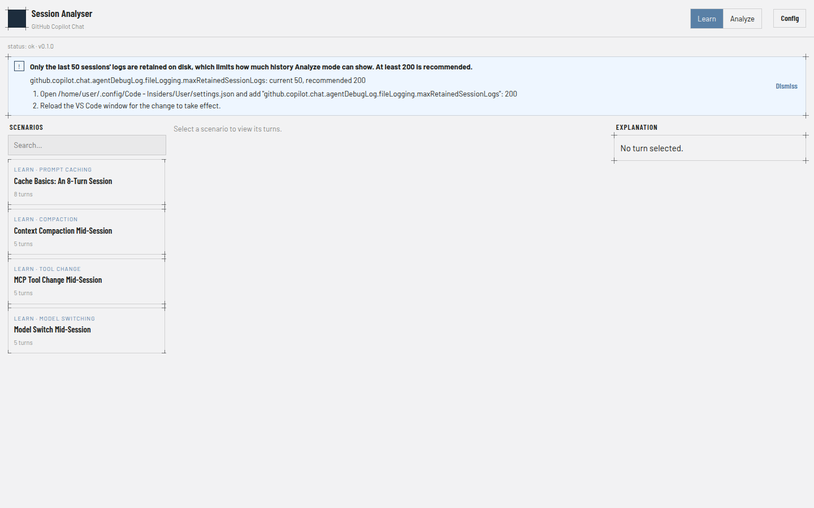

## Connecting an AI chat (MCP)

The app is also a local, read-only MCP server, so you can ask an AI chat
about your own sessions: "what drove my spend this week?", "which commands
failed most, and why?", "did my agents do anything risky?". Connect it
once per client; no clone is needed. What it can answer:
[MCP tools and prompts](#mcp-tools-and-prompts) and
[Interactive views in the chat](#interactive-views-in-the-chat).

### Install with `mcp install`

```bash
npx agent-cost-analyzer mcp install
```

`mcp install` finds the MCP clients on this machine (Claude Code, Claude
Desktop, Cursor, VS Code, VS Code Insiders, Codex CLI and Gemini CLI) and
prints a plan: each
client, its status, every command it will run and every file it will
change. It applies the plan only after you answer `y` to `Apply these
changes? [y/N]`. The server is registered as `agent-cost-analyzer` and
launched with `npx -y --prefer-offline agent-cost-analyzer mcp`.

- `--client <id>` picks the clients: `claude-code`, `claude-desktop`,
  `cursor`, `vscode`, `vscode-insiders`, `codex`, `gemini`, a comma list, or
  `all`. Without it,
  `install` plans for every client it detects. A run without a terminal (a
  script) must name `--client`. A named client that is not installed gets
  the text to register it by hand, and nothing is written for it.
- `--scope user` (the default: every project), `project` (Claude Code,
  Cursor and Gemini CLI, in the current folder) or `local` (Claude Code
  only).
- `--dry-run` prints the plan and stops. `--yes` applies without asking; a
  run without a terminal needs it.
- `--pin` registers the version you are running
  (`agent-cost-analyzer@<version>`) instead of the latest release.
- `--project-billing-details` adds that flag after `mcp`, to share client
  names and billing codes.

How each client is registered:

- Claude Code, Codex CLI and Gemini CLI: through the client's own `mcp add`
  command, run directly, never through a shell.
- Claude Desktop, Cursor, VS Code and VS Code Insiders: the entry is merged into the client's
  JSON file (`claude_desktop_config.json`, `~/.cursor/mcp.json`, the user
  `mcp.json` of VS Code or VS Code Insiders). Other servers and settings stay as they were, in their
  order. The file is first copied to `<file>.agent-cost-analyzer.bak`
  (replacing an earlier backup), and the new file replaces the old one in a
  single rename. A file that is not plain JSON, such as one with comments, is
  left alone: the plan shows the entry to paste yourself and the command
  exits with 1. Restart Claude Desktop afterwards.
- VS Code and VS Code Insiders are each skipped when the AI Credits
  Analyzer extension is installed in them, since the extension registers its
  own server.
- An entry with a different launch (another version, or a command of your
  own) is replaced only after you confirm, or with `--yes`. The plan prints
  your old entry and the new one in full, as one line of JSON each. Claude
  Code and Gemini CLI replace through their own `remove` then `add` and keep
  no backup: if the `add` fails, the command exits with 1, says the server
  is no longer registered in that client, and prints how to restore your
  old entry (for Claude Code, a `claude mcp add-json` command).
- For `--scope project`, a config file or folder in the project that is a
  link (`.mcp.json`, `.cursor`, `.gemini` and the files in them) is refused:
  a cloned repository could point it anywhere. The plan names the link's
  target, changes nothing for that client and exits with 1.

### The Connect an agent dialog

The standalone app's header has a **Connect an agent** button (icon only in a
narrow window). It opens a dialog with one tab per client: the
`npx agent-cost-analyzer mcp install --client <id>` command, the client's own
command or JSON to set it up by hand, and, for Cursor, an install link. Each
has a **Copy** button. The dialog only shows text and changes nothing; the
terminal command is what writes. The VS Code extension has no such button,
since it provides the server itself.

### Check or remove the registration

`npx agent-cost-analyzer mcp status` prints one line per client, such as
`registered (latest)`, `registered (pinned 1.0.0)`, `not registered`, `not
detected` or `provided by the AI Credits Analyzer extension`. It writes
nothing.

`npx agent-cost-analyzer mcp uninstall` takes the same `--client`,
`--scope`, `--dry-run` and `--yes`. It removes only the
`agent-cost-analyzer` entry, again with a backup of each JSON file. Codex
has no remove command, so for Codex it prints the
`[mcp_servers.agent-cost-analyzer]` table to delete from
`~/.codex/config.toml` and changes nothing.

The exit code is 0 on success, 1 when a step failed or a config file could
not be read (the message names the client) and 2 for a usage error.
`install` and `uninstall` are the only commands that write outside the
app's settings folder; the app and the MCP server never change a client's
configuration. Setup is tested on Linux. macOS and Windows use each
client's documented paths but are untested.

### Register by hand

`npx agent-cost-analyzer mcp config --client <id>` prints that client's command, JSON or TOML (and Cursor's install
link) and writes nothing. For Claude Code it is:

```bash
claude mcp add agent-cost-analyzer -- npx -y --prefer-offline agent-cost-analyzer mcp
```

- `-y` skips npx's install prompt. `--prefer-offline` runs the cached copy at
  once when the npm registry is unreachable; without it, npx waits about a
  minute of retries first.
- The package serves the interactive cost views to hosts that can show them
  (see [Interactive views in the chat](#interactive-views-in-the-chat)).
  Add `--project-billing-details` after `mcp` to share client names and
  billing codes.
- On Windows, a client that does not resolve `.cmd` files needs
  `cmd /c npx -y --prefer-offline agent-cost-analyzer mcp`: set `cmd` as the
  command and the rest as its arguments.
- To run fully offline, or to pin a version, install it once with
  `npm install -g agent-cost-analyzer` (or `agent-cost-analyzer@<version>`)
  and register `agent-cost-analyzer mcp` as the command. `npx
  agent-cost-analyzer@latest` and `agent-cost-analyzer --version` show which
  version runs.

From a clone (contributors, or before 0.16.0), run `npm install` and
`npm run build` in the repository, then register the script:

```bash
claude mcp add agent-cost-analyzer -- /absolute/path/to/agent-cost-analyzer/scripts/mcp-server.sh
```

The build makes the script serve the views
(`packages/mcp-apps/dist/views.html`); without it the server returns text
results only.

### Other ways to install the MCP server

Three options besides `mcp install`. All three start the same server as
`npx -y --prefer-offline agent-cost-analyzer mcp` and need Node.js 22.18 or
later.

#### Claude Code plugin

In Claude Code, add this repository as a marketplace and install the plugin:

```text
/plugin marketplace add raulkivi/agent-cost-analyzer
/plugin install agent-cost-analyzer@agent-cost-analyzer
```

Restart the session or run `/reload-plugins`. The plugin only registers the
server; each start runs the latest npm release through `npx`. It follows the
repository's default branch, not a release tag.

#### Claude Desktop bundle

Each app release attaches `agent-cost-analyzer-<version>.mcpb` to its
[GitHub Release](https://github.com/raulkivi/agent-cost-analyzer/releases).

- Download it and open it with Claude Desktop (double-click it, or drag it
  into Settings > Extensions), then confirm the install.
- The bundle holds the same files as the npm package, so it needs no
  network and no `npx`. It starts `node bin/agent-cost-analyzer.js mcp` on
  Claude Desktop's own Node.js.
- The bundle is unsigned. Download it only from the repository's Releases
  page.
- If that Node.js is older than 22.18, the server fails to start with a
  version message in Claude Desktop's server log. Use `mcp install` instead:
  it runs the server on your own Node.js.
- Update by installing the next release's bundle.

#### MCP Registry

The server is listed in the official MCP Registry as
`io.github.raulkivi/agent-cost-analyzer`. A client or directory that reads
the registry installs the npm package `agent-cost-analyzer` and starts it
with `mcp` over stdio. The listing is published after each app release; a
registry outage never blocks the release, so a new version can appear there
later than on npm.

## The shared layout

Both modes use the same three-column layout:

- **Header** (top) — brand mark, the **Learn / Analyze** mode switch, and
  a **Config** button. In Analyze mode it also holds the
  [monthly allowance](#monthly-allowance) gauge.
- **Left column** — a searchable list of scenarios (Learn) or sessions
  (Analyze). Click a card to load it.
- **Center column** — the selected session's **turns table** (one row per
  turn) with a **timeline scrubber** underneath it.
- **Right column** — an **Explanation** panel for the selected turn; in
  Analyze mode this becomes a three-tab panel (Explanation / System
  prompt / Tools).

### Color theme

The header has an **Auto / Light / Dark** switch.

- **Auto** (the default) follows your operating system's light or dark setting and changes with it.
- **Light** and **Dark** fix the theme.
- The choice is stored in your browser, not on the server.
- The switch is in the standalone app only; the VS Code panel follows your VS Code theme.

Clicking a table row, dragging the scrubber, or pressing **Enter/Space**
on a focused row or card all drive the same "selected turn" state, so the
table, scrubber, and explanation panel always stay in sync.

## Exporting an AI-advice bundle

Every session card — Learn or Analyze — has a checkbox in its top-right
corner. Tick one or more to select sessions for advice; a trigger bar
appears under the list showing how many are selected:

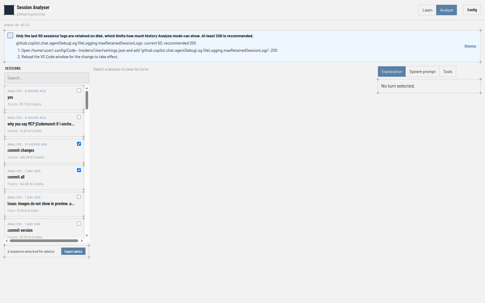

Click **Export advice** to open a dialog with a ready-to-paste prompt:
aggregated session/turn metadata — token usage, cache efficiency, tool
usage, prompt composition, AI Credits — formatted as JSON for an LLM chat
to give advice on your agentic-coding workflow. **Chat message text is
never included.** Click **Preview** to see the exact bundle before
copying it, optionally include tool-call arguments (which may contain
text snippets) via the checkbox, then **Copy advice prompt**:

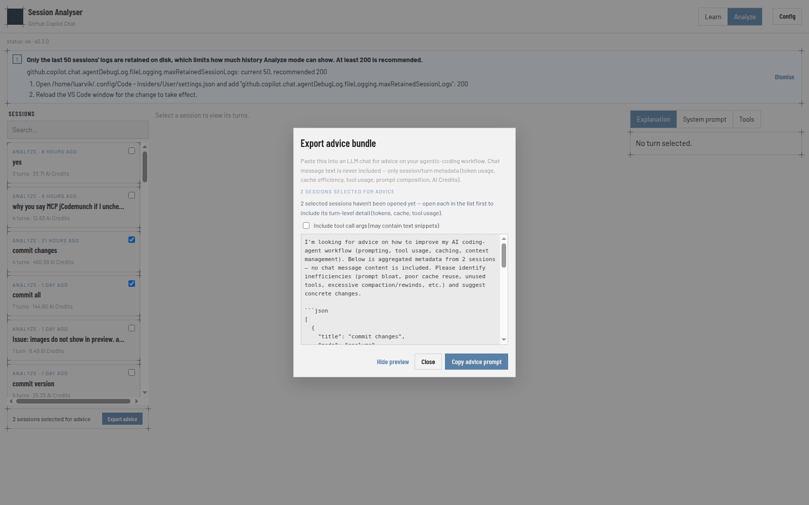

If a selected session hasn't been opened yet in the list, the dialog
flags it — its turn-level detail (tokens, cache, tool usage) won't be in
the bundle until you open it first.

## Learn mode

Learn mode ships with 18 bundled example scenarios (the VS Code extension
lists the 17 that apply to Copilot), each illustrating one
concept from [agentic-coding-explained.md](agentic-coding-explained.md) —
prompt caching basics and TTL expiry, context compaction, an MCP tool
change, a model switch, `/clear`, `/rewind`, session forking, an
instructions-file edit, extended thinking/reasoning budget, a subagent
running on a cheaper model, and more. No setup is required — the scenarios
don't depend on anything on your machine. Their numbers are **simulated**:
each scenario is replayed on a vendor and model you choose, using that
vendor's documented caching rules and real prices, and the result is labeled
**Simulated** wherever it appears. It's a teaching model, not a prediction of
your bill.

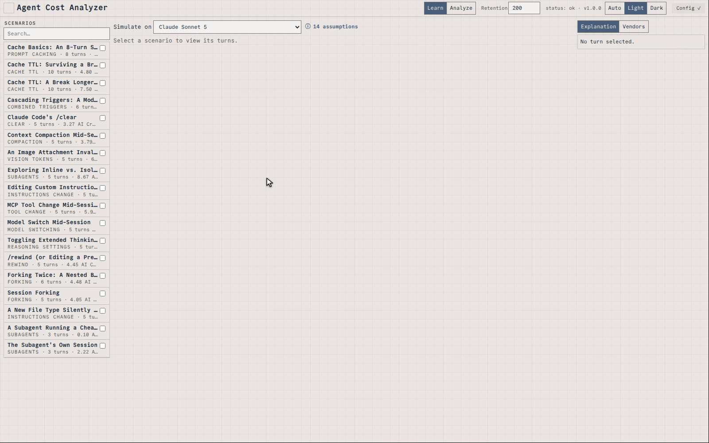

The header switch in the GIF changes the color theme ([Color theme](#color-theme)).

### Choosing a vendor and model

The **Simulate on** picker above the turns table lists models grouped by
vendor (Anthropic, OpenAI, Google, xAI). Models from vendors whose caching
isn't documented (Moonshot AI, Microsoft) are listed but disabled, with the
reason shown. By default it picks the model your recent Analyze sessions used
most, falling back to Claude Sonnet 5.5; your own pick is remembered. Changing
the model re-simulates the open scenario. In scenarios with a second, cheaper
model, that model is the vendor's curated cheaper sibling.

The **ⓘ assumptions** button next to the picker lists what the simulation
assumes because no vendor documents it, for example where Copilot places
cache breakpoints, each marked *documented*, *inferred* or *unknown*. The
**Sources** footer under the table links the documents the numbers come from
and shows the date they were checked; it turns into a warning when that data
is more than 90 days old.

### Picking a scenario and reading the turns table

Click a card in the left column to load it. Each row in the turns table is
one turn, with the token/AI Credit breakdown for that turn:

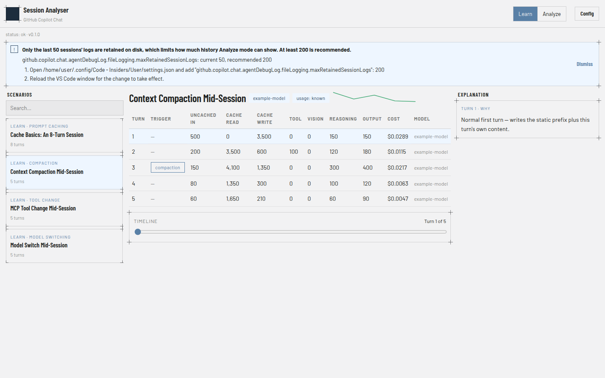

The columns are **Turn, Trigger, Rounds, Uncached in, Cache read, Cache
write, Tool, Vision, Reasoning, Output, AI Credits, Cumulative, Model**.
Rounds is how many LLM request/response round-trips made up that turn (a
tool call followed by a follow-up response counts as two) — always `1` for
mitmproxy sessions, since one HAR entry is one complete exchange. Cumulative
is a running AI Credits total across the session, up to and including that
row. An em dash (**—**) in any numeric cell means that figure is genuinely
unknown for that turn — the app never shows a fabricated `0` in its place,
and once one turn's own cost is unknown the cumulative total for that row
and every later row is also an em dash rather than a total that silently
skips it. The small line chart next
to the session title (when visible) is an AI-Credits-per-turn sparkline; it
only appears when every turn in the session has a known AI Credits value.

The **Trigger** column flags turns where something out of the ordinary
happened mid-session — a `compaction` event (shown above), a `tool
change`, a `model switch`, `/clear`, `/rewind`, cache expiry, or a
session fork. Most turns have no trigger and show a muted em dash instead.

In a simulated scenario a **Cache** column follows Trigger: ● hit, ◐ partial
(part of the prefix was still cached), ○ miss, ? unknown. A ? means a rule
this turn depends on is unknown for the chosen vendor; its cache figures and
AI Credits then show an em dash, never a made-up zero. Hover an AI Credits
figure for its USD equivalent (1 AI Credit = $0.01).

The **Columns** button above the table (next to "Showing n of 14 columns")
opens the column chooser: untick any column to hide it, except **Turn**,
which names the row and always stays. Your choice is remembered. It is
not offered in the narrow layout; see
[Narrow and medium windows](#narrow-and-medium-windows).

### Stepping through turns

Click any row, or drag the **Timeline** scrubber at the bottom of the
table, to select a turn. Both stay in sync — dragging the scrubber
highlights the matching row, and clicking a row moves the scrubber:

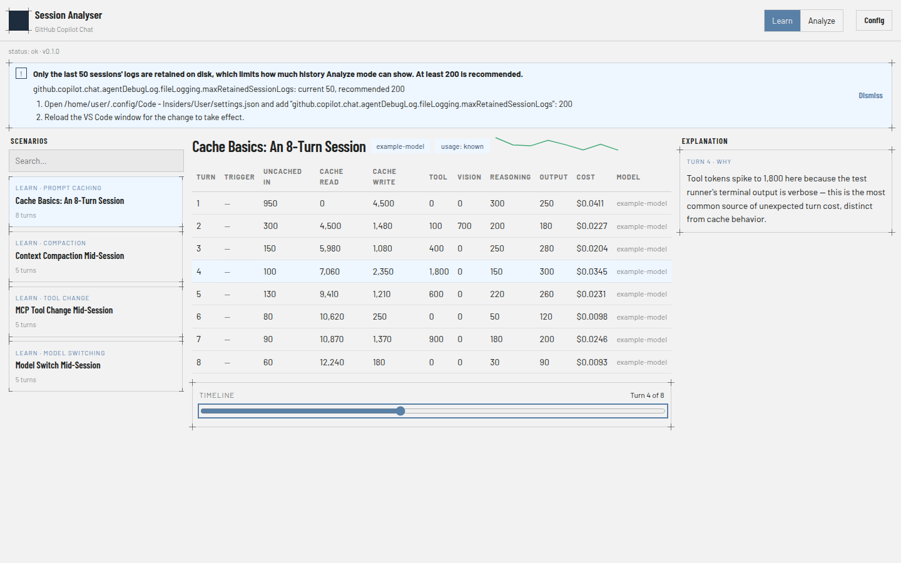

The right-column **Explanation** panel always shows a plain-language
explanation for the currently selected turn — what happened, and why,
based on that turn's cache/token numbers. In a simulated scenario it adds a
generated line for the chosen model ("the image invalidated the conversation
cache; tools and system prompt were still read from cache") and, for turns
with a cache event, a **How vendors differ** card with one row per vendor
(its default model): the outcome, the turn's AI Credits and a source link.

The **Vendors** tab compares models across the whole scenario: total AI
Credits (with USD), cache-hit ratio, misses and the most expensive turn, with
a per-turn strip of hit/partial/miss marks. It starts with each simulated
vendor's default model, and you can add more models. The table can be sorted.

### Searching the scenario list

The left column has a search box that filters by title as you type:

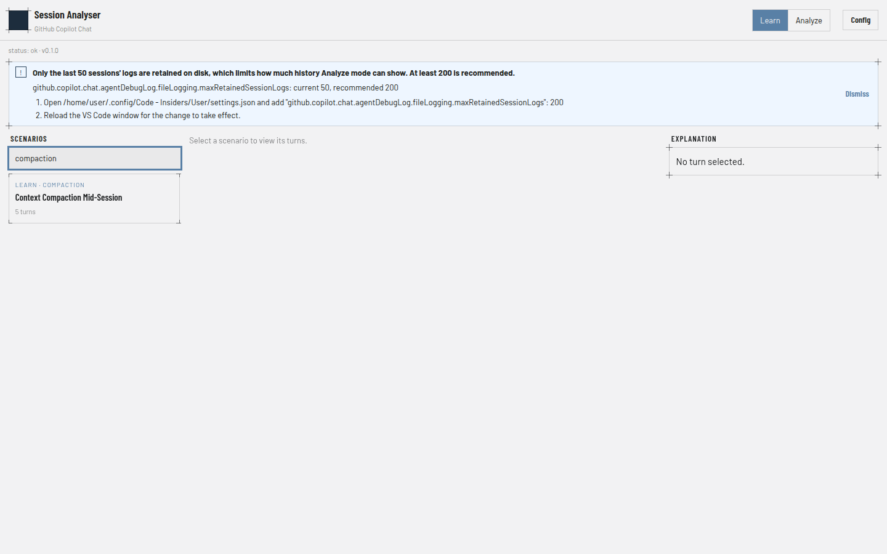

If nothing matches, the list shows a plain "No matches." message instead
of an empty box.

## Analyze mode

Switch to Analyze mode via the header's mode switch. This lists real
sessions read from a **log provider** — nothing is sent anywhere, the app
only reads local files.

### Choosing a log provider

Analyze mode reads from one of four local sources, picked via the **Source**
dropdown that appears in the header once you're in Analyze mode. The same
header area also holds the **Retention** field described below:

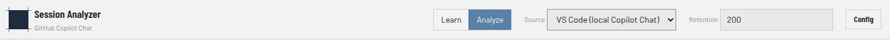

- **VS Code (local Copilot Chat)** — the default. Reads directly from your
  local VS Code Copilot Chat session store (SQLite + debug logs), as
  described below. From VS Code 1.143, new chats run through the default
  Copilot harness and its Agent Host; those sessions are listed with their
  tokens and AI Credits. Their prompt and response text, turn inspector, tool
  calls and system prompt come from the Copilot CLI's event log, read locally.
  When VS Code titles such a session with the opening of its first prompt, it
  is shown as untitled ("Session <id>"), so prompt text never appears as a title.
  Chats in a VS Code window with no folder open are listed too, with their
  tokens and AI Credits, as "No repository".
  Cache-write and reasoning tokens come from the same log's per-call usage
  records (Copilot CLI 1.0.95 and later). They're used only when the records
  add up to the turn's token totals; otherwise both show as unknown, with the
  reason. Tool and vision tokens stay unknown. The Tools tab stays
  unavailable, since the log records no tool definitions. Agent Host
  sessions need none of the settings below.
- **mitmproxy (HAR capture, optional)** — only for coding agents that write
  no usable local logs, such as tools calling the Anthropic or OpenAI API
  directly. See [mitmproxy-setup.md](mitmproxy-setup.md). Captures are split
  into sessions at 30+ minute idle gaps.
- **Claude Code** — reads the Claude Code CLI's own session files directly
  from `~/.claude/projects/`, one session per file, no capture step needed.
- **pi coding agent** — reads session logs written by the [pi coding
  agent](https://pi.dev) directly from `~/.pi/agent/sessions/`, no capture
  step needed. Because a pi session can branch (fork/rewind to try a
  different approach mid-session), a session file with unmerged branches
  shows up as multiple sessions, titled `<name> (branch i of N)` — one per
  branch tip. Token totals include everything pi records — assistant
  replies, nested tool usage, cache warming and compaction/branch summaries
  — and reasoning tokens when the model's provider reports them. The
  system prompt and tool list come from the session file itself. pi's
  saved prompt leaves out text that other pi extensions add when a request
  is sent (for example a sandbox extension's working-directory and mount
  notes), so it is smaller than what the model received. The optional
  `pi-system-prompt-logger` extension records the exact prompt and stays
  recommended: when it is installed, the system prompt view shows the exact
  text and size, pi's own sections as the breakdown, and everything else as
  one **Added by pi extensions** part. Without it the view says the prompt
  is incomplete. Sessions recorded before pi saved its prompt use the
  logger's record alone.
  Tool-call and vision token breakdowns, plus AI Credits (a GitHub
  Copilot-specific billing unit pi has no equivalent of), aren't available
  for pi sessions. Known limitation: pi's `/fork` starts a new session file
  that repeats the parent's earlier turns, so a total over both files counts
  those turns twice.

Switching the source clears the currently-selected session and reloads the
session list from the newly active provider. A provider shows
**(unavailable)** in the dropdown, and can't be selected, if its underlying
data isn't currently reachable (e.g. no capture file found yet).

### Enabling full per-turn numbers

By default, VS Code's Copilot Chat debug log doesn't record token/cache
usage, so Analyze mode's numbers for Local harness chats are limited until
you turn on a setting. The app checks this automatically and shows a
banner explaining exactly what's missing and how to fix it. Once VS Code
has an Agent Host store (`agent-host.db`), these warnings are optional and
say they only affect Local harness chats:

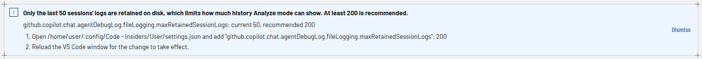

Click **Dismiss** to hide it for the session; the header's **Config**
button reopens it later. See the
[standalone app doc's "Enabling GitHub Copilot Chat debug logging"](standalone-app.md#enabling-github-copilot-chat-debug-logging)
section for the exact settings.json steps. Once every check passes, the
Config button becomes a static confirmation instead of something to click:


Sessions recorded *before* you enable logging still show up in Analyze
mode — they just show em dashes for the numeric columns, the same as any
other genuinely-unknown value.

The retention check requires VS Code to keep at least a minimum number of
session logs on disk; the header's **Retention** field (VS Code source
only) shows and lets you change that minimum — it defaults to 200, but you
can raise or lower it to match how far back you actually want Analyze mode
to be able to look. Changes save automatically when you click away from
the field.

Claude Code deletes its own session files after 30 days unless you change
its `cleanupPeriodDays` setting, so Analyze mode, the dashboard's 30- and
90-day windows and the savings report can't see older Claude Code work. To
keep more, set it in `~/.claude/settings.json`, for example:

```json
{ "cleanupPeriodDays": 90 }
```

It keeps sessions from then on; files Claude Code already deleted don't
come back. The app doesn't check or change this setting.

For Local harness chats, cache-write and reasoning tokens need a *separate*,
optional setting on top of the one above — see the standalone app doc's
["Enabling richer cache-write/reasoning numbers"](standalone-app.md#enabling-richer-cache-writereasoning-numbers-optional)
section for the steps. Skipping it doesn't limit anything else — every
other Analyze mode figure works the same either way — it just leaves
those two columns showing em dashes.

### The turns table in Analyze mode

Real sessions render with the identical 13-column table Learn mode
uses — this is a real (numbers-only) example, with em dashes for the
usage figures this particular log didn't capture:


#### Classic Copilot Chat subagent runs

A VS Code (classic Copilot Chat) turn that called a subagent shows the
run's AI Credits inside the turn's total, so the row, the session and the
dashboard all include them. Each run is read from its own debug log next to
the session's `main.jsonl`.

- **Marker.** A small subagent glyph after the AI Credits value. Its
  tooltip (and accessible name) reads "incl. 42.06 AI Credits from 1
  subagent run".
- **Explanation block.** The Explanation tab gains **Subagent runs this
  turn**: one row per run with its agent, model, requests and AI Credits.
  A `searchSubagent` run that cost nothing shows **0.00**, because the log
  says 0. A **Turn totals** group below sums the turn's own AI Credits, the
  runs' and the total.
- **Matched by time.** A run's log that no `child_session_ref` names is
  placed on the turn whose prompt window holds its start time. Such a run is
  labeled "matched by time"; a start time in no single window leaves the
  session's AI Credits unknown.
- **Unknown, with a reason.** A total is unknown, never lower, when a run's
  log is missing, is not a regular file (for example a symbolic link), can't
  be read, has no readable events, holds nested subagents (not read), has a
  request with no AI Credits, can't be matched to a turn, started before the
  session's first prompt, or when the folder has more than 200 subagent logs
  or can't be listed. A run that could not be read has no row of its own:
  the block shows **Subagent run not read** with the reason.
- **Turn inspector.** It keeps the main agent's rounds and says "N subagent
  runs are not shown here".
- **Session tile.** The session's AI Credits tile adds "incl. 54.65 from 3
  subagent runs".
- **Totals changed.** Sessions you saw before can now read higher, or
  unknown with a reason. Per-model figures credit each run's model, and the
  dashboard's **model** list box matches a turn when its own model or any
  run's model is selected.
- **Replay.** A replay compares the main agent only. The app doesn't list
  the runs it leaves out; the MCP `replay_session` result does, in
  `coverage.subagentRuns` (the run count and their AI Credits).

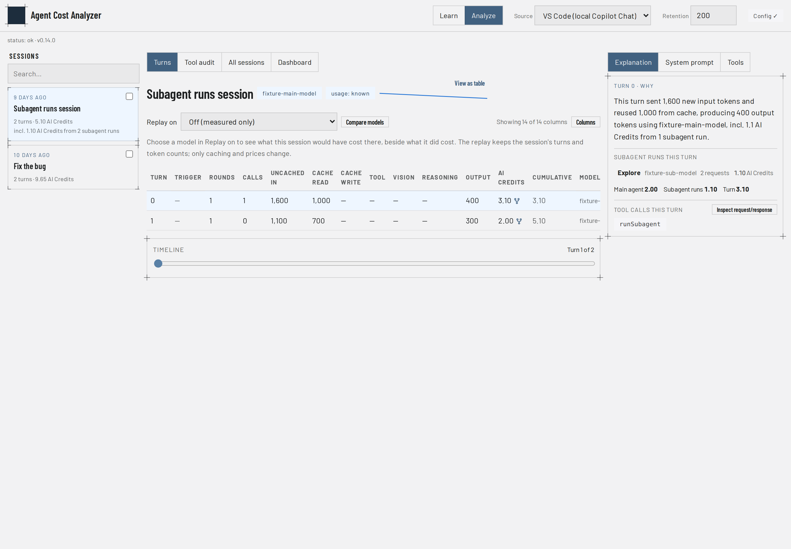

#### Claude Code subagent runs

A Claude Code session that used the `Agent` tool has one transcript per run
in `<session-id>/subagents/`. The app reads them and counts each run in the
turn that started it, so the turn, the session and the dashboard include
the run's tokens and priced cost. Claude Code records no AI Credits, so the
AI Credits column stays an em dash.

- **Why totals rose.** Sessions you saw before can now read higher, or
  unknown with a reason. A run on another model is priced on its own model.
- **Marker.** The subagent glyph sits in the Turn cell (the AI Credits cell
  has no figure to attach it to). Its tooltip and accessible name list tokens,
  then priced cost, for example "incl. 2.04M tokens, $0.38 priced, from 2
  subagent runs" (synthetic example). A run placed by time adds ", matched by
  time". When a part is unknown, the tooltip names the unknown column and its
  reason.
- **Explanation block.** "Subagent runs this turn" with a **Priced** tag: one
  row per run with model, requests, tokens and priced cost, then **Main
  agent**, **Subagent runs** and **Turn** figures, a share sentence, and
  "Priced at Anthropic prices as of" a date, each run on its own model. A run
  with an unknown part shows an em dash and its reason; the other runs stay
  listed. The turn inspector and the narrow-screen drawer carry the same line
  as text.
- **Session tiles.** **AI Credits** reads n/a ("Claude Code has no AI
  Credits"). A **Priced cost** tile carries the sub-line "incl. $X and N
  tokens from M subagent runs" (matched by time stays out of it), or the
  reason when unknown. The Sessions list shows the runs' tokens only.
- **Matched by time.** A transcript no `Agent` call names is placed on the
  turn whose prompt window holds its start time and labeled "matched by time".
- **Nested runs.** A run started by another run is listed as its own run on
  its own model.
- **Unknown, with a reason.** A total is unknown, never lower, when a run's
  transcript is missing, is not a regular file, can't be read, has no
  parsable line, is nested deeper than 8 levels, or can't be matched to a
  turn, or when the folder has more than 500 transcripts or can't be listed.
- **Not counted.** A run started from a branch of the conversation you later
  abandoned (an edited or resent message) is not counted, and the app doesn't
  list it. A run whose launch failed is no run.
- **Replay.** A replay compares the main agent only. The MCP
  `replay_session` result counts the runs it leaves out, with their tokens
  and priced cost, in `coverage.subagentRuns`.
- **Savings.** A saving that reads main-agent usage only says "N subagent
  runs not analyzed" in its coverage.
- **Tool calls.** Calls made inside a run appear in the tool audit and the
  security findings, labeled with their run. A run whose calls can't be read
  shows as unknown, never as 0 calls. A run placed by time shows a
  "matched by time" mark on its audit row. MCP output keeps the run's prompt out.

In the MCP App's turn detail (U1) a Claude Code turn lists its runs with
tokens and priced cost, and shows an n/a AI Credits tile and a Priced cost
tile. A run another session already counts and "continued N times" are not
shown.

### The three-tab right panel

Analyze mode's right column adds two tabs beyond Explanation, since real
sessions carry more detail than Learn's curated examples:

**Explanation** — same plain-language summary as Learn mode, plus a "Tool
calls this turn" section listing which tools the assistant invoked during
that specific turn:


When the turn's raw request/response data was captured, an **Inspect
request/response** button also appears on the Explanation tab — see
[The turn inspector](#the-turn-inspector) below.

**System prompt** — a breakdown of what made up the system prompt for
this session (base instructions, `CLAUDE.md`/repo instructions, loaded
skills, tool definitions, …), each as a labeled bar sized to its share of
the total. When the base system prompt was captured, an **Open system
prompt inspector** button appears above the breakdown:

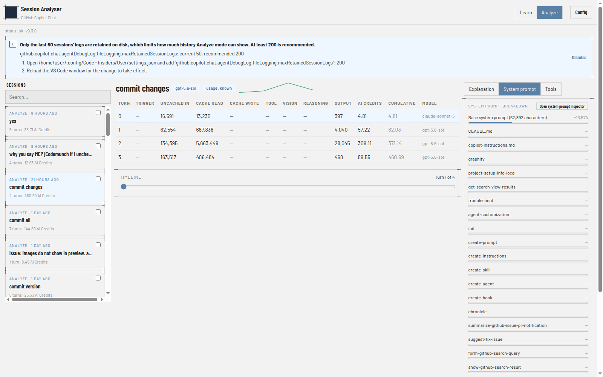

**Tools** — every tool that was loaded for the session, cross-referenced
against whether it was actually invoked and how many turns used it:


If a session has no captured system-prompt or tool-inventory data (for
example, it predates enabling debug logging), each tab shows a short
explanation instead of an empty table.

### The system prompt inspector

Click **Open system prompt inspector** on the System prompt tab to
replace the session view with a full-detail breakdown of the captured
system prompt, in three panels:

- **Structure** (left) — a nav tree of every tagged section, color-coded
  to match its highlight in the raw text.
- **Raw text** (center) — the full captured prompt, toggled between
  **Pretty** (reformatted/indented) and **Raw** (exactly as captured);
  clicking a Structure entry scrolls to and highlights that section.
- **Component description** (right) — a plain-language explanation of
  the selected section's purpose, tagged **Sourced** when it's backed by
  a citation into the Copilot Chat extension's own source, or **Not
  independently sourced** when the description is inferred from the
  captured text alone.

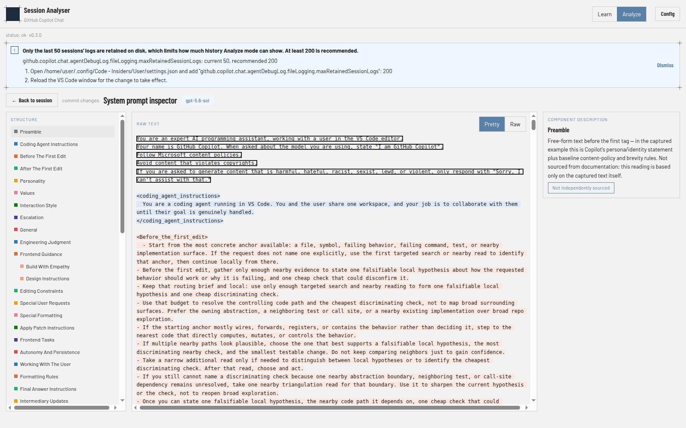

Click **← Back to session** to return to the turns table.

### The turn inspector

Click **Inspect request/response** on the Explanation tab for a turn to see
that turn's actual LLM request/response round-trip(s) — scoped to only the
content that turn added, not the full conversation history each round
technically resent. A row of **Round** tabs across the top lets you step
through each round trip within the turn (the same number shown in the
turns table's Rounds column); each shows one Request/Response card pair,
tool-call name/arguments/result on the request side and reasoning shown
inline where captured on the response side. Oversized text and file/image
content is collapsed into small placeholder chips instead of being dumped
inline, to keep the view readable.

If a turn has no captured round-trip data (for example, it predates
enabling debug logging, or its data has since aged out), the inspector
shows an explanatory empty state instead of a blank panel.

### Replaying a session on another model

What would this session have cost on another model? A replay keeps the
session's turns, requests and token counts, and runs them through the
other model's vendor caching rules and prices. Only caching and prices
change. Every replayed figure is labeled **Simulated**, and the measured
figures stay as they are, beside it.


**Choose a model.** With a session open, the **Replay on** select sits in
the session's header row. It starts at **Off (measured only)**. Models are
grouped by vendor, and the session's own model is marked
**(this session)**. A model whose vendor doesn't document its caching is
listed but disabled, with the reason. While the replay runs, "Replaying on
*model*…" shows with **Cancel**, which turns the replay off again. Opening
another session starts it at Off.

**The Simulated columns.** The turns table gains a dashed
**Simulated · *model*** group after the measured columns:

| Column | What it shows |
|---|---|
| Cache | The simulated cache outcome of the turn, as a word and an icon |
| Cache read | The simulated cache-read tokens |
| Cost | The simulated cost: AI Credits for a Copilot session (hover for USD), USD otherwise. "unknown" when it has no price |

A turn that can't be replayed reads **not replayed** across the group, with
the reason (for example, the log has no usage for it). It never reads 0.
The **Columns** chooser lists the group as Simulated cache, Simulated
cache read and Simulated cost; the cost can't be hidden while a replay is
shown. On the **Explanation** tab, the selected turn gets a dashed
**Simulated** box with its outcome and its cache read, cache write and
cost, measured beside simulated.

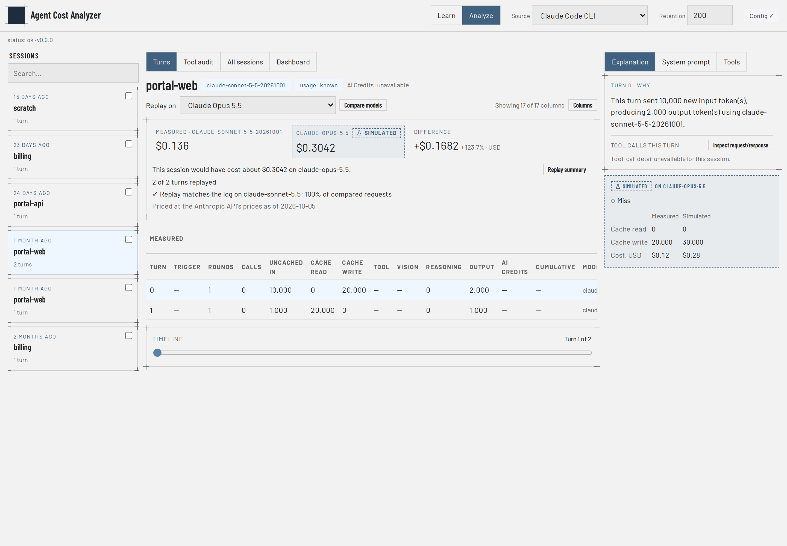

**The summary strip.** Above the table, a strip shows:

- the **Measured** total and the **Simulated** total, and the
  **Difference** (simulated minus measured, with its percentage);
- a sentence: "This session would have cost about … on *model*.";
- the coverage, for example "38 of 40 turns replayed; 2 not replayed: …";
- the self-check, for example "Replay matches the log on
  claude-opus-5-5: 98% of compared requests";
- which prices were used, and their date.

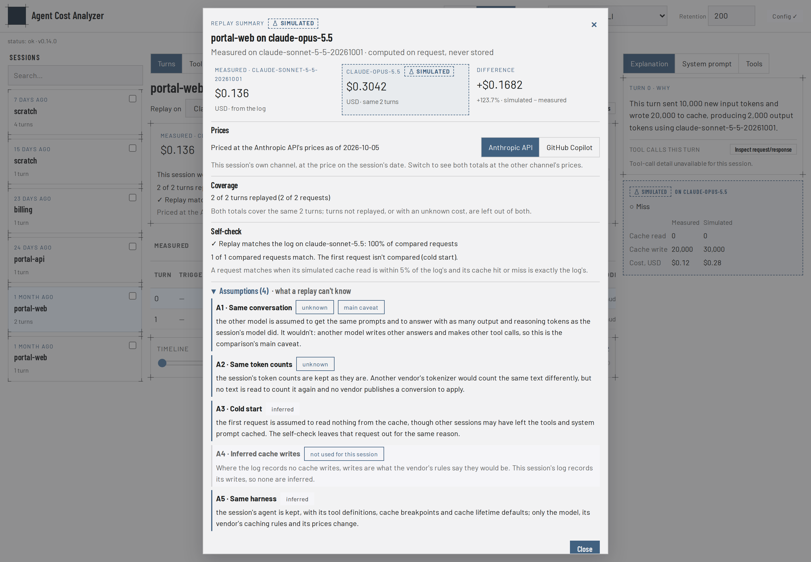

**Replay summary** opens the full summary as a dialog:

- **Totals.** Both totals cover the same turns: those replayed with a known
  measured and simulated cost. Turns not replayed, or with an unknown cost,
  are left out of both, so the difference compares like with like.
- **Prices.** By default a replay is priced on the session's own channel,
  at the price on the session's date: a Copilot session at GitHub
  Copilot's prices, in AI Credits; a Claude Code session at the replay
  vendor's API prices, in USD. The **Price channel** switch (for
  example *Anthropic API* or *GitHub Copilot*) prices both totals at the other channel
  instead. The only conversion is 1 AI Credit = $0.01.
- **Coverage.** How many turns and requests were replayed, and each reason
  a turn wasn't, with its turn numbers. Only the session's main chain is
  replayed: subagent runs (Copilot and Claude Code) are left out, and the app
  doesn't list them.
- **Self-check.** The same replay on the session's own model, compared
  request by request with the log. A request matches when its cache hit or
  miss is exactly the log's and its cache read is within 5%. The first
  request isn't compared (a cold start). The figures for other models rest
  on this check: if it fails, the dialog says to read them with care. A
  session that used more models than a replay can hold (three or more, or two from different vendors),
  or whose model has no vendor profile, has no self-check, and the dialog
  says why.
- **Assumptions** (what a replay can't know). Open the first time you open
  the dialog, each with its confidence (documented, inferred or unknown):
  - **A1, same conversation** (the main caveat): the other model gets the
    same prompts and answers with as many output and reasoning tokens. It
    wouldn't: another model writes other answers and makes other tool
    calls.
  - **A2, same token counts**: another vendor's tokenizer would count the
    same text differently. No text is read to count it again.
  - **A3, cold start**: the first request reads nothing from the cache,
    though other sessions may have left it warm.
  - **A4, inferred cache writes**: where the log records no cache writes
    (Copilot's local harness without `agent-traces.db`), they are what the
    vendor's rules say. Grayed out as "not used for this session" when the
    log records every write.
  - **A5, same harness**: the session's tools, cache breakpoints and cache
    lifetimes are kept; only the model, its caching rules and prices
    change.

That is why the app says a session "would have cost about" a figure, not
"would have cost" it.

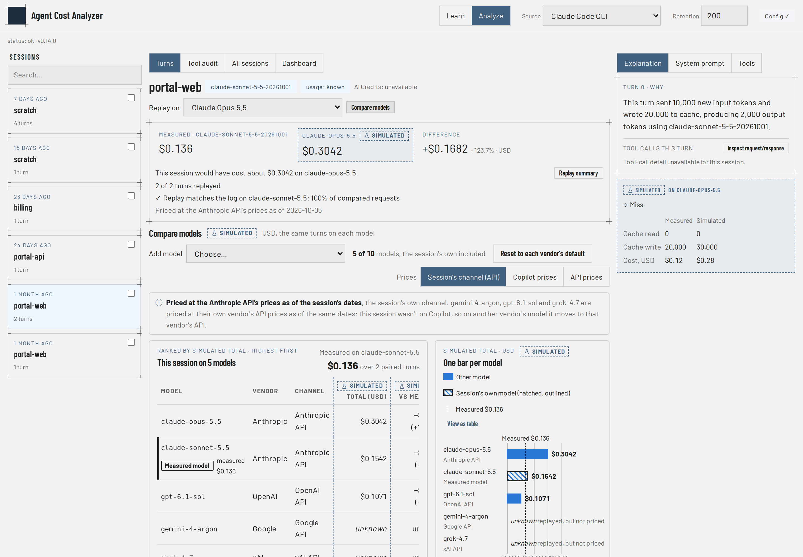

**Compare models.** The **Compare models** button, beside Replay on,
swaps the turns table for the session's simulated total on several models:

- It starts with the session's own model, the Replay on model and each
  vendor's default model. **Add model** adds one, up to 10 models with the
  session's own included ("4 of 10 models"). **Reset to each vendor's
  default** starts over, and ✕ on a row removes that model.
- The table is ranked by simulated total, highest first: model, vendor,
  channel, the simulated total, the difference from the measured total and
  the turns replayed. The session's own model is tagged **Measured model**,
  with its measured total.
- The bar chart beside it (below it in a narrow window) uses one hue for
  every model. The session's own model is hatched and outlined, and a
  dashed line marks the measured total. **View as table** gives the same
  numbers.
- A model with no total reads **unknown**, with the reason ("not
  replayed", or "replayed, but not priced"), never 0.
- **Prices** chooses *Session's channel*, *Copilot prices* or *API
  prices*. On the session's channel, a session that wasn't on Copilot
  moves to each model's own vendor's API prices. The choice is shared with
  the summary strip and dialog.

Press **Compare models** again to return to the turns table.

**Which sessions can be replayed.** Claude Code sessions and Copilot Chat
sessions (local and Agent Host) can. pi and mitmproxy sessions can't yet:
**Replay on** shows *Not available* with "This provider's logs can't be
replayed yet." Otherwise you may see:

- **This session can't be replayed**, with the reason, for example a
  session with no request data, or one with more than 20,000 requests
  ("at most 20,000 can be replayed"). Its measured figures are unchanged.
- **Unpriced**, when the channel has no price for the model on the
  session's date, or no price channel is known. The tokens are still
  simulated; a button offers the other channel's prices instead.
- **Couldn't replay on *model***, when the request fails, with **Try
  again** and **Copy details**.

A replay is computed when you ask for it and never stored. The same
replays are available to an agent through the MCP tools
[`replay_session` and `compare_models_for_session`](#mcp-tools-and-prompts).

### Searching sessions and empty states

The left column's search box works the same way in Analyze mode — filter
by title as you type. If the app can't find *any* bundled Learn scenarios
or *any* Copilot Chat sessions at all, the whole three-column layout is
replaced with a single centered message explaining what's missing:

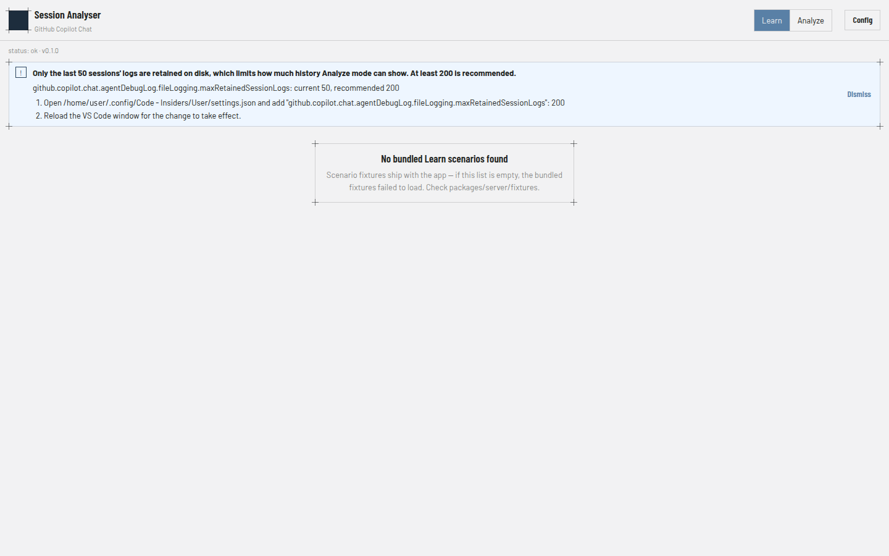

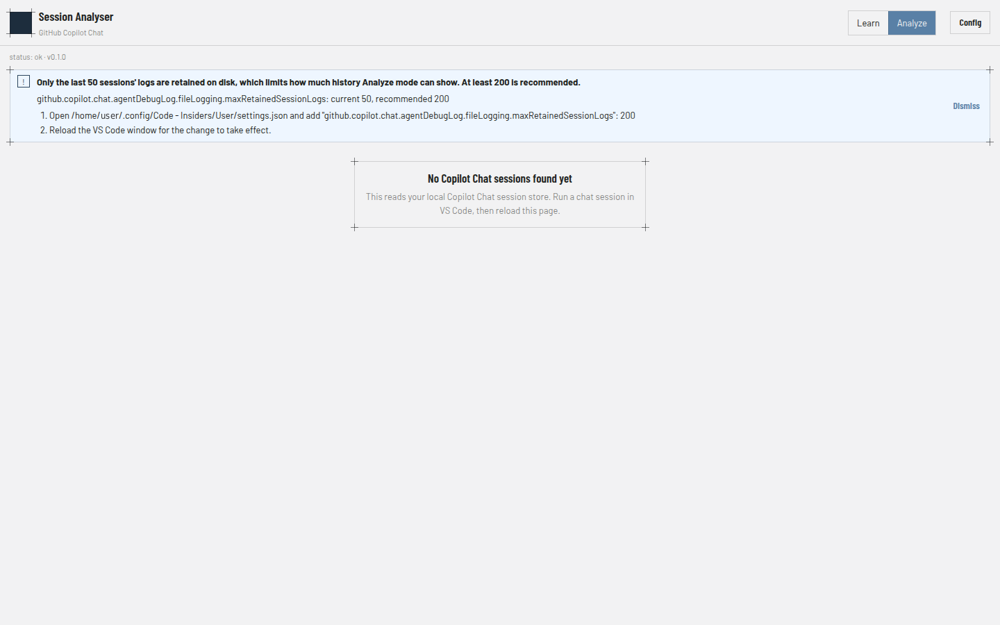

For Analyze mode, this normally means you haven't run a Copilot Chat
session yet, or the app can't find your VS Code session store — reload
the page after starting a chat session in VS Code.

### Auditing tool calls

Analyze mode's center column has a **Turns / Tool audit / All sessions /
Dashboard** switch (Dashboard is described in "The insights dashboard"
below). It shows what the agent actually ran and why calls failed: a
missing utility, a wrong working directory, bad arguments, a missing
dependency, git state, a blocked permission, and so on. Every
classification shows the rule that matched and a short, redacted excerpt
of the real error as evidence.

**Tool audit** audits the selected session:

- **Stat tiles.** Tool calls, failure rate (computed only over calls whose
  outcome is known), shell commands, retried commands, recovery rounds, and
  output tokens spent in turns that had a failure.
- **Outcomes per turn.** Stacked columns per turn. Hover or focus a column
  for its counts, and click a column to select that turn. **View as
  table** shows the same numbers as a table.
- **Why calls failed** and **Shell programs.** Ranked bars. Click a bar to
  filter the call table below; click it again to clear the filter.
- **Tool calls table.** Filter chips by outcome, plus the command, outcome,
  exit code, and evidence for each call. **Inspect** opens the turn
  inspector.
- **Retried commands.** The same command re-run after it failed.
- **Subagent calls.** When a turn started subagents, the figures include
  their tool calls ("incl. N calls from M subagent runs"). **Calls by
  agent** splits main agent and subagents, and the **Agent** filter (All /
  Main agent / Subagents) and column narrow the tool calls table. The
  **Subagent runs** table has one row per run. A run whose calls could not
  be read shows its reason and **Unknown**, never 0 calls; a run linked by
  time window carries a "matched by time" mark. A canceled call (a stop
  you made) has its own tile and chip and counts in no failure figure.
  The filter works on the audit already loaded (no new request); a section
  that still counts every agent says so.

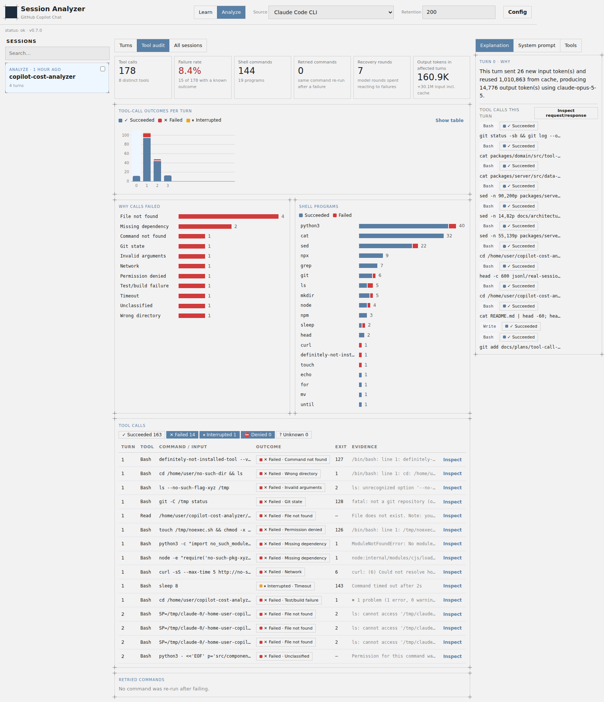


**All sessions** rolls the audit up over the last 7, 30, or 90 days (or
all time). It shows failures per day, top failing commands with how many
sessions they failed in, and a sessions table. Click a session to open its
own audit.

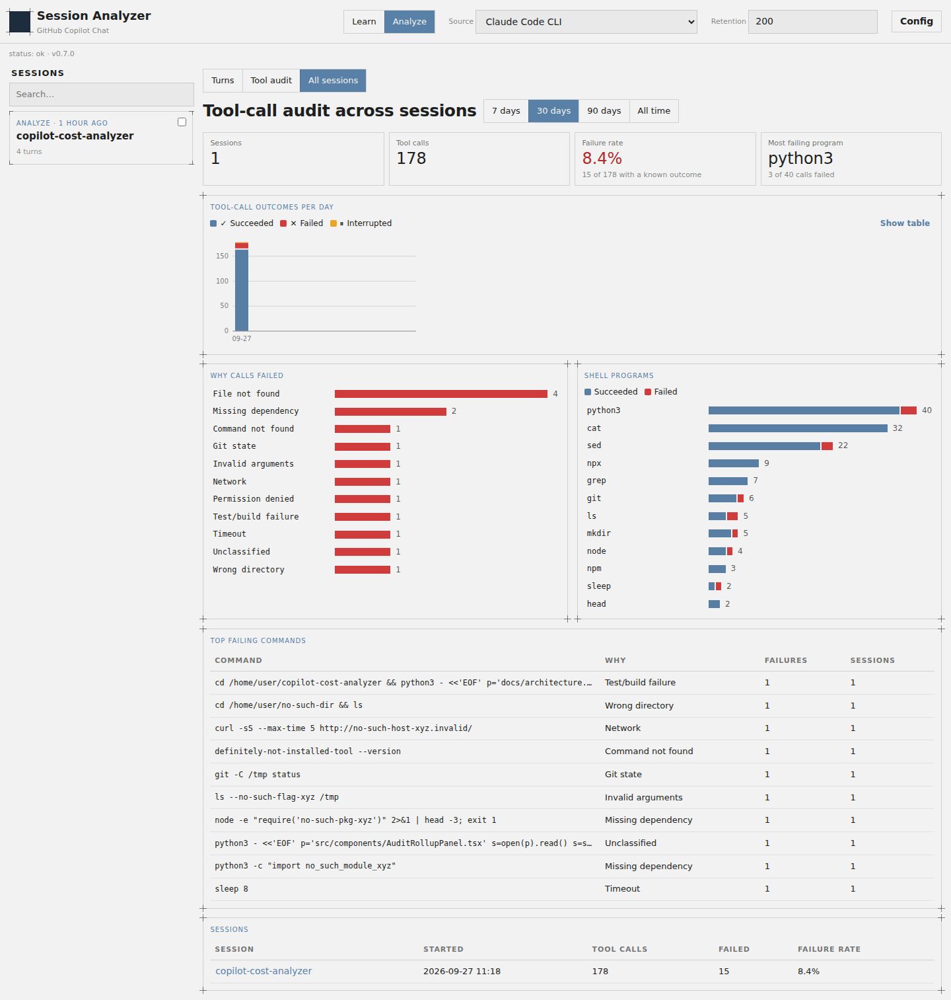

Outcome data depends on the log provider. Claude Code CLI sessions record
it in full. pi records it when its `isError` flag is present. VS Code
Copilot Chat's debug log records each tool call's status, so its calls have
known outcomes, including the calls of subagent runs. A call whose status
the log doesn't state shows as **Unknown**, with the reason spelled out,
rather than counting as zero failures.

### MCP tools and prompts

Once the MCP server is connected (see
[Connecting an AI chat (MCP)](#connecting-an-ai-chat-mcp)), an agent can
call these tools:

| Tool | What it returns |
|---|---|
| `list_log_providers` | Available log sources and which one is active |
| `list_sessions` | Sessions, most recent first. Search titles and ids with `query`, filter by date, repository or project; `total` says how many matched |
| `get_turn` | One turn: prompt and response (secrets redacted, truncated), usage, triggered event and tool calls |
| `get_session_cost` | One session's tokens and AI Credits with coverage, cache hit ratio, spend per model, the most expensive turns, cost events and context overhead |
| `get_cost_rollup` | Spend across **every** provider by provider, model and day, plus the most expensive sessions |
| `get_session_audit` | One session's tool-call audit, split by main agent and subagent runs. Set `includeCalls` to also get every classified call |
| `list_tool_calls` | One session's calls, filtered by status, failure category, tool kind, tool, program, turn, `origin` (main or subagent) or `runId`, paged with `offset`/`limit`. A subagent call's prompt is not returned |
| `get_audit_rollup` | Cross-session tool-call totals split by main agent and subagents, top failing commands and per-day counts for one provider |
| `list_findings` | Security, anomaly and behavior-change findings across every provider, most severe first, with what, when, why and redacted evidence |
| `list_repositories` | The repositories your sessions ran in, with sessions, turns, AI Credits and project ids; sessions with no repository are grouped by reason. Local repositories are named by folder, never by path |
| `list_projects` | Your projects from `projects.json` with their repositories and AI Credits; client names and billing codes only if you start the server with `--project-billing-details` (for example `claude mcp add agent-cost-analyzer -- npx -y --prefer-offline agent-cost-analyzer mcp --project-billing-details`, or `/abs/path/scripts/mcp-server.sh --project-billing-details` from a clone) |
| `get_price_book` | The dated price versions the app prices turns with, per channel and model |
| `get_price_changes` | When a model's price changed: documented changes from the price book, and observed GitHub Copilot ones |
| `get_repository_cost` | One repository's cost over time, by vendor and model, with price-change markers |
| `get_project_cost` | One project's cost over time, by repository, vendor, model and token type, with its most expensive sessions |
| `compare_costs` | Two to 20 repositories or projects side by side: total, change, per session, per active day, share and coverage |
| `explain_cost_change` | Why a repository's or project's cost changed between two periods: usage, price and mix effects that add up exactly |
| `get_statement` | A project's billing statement for a period: the issued one with any differences, else the draft. It never issues one |
| `estimate_cost` | The cost of planned work as a p50–p90 range at today's prices, never one number. With `model`, the same estimate from the project's sessions (up to 200) replayed on that model: **Simulated**, priced on each session's own channel as of its dates, with coverage, self-check counts and assumptions |
| `replay_session` | One session replayed on another model: per turn and in total what it would have cost beside what it did, with coverage, the self-check on its own model and the assumptions. `pricing` is `session-channel` (the default), `copilot` or `api`. **Simulated** |
| `compare_models_for_session` | One session's simulated total on up to 10 models, its own included, with how many turns each replayed. Takes the same `pricing`. **Simulated** |
| `get_monthly_allowance` | How much of your monthly AI Credits [allowance](#monthly-allowance) is used so far this billing period, the same answer as the app's header: used, remaining ("up to"), coverage, the by-harness split and the period. Read-only; it cannot change the allowance, and it answers that none is set until you set one in the app |
| `get_savings_report` | The [savings report](#the-savings-report): changes that would have cost less over a window (default the last 30 days), ranked by the high end, each with its amount per week and over the window as a range or "up to", coverage, price versions, up to 10 session ids, each with its date and its saving over the window, and the fixed text of what to change. `limit` (default 10, at most 20) cuts the list and says how many there are. Cheaper-model replays only with `includeSimulated` (off by default, slow), listed apart as **Simulated** |

Six prompts start common reviews: `audit_session` (why a session's tool
calls failed), `review_costs` (what drives your spend and how to cut it; it
starts from `get_savings_report` and explains its rows as ranked, without a
total),
`security_review` (risky agent actions and the guardrails that would
prevent them), `explain_cost_change` (whether usage, price or mix drove a
change), `prepare_statement` (a statement's summary and a note to the
client) and `estimate_work` (a range for planned work and its main
uncertainty).

The replay tools give the same figures as
[Replaying a session on another model](#replaying-a-session-on-another-model)
in the app. Like the app, they can't replay pi or mitmproxy sessions yet,
and they refuse a model no vendor profile lists, with the reason.

In a VS Code Copilot Chat or Claude Code session, `get_turn` lists a turn's
subagent runs in `usage.subagents` and the main agent's own figures in
`usage.ownUsage`. `get_session_cost` `subagents` totals the runs: AI
Credits for Copilot, tokens and priced cost for Claude Code (which records
no AI Credits). Replay compares the main agent only; `coverage.subagentRuns`
counts the runs it leaves out, and for Claude Code gives their tokens and
priced cost. The extension's MCP server describes Copilot only.

Every cost figure says its basis: **billed** (what the vendor billed,
GitHub Copilot's AI Credits), **reported** (a cost the log itself records)
or **priced** (tokens times the price book's price for that model and
date). Figures are priced **as of use** unless a tool is asked for
**today's prices**, and the only conversion is 1 AI Credit = $0.01. The
server's instructions tell the agent this when it connects.

Per-session tools take an optional `provider` (for example
`"claude-code"`) and otherwise use the source selected in the web app.
`get_cost_rollup` and `list_findings` read every available provider
unless you pass one. Local repositories are reported by folder name only, never by path. A `null` figure means the log doesn't record it; it
is never treated as zero. A session whose latest turn started in the last
15 minutes is marked `active` in `get_session_cost` and among
`get_cost_rollup`'s top sessions, with a sentence saying its figures may
still change: a running chat's log is not complete yet. The server reads local logs only and writes
nothing. Everything a tool returns goes into the agent's context, so free
text is redacted and truncated first.

### Interactive views in the chat

In a chat host that supports MCP Apps, sixteen of the tools above show an
interactive view next to their text answer, so you can click through a
session, a repository or a project instead of asking one question after
another:

| You ask about | Tool | The view shows |
|---|---|---|
| One session's cost | `get_session_cost` | Tiles (AI Credits, input, cache hit, output), AI Credits per turn as a chart with compaction and model-switch markers, the most expensive turns, and context overhead |
| This week's spend | `get_cost_rollup` | Tiles, spend per day, spend by model and provider, and the most expensive sessions |
| Anything risky | `list_findings` | Severity tiles and a table of findings, with filters |
| What a repository or project cost, over time | `get_repository_cost`, `get_project_cost` | Cost tiles per basis, cost per day, week or month with price-change markers; for a project also cost by vendor then model, tokens by type and the top sessions |
| Which repository or project costs the most | `compare_costs` | A table of total, change, cost per session, per active day and per turn, and cache hit, with share bars |
| Why the cost changed | `explain_cost_change` | A waterfall of usage, price and mix effects, a table by model, the turns it could not explain and the documented price changes |
| What a session would have cost on other models | `compare_models_for_session`, `replay_session` | Each model's simulated total beside the measured one, with the own-model check; one model's replay turn by turn with the self-check, a chart and the turns not replayed. **Simulated** |
| When prices changed | `get_price_changes` | A timeline of documented and inferred price changes, with % per token type, sources and, for an inferred change, the weekly billed-against-priced figures |
| A project's statement (standalone only) | `get_statement` | Totals and lines per currency, turns of unknown cost and, for an issued period, how a re-run today differs from the issued copy |
| What planned work will cost (standalone only) | `estimate_cost` | A p50–p90 range tagged **estimate**, the history it used, and on another model the replay coverage and self-check. **Simulated** on another model |
| Why tool calls failed | `get_session_audit`, `get_audit_rollup` | The failure rate, failure categories, recovery cost in tokens, retried commands and calls by tool; over a date range also failed calls per day, top failing commands and the sessions |
| Which session to look at | `list_sessions` | A list of sessions with an **Analyse** button per row |
| How to spend less | `get_savings_report` | **Possible savings**: the ranked changes, one list per currency, each with its amount per week as a range or "up to" and a bar, its coverage and the **estimate** or **inferred** tag where it applies; a **Simulated** section; what was not analyzed and why |

The views use the product's name and colors and follow the host's light or
dark theme. They only show what the tool already returned; they read your
logs and write nothing. A figure priced from a price version you added is
labeled **your prices** beside it, with the version id in the label's name, as
in the app.

**Where they appear.**

| Host | Views | Display |
|---|---|---|
| VS Code Copilot Chat (the AI Credits Analyzer extension's MCP server) | Yes | Inline in the chat only |
| Claude Desktop (this repo's `scripts/mcp-server.sh`) | Yes | Inline and fullscreen |
| Claude Code CLI, pi and other terminals | No | The text answer, exactly as before |

claude.ai on the web and ChatGPT can't reach a server on your machine, so
they show nothing either. A host without MCP Apps support just shows the
text.

**What you can click.**

- **A top turn** (session cost view) opens that turn in place: its prompt
  (redacted, truncated), token usage, AI Credits, event and tool calls.
  For a VS Code Copilot Chat turn that started subagents, the detail also
  shows **Subagent runs (N)**: one row per run with its agent, model,
  requests and AI Credits, and a **Main agent** and a **Subagent runs**
  figure that split the turn's AI Credits. Other providers have no such
  block.
  **Hide turn** closes it; **Retry** appears if the load failed.
- **A top session** (cost rollup view) opens that session's cost view in
  place. **Back to cost rollup** returns to the rollup without loading it
  again.
- **A row** (comparison view) opens that repository's or project's cost
  over time in place. **Back to comparison** returns to the table with
  focus on the row you left, without loading it again.
- **A top session** (project cost over time view) opens that session's cost
  view in place, and **Back to cost over time** returns (**Back to** the
  project's name when you came from the comparison). So the chain is
  comparison, then cost over time, then session cost, each with its own
  Back. Repositories have no session drill-down: a repository's cost over
  time has no top sessions, and the chain stops there.
- **The currency control** (cost over time view) appears when the figures are
  in both AI Credits and USD and switches the chart between them.
- **A model row** (cost change view) opens to its token types, with tokens
  and unit prices per 1M tokens from the first period to the second, and the
  price versions used. This view calls no tool.
- **The filters** (findings view) are a kind selector and a minimum
  severity. Each change asks the server again; the table you had stays on
  screen while it loads. Each finding's redacted evidence is collapsed until
  you open it.
- **A model** (replay comparison) replays the session on that model in
  place, turn by turn. **Back to model comparison** returns with focus on
  the model you left, without loading the comparison again. A model id the
  view can't send back as-is is shown but not clickable.
- **Price changes** (cost change view) opens the price timeline in place
  for the cost change's period, filtered to the (up to three) models with
  the largest price effect, and says how many changes in the range that
  leaves ("2 of 4 changes in the range"). **Back to cost change** returns
  with focus on the button, without a new call.
- **View as table** (replay chart, and failed calls per day in the audit)
  shows the chart's figures as a table, with **Unknown** written where a
  figure isn't known. In the replay, **Show 2 assumptions** (the count varies) lists what the
  simulation assumes.
- **Fullscreen** (cost rollup and cost over time views, Claude Desktop
  only) asks the host for fullscreen; the button then reads **Exit
  fullscreen**. The charts and tables use the wider window, and a narrow
  window still gets the narrow layout. VS Code offers only the inline
  view, so the button isn't there.
- **Ask about this session** (cost rollup view) sends one fixed message to
  the chat, `Analyse session <id>`, and the model answers as it would for
  any question. Nothing else from the view is ever sent to the model, not
  the session title or a prompt: they stay in the view. After the click
  the button reads **Added to chat** and a hint says to press send in the
  chat; the host only puts the message in the chat input. If the host
  declines or can't send it, the view shows **Ask in the chat: Analyse
  session <id>** for you to type instead; it doesn't try again by itself.
- **Analyse** (session picker) sends the same fixed message for that row's
  session and then reads **Added to chat** with the hint "Press send in
  the chat to run it.", because the host puts the message in the chat
  input and you press send. If the host declines, that row shows the
  text to type instead. A session whose id isn't a plain id gets no
  button. The row itself is not a button.
- **A savings row** (savings view) opens in place: the amount over the
  window, the evidence, **What to change** (a suggestion; nothing is
  changed), an unused-tools row's five largest tools, and the largest
  three of its sessions, each with its date and its saving over the window
  (ids only, no titles), with the price versions.
  Each session has **Open cost**, which opens its cost view in place, or,
  on a cheaper-model row, **Open replay**, which opens the replay on that
  model. **Back to savings** returns with focus on the session you left.
  The view has no Copy or Cancel button and sends nothing to the chat: to
  see the cheaper-model replays or more than the rows shown, ask in the
  chat (for example "show my savings including simulated replays"), as
  the view says.
- **Copy title to open in panel** (session cost view, VS Code only) copies
  the session title. Hosts don't let a view open a link into VS Code, so
  there is no link to click. Press Ctrl+Shift+P (Cmd+Shift+P on macOS), run
  **AI Credits Analyzer: Open Session…**, paste the title into the picker and
  press Enter, or find the session in the extension's Sessions view. The standalone product shows no
  such button, because its web app may not be running.

Clicking through a view calls the server through the host; the model never
sees those answers, so it costs no model tokens.

**Cost over time, comparison and cost change.** Every money figure in these
views names its basis and its currency.

- **Basis.** The cost over time view shows four tiles: the total on the
  preferred basis (billed, then reported, then priced), then billed,
  reported and priced, each with its own coverage. The comparison follows
  the basis you asked for. The cost change view always uses the priced
  basis (tokens times the price in force when each turn ran), and says so.
- **Coverage.** A tile or a cell covering only some turns says "known for
  12 of 40 turns". A day, week or month with only some turns known is drawn
  hatched, as a floor. A figure with nothing known reads **Unknown**, never 0.
- **Currencies stay apart.** AI Credits and USD are never added or
  converted. A cell with both lists AI Credits first, then USD with a "$",
  and the comparison's **Together** row has two totals.
- **No earlier figure.** A change against a period with nothing known reads
  "no earlier figure", never "from 0". The cost change view then shows the
  later period's figure and skips the waterfall.
- **Price changes.** A change in the price book is **documented**: a solid
  marker on the chart and a "documented" tag in the list. A change seen only
  by comparing billed with priced figures is **inferred**: a dashed marker
  and an "inferred" tag. The cost change view lists documented changes
  between its two periods, and its **Price changes** button opens the price
  timeline described below.
- **The waterfall.** It goes from the first period's total to the second's
  through usage, price and mix. A rise uses the host's danger color, a fall
  its success color, and each carries its written sign, so color is never
  the only cue. The three effects add up to the change. Usage is the later
  period's tokens at the earlier period's average price, before any change
  of model; price is the later tokens times the change in unit price; mix is
  work that moved between models.
- **Not explained.** Turns with no price for their model are left out of
  every number. The **Not explained** tile counts them ("3 turns", "no price
  for these turns; not counted as 0") and the section lists the reasons for
  each period. They are never counted as 0.
- **No projects.** Questions about projects in the VS Code extension show
  **No projects here**, with the reason in place of a chart: projects are
  edited in the standalone Agent Cost Analyzer app, and every turn is in No
  project. The extension's chain therefore stops at the cost over time view
  for a repository, and a project comparison shows the same state. Ask about
  repositories instead. In the standalone product, "no projects" reads
  "There are no projects to compare."

**Replay, price changes, statements, estimates, audits and the session
picker.**

- **Replay is simulated.** Every replayed figure carries a **Simulated**
  tag and assumes the same conversation and token counts; it is what the
  session would have cost about, not what was billed. The comparison lists
  the measured total first, then the models in the tool's order. A model
  replayed for only some turns shows "≥" before its total, "known for 40 of
  42 turns" and "partial" in place of a percentage; a model with no price
  reads **Unknown** and has no bar. Measured is a solid bar, simulated a
  hatched one.
- **The self-check is never hidden.** The comparison opens with the
  own-model check: the session's own model replayed, against the log. A
  replay opens with its self-check. A failed or missing check is an alert
  above the figures ("Treat them as rough, not as a quote"); the figures
  stay. On the per-turn chart, measured is a solid line with filled dots
  and simulated a dashed line with open diamonds, each labeled; turns not
  replayed are a hatched gap, listed with their reasons below the chart.
- **Price changes.** Documented and inferred changes share one timeline,
  oldest first, and stay apart by tag, by a solid or dashed diamond and
  rail, and, for an inferred change, a weekly table of billed against
  priced AI Credits. A rise is written in red and a fall in green, each
  with its sign. A side with no price reads "no earlier price" or "no later
  price", never 0 %. Sources are listed as text.
- **Statements (standalone only).** One table per currency, AI Credits
  first; the channel column hides on a narrow window. Turns of unknown cost
  are counted and never priced at 0. For an issued period, an amber alert
  says a re-run today differs from the issued copy and that the issued copy
  stays the statement of record, then lists issued, re-run and difference
  per changed line and per currency. A draft says whether it can be issued
  yet. The view has no issue, re-issue or export button: statements are
  issued in the app.
- **Estimates (standalone only).** Always a p50 to p90 range tagged
  **estimate**, never one number, and no run rate. On another model the
  figures are **Simulated** too, with the sessions and turns replayed, the
  turns not replayed and the self-check count. Too little history shows the
  reason and every figure **Unknown**.
- **Tool-call audits.** The failure rate counts only calls whose outcome
  is known; calls with an unknown outcome are counted apart, never as a
  success or a failure, and with none known the rate reads **Unknown**.
  Recovery cost is in tokens, labeled "tokens, not AI Credits". Sessions
  whose tool calls aren't recorded are named in a **Left out** tile and are
  in no figure. Commands are shown as written. Nothing in the audit opens
  anything. A subagent run whose tool calls can't be read is counted as an
  unread run with its reason, and its session stays in every count. A
  subagent call's prompt shows in the app and the extension but never in
  MCP output. Two known gaps: the all-sessions unread-runs count misses a
  classic run that can't be placed in any turn, and some unread reasons
  (not a regular file, name rejected, unreadable, no parsable lines) mention
  AI Credits.
- **The session picker** shows each session's title, short id, start,
  turns, model and repository, and no cost (`list_sessions` returns none).
  No match shows **No sessions match** with what to try.
- **Not in VS Code.** The statement and estimate views exist only in the
  standalone product; the extension has no billing tools.

**Unknown means not reported.** A figure the log doesn't record reads
**Unknown**, never 0, in every view. When only some turns have a figure the
view says so ("known for 12 of 40 turns"), and an estimated figure carries
an **estimate** tag.

**Recorded examples.** These recordings run in Claude Desktop with made-up
sample data.

**Cost rollup.** October's spend across Claude Code, Copilot and pi, opened
in the side pane, then the top session and one of its turns.

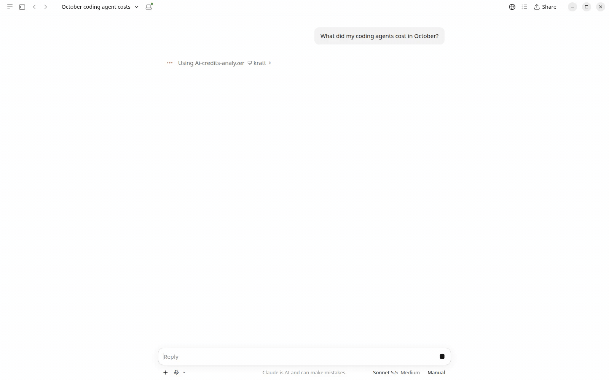

**Cost change.** A project's cost between two periods as a waterfall, then
the price changes behind it.

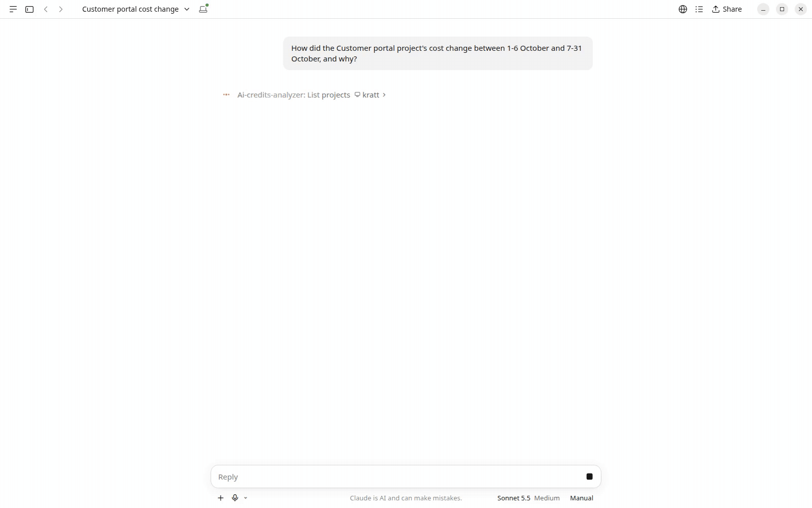

**Statement.** A project's October statement, with totals per currency and
how many turns each figure covers.

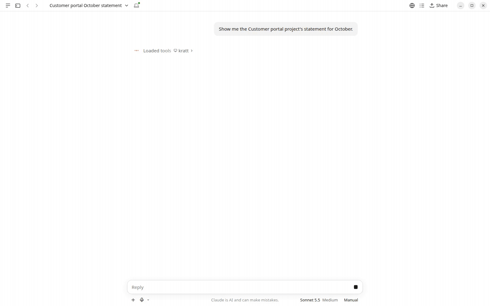

**Session picker.** A list of Claude Code sessions. **Analyse** puts a
request for one session in the chat, and Claude answers it.

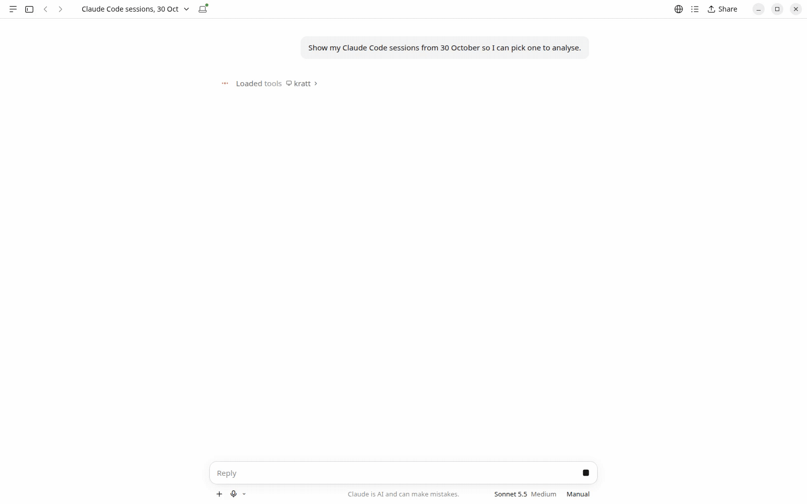

**Findings.** Findings across providers for October, filtered to anomalies,
with one finding's evidence opened.

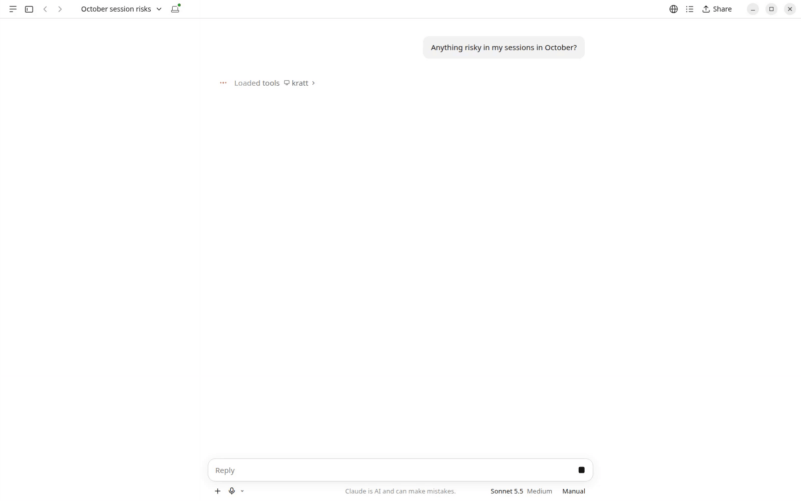

**Replay on another model.** A model comparison for a session, then one
model's replay turn by turn. The figures are **Simulated**.

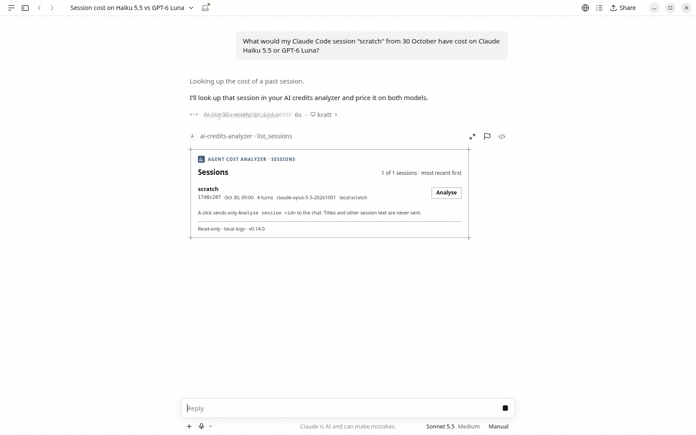

**Estimate.** A cost range for ten more active days, tagged **estimate**.

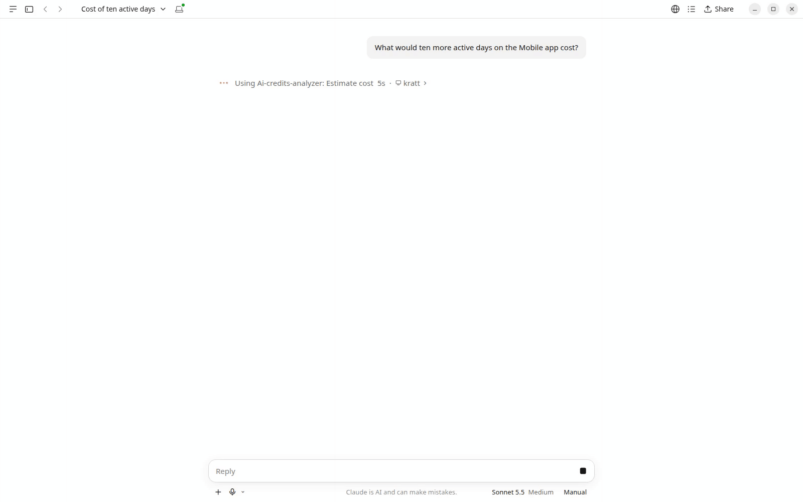

**Savings.** Asked "What could I have saved on my coding agents in October?",
Claude Desktop shows the savings view in the side pane. A row opens in place
with its tools and sessions, then one session's cost, then Back.

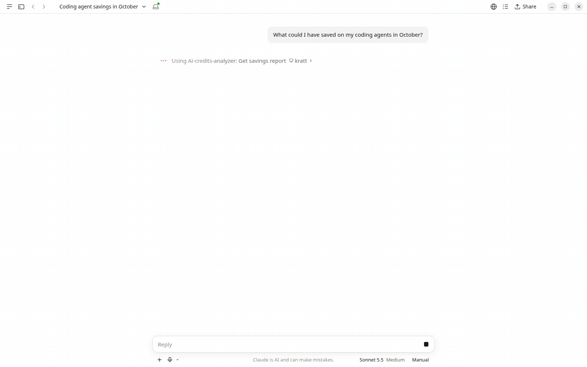

**Getting the views.** The npm package includes them. Register
`npx -y --prefer-offline agent-cost-analyzer mcp` as the server's command, as
in [Register by hand](#register-by-hand).
For Claude Desktop, add an entry to `claude_desktop_config.json` whose
`command` is `npx` and whose arguments are `-y --prefer-offline
agent-cost-analyzer mcp`, then restart it. To run from a clone instead, run
`npm run build` in the repo, then register `scripts/mcp-server.sh` as above
(for Claude Desktop, as the `command` of an entry in
`claude_desktop_config.json`, then restart it). The script adds
`--app-views-html packages/mcp-apps/dist/views.html` for you when the built
file exists. The VS Code extension includes the views; there is nothing to
build.

**No view appears?**

- **Standalone server from a clone:** the build is missing, so the server starts with
  text results only and says nothing. Run `npm run build`, then restart the
  server (or the host).
- **Your host doesn't support MCP Apps.** Claude Code CLI doesn't; it shows
  the text answer, which is all it can show.
- **VS Code:** use a version that renders MCP Apps (1.109 or later; the
  extension needs 1.144 or later) and check that the extension's MCP server
  is on ([the extension guide](vscode-extension-guide.md#interactive-views-in-copilot-chat)).

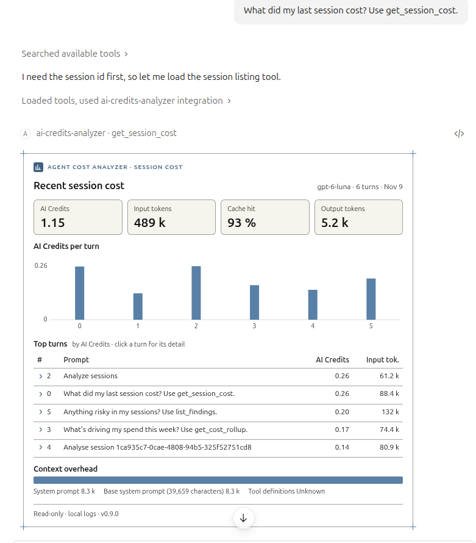

### Monthly allowance

The header shows how much of your monthly AI Credits allowance you have
used. It appears in Analyze mode only, whichever log provider is selected,
because it always reads your GitHub Copilot Chat sessions from VS Code on
this machine. Claude Code, pi and mitmproxy sessions record no AI Credits and
are not counted. Learn mode has no gauge. The VS Code extension has the same
gauge in its status bar (see the
[extension guide](vscode-extension-guide.md#monthly-allowance-gauge)).


**Set it.** Until you set an allowance the header shows **Set monthly
allowance**. Click it and fill in the dialog:

- **Monthly allowance (AI Credits)**: your plan's amount; match it to your
  GitHub billing page. The app suggests no amount.
- **Reset day (1 to 28)**: the day your billing period starts. The default is
  1.
- **Warn at (percent of allowance)**: when the gauge turns to "near limit".
  The default is 80.

Nothing is saved if a field is out of range; the dialog says which. The
values live in the app's `settings.json`
([settings folder](#cost-by-repository-and-project)), under
`monthlyAllowance`, and nothing is sent anywhere. To change them, click the
gauge, then **Change allowance**. **Remove allowance** hides the gauge at
once, with no confirmation; it keeps the reset day and warn percent, so typing the
number again brings it back.

**Read it.** The header gives the figure first and the level last, in words:
`812.40 of 1,000 AI Credits · near limit`. Color only adds to the words.
In the [narrow layout](#narrow-and-medium-windows) the text shortens to the figure plus "near" or "over". Click
the gauge for the details: the percentage used, what remains, the days left,
the period with its time zone, how many sessions have cost data, and the
split between **Copilot Chat** and **Agent Host and Copilot CLI** sessions
(a split with no sessions in the period is left out). The source row says
**VS Code** or **VS Code Insiders**, whichever the app reads. **Recount**
reads the logs again.

| State | The header says |
|---|---|
| Not set | **Set monthly allowance**, no figure |
| Normal, below your warn percent | `812.40 of 1,000 AI Credits` |
| Near limit, from your warn percent | `…AI Credits · near limit` |
| Over, 100 % or more | `…AI Credits · over` |
| Some sessions have no cost data | `at least 812.40 of 1,000 AI Credits`; the meter ends open, the total may be higher and the remainder is "up to" |
| No session has cost data | `AI Credits this month: unknown`; no total and no percentage, because unknown is not 0 |
| No Copilot session started this period | `No sessions this month` |
| No Copilot Chat logs on this machine | `AI Credits this month: no Copilot logs` |

**What counts.** Only billed AI Credits that Copilot recorded, summed over
the sessions of the current billing period. A session counts wholly in the
period it started in, in your local time zone, and a session without cost
data is left out, never counted as 0. These are not counted, and the
details dialog's **Not counted** list says so:

- sessions whose logs Copilot already pruned;
- spend made elsewhere: github.com chat, the cloud agent, other machines;
- Claude Code, pi and mitmproxy sessions.

The gauge shows the month to date against your allowance and nothing more:
there is no projection or run rate. Because of the gaps above, treat it as a
lower bound that can trail your GitHub billing page.

**Ask your AI chat.** The MCP tool `get_monthly_allowance` gives the same
answer ([MCP tools](#mcp-tools-and-prompts)). It is
read-only and cannot change the allowance.

The gauge has a screen-reader label per state and both dialogs trap focus,
close with Escape and return focus to the gauge. Screenshots of the gauge
and its dialogs are not in this guide yet.

### The insights dashboard

**Dashboard**, the fourth view on Analyze mode's center switch, works like
QlikView. It loads the most recent sessions (up to 200 per provider) from
**every** log provider at once, not just the selected source. It stays
reachable even when the selected source has no sessions: the empty state
offers **Open the dashboard across all providers**. Pick 7, 30 or 90 days,
or all time.

**List boxes** (left) hold every field: project, repository, vendor,
channel, provider, date, hour (UTC), session, model, trigger event, usage data, tool, tool kind, program,
outcome, failure category, signal type, severity and signal category.
Click a value to select only it; Ctrl/⌘-click to add or remove values.
Every other list box then colors its values:

| Color | Meaning |
|---|---|
| Green | Selected |
| White | Associated with the current selections |
| Light gray | Alternative: another value in a field you've already filtered |
| Dark gray | Excluded by the current selections |

The gray values answer "which providers had **no** failures?" or "which
models never triggered a signal?" at a glance. Charts are selection
surfaces too: click a day, a model, a tool, a failure category or a
program bar to select it. **Current selections** lists every filter.
Clear one with its ✕, undo the last change with **Back**, or press
**Clear all**.

What the view shows for the current selection:

- **What happened**: a plain-language summary covering which sessions
  and when, AI Credits and cache share, tool-call failures and their main
  cause, the most severe signal, anomalies and behavior changes.
- **KPI tiles**: AI Credits, sessions, turns, cache hit ratio, output
  tokens, tool calls, failure rate and security signals. Figures that a
  log source didn't record are never counted as 0. Each tile says how many
  turns or calls were known.
- **AI Credits by day**, **Tokens by model**, **Tool calls by tool**, **Why
  calls failed** and **Shell programs**.
- **Signals to review**: for each signal, what happened, when, why it was
  flagged (with a redacted excerpt of the command or path as evidence) and
  where. Click "where" to select that session. There are three kinds:
  - *Security signals* flag commands worth a second look: a download
    piped into a shell, decoded or `eval`'d code, `rm -rf` (on `/` or `~`
    as high), force push, `git reset --hard`, `sudo`, permissive `chmod`,
    access to SSH keys, cloud credentials or `.env` files, changes to shell
    profiles, crontab or services, writes under `/etc` or `/usr`, uploads
    with `curl -d`/`-T`, raw sockets (`nc`, `socat`), `ssh`/`scp`,
    installing a named package, and any action you or a policy denied.
  - *Anomalies* flag sessions far above the norm for AI Credits, output
    tokens, tool calls or failure rate (robust z-score over at least 8
    sessions). The reason states the value, the median and the sample size.
  - *Behavior changes* flag the first use of a program, tool or model
    after the earliest sessions.

  Signals are prompts to look, not verdicts. Mentioning a dangerous
  command inside a heredoc that isn't run by a shell (for example a test
  fixture or a doc being written) isn't flagged.
- **Most expensive sessions**: click one to select it.

#### Cost by repository and project

Each session is attributed to the **repository** it ran in (read from the
folder's git files; no `git` process, no network), the **vendor** and the
**channel** it was billed through. Clones, worktrees and subfolders of one
remote share one repository, and credentials in remote URLs are dropped.
Sessions whose repository can't be found sit under **Unattributed**, with
the reason (for example a mitmproxy capture records no folder). Sessions in
a repository that no project claims sit under **No project**.

To group repositories into **projects**, create `projects.json` in the
app's settings folder, beside `settings.json`:

| OS | Settings folder |
|---|---|
| Linux | `$XDG_CONFIG_HOME/agent-cost-analyzer` (default `~/.config/agent-cost-analyzer`) |
| macOS | `~/Library/Application Support/agent-cost-analyzer` |
| Windows | `%APPDATA%\agent-cost-analyzer` |

```json
{
  "version": 1,
  "projects": [
    {
      "id": "acme-portal",
      "name": "ACME customer portal",
      "members": [
        { "repository": "github.com/acme/portal-web" },
        { "repository": "github.com/acme/platform", "path": "services/portal-api" },
        { "repository": "github.com/acme/infra", "branches": ["portal/*"] }
      ]
    }
  ]
}
```

- A turn belongs to at most one project; the most specific member wins
  (path beats whole repository, branch beats no branch), so project totals
  add up.
- `aliases` merge repository keys; `captureRules` map mitmproxy capture
  files to a repository by glob.
- A file that fails validation is ignored and an optional warning appears;
  nothing is rewritten.
- `GET`/`PUT /api/projects` read and write the file; `GET /api/repositories`
  lists the repositories found.

Prices come from a bundled, dated **price book** (GitHub Copilot's table from
2026-10-01 and the Anthropic, OpenAI and Google APIs'). Add your own contract
prices under `channels.priceVersions` in `projects.json`. A figure priced
with one of your versions is labeled **your prices**, with the version id in
the label's accessible name and tooltip: on the Overview's Cost tile, Cost over
time, Compare, the Project tab, a statement's lines and the estimate, and on
Savings rows. Billed and reported figures never carry it. A price that isn't
in the book is shown as unknown with a reason, never as 0. Learn mode's
simulated prices come from the same book.

#### Cost over time and Compare

Above the dashboard's content, a view switch offers **Overview** (everything
above), **Cost over time** and **Compare**; below 700 px it is a **View**
dropdown. The list boxes and **Current selections** stay in force in all
three views. The two cost views follow the **Project**, **Repository** and a
single **Provider** selection; any other selection (a model, a date, a tool)
is named under the filters as "Not applied here", so a figure never only
looks filtered. The VS Code extension has both views too, over its Copilot
sessions; **Project** and **Billing** (below) are only in this app, because
the extension has no projects. **Savings** ([below](#the-savings-report)) is
a view here and, in the extension, a view of its own.

The filters sit in one row: the date range first (**This month**, **Last
month**, **Last 90 days**, **This year**), then, on Cost over time, the
bucket (**Day**, **Week**, **Month**, in UTC; the [monthly allowance](#monthly-allowance) counts in your local time zone, so a session near midnight can fall in different days), the unit (**AI Credits** or
**USD**) and the pricing (**As of use** or **Today's prices**). Figures in
the other unit are converted at GitHub's documented 1 AI Credit = $0.01, and
the view says so. Totals use each turn's preferred basis (billed, then
reported, then priced) unless the Overview's **Cost basis** switch picks
one.

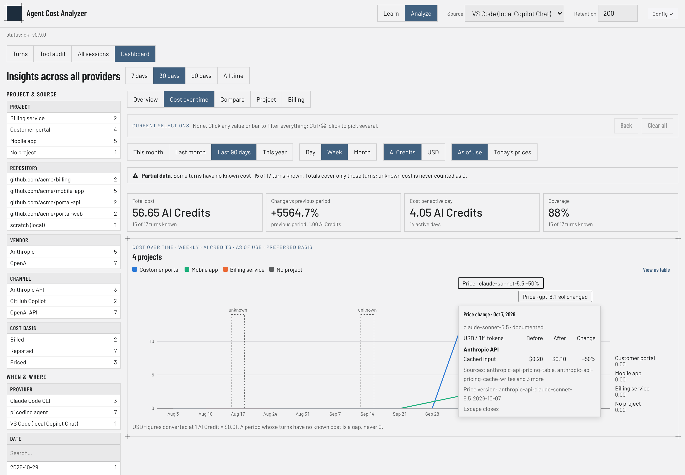

**Cost over time** shows:

- **KPI tiles**: total cost, change against the previous period of the same
  length, cost per active day and coverage. When some turns have no known
  cost, the tiles say how many are known ("6 of 7 turns known") and a
  *Partial data* warning appears; the total is never shown as complete.
- **One project or repository** as columns, with a separate **running
  total** chart below (never a second axis on the same chart). A column
  whose turns are only partly known carries a hatched cap.
- **Two to four** as lines, with a legend and a label at each line's end.
- **Five or more** as small multiples, one per project or repository, with
  **Shared scale** or **Own scale**.
- **Unknown cost is a gap**: a period whose turns have no known cost (for
  example Claude Code turns before the price book's first price) is left
  out of the line and marked with a dashed *unknown* band, never drawn as 0.
- **Price changes**: a documented price change in the range is a hairline
  with a tag such as "Price · claude-sonnet-5.5 −50%". The tag is in the Tab
  order; on focus or hover its tooltip lists each channel's old and new unit
  prices (USD per 1M tokens), the sources and the price version. Esc closes
  it.

A project keeps its color (its position in `projects.json`) and a
repository its color whatever you filter. **No project** and
**Unattributed** are gray. Focus a chart and use Left/Right, Home and End to
read each period; the tooltip lists every line with its coverage.

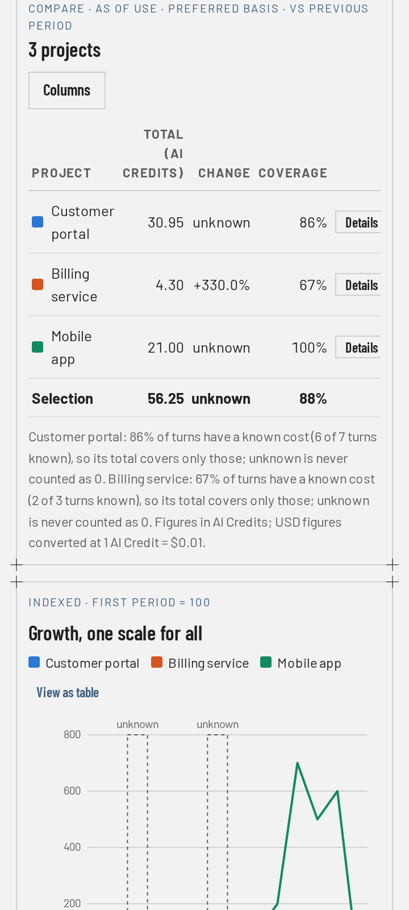

**Compare** puts two or more projects (or repositories, with **Group by**)
side by side: the selected ones, or every one still possible under the
current selections when fewer than two are selected (up to 20). **Compare
with** picks the previous period or the same dates last year.

- A **table** first: total, change, cost per session, per active day, share
  of the selection, cache-hit ratio, output share and coverage, with units
  in the headers and a **Selection** total row. A change against a period
  with nothing known is "unknown", never a change from 0. Below 700 px only
  the name, total, change and coverage stay; **Details** on a row opens the
  rest in a drawer (Esc closes it and returns to the button), and
  **Columns** keeps more.
- **Growth, one scale for all**: each line indexed to its first known
  period (= 100), so a large and a small project compare on one axis.
- **Where the money went**: share of the total as bars.

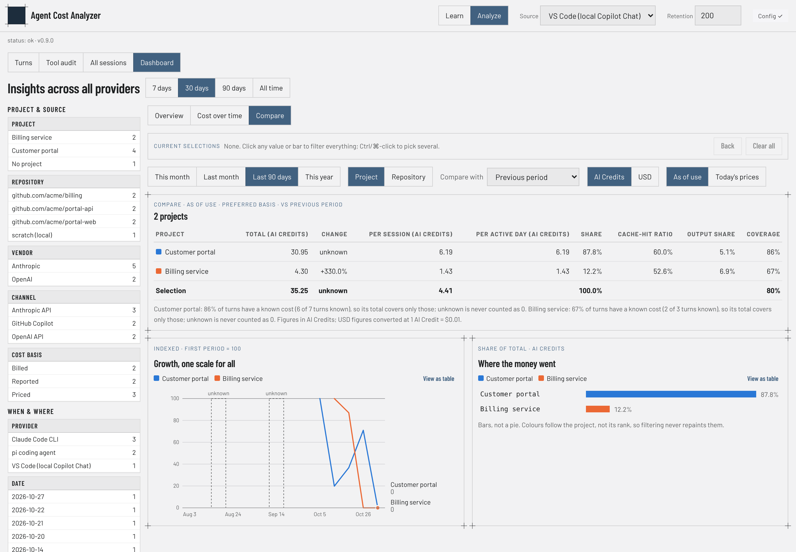

The views read `GET /api/cost/timeseries` and `GET /api/cost/compare`, the
same analyses the MCP tools `get_repository_cost`, `get_project_cost` and
`compare_costs` return. At 360 px the cost views stack under the view
dropdown:

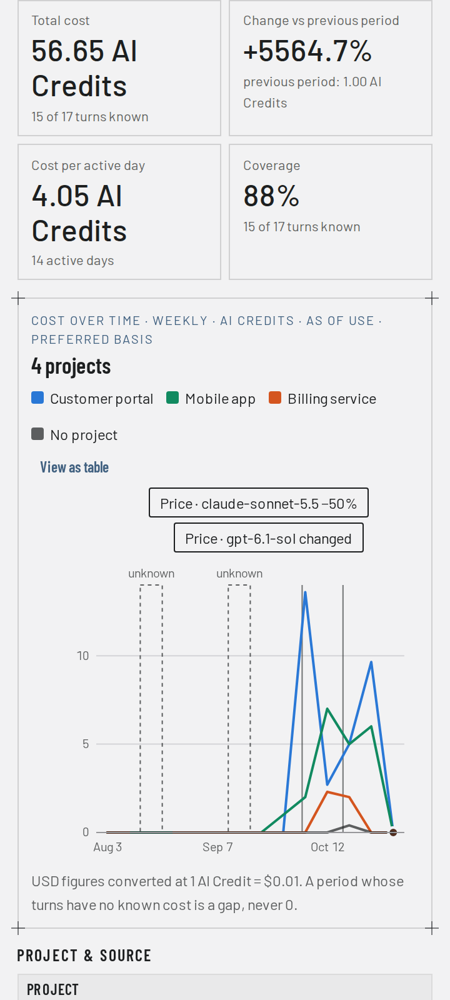

**Project** looks inside the one project selected in the **Project** list
box (select one first; the tab says so otherwise):

- **Cost by vendor** as bars. Click a vendor to see its **models**, and
  beside them the **tokens by type** (uncached input, cache write, cache
  read, reasoning, output) as a separate chart.
- **Why cost changed** between two months (**From** and **To**; by default
  the first and last month of the date range): a waterfall from the first
  month's cost through three effects to the second's. **Usage** is more or
  fewer tokens at the first month's prices, **price** is the second month's
  tokens times the change in unit price, and **mix** is work moved between
  models. They add up exactly to the change. Increases are red and decreases
  blue, and every step also has its written sign. The waterfall uses the
  priced basis as of use, since only prices can be split this way; turns
  without a priced figure are listed as not explained, never counted as 0.
- **Reconciliation** (GitHub Copilot turns): billed minus priced AI Credits
  per model and month. When Copilot billed a model more than 5% above or
  below the price book, the same way, two weeks in a row (20 turns or more
  each week), it is shown here as an **observed price change**: an inferred
  finding, a prompt to check the price book, not a price. The same change
  is a dashed marker on **Cost over time** (documented changes are solid).

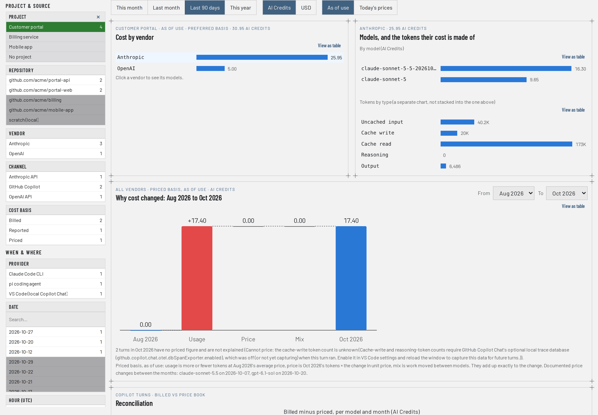

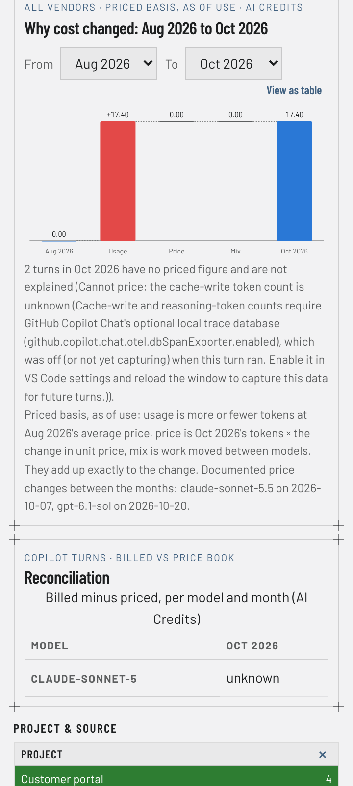

The Project tab reads `GET /api/cost/project` and `GET /api/cost/variance`;
the MCP tools `explain_cost_change` and `get_price_changes` give the same
answers.

**Billing** bills one project for a month. Pick the **Project** and the
**Period** (the last month that has ended is chosen first); months are
calendar months in this computer's time zone, which the statement names.

- The **statement** lists a line per channel, model and price version with
  its turns, tokens and amount. Turns whose cost is unknown are listed with
  the reason and are not counted as zero. Use under a subscription (Claude
  Code priced as API-equivalent) is left off unless the project includes
  it. The totals are per currency, with the project's markup and fixed
  lines, and in the project's own currency if it has one, at its fixed rate.
- **Issue statement** freezes it as a file in the app's settings folder,
  after a confirmation. Only a month that has ended can be issued. An issued
  statement never changes: if later logs or a price change give other
  figures, it shows **Differs from issued**, and **View diff** lists the
  exact differences.
- **Export…** writes the statement as CSV, JSON or Markdown (for an email to
  a client), with a preview, to copy or save. Exports hold session ids and,
  if you leave the box ticked, their titles; never message text.

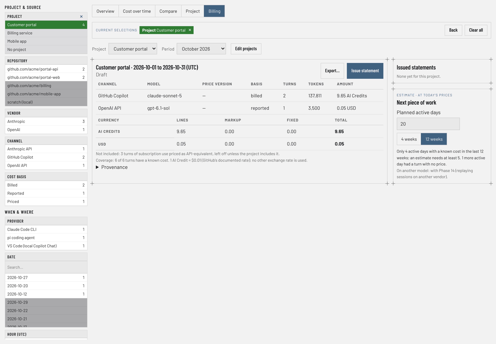

**Edit projects** (or **Create project** when there are none) opens the
**Projects** editor:

- **Repositories without a project** are listed first. Assign each one with
  its **Assign to** select; the keyboard is enough.
- Each project has a name, client, billing code, **markup** (%), **fixed
  lines** on every statement (a seat fee, say), an **own currency** at a
  fixed rate per USD, whether **subscription use** is included, and its
  members: a repository, optionally narrowed to a path inside it and branch
  patterns (`main, release/*`).
- **Capture rules** assign mitmproxy captures, which record no folder, to a
  repository; the editor says how many sessions are Unattributed and why.
- Problems, such as two projects claiming the same repository and branches
  (a turn counts in one project only), show next to the field and in a
  summary at the top, and **Save** stays disabled until they are fixed.

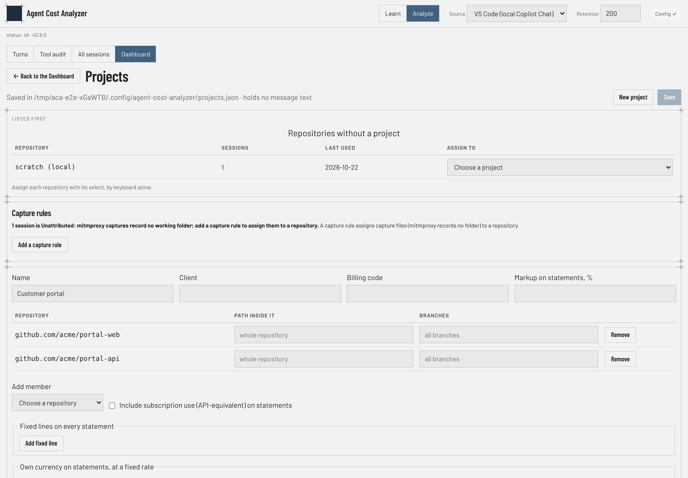

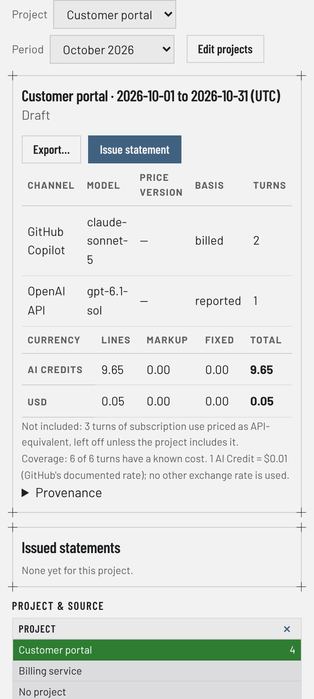

Billing reads `GET /api/statements`; the MCP tool `get_statement` gives the
same answer and never issues one, and the `prepare_statement` prompt drafts
a note to the client from it.

#### Estimate the next piece of work

Beside the statement, **Next piece of work** estimates what planned work on
the project will cost. Enter the **Planned active days** (20 to start) and
pick a **History window** of 4 or 12 weeks. The estimate is a range, never
one number: the median (p50) and 90th-percentile (p90) cost of one active
day in that window, at today's prices, times the planned days. It is shown
in AI Credits with USD beside it, with the days it used.

- An active day is a UTC day with at least one turn on the project. A day
  with any turn that has no price is left out, and the panel says how many.
- With fewer than 5 active days of known cost there is no range: the panel
  says why, and how many days had a turn with no price.
- The panel estimates on the models the sessions used. To estimate on
  another model, ask the MCP tool `estimate_cost` with a `model`: it
  replays the project's sessions on that model
  ([Replaying a session on another model](#replaying-a-session-on-another-model))
  and labels the estimate **Simulated**.

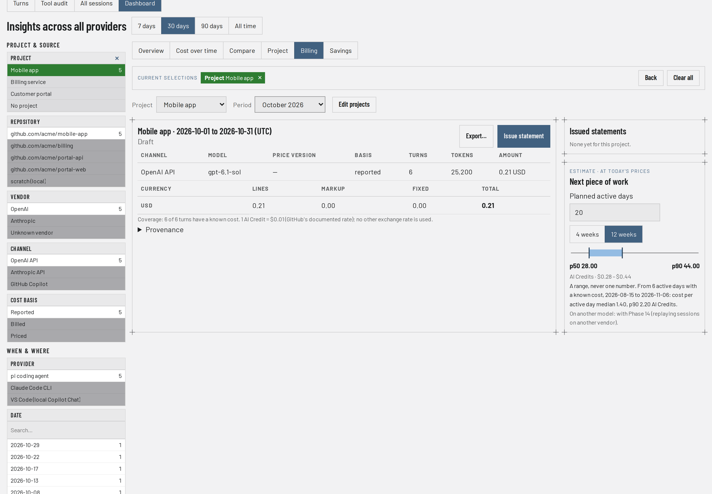

The panel reads `GET /api/estimates`, which also takes `sessions` instead
of `activeDays`. The MCP tool `estimate_cost` gives the same answer, and
the `estimate_work` prompt turns it into a short estimate with its inputs
and main uncertainty.

#### The savings report

**Savings** lists changes that would have cost less, ranked, each with the
change to make, its evidence and an estimated saving per week. It is a
view of the Dashboard's view switch, after **Billing**. It reads the most
recent sessions in the window from the selected providers (at most 500)
and computes the report when you open it; nothing is stored.

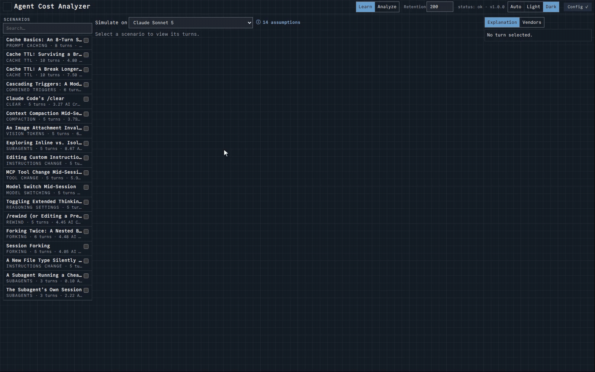

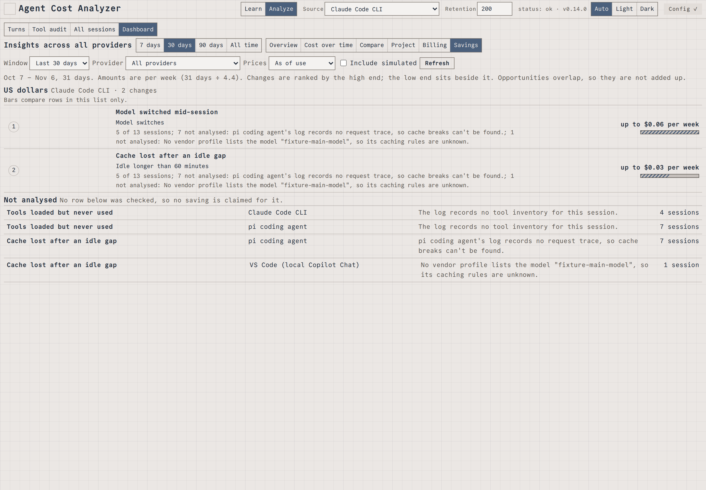

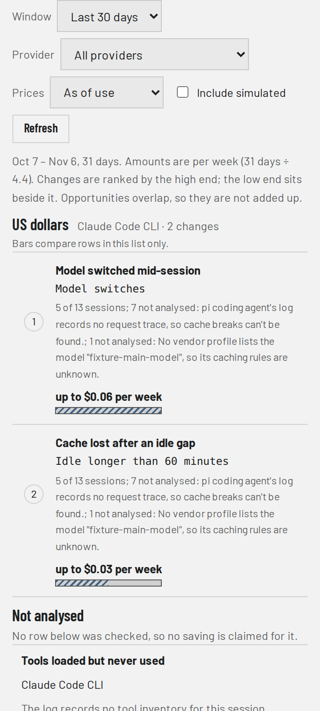

**The filters.**

- **Window.** Last 7, 30 (the default) or 90 days, by each session's start.
  The note under the filters gives the dates and says how a week is
  counted (days ÷ 7).
- **Provider.** All providers, or one.
- **Prices.** **As of use** (the default) or **Today's prices**.
- **Include simulated.** Off by default: it replays your most expensive
  sessions on other models, which takes longer.
- **Refresh** recomputes. A long load shows **Cancel**.

**What it checks.**

| Change | Found when | Amount |
|---|---|---|
| Tools loaded but never used | A tool, or an MCP server's tools, was loaded in sessions of the window and ran in none; each request resends its definition | A range per week: the cache-read price (likely) to the uncached price |
| Cache lost after an idle gap | A request's cache read fell short of the last prompt after a gap longer than the vendor's cache lifetime | "Up to" per week |
| Cache lost with no idle gap | The same, within the cache lifetime. The cause is named only where the log records it (tools, system prompt or instructions changed) | "Up to" per week |
| Model switched mid-session | A switch followed by a cache read below the threshold | "Up to" per week |
| Repeated failed tool calls | The same program or tool failed at least twice with the same failure category | "Up to" per week: the cost of the affected turns |
| A cheaper model | A replay of one of your 5 most expensive sessions on up to 3 cheaper models of the same vendor | **Simulated** (below) |

A cache break counts when the lost tokens are at least the vendor's
minimum cacheable size and half of the previous prompt. A session with a
break that has no price is left out of the row's amount and listed under
its coverage with the reason, so the amount and the coverage agree. Failed calls where
the user said no, and failing test or build runs, are not counted: they are
choices and the work itself.

What each provider gives:

| Provider | Unused tools | Cache breaks | Failed calls | Cheaper model |
|---|---|---|---|---|
| VS Code Copilot Chat (local) | Yes, with debug logging | Yes | Yes, where outcomes are logged | Yes |
| VS Code Agent Host | No: only the total tool-definition tokens | Yes | No: tool calls unknown | Yes |
| Claude Code | Yes, per tool and MCP server | Yes | Yes | Yes |
| pi | Yes, per tool, from the session file's system messages (each tool counted for the requests it was declared for); "Not priced" on a local model | No: no request trace yet | Per the [tool-call audit](#auditing-tool-calls) | No |
| mitmproxy | No | No | Per the tool-call audit | No |

**Reading a row.** Each row has the kind, the subject (a tool, MCP server
or program), the amount per week, a bar and its coverage ("38 of 41
sessions; 3 had no request trace").

- **Range** ("6.2–38.4 AI Credits per week"): the solid part of the bar
  is the low end, the hatched part the rest up to the high end.
- **Up to** ("up to 12.0 AI Credits per week"): no lower bound is claimed,
  because a break is not always avoidable.
- **estimate**: the tokens are counted by a local tokenizer over the tool
  definitions, not by the vendor.
- **inferred**: the grouping is a guess. Copilot names MCP tools
  `mcp_<server>_<tool>`, and a server name can hold `_`.
- **Not priced**: no price for that model on that date, or no known price
  channel at all (pi on a local model). It has no bar, never counts as 0
  and sorts last; its tokens and requests are still shown.
- **under 0.1 AI Credits** (**under $0.01**): a known saving too small to
  show at one decimal (two for dollars); it is not zero and ranks by its
  real size.

Every figure is a counterfactual priced from the price book, so it can't be
billed. Rows are ranked by the high end, one list per currency (AI Credits
for Copilot, US dollars otherwise); amounts are never converted between
them. **There is no total**: the opportunities overlap, so adding them
would count some savings twice.

**The detail.** Select a row to open its evidence (sessions, requests,
tokens, occurrences, coverage), how the amount is set, the amount over the
whole window, the change to make and the price versions behind it.

- **Copy text** puts the change on the clipboard as one line, at most 600
  characters. The text is fixed wording with your numbers and names filled
  in; it says what to do, never that anything was done. The report changes
  none of your settings or files.
- **Tools.** A "Tools loaded but never used" row lists its tools: the
  five largest with their definition tokens per request ("about N", an
  estimate, averaged over the sessions that loaded the tool) and "loaded in
  N sessions", then "and N more". "(about X)", the row's total minus the
  five, is shown only when every one of the five was loaded in every
  session of the row; then the figures differ from the row's total by a few
  tokens of rounding. A tool loaded in only some sessions counts for more
  in the list than in the total, so the rest's tokens are left out. The
  chat tool gives the model up to 20 tools and its text answer the first
  five.
- **Sessions.** Each listed session shows its title first, then its id and
  its date (in your time zone) under it, and its own saving over the window
  at the right, with the row's label ("up to", a range). The title is the
  one the Dashboard shows for that session, looked up in your browser; a
  session without one shows the id alone. A long title is cut to one line
  and shown in full on hover. Titles never reach the report, the chat or
  Copy. A session that could not be priced says "Not priced", with the
  reason once under the list, never 0; one whose log has no start says
  "date unknown".
- **Open in Analyze** opens a session of the row in the turns view. For a
  session of another provider it also switches the selected provider, as
  the Provider select does, and the app saves that choice in its own
  settings.
- Below 600 px the detail replaces the list; **Back** returns to it.

**Simulated.** A cheaper-model replay is shown apart, unranked and never
beside the priced rows: "Replayed on *model*, the same conversation would
have cost about X% of what it did". It carries the replay's self-check
(how many requests of the session's own-model replay match the log), its
coverage and its assumptions. The other model would not have answered the
same way.

**Not analysed.** What could not be checked is listed with the reason,
never shown as a saving of 0: a provider with no tool inventory or request
trace, a pi session whose file holds no system message (the logger's
record names the tools but not their size), a session whose log could not
be read, or sessions over the 500-session cap (only the most recent are
read). A row's coverage line counts them too. A branch of a forked pi file
counts the requests it shares with an earlier branch of the same file
once, under that branch.

The report reads `GET /api/savings` (`since`, `until`, `provider`,
`pricing`, `includeSimulated`).

**In the chat.** The MCP tool `get_savings_report` gives an agent the same
ranked rows (in VS Code Copilot Chat, Copilot sessions only), cut to the 10
highest unless it asks for up to 20, with session ids (each with its date
and its saving over the window), model ids and up to 20 tools of an
unused-tools row, but no session titles or prompts. In a host with MCP Apps it opens the savings view
([Interactive views in the chat](#interactive-views-in-the-chat)). A recording
of the view in Claude Desktop is there too.

## Charts as tables

Every chart has a **View as table** button in its toolbar: the AI Credits
sparkline, the prompt composition diagram, the tool-audit and dashboard
columns, the ranked bars, the Compare models bars, and the cost views' charts (where price changes
are rows of their own and an unknown period reads "unknown"). It swaps the chart for a table of the same
numbers, and pressing it again returns to the chart. Use it when a chart is
hard to read (color, size, a screen reader) or when you want exact values.

## Long loads and canceling

While the dashboard, the all-sessions audit or a turn's detail loads, a
progress bar and skeleton show with a **Cancel** button. Canceling replaces
the view with "Loading cancelled" and a **Retry** button. Nothing is changed
either way: these views only read your logs. A load that fails shows the
error with **Try again** and **Copy details**.

## Narrow and medium windows

The layout follows the room the app leaves for the turns: its width minus
the session list column, when that column is shown. Nothing is ever cut
off on the right; a table wider than its column scrolls sideways inside it.

- **Wide** (about 1250 px and up with the session list, 1000 px without) —
  the three columns described above.
- **Medium** (from about 770 px with the session list, 510 px without) —
  the right column becomes a drawer. Select a turn and press **Details** (or
  press Enter on a row) to open it; **Esc** or its close button closes it
  and returns focus. The turns table keeps the **Columns** chooser.
- **Narrow** (below that) — the center switch becomes a **View** dropdown,
  the session's KPIs show as 2x2 tiles, and the turns table keeps only
  Turn, Trigger, AI Credits and Cumulative, plus the simulated Cost while a
  replay is shown. The other columns appear in the **Details** drawer for
  the selected turn, the simulated ones included. The column chooser isn't
  offered.

The system prompt inspector stacks its structure, text and description
columns the same way, and the insights dashboard puts its filter lists in
a slimmer column, then (below 720 px) after the insights.

The layout works down to 360 px wide.

## Keyboard use

- **Session list and turns table** — one Tab stop each. Use Up/Down,
  Home and End to move, and Enter or Space to select. In the medium and
  narrow layouts, Enter on a turn also opens its Details drawer.
- **Timeline scrubber** — a slider: arrow keys step through turns.
- **Column chooser** — Tab to **Columns**, Enter to open, Esc to close and
  return to the button.
- **Replay on** — a standard select; **Compare models** is a toggle
  button.
- **Replay summary** — a dialog: it traps focus, closes with Esc, its
  close button or a click outside, and gives focus back to the
  **Replay summary** button.
- **Dialogs and drawers** — the advice export dialog traps focus and closes
  with Esc; drawers take focus when they open, give it back when they
  close, and never trap Tab.
- **System prompt diagram** (the zoomable composition diagram in the
  [system prompt inspector](#the-system-prompt-inspector)) — one Tab stop.
  Left/Right move along a level, Home/End jump to the first or last cell,
  Down goes to a section's first child, Up goes to its parent, and Enter or
  Space does what a click does: zooms into the section (and selects it), or
  zooms back out from the focused one.
- **Charts** — hover tooltips also appear on focus; Enter selects, as a
  click does.

## Reduced motion

If your system asks for reduced motion (`prefers-reduced-motion`), the app
turns off transitions, the loading bar's animation and smooth scrolling.

## License

[MIT](../LICENSE)
