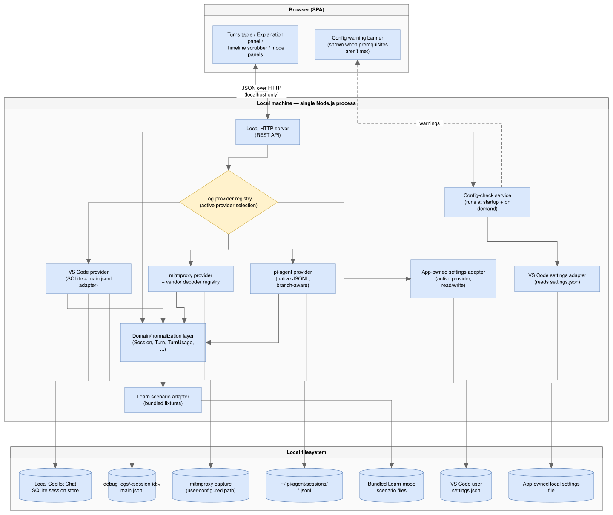
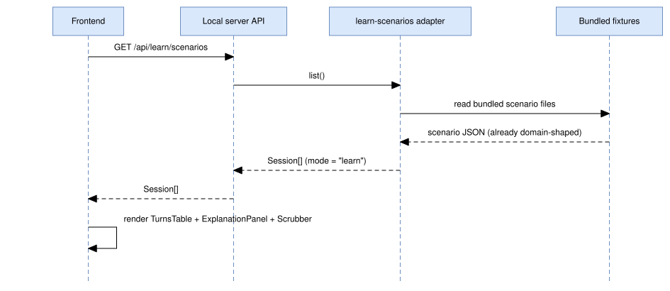
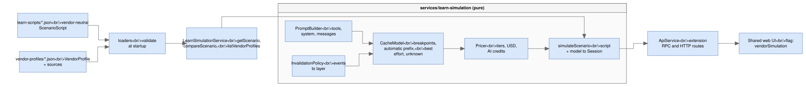
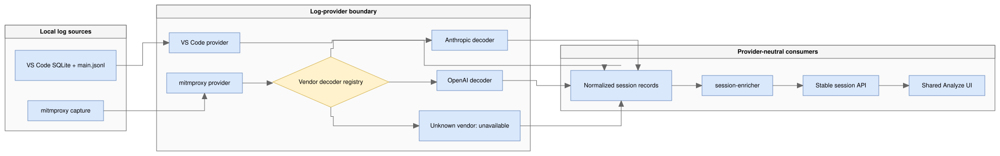
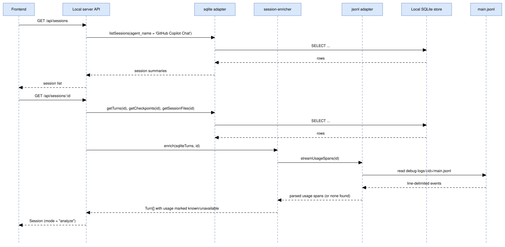
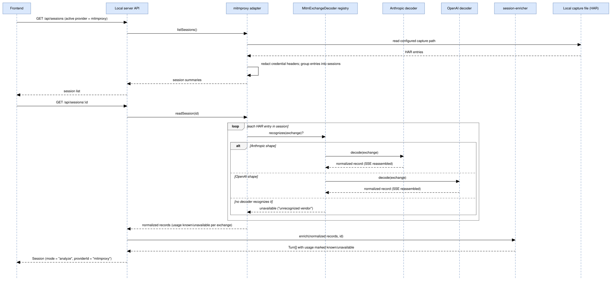
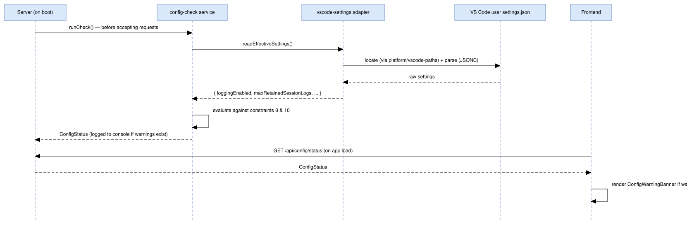
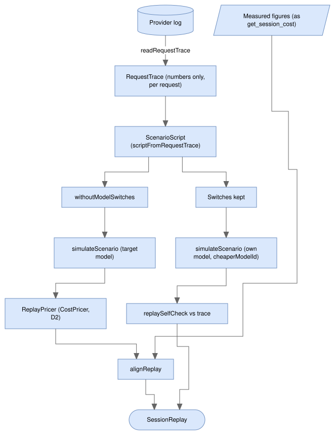

# Architecture: Agent Cost Analyzer and AI Credits Analyzer

**Last changed:** 2026-11-13 · **Source:** https://github.com/raulkivi/agent-cost-analyzer

## 1. Purpose & scope

This document translates [vision.md](vision.md) into a concrete system design:
components, data flow, module boundaries, and technology choices. It exists so
implementation decisions (what talks to what, where a piece of logic lives)
are made once, deliberately, and can be revisited as a whole rather than
rediscovered file by file.

Nothing here changes the product scope in vision.md — this is the "how", not
the "what"/"why".

## 2. Guiding constraints (carried from the vision)

These constraints shape every decision below and should be checked against
before deviating from this document:

1. **Local-only, offline-first.** No dependency on the cloud-synced (DuckDB)
   store or any network service. Only local sources reachable through a
   configured log provider — the SQLite session store, local `main.jsonl`
   debug-log files, and local mitmproxy captures — are read (vision §4, §6).
2. **A local server is required.** The browser cannot read arbitrary local
   files (SQLite DB, `.jsonl` logs) directly, so a small local process must
   read them and serve normalized data to the UI (vision §5).
3. **Decoupled visualization from data-loading.** The UI layer must not
   assume *how* data was sourced, so it can later be swapped into a VS Code
   webview without a rewrite (vision §5, §7).
4. **One shared visual language for Learn and Analyze modes.** Both modes
   render the same turns table / explanation panel / scrubber layout, so they
   must consume the same normalized data shape (vision §3.3).
5. **Defensive, version-tolerant parsing of `main.jsonl`.** Its `attrs` schema
   is undocumented and varies by event `type` and provider (vision §4, §7 open
   questions).
6. **Explicit "unavailable", never fabricated.** If a session's `attrs` lack
   usage data, the app must say per-token figures are unavailable and fall
   back to behavioral proxies (turn counts, duration, checkpoints) instead of
   showing zeros or estimates (vision §4). One narrow, deliberate exception
   (§6.2.2 Phase 6 addendum): a `TokenCount` may carry `estimated: true` when
   it's a real local-tokenizer count run over real captured text — never a
   fabricated number or a char-count-divided-by-N guess — and every place
   that renders it labels it visibly as an estimate. Still forbidden
   wherever the underlying text itself isn't captured.
7. **Single-developer, single-machine.** No multi-tenant concerns, no auth
   system — but still no unnecessary exposure of the local filesystem (see
   §11.2 Security).
8. **Rich `main.jsonl` content is opt-in, not default.** Verified directly:
   without the advanced, off-by-default VS Code setting
   `github.copilot.chat.agentDebugLog.fileLogging.enabled` (requires a
   window reload after toggling), `main.jsonl` contains only a
   `session_start` line — no usage data at all, for any session. The app
   must treat "no usage spans found" as the **expected default case**, not
   an edge case, and must guide the user to enable that setting for future
   sessions rather than silently falling back every time (vision §4).
9. **The app checks its own prerequisites at startup, not just per-session.**
   Rather than only reacting turn-by-turn (constraint 8), the server
   validates the relevant VS Code settings once at boot — and again on
   demand — and surfaces an actionable warning with concrete fix steps if
   they aren't met, instead of leaving the user to discover the gap only
   after loading a session that turns out to have no usage data (§6.3).
10. **A shallow retention window defeats the point of Analyze mode.**
    `github.copilot.chat.agentDebugLog.fileLogging.maxRetainedSessionLogs`
    defaults to 50, which only keeps the last 50 sessions' logs on disk. The
    app requires/recommends at least **200** so there's a meaningful pool of
    historical sessions to analyze, not just whatever ran most recently
    (§6.3).
11. **Development follows TDD; module design follows SOLID.** Tests are
    written before (or alongside, red-green-refactor) the implementation
    they verify, never retrofitted after the fact (§11.4). Every module
    boundary in §4/§10 is drawn along SOLID lines, not by convenience
    (§11.5).
12. **Analyze ingestion is provider-extensible.** VS Code local logs,
  mitmproxy captures, and the [pi coding agent](https://pi.dev)'s own JSONL
  session logs are all supported log providers. A provider converts its
  source into the normalized domain model through a provider-local decoder
  pipeline; adding one must not change the session API contract or frontend
  components. mitmproxy decoders are vendor-specific (at least Anthropic and
  OpenAI) because their SDK wire formats differ. Unlike the other two, pi
  already normalizes its own token usage per message, so its provider reads
  and interprets that native format directly rather than decoding a raw
  vendor wire protocol.

## 3. High-level system overview



<!-- mermaid-source: diagrams/3-high-level-system-overview.drawio.svg
```mermaid
flowchart TB
    subgraph Browser["Browser (SPA)"]
        UI["Turns table / Explanation panel /<br/>Timeline scrubber / mode panels"]
        Banner["Config warning banner<br/>(shown when prerequisites aren't met)"]
    end

    subgraph Local["Local machine — single Node.js process"]
        API["Local HTTP server<br/>(REST API)"]
        Domain["Domain/normalization layer<br/>(Session, Turn, TurnUsage, ...)"]
        Registry{"Log-provider registry<br/>(active provider selection)"}
        VscodeProvider["VS Code provider<br/>(SQLite + main.jsonl adapter)"]
        MitmProvider["mitmproxy provider<br/>+ vendor decoder registry"]
        PiAgentProvider["pi-agent provider<br/>(native JSONL, branch-aware)"]
        ScenarioAdapter["Learn scenario adapter<br/>(bundled fixtures)"]
        SettingsAdapter["VS Code settings adapter<br/>(reads settings.json)"]
        ConfigCheck["Config-check service<br/>(runs at startup + on demand)"]
        AppSettings["App-owned settings adapter<br/>(active provider, read/write)"]
    end

    subgraph Disk["Local filesystem"]
        DB[("Local Copilot Chat<br/>SQLite session store")]
        Logs[("debug-logs/&lt;session-id&gt;/<br/>main.jsonl")]
        Capture[("mitmproxy capture<br/>(user-configured path)")]
        PiSessions[("~/.pi/agent/sessions/<br/>*.jsonl")]
        Fixtures[("Bundled Learn-mode<br/>scenario files")]
        Settings[("VS Code user<br/>settings.json")]
        AppConfig[("App-owned local settings file")]
    end

    UI <--&gt;|"JSON over HTTP<br/>(localhost only)"| API
    API --&gt; Domain
    API --&gt; Registry
    Registry --&gt; VscodeProvider --&gt; DB
    VscodeProvider --&gt; Logs
    Registry --&gt; MitmProvider --&gt; Capture
    Registry --&gt; PiAgentProvider --&gt; PiSessions
    Domain --&gt; ScenarioAdapter --&gt; Fixtures
    Registry --&gt; AppSettings --&gt; AppConfig
    API --&gt; ConfigCheck --&gt; SettingsAdapter --&gt; Settings
    ConfigCheck -.->|warnings| Banner
    VscodeProvider --&gt; Domain
    MitmProvider --&gt; Domain
    PiAgentProvider --&gt; Domain
```
-->

The browser never talks to SQLite, mitmproxy captures, or the filesystem
directly — every read goes through the local server's API, which normalizes
Learn-mode scenarios and Analyze-mode sessions from whichever log provider is
active into the **same domain shape** (§5) before returning them. This is
what lets the frontend stay ignorant of where data came from, satisfying
constraint 3. See §6.2.1 for the provider boundary in detail.

## 4. Component breakdown

### 4.1 Local server (backend)

Responsibilities: own both data sources, normalize their output into the
shared domain model, and expose it over a small REST API. Never makes
outbound network calls.

| Module | Responsibility |
|---|---|
| `data-sources/sqlite` | Read-only queries against the local Copilot Chat session store (`sessions`, `turns`, `checkpoints`, `session_files`, `session_refs`) per vision §4/18.1 |
| `data-sources/jsonl` | Streams a session's `main.jsonl`, extracts request/response spans, and pulls out token/cache usage from each event's `attrs` — defensively, per §7 below. `turn-inspector-reader.ts` (Phase 9.5) is a second, on-demand, bounded read of the same file for one turn's wide-content `attrs` (§6.2.4) |
| `data-sources/log-providers` | Owns the `LogProvider` registry, exposes provider descriptors, persists the active provider in app-owned local settings, and presents one provider-neutral session-reading interface to the API/services layer. `build-content-parts.ts` (Phase 9.5) is a provider-neutral placeholder-detection helper shared by both concrete providers' `readTurnDetail` (§6.2.4) |
| `data-sources/log-providers/vscode` | Adapts the existing SQLite and `main.jsonl` readers into the `LogProvider` interface; VS Code-specific paths, settings, and event extraction stay here. Also owns the optional `agent-traces.db` cache-write/reasoning enrichment (Phase 8.5) — folded in here, not a separate provider id or a direct `app.ts` path (decided 2026-08-10, see `implementation-plan.md` Phase 9) — and `turn-inspector-builder.ts` (Phase 9.5), which turns one turn's isolated envelopes into a `TurnInspectorDetail` (§6.2.4) |
| `data-sources/log-providers/mitmproxy` | Reads local mitmproxy capture files and dispatches each intercepted LLM request/response to the vendor decoder that recognizes its SDK/protocol shape |
| `data-sources/log-providers/mitmproxy/decoders` | Independent vendor decoders (initially Anthropic and OpenAI) that convert a matched exchange into provider-neutral intermediate records; an unrecognized exchange is reported as unavailable, never guessed |
| `data-sources/pi-agent` | Reads the [pi coding agent](https://pi.dev)'s own JSONL session format (`~/.pi/agent/sessions/`) directly — no OS-level store dependency. Reconstructs pi's branchable entry tree, groups a branch into turns, and extracts usage already normalized per message by pi itself (no vendor wire-protocol decoding needed, unlike mitmproxy) |
| `data-sources/learn-scenarios` | Loads bundled scenario fixtures (seeded from [agentic-coding-explained.md](agentic-coding-explained.md)) that already conform to the domain model, so Learn mode needs no parsing/enrichment step |
| `services/session-enricher` | Converts a selected provider's normalized structural/usage records into `Session`/`Turn` values; it does not know whether they originated in VS Code, mitmproxy, Anthropic, or OpenAI |
| `platform/vscode-paths` | Resolves the active VS Code variant's user-data directory across OSes (Linux/macOS/Windows, Stable/Insiders) so `sqlite`, `jsonl`, and `vscode-settings` all locate the right files without duplicating detection logic |
| `data-sources/vscode-settings` | Reads and merges the user (and workspace, if present) `settings.json` (JSONC) to read the prerequisite Copilot Chat debug-logging settings |
| `services/insights` | Phase 9.11 ([plans/insights-dashboard.md](plans/insights-dashboard.md)): flattens sessions from every registered provider into the `InsightsDataset` star schema and runs injected `FindingDetector` strategies: rule-based security signals (`SecurityRule` table), robust z-score anomalies, and first-use behaviour changes. Pure apart from `InsightsService`, which loads providers through a narrow `listProviders()` port |
| `services/cost-attribution` | Phase 15 ([plans/cost-by-repository-and-project.md](plans/cost-by-repository-and-project.md) §4, §7): `RepositoryResolver` (a folder → its repository, over a read-only `FileSystem` port, with `RemoteUrlNormalizer`), `ProjectCatalog` and `ProjectMatcher` (the projects file; one project per turn, D1), capture rules for mitmproxy, the vendor and channel resolvers, and `SessionAttributor`, which gives a session or turn its repository, project, vendor and channel (§6.4) |
| `services/pricing` | Phase 15 §5–§6: the `PriceBook` with history (bundled `fixtures/price-book/` plus the user's versions), `CostPricer`, which gives each turn its billed, reported and priced `CostFigure`s, and `PriceChangeDetector` (documented and observed price changes) |
| `services/cost-analysis` | Phase 15 §8: the cost cube over the Insights dataset and the pure builders for cost over time, compare, project cost and variance (usage, price and mix effects), behind `CostAnalysisService` |
| `services/billing` | Phase 15 §8.5–§8.6: statements (draft, freeze, diff, CSV/JSON/Markdown export) and estimates (a p50–p90 range); standalone app only |
| `data-sources/projects`, `data-sources/statements` | Phase 15: the projects file and issued statements, as JSON in the app's own settings folder (the only files the app writes besides `settings.json`, §11.2) |
| Request traces (`RequestTraceReader`) | Phase 14 ([plans/analyze-session-replay.md](plans/analyze-session-replay.md) §4.1, step 14.2): an optional `LogProvider` capability (`canReadRequestTrace`, ISP) that reads a session's main chain as a numbers-only `RequestTrace`, one record per LLM request. `ClaudeCodeLogProvider` and `VscodeLogProvider` implement it (classic store first, then Agent Host through `CopilotSessionSource.readRequestTrace`); pi and mitmproxy don't yet (D1). One pure builder per provider, each reusing its provider's own turn building: `buildClaudeCodeRequestTrace` (`data-sources/claude-code/request-trace-builder.ts`), `buildLocalRequestTrace` (`data-sources/jsonl/local-request-trace.ts`) and `buildAgentHostRequestTrace` (`services/session-enricher/agent-host-request-trace.ts`) |
| `services/session-replay/request-trace-scripter.ts` | Phase 14 step 14.3: `scriptFromRequestTrace` (and the injectable `RequestTraceScripter`) turns a trace into a `ScenarioScript` with compaction, clear, model-switch and `extended-ttl` events (pure). It replaced 13.5a's `scriptFromCapture`; calibration replays its captures through it |
| `services/session-replay/replay-model-resolver.ts` | Phase 14 step 14.4: `ReplayModelResolver` maps a log's model id (a date suffix, `[1m]`, `copilot/`) to a vendor profile's model through Phase 15's `candidateModelIds`; no near match is guessed, and a model whose caching is undocumented is refused |
| `services/session-replay/replay-pricer.ts` | Phase 14 step 14.4, D2: `replayChannel` picks the price channel (a Copilot session stays on Copilot; any other goes to the target vendor's API) and `ReplayPricer` prices each simulated request through Phase 15's `CostPricer` at list prices, as of the request's date. `convertCost` converts only at 1 AI Credit = $0.01 |
| `services/session-replay/replay-aligner.ts` | Phase 14 step 14.4: `alignReplay` sums simulated requests into the session's turns, with paired totals and coverage (pure) |
| `services/session-replay/replay-self-check.ts` | Phase 14 step 14.4 (G4, D8): `replaySelfCheck`, calibration's own check of a replay on the session's own model against its log |
| `services/session-replay/replay-script-variants.ts` | Phase 14 step 14.4: `withoutModelSwitches`, the script a target model runs (A1, A5) |
| `services/session-replay/session-replay-service.ts` | Phase 14 step 14.4: `SessionReplayService` (`replay`, `compare`) composes trace, scripter, the Learn simulator, pricer, aligner and self-check over narrow ports (DIP); it owns the limits and the A1–A5 assumption texts |
| `services/session-replay/replay-query-params.ts` | Phase 14 step 14.5: the replay options' zod schemas, shared by HTTP, the webview RPC and MCP so all three give the same messages |
| `composition/create-session-replay.ts` | Phase 14 step 14.5: `createSessionReplay`, the one wiring of `SessionReplayService` used by the standalone app, its MCP server, the extension and its MCP server |
| `mcp/replay-tools.ts` | Phase 14 step 14.5 (D7): the `replay` tool group, `replay_session` and `compare_models_for_session` (read-only, domain output schemas) |
| `mcp/apps/` | Phase 12 ([plans/mcp-apps.md](plans/mcp-apps.md) §4.2): the MCP App views as a tool group. `registerAppViews` registers the one `ui://<server name>/views.html` resource, adds `_meta.ui.resourceUri` to the tools in `APP_VIEW_TOOL_NAMES` that the server actually registered (`captureRegisteredTools` records them, so the other groups don't change) and registers the app-only `get_turn_series`. `ViewSource` is the port for the HTML (`FileViewSource` reads the built file on every call, `InMemoryViewSource` is the test double). `injectBrand` fills the page's `aca-brand` meta with the escaped `ViewBrand` from `toViewBrand(identity, version)`. `resolveAppViews(path, onMissing)` turns a path into the `appViews` option, or into nothing when the file is missing, so both entry points start without the group instead of failing at `resources/read` |
| `services/cost/turn-series-builder.ts` | Phase 12 A1: `buildTurnSeries` turns a session into the bounded per-turn figures (default 500 turns, at most 2000) that `get_turn_series` returns for the chart. `SessionCost` carries only `topTurns` |
| `services/config-check` | Runs at server startup and on demand (§6.3): checks `agentDebugLog.fileLogging.enabled` and `maxRetainedSessionLogs` against constraints 8/10, producing actionable `ConfigWarning`s |
| `domain` | The shared normalized TypeScript types (§5), plus schema validation, used by every other module and re-exported to the frontend build |
| `api` | Thin REST layer (§8) that calls into `domain`/services and returns JSON; no business logic lives here |

#### 4.1.1 MCP App views: runtime flow (Phase 12)

A host that supports MCP Apps (VS Code Copilot Chat, Claude Desktop) shows
an interactive view next to the text result of the tools below. The server
stays read-only and makes no network call (constraint 1); the view is one
static file.

1. **Tool call.** `tools/list` gives `get_session_cost`, `get_cost_rollup`, `get_repository_cost`, `get_project_cost`, `compare_costs`, `explain_cost_change`
   and `list_findings`, and (A26, Increment 3) `replay_session`, `compare_models_for_session`, `get_price_changes`, `get_statement`, `estimate_cost`, `get_session_audit`, `get_audit_rollup` and `list_sessions`, a `_meta.ui.resourceUri` of
   `ui://<server name>/views.html` (and the legacy flat key). The model
   calls the tool as before. Its name, input schema, output schema and
   `content` are unchanged, so a host without MCP Apps, and Claude Code
   CLI, get the same text. The extension has no billing group (D7), so its
   list has no `get_statement` or `estimate_cost` and names no billing view;
   U14 and U15 also render the neutral "No view for this result" state for
   the extension's brand. The router sends the Increment 3 tools to U12
   (`replay_session`, `compare_models_for_session`), U13
   (`get_price_changes`), U14 (`get_statement`), U15 (`estimate_cost`), U4
   (`get_session_audit`, `get_audit_rollup`) and U5 (`list_sessions`).
2. **Resource read.** The host reads the URI with `resources/read`. The
   server answers with the built `views.html` (MIME type
   `text/html;profile=mcp-app`) after `injectBrand` has put the product's
   name, version and id into the page. The resource declares no `csp`
   domains, so the host's default applies.
3. **Render.** The host renders the page in a sandboxed iframe and sends it
   the host context (theme, style variables, display mode, the tool's
   name), the tool's input and its result over postMessage JSON-RPC. The
   page picks its view from `toolInfo.tool.name` (Claude Desktop), then
   `toolCall.toolName` (VS Code), then the shape of `structuredContent`.
4. **Drill-down.** A click makes the view call a tool through the host,
   which forwards it to this server: `get_turn_series` for the chart,
   `get_turn` for an expanded turn, `get_session_cost` from the rollup and
   from a project's top session, `list_findings` for the filters,
   `get_repository_cost` or `get_project_cost` from a comparison row,
   `get_price_changes` from the cost change view (its period, only when both
   ends are ISO dates) and `replay_session` from the replay comparison (the
   result's ids and a plain model id). Arguments are ids, dates and filters
   from the current `structuredContent`, never display text. The answers go
   to the view and never to the model, so exploring a session spends no
   model tokens. U4, U13 opened directly, U14 and U15 call nothing. In a
   host that offers it (Claude Desktop), U2 and U9 also ask for fullscreen
   with `requestDisplayMode`.
   `get_turn_series` is app-only (`_meta.ui.visibility: ["app"]`), so the
   host keeps it out of the model's tool list. `tools/list` therefore has
   22 tools on the standalone server and 20 on the extension's when the
   views are served, and 21 and 19 without them.
5. **Back to the chat.** The view reaches the chat in two ways only:
   `sendMessage` with the fixed text `Analyse session <id>` (U2's "Ask about
   this session" and U5's per-row "Analyse", one shared call site, a plain id
   only), and (extension only) a button that copies the session title for
   the extension's **AI Credits Analyzer: Open Session…** picker. The
   message follows "try, then fall back" (owner, 2026-11-11): VS Code
   advertises no `message` capability yet sends, so the button shows unless
   the host says `message: false`, and a declined or failed send shows the
   same text for the user to type, with no retry. Both hosts refuse a
   `vscode://` link, so there is no deep link and no `openLink` call.
   Logged text is never forwarded ([threat-model.md](threat-model.md) §6.1).

Without `dist/mcp-apps/views.html` (the extension) or `--app-views-html`
(the standalone server), none of this is registered: no resource, no
`_meta.ui`, no `get_turn_series`.

### 4.2 Frontend (SPA)

Responsibilities: render the shared layout (vision §3.3) purely from the
normalized domain model returned by the API. It has **no knowledge** of
SQLite, `main.jsonl`, or scenario fixtures.

| Module | Responsibility |
|---|---|
| `components/AppHeader` | Brand mark/wordmark, the Learn/Analyze mode `SegmentedControl`, a provider `Select` in Analyze mode, and the Config button (or a static "Config ✓" tag when there are no warnings) |
| `components/SessionList` | Left panel: searchable, scrollable list of `Session` cards (Learn scenarios or Analyze sessions, per mode) with a category/relative-time kicker and turn count |
| `components/TurnsTable` | Center panel: one row per turn — Turn, Trigger, Rounds, Uncached in, Cache read, Cache write, Tool, Vision, Reasoning, Output, AI Credits, Cumulative, Model |
| `components/ExplanationPanel` | Right panel: plain-language explanation for the selected turn, plus (Analyze mode only) a "Tool calls this turn" block listing that turn's tool calls and touched files, and an "Inspect request/response" button opening `TurnInspector` |
| `components/TurnInspector` | Analyze-mode-only, full-page view (replaces the 3-column layout, not a tab), structured like `SystemPromptInspector`: one Request/Response `Blueprint` card pair per LLM round-trip for the selected turn, reasoning shown inline under the response with no toggle, oversized/file/image content rendered as `Tag`-styled placeholder chips instead of raw text. No provider-specific branching — both `LogProvider`s implement `readTurnDetail` (§6.2.4) |
| `components/TimelineScrubber` | Bottom slider driving the shared "selected turn" state |
| `components/SystemPromptBreakdown` | Analyze-mode-only: token contribution per system-prompt component (real or, where labeled, tokenizer-estimated), rendered as a proportional bar-meter; opens `SystemPromptInspector` for the base prompt. Its empty state (no components) is provider-aware: the VS Code-specific "enable `agentDebugLog.fileLogging.enabled`" hint only shows for `providerId: "vscode"`; `mitmproxy` sessions, which never capture a system-prompt artifact, get a provider-neutral message; `pi-agent` sessions get a message pointing at the optional sidecar-log extension (§6.2.5) and, unlike other providers, always show the "Open system prompt inspector" button even with no components yet, so the inspector's own message can explain how to enable capture |
| `components/SystemPromptInspector` | Analyze-mode-only, full-page form (replaces the 3-column layout, not a tab): a three-pane view over the raw captured system-prompt text — a colored hierarchical tag/subtag menu (left), the byte-for-byte raw text with matching per-section background colors (center, scrolls to the clicked menu entry), and a description panel (right) explaining the selected tag, honestly labeled `Sourced` (with links) or `Not independently sourced` per constraint 6's spirit. Built entirely client-side from `lib/system-prompt-parser.ts` (defensive tag-tree parser), `lib/system-prompt-menu.ts` (labels + an 8-hue categorical palette), `lib/system-prompt-text.ts` (lossless colored-segment renderer), and `lib/system-prompt-descriptions.ts` (the tag glossary) — no new API surface, reuses `GET /api/sessions/:id/system-prompt` |
| `components/ToolInventoryPanel` | Analyze-mode-only: tools loaded vs. tools actually invoked |
| `components/ConfigWarningBanner` | Dismissible banner shown when `GET /api/config/status` reports unmet prerequisites; renders the exact setting name, current vs. recommended value, and step-by-step fix instructions (§6.3) |
| `components/ui/*` | Shared design-system primitives (`Blueprint`, `Tag`, `SegmentedControl`) used across the components above, per the "Industry" design tokens in `theme.css` |
| `state/session-store` | Holds the currently loaded `Session`, selected turn index, Learn/Analyze `mode`, selected Analyze log-provider id, and right-column `rightTab` (Analyze mode only); the rest of the UI is a pure function of this state |
| `api-client` | Fetches provider descriptors, selects the active provider, and fetches sessions through the stable REST API; it is the only frontend module that knows an HTTP boundary exists |
| `charts/*` | D3-based AI Credits sparkline rendered in the center column's header row |
| `components/replay/*` | Phase 14 step 14.7 (behind `ProductFeatures.sessionReplay`, both products): `ReplayOnPicker` (Learn's `VendorPicker` with an "Off (measured only)" first choice; disabled with the server's reason for pi and mitmproxy), `ReplaySummaryStrip`, `ReplaySummaryPanel` (a dialog; the assumptions open the first time), `ReplayTurnNote` in the Explanation tab, `ReplayStatus` (loading with Cancel, not replayable, errors), `ReplayPricingNote`, `SimulatedBadge` and `CompareModelsView`. `TurnsTable` gains a dashed "Simulated · <model>" column group. State in `state/use-session-replay.ts`, `use-analyze-replay.ts` and `use-replay-comparison.ts`; the client in `api-client/replay.ts` |
| `charts/ReplayCompareBars.tsx` | Phase 14 step 14.7: the Compare models bars (one hue, the session's own model hatched and outlined, a measured reference line, an unknown total as "unknown") |

### 4.3 Shared domain/schema package

The domain types in §5 are defined **once** and imported by both the server
(to shape its API responses) and the frontend (to type what it renders).
Keeping this in its own package (not duplicated ad hoc in each app) is what
makes constraint 3 (decoupling) actually enforceable rather than aspirational.

### 4.4 MCP App views package (`packages/mcp-apps`, Phase 12)

Responsibilities: render the cost, findings, replay, price, billing, audit
and session-picker views inside an MCP Apps host, purely from tool results. It is a Vite workspace whose build
(`vite-plugin-singlefile`) writes one self-contained `dist/views.html`, with
scripts and CSS inline and no external resource, font or network access. It
is never published; the server and the extension serve the built file.

| Module | Responsibility |
|---|---|
| `host/` | `AppHostPort`, the view's only gateway to the host (`callTool`, `openLink`, `canSendMessage`, `sendMessage`, `requestDisplayMode`, `onHostContext`, `onToolInput`, `onToolResult`). `canSendMessage` is false only when the host's capabilities say `message: false` (owner, 2026-11-11: try, then fall back). `ExtAppsHostPort` wraps ext-apps' `App`; `FakeAppHostPort` records calls for tests. `ClipboardPort` is the same idea for "copy this text"; a host that blocks the clipboard gets none, and the button is hidden |
| `router/select-view.ts` | The tool name, else the result's shape, to a view id. A named tool without a view gets the neutral state and is not guessed from its shape |
| `view-models/` | Pure functions from a domain type to display text: `toSessionCostViewModel`, `toCostRollupViewModel`, `toFindingsViewModel`, `toTurnDetailViewModel`. `toCostSeriesViewModel` (U9) and the other cost-analysis ones. Increment 3: `toReplayViewModel`, `toPriceChangesViewModel`, `toStatementViewModel`, `toEstimateViewModel`, `toSessionAuditViewModel`, `toAuditRollupViewModel` and `toSessionListViewModel`, which always carry the "Simulated", "inferred" and "estimate" labels. They own the display rules: a `null` measure reads "Unknown" and never 0 (constraint 6), AI Credits round to 2 decimals, partial coverage adds a note, `estimated` adds an "estimate" tag |
| `views/` | `SessionCostView` (U1), `CostRollupView` (U2, drilling into U1 in place), `FindingsView` (U3), `CostOverTimeView` (U9: `get_repository_cost` and `get_project_cost`, with `views/cost-over-time/` for its chart model, chart, tiles, breakdowns and error explanation; a project's top session drills into U1 in place through the shared `DrillDown`) `CostCompareView` (U10, `compare_costs`: `views/cost-compare/` holds the table, the in-place drill-down into U9 and the no-projects text; a row calls `get_repository_cost` or `get_project_cost` with its own `drillDown.arguments`, and U9 takes a `frame` so the U10 → U9 → U1 chain has a back control and a kicker trail at each level), `CostChangeView` (U11, `explain_cost_change`: waterfall, per-model table, not-explained turns, documented price changes; its "Price changes" control opens U13 in place through `price-changes/PriceDrillDown`), `ReplayView` (U12, `replay_session` and `compare_models_for_session`: compare mode, and replay mode in place through `replay/ReplayDrillDown`), `PriceChangesView` (U13, `get_price_changes`), `StatementView` (U14) and `EstimateView` (U15), both standalone only and read-only, `AuditView` (U4, `get_session_audit` and `get_audit_rollup`, display only) and `SessionPickerView` (U5, `list_sessions`, a per-row "Analyse" through the shared `cost-rollup/AskAboutSession.tsx` hook), inside the branded `ViewShell`. `display-mode/` holds the fullscreen control for U2 and U9. A view gets the port, the brand and the tool result as props. An error result reaches a view with its first text as `errorText`, which every view shows as plain text, capped at 500 characters |
| `brand/` | `ViewBrand` and `readBrand`, which reads the `aca-brand` meta the server filled |
| `theme/` | `brand.css` (fixed brand tokens), `theme-mcp-host.css` (the Industry tokens pointed at the host's style variables, with fallbacks), `views.css`, and `bindHostTheme`, which applies the host's theme, variables and fonts as they arrive |

**Dependency rules.** `mcp-apps` depends on `domain` (types) and on
`web`'s presentational exports only: `theme.css`, `ui/Blueprint`,
`ui/StatTile`, `ui/Tag`, `ui/SegmentedControl`, `lib/format-ai-credits` and
`lib/contrast`, plus the Phase 14/15 charts (`CostTimeChart`, `Waterfall`,
`ReplayCompareBars`, `ChartDataTable`, `ViewAsTable`), `lib/cost/*`
(`cost-format`, `series-model`, `series-colors`, `project-model`) and
`replay/SimulatedBadge` and `replay/ReplayPricingNote`, each listed in
`web`'s `exports`, which keeps them free of
any data source (constraint 3). It never imports `server`. The server in
turn never imports `mcp-apps`: it reads the built HTML through `ViewSource`
(DIP). The extension's build copies the file. The only link between a view
and the server is the MCP tool contract, and the view checks the shape of a
result itself instead of importing the server's zod schemas, so zod stays
out of the bundle. The build order is `domain`, `web`, `mcp-apps`, then
`server` and `vscode-extension` (`scripts/build-order.test.mjs`).

## 5. Domain model

Both modes normalize into the same shapes. Fields that only make sense for
real sessions (Analyze mode) are optional so Learn-mode scenarios can omit
them cleanly; fields that may be genuinely unknown (constraint 6) are typed
as an explicit union rather than defaulted to zero.

```ts
type TokenCount =
  | { known: true; value: number; estimated?: boolean } // estimated ⇒ real tokenizer count over real captured text, not a billed figure (constraint 6)
  | { known: false; reason: string };

interface TurnUsage {
  uncachedInput: TokenCount;
  cacheWrite: TokenCount;
  cacheRead: TokenCount;
  tool: TokenCount;
  vision: TokenCount;
  reasoning: TokenCount;
  output: TokenCount;
  costAiCredits: TokenCount;
  model: string;
  roundsCount?: number; // LLM request/response round-trips this turn made; absent when the source doesn't compute it
}

interface ToolCallRecord {
  id?: string; // Analyze mode only — tool_use id / toolCallId
  name: string;
  kind?: "shell" | "file-read" | "file-write" | "search" | "web" | "mcp" | "subagent" | "other";
  argsSummary: string; // bounded (≤ 300 chars) and redacted — never a Write's whole file content
  shell?: { command: string; program?: string; cwd?: string };
  outcome?: ToolCallOutcome; // Phase 9.10 tool-call audit
  startedAt?: string;
  durationMs?: number;
  roundIndex?: number; // which LLM round in the turn issued it
  filesTouched?: string[]; // Analyze mode only
  tokenCount?: TokenCount; // Analyze mode only
}

// Phase 9.10 (plans/tool-call-audit.md). "unknown" requires a reason
// (constraint 6); only error/interrupted/denied carry a failureCategory.
interface ToolCallOutcome {
  status: "success" | "error" | "interrupted" | "denied" | "unknown";
  reason?: string;
  exitCode?: number; // only when the source states it explicitly
  failureCategory?: FailureCategory; // command-not-found, wrong-directory, invalid-arguments, dependency-missing, git-state, …
  classificationEvidence?: { ruleId: string; excerpt: string /* ≤ 200 chars, redacted */ };
}
// SessionAudit / AuditRollup (packages/domain/src/session-audit.ts) are
// server-computed aggregates over these records — see §8's audit endpoints.
// InsightsDataset (packages/domain/src/insights.ts, Phase 9.11) flattens
// sessions/turns/tool calls from every provider into keyed rows (unknown
// token figures are null, never 0) plus InsightFindings, each carrying
// what (title), when (at), why and redacted evidence; the browser's
// associative engine links them (sessions ← turns ← toolCalls,
// sessions ← findings).

interface Turn {
  index: number;
  userMessage: string;
  assistantResponse: string;
  toolCalls: ToolCallRecord[];
  usage: TurnUsage;
  explanation: string; // "what happened this turn, and why" (both modes)
  triggeredEvent?: "model-switch" | "tool-change" | "compaction" | "clear" | "rewind" | "fork" | "cache-expiry";
  startedAt?: string; // Analyze mode only (Phase 15 step 15.1) — when the turn started, as the log records it
  workspace?: SessionWorkspace; // only where the turn ran elsewhere than its session (Claude Code)
}

interface SystemPromptComponent { // Analyze mode only
  kind: "built-in" | "repo-instructions" | "path-scoped-instructions" | "skill-manifest" | "tool-definitions";
  label: string;
  tokenCount: TokenCount;
}

interface ToolInventoryEntry { // Analyze mode only
  name: string;
  loaded: boolean;
  invokedInTurns: number[];
}

interface Session {
  id: string;
  mode: "learn" | "analyze";
  providerId?: string; // Analyze mode only; supplied by the selected log provider
  title: string;
  model: string;
  turns: Turn[];
  systemPrompt?: SystemPromptComponent[]; // Analyze mode only
  toolInventory?: ToolInventoryEntry[]; // Analyze mode only
  usageDataAvailable: boolean; // false ⇒ UI shows behavioral proxies, per constraint 6
  category?: string; // Learn mode only — authored once per fixture, e.g. "Prompt caching"
  startedAt?: string; // Analyze mode only — ISO date, sourced from sessions.created_at
  copilotHarness?: "local" | "agent-host"; // VS Code (Copilot) sessions only; §6.2.2.1
  workspace?: SessionWorkspace; // Analyze mode only (Phase 15 step 15.1)
}

// Phase 15 step 15.1 (plans/cost-by-repository-and-project.md §4.1): the
// folder a session ran in, as its log records it, before any repository
// resolution. Unknown carries its reason, like TokenCount (constraint 6).
type SessionWorkspace =
  | { known: true; cwd: string; repositoryHint?: string; branch?: string }
  | { known: false; reason: string };
// Where each provider reads it:
// - VS Code classic: the session store's sessions.cwd / repository / branch;
//   turns.timestamp per turn.
// - VS Code Agent Host: the catalog payload's data.project.uri (else
//   data.workingDirectories[0]; file: URIs only), else the Copilot CLI event
//   log's session.start data.context.cwd; each user.message timestamp.
// - Claude Code: cwd / gitBranch / timestamp on every entry; the session
//   takes the first, a turn its user message's when it differs.
// - pi: the session header's cwd (no branch); SessionEntryBase.timestamp.
// - mitmproxy: unknown (captures record no folder); each entry's
//   startedDateTime.

// Phase 15 step 15.2 (plans/cost-by-repository-and-project.md §4.2): the
// repository a workspace belongs to, resolved from files only (no git
// process). key: a normalised remote ("github.com/org/app"),
// "local:<main repository root>", "repository:<recorded name>" or
// "path:<folder>"; credentials are dropped before a key is built.
interface RepositoryRef {
  key: string;
  source: "git-remote" | "git-local" | "recorded-repository" | "folder-path";
  rootPath?: string;
  pathInRepo?: string; // relative; "" is the root
  branch?: string;
}
type RepositoryAttribution =
  | { attributed: true; repository: RepositoryRef }
  | { attributed: false; reason: string };
```

Attribution (Phase 15 step 15.4): `RepositorySource` also has
`capture-rule`; mitmproxy sessions carry `Session.capture?: { filePath }`, a
local path never put into MCP output. `InsightSessionRow`/`InsightTurnRow`
gain `repositoryKey | null` (with `unattributedReason`), `projectId | null`,
`vendorId | null` (with `vendorUnknownReason`) and `channel | null` (with
`channelUnknownReason`); `InsightsDataset` gains optional `projects[]` and
`vendors[]` display names. `RepositoryListEntry` and `UnattributedEntry`
gain `turnCount` and `aiCredits { value | null, knownSessions, sessions }`.
`ProjectList` is `list_projects`' output; `channels.ts` holds the channel
ids. On the server, `services/cost-attribution/` adds `SessionAttributor`,
`ProfileVendorResolver`, `resolveChannel`, `matchCaptureRule`,
`AttributionQueryService` and `repository-key-privacy`; `InsightsService`
takes an optional `DatasetAttribution`. The MCP attribution tools are
registered when `McpServerDeps.attribution` is given (the standalone stdio
server); they never return local folder paths (threat-model.md §5.6; paths
stay in `GET /api/repositories`).

Price book (Phase 15 step 15.5, `packages/domain/src/price-book.ts`;
[plans/cost-by-repository-and-project.md](plans/cost-by-repository-and-project.md)
§6): a `PriceVersion` is one dated price (`channel`, `modelId`, `currency`
`"USD"`, `[effectiveFrom, effectiveTo)`, Phase 13's `tiers`, `kind` list,
promo or contract, cited `sourceIds`, a contract-only `scope`).
`PriceBookEntry` adds its `origin` (`bundled` or `user`); `PriceLookup` is
known with the version or unknown with a reason (constraint 6: a turn
outside every version is never priced at 0); `PriceBookListing` is what the
API and MCP return. The user's versions live in
`ProjectsFile.channels.priceVersions`. On the server, `services/pricing/`
holds a `PriceBook` over a `PriceBookSource` port (bundled
`fixtures/price-book/<channel>.json`, user versions, composite). Invalid
bundled data stops startup; invalid user data is reported as problems.
Phase 13's vendor profiles read their prices from the price book.

Cost basis (Phase 15 step 15.6, `packages/domain/src/cost-figure.ts`; plan
§5): a `CostFigure` is known (`amount`, `currency` `"AI_CREDITS" | "USD"`,
`basis` `"billed" | "reported" | "priced"`, priced-only `priceVersionIds`
and `apiEquivalent`, optional `estimated` and `notes`) or unknown with a
`reason`, never 0. `TurnCostFigures` holds one figure per basis;
`preferredCostFigure` takes billed, else reported, else priced (D3).
`CostTotal` sums figures MeasureTotal-style (`turns`, `knownTurns`, one
`amounts[]` entry per currency, `usd` converted only at 1 AI Credit =
$0.01, `apiEquivalentTurns`); `CostBasisTotals` holds one per basis plus
`preferredBasisTurns`, the price versions used and the conversion text.
`CostReconciliationRow` compares billed and priced AI Credits per model and
month. `TurnUsage` gains optional `extendedCacheWrite` (the 1-hour subset of
cache writes: Claude Code `cache_creation.ephemeral_1h_input_tokens`, pi
`cacheWrite1h`) and `reportedCostUsd` (pi `Usage.cost.total`).
`InsightTurnRow` gains `date` and `cost` (`TurnCostFigures`),
`InsightSessionRow` `cost` (`CostBasisTotals`); `SessionCost` gains the
session's `repositoryKey`/`projectId`, `cost` and a `cost` per top turn;
`CostRollup` gains `cost`, `byRepository`/`byProject`/`byVendor`/`byChannel`
(`CostGroup`) and `reconciliation`; `TurnView` gains `cost` and
`preferredCost`; `channelCurrency` says a channel's unit. On the server,
`services/pricing/` adds `CostPricer` (over a `PriceLookupPort` and a
`PriceModelMapper`; Phase 13's `priceTurn`/`pickTier` do the arithmetic),
`CandidatePriceModelMapper` (provider model ids to price-book ids through
step 15.4's `candidateModelIds`), and `TurnCostFigureBuilder` (billed and
reported from the log, priced from the pricer, per-provider pricing
policy). Data flow: `InsightsService` and `AnalysisQueryService` take a
`TurnPricing` port and price each dataset (or session) over one
`PriceBook.snapshot()`, so the projects file is read once; the Dashboard,
`get_cost_rollup`, `get_session_cost` and `get_turn` read the same figures.

Cost over time, compare and inside a project (Phase 15 step 15.7,
`packages/domain/src/cost-analysis.ts` and `price-change.ts`; plan §8.1–
§8.3): `CostSeries` is a selection's cost bucketed by UTC day, ISO week or
month (`period`, inclusive `start`/`end`), stating its view (`basis`
preferred/billed/reported/priced, `pricing` as-of-use/today, `currency`
native/usd and the `conversion` text). It holds `total` (the view's basis
and currency), `totals` (`CostBasisTotals`, native), one `CostPoint` per
bucket in the range (empty buckets included; each with `sessions`, `turns`,
`cost`, a running `cumulative` and `BasisCoverage`, i.e. `turns`/
`knownTurns` per basis), one `series[]` line per group (repository,
project, vendor or model), `byVendor` (vendor → model), `undatedTurns` and
`priceChanges`. A bucket with turns but nothing known has `usd: null` and
no amounts: a gap, never 0. `ProjectCost` extends it with `project`,
`byRepository`, `byTokenType` (per model, `MeasureTotal` per token type)
and `topSessions`. `CostComparison` holds per id the total and coverage,
the previous period's (`comparePeriod` previous or last-year), `change`,
`perSession`, `perActiveDay` and `perTurn` per currency, `share` of the
compared total per currency, `cacheHitRatio` and `outputShare`. A
`PriceChangeMarker` is a documented price change: the boundary between two
adjacent versions of one model on one channel where a unit price differs
(`documentedPriceChanges`). On the server, `services/cost-analysis/` holds
the cost cube (`buildCostCube`: one row per dated Insights turn row, joined
to its session), the pure builders `buildCostSeries`,
`buildCostComparison` and `buildProjectCost`, the shared query schemas
(`cost-query-params.ts`, used by HTTP and MCP) and `CostAnalysisService`
over a `CostCubeSource` port (`DatasetCostCubeSource` reads the Insights
dataset, priced in the asked mode through `TurnPricing.snapshot(mode)`),
an optional `PriceVersionSource` (the price book) and an optional
`ProjectDirectory` (the projects file). Repository keys in its output are
always redacted to folder names for `local:`/`path:` keys. The MCP tools
`get_repository_cost` (`CostSeries`), `get_project_cost` (`ProjectCost`)
and `compare_costs` (`CostComparison`) are registered in `mcp/cost-tools.ts`
when `McpServerDeps.costAnalysis` is given (the standalone stdio server,
which builds it with attribution); they and the two HTTP endpoints call the
same `CostAnalysisService`, so their outputs are equal. `review_costs`
gains a step that compares projects and groups findings by project.

Billing statements (Phase 15 step 15.11, plan §8.5, D4, D6, D13–D15;
`packages/domain/src/statement.ts` and `statement-export.ts`): a
`Statement` holds one project's lines for a period (per basis, currency,
channel, model and price version, with tokens and unit prices), unknown-
cost and excluded lines (never summed), markup and fixed lines from the
project's `rates`, totals per currency, the project's own currency at its
fixed rate, coverage and provenance; `diffStatements` compares a frozen
copy with a re-run exactly; `exportStatement` writes CSV, JSON and
Markdown without message text. On the server, `services/billing/` holds
the pure `buildStatement` (over the cost cube; turns placed by their day
in the statement's time zone through `InsightTurnRow.at`) and
`StatementService` over a `StatementStore` port
(`FileStatementStore`, `data-sources/statements/`, exclusive create so an
issued statement never changes); `mcp/billing-tools.ts` registers
`get_statement` (read-only) and the prompts gain `prepare_statement`.
Step 15.12 adds estimates: the domain's `CostEstimate`
(`cost-estimate.ts`; a p50–p90 range at today's prices in USD with the
unit costs and history window used, or the reason when fewer than 5 units
have a known cost), the pure `buildCostEstimate` and `EstimateService` in
`services/billing/`, MCP `estimate_cost` and the `estimate_work` prompt,
and the Billing tab's `EstimatePanel`. The
web's Billing tab (`components/billing/`) and Projects editor
(`components/projects/`, edits as pure functions in
`lib/projects/editor-model.ts`) are the Dashboard's.

MCP across the products (Phase 15 step 15.13, plan §10.1.4–§10.1.6):
`createMcpServer` takes `toolGroups` (`sessions`, `audit`, `cost`,
`findings`, `attribution`, `pricing`, `costAnalysis`, `replay` from
Phase 14, `billing`; every group by default), and a group is registered only when its services are
given too. The standalone stdio server serves all 21 tools and 6 prompts (19 before Phase 14 step 14.5 added the `replay` group).
The extension's (`createCopilotMcpServices`) serves
`WITHOUT_BILLING_TOOL_GROUPS`: repositories over the Copilot provider
(`createCopilotAttribution`, with no projects file, so `list_projects`
returns none with a `reason`, D19), the bundled price book from its
`media/` folder, the cost analyses and the replay tools, 19 tools and 4 prompts. Both
identities' instructions share `COST_BASIS_INSTRUCTIONS` (the three cost
bases, as-of-use versus today's prices, 1 AI Credit = $0.01).

MCP SDK and transport (since 2026-11-12,
[plans/mcp-sdk-2-migration.md](plans/mcp-sdk-2-migration.md)):
- **Packages.** `@modelcontextprotocol/server`, `client` and `core`
  2.4.0 and `@modelcontextprotocol/ext-apps` 2.0.4, each pinned exactly.
  `@modelcontextprotocol/sdk` 1.x is gone. `packages/server` lists
  `client` because ext-apps needs it as a peer; only tests import it.
- **`serveStdio`.** Both stdio entries (`packages/server/src/mcp/stdio.ts`,
  the extension's `src/mcp/stdio.ts`) call `serveStdio` from
  `@modelcontextprotocol/server/stdio` with a server factory (D1). One
  process serves 2025-era clients (`initialize`, e.g. at 2025-06-18 or
  2025-11-25) and MCP 2026-07-28 clients (`server/discover`, then a
  `_meta` envelope on every request).
- **Server factory.** `() => createMcpServer(deps)` in the standalone
  entry, `createCopilotMcpServerFactory(options)` in the extension.
  `serveStdio` calls it once per connection plus once for a
  `server/discover` probe it may discard. So the services are composed
  once, outside it, and `createMcpServer` only builds a server: no I/O, no
  output.
- **Argument size.** `createMcpServer` sets `maxToolInputElements` to
  `MAX_TOOL_INPUT_ELEMENTS` (256). A `tools/call` whose arguments hold
  more array elements and object members gets an `isError` result naming
  the limit, before validation. The largest legitimate call has 38.
- **Unknown tool.** A call to a tool the server doesn't serve is a
  JSON-RPC error `-32602` (D2); on SDK 1 it was an `isError` result. An
  unknown argument value is still an `isError` result.
- **Cache hints.** None set (D4): 2026-07-28 results carry the SDK's
  `ttlMs: 0`, so a host re-reads `views.html` after an update.
- **Schemas.** Tool schemas are advertised as JSON Schema 2020-12.
- **Tests.** `tool-list-contract.test.ts` and
  `copilot-tool-list-contract.test.ts` compare `tools/list`, instructions,
  capabilities, the views resource and the prompts with snapshots taken
  on SDK 1. `mcp-protocol.test.ts`, `stdio.test.ts` and the extension's
  `stdio-protocol.test.ts` pin the behaviour above.

Price changes and variance (Phase 15 step 15.10, plan §6.4, §8.4, D11,
D12; `packages/domain/src/price-change.ts` and `cost-variance.ts`): a priced
`CostFigure` carries `byTokenType` (uncached input, cache read, cache
write, output). `ObservedPriceChange` is a run of 2+ ISO weeks in a row in
which Copilot's billed AI Credits for a model are more than 5% above (or
below) the priced ones, each week with 20+ turns that have both
(`confidence: "inferred"`); `PriceChangeList` holds both kinds. On the
server, `services/pricing/price-change-detector.ts` (`PriceChangeDetector`)
lists them; `services/insights/price-change-finding-detector.ts` raises each
observed change as a finding of kind `price-change` (none when the dataset
is priced at today's prices; `DetectorInput.pricing` says which); cost
series carry `observedChanges` for the models shown. `CostVariance`
(`services/cost-analysis/variance-analyzer.ts`, pure over the cube) splits
the priced change between two periods per currency, model and token type
into usage (volume at period A's average price), price and mix (the rest),
which add up by construction (a property test checks it; the schema
refuses effects that don't). `CostAnalysisService.explainChange` and
`getPriceChanges` serve `GET /api/cost/variance`, `/api/price-book/changes`
and the MCP tools `explain_cost_change` (cost group) and
`get_price_changes` (pricing group), registered with the cost analyses,
plus the `explain_cost_change` prompt.

The Dashboard's cost tabs (Phase 15 step 15.9, plan §11.1–§11.3) are the
web client of those two endpoints. `InsightsDashboard` shows a view switch
(Overview, Cost over time, Compare, and Project from step 15.10; a `select` below 700 px of its own
width) when `ProductFeatures.costAnalysis` is on, in both products (the
extension's ApiService has the cost analyses over its Copilot dataset from
step 15.14). Project and Billing need `ProductFeatures.projectsAndBilling`
too: true in the standalone app, false in the extension, which has no
projects file or billing (D7, D19), so its switch offers Overview, Cost
over time and Compare with a note that billing and estimates are in the
standalone app (the webview RPC allow-list carries `getCostTimeSeries`,
`getCostComparison`, from step 15.10 `getProjectCost` and
`getCostVariance`, and from step 15.11 `getStatement`, `issueStatement`,
`getProjects`, `saveProjects` and `getRepositoryList`, from step 15.12
`getCostEstimate`; the extension answers the project and billing ones
404). The tabs share
the associative selections. Data flow: `lib/cost/cost-scope.ts` turns the
selections into a request (Project, else Repository, as `groupBy` and
`ids`; one selected Provider as `provider`; a selected No project or
Unattributed bucket asks for every line and keeps that one, since no id
names it) and lists every other selected field as not applied, which the
tab states; `api-client/cost-analysis.ts` calls the transport;
`lib/cost/series-model.ts` maps a `CostSeries` to chart lines in the shown
unit (an idle bucket is 0, a bucket with turns and nothing known is
`null`, a gap), KPIs (Cost over time asks a second, day-by-day series from
the previous period's start for the change and active days), the running
total, indexed lines and price-marker groups. Money is shown in AI Credits
or USD through the totals' `usd` at 1 AI Credit = $0.01, so switching unit
asks nothing again (Compare asks with `currency=usd`). `SeriesPalette`
(`lib/cost/series-colors.ts`) gives `--color-series-n` and
`--dash-series-n` by a fixed order: a project's position in the projects
file (the Insights dataset's `projects` now lists every project in file
order), a repository's place among the dataset's sorted keys, null buckets
neutral. `charts/CostTimeChart.tsx` draws columns (one series, hatched cap
when partial), lines (direct labels, legend) or a compact small multiple,
with the unknown bands, the price-change hairlines and focusable tags
(described by the whole change; tooltip with the unit prices, sources and
price version), a keyboard crosshair, and `costChartTable` for "View as
table". `CostOverTimeTab` and `CompareTab` (with `CostFilters`) compose
them; `CompareTab` keeps the priority columns and a row's `Drawer` below
700 px.

Session replay (Phase 14 steps 14.1–14.7,
[plans/analyze-session-replay.md](plans/analyze-session-replay.md);
`packages/domain/src/request-trace.ts` and `session-replay.ts`; data flow
in §6.5): a `RequestTrace` is a session's main chain as one strict,
numbers-only `TraceRequest` per LLM request (`index`, `turnIndex`,
`startedAt`, `model`, uncached input, cache read, `cacheWrite` with the
1-hour `extendedCacheWrite` inside it, output, `reasoning`, and an optional
`compaction`/`clear`/`model-switch` event), plus `notTraced` turns with
their reasons. Indexes, times and turns never go back. `cacheWrite` is
`null`, never 0, where the log records no writes (A4). A `SessionReplay` is
always `simulated: true`: the target `model` and `vendorId`, the
`measuredModels`, `pricing` (the `channel` `copilot`/`api`, or `null` with a
reason; `asOf`; the `requested` basis), one `currency`, and per turn the
measured cache read and cost beside the simulated cache read, write,
outcome and cost, or a `notReplayedReason`. `totals` (measured, simulated,
`difference`) are `null` when unknown, never 0; `coverage` counts turns and
requests replayed and the rest by reason; `selfCheck` is the own-model check
or `null`; `assumptions` are A1–A5 with confidence. A
`SessionReplayComparison` holds the measured total and 1 to
`MAX_COMPARED_MODELS` (10) entries, each a model's simulated total, its
replayed turns and `isMeasuredModel`. `ProductFeatures.sessionReplay` (step
14.7, `product-profile.ts`) is on exactly when the backend can answer
replays: always in the standalone app, and in the extension when its
bundled price book is there.

Log-provider selection is a separate app-level contract, not a provider-
specific API or UI branch:

```ts
interface LogProviderDescriptor {
  id: string; // stable machine-readable id, e.g. "vscode" or "mitmproxy"
  label: string;
  available: boolean; // provider can currently read its configured local source
  unavailableReason?: string;
}

interface LogProviderStatus {
  providers: LogProviderDescriptor[];
  activeProviderId: string;
}
```

The API and UI use these generic shapes only. Provider configuration,
capture-file discovery, and vendor protocol details do not escape the
provider implementation. Changing the active provider clears the selected
Analyze session and reloads the same `GET /api/sessions` resource; Learn mode
is unaffected.

`TurnInspectorDetail` (Phase 9.5) is a per-turn analog of
`SystemPromptComponent`, deliberately **not** a field on `Turn` itself — it's
fetched on demand via `GET /api/sessions/:id/turns/:turnIndex` (§8) rather
than sent with every turn up front, since this content (the turn's actual
LLM request/response round-trip(s)) can be arbitrarily large:

```ts
type ContentPlaceholder = {
  placeholder: true;
  kind: "file" | "image";
  path?: string;
  sizeBytes?: number;
};

type MessageContentPart = { kind: "text"; text: string } | ContentPlaceholder;

interface TurnInspectorDetail {
  turnIndex: number;
  userMessage: MessageContentPart[];
  rounds: {
    request: { index: number; addedMessages: MessageContentPart[]; toolCalls: { name: string; args: MessageContentPart[]; result: MessageContentPart[] }[] };
    response: { index: number; response: MessageContentPart[]; reasoning?: MessageContentPart[] };
  }[];
}
```

`rounds: []` is a valid, non-error value (the turn genuinely made no model
request), distinct from `readTurnDetail` returning `null` (the session or
turn index doesn't exist at all) — see §6.2.4.

Note this is the same reasoning as the "AI Credits split" in vision §6 — each
`TokenCount` slot maps 1:1 onto a term in that section's AI Credits formula.

`ConfigStatus` is a separate, session-independent shape — app health/
prerequisites, not session content — computed at startup and re-checked on
demand (§6.3):

```ts
interface ConfigWarning {
  code: "logging-disabled" | "retention-too-low" | "settings-not-found" | "agent-traces-unavailable" | "copilot-chat-unavailable";
  settingId: string;
  currentValue: unknown;
  recommendedValue: unknown;
  message: string;
  helpSteps: string[]; // e.g. exact settings.json snippet + "reload VS Code"
}

interface ConfigStatus {
  checkedAt: string;
  vscodeUserSettingsPath: string | null; // null if no install/user-data-dir found
  loggingEnabled: boolean;
  maxRetainedSessionLogs: number | null; // null ⇒ VS Code default (50) applies
  minRetainedSessionLogsThreshold: number; // effective threshold in force: persisted override, or 200 default
  warnings: ConfigWarning[];
}
```

## 6. Data flow

### 6.1 Learn mode



<!-- mermaid-source: diagrams/6-1-learn-mode.drawio.svg
```mermaid
sequenceDiagram
    participant UI as Frontend
    participant API as Local server API
    participant Scn as learn-scenarios adapter
    participant Fx as Bundled fixtures

    UI->>API: GET /api/learn/scenarios
    API->>Scn: list()
    Scn->>Fx: read bundled scenario files
    Fx--&gt;>Scn: scenario JSON (already domain-shaped)
    Scn--&gt;>API: Session[] (mode = "learn")
    API--&gt;>UI: Session[]
    UI->>UI: render TurnsTable + ExplanationPanel + Scrubber
```
-->

Learn mode no longer serves hand-computed numbers where the product has
vendor simulation (the `vendorSimulation` flag in `ProductFeatures`: on in
the VS Code extension and the standalone app). Each scenario is a
vendor-neutral `ScenarioScript` that the simulator replays on a chosen
vendor and model, so cache hits, misses and prices come from that vendor's
documented rules and real prices (§6.1.1). A product with the flag off keeps
serving the bundled fixtures, which are authored directly in the domain
shape (§5) to seed realistic `Turn`/`TurnUsage`/`explanation` data for
teaching, per vision §3.1.

#### 6.1.1 Vendor-aware simulation



Pure core, data at the edges, one strategy per caching kind (SOLID: each
cache model is closed for modification and open for new vendors). The
simulator depends on domain types and the `CacheModel` interface only, never
on a concrete vendor file, so adding a vendor means adding a data file, plus
a new strategy only when its caching kind is new.

| Unit | Package | Responsibility |
|---|---|---|
| `scenario-script.ts`, `vendor-profile.ts`, `simulation.ts`, `vendor-comparison.ts` | `domain` | zod schemas: `ScenarioScript`, `VendorProfile` (prices, cache rules, sources), `Turn.simulation`, `VendorComparison` |
| `fixtures/learn-scripts/` | `server` | the 18 scenarios as vendor-neutral scripts |
| `fixtures/vendor-profiles/` | `server` | one file per vendor: prices, cache rules, assumptions, sources |
| `services/learn-simulation/prompt-builder.ts` | `server` | builds each request as tools → system → messages segments (S1) |
| `services/learn-simulation/cache-models/*` | `server` | `Breakpoint`, `AutomaticPrefix`, `BestEffort` and `Unknown` strategies, chosen by `createCacheModel` |
| `services/learn-simulation/invalidation-policy.ts` | `server` | maps script events to the first invalidated layer using the profile's rules |
| `services/learn-simulation/pricer.ts` | `server` | token buckets × price tier → USD → AI credits (1 credit = $0.01) |
| `services/learn-simulation/simulate-scenario.ts` | `server` | script + model → Learn `Session` (pure) |
| `services/learn-simulation/learn-simulation-service.ts` | `server` | `getScenario`, `compareScenario`, `listVendorProfiles` behind `ApiService` |
| `components/learn/*` | `web` | vendor picker, assumptions popover, sources footer, cache-outcome badge, How vendors differ card, Vendors tab |

Where a rule a turn depends on is `unknown` for the chosen vendor, the turn's
cache fields and cost are unavailable, never zero (constraint 6). Vendors whose
whole caching kind is unknown are listed but not simulated. The rules and
their sources are in
[plans/vendor-aware-learn-simulation.md](plans/vendor-aware-learn-simulation.md)
§5 and [learn-rule-register.md](learn-rule-register.md).

Phase 14 runs this same simulator, with the same rules, on the token shape
of a real Analyze session (§6.5).

### 6.2 Analyze mode

#### 6.2.1 Provider-neutral ingestion

`LogProvider` is the boundary between source-specific parsing and the rest of
Analyze mode. It lists session summaries and reads one session as normalized
structural records plus usage/tool/prompt artifacts. The API and
`session-enricher` depend only on that contract. Provider registration is
explicit at server composition time; a provider is not dynamically loaded
from arbitrary local code.

The VS Code provider adapts the existing SQLite and `main.jsonl` path. The
mitmproxy provider reads only a user-configured local capture path and uses a
second registry of `MitmExchangeDecoder`s. Each decoder declares whether it
recognizes an intercepted exchange and, when it does, converts that
vendor-SDK request/response pair into provider-neutral records. Initial
decoders cover Anthropic and OpenAI SDK traffic. A decoder must preserve
observed token/caching fields when present and mark fields unavailable when a
vendor omits them; it must never estimate or infer billing figures. Unknown
vendors and malformed exchanges remain visible as unavailable data without
preventing other sessions from loading.



<!-- mermaid-source: diagrams/6-2-1-provider-neutral-ingestion.drawio.svg
```mermaid
flowchart LR
  subgraph Sources["Local log sources"]
    VscodeLogs["VS Code SQLite + main.jsonl"]
    MitmCapture["mitmproxy capture"]
  end

  subgraph Providers["Log-provider boundary"]
    VscodeProvider["VS Code provider"]
    MitmProvider["mitmproxy provider"]
    DecoderRegistry{"Vendor decoder registry"}
    AnthropicDecoder["Anthropic decoder"]
    OpenAiDecoder["OpenAI decoder"]
    Unknown["Unknown vendor: unavailable"]
  end

  subgraph Consumers["Provider-neutral consumers"]
    Records["Normalized session records"]
    Enricher["session-enricher"]
    Api["Stable session API"]
    Ui["Shared Analyze UI"]
  end

  VscodeLogs --&gt; VscodeProvider --&gt; Records
  MitmCapture --&gt; MitmProvider --&gt; DecoderRegistry
  DecoderRegistry --&gt; AnthropicDecoder --&gt; Records
  DecoderRegistry --&gt; OpenAiDecoder --&gt; Records
  DecoderRegistry --&gt; Unknown --&gt; Records
  Records --&gt; Enricher --&gt; Api --&gt; Ui
```
-->

The provider boundary is the architectural seam: source-specific file access
and vendor protocol decoding end at normalized session records. The enricher,
API, and UI consume only those records, so adding a provider or decoder does
not require API or UI changes.

#### 6.2.2 VS Code provider flow



<!-- mermaid-source: diagrams/6-2-2-vs-code-provider-flow.drawio.svg
```mermaid
sequenceDiagram
    participant UI as Frontend
    participant API as Local server API
    participant SQL as sqlite adapter
    participant Enr as session-enricher
    participant JL as jsonl adapter
    participant DB as Local SQLite store
    participant Log as main.jsonl

    UI->>API: GET /api/sessions
    API->>SQL: listSessions(agent_name = 'GitHub Copilot Chat')
    SQL->>DB: SELECT ...
    DB--&gt;>SQL: rows
    SQL--&gt;>API: session summaries
    API--&gt;>UI: session list

    UI->>API: GET /api/sessions/:id
    API->>SQL: getTurns(id), getCheckpoints(id), getSessionFiles(id)
    SQL->>DB: SELECT ...
    DB--&gt;>SQL: rows
    API->>Enr: enrich(sqliteTurns, id)
    Enr->>JL: streamUsageSpans(id)
    JL->>Log: read debug-logs/<id>/main.jsonl
    Log--&gt;>JL: line-delimited events
    JL--&gt;>Enr: parsed usage spans (or none found)
    Enr--&gt;>API: Turn[] with usage marked known/unavailable
    API--&gt;>UI: Session (mode = "analyze")
```
-->

If step "parsed usage spans" comes back empty, the enricher distinguishes
**why** rather than lumping every cause into one generic fallback, since one
cause is actionable and the others aren't:

- **`main.jsonl` has only a `session_start` line** (by far the most common
  case per constraint 8 — the user never had
  `github.copilot.chat.agentDebugLog.fileLogging.enabled` turned on while
  this session ran): `reason` is a specific, actionable message telling the
  user to enable that setting and reload VS Code for *future* sessions.
- **Older log format / missing `attrs` on an otherwise-populated log, or the
  log file was rotated away** (per `maxRetainedSessionLogs`/
  `maxSessionLogSizeMB`): `reason` is a generic "usage data unavailable for
  this session" message — nothing the user can retroactively fix.

Either way, every affected `TurnUsage` field is marked
`{ known: false, reason: ... }` and `usageDataAvailable: false` is set on
the `Session`, so the frontend renders the behavioral-proxy view (turn
counts/duration/checkpoints) instead of fake numbers — satisfying
constraint 6, with constraint 8's actionable case surfaced distinctly.

**Implementation note (Phase 3).** Phase 3 built `platform/vscode-paths`,
`data-sources/sqlite`, and a stubbed `services/session-enricher` (no `JL`
step yet — that's Phase 4). Facts and decisions discovered/made along the
way that weren't previously documented:

- The local session-store database (tables listed in vision/
  agentic-coding-explained §18.1) lives at
  `<user-data-dir>/User/globalStorage/github.copilot-chat/session-store.db`
  (WAL mode). **Correction (Phase 4):** this note originally claimed
  `debug-logs/<session-id>/main.jsonl` was a sibling under the same
  `globalStorage` path — verified wrong once real logs existed to check
  against. `main.jsonl` actually lives per-workspace (for a window with no
  folder open, step 10.18: under `globalStorage`, see below), at
  `<user-data-dir>/User/workspaceStorage/<workspace-hash>/GitHub.copilot-chat/debug-logs/<session-id>/`
  (note the differing case, `GitHub.copilot-chat` vs. `github.copilot-chat`),
  matching what agentic-coding-explained.md §18.3 and vision.md §4 said all
  along. See the Phase 4 note below for how the adapter handles not knowing
  a session's workspace hash ahead of time. `<user-data-dir>` resolution
  (§13's open question, issue #22) is currently: prefer the Insiders
  folder, fall back to the Stable `Code` folder, on all three OSes —
  `~/.config/Code - Insiders` and `~/.config/Code` on Linux,
  `~/Library/Application Support/Code - Insiders` and `.../Code` on macOS,
  `%APPDATA%\Code - Insiders` and `%APPDATA%\Code` on Windows (falling back
  to `<home>\AppData\Roaming` when `APPDATA` is unset). These candidate paths
  match VS Code's documented settings-file locations and are unit-tested
  only; they are not yet verified against a real macOS or Windows install.
- `sessions` has no `title`/`model` column, but `Session` requires both:
  `title` falls back through `summary → repository → cwd → "Session <id>"`;
  `model` is the literal string `"unknown"` on both `Session.model` and
  every `Turn.usage.model` until Phase 4 recovers the real value from
  `main.jsonl`.
- `GET /api/sessions` returns summaries with `turns: []` (not full turn
  data) to avoid an unbounded join over every locally stored session;
  `GET /api/sessions/:id` returns the full session.
- Every `TurnUsage` field is stubbed with a single generic reason
  (`"main.jsonl parsing not yet implemented"`) — Phase 3 does not yet
  distinguish the two `reason` cases described above; that split is Phase
  4 work, once the `JL` step actually exists to tell them apart.
- `toolCalls` per turn ARE populated in Phase 3 (not left empty) by
  grouping `session_files` rows by `tool_name` for that turn — cheap to
  derive from data already being queried, and closer to "real turns" than
  omitting them.
- `data-sources/sqlite` exposes a tested `getCheckpointRows` query
  (checkpoint rows are real, structural data per §4.1), but `app.ts`/
  `session-enricher` don't call it yet — there's no `Turn.triggeredEvent`
  wiring for it in Phase 3. Mapping a checkpoint to the turn it interrupted
  needs timestamp-correlation heuristics that belong in a later phase, not
  "structural data only."

**Implementation note (Phase 4, complete).** `agentDebugLog.fileLogging`
was confirmed enabled and, once real sessions had run under it, real
`llm_request` spans were captured, redacted into fixtures, and used to
build the extractor registry per TDD (§11.4). Facts and decisions from
this slice:

- `data-sources/jsonl/main-jsonl-reader.ts` streams a file via `readline`
  and defensively parses each line into the generic envelope, skipping
  malformed/unrecognizable lines. `classifyEnvelopesAvailability` (pure,
  sync) applies the §7 gating check to an already-parsed envelope array;
  `classifyMainJsonlAvailability` is a thin file-reading wrapper around it
  for callers that don't need the envelopes themselves. Returns one of
  `"missing"` (file not found — e.g. rotated away per
  `maxRetainedSessionLogs`), `"logging-never-enabled"` (file has at most
  the one `session_start` line), or `"events-present"`.
- **Real event shape, captured from this machine's own logs once logging
  was on.** A session's `main.jsonl` (once populated) contains
  `session_start`, `user_message`, `turn_start`/`turn_end`, `discovery`,
  `generic`, `tool_call`, `llm_request`, and `agent_response` spans. Only
  `llm_request` carries usage numbers, in `attrs`: `model`, `inputTokens`
  (the request's total input, cached + uncached), `outputTokens`,
  `cachedTokens` (the subset of `inputTokens` served from cache),
  `responseId` (Phase 8.5's join key into the optional `agent-traces.db`
  enrichment below — otherwise unused by this adapter), and
  `copilotUsageNanoAiu` (request usage in nano-AIU), plus non-usage fields
  (`ttft`, `debugName`,
  `requestOptions`, `requestShape`, `systemPromptFile`, `toolsFile`, and the
  full prompt/message content in `userRequest`/`inputMessages`, which the
  adapter never reads). There is **no separate cache-write figure, and no
  tool/vision/reasoning token breakdown** in this event shape — those
  `TurnUsage` fields stay `{ known: false }` for every turn sourced from
  `main.jsonl` alone, not just when extraction fails. Phase 8.5 added a
  second, optional local source, `agent-traces.db`, that can populate
  `cacheWrite`/`reasoning` when available (see the Phase 8.5 implementation
  note below) — `tool`/`vision` remain unavailable from any known local
  source. `copilotUsageNanoAiu` converts directly to AI Credits:
  $1\ \text{AI Credit}=10^9\ \text{nano-AIU}$. The extractor normalizes each
  request with that conversion and `extractTurnUsages` sums every request in
  the turn into `costAiCredits`. If any request lacks a numeric value, the
  whole turn's AI Credits stay `{ known: false }` rather than understating
  a partial total. AI Credits are GitHub Copilot's own billing unit for
  premium requests (not USD) — see [GitHub Copilot models and
  pricing](https://docs.github.com/en/copilot/reference/copilot-billing/models-and-pricing)
  for how a given model's requests convert to AI Credits.
- **The join key is the user's message text, not `turnId`.** (Positional
  until 2026-11-05: see the mid-session logging bullet below.) `main.jsonl`'s own
  `turnId` (on `turn_start`/`turn_end`) is an internal per-agent-iteration
  counter that **resets to 0 at every `user_message`**, not a running
  SQLite `turn_index` — verified against this project's own session
  history (turn 0 and turn 1's `user_message` events both start their
  internal `turnId` back at 0). The correct join (confirmed against
  `turns` rows for real sessions) is: the Nth `user_message` event in
  `main.jsonl` corresponds to SQLite `turn_index` N, and everything up to
  (not including) the next `user_message` belongs to that turn —
  `data-sources/jsonl/session-usage-spans.ts`'s
  `groupEnvelopesByUserMessage` implements this. A single SQLite turn can
  contain more than one `llm_request` span this way (the agent looping
  through several tool-call round-trips before answering); `extractTurnUsages`
  sums every `llm_request` span's numbers within a turn's group rather than
  taking just the first/last one, and uses the last span's `model`.
- `data-sources/jsonl/llm-request-extractor.ts` is the single per-event-type
  extractor (§7's extension point) for `llm_request` spans: defensively
  requires numeric `inputTokens`/`outputTokens` (an older/unrecognized shape
  — e.g. missing those fields — yields `null`, not a fabricated number);
  missing `cachedTokens` defaults to `0` (a legitimate value already
  observed for uncached requests, not an assumption about hidden data).
- `data-sources/jsonl/session-log-path.ts`'s `listWorkspaceDebugLogsDirPaths`
  replaces the old single-`globalStorage`-dir resolution (see the corrected
  Phase 3 note above): it lists every `workspaceStorage/<hash>` directory
  and returns one candidate `.../GitHub.copilot-chat/debug-logs` path per
  workspace, since a session id's workspace hash isn't known ahead of time.
  `resolveMainJsonlPath` tries each candidate and returns whichever one's
  `<sessionId>/main.jsonl` actually exists. **Step 10.18:** it also returns
  `<user-data-dir>/User/globalStorage/github.copilot-chat/debug-logs`, last,
  whether or not it exists yet. Copilot Chat writes there when the window has
  no folder open (VS Code 1.145.0, Copilot Chat 0.73.0); such a session's
  store row has no `cwd` or repository, so it shows as "No repository", never
  a guessed one. A session in both places is one store row, read from the
  first folder that has it. — `app.ts` reads the envelopes
  once at that resolved path and reuses them for both the gating
  classification and extraction, rather than reading the file twice.
- `session-enricher.buildSession` now takes an optional `turnUsages`
  array (one `TurnUsage | null` per SQLite `turn_index`, `[]` by default so
  Phase 3 callers are unaffected). A turn with a known usage gets its real
  numbers, a plain-language explanation built from them (e.g. "This turn
  sent 21,370 new input token(s) and reused 42,559 from cache, producing
  1,146 output token(s) using claude-sonnet-5."), and contributes to
  `usageDataAvailable`/`Session.model` (last known turn's model); a turn
  with no extracted usage still falls back to Phase 3's per-availability
  reason (`LOGGING_NEVER_ENABLED_REASON`/`USAGE_UNAVAILABLE_REASON`) — a
  session can have some turns known and others not (e.g. the last turn's
  events not yet flushed per the `flushIntervalMs` note below).
- **Debug logging switched on mid-session (fix, 2026-11-05).** The log holds
  only the turns from the moment logging was enabled, so the Nth
  `user_message` is not necessarily store turn N; joining by position
  attributed those turns' tokens and AI Credits to the wrong store turns
  (earlier turns showed later turns' usage). Both sides carry the user's
  message text, so `data-sources/jsonl/log-turn-alignment.ts` joins on it:
  `main-jsonl-reader.ts` keeps a SHA-256 digest of each `user_message`'s
  `attrs.content` (`attrs.contentDigest`; the text itself is still dropped
  by the narrow read), the store side digests `turns.user_message`, and
  `alignLogTurnsToStore` looks for the one start offset where every
  overlapping text agrees. One offset: used. None or several (for example a
  log of one "continue" in a session with two): if the log has as many turns
  as the store, position is trusted (a text differing, e.g. through
  attachments), otherwise every log turn is *unplaced* and the store turns
  get unknown usage (constraint 6: unknown, not a guess). Log turns past the
  store's last row continue the numbering. The per-log-turn usage, invoked
  tools and turn-inspector lookup all go through this alignment
  (`placeByStoreIndex`, `VscodeLogProvider.findLogTurnIndex`). The total
  stays all-or-nothing: store turns logging did not cover leave the session
  total unknown, in the list and the detail alike. Checked on this machine's
  real data: 85 sessions with a log and store turns, all join the same way
  as the positional rule did (no mid-session case occurs there), so the
  fix changes nothing for them. Timestamps are not used: the store's
  timestamp is the turn's end, 0.4 s to 11 h after the log's
  `user_message`.
- **Debug-log turns without a store row (fix, 2026-11-05).** The store can
  also lag the log: a turn that was interrupted, or still running when the
  store was read, has a `user_message` and billed `llm_request`s in
  `main.jsonl` but no `turns` row (seen on real data: 3 requests, 11.22 AI
  Credits, no row). Such a turn is part of the session: `buildSession` adds
  it at its aligned index with its usage and tool calls, empty text and
  `textUnavailableReason` (`STORE_TURN_MISSING_REASON`), and
  `readTurnDetail` opens it. The session's figures (`turnCount`,
  `costAiCredits`, `model`, `usageDataAvailable`) come from one function,
  `summarizeSessionUsage(availability, storeTurnIndices, turnUsages)`, which
  both the list summary and `buildSession` call, so the Sessions list,
  status bar, turns table and MCP tools agree. Every store turn and every
  log turn counts, all-or-nothing: a store turn with no usage in the log
  makes the total unknown in the list too. Before this fix the list summed
  every log turn and ignored store turns, while the detail summed only
  store turns, so the two could differ in either direction. The
  `LogProvider` contract (`contract.ts`) now asserts that every provider's
  list summary equals its `readSession` on these four figures.
- Verified end-to-end against this machine's own real, live local data
  (not just fixtures): this project's own session history and another
  project's longer session both return real per-turn numbers through
  `GET /api/sessions/:id` once resolved via the corrected workspace-based
  path.

**Implementation note (medium security-review fix, done alongside Phase
6).** `classifyEnvelopesAvailability` previously classified any file with
`<= 1` parsed envelopes as `"logging-never-enabled"`, which conflated two
different situations: a file that genuinely only has `session_start`, and a
file with several raw lines that all failed to parse (a parser regression
or corrupted file — a 2026-08-08 code/security review's medium finding).
`readMainJsonlFile` (renamed from the old
`readMainJsonlEnvelopes`, which is now a thin wrapper over it) now also
returns `rawLineCount` — non-blank lines seen, independent of parse success
— and `classifyEnvelopesAvailability`/`classifyMainJsonlAvailability` take
it as a second input, returning a new `"parse-failures"`
`MainJsonlAvailability` value when raw lines outnumber parsed envelopes.
`session-enricher`'s `reasonForAvailability` gives this case its own
message rather than the actionable "turn on logging" one, since the
setting was very likely already on. The other, high-severity finding
(full in-memory envelope array) was addressed after Phase 6: no extractor
in the codebase reads any `attrs` key beyond a small known allow-list
(`inputTokens`/`outputTokens`/`cachedTokens`/`model`/`systemPromptFile`/
`toolsFile`/`details`), so `main-jsonl-reader.ts`'s `parseEnvelopeLine` now
projects each envelope's `attrs` down to that allow-list at parse time,
discarding the rest of the undocumented, per-provider payload (raw
prompt/tool-call content) that no consumer reads. This bounds per-envelope
memory to what's actually used instead of the raw log's full per-line
payload, while keeping the existing whole-array contract the Phase 6
extractors were built against (still tracked as an open question below for
whether very long sessions eventually need per-turn lazy loading instead).

**Implementation note (Phase 6, complete).** The research spike (against
this machine's own real, unredacted debug-logs directory — not just
fixtures) found that `main.jsonl` and its sibling artifacts do **not**
expose a per-system-prompt-component or per-tool-call token count anywhere:
only the aggregate `inputTokens`/`outputTokens` per `llm_request` (already
captured in Phase 4) exists. Every `SystemPromptComponent.tokenCount` and
`ToolCallRecord.tokenCount` this phase adds is therefore
`{ known: false, reason: ... }` — computing one via a bundled tokenizer
would be an estimate under a *different* tokenizer than the one actually
billed the request (VS Code's own model catalog, `models.json`, names
`o200k_base` for Claude models — its own client-side prompt-budget
estimator, not the real Anthropic-side tokenizer), which constraint 6
treats the same as fabrication. What real, non-token data the spike did
confirm:

- An `llm_request` span's `attrs.systemPromptFile`/`toolsFile` name sibling
  JSON files in the session's own debug-logs directory (`system_prompt_N.json`/
  `tools_N.json`, not inline data) — each double-encoded on disk as
  `{ content: "<JSON-stringified array>" }`. The system-prompt artifact
  observed is a single-element `[{ type: "text", content: "<full prompt>" }]`;
  the tools artifact is an array of tool-definition objects
  (`type`/`name`/`description`/`parameters`) — the definitive list of tools
  loaded for the request, independent of which ones were actually invoked.
  `data-sources/jsonl/prompt-artifact-reader.ts` reads both, defensively
  (missing file or unrecognized shape → `null`, never a throw).
- `tool_call` events' `attrs` carry only `args`/`result` (both redacted in
  fixtures) — no token count, confirming `ToolCallRecord.tokenCount` must
  stay unavailable regardless of extraction success, the same permanent-gap
  pattern as `TurnUsage.tool`/`vision` (Phase 4). `cacheWrite`/`reasoning`
  were also a permanent gap from `main.jsonl` alone as of this phase, but
  Phase 8.5 later added a second, optional local source that can populate
  them — see that phase's implementation note below.
  `data-sources/jsonl/tool-inventory.ts`'s `extractInvokedToolNamesByTurn`
  reuses `groupEnvelopesByUserMessage`'s grouping (then placed by the
  alignment above) to attribute each `tool_call` to a SQLite turn index; `buildToolInventory` unions that
  against the tools-artifact list — a tool invoked but absent from the
  artifact (schema drift) is still surfaced, marked `loaded: false`, rather
  than dropped; if the artifact itself couldn't be read, only tools with
  direct invocation evidence are reported (all `loaded: true`) rather than
  guessing at the full inventory either way.
- The "discovery"/"generic" events (`Skill Discovery`, `Custom
  Instructions`, etc.) carry human-readable but *fixed-template* details
  strings (Copilot Chat's own debug-log code generates them, not model/user
  content) — e.g. `"context included: [3] CLAUDE.md, copilot-instructions.md, ..."`
  and `"... | loaded: [graphify, ...] | ..."`. `system-prompt-breakdown.ts`
  parses these defensively (regex miss → empty, never a throw) to name real
  `repo-instructions`/`skill-manifest` components. No `path-scoped-instructions`
  component is produced: no real captured log on this machine has shown an
  `applyTo`-scoped instruction file actually applying (only "always added"
  or "skipped: no applyTo pattern" have been observed), so there's no
  confirmed template to parse — left as an architecture §13 open question
  rather than guessed at.
- `session-enricher.buildSession` gained three new optional parameters
  (`invokedToolNamesByTurn`, `systemPrompt`, `toolInventory`, all
  default-`[]` so Phase 3/4 callers are unaffected) and now merges
  jsonl-only tool invocations into a turn's `toolCalls` alongside the
  existing SQLite-`session_files`-based ones.
- Verified against this project's own real session history: a real
  `system_prompt_0.json`/`tools_0.json` pair (145 real tool definitions) and
  real `tool_call` events round-trip correctly through
  `GET /api/sessions/:id`.

**Implementation note (Phase 6 addendum, complete).** After the Phase 6 spike
above shipped every `SystemPromptComponent.tokenCount` as permanently
`unavailable`, a follow-up request asked specifically for a labeled estimate
wherever the underlying text is actually available, plus a way to inspect
that text directly instead of only a token count:

- `data-sources/jsonl/token-estimator.ts` wraps `gpt-tokenizer`'s
  `o200k_base` encoding — the same encoding VS Code's own model catalog
  (`models.json`) names for Claude models, i.e. the client-side
  prompt-budget estimator Copilot Chat itself relies on, not the real
  Anthropic-side tokenizer that actually bills the request. `TokenCount`
  gained an optional `estimated` flag (`domain/token-count.ts`'s
  `estimatedTokenCount`) precisely so this stays distinguishable from a real
  billed figure per constraint 6, rather than silently upgrading to
  `known: true` indistinguishable from measured usage.
- Only two of the five `SystemPromptComponent` kinds ever get an estimate:
  `built-in` (the full system-prompt text is already read in full by
  `prompt-artifact-reader.ts`) and `tool-definitions` (the full tool-def
  JSON array, via the new `readToolDefinitionsRaw`, stringified before
  tokenizing). `repo-instructions`/`skill-manifest` stay unavailable — only
  filenames are ever parsed out of the fixed-template log line (per the
  spike above), never the file/manifest content itself, so there is nothing
  to tokenize for those regardless of policy.
- `GET /api/sessions/:id/system-prompt` (§8) returns the captured base
  system prompt's raw text as `text/plain`, reusing the same
  artifact-source resolution as `buildAnalyzeModeExtras`
  (`analyze-mode-extras.ts`'s `resolveSystemPromptText`) — 404 when no
  artifact was captured for the session. `SystemPromptBreakdown.tsx` marks
  any estimated figure with a `~` prefix plus an explanatory tooltip so it
  never reads with the same confidence as a real measured count, and (per
  the addendum immediately below) opens `SystemPromptInspector` — rather
  than a bare new tab — whenever a `built-in` component is present.

**Implementation note (Phase 6 second addendum, complete).** A follow-up
request asked to present the raw system prompt as a dedicated three-pane
form — a colored hierarchical tag/subtag menu, the raw text itself with
matching colors, and a description panel — rather than a plain-text tab:

- The prompt is not valid XML (it's prose that happens to contain tags), so
  `lib/system-prompt-parser.ts` is a defensive, non-strict tag-tree parser
  rather than an XML parser: it tolerates and safely ignores stray
  angle-bracket text that isn't real markup (confirmed against this app's
  own real captured prompt, which contains both a literal
  `<your-model-id>` placeholder with no closing tag anywhere, and a prose
  aside — "the `<file>` element" — reusing a name, `file`, that *is* real
  markup elsewhere in the same document). Two signals, computed from the
  document itself rather than any hardcoded tag name, separate real markup
  from noise: an opening tag must sit at a tag boundary (start of text,
  after a newline, or immediately after another tag's `>`), and its name
  must have at least one matching close somewhere in the document. A
  genuine structural error (an unclosed or crossed real tag) degrades to a
  single unparsed section covering the whole text — never a guessed
  structure — verified by round-tripping the parser's output back to the
  exact original text, including against the real captured example.
- `lib/system-prompt-menu.ts` derives a label per tag (its own `<name>`/
  `<file>` child content or a `filePath` attribute where present — real
  captured content, never invented — otherwise the tag name formatted as
  Title Case) and a color, capped at menu/nesting depth 3 (tag → subtag →
  that subtag's own repeated entries, e.g. `skills` → `skill` → its
  `<name>`) using the dataviz skill's validated 8-hue categorical palette;
  a repeated tag name reuses its family's hue, and nested tags tint it
  lighter via `color-mix` rather than claiming an unrelated hue.
- `lib/system-prompt-descriptions.ts` is a glossary keyed by tag name,
  grounded in a source-level read of the public `microsoft/vscode-copilot-chat`
  repository (the captured prompt matches its `Claude46SonnetPrompt`/
  `Claude46OptimizedBasePrompt` templates almost verbatim) and VS Code's
  custom-instructions/Agent-Skills/subagents docs. Each entry is explicitly
  `sourced: true` (with the URL shown in the UI) or, for the small number
  of tags with no confirmed source (e.g. the two `<instructions>` tags are
  disambiguated by structure — the second one wraps `skills`/`agents`/
  `attachment` — and preamble/trailing-text sections), `sourced: false`
  with an honest "not independently sourced" label rather than a
  fabricated-sounding explanation. An unrecognized tag name gets a plain
  "no description available" fallback, the same never-fabricate posture as
  constraint 6, generalized from token counts to explanatory text.
- `SystemPromptInspector.tsx` composes these three modules client-side —
  fetching only the existing `GET /api/sessions/:id/system-prompt` text —
  and replaces the 3-column layout (not a tab within it) while open;
  clicking a menu entry calls `scrollIntoView` on that section's `<span>`
  in the text panel and outlines it.

**Implementation note (Phase 8.5, complete).** A source-level investigation
of the Copilot Chat extension itself
([docs/copilot-chat-source-investigation.md](copilot-chat-source-investigation.md))
found and empirically confirmed a second, optional local file, `agent-traces.db`
— a SQLite OTel span store the extension can write, gated behind VS Code
setting `github.copilot.chat.otel.dbSpanExporter.enabled` (default off,
same non-retroactive caveat as `agentDebugLog.fileLogging.enabled`). Unlike
`main.jsonl`, its spans carry real cache-write (`gen_ai.usage.cache_creation.input_tokens`,
in a generic `span_attributes` key/value table) and reasoning-token
(`reasoning_tokens`, a denormalized column) values — confirmed non-zero and
internally coherent against a real capture on the development machine.

- `data-sources/agent-traces/agent-traces-reader.ts` reads it read-only via
  `node:sqlite` (same pattern as `data-sources/sqlite/session-store.ts`),
  joining `main.jsonl`'s `llm_request.attrs.responseId` (added to
  `main-jsonl-reader.ts`'s `KNOWN_ATTRS_KEYS` allow-list this phase — it was
  previously stripped, silently, before any extractor could see it) against
  the span's `gen_ai.response.id` attribute — confirmed to hold the exact
  same value. `data-sources/agent-traces/agent-traces-db-path.ts` resolves
  the file's path via the same `globalStorage/github.copilot-chat/`
  directory construction `session-store-path.ts` already used, now shared
  through `data-sources/sqlite/copilot-chat-global-storage-path.ts`.
- This data source is explicitly optional and best-effort: a missing,
  locked, or corrupt `agent-traces.db` degrades to an empty result (never
  fabricated, never throws), and a `responseId` with no matching span
  degrades that turn's `cacheWrite`/`reasoning` to
  `{ known: false, reason: AGENT_TRACES_UNAVAILABLE_REASON }` — a distinct,
  actionable reason from `tool`/`vision`'s `USAGE_CATEGORY_NOT_EXPOSED_REASON`,
  since this gap (unlike that one) has something the user can do about it.
  `session-usage-spans.ts`'s `extractTurnUsages` sums both fields across
  every `llm_request` in a turn, all-or-nothing per turn — the same shape
  already used for `costAiCredits`.
- A new, optional-severity `ConfigWarning` (`config-warning.ts`'s `code:
  "agent-traces-unavailable"`) surfaces the setting via the existing
  `GET /api/config/status` check, gated the same way as the other three
  (`config-check.ts`). `severity: "required" | "optional"` was added to
  `ConfigWarning` (non-defaulted — every existing warning had to declare it
  explicitly) so the frontend (`ConfigWarningBanner.tsx`) can render this
  one with a visually muted tone (reusing the existing `--color-accent-2-*`
  token pair, not a new one) rather than the same urgency as a warning that
  blocks all usage data.

**Refactor complete (Phase 9, see §6.2.3's implementation note below).**
This section's `app.ts`-level wiring (`data-sources/agent-traces` read
directly by `app.ts`, alongside `data-sources/sqlite`/`data-sources/jsonl`)
has been moved: `data-sources/log-providers/vscode/vscode-log-provider.ts`
now owns this enrichment as an internal detail of the VS Code provider —
`app.ts` no longer imports `data-sources/agent-traces` or
`data-sources/sqlite`/`data-sources/jsonl` directly for session reads, only
through `VscodeLogProvider`. `agent-traces.db` is still not a separate
`LogProvider` id, per the 2026-08-10 decision.

#### 6.2.2.1 VS Code Agent Host sessions (step 10.13)

**Why.** VS Code 1.143 made the Copilot harness the default for new
sessions, and those sessions run through the Agent Host. They write nothing
to `session-store.db` or `debug-logs/`, so the classic path listed none of
them. The Agent Host sessions are read from VS Code's user-data dir, next to
the classic stores, through `AgentHostSessionSource`
(`data-sources/agent-host/`).

**Stores read.** Both are read-only, and both are opened per call, not at
startup.

- `User/globalStorage/agent-host.db`, the session catalog:
  - `sessions_v2`: one row per session. Only `session_uri` values with the
    `copilotcli:/` prefix are read. `start_time` and `modified_time` are in
    ms. `payload` is JSON; `data.summary` is the title.
  - `metadata`: a row `sessionTombstone:<session_uri>` = `true` marks a
    deleted session. Its `sessions_v2` row stays, and the session is skipped.
- `agentSessionData/<id>/session.db`, one per session:
  - `turns`: one row per turn, in insertion order. Holds no text.
  - `turn_usage.usage`: per turn, JSON. `_meta.turnTokenTotals` gives each
    model's `inputTokens` (cached tokens included), `cachedTokens` and
    `outputTokens`. `_meta.copilotUsage.totalNanoAiu` gives the turn's AI
    Credits, at ÷ 10⁹. The top-level `inputTokens`, `outputTokens` and
    `cacheReadTokens` describe only the turn's last model call, so they
    aren't used. `sessionTotalNanoAiu` lags the turns, so it isn't used.
  - `session_metadata`: `customTitle` (title) and `copilot.model` (model).

**What is unknown, and why.** Each unrecorded figure is `unknown` with a
reason, never 0.

- Tool and vision tokens: the store doesn't record them.
- Cache-write and reasoning tokens: from the Copilot CLI event log's
  `session.usage_record` events, per turn, when they reconcile with
  `session.db` (step 10.15, §6.2.2.2). Otherwise unknown, with the reason.
- Turn text (prompt and response), tool calls and the system prompt: these
  stores don't hold them. The Copilot CLI event log holds them, read in
  step 10.14 (§6.2.2.2). A session whose log is missing or unreadable keeps
  them unknown, with the reason.
- A turn without `totalNanoAiu` has unknown AI Credits. The session total
  is unknown when any turn's AI Credits are unknown (all-or-nothing, as for
  classic sessions).

**Marker.** `Session.copilotHarness` is `"agent-host"` on these sessions and
`"local"` on classic Copilot Chat sessions (§5). The event-log status
`Session.copilotEventLog` (§6.2.2.2) says whether the log was read. The UI
and the MCP tools show "not available" only when the log is missing or
unreadable, or a turn is unmatched. Text and tool-call reasons are set on the turn or the
audit, with the messages from `services/tool-audit/tool-calls-availability.ts`
and the web's `lib/agent-host-unavailable.ts`.

**What lists.**

- A chat whose `session.db` was read and has no turns (opened, never sent)
  is hidden from every list. `readSession` still finds it by id.
- A missing or unreadable `session.db` stays listed, with unknown tokens
  and AI Credits. Unknown is shown, never hidden (constraint 6).
- The Copilot provider's list is classic and Agent Host sessions together,
  newest `startedAt` first. A session without a start goes last. Ties keep
  each store's own order. Every session has `providerId` `vscode`.
- A lookup by id asks the classic store first. The Agent Host store is asked
  only for an id the classic store doesn't have.
- The provider is available when either store exists. With neither, the
  classic store's reason is reported.

**Paths (D4).** `createVscodeProvider` takes `agentHostUserDataDir`. The
standalone app defaults it to `resolveUserDataDir()`. The extension derives
it from VS Code's `globalStorageUri` in `copilotLogPathsFromUserDataDir`,
and its composition roots require it, so no default install is guessed.

**Rollups and insights.** A session whose tool calls are unknown (Agent
Host, event log not read: §6.2.2.2) is left out of the audit rollup's counts
and rates, and the rollup reports how many as `sessionsWithUnknownToolCalls`.
Insight session rows carry `toolCallsUnavailable: true`, and their turn rows
have `toolCallCount: null`. A per-turn cost row's `toolCalls` is `null`, not
0. A session whose log was read has real tool calls, so it counts.

**Config check.** When `agent-host.db` exists, the two classic logging
warnings become optional (§6.3).

#### 6.2.2.2 Copilot CLI event log (step 10.14)

**Why.** Agent Host sessions keep no text in VS Code's stores (§6.2.2.1).
The Copilot CLI that runs them writes its own event log. 10.14 reads it,
read-only, for turn text, tool calls, the inspector rounds and the system
prompt. Step 10.15 adds cache-write and reasoning tokens from it. Uncached
input, cache read, output and AI Credits stay from `session.db`.

**Finding the log.** `<copilotHome>/session-state/<sdkSessionId>/events.jsonl`.
`copilotHome` is `COPILOT_HOME` when set and non-empty, else `~/.copilot`
(how the bundled Copilot SDK resolves it). `sdkSessionId` is in `agent-host.db`
`chats_v2.provider_data` (JSON, with `model`); it never equals the Agent Host
session id. A session without a chat row, or whose log is missing, has
unknown text and tool calls. The log is outside the user-data dir.

**Line format.** One JSON object per line: `{type, data, id, timestamp,
parentId}`, plus `agentId` on events from a subagent. A live session's file
is still appended to, so the last line may be partial; a line that isn't
a JSON object with a string `id` and `type` is skipped and counted. Lines run
to 0.5 MB (`permission.requested`) and files to ~18 MB, so the log is
streamed line by line. `session.binary_asset.data` (base64) is dropped on
read.

**Turn join key.** `session.db` `turns.event_id` equals the `id` of the turn's
`user.message` event. The `request_<uuid>` turn ids appear nowhere in the log,
and `interactionId` isn't a key: a `delivery: "steering"` message (its own
turn) shares the previous turn's `interactionId`. An aborted turn has a
second `turns` row: `event_id` NULL and a bare id (no `request_` prefix) equal
to the previous row's `event_id`. A `user.message` with `source: "agent-<id>"`
is a subagent's prompt, not a turn. A turn's events run from its
`user.message` to the next turn's, in file order.

**Events used.**

| Type | Fields used |
|---|---|
| `user.message` | `content` (typed), `transformedContent` (what the model saw), `attachments` (`file`, `blob` with base64 `data`, `selection`, `directory`), `delivery` (`idle`, `steering`), `source`, `interactionId` |
| `assistant.turn_start` / `turn_end` | `turnId` ("0", "1", ...): one model round-trip |
| `assistant.message` | `content` (often empty), `toolRequests[{toolCallId, name, arguments}]`, `reasoningText`, `phase`, `model`, `apiCallId`, `parentToolCallId` (subagent) |
| `tool.execution_start` | `toolCallId`, `toolName`, `arguments`, `turnId`, `parentToolCallId` |
| `tool.execution_complete` | `toolCallId`, `success`, `result.content`, `error{code, message}`, `fileEdits`, `shellExecution.exitCode` |
| `permission.completed` | `toolCallId`, `result.kind` (`approved`, `approved-for-location`, `cancelled`, ...) |
| `abort` | `reason`; a start with no complete in an aborted turn is interrupted |
| `system.message` | `role: "system"`, `content` (30-60 K characters, XML-like sections), `agentId` when a subagent's |
| `session.usage_record` | `data.usage`: `inputTokens` (includes cache reads and writes), `cacheReadTokens`, `cacheWriteTokens`, `reasoningTokens` (a subset of `outputTokens`), `outputTokens`, `cacheDetailsReported`, `apiCallId` (parsed, not used to match); one per model call, before its `assistant.message` (Copilot CLI 1.0.95 and later; step 10.15). `copilotUsage` isn't used: AI Credits stay from `session.db` |
| `session.shutdown`, `session.compaction_start` | `systemTokens`, `toolDefinitionsTokens`, `conversationTokens` (real counts) |
| `session.binary_asset` | image payload: shown as a placeholder only |

A file holds one `system.message`, or several: it is re-emitted after a model
change or resume. The latest main-agent one is the prompt. **Tool
definitions are not recorded** (only their token count), so the Tools tab
stays unavailable. Not used: `hook.*`, `permission.requested`, `model.*`,
`skill.*`, `subagent.*`, `session.compaction_*` other than the token counts.

**Wiring.**

- **Reads.** `AgentHostSessionSource` opens the log only in `readSession`,
  `readTurnDetail` and `lookupSystemPromptText`. `listSessions` never opens
  it (a test proves this).
- **Status.** `Session.copilotEventLog` is `read`, `missing` or `unreadable`,
  with a reason for the last two. An unreadable log degrades to unknown and
  never rejects `readSession`. A list summary has no status.
- **Token detail (step 10.15).** Cache-write and reasoning tokens come from
  each turn's `session.usage_record` events, the segmentation above. A
  record is read by `readCopilotCallUsage`; a record without a usable
  `inputTokens`, `cacheReadTokens` or `outputTokens` is ignored, which
  leaves the turn's sums short.
  - **Reconciliation (all-or-nothing).** The records are used only when the
    turn's Σ`inputTokens`, Σ`cacheReadTokens` and Σ`outputTokens` equal
    `session.db`'s `input`, `cached` and `output` for the turn. Equal sums
    show the records cover every call `session.db` counted, subagent calls
    included, without assuming how subagents log.
  - **Known per figure.** Cache-write (Σ`cacheWriteTokens`) and reasoning
    (Σ`reasoningTokens`) are known only when every record has the count. A
    record with `cacheDetailsReported: false` has no cache-write count.
  - **Uncached input.** With cache-write known, uncached input is `input −
    cached − cacheWrite`; otherwise it stays `input − cached`, which then
    includes cache writes. Either way uncached + cache write + cache read
    equals `session.db`'s `input`. Reasoning is a subset of output, so
    output is unchanged.
  - **Reasons.** Unknown is never 0. A turn's cache-write and reasoning take
    the first that applies:
    - the log's own reason, when the log is missing or unreadable;
    - the segmenter's reason, for a turn that doesn't match the log;
    - "log wasn't read", in a session list (the log isn't opened);
    - no token totals in `session.db` for the turn;
    - no usage records in the turn: Copilot CLI before 1.0.95 writes none;
    - the records' sums differ from `session.db`, or cache write exceeds
      `input − cached`: the records don't cover the whole turn;
    - a call without a cache-write or reasoning count: "not reported".
- **Unmatched turns.** A turn that can't be matched to the log has
  `textUnavailableReason` and `toolCallsUnavailableReason` on its `Turn`, and
  `TurnInspectorDetail.unavailableReason` on the inspector. An empty tool-call
  list means "no calls" only when the log was read.
- **Subagents.** Events with a top-level `agentId` add their tool calls to the
  turn that started the subagent. Their text and inspector rounds are left out.
- **Cache.** `CopilotEventLogCache` keeps the 4 most recently used parsed logs,
  keyed by path, size and mtime. It parses only the event types the builders
  read, so the audit and insights rollups reuse one parse.
- **Copilot home.** `resolveCopilotHome()` gives `COPILOT_HOME` or `~/.copilot`.
  `copilotHome` is required in the extension's options and the Copilot MCP
  services, and defaults to `resolveCopilotHome()` in the standalone app.
  There's no setting.
- **Redaction.** Tool arguments and results go through `summarizeToolArgs`,
  `buildToolCallOutcome` and `redactSecrets`. Inspector rounds aren't
  redacted, as for every other provider's inspector. Only the MCP turn view
  redacts.
- **System prompt.** `systemTokens` comes from the last `session.shutdown` or
  `session.compaction_start` after the prompt, when present. Otherwise it's
  estimated and labeled as an estimate. `toolDefinitionsTokens` is real when
  recorded, else unknown with a reason.
- **Tools tab.** Stays unavailable. Its reason says that the event log records
  no tool definitions, so a list of called tools would hide loaded but unused
  ones. `usage_record.availableToolCount` isn't used.

**Fixtures.** `packages/server/fixtures/agent-host/copilot-cli/`: a Copilot
home (`session-state/<sdkSessionId>/events.jsonl`) with a normal session, a
steering plus abort plus duplicate-turn plus subagent session, a re-emitted
system prompt, and a malformed log; `rows.json` holds the matching
`chats_v2` and `turns` rows. All text is synthetic; structure, ids and field
names follow real captures.

#### 6.2.3 mitmproxy provider flow



<!-- mermaid-source: diagrams/6-2-3-mitmproxy-provider-flow.drawio.svg
```mermaid
sequenceDiagram
    participant UI as Frontend
    participant API as Local server API
    participant Mitm as mitmproxy adapter
    participant Reg as MitmExchangeDecoder registry
    participant Anth as Anthropic decoder
    participant OAI as OpenAI decoder
    participant Enr as session-enricher
    participant Cap as Local capture file (HAR)

    UI->>API: GET /api/sessions (active provider = mitmproxy)
    API->>Mitm: listSessions()
    Mitm->>Cap: read configured capture path
    Cap--&gt;>Mitm: HAR entries
    Mitm->>Mitm: redact credential headers; group entries into sessions
    Mitm--&gt;>API: session summaries
    API--&gt;>UI: session list

    UI->>API: GET /api/sessions/:id
    API->>Mitm: readSession(id)
    loop each HAR entry in session
        Mitm->>Reg: recognizes(exchange)?
        alt Anthropic shape
            Reg->>Anth: decode(exchange)
            Anth--&gt;>Reg: normalized record (SSE reassembled)
        else OpenAI shape
            Reg->>OAI: decode(exchange)
            OAI--&gt;>Reg: normalized record (SSE reassembled)
        else no decoder recognizes it
            Reg--&gt;>Mitm: unavailable ("unrecognized vendor")
        end
    end
    Mitm--&gt;>API: normalized records (usage known/unavailable per exchange)
    API->>Enr: enrich(normalized records, id)
    Enr--&gt;>API: Turn[] with usage marked known/unavailable
    API--&gt;>UI: Session (mode = "analyze", providerId = "mitmproxy")
```
-->

Credential headers (`authorization`, `x-api-key`, `api-key`,
`proxy-authorization`, `cookie`) are stripped at the `Mitm` boundary before
any record reaches a decoder, the enricher, or the API — never stored,
decoded, or forwarded to the frontend, per §11.2. A decoder that recognizes
an exchange but finds no usage field on it (e.g. a streamed OpenAI response
without `stream_options.include_usage`) marks that exchange's usage
`unavailable` with a specific reason, exactly like the jsonl path (§7) — it
never estimates. An exchange no registered decoder recognizes is surfaced the
same way, tagged with an "unrecognized vendor" reason, and does not prevent
the rest of the session from loading.

**Implementation note (Phase 9, complete).** Built TDD-first, module by
module. Facts and decisions from this slice, including a few deliberate
departures from the original design sketch's illustrative contracts where
implementation revealed a simpler shape:

- **`LogProvider` returns the actual `Session` domain type directly**,
  rather than the sub-plan §7's separate `ProviderSessionSummary`/
  `NormalizedSession` shapes: `listSessions(): Promise<Session[]>` (summaries,
  `turns: []`, matching the existing `GET /api/sessions` contract) and
  `readSession(id): Promise<Session | null>` (`null` ⇒ the API layer's
  existing 404 handling; a thrown/rejected error ⇒ its existing 500
  handling). Since `Session` is already the one normalized contract the
  API/UI consume (§5), inserting a second intermediate shape between a
  provider and it would be pure translation overhead with nothing left to
  normalize — `packages/server/src/data-sources/log-providers/log-provider.ts`
  records this reasoning inline. `RawMitmExchange`/`MitmExchangeDecoder`
  (mitmproxy-internal, never escaping `data-sources/log-providers/mitmproxy`)
  are implemented as specified.
- `VscodeLogProvider` (`data-sources/log-providers/vscode/`) is a direct
  refactor of the Phase 3-6/8.5 `app.ts` route bodies into a class — the
  underlying `sqlite`/`jsonl`/`session-enricher`/`agent-traces` modules and
  their existing tests are unchanged. `GET /api/sessions/:id/system-prompt`
  deliberately stays wired directly to the SQLite/`main.jsonl` path rather
  than going through `LogProvider` — a captured system-prompt artifact is a
  VS Code-specific concept mitmproxy sessions have no equivalent of, and this
  endpoint was already outside the Phase 9 requirements' scope.
- The provider registry (`data-sources/log-providers/registry.ts`) is
  constructed once per `createApp()` call with explicit provider instances
  (`[vscodeProvider, mitmproxyProvider, ...additionalLogProviders]`) — no
  dynamic loading, matching §6.2.1. `platform/app-settings-dir` resolves an
  OS-conventional per-user config directory (Linux: `$XDG_CONFIG_HOME` or
  `~/.config`; macOS: `~/Library/Application Support`; Windows: `%APPDATA%`)
  containing `settings.json` (`{ activeProviderId }`); a missing or corrupt
  file degrades to the `"vscode"` default rather than crashing startup.
- **mitmproxy capture configuration convention**: the app looks for `.har`
  files in `<app-settings-dir>/mitmproxy-captures/` (`resolve-mitmproxy-
  captures-dir.ts`) rather than a single user-supplied path setting — there
  is no capture-path configuration UI in this phase (only the provider
  *select*, per the requirements), so a fixed, documented directory the user
  drops HAR exports into avoids inventing a second app-settings value ahead
  of need (§13 still tracks whether the settings file should ever grow
  beyond `activeProviderId`). See
  [mitmproxy-setup.md](mitmproxy-setup.md) for how to actually install
  mitmproxy, trust its CA, capture traffic, and produce that HAR file. One
  `.har` file is split into one or more sessions by an idle-gap heuristic
  (§13, resolved): a gap between two consecutive HAR entries'
  `startedDateTime` greater than a threshold (default 30 minutes,
  `MitmproxyLogProviderOptions.idleGapThresholdMs`) starts a new session —
  `split-entries-by-idle-gap.ts`. A session's id is
  `<computeHarSessionId(filePath)>-<segmentIndex>` (`session-id.ts`) — the
  file-hash part is still the same stat-based path+mtime hash as before, so
  a re-exported/overwritten file at the same path still gets fresh ids
  rather than reusing stale content. A file whose entries never have a gap
  over the threshold still produces exactly one session, titled with the
  bare filename unchanged; N>1 sessions are titled `<filename> (session i
  of N)`.
- `MitmExchangeDecoder.recognizes()` works from `RawMitmExchange`'s headers/
  body alone — there is no request URL in the redacted-exchange shape
  (deliberately: mitmproxy hosts vary and the decoder boundary shouldn't
  need to special-case them), so Anthropic is recognized via the
  `anthropic-version` request header or a `"type":"message"`/
  `message_start` response shape, and OpenAI via the `openai-organization`/
  `openai-project` request headers or a `"chat.completion"`-prefixed
  `object` field.
- Every non-Copilot vendor exchange's `costAiCredits` is permanently
  `unavailable` (a distinct reason from the jsonl path's) — AI Credits are
  GitHub Copilot's own billing unit with no defined conversion for a direct
  Anthropic/OpenAI API call, so computing one would be constraint-6
  fabrication, not a gap to close later.
- Fixtures are hand-authored synthetic HAR files (never a real captured key
  or prompt) under `packages/server/fixtures/mitmproxy/`, covering every
  case §9 of the sub-plan lists: non-streamed and streamed Anthropic,
  OpenAI streamed with/without `stream_options.include_usage`, an
  unrecognized-vendor shape, malformed SSE, and a credentials-bearing
  exchange for the redaction test.
- Frontend: `AppHeader` gained an optional Analyze-mode-only provider
  `<select>` (native element, not a new `components/ui/*` primitive — used
  in exactly one place); `state/session-store.ts` gained `activeProviderId`/
  `setActiveProviderId` (clears the selected session the same way `setMode`
  does); `App.tsx` refetches `GET /api/sessions` whenever the active
  provider id changes. No session-list/table/panel/chart component branches
  on provider id, per the exit criterion.
- The OCP proof (sub-plan §8 step 9) is a registry-level test
  (`registry.test.ts`): a third, in-memory `LogProvider` is registered
  alongside `vscode`/`mitmproxy` and served correctly with zero changes to
  `LogProviderRegistry`, the `LogProvider` interface, or any other
  production file.

#### 6.2.4 Turn request/response inspector (Phase 9.5)

A per-turn analog of `SystemPromptInspector` (§4.2): drills into one turn's
actual LLM request/response round-trip(s) instead of the session-level
system prompt, scoped to only the content that turn added. `readTurnDetail`
(`sessionId, turnIndex): Promise<TurnInspectorDetail | null>`) joins
`checkAvailability`/`listSessions`/`readSession` as a fourth required
`LogProvider` method — both `VscodeLogProvider` and `MitmproxyLogProvider`
implement it. `null` means only "the session or turn index doesn't exist"
(matching `readSession`'s null-for-404 convention); a turn that exists but
made no model request is a valid, non-null `TurnInspectorDetail` with
`rounds: []`.

**`main.jsonl`'s memory/security constraint (VS Code provider).** The
existing whole-session `readMainJsonlFile` path trims every envelope's
`attrs` down to a small `KNOWN_ATTRS_KEYS` allow-list (§7) specifically
*because* the dropped fields (`user_message.attrs.content`,
`llm_request.attrs.userRequest`/`inputMessages`,
`agent_response.attrs.response`/`reasoning`, `tool_call.attrs.args`/
`result`) can carry arbitrarily large raw content — the 2026-08-08
security-review fix this phase deliberately doesn't reopen. Instead,
`turn-inspector-reader.ts`'s `readMainJsonlEnvelopesForTurn` is a **second,
separate, on-demand** stream of the same file, through its own
`WIDE_ATTRS_KEYS` projector, that isolates only the envelopes belonging to
one `user_message`-to-`user_message` span (the requested `turnIndex`) and
stops reading once that span ends — bounded to one turn's content in memory
regardless of session length, and only invoked when a user explicitly opens
the inspector for that turn.

**Per-round content diffing.** One SQLite turn can contain several
`llm_request`/`agent_response` round-trips (the agent looping through tool
calls before a final answer — already true of `session-usage-spans.ts`'s
positional turn grouping). Each round's `llm_request.attrs.inputMessages`
carries the *entire* accumulated conversation so far, so showing it verbatim
on a later round would re-dump every earlier round's content. The rule:
diff each round's message array against the previous round's (or, for a
turn's first round, the previous turn's last round) by array **length** —
`inputMessages.slice(prevLength)` — never by re-parsing message contents,
since the array only ever grows.

**Confirmed real shape (differs from this phase's initial investigation
notes).** Verified against this
machine's own real, unredacted `main.jsonl`: `llm_request.attrs.inputMessages`
and `agent_response.attrs.response` are not raw arrays but **JSON-encoded
strings** of a `[{ role, parts: [{ type, content? }, ...] }, ...]` array — a
second layer of stringification on top of the already-JSON log line (the
same pattern already known for `requestShape`, §6.2 note above). A "text" or
"reasoning" part carries its text in a `content` string field; a "tool_call"
or "tool_call_response" part has no single string field and is stringified
whole via `build-content-parts.ts`'s defensive fallback instead. Content
that isn't a JSON-encoded message array at all (an older/unrecognized shape,
or this repo's own privacy-redacted test fixture, which blanks these fields
to short placeholder strings) is surfaced best-effort as a single text part
rather than silently dropped.

**Placeholder detection** (`build-content-parts.ts`, provider-neutral,
shared by both providers): any string content part over
`PLACEHOLDER_THRESHOLD_CHARS` (2000, a named exported constant) becomes a
`{ kind: "file", sizeBytes }` placeholder regardless of source; a `tool_call`
whose name is a confirmed file-reading tool (`read_file`, the only one
observed in a real capture so far) gets `path` populated from its args even
under the size threshold; a `type: "image"`/data-URI content block becomes a
`{ kind: "image" }` placeholder, best-effort (no real image-bearing capture
has been found on this machine to confirm the shape against).

**mitmproxy provider**: a HAR entry is already one complete, self-contained
request/response pair with no cross-request `inputMessages`-growth
invariant to diff against, so `MitmproxyLogProvider.readTurnDetail` returns
exactly one round — the full raw `requestBody`/`responseBody` text
(already redacted, from the same `harEntryToRawExchange` the decoder
registry uses) run through `build-content-parts.ts` — bypassing the
`MitmExchangeDecoder` registry entirely, since decoders normalize usage by
discarding message content, which is exactly what this feature needs back.

**API/frontend**: `GET /api/sessions/:id/turns/:turnIndex` (§8) validates
`turnIndex` as a non-negative integer (400 otherwise), calls the active
provider's `readTurnDetail`, and maps `null` to 404. `components/TurnInspector`
(§4.2) renders it; the empty state picks between two distinct messages using
a signal the UI already has before the fetch — `Session.usageDataAvailable`
(known from the `GET /api/sessions/:id` call made before the inspector could
be opened) — rather than needing a second signal from this endpoint: `false`
⇒ the actionable "enable logging" copy shown immediately, without waiting on
the fetch; `true` but `rounds: []` ⇒ "This turn made no request to the
model."

#### 6.2.5 pi-agent provider flow

A third `LogProvider`, `PiAgentLogProvider`
(`data-sources/pi-agent/pi-agent-log-provider.ts`), reads the
[pi coding agent](https://pi.dev)'s own JSONL session format
(`https://pi.dev/docs/latest/session-format`) directly:
`~/.pi/agent/sessions/--<cwd-with-slashes-as-dashes>--/<timestamp>_<uuid>.jsonl`,
one file per session. Unlike the VS Code and mitmproxy providers, pi already
normalizes token usage per message (pi-ai's `Usage`:
`input`/`output`/`cacheRead`/`cacheWrite`/`reasoning`), so there is no vendor wire-format
decoding to do — the raw JSONL line already is the normalized event.

**pi sessions are a branchable tree, not a linear history.** Every entry
(besides the header) carries `id`/`parentId`, because fork/rewind operations
create siblings sharing an ancestor. Since `Session.turns` is a flat array
(§5) and constraint 12 forbids changing that contract, `PiAgentLogProvider`
produces **one `Session` per leaf branch** — the same "one file → N
sessions" precedent already set by the mitmproxy provider's idle-gap split
(§6.2.3). `session-tree.ts`'s `findLeafEntryIds`/`walkBranch` do the tree
reconstruction; a file with no forks still yields exactly one session. A
multi-leaf file's sessions are titled `<name> (branch i of N)`, and a leaf's
id is `<file hash>__branch__<leaf entry id>` (`session-id.ts`) — a
`__branch__` separator rather than mitmproxy's numeric `-<segmentIndex>`
suffix, since pi's own leaf ids are typically uuids that already contain
hyphens.

**Turn boundaries and usage** follow the same "group by user message"
pattern already used for VS Code's `main.jsonl` (`turn-grouper.ts`'s
`groupBranchEntriesByUserMessage`, mirroring `groupEnvelopesByUserMessage`).
Entries before the first user message (the leading system message, an early
`usage` entry) become the first turn's `precedingEntries`, so usage they
carry isn't dropped; per-round consumers (inspector, tool calls) only read a
turn's own `entries`. `usage-extractor.ts` sums every usage-bearing entry in
a turn's span into `uncachedInput`/`output`/`cacheRead`/`cacheWrite` — a
turn can contain several round-trips when the agent loops through tool
calls before answering, same reasoning as the VS Code provider's per-turn
`llm_request` summing. pi's schema has five usage carriers, all of which
pi itself counts toward session totals, so all are summed:

| Carrier | Schema reference (vendored package) | Notes |
|---|---|---|
| `AssistantMessage.usage` | `docs/message-types.md` "AssistantMessage"/"Usage" | Always present; a missing one makes the turn's figure unknown. Only these count toward `roundsCount` (main-model round-trips the inspector pairs). |
| `ToolResultMessage.usage` | `docs/message-types.md` "ToolResultMessage" | Optional: nested model work by the tool. |
| `usage` entry (`kind`, e.g. `cache_warm`) | `docs/session-format.md` "UsageEntry"; `dist/core/session-manager.d.ts` `UsageEntry` | Usage outside any assistant message; any `kind` counts. Appended as a child of the leaf and advances it (`SessionManager.appendUsage` → `_appendEntry`), so it sits inline on its branch. |
| `compaction.usage` | `docs/session-format.md` "CompactionEntry" | Optional: the LLM call that generated the summary. |
| `branch_summary.usage` | `docs/session-format.md` "BranchSummaryEntry" | Optional: same. |

**Attribution rule:** non-assistant usage is attributed to the turn whose
span (its user message up to the next one) contains the entry; before the
first user message, to the first turn. A `branch_summary` is written just
before the user message that continues the new branch, so its usage lands
on the previous turn of that branch.

**Reasoning** comes from `Usage.reasoning` (pi-ai `dist/types.d.ts`
`Usage`): optional, set only by providers that report a breakdown, and
already included in `output` (never added on top). A usage with
`output === 0` and no `reasoning` field contributes 0 (reasoning ⊆
output); any other usage without the field makes the turn's `reasoning`
unknown.

**Verified against the published schema shipped in the vendored
`@earendil-works/pi-coding-agent` 0.87.1** (`docs/session-format.md`,
`docs/message-types.md`, pi-ai `dist/types.d.ts`, `dist/core/
session-manager.d.ts`/`.js`), pinned by the schema-faithful fixture
`fixtures/pi-agent/schema-v3-session.jsonl`. Still **not** a real captured
session (scheduled as implementation-plan.md Phase 11) — the project's
usual practice of pinning extractors against a
real, redacted capture remains outstanding for this provider. Consequences:

- `tool` and `vision` token counts are `{ known: false }` — confirmed: pi's
  `Usage` has no field separating them from `input`/`output`.
- `costAiCredits` (both per-turn and session-level) is permanently
  `{ known: false }`, the same precedent as the mitmproxy provider's
  non-Copilot vendors (§6.2.3) — AI Credits is a Copilot-specific billing
  unit with no defined conversion for pi's own USD cost (`Usage.cost`).
- `readTurnDetail` (`turn-inspector-builder.ts`) needs no VS-Code-style
  array-length diffing across rounds — pi's JSONL entries are already
  incremental (each is only its own new content). Content-block fields
  follow the schema: `text` on `TextContent`, `thinking` on
  `ThinkingContent`, `id`/`name`/`arguments` on `ToolCall`
  (`pi-message.ts`'s `toolCallArgumentsOf` also accepts the pre-schema
  `args` spelling the older hand-authored fixtures use).
- Fork vs. rewind disambiguation is approximate: a turn immediately
  following a tree branch point (an entry claimed as `parentId` by more than
  one other entry) is always tagged `triggeredEvent: "fork"`; a real
  `branch_summary` entry's more specific intent isn't yet distinguished.

**`systemPrompt` and `toolInventory` come from the session file itself when
it has system messages.** pi persists the prompt and tool loadout as
`role: "system"` messages (`docs/session-format.md` "SessionMessageEntry";
`docs/message-types.md` "SystemMessage"): the first request persists one
with every prompt section (`sections`) and tool declaration (`toolsAdded`);
later ones append `content`, patch `sections` by name (`null` removes one),
list `toolsAdded`/`toolsRemoved`, or reset with `replace: true`; a
`compaction` entry's optional `systemMessage` is a complete checkpoint.
`system-message-replay.ts`'s `replaySystemMessages` replays them along the
branch exactly like pi-ai's `getCurrentSystemMessage`/`getSystemMessageText`
(`dist/utils/transcript.js`, `dist/utils/text.js`) into the final prompt
text and tool set, plus every tool declared anywhere on the branch.
`system-prompt-components.ts`'s `buildPiSystemPromptComponentsFromState`
turns that into components: a `built-in` component for the base `content`
and one per named section (section names are pi's own and free-form, so
they are not mapped onto `repo-instructions`/`skill-manifest`), and a
`tool-definitions` component — all with real `estimateTokenCount` counts,
since every part's text is captured. `toolInventory` reuses
`jsonl/tool-inventory.ts`'s `buildToolInventory` over the declared tool
names and each turn's invoked tool calls (a tool removed mid-session still
counts as loaded, since it was available when used). Sessions with no
system message (recorded before pi persisted them) leave both unset and
fall back to the sidecar below for `systemPrompt`; `toolInventory` stays
unset for them.

**Sidecar fallback: `systemPrompt` via an optional sidecar log
(Phase 9.8).** `packages/pi-system-prompt-logger` (§10) is a vendored Pi
extension that captures the fully assembled system prompt plus selected
tools/skills/context files — which older pi session files lack — to a
separate JSONL sidecar log
(`~/.pi/agent/logs/system-prompts.jsonl`, or `$PI_SYSTEM_PROMPT_LOG_PATH`)
from outside pi's own session format. Installing it extends trust into pi's
own process ([threat-model.md](threat-model.md) §4, §5.3). `PiAgentLogProvider` optionally reads
it:

- `system-prompt-sidecar-reader.ts`'s `readSystemPromptSidecarIndex` streams
  the sidecar log into a `Map` keyed by each record's resolved `sessionFile`
  path — the only reliable join key, since `session-id.ts`'s
  `computePiFileHash` is a one-way hash and a `Session.id` can't be reversed
  back to a file path. **Known simplification pending real-data
  verification**: if a forked/rewound session's file has multiple sidecar
  records (one per branch), the earliest-captured one wins and is applied to
  every branch — the sidecar's own `sessionId` field vs. a session file's
  own `header.id` are an unconfirmed equivalence, so `sessionFile` sidesteps
  that uncertainty rather than resolving it.
- `system-prompt-components.ts`'s `buildPiSystemPromptComponents` turns a
  matched record into `SystemPromptComponent[]`, mirroring
  `buildSystemPromptBreakdown`'s VS Code shape: one `built-in` component
  with a *real* `estimateTokenCount` count (pi captured the full text,
  unlike VS Code's per-artifact split), one `repo-instructions` component
  per `contextFilePaths` entry and one `skill-manifest` per `skillNames`
  entry (both name-only/`unavailableTokenCount`, since the sidecar never
  captured per-item content), and one `tool-definitions` component sized by
  `selectedTools.length` when present.
- A new `PiAgentLogProvider.readSystemPromptText(sessionId)` method — not on
  the shared `LogProvider` interface (ISP: `VscodeLogProvider`/
  `MitmproxyLogProvider` have no equivalent) — returns the replayed in-file
  prompt text when the branch has system messages, else the matched sidecar
  record's raw text, or `null`. Since Phase 10.1, `GET
  /api/sessions/:id/system-prompt` no longer branches on the provider id.
  Providers that have a system-prompt artifact implement the optional
  `SystemPromptTextReader` capability
  (`data-sources/log-providers/system-prompt-text-reader.ts`):
  - `lookupSystemPromptText(id)` returns found, not-captured or
    unknown-session.
  - `PiAgentLogProvider` wraps this method, and `VscodeLogProvider` owns the
    session-store/`main.jsonl` lookup that used to live in `app.ts`.
  - `ApiService` asks only the active provider. The contract is the same 200
    text/plain / 404 JSON either way, so the frontend needs no
    provider-specific response parsing.

No in-file system message and no sidecar match (extension not installed, or
this session predates capture) leaves `Session.systemPrompt` unset exactly as
before Phase 9.8 — `components/
SystemPromptBreakdown`'s "Open system prompt inspector" button always
renders for `pi-agent` sessions regardless (unlike other providers, which
gate it on a `built-in` component being present), and opening it without a
match shows a plain-text message pointing at `npm run configure` rather
than the VS Code-specific hint.

#### 6.2.6 Claude Code CLI provider flow

A fourth `LogProvider`, `ClaudeCodeLogProvider`
(`data-sources/claude-code/claude-code-log-provider.ts`), reads the
[Claude Code CLI](https://claude.com/claude-code)'s own JSONL session
format directly:
`~/.claude/projects/<encoded-cwd>/<session-id>.jsonl`, one file per
session, no proxy/certificate setup required — the same low-friction
argument that put `agent-traces.db` ahead of mitmproxy for Copilot data
(`docs/copilot-chat-source-investigation.md` §5). Unlike pi-agent
(§6.2.5), every shape this provider depends on — the tree structure, the
per-response `usage` object, `toolUseResult`, `attachment`, `last-prompt`,
`ai-title` — was confirmed directly against real captures on this machine
(including this repo's own session logs), not inferred from published
docs, so there is no "provisional pending a real captured session" caveat
here.

**Claude Code sessions are a branchable tree, like pi's, but with an
authoritative active-branch pointer pi's format lacks.** Every entry
carries `uuid`/`parentUuid` (forks happen on message-edit/resend), reconstructed by
`session-tree.ts`'s `findLeafUuids`/`walkBranch`, direct ports of pi's
tree-walk functions. Unlike pi-agent, `ClaudeCodeLogProvider` produces
**one `Session` per file, not one per leaf branch**: a `type: "last-prompt"`
entry's `leafUuid` field names the single authoritative active branch
directly (`resolveActiveLeafUuid`, falling back to the last-occurring leaf
when no such entry exists yet), so there is no need to guess/expose every
fork as its own session the way the mitmproxy idle-gap split and
pi-agent's per-leaf split both do. This also matches Claude Code's own UI
mental model: one file is one conversation, possibly edited, not several.
A compaction (`/compact` or automatic) starts a new `parentUuid` chain: its
`system`/`compact_boundary` entry has `parentUuid: null` and names the last
entry before it in `logicalParentUuid`. `walkBranch` follows that link too
(with a cycle guard), so a compacted session keeps its turns from before the
compaction (before step 14.3 it stopped there and undercounted the session).
A `/clear` in the same file has no such link, so the branch still starts
after it.

**Turns are grouped by real user messages, but "real" needs its own
predicate here.** `type: "user"` is shared by two different things in this
format: a genuine human turn, and a tool-result-delivery line the CLI
writes back after running a tool call. `turn-grouper.ts`'s
`isRealUserMessage` distinguishes them (message content is a string, or an
array containing at least one non-`tool_result` block; CLI-written
`isMeta` lines and a compaction's `isCompactSummary` line never count)
before
`groupBranchEntriesByUserMessage` (otherwise a direct port of pi's turn
grouper) opens a new turn.

**Round grouping is the one genuinely new algorithm — pi has no
equivalent.** pi writes one JSONL entry per assistant response; Claude
Code writes one *line per content block* of a response, chained by
`parentUuid` and sharing one `message.id`. Under parallel tool calls, a
real capture (this repo's own logs) shows a `tool_result` line for an
earlier block sitting *between* that block and the next `tool_use` block
of the *same* response — line adjacency cannot define a round, but
grouping by `message.id` survives the interleaving. `round-grouper.ts`'s
`groupTurnEntriesByRound` does this grouping; `findToolResultFor` scans
every `user` entry in the turn (not just one round) for the matching
`tool_use_id`, correctly reuniting calls and results regardless of what
sits between them.

**Usage summation must happen once per round, not once per entry** — a
real capture confirms the full `usage` object is repeated identically
across every content-block entry sharing one `message.id` (it describes
the whole response, not the individual block), so `usage-extractor.ts`
takes one representative entry's `usage` per round before summing across
rounds. `uncachedInput`/`cacheWrite`/`cacheRead`/`output` sum
`input_tokens`/`cache_creation_input_tokens`/`cache_read_input_tokens`/
`output_tokens`; `reasoning` sums `output_tokens_details.thinking_tokens`,
marked known (a confirmed real field, a subset of `output`, not
additive). `tool`, `vision`, and `costAiCredits` (per-turn and
session-level) stay permanently `{ known: false }` — no field separates
tool/vision token cost from the rest, and no AI Credits conversion exists
for a non-Copilot CLI, same precedent as mitmproxy's and pi-agent's
non-Copilot cost handling.

**`triggeredEvent` detects only `"fork"` in v1**, via a direct port of
pi's fork-point detection (`findForkPointIds`: any `uuid` claimed by more
than one entry's `parentUuid`). This needed one real-data-driven
refinement beyond a literal port, though: a real capture shows parallel
tool calls *also* produce `parentUuid` multiplicities structurally (one
child continues the same response, another is that block's own
`tool_result`) — but neither child is ever a genuine new user turn.
Checking specifically against a turn's own `userMessageEntry.parentUuid`
(mirroring how pi-agent-log-provider.ts already consumes its own fork
points, rather than testing every entry indiscriminately) is sufficient to
avoid misreporting parallel-tool-call structure as a fork: a real
message-edit/resend is the only case that puts a genuine user turn on both
sides of a fork point. `compaction` is the turn holding the first request
after a `compact_boundary` (`compaction.ts`; fork wins when both apply), and
the request trace marks that request with a `compaction` event. The CLI's
own `<synthetic>` assistant lines (written after an interruption, all-zero
usage) are no request: they are left out of usage, the turn's model and the
trace (`round-grouper.ts`'s `groupTurnRequestRounds`). No confirmed on-disk
marker exists yet for the other `triggeredEvent` enum values (model-switch, clear,
rewind, cache-expiry, instructions-change, image-change,
reasoning-toggle) — shipped without rather than guessed, per constraint 6.

**`Session.systemPrompt` and `Session.toolInventory` are left unset,
always — a confirmed absence, not a pending gap.** Exhaustive grepping of
real captures on this machine found the base system prompt is never
written to disk anywhere by Claude Code CLI (only per-turn dynamic
`attachment` injections are captured, which feed `readTurnDetail`'s
`addedMessages`, not the session-level system prompt). This differs from
pi-agent (§6.2.5), whose session files persist the prompt as system
messages (with an optional vendored sidecar-logger extension as the
fallback for older files) — no equivalent exists (or is planned) for
Claude Code CLI, so there is no third branch on `GET
/api/sessions/:id/system-prompt`: `claude-code`, like `mitmproxy`, doesn't
implement `SystemPromptTextReader`, so every id answers 404 `Unknown
session id`. Since Phase 10.1, a VS Code session id no longer returns its
VS Code prompt while another provider is active. `toolInventory` stays
unset for the same "keep v1 scoped to the two requested features" reason,
not a data-availability gap.

`readTurnDetail` (`turn-inspector-builder.ts`) reuses
`build-content-parts.ts`'s `buildContentPart` throughout, and — unlike
pi-agent's builder, which ships it empty — actually populates the
top-level `userMessage` field, following the `vscode` builder's
precedent. A tool call's `result` prefers the richer `toolUseResult`
sibling field (present alongside `message` on the tool-result-delivery
entry itself) over the raw `tool_result` content block when present, since
real captures show it often carries more structure (e.g. a `Read` call's
`{ type, file: { filePath, content } }`). `tool-results/<id>.txt` overflow
files referenced from an oversized `<persisted-output>` preview are not
dereferenced — the inline preview text is treated as ordinary oversized
text, already turned into a placeholder by `buildContentPart`'s existing
size threshold. Subagent transcripts (a session's sibling
`<session-id>/subagents/agent-*.jsonl` directory) are out of scope for v1;
`platform/claude-code-paths/resolve-claude-code-projects-dir.ts`'s
`listClaudeCodeSessionFiles` walks exactly two levels
(`projectsDir/<encoded-cwd>/<session-id>.jsonl`) and never recurses into
that sibling directory, excluding them structurally rather than by
filename convention.

**Tool-call outcomes (Phase 9.10).** Confirmed against a real capture
(`fixtures/claude-code-audit/`): a failed call's `tool_result` has
`is_error: true` and content starting `Exit code N\n`; a harness timeout is
`Exit code 143\nCommand timed out after …`; a success's `toolUseResult` is
`{ stdout, stderr, interrupted, … }`. With N **parallel** tool calls, each
`tool_result` entry is parented to its own `tool_use` entry, so N-1 results
sit *off* the `last-prompt` branch — `tool-result-index.ts` therefore pairs
results by `tool_use_id` across the whole file (the turn inspector uses the
same file-wide search). `tool-call-extractor.ts` turns each pair into a
classified `ToolCallRecord` via the shared `services/tool-audit/*` helpers.

### 6.3 Startup configuration check



<!-- mermaid-source: diagrams/6-3-startup-configuration-check.drawio.svg
```mermaid
sequenceDiagram
    participant Srv as Server (on boot)
    participant CC as config-check service
    participant Set as vscode-settings adapter
    participant FS as VS Code user settings.json
    participant UI as Frontend

    Srv->>CC: runCheck() — before accepting requests
    CC->>Set: readEffectiveSettings()
    Set->>FS: locate (via platform/vscode-paths) + parse (JSONC)
    FS--&gt;>Set: raw settings
    Set--&gt;>CC: { loggingEnabled, maxRetainedSessionLogs, ... }
    CC->>CC: evaluate against constraints 8 & 10
    CC--&gt;>Srv: ConfigStatus (logged to console if warnings exist)

    UI->>Srv: GET /api/config/status (on app load)
    Srv--&gt;>UI: ConfigStatus
    UI->>UI: render ConfigWarningBanner if warnings.length > 0
```
-->

Since Phase 10.4, `checkConfig` reads settings through a `SettingsSource`
port (`services/config-check/settings-source.ts`):
- **Standalone app:** the default adapter is `JsoncFileSettingsSource`, the
  user `settings.json` reader shown above.
- **VS Code extension:** `VscodeSettingsSource` reads
  `vscode.workspace.getConfiguration()`, so it sees the effective value
  including workspace overrides.
- **Change events:** the extension re-checks when either Copilot logging
  setting changes and tells the webview through a `configChanged` event.

Two prerequisites are checked, each producing its own `ConfigWarning` when
unmet:

1. **`github.copilot.chat.agentDebugLog.fileLogging.enabled` must be
   `true`** (constraint 8) — otherwise every session's `main.jsonl` will
   only ever contain `session_start`. `helpSteps` walks the user through
   the resolved path to their `settings.json` (included in the warning),
   the exact key/value to add, and the reload-VS-Code-required note.
2. **`github.copilot.chat.agentDebugLog.fileLogging.maxRetainedSessionLogs`
   must be at least `200`** (constraint 10) — the VS Code default (50) only
   retains the last 50 session-log directories; Analyze mode needs a
   deep-enough pool of historical sessions to be useful, not just whatever
   happened to run most recently. `helpSteps` includes the exact key/value
   to add.

**Agent Host sessions (step 10.13).** Agent Host sessions need none of the
classic logging settings. When `agent-host.db` exists, the check asks
`agentHostCatalogProbe` on every call, so a catalog created after startup is
seen without a restart. Then:

- `logging-disabled` and `retention-too-low` get `severity: "optional"`.
  Their messages start with "Only affects chats run with the Local harness;
  Agent Host chats are unaffected. ".
- `agent-traces-unavailable` is optional already. It gets the same prefix.
- Without the catalog, the two prerequisites stay required, with their
  original messages.

This check runs **once at server startup** — so a CLI user sees the warning
in the terminal immediately, before ever opening the browser — and again on
**every `GET /api/config/status` call**, so the frontend banner reflects
current state even if the user fixes settings and reloads VS Code without
restarting the analyzer's own server. It never blocks startup or any other
endpoint: this is guidance, not a hard failure, applying constraint 6's
"explicit, not fabricated" philosophy to the app's own health rather than
to token data.

**Implementation note (Phase 5, complete).** Built TDD-first
(`data-sources/vscode-settings`, `services/config-check`) per architecture
§11.4, then wired into `GET /api/config/status` and a `server.ts` startup
console warning. Facts/decisions from this slice:

- Only the **user** `settings.json` is read (`resolveVscodeSettingsPath`
  reuses `platform/vscode-paths`' `resolveUserDataDir`, then
  `<userDataDir>/User/settings.json`) — the §4.1 table's "and workspace, if
  present" merge is not implemented; no workspace-level override exists on
  this single-developer machine to motivate it yet, so it's deferred (§13
  candidate) rather than built speculatively.
- The deprecated alias `github.copilot.chat.agentDebugLog.enabled` (§7) is
  also honored as "logging enabled", alongside the current
  `agentDebugLog.fileLogging.enabled` key.
- `ConfigStatus.maxRetainedSessionLogs: null` means "unset in
  `settings.json`"; `config-check` treats that as VS Code's own default of
  50 (below the 200 minimum) when deciding whether to emit
  `retention-too-low` — the null/default distinction lives in the domain
  type (§5), not duplicated ad hoc in the service.
- Verified against this machine's own real `settings.json`: logging is
  already enabled (from Phase 4), but retention was never explicitly
  raised, so `GET /api/config/status` returns exactly one
  `retention-too-low` warning with the real settings.json path in
  `helpSteps` — the exit criterion's default-retention case, confirmed
  directly rather than only via fixtures.

### 6.4 Cost by repository and project (Phase 15)

One pipeline serves the Dashboard, the HTTP API, the webview RPC and MCP,
so all four give the same figure for the same selection (scenario S10).
Details and decisions are in
[plans/cost-by-repository-and-project.md](plans/cost-by-repository-and-project.md);
this is the end-to-end view.

1. **Where a session ran.** Each provider reports `Session.workspace` (a
   folder, a branch, or why it has none) and `Turn.startedAt`; Claude Code
   also `Turn.workspace` (step 15.1). mitmproxy captures record no folder.
2. **Which repository.** `RepositoryResolver` reads the folder's git files
   (read-only, size-capped) and gives a `RepositoryRef`: a normalised remote
   (`github.com/org/app`, credentials stripped), `local:` for a repository
   with no remote, a provider's recorded name, or `path:` for a folder
   outside one; otherwise the session is Unattributed with the reason.
   Capture rules in the projects file assign mitmproxy captures.
3. **Which project, vendor and channel.** `SessionAttributor` applies the
   projects file's aliases and members (exclusive, most specific wins, D1),
   resolves the model's vendor from the vendor profiles and the channel that
   sold the tokens (Copilot, a vendor's API, a subscription).
4. **What it cost.** `CostPricer` gives every turn up to three figures:
   **billed** (Copilot's own AI Credits), **reported** (a cost the log
   records), and **priced** (tokens × the price-book version in force on
   the turn's day, or today's prices). An unknown figure keeps its reason
   and is never summed as 0 (constraint 6). Totals use the preferred basis
   (billed, else reported, else priced, D3) unless a view picks one.
5. **The dataset.** `InsightsService` flattens every provider's sessions into
   the Insights rows with those fields (step 15.4, 15.6). The cost cube
   (`services/cost-analysis/`) aggregates the rows by bucket, group, vendor,
   model and token type.
6. **Analyses.** Pure builders over the cube: cost over time and compare
   (step 15.7), project cost, variance and price-change markers (15.10),
   statements (15.11, frozen copies kept in the settings folder, with an
   exact diff against a re-run) and estimates (15.12).
7. **Clients.** `ApiService` behind `GET /api/cost/*`, `/api/statements`,
   `/api/estimates` and the price-book routes (§8); the same methods behind
   the extension's webview RPC; and the MCP tools in the `attribution`,
   `pricing`, `costAnalysis` and `billing` tool groups.

**What each product has.**

| | Standalone app | VS Code extension |
|---|---|---|
| Providers | All five | Copilot only |
| Repositories, vendors, channels | Yes | Yes |
| Projects file, Projects editor | Yes (`projects.json`) | No (D19): every turn is in No project |
| Price book | Bundled plus user versions | Bundled only |
| Dashboard tabs | Overview, Cost over time, Compare, Project, Billing | Overview, Cost over time, Compare (`ProductFeatures.projectsAndBilling` false) |
| Statements and estimates | Yes | No (D7) |
| Side bar and status bar | — | Sessions grouped by day or repository; today's AI Credits for the workspace's repository (step 15.14) |
| Session replay (Phase 14, D5) | Replay on and Compare models for Claude Code and VS Code sessions; pi and mitmproxy not yet (D1) | Replay on and Compare models for Copilot sessions (classic and Agent Host), priced from the bundled price book |
| MCP | 21 tools, 6 prompts | 19 tools, 4 prompts (no `billing` group) |

### 6.5 Session replay (Phase 14)

A replay answers "what would this real session have cost on another
model?". It runs Phase 13's simulator (§6.1.1) on the token shape of a
session the user really ran, and shows the result beside the measured
figures, labelled **Simulated**. Details and decisions are in
[plans/analyze-session-replay.md](plans/analyze-session-replay.md); this is
the end-to-end view.



1. **Trace.** The provider reduces its log to one record per LLM request in
   the session's main chain (time, model, token counts; no text). A turn is
   traced whole or not at all; an untraced turn keeps its reason.
   Sub-agent requests are left out of the main chain (D6).
2. **Script.** `scriptFromRequestTrace` derives each request's new tokens
   (this input − previous input − previous output, reasoning not carried).
   A shrinking prompt becomes `compaction` (or `clear` when the log says
   so), a model change `model-switch`, and the first 1-hour write
   `extended-ttl`.
3. **Simulate.** `simulateScenario` with the target's vendor profile and
   model and the session's harness (`claude-code`, `vscode-local`,
   `copilot-agent-host`). Harness cache defaults are on, so Claude Code's
   1-hour cache applies (calibration runs with them off; no capture's result
   changes).
4. **Price.** Each simulated request through `CostPricer` at list prices,
   as of that request's date (D2, below).
5. **Align.** `alignReplay` sums the requests back into the session's
   turns, beside each turn's measured figure (the preferred figure, as
   `get_session_cost` gives it).
6. **Self-check.** The unchanged script on the session's own model,
   compared request by request with the trace (G4, D8).

**Rules a maintainer must keep.**
- **Numbers only.** Traces, replays and MCP answers hold token counts, model
  ids and turn indexes; no prompt, response, tool or path text.
- **Unknown is never 0** (constraint 6). A turn with any unknown request is
  not replayed, with its reason. A null `cacheWrite` stays in the uncached
  input and the simulator infers the writes (A4). An unknown total, and its
  difference, is `null`.
- **Totals compare like with like.** Measured and simulated totals are over
  the same turns: replayed, with a known measured and a known simulated
  cost. `coverage` gives the rest with reasons. Compare models shows the
  own-model replay's measured total.
- **Model switches.** On a target model the whole session runs on that one
  model (`withoutModelSwitches`, A1/A5). The self-check keeps the switches:
  the simulator's `cheaperModelId` option runs the "cheaper" role on the
  session's own second model. With three or more models, a second model in
  another vendor's profile, or an own model with no profile, the self-check
  is `null`.
- **Self-check.** Calibration's check (13.5a, D12): the first request is not
  compared (A3); a request matches when the cache outcome is the recorded
  one and the read is within 5%. Through the service every calibration
  capture gives calibration's own result, including its two known
  disagreements (recorded in `calibration.test.ts`).
- **Pricing (D2).** "Session channel" (the default) keeps a Copilot session
  on Copilot's price table (AI Credits) and moves any other channel to the
  target vendor's API (USD); `copilot` and `api` force one. No contract
  price applies (a contract covers real use). An unknown channel gives
  `pricing.channel: null` with its reason and nothing simulated is priced.
  Measured figures convert only at 1 AI Credit = $0.01.
- **Models.** A model must resolve to a vendor profile's model with
  documented caching (`ReplayModelResolver`); no near match is guessed. Any
  unresolved model refuses a whole comparison.
- **Limits** (threat-model.md §4). A model id is at most 100 characters; a
  comparison has 1 to 10 models, the session's own included; a trace over
  20,000 requests (`MAX_REPLAY_REQUESTS`) is not replayed.
- **Errors.** An unknown model or too many models is a 400. An unknown
  session, or one that can't be replayed (a provider with no traces, an
  empty trace, more than 20,000 requests, turns not numbered 0, 1, 2…), is a
  404 with the reason. The shared error set has no 422; this matches the
  system-prompt route's 404 for a missing artifact.
- **Never stored.** A replay is computed on each request and not written
  anywhere; the routes are GET only.

**Provider coverage (D1).**

| Provider | Trace from | Replayable |
|---|---|---|
| Claude Code | Every request round on the active branch, through compactions (§6.2.6) | Yes |
| VS Code, classic (local harness) | `main.jsonl` request spans aligned to the store; writes from `agent-traces.db`, else `null` and inferred (A4) | Yes |
| VS Code, Agent Host | The Copilot CLI event log's usage records (§6.2.2.2); writes `null` where flagged unreliable | Yes |
| pi | — | Not yet (waits for Phase 11's real capture) |
| mitmproxy | — | Not yet |

Known gaps (plan §12.1, step 14.3): a `/clear` inside a Claude Code file
still starts the branch after it, and a file that begins with a compaction
records no `compaction` event.

## 7. `main.jsonl` parsing strategy

This is the riskiest part of the system (vision §7 open question: the
`attrs` shape is undocumented and varies by event `type`/provider), so it's
isolated behind one seam:

- The `jsonl` adapter reads the file as a stream (never loads a whole
  session's log into memory at once — logs can be verbose per vision §18.3).
- Each line is parsed into a generic `{ v, ts, dur, sid, spanId, type, name, status, attrs }` envelope first; only `attrs` is type-specific.
- Extraction of usage fields from `attrs` is done through a small registry of
  **per-event-type extractors** (e.g. one for `assistant.usage`-shaped spans),
  each of which is defensive: unknown/missing fields are tolerated and
  reported as `unavailable` rather than throwing.
- Unknown `type` values are skipped, not treated as errors — new event types
  appearing in future VS Code versions must not break ingestion.
- Extractors are unit-tested against captured fixture lines (real, redacted
  `main.jsonl` samples covering each known event `type` and at least one
  "missing/older-shape" case) so a provider/version change is caught by a
  failing test rather than a silent wrong number.
- This registry is the intended extension point for the vision §7 open
  question ("most robust way to locate/parse token-usage fields... across
  model/provider versions") — new provider shapes get a new extractor, not a
  rewrite of the adapter.

**Confirmed gating setting (constraint 8).** Verified directly against this
machine's local logs: the tool-call/LLM-request/token-usage spans this
adapter looks for are only written when the advanced, off-by-default VS
Code setting `github.copilot.chat.agentDebugLog.fileLogging.enabled` is
turned on (its deprecated alias is `github.copilot.chat.agentDebugLog.enabled`;
toggling either requires a window reload to take effect). Without it, every
session's `main.jsonl` contains exactly one `session_start` event and
nothing else. The adapter's first job before running any extractor is
therefore a cheap check — *does this file contain more than one line/event?*
— so the enricher (§6.2) can immediately classify "logging was never
enabled" separately from "logging was enabled but this event's `attrs`
didn't parse". `github.copilot.chat.agentDebugLog.fileLogging.flushIntervalMs`
(default 4000ms) also means a session's very last few events may not be
flushed to disk yet if read immediately after the session ends — worth a
small retry/tolerance window rather than treating that as missing data.

## 8. API design

A minimal REST surface, almost entirely read-only — the app never writes to
the SQLite store or the log files (vision §6 non-goal: read-only viewer).
The `PUT` endpoints below are the exceptions: they write only to the app's
own settings folder (`settings.json`, and `projects.json` for
`PUT /api/projects`, §11.2), never to VS Code's or the log/SQLite sources
themselves.

| Method & path | Returns |
|---|---|
| `GET /api/learn/scenarios` | `Session[]` summaries (mode=`learn`) |
| `GET /api/learn/scenarios/:id` | Full `Session` for one scenario |
| `GET /api/log-providers` | `LogProviderStatus`: available provider descriptors plus the active provider id |
| `PUT /api/log-providers/active` | Selects an available provider by generic provider id; returns the updated `LogProviderStatus` |
| `GET /api/sessions` | `Session[]` summaries from the active log provider; the endpoint and response shape do not vary by provider |
| `GET /api/sessions/:id` | Full enriched `Session` from the active provider (mode=`analyze`), including `usageDataAvailable` |
| `GET /api/sessions/:id/system-prompt` | Raw `text/plain` of the session's captured base system prompt (Phase 6 addendum); 404 if no system-prompt artifact was captured |
| `GET /api/sessions/:id/turns/:turnIndex` | `TurnInspectorDetail` — one turn's actual LLM request/response round-trip(s), scoped to only the content that turn added (Phase 9.5, §6.2.4); used for on-demand deep dives, avoiding sending every turn's full detail up front. 404 if the session or turn index doesn't exist; 400 for a non-numeric/negative `turnIndex` |
| `GET /api/sessions/:id/audit` | `SessionAudit` (Phase 9.10, [plans/tool-call-audit.md](plans/tool-call-audit.md)): per-status totals, failure rate over known outcomes (`null` when none known), by-tool/program/category breakdowns, per-turn outcome counts, every classified call, retry groups, failure-recovery cost, and outcome coverage. Optional `?provider=<id>` audits a provider other than the active one (400 if unknown); 404 for an unknown session |
| `GET /api/sessions/:id/tool-calls` | `{ total, calls: AuditedToolCall[] }`: one session's classified tool calls, filtered by `status`/`category`/`kind` (comma-separated enum lists), `tool`, `program`, `turn`, paged by `offset`/`limit`, optional `provider`. 400 on an invalid value |
| `GET /api/sessions/:id/replay?model&pricing&provider` | `SessionReplay` (Phase 14 step 14.5, §6.5): the session replayed on `model` (a vendor profile's model id, at most 100 characters; log spellings resolve), per turn and in total beside the measured figures, with coverage, the self-check and the assumptions, always `simulated: true`. `pricing` is `session-channel` (default), `copilot` or `api` (D2); optional `provider`. 400 for a bad query or a model no vendor profile lists; 404 for an unknown session or one that can't be replayed, with the reason. Webview RPC `getSessionReplay` in the extension (D5); also MCP `replay_session` |
| `GET /api/sessions/:id/replay/compare?models&pricing&provider` | `SessionReplayComparison` (Phase 14 step 14.5): the session's simulated total on each of `models` (comma-separated, 1 to 10 with the session's own model, which is added first when a profile lists it) beside its measured total. Errors as for `/replay`; any unknown model refuses the whole comparison. RPC `compareSessionReplay`; also MCP `compare_models_for_session` |
| `GET /api/audit` | `AuditRollup` over the most recent sessions (`limit`, default 50, max 500) whose `startedAt` falls in `since`..`until` (ISO date or timestamp, compared at the bound's precision): totals, top failing commands, daily counts, per-session summary, category/program/tool breakdowns. Optional `provider` |
| `GET /api/insights` | `InsightsDataset` (Phase 9.11, [plans/insights-dashboard.md](plans/insights-dashboard.md)): the most recent sessions from **every** registered provider (`limit` per provider, default 50, max 500; `since`/`until` as for `/api/audit`; optional `provider` restricts to one, 400 if unknown), flattened to session/turn/tool-call rows, plus security, anomaly and behaviour-change findings. Each provider's availability, error or truncation is reported in `providers[]`; one failing provider never fails the response. Since Phase 15 step 15.6 each turn row carries its billed, reported and priced `cost` figures and each session row their per-basis totals |
| `GET /api/config/status` | `ConfigStatus` — current prerequisite-setting check results and any `warnings[]` (§6.3), including the effective `minRetainedSessionLogsThreshold` |
| `GET /api/projects` | `ProjectsState` (Phase 15 step 15.3, [plans/cost-by-repository-and-project.md](plans/cost-by-repository-and-project.md) §7): `status` (`missing`, `valid` or `invalid`), the file in use, its `problems` and its `location` |
| `PUT /api/projects` | Replaces the projects file with the body after validation; returns the new `ProjectsState`. 400 with `{ error, problems }` if anything is wrong, and nothing is written |
| `GET /api/price-book?channel&model&at` | `PriceBookListing` (Phase 15 step 15.5): the price versions in force (or all), their sources, gaps, unknown lookups with reasons and user-version problems; also the MCP tool `get_price_book` (both products' servers from step 15.13). Not a webview method: the extension's panel has no price-book view |
| `GET /api/cost/timeseries?groupBy&ids&bucket&basis&pricing&currency&since&until&provider&limit` | `CostSeries` (Phase 15 step 15.7): cost over time for the whole selection and, with `groupBy` (`repository`, `project`, `vendor`, `model`), one line per group or per `ids` entry (comma-separated, up to 20); `bucket` `day`/`week`/`month` (default), UTC; `basis` default `preferred`; `pricing` `as-of-use` (default) or `today`; `currency` `native` (default) or `usd`; `since`/`until` inclusive ISO dates. 400 on a bad query. In the extension too (webview RPC `getCostTimeSeries`, step 15.14), over its Copilot sessions. Project cost is this endpoint with `groupBy=project` (the MCP tool `get_project_cost` adds the project breakdowns) |
| `GET /api/cost/compare?groupBy&ids&since&until&comparePeriod&basis&pricing&currency&provider&limit` | `CostComparison` (Phase 15 step 15.7): the plan's §8.2 measures for 2 to 20 repositories or projects over `since`..`until` (required), against the `previous` period (default) or `last-year`. 400 on a bad query. In the extension too (`getCostComparison`, step 15.14) |
| `GET /api/cost/variance?groupBy&id&periodA&periodB&currency&provider&limit` | `CostVariance` (Phase 15 step 15.10): why a repository's or project's cost changed between two periods (`YYYY-MM` or `YYYY-MM-DD..YYYY-MM-DD`), as usage, price and mix effects per currency, model and token type that add up exactly to the change, on the priced basis as of use; turns without a priced figure are `notExplained`; also MCP `explain_cost_change`. 400 for a bad query. In the extension (`getCostVariance`) for repositories, vendors and models; it has no projects |
| `GET /api/cost/project?projectId&since&until&bucket&basis&pricing&currency&provider&limit&topSessions` | `ProjectCost` (Phase 15 step 15.10, the Dashboard's Project tab): as MCP `get_project_cost`; 404 for an unknown project or in the extension |
| `GET /api/price-book/changes?since&until&channel&model&kind&provider&limit` | `PriceChangeList` (Phase 15 step 15.10): documented changes (price-book version boundaries) and observed ones (Copilot billed vs priced, `inferred`), oldest first; also MCP `get_price_changes` (both products). Not a webview method; the extension's cost tabs carry the markers |
| `GET /api/statements?projectId&period&provider&limit` | `StatementAnswer` (Phase 15 step 15.11): one project's statement for a month (`YYYY-MM`) or range (`YYYY-MM-DD..YYYY-MM-DD`) in the machine's time zone: the frozen copy with the re-run and its exact diff, else the draft and whether it can be issued; also MCP `get_statement`. 404 unknown project, 400 bad period; not in the extension (404) |
| `GET /api/estimates?projectId\|repository&activeDays\|sessions&historyWeeks=4\|12&provider` | `CostEstimate` (Phase 15 step 15.12): the cost of planned work as a p50–p90 range at today's prices (median and 90th-percentile cost per active day or session in the last 4 or 12 weeks × the planned units), labelled `"estimate"`, never one number; under 5 units with a known cost no range, the reason instead; also MCP `estimate_cost`. 404 unknown project, 400 bad query; not in the extension (404) |
| `POST /api/statements/:projectId/:period/issue` | Freezes the draft into `statements/<project>/<period>.json` in the app's settings folder (Phase 15 step 15.11). JSON only (415 otherwise); 409 for an open or already issued period; returns the `StatementAnswer` |
| `GET /api/repositories` | `RepositoryList` (Phase 15 step 15.3): every repository the providers' sessions resolve to (`key`, `source`, `rootPath`, session count, providers, first and last use, projects), the Unattributed sessions grouped by reason, and each provider's status |
| `PUT /api/config/retention-threshold` | Sets the persisted `minRetainedSessionLogsThreshold` override (body: `{ value: number }`, must be a positive integer, else 400); returns the fresh `ConfigStatus` so the caller can update both the header control and the warning banner from one response |

The server binds to `localhost` only (see §11.2).

The webview RPC (`packages/domain/src/rpc.ts`) mirrors these methods for
the extension. `getSessionReplay` and `compareSessionReplay` (Phase 14) are
the first with result schemas (`apiMethodResultSchemas`), which the web
client parses answers with. The MCP servers expose the same services: the
standalone stdio server 21 tools and 6 prompts, the extension's 19 tools
and 4 prompts (no `billing` group; §5), plus the app-only `get_turn_series`
in each when the views are served (§4.1.1). Phase 15's `estimate_cost` (billing
group, standalone only) takes an
optional `model` (Phase 14, D7): the project's sessions in the window (at
most 200) are replayed on it and their simulated costs feed the unchanged
estimate rules, with a `simulation` block. `GET /api/estimates` doesn't take
`model` yet.

## 9. Technology stack

| Layer | Choice | Rationale |
|---|---|---|
| Backend language/runtime | TypeScript on Node.js ≥ 22.18 | Same language as frontend and shared domain package; good SQLite and streaming support. 22.18 is the first release that runs `.mts` build scripts directly (type stripping on by default), which the VS Code extension's build uses |
| Local HTTP server | Express (or Fastify) | Minimal REST surface (§8); no need for anything heavier |
| SQLite access | `node:sqlite` (`DatabaseSync`, read-only connection) | Built into Node.js (experimental) — synchronous, well-suited to local read-only queries against the store described in vision §18.1, no native-addon dependency to install/audit |
| `main.jsonl` parsing | Node streams + `readline`, hand-rolled extractor registry (§7) | No fixed schema exists to codegen against; defensive parsing needs full control |
| Schema validation | `zod` (or equivalent) shared in the domain package | Runtime-validates data crossing the server/frontend boundary, and doubles as the TS type source |
| Frontend framework | React + TypeScript + Vite | Fast local dev loop; component model matches the panel breakdown in §4.2 |
| Visualization | D3.js | Explicitly suggested in vision §5; fine-grained control over the turns table's per-token-type bars and the scrubber |
| Settings parsing | `jsonc-parser` (same library VS Code itself uses) | `settings.json` allows comments/trailing commas; a strict `JSON.parse` would break on real-world files (§6.3) |
| Token estimation | `gpt-tokenizer` (`o200k_base` encoding), pure JS/no native build step | Matches VS Code's own model-catalog encoding for Claude models (§6.2.2 Phase 6 addendum); only ever used to produce an explicitly `estimated: true` `TokenCount`, never a substitute for real usage data |
| MCP | `@modelcontextprotocol/server`, `client`, `core` 2.4.0 and `@modelcontextprotocol/ext-apps` 2.0.4, pinned exactly | The official TypeScript SDK and MCP Apps library; `serveStdio` serves 2025-era and 2026-07-28 clients (§5, "MCP SDK and transport") |
| Monorepo tooling | npm workspaces | Small project; avoids adding a build-orchestration tool (Turborepo/Nx) before it's needed |

These are default choices consistent with the constraints, not locked in —
see §13 for what's still open.

## 10. Proposed project structure

```
agent-cost-analyzer/
  docs/
    vision.md
    architecture.md
    agentic-coding-explained.md
  packages/
    domain/           # shared TS types + zod schemas (§5)
    server/
      src/
        data-sources/
          log-providers/
            vscode/
            mitmproxy/
              decoders/
          pi-agent/
          sqlite/
          jsonl/
          learn-scenarios/
          vscode-settings/
        services/
          session-enricher/
          config-check/
          tool-audit/    # Phase 9.10 outcome classification + audit builders
          insights/      # Phase 9.11 dataset builder + finding detectors
        platform/
          vscode-paths/
          pi-agent-paths/
        mcp/apps/      # Phase 12: registerAppViews, ViewSource, injectBrand (§4.1.1)
        http/          # cross-cutting Express middleware (loopback Host guard, §11.2)
        api/
      fixtures/        # bundled Learn-mode scenario files + jsonl/mitmproxy/pi-agent test fixtures
    web/
      src/
        components/
        state/
        api-client/
        charts/
        lib/associative/ # Phase 9.11 generic associative selection engine (no React)
        lib/insights/    # Phase 9.11 insights model, measures, narrative
    mcp-apps/         # Phase 12: the MCP App views, built to one dist/views.html (§4.4)
      src/            # host/ (AppHostPort), router/, view-models/, views/, brand/, theme/
    pi-system-prompt-logger/ # vendored Pi coding-agent extension: captures the
                              # assembled system prompt to a JSONL sidecar log,
                              # optionally consumed by server/pi-agent (§6.2.5)
  package.json          # workspaces root
```

`domain` has no dependency on `server` or `web`; both of those depend on
`domain`. This is the enforced version of constraint 3. `mcp-apps` depends
on `domain` and on `web`'s presentational exports only, never on `server`
(§4.4).

## 11. Non-functional concerns

### 11.1 Performance

- `main.jsonl` files are streamed line-by-line, never fully buffered.
- The turns table fetches full session detail once per session load; very
  long sessions may later need per-turn lazy loading via
  `GET /api/sessions/:id/turns/:turnIndex` instead of embedding full tool-call
  detail in the initial payload — start simple, add pagination if profiling
  shows it's needed.

### 11.2 Security

- The local server binds to `localhost`/loopback only — never `0.0.0.0` —
  since it exposes session contents (which may include file paths, code
  snippets, terminal output).
- **Host-header allow-list (DNS-rebinding defence).** Loopback binding plus
  no CORS stops a cross-origin page from reading responses — but a DNS
  rebinding attack re-points the attacker's own hostname at `127.0.0.1`,
  making their page *same-origin* with this server, so neither defence
  applies. The browser still sends the attacker's hostname in `Host`, so
  `http/loopback-host-guard.ts`'s `createLoopbackHostGuard` (registered
  first in `app.ts`, before any route) answers `403` with a JSON `error`
  unless `Host` is literally `localhost`, `127.0.0.1` or `[::1]` on an
  allowed port. `server.ts` passes the allowed ports — its own `3001` and
  the Vite dev server's `5173`, since `vite.config.ts`'s `/api` proxy has no
  `changeOrigin` and forwards the browser's `Host` unchanged (that port is
  pinned with `strictPort` so the allow-list can't drift). `createApp()`
  without `allowedHostPorts` (tests on an ephemeral port) still requires a
  loopback hostname, any port. Only the raw `Host` header is read, never
  `X-Forwarded-Host` (`trust proxy` stays off). The Vite dev server itself
  rejects non-loopback hosts via its own default `server.allowedHosts`.
- `sessionId` (and any other path parameter used to build a filesystem path
  under `debug-logs/`) is validated against an allow-list pattern before use,
  to prevent path traversal into arbitrary files on disk.
- SQLite connections are opened **read-only**; the app has no write path into
  the user's real Copilot Chat store (defense in depth beyond just "we don't
  call INSERT/UPDATE").
- No outbound network calls anywhere in the server (constraint 1) — this is
  also a security property, not just a product one: nothing in a session log
  (which can contain sensitive repo content) ever leaves the machine.
- The stdio MCP server (Phase 9.10/9.12) returns data into the client
  model's context, which is usually a hosted model. Its free text (turn
  prompts and responses, command and evidence excerpts) is therefore
  passed through `redactSecrets` and bounded before it is returned, and
  its tools are all read-only and never reach the network
  ([plans/mcp-tools-v2.md](plans/mcp-tools-v2.md) §6). Repositories are
  returned by their normalised remote key (credentials stripped) or, for
  a local one, its folder name, never its path; client names and billing
  codes come only from `get_statement`, and from `list_projects` when the
  server is launched with `--project-billing-details` (threat-model.md §5.6). `mcp/security.test.ts` runs every tool over generated
  folders and remote credentials to check this (Phase 15 step 15.13).
  Since MCP SDK 2 (2026-11-12) a `tools/call` whose arguments hold more
  than 256 array elements and object members is refused before
  validation, and a call to an unknown tool is a JSON-RPC error `-32602`
  (§5, "MCP SDK and transport").
- Session replay (Phase 14, §6.5, threat-model.md §4) is read-only and
  bounded: GET routes only, nothing stored, numbers and model ids only in
  every answer, a model id of at most 100 characters that a vendor profile
  must list, at most 10 models per comparison, and no trace over 20,000
  requests. `mcp/security.test.ts` covers the replay tools and
  `estimate_cost` with a model.
- No secrets are logged; any credentials that happen to appear in captured
  terminal-output tool results are treated as opaque strings, never parsed or
  echoed into error messages.
- The mitmproxy provider strips known credential-bearing headers
  (`authorization`, `x-api-key`, `api-key`, `proxy-authorization`, `cookie`)
  from every captured exchange before it reaches a decoder, the enricher, or
  the API response — these never reach the frontend (§6.2.3).
- The mitmproxy capture path is user-configured, so it is resolved to an
  absolute path and validated the same way `sessionId` is (allow-list/no
  traversal); a path that doesn't resolve to a readable file marks that
  provider `unavailable` with a reason, never a server crash.
- The app's own settings (currently only the active log-provider id) are the
  one thing this app ever writes to local disk — stored in an app-owned
  config directory, never inside VS Code's `settings.json`, session store, or
  a captured-log directory.
- Only the latest stable, non-vulnerable version of each dependency may be
  added or upgraded to (see §11.6); a dependency with a known unpatched
  vulnerability is not introduced regardless of how minor its role is.
- The MCP App views (Phase 12) add no network access and no write path:
  the page is one static file that declares no `csp` domains, so the
  host's default CSP (no network, no frames, no external resource) holds,
  and a view can only call this server's read-only tools through the host.
  See [threat-model.md](threat-model.md) §6.1.

### 11.3 Graceful degradation

- Every stage that can fail partially (missing `main.jsonl`, malformed line,
  older schema without usage `attrs`, or
  `agentDebugLog.fileLogging.enabled` never having been turned on for that
  session) degrades to the explicit `unavailable` state described in
  §5/§6.2, never to a fabricated number — this is constraint 6 and is
  treated as a correctness requirement, not a UI nicety.
- The specific, actionable case (setting was off) is surfaced with guidance
  to fix it going forward, not just a generic "unavailable" label — this is
  constraint 8 and is the difference between a dead end and a useful next
  step for the user.

### 11.4 Testing (test-driven)

Every module in §4/§10 is built test-first (constraint 11): a failing test
is written against the module's public contract before its implementation
exists, then the minimum implementation is written to make it pass, then
refactored — red-green-refactor, not tests bolted on afterward.

- `jsonl` extractors: for each known event `type` (and one "old/missing
  shape" case), write the fixture + failing test first, then implement the
  extractor against it.
- `session-enricher`: write the test asserting SQLite-turn + jsonl-span
  joins produce the right `Turn[]` (and that a missing/empty jsonl file
  yields `usageDataAvailable: false` rather than an error) before wiring the
  join logic itself.
- `domain` schemas: write a sample object (Learn fixture shape and
  Analyze-mode shape) and its schema-validation test before finalizing the
  TypeScript type, so the schema and the type are pinned down together.
- `services/config-check`: write the test for each `ConfigWarning` case
  (logging disabled, retention too low, settings not found) before
  implementing the check that produces it.
- Log providers: write contract tests that run the same list/read assertions
  against VS Code and mitmproxy fixtures before wiring either provider into
  the registry. Write each vendor decoder's failing captured-exchange test
  before implementing it, including unknown-vendor and missing-usage cases.
- Test files are type-checked like production code: `npm run typecheck`
  runs `tsc --noEmit` over every workspace including its tests, and CI runs
  it alongside lint/build/test (Vitest strips types without checking them,
  so a test can pass while its fixtures no longer match the domain types).
  `packages/web` checks twice: `tsconfig.json` (app + tests, with Node types
  for tests that read fixtures from disk) and `tsconfig.app.json` (app code
  only, browser types only, so app code can't silently import `node:*`).
- The VS Code extension has three layers beyond its unit tests: the
  real-VS Code integration suite (`@vscode/test-cli`, step 10.9), the
  Playwright UI check of the webview build (step 10.11), and the VS Code UI
  automation (step 10.16, `packages/vscode-extension/test/ui/`,
  `wdio-vscode-service` under a virtual display), which drives the real
  workbench and webview for the manual checks that need them. Its specs
  reach VS Code through one port (`support/vscode-host.ts`) and the panel
  and side bar through page objects, so specs hold no selectors; its pure
  helpers and its fixture are unit-tested in vitest, while the specs, the
  config and the CI job are TDD exceptions (only a real VS Code run tests
  them, as in step 10.9). The one production seam it needed is a Test-mode
  hook that holds webview replies (`aiCreditsAnalyzer.internal.holdRequests`),
  registered only in `ExtensionMode.Test` like the other hooks (and, since
  step 10.17 G3, `Development` with `AICA_TEST_HOOKS=1`; never `Production`). Six launch
  configurations (main, first run, Copilot Chat on, Workspace Trust on, a
  seeded git folder for S9, and an installed VSIX for uninstall) run 13
  spec files in the `extension-ui` CI job, a required check since step
  10.17 G1 (#202). A separate
  opt-in suite (`test:ui:vscode:copilot`, never in CI) drives a real
  signed-in Copilot chat. Coverage per manual check and the CI record:
  [vscode-ui-automation.md](plans/vscode-ui-automation.md) §6.1 and §6.9.
- The standalone app has a usage-scenario suite (Phase 15 step 15.9,
  plan §12.4, `packages/web/e2e/`, `npm run test:e2e --workspace=packages/web`,
  Playwright Test): each scenario starts the real server and the web build
  (`e2e/support/serve.mts` through tsx) over a seeded fixture home (a
  temporary `HOME` with Claude Code, pi, Copilot and mitmproxy sessions in
  four repositories and two projects, `e2e/support/fixture-home.mts`) at a
  fixed clock (`AGENT_COST_ANALYZER_NOW`, read by the server's clock port
  `platform/clock/clock-from-env.ts`, and the page's clock), reads figures
  from the page and runs axe in the browser at every stop. The required
  `web-e2e` CI job runs it with no retries.
- Release gate (step 10.17, [release-ui-gate.md](plans/release-ui-gate.md)).
  The extension is gated by its integration suite, its Playwright UI check
  and the `extension-ui` wdio suite; the job is required on PRs and runs in
  `release-extension.yml` (G1, #202). The real-Copilot suite
  runs on the owner's machine before tagging, and its result is recorded per
  commit (planned, D1, G2). The app is gated by `web-e2e`, which
  `release-app.yml` also runs (G1). The remote checks
  (manual checks §3) are outside the gate (D2).
- Docs-only PRs skip the heavy jobs (owner decision 2026-11-11). A `changes`
  job in `ci.yml` runs `scripts/ci-change-scope.mjs` over the PR's diff; when
  every path is under `docs/**` or is a root-level `*.md`, `extension-ui`,
  `web-e2e`, `mcp-apps-e2e` and `extension` are skipped by a job-level `if`,
  which GitHub reports as success for the required checks, so the PR stays
  mergeable. `test` never skips: it holds lint, typecheck and the unit tests
  that read docs. Docs that a test reads count as code: the extension guide,
  `docs/UserGuide.md`, `docs/threat-model.md`, `CONTRIBUTING.md`
  (`docs.test.ts`), `docs/scenarios/**` (`docs-drift.test.ts`) and the
  recorded themes in `docs/plans/mcp-apps-spike-results/` and
  `mcp-apps-a24-results/` (the `mcp-apps` theme and e2e support). Every
  `CHANGELOG.md` is code. An empty diff is not docs-only. The heavy jobs
  fail safe: they run unless the `changes` job succeeded and reported
  docs-only.
- Property-based tests (`*.property.test.ts`, `fast-check`) cover code
  that takes untrusted input or has a simple invariant: secret and header
  redaction, the SSE and shell-command parsers, the release checks and
  `layoutFor`. They sit beside the example tests and run in the same Vitest
  suites. A property that finds a bug is kept as `it.fails` with its
  counterexample until the fix's own failing example test lands. Importing
  `fast-check` directly also satisfies OpenSSF Scorecard's Fuzzing check.
- Session replay (Phase 14) rests on four kinds of test: fast-check
  properties for the scripter, aligner, model resolver and pricer (the
  script parses and simulates with every request's input equal to the
  trace's; replays always schema-valid, with coverage that adds up and a
  difference of simulated − measured); golden replays in
  `services/session-replay/__golden__/` over the Claude Code, Copilot local
  and Agent Host fixtures; the self-check over every 13.5a calibration
  capture, which must give calibration's own result; and usage scenario R1
  (a fixture session replayed on two models, then Compare models) in
  `web-e2e` (`e2e/specs/r1-replay-on-two-models.spec.ts`) and
  `extension-ui` (`test/ui/specs/r1-replay.e2e.ts`).

- The MCP App views (Phase 12, `packages/mcp-apps`) have seven kinds of
  test. View-model unit tests and fast-check properties
  (`view-models.property.test.ts`) pin the display rules: a `null` measure
  always reads "Unknown", a known one never does, AI Credits keep two
  decimals when the text is formatted again, and the coverage note and the
  "estimate" tag appear exactly when they should. Component tests render
  each view with Testing Library over `FakeAppHostPort` and a fake
  clipboard, click the drill-downs, filters and buttons, and assert the
  calls the port recorded, including that no `sendMessage`, `updateModelContext`
  or `openLink` call carries logged text. Per view, an axe test covers every
  rendered state, a keyboard test every drill-down and Back, and a
  hostile-text test plants markup and an injected instruction in every text
  field and presses every control (A14, A23, A32). The static
  `no-forwarding.test.ts` finds every host call site in the shipped code. The contrast tests (`test/theme/`)
  read the real CSS and check text at 4.5:1 and marks at 3:1 against the
  fallbacks and the host variable sets recorded in the A0 spike (VS Code
  Light Modern, Dark Modern and Dark High Contrast, and Claude Desktop),
  including every rise or fall a view stylesheet writes as text (A32). The
  bundle test (`test/bundle-size.test.ts`) runs the production build and
  asserts at most 1.2 MiB (raised from 900 KB by the owner on 2026-11-11), exactly one brand placeholder, no external
  script, stylesheet or font, and a clean load in jsdom. On the server,
  in-memory MCP client tests (`register-app-views.test.ts`) assert the
  `tools/list` metadata, the resource's MIME type and injected brand,
  unchanged tool `content`, and 22 and 20 tools with the views against 21
  and 19 without; `injectBrand`, `ViewSource` and `resolveAppViews` have
  unit tests. Stdio tests start the real entry points with and without the
  file (`stdio.test.ts`, `mcp-stdio-bundle.test.ts`), and `packaging.test.ts`
  asserts `dist/mcp-apps/views.html` is in the `.vsix`. The fake-host suite
  (step 10.17 G5, `packages/mcp-apps/e2e/`, `npm run test:e2e
  --workspace=packages/mcp-apps`, the `mcp-apps-e2e` CI job, no retries) renders the built `views.html` in Chromium through ext-apps'
  `AppBridge`, with the host context of Claude Desktop or VS Code as the A0
  spike recorded it and a theme set from `test/theme/host-sets.ts`. Every
  `tools/call` the view makes goes to the real stdio server over the
  `web-e2e` fixture home; the specs assert the calls the host recorded (a
  drill-down is a tool call, never a message), focus on Back, and axe in
  the view's frame. For states the fixture home can't produce (a failed
  self-check, an issued statement with a diff, an estimate range, an
  inferred rise, audits with failed calls), `host.showResult` answers the
  model's call with a canned result built from the view models' fixtures
  (A27, A32). It proves the views against the protocol and the
  recorded theme sets, not each host's own chrome (risk R4 in
  [release-ui-gate.md](plans/release-ui-gate.md)); the views inside the
  real Copilot Chat are G4's.

### 11.5 Code quality: SOLID

The module boundaries chosen in §4/§10 map onto SOLID directly, and any new
module should be justified against these before being added:

- **Single Responsibility** — each `data-sources/*` adapter has exactly one
  reason to change: the shape of the one thing it reads (SQLite schema,
  `main.jsonl` envelope, `settings.json` format, scenario fixture format).
  Each `services/*` module owns exactly one piece of business logic
  (enrichment, config checking). Each frontend `components/*` renders
  exactly one panel.
- **Open/Closed** — the provider registry (§6.2.1), mitmproxy decoder
  registry, and `jsonl` extractor registry (§7) are extended by adding a
  provider or decoder/extractor, never by changing API/UI control flow;
  new source, vendor, and version formats are additive.
- **Liskov Substitution** — any `LogProvider` can replace another without
  changing `services/session-enricher`, the API layer, or frontend
  components, as long as it returns the provider-neutral records its callers
  expect.
- **Interface Segregation** — the frontend depends only on `api-client`'s
  narrow fetch surface, not on server internals; each panel component
  receives only the slice of `Session`/`Turn` it needs, not the full object
  graph.
- **Dependency Inversion** — `server` and `web` both depend on the `domain`
  package's types/schemas as the shared abstraction; neither depends on the
  other's implementation. This is the concrete mechanism behind constraint
  3's decoupling requirement.

### 11.6 Dependency management

- **Only the latest stable, non-vulnerable release of a dependency may be
  used**, at time of adding it and at time of any upgrade. "Stable" excludes
  pre-release/alpha/beta/RC tags and anything below `1.0.0` unless no stable
  release exists at all; "non-vulnerable" means no known unpatched advisory
  (e.g. from `npm audit` or GitHub Dependabot alerts) at that version.
- Before adding a new dependency, check its latest stable version and run
  `npm audit` (or check its advisory database entry) as part of the same
  change — don't pin to an older version "for safety" without recording why
  in the PR/commit.
- If a dependency's only non-vulnerable release is a major version bump with
  breaking changes, take the breaking upgrade rather than staying on a
  vulnerable older major — update the affected code in the same change.
- Applies to every `package.json` in the workspace (`domain`, `server`,
  `web`, and the workspace root), including dev dependencies.
- If a fix isn't yet available upstream for a reported vulnerability, this is
  the one allowed exception — pin to the latest available version and leave
  a comment in `package.json`/the PR noting the advisory being tracked and
  why it can't yet be resolved.

## 12. VS Code extension (AI Credits Analyzer, Phase 10)

Detailed implementation and deployment plan:
[plans/vscode-extension.md](plans/vscode-extension.md).

**Two products (decided 2026-10-24, vision §5).** The extension is a
separate, Copilot-only product. It composes its registry with a second
composition root, `composeCopilotProviders()`, which registers only
`VscodeLogProvider`. The standalone app keeps `composeLogProviders()`
with every provider. A bundle-boundary test fails if Claude Code, pi or
mitmproxy code reaches the extension bundle. The UI adapts through a
`ProductProfile` the host supplies, never through product checks inside
components. Both products ship the same MCP tools, each over its own
registry. See the plan's §3 for the decisions (D1-D10).

**As built (steps 10.0-10.7).**
- **Webview.** `packages/web` runs unchanged inside the webview. Only its
  `api-client` seam differs: an `ApiTransport` that uses HTTP in the
  standalone app and `postMessage` in VS Code. Components never check
  which product they're in. They render from the `ProductProfile` and get
  host-only actions (open a setting, clipboard, open a read-only document)
  through a `HostCapabilities` port.
- **No HTTP server in the extension.** The extension host
  (`packages/vscode-extension`) calls the same transport-neutral
  `ApiService` that `app.ts` wraps for HTTP. A `MessageDispatcher`
  validates every webview request and host command against the schemas in
  `packages/domain/src/rpc.ts`.
- **Shared adapters.** The `sqlite`/`jsonl` adapters and `session-enricher`
  are reused unchanged. Copilot Chat log paths are derived from VS Code's
  own `globalStorageUri`, and settings are read through VS Code's merged
  configuration via the `SettingsSource` port.
- **Setting fixes.** Config warnings get one-click fixes through
  `workbench.action.openSettings`. Only setting ids that appear in the
  current warnings are allowed.
- **Extension-only UI.** A native sidebar (Sessions, Setup), a status-bar
  AI Credits item, a Get Started walkthrough, and localization through
  `vscode.l10n`.

**As built (steps 10.8-10.10).**
- **MCP server.** The extension offers a Copilot-only stdio MCP server
  (`dist/mcp-stdio.js`) through `vscode.lm.registerMcpServerDefinitionProvider`,
  started with VS Code's own Electron as Node. It started with the standalone server's 9 read-only tools (17
  from step 15.13, below), under its own name (`ai-credits-analyzer`),
  title (AI Credits Analyzer) and Copilot-only instructions. Both servers
  send the same author, GitHub repo link (`websiteUrl`) and inline SVG/PNG
  icon in their `initialize` result (`mcp/mcp-branding.ts`). Its only input is a validated
  `--user-data-dir`; the MCP App views (Phase 12) are the one file it also serves, `dist/mcp-apps/views.html`, copied there from `packages/mcp-apps/dist/views.html` by `scripts/build.mts`, and without it the server starts without views. Since 2026-11-12 it runs under `serveStdio` with `createCopilotMcpServerFactory`, as the standalone server does (§5, "MCP SDK and transport"). It's off until `aiCreditsAnalyzer.mcp.enabled` is on,
  and an untrusted workspace can't turn it on (`restrictedConfigurations`).
- **Tests in a real VS Code.** A `@vscode/test-cli` suite runs on stable
  VS Code in CI. The webview posts its timing marks to the host, which
  checks the §3.5 performance budgets. Test-only commands exist only in
  `ExtensionMode.Test`, or in `Development` with `AICA_TEST_HOOKS=1`
  (the real-Copilot suite's normal mode, step 10.17 G3, decision D5); never
  in a plain F5 host or an installed copy.
- **Packaging and release.** Minified bundles in an allow-listed `.vsix`
  (about 2.6 MB). `ext-v*` tags publish to the Marketplace (Entra ID) and
  Open VSX; `app-v*` tags make a GitHub Release of the standalone app.
- **Docs.** The extension's README is its Marketplace page; the full
  guide is [vscode-extension-guide.md](vscode-extension-guide.md). Its
  security surfaces are in [threat-model.md](threat-model.md) §6.

**As built (Phase 15 steps 15.13-15.14).** The extension's share of cost
by repository (§6.4 has the product table):
- **MCP.** The server gains the repository, price-book and cost tools: 17
  in all, without the `billing` group (`WITHOUT_BILLING_TOOL_GROUPS`).
  `list_projects` returns no projects with the reason (D19).
- **Dashboard.** The extension's `ApiService` has the cost analyses over
  its Copilot dataset and the bundled price book, so the panel offers
  Cost over time and Compare; `ProductFeatures.projectsAndBilling` is
  false, so Project and Billing stay in the standalone app.
- **Side bar and status bar.** The Sessions view groups by day or by
  repository (`sidebar/sessions-by-repository-tree-model.ts`, a title-bar
  toggle on a context key, the choice in `globalState`). The status bar
  names the workspace folder's repository with its AI Credits today.
  Both resolve repositories through `sidebar/repository-sources.ts`, the
  same `SessionAttributor` and `RepositoryResolver` as the Dashboard.

**As built (step 10.21, monthly allowance).** A month-to-date AI Credits
gauge against the user's allowance, in the status bar and the Sessions view
(plan [plans/monthly-allowance.md](plans/monthly-allowance.md)):
- **Model.** `status-bar/monthly-allowance.ts` is pure and has no `vscode`
  import. It takes the cached session summaries, `now`, the time zone and
  the settings, and returns the level (`normal`, `near`, `over`), the text,
  tooltip and label. The period comes from `time/billing-period.ts`. The
  sum is `status-bar/session-credits.ts`, shared with today's item. An
  unknown session is never 0 and makes the figure "at least".
- **Setting.** `aiCreditsAnalyzer.monthlyAllowance.aiCredits`, `.resetDay`
  and `.warnAtPercent`, all `application` scope, so a workspace file cannot
  set them (threat-model §6). `settings/allowance-settings.ts` reads them
  through `ConfigurationReader` on each call.
- **No-rescan rule.** The gauge reads the sessions the controller already
  holds. A setting change calls `SidebarController.settingsChanged()`,
  which re-renders from that cache: no `listSessions` and no
  `relistLogSources`. The model is memoised on its inputs, and
  `sidebar/monthly-allowance-performance.test.ts` asserts both the budget
  and the zero source calls.
- **Adapter.** A second status-bar item, id `aiCreditsAnalyzer.monthlyAllowance`,
  priority 99, is the only `vscode` code. It is hidden when the allowance
  is not set and while the setup warning shows.

**As built (Phase 14 steps 14.5-14.7).** Session replay is in both
products (D5; §6.4 has the product table, §6.5 the data flow):
- **Backend.** The extension's `ApiService` gets the same
  `createSessionReplay` wiring as the standalone app, over the Copilot
  provider (classic and Agent Host sessions) and the bundled price book.
  Without the price book it has no replay service, the methods answer
  "not available" (a not-found error) and `ProductFeatures.sessionReplay`
  is false.
- **Webview.** The dispatcher routes `getSessionReplay` and
  `compareSessionReplay` to the same `ApiService` methods. The panel shows
  Replay on, the summary, the Simulated column group and Compare models,
  from the same `components/replay/*`.
- **MCP.** The `replay` group adds `replay_session` and
  `compare_models_for_session`: 19 tools in all, without the `billing`
  group.
- **Tests.** The extension's UI check has three replay scenarios across
  Dark Modern, Light Modern and High Contrast; scenario R1 runs in
  `extension-ui`.

**Runtime check (Phase 10.0, 2026-10-24).** Current stable VS Code
(1.143.0) ships Electron 43.7.7 with Node 24.21.0. `node:sqlite`
read-only access works there without flags, so the extension keeps the
same SQLite adapters as the standalone app. No WASM fallback is needed.
Details: [plans/vscode-extension.md](plans/vscode-extension.md) step 10.0.

## 13. Open architecture decisions

Carried over from vision §7 plus new ones raised while designing this layer:

- The extractor registry has one usage extractor (`llm_request`) and one
  real provider (`claude-sonnet-5`, plus one `gpt-4o-mini` sample) to test
  against so far — still open whether other providers/older VS Code
  versions use a differently-shaped `llm_request.attrs`. Phase 6 answered
  the `tool_call`/`agent_response` half of this question: `tool_call.attrs`
  carries no token data (confirmed real, unredacted), so it's only useful
  for tool-name/invocation detail, never token detail; `agent_response` was
  not found useful for anything this app currently models.
- No `path-scoped-instructions` `SystemPromptComponent` has ever been
  produced (Phase 6): no real captured log on the development machine has
  shown an `applyTo`-scoped instruction file actually applying (only
  "always added" or "skipped: no applyTo pattern" observed in the "Resolve
  Customizations" generic event). Whoever hits this next should capture a
  real example of that log line before writing the parser, rather than
  guessing at its shape.
- How `platform/vscode-paths` should behave when multiple VS Code
  variants/installs exist on one machine (Stable + Insiders, or several
  profiles) — Phase 3 resolved this minimally (prefer Insiders, fall back to
  Stable, no per-workspace matching), not the deeper auto-detect-by-workspace
  or explicit-configuration approaches. Issue #22 added the macOS and Windows
  candidate paths (unverified on a real install). Multi-profile setups remain
  open on every OS.
- Whether large sessions need per-turn lazy loading (§11.1) or whole-session
  payloads stay acceptable in practice.
- Express vs. Fastify for the server (functionally interchangeable here;
  pick based on team familiarity).
- Whether Learn-mode scenarios ship as static JSON files or as TypeScript
  fixtures with computed fields (author ergonomics vs. easy schema
  validation) — leaning JSON validated by the `domain` zod schema so
  non-engineers could in principle contribute scenarios later.
- Whether a real captured pi session matches the published schema the
  pi-agent provider (§6.2.5) is now verified against (vendored
  `@earendil-works/pi-coding-agent` 0.87.1 docs/types) — reasoning comes
  from `Usage.reasoning`, `ToolResultMessage.usage` shares the `Usage`
  shape, and vision/tool tokens are confirmed absent; pinning against a
  real, redacted capture remains the same discipline every other extractor
  in this app was built under (§7, §11.4); scheduled as implementation-plan.md
  Phase 11.
- How aggressively to keep seeded Learn scenarios in sync with
  [agentic-coding-explained.md](agentic-coding-explained.md) as it evolves —
  the vision doc doesn't mandate automated drift-checking, but a periodic
  manual review is worth deciding on explicitly.

**Resolved:** whether the app-owned settings file should ever hold more than
the active provider id — yes. It now also holds
`minRetainedSessionLogsThreshold` (below), read-merge-write through a shared
private helper in `app-settings.ts` so neither key clobbers the other on
write.

**Resolved:** whether the 200-session retention minimum (constraint 10)
should stay a hard-coded constant in `config-check`, or become an app-level
configurable threshold — configurable. `ConfigStatus` gained a required
`minRetainedSessionLogsThreshold: number` field (§5): the persisted override
from `settings.json` if one was ever written, else `config-check`'s own
`200` default. It's surfaced as an always-visible numeric input in
`AppHeader`, next to the Config button/tag, in both Learn and Analyze mode
regardless of whether a `retention-too-low` warning is currently showing
(commit-on-blur, not per-keystroke), backed by `GET /api/config/status`
(now including the field) and the new `PUT /api/config/retention-threshold`
(§8).

**Resolved:** whether one mitmproxy capture file should always equal one
session — no. A file is now split into one or more sessions by an idle-gap
heuristic: a gap between consecutive HAR entries greater than 30 minutes
(default, configurable via `MitmproxyLogProviderOptions.idleGapThresholdMs`)
starts a new session (`split-entries-by-idle-gap.ts`). 30 minutes was
chosen as comfortably above the ~5-minute in-session pauses this app's own
Learn-mode cache-TTL scenarios already treat as normal, while still
separating genuinely distinct, manually-started captures. See §6.2.3's
mitmproxy capture configuration convention note above for the resulting id
scheme and title convention.

**Raised by the Phase 8 design handoff, resolved in the v2 handoff
(`Design/GitHub chat analyser design 2.zip`) and implemented as designed**
— kept here as a record of what was asked and how it was answered, not as
open questions:

- `AiCreditsSparkline`'s home → kept, relocated to the center column's header
  row next to the title/model tag/usage tag.
- `TurnDetail`'s home → folded into the Explanation panel as a "Tool calls
  this turn" block (Analyze mode only), not the Tools tab and not a 4th
  tab.
- Zero-data state → a centered `.blueprint` card with mode-specific copy,
  replacing the whole three-column grid, gated on that mode's list fetch
  having resolved.
- Config button with no warnings → a static `.tag.tag-neutral` "Config ✓"
  label, no click handler.
- Session list at scale → a `.input` search box (title filter) above a
  `max-height: 520px; overflow-y: auto` card list.
- Truncation → a shared `.truncate` class plus a native `title` attribute
  on card titles, table `Trigger`/`Model` cells, tool names, and file
  paths.
- Card kicker fields → `sessionSchema` gained optional `category` (Learn,
  authored per fixture) and `startedAt` (Analyze, from
  `sessions.created_at`); Analyze's kicker uses relative time ("2 days
  ago"), not an absolute date.
- Keyboard accessibility → in scope: session cards and table rows are
  `tabIndex="0"` with an Enter/Space `onKeyDown` mirroring their `onClick`.
- Dark theme → stayed out of scope, per the v2 handoff's explicit call.
- App icon/favicon → stayed out of scope, deferred to Phase 10.
- AI Credit formatting precision → up to 6 decimals with trailing zeros
  removed (`2.79598`), matching the nano-AIU source precision without a
  misleading currency symbol.
