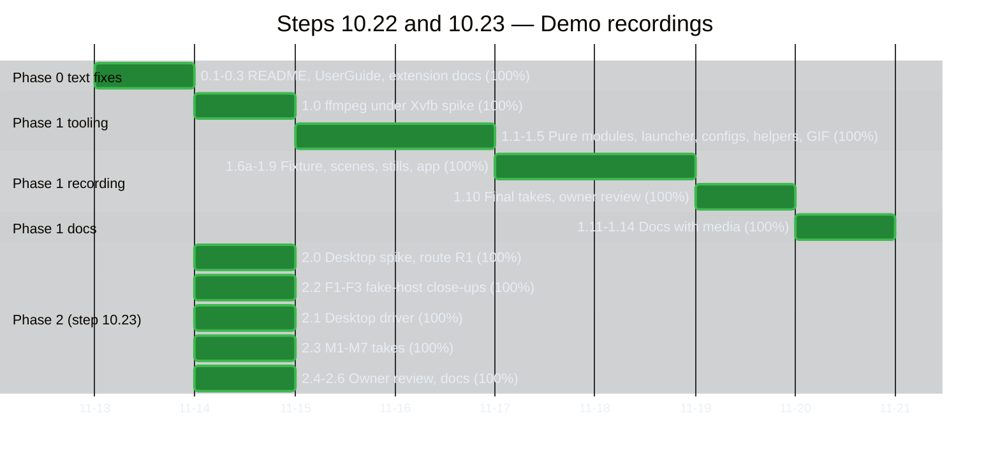
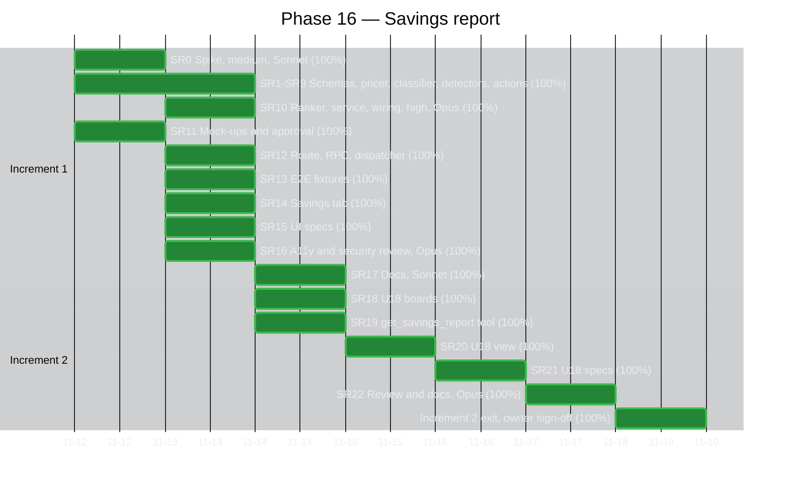
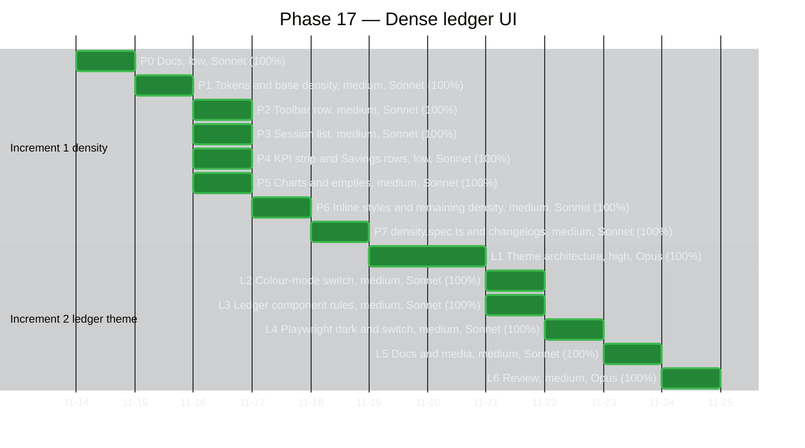
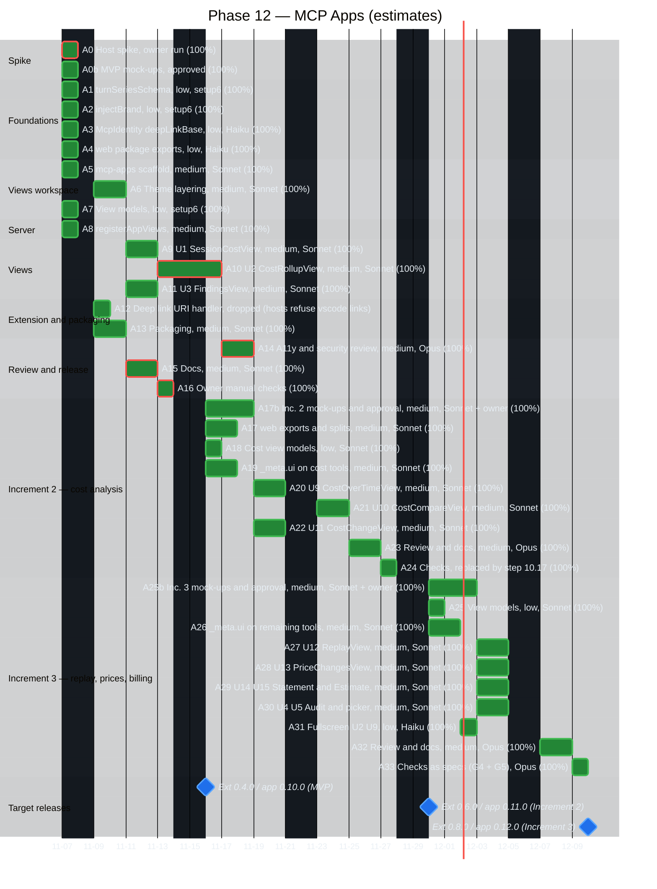

# Implementation plan — Gantt

**Last changed:** 2026-11-16 · **Source:** https://github.com/raulkivi/agent-cost-analyzer

Timeline of [implementation-plan.md](implementation-plan.md) phases. Percentages are step-based: done phases 100%, minus open owner reviews or manual checks; Phase 14 is 8 of 9 steps, with 14.8's docs written and in the owner's review. Dates are first-commit to merge dates from git history (as of 2026-11-07); not-started phases have no dates and are listed below the chart. The 1.0.0 section has one bar per criterion in [implementation-plan.md](implementation-plan.md#100-release); bars not started start at a placeholder date, 2026-11-16.

```mermaid
%%{init: {
  "theme": "base",
  "themeVariables": {
    "darkMode": true,
    "background": "#0d1117",
    "textColor": "#e6edf3",
    "primaryTextColor": "#e6edf3",
    "lineColor": "#8b949e",
    "sectionBkgColor": "#161b22",
    "sectionBkgColor2": "#1c2129",
    "altSectionBkgColor": "#0d1117",
    "gridColor": "#30363d",
    "excludeBkgColor": "#161b22",
    "todayLineColor": "#f85149",
    "taskBkgColor": "#1f6feb",
    "taskBorderColor": "#58a6ff",
    "taskTextColor": "#ffffff",
    "taskTextLightColor": "#ffffff",
    "taskTextDarkColor": "#ffffff",
    "taskTextOutsideColor": "#e6edf3",
    "doneTaskBkgColor": "#238636",
    "doneTaskBorderColor": "#3fb950",
    "activeTaskBkgColor": "#9e6a03",
    "activeTaskBorderColor": "#d29922",
    "critBkgColor": "#da3633",
    "critBorderColor": "#f85149"
  }
}}%%
gantt
    title Agent Cost Analyzer — implementation phases
    dateFormat YYYY-MM-DD
    axisFormat %m-%d

    section Foundation
    0 Repo scaffolding (100%)               :done, p0, 2026-08-08, 1d
    1 Domain model (100%)                   :done, p1, 2026-08-08, 1d
    2 Learn mode (100%)                     :done, p2, 2026-08-08, 1d
    3 Analyze structural data (100%)        :done, p3, 2026-08-08, 1d
    4 main.jsonl enrichment (100%)          :done, p4, 2026-08-08, 1d
    5 Startup config check (100%)           :done, p5, 2026-08-08, 1d
    6 Analyze-only extras (100%)            :done, p6, 2026-08-08, 1d
    7 Visualization polish (100%)           :done, p7, 2026-08-08, 1d
    8 Industry design system (100%)         :done, p8, 2026-08-08, 1d

    section Log providers
    9 Providers and mitmproxy (100%)        :done, p9, 2026-08-09, 2d
    9.5 Turn inspector (100%)               :done, p95, 2026-08-10, 1d
    9.6 pi provider (100%)                  :done, p96, 2026-09-02, 1d
    9.7 Vendor pi logger (100%)             :done, p97, 2026-09-03, 1d
    9.8 pi logger sidecar (100%)            :done, p98, 2026-09-04, 1d
    9.9 Claude Code provider (100%)         :done, p99, 2026-09-09, 1d
    11 pi generated fixtures (100%, in review) :active, p11, 2026-11-14, 1d

    section Audit and insights
    9.10 Tool-call audit and MCP (100%)     :done, p910, 2026-10-09, 1d
    9.11 Insights dashboard (100%)          :done, p911, 2026-10-12, 1d
    9.12 MCP tools v2 (100%)                :done, p912, 2026-10-12, 1d

    section VS Code extension
    10.0-10.12 Extension build (100%)      :done, p10a, 2026-10-24, 2d
    10.9/10.10 closed by owner decision (100%) :done, p10ar, 2026-11-14, 1d
    10.13-10.15 Agent Host sessions (100%)  :done, p10b, 2026-10-28, 6d
    10.16 UI automation (100%)             :done, p10c, 2026-11-04, 2d
    10.17 Release UI gate (100%)           :done, p10d, after p10c, 1d
    10.18 Copilot empty-window sessions (100%) :done, p10e, 2026-11-11, 1d
    10.19 Classic subagent AI Credits (100%) :done, p10f, 2026-11-12, 2d
    10.21 Monthly allowance gauge (100%)   :done, p10g, 2026-11-12, 2d
    10.22 Extension demo recordings (100%)  :done, p10h, 2026-11-13, 3d
    10.23 Claude Desktop demo recordings (100%) :done, p10i, 2026-11-14, 1d

    section Simulation and replay
    13 Vendor-aware Learn simulation (100%) :done, p13, 2026-11-04, 4d
    13.8 owner review (100%)               :done, p13r, after p13, 1d
    14.0-14.7 replay core, API, mock-ups, UI (89%) :done, p14, 2026-11-07, 1d
    14.8 docs written, owner review (11%)  :active, p14r, after p14, 1d

    section MCP Apps
    12 MVP A0-A16: foundations, server, views U1-U3, packaging, review, docs, owner checks (47%) :done, p12a, 2026-11-07, 2d
    12 Increments 2 and 3 (19 of 19 tasks) :done, p12b, after p12a, 1d
    12 MCP SDK 2 migration M0-M6 (100%) :done, p12c, 2026-11-12, 1d

    section Cost
    15 Cost by repository and project (95%) :done, p15, 2026-11-05, 3d
    15.15 owner docs review (50%)         :active, p15r, after p15, 1d

    section Savings
    16 Savings report (100%, 23 of 23 tasks)     :done, p16, 2026-11-12, 3d

    section UI density
    17 Dense ledger UI (100%, 14 of 14 tasks) :done, p17, 2026-11-14, 5d

    section 1.0.0
    C1 Phase 10 closed (100%)                 :done, c1, 2026-11-14, 1d
    C2 Phase 11 pi generated fixtures (100%, in review) :active, c2, 2026-11-14, 1d
    C3 Phase 14 real-data check (100%)        :done, c3, 2026-11-14, 1d
    C4 Phase 15 real-data check (100%)        :done, c4, 2026-11-14, 1d
    C5 Savings Increment 2 finished (100%)    :done, c5, 2026-11-14, 1d
    C6 U5 and U2 Added to chat (100%)         :done, c6, 2026-11-14, 1d
    C7 Desktop prompts, R4 accepted (100%)    :done, c7, 2026-11-14, 1d
    C8 npm package (100%)                     :done, c8, 2026-11-15, 1d
    C9 MA13 allowance (4 of 14 tasks)        :active, c9, 2026-11-15, 2d
    C10 Step 10.20 audit (7 of 17 tasks)       :active, c10, 2026-11-15, 2d
    C11 Savings Incr. 3 (4 of 6 tasks)        :active, c11, 2026-11-15, 2d
    C12 Release tag ruleset (100%)            :done, c12, 2026-11-14, 1d
    C13 Open VSX trusted publishing (100%)    :done, c13, 2026-11-15, 1d
    C14 User price label, 5.10 (100%)         :done, c14, 2026-11-14, 1d
    C15 Claude Code subagents (8 of 18 tasks)  :active, c15, 2026-11-15, 2d
    C16 VS Code install read, VB1 (100%)     :done, c16, 2026-11-14, 1d
    1.0.0 both products                       :milestone, r100, after c1 c2 c3 c4 c5 c6 c7 c8 c9 c10 c11 c12 c13 c14 c15 c16, 0d

    section Releases
    App v0.3.0-alpha :milestone, r0, 2026-08-09, 0d
    App v0.4.0-alpha :milestone, r1, 2026-08-10, 0d
    App v0.5.0-alpha :milestone, r2, 2026-09-04, 0d
    App v0.6.0-alpha :milestone, r3, 2026-09-09, 0d
    App v0.7.0-alpha :milestone, r4, 2026-09-09, 0d
    App v0.8.0-alpha :milestone, r5, 2026-10-12, 0d
    App v0.9.0-alpha :milestone, r6, 2026-10-24, 0d
    Extension 0.1.0 :milestone, r7, 2026-11-03, 0d
    Extension 0.2.0 :milestone, r8, 2026-11-06, 0d
    Extension 0.2.1 :milestone, r9, 2026-11-06, 0d
    Extension 0.4.0, App v0.10.0 :milestone, r10, 2026-11-10, 0d
    Extension 0.5.0 pre-release :milestone, r11, 2026-11-10, 0d
    Extension 0.6.0, App v0.11.0 :milestone, r12, 2026-11-11, 0d
    Extension 0.8.0, App v0.12.0 :milestone, r13, 2026-11-12, 0d
    Extension 0.10.0, App v0.13.0 :milestone, r14, 2026-11-12, 0d
    Extension 0.12.0, App v0.14.0 :milestone, r15, 2026-11-14, 0d
    Extension 0.14.0, App v0.15.0 :milestone, r16, 2026-11-15, 0d
    App v0.16.0 on npm :milestone, r17, 2026-11-15, 0d
```

## Open items

- Phase 11 (pi provider against real pi sessions, 100%, in review; C2): V13's manual capture is replaced by automated generation (owner 2026-11-14). `npm run fixtures:generate-pi` drives the owner's pi 1.5.2 with the local model through four scenarios (linear with a 310 s idle gap, compaction, `context_edit` recovery, fork; full run 7.5 minutes), redacts the sessions and their sidecar records and commits them to `packages/server/fixtures/pi-agent/generated/`; CI reads the committed files. V14 found and fixed raw `context_edit` and compaction entries in the turn inspector and marks omitted attempts; usage is unchanged. Open: `/fork` copies the parent's entries, so usage counts twice across both files (owner never forks); `/tree` branching cannot be scripted. Plan: [implementation-plan.md](implementation-plan.md) Phase 11, [providers/pi-provider.md](providers/pi-provider.md#generating-pi-fixtures).

- Releasing 2026-11-16: app 0.16.1 with the first `agent-cost-analyser` alias version (0.16.0; npm-package.md NP15, D3 amended by the owner 2026-11-15) and the npm docs worded for the published package. <!-- codespell:ignore analyser -->
- Released 2026-11-15: app 0.16.0 (npm and GitHub, 22:31 UTC), the first version on npm: `npx agent-cost-analyzer`. Published from `release-app.yml` through npm trusted publishing with SLSA v1 provenance (run 43768131439, tag `app-v0.16.0` on `2a2cf59e`); the first attempt stopped at the maintainer check before publishing (a stdin read raced `npm view`, fixed in PR #345, tag moved). It carries the npm package (C8), Savings Increment 3 V24-V26 and the MA13, 10.20 and C15 groundwork merged since 0.15.0. The placeholders `0.0.0` and `0.0.0-stage` are deprecated.
- Released 2026-11-15: extension 0.14.0 (VS Code Marketplace, Open VSX and GitHub, 02:36 UTC) and app 0.15.0 (GitHub, 02:03 UTC), tagged on `ff3638c` (PR #305; bump PR #304). They carry the Marketplace listing fixes (PR #272), the Learn Vendors tab layout fix, the pi system-prompt fix (PR #279: the app now combines both prompt sources), the mitmproxy docs slimming (PR #280: mitmproxy is an optional source), Phase 16 Increment 2 and the 1.0 work merged since (V1, V2, V2b, V3, V4, Overview accessibility, PRs #298, #299, #302, #303, #305). The real-Copilot gate passed 37 of 37. Open VSX took the release through trusted publishing, without `OVSX_PAT` (C13).
- Released 2026-11-14: extension 0.12.0 (VS Code Marketplace, Open VSX and GitHub, 15:43 UTC) and app 0.14.0 (GitHub, 14:57 UTC), tagged on `613724e` (PR #271). They carry steps 10.19 and 10.21, Phase 16 Increment 1, Phase 17 and the fixes from PRs #261, #266, #267 and #270 (`[Unreleased]` folded in, no new bump). The real-Copilot gate passed 33 of 33; the owner accepted the gauge's wdio specs in place of a live real-Copilot check.
- Step 10.19 (classic subagent AI Credits, 100%): done 2026-11-13 (SA0 to SA18, 20 of 20 tasks; exit criterion met: `npm run test:real-data` passed 10 of 10 on the owner's logs, owner sign-off 2026-11-13). Before release: the real-Copilot gate. Plan: [classic-subagent-credits-implementation.md](plans/classic-subagent-credits-implementation.md). Step 10.20 (subagent tool calls in the audit) is planned ([subagent-tool-audit.md](plans/subagent-tool-audit.md), approved 2026-11-14), a 1.0 criterion (C10).
- Step 10.21 (monthly allowance gauge, 100%): done 2026-11-13 (MA0 to MA12, 14 of 14 tasks; exit criterion met, review in plan §14). Released in extension 0.12.0: the owner accepted the gauge's wdio specs (`monthly-allowance.e2e.ts`, `monthly-allowance-trust.e2e.ts`, green in CI) in place of a live real-Copilot check (2026-11-14). MA13 (standalone app) is a later increment. The Sessions row is hidden while VS Code's filter is active (plan §3.8). Plan: [monthly-allowance.md](plans/monthly-allowance.md).
- Step 10.22 (extension demo recordings, 100%, 22 of 22 tasks): done 2026-11-14. Phase 0 (PR #255), Phase 1 code (PRs #256, #257) and docs with media; 13 owner-approved GIFs in `docs/images/demo/` (1600x1000). Open follow-ups: the release suite's monthly-allowance spec flakes between midnight and about 01:15 (plan §11); the owner's two Phase 0 findings (plan §11). Next: step 10.23 (Claude Desktop demos). Plan: [docs-refresh-and-demo-recordings.md](plans/docs-refresh-and-demo-recordings.md).
- Step 10.23 (Claude Desktop demo recordings, 100%, 7 of 7 tasks): done 2026-11-14 (PR #262). Spike 2.0 passed route R1 (Desktop 5.11492.5 driven by `xdotool` and OpenCV template matching in Xvfb, a separate signed-in profile); `npm run demo:record:desktop -w packages/vscode-extension -- M1..M7` and `npm run demo:record -w packages/mcp-apps` (F1–F3) re-record every scene. Ten owner-approved GIFs in `docs/images/demo/` (about 16 MB, D28), embedded in the User Guide and README. Found and fixed: the replay named one model for a session that switched models (PR #261). The owner approved the retaken M6 on 2026-11-14. Plan: [docs-refresh-and-demo-recordings.md](plans/docs-refresh-and-demo-recordings.md).
- Phase 17 (dense ledger UI, 100%, 14 of 14 tasks): Increment 1 (P0-P7) and Increment 2 (L1-L6) done 2026-11-14; the L6 review fixed 7 findings and recorded 7 (plan §10). Exit criterion met 2026-11-14 with the owner's eyes-on review; ships in app 0.14.0 and extension 0.12.0. The Dashboard on the e2e fixture went from 2,444px to 1,467px tall at 1440x900 (`density.spec.ts`). Increment 1 (P1-P7) is the density pass in every host; Increment 2 (L1-L6) is the standalone ledger theme with light and dark modes. Plan: [dense-ledger-ui.md](plans/dense-ledger-ui.md). Standalone stills outside `screenshots.mts` (landing page, Learn scenario, older guide images) and the VS Code panel stills are retaken with step 10.22's final takes.
- Phase 16 (savings report, 100%, 23 of 23 tasks; Increment 2 exit criterion met 2026-11-14): Increment 1 (SR0-SR17) done 2026-11-13, code and docs; SR16 review in plan §16 (5 findings fixed, 3 recorded). Exit criterion met 2026-11-14 (owner sign-off on `npm run test:real-data:savings`, PR #270). The owner approved the docs on 2026-11-14 (D13-D15 answered the same day). Increment 1 released 2026-11-14 in app 0.14.0 and extension 0.12.0. Increment 2 started 2026-11-14: SR18 boards approved (D16-D21), SR19 `get_savings_report` merged (PR #275), SR20 U18 view merged (PR #278), SR21 U18 specs done (PR #281: Playwright G5 spec, real-Copilot G4 rows written, owner runs them before tagging), SR22 review and docs done (PR #285: plan §17, 2 findings fixed, 6 recorded; the G4 seed now gives U18 a ranked row). Increment 2's exit check, `npm run test:real-data:savings` extended to `get_savings_report`, passed on the owner's logs 2026-11-14; the owner signed it off the same day; it ships in extension 0.14.0 and app 0.15.0. Plan: [savings-report.md](plans/savings-report.md).
- Phase 14: steps 14.0-14.7 built; 14.8's docs written, the owner's review open; the §13 exit check built (V3, `npm run test:real-data:replay`) and passed on the owner's logs 2026-11-14 and the owner signed it off (exit criterion met); the extension guide's replay screenshots open (User Guide's done). Step table: [analyze-session-replay.md](plans/analyze-session-replay.md) §12.
- Phase 15: the exit criterion's automated check is built (V4, C4): `npm run test:real-data:cost-by-project` rebuilds each repository's and project's cost per month from the raw logs, the projects file and the price book, and passed 11 of 11 on the owner's logs 2026-11-14: Copilot classic and Agent Host (23 repositories), Claude Code and pi, 0 differences. It found and fixed statements leaving turns off (only 50 sessions per source, started near the period; a statement now says how many sessions its cap left out). Exit criterion met: the owner signed off the check's output 2026-11-14 (C4, PR #290). The owner decided 2026-11-14 to count the 4 store sessions outside the §18.2 scope (select store sessions by host type `vscode`, §15.2), implemented in a separate PR. Open: the owner's docs review (step 15.15); the owner's decision on Agent Host session titles that hold the first prompt's opening (they reach statements); a rerun after Phase 11. Plan: [cost-by-repository-and-project.md](plans/cost-by-repository-and-project.md) §15.1–§15.2.
- Phase 13 (vendor-aware Learn simulation, 100%): done 2026-11-14 with the owner's eyes-on review of step 13.8. Follow-up from that review, fixed 2026-11-14 for the next release: the Vendors tab shows one block per model, so it fits the narrow side column (names no longer wrap, no column scrolls off; `density.spec.ts` at 1440 and 360 px, light and dark). Calibration stays Claude Code only (owner, 2026-11-14). Plan: [vendor-aware-learn-simulation.md](plans/vendor-aware-learn-simulation.md).
- 1.0.0 (both products, 11 of 16 criteria met): owner decisions 2026-11-14; no target date, released when C1-C16 are met. Done: C8 (the npm package: app 0.16.0 published 2026-11-15 with provenance), C1 (Phase 10 closed: 10.9 superseded by step 10.17, 10.10 covered by the 0.12.0 reviews), C3 (Phase 14 replay check, PR #289; owner signed off 2026-11-14), C4 (Phase 15 cost-by-project check, V4 PR #290; owner signed off 2026-11-14), C5 (Savings Increment 2: V5 SR22 and V6 the real-data extension, PR #285; owner signed off the check's output 2026-11-14), C6 (U5 and U2 read "Added to chat"), C7 (Claude Desktop permission prompts, risk R4 accepted), C12 (release tag ruleset 27281699, owner 2026-11-14), C13 (Open VSX trusted publishing: extension 0.14.0 published there through OIDC on 2026-11-15; the `release` environment holds no secrets), C14 (the §5.10 "your prices" label in the web UI, V2 PR #286, and in the chat views, V2b) and C16 (the right VS Code install is read, VB1 only, PR #302; the rest of `docs/plans/vscode-both-variants.md` is post-1.0). C2 (Phase 11) is built (PR #303) and in the owner's review (V14; V13 replaced by automated generation). C15 (Claude Code subagent usage counted, added 2026-11-14 after V3 found the gap): plan [claude-code-subagents.md](plans/claude-code-subagents.md) with spike CS0 done, approved (D1–D16) 2026-11-14. The four per-feature plans (npm package, MA13, step 10.20, Savings Increment 3) were approved 2026-11-14. Progress 2026-11-15: npm code and docs done (NP0-NP8, NP10, NP12, NP13; the release workflow's dry run is green); all four mock-up board sets approved (MS0, ST2, CS2, V23b); MA13 MS1-MS3, 10.20 ST0b-ST5, Savings Increment 3 V24-V26 and C15 CS0b-CS6 built; the extension's `.vsix` now ships third-party license notices (V35). Next: MS4, ST6, CS7 and V27; the owner's review of Phase 11 (V14) and the Phase 14 and 15 docs reviews. Not in 1.0: mitmproxy tool calls (F6), threat-model §5.9. Criteria, tasks and the release procedure: [implementation-plan.md](implementation-plan.md#100-release).

## Steps 10.22 and 10.23 detail — Demo recordings

Schedule view of the task tables in [docs-refresh-and-demo-recordings.md](plans/docs-refresh-and-demo-recordings.md) §6. Status: owner decisions answered 2026-11-13; Phase 0 done; Phase 1 spike 1.0, tooling 1.1-1.5, scenes and stills 1.6a-1.9 done (17 of 22 tasks); final takes, owner review and docs with media 1.10-1.14 done 2026-11-14 (22 of 22 tasks; step 10.22 done). Phase 2 (step 10.23) done 2026-11-14 (7 of 7 tasks): M1–M7 and F1–F3 recorded, approved and in the docs.



## Phase 16 detail — Savings report

Schedule view of the task table in [savings-report.md](plans/savings-report.md) §10. Status: Increment 1 18 of 18 code and docs tasks done (SR0-SR17, 2026-11-12 to 2026-11-13); the owner approved the docs and D13-D15 on 2026-11-14; released 2026-11-14 in app 0.14.0 and extension 0.12.0. Increment 2: SR18 to SR22 done 2026-11-14 (23 of 23 tasks; SR20 PR #278, SR21 PR #281, SR22 PR #285); its exit check passed on the owner's logs and the owner signed it off (2026-11-14).



## Phase 17 detail — Dense ledger UI

Schedule view of the task tables in [dense-ledger-ui.md](plans/dense-ledger-ui.md) §6. Status: Increment 1 (P0-P7) and Increment 2 (L1-L6) done 2026-11-14, 14 of 14 tasks; exit criterion met 2026-11-14 with the owner's eyes-on review.



## Phase 12 detail — MCP Apps

Schedule view of the task tables in [mcp-apps.md](plans/mcp-apps.md) §7, §7.1 and §7.2. The design, exit criterion and risks stay there; this file only sequences the work.

- Status: done (100%, 36 of 36 tasks; Increment 3 shipped 2026-11-12 in extension 0.8.0 / app 0.12.0; the MVP shipped 2026-11-10 in extension 0.4.0 / app 0.10.0; Increment 2 (A17-A24) shipped 2026-11-11 in extension 0.6.0 / app 0.11.0, A24 done through step 10.17; extension 0.5.0 pre-release published 2026-11-10; A27-A33 done 2026-11-11): A0 done 2026-11-07 (owner ran the spike in VS Code Insiders 1.146 and Claude Desktop; results in `docs/plans/mcp-apps-spike-results/`), A1-A4 done 2026-11-07 (#176), A8 done 2026-11-07 (server views group), A5 done 2026-11-07 (`packages/mcp-apps` scaffold; bundle budget 900 KB by owner decision), A6 done 2026-11-07 (theme layering: `theme-mcp-host.css`, `brand.css`, contrast tests against the fallbacks, the recorded Claude set and the resolved VS Code set), A7 done 2026-11-07 (pure view models for U1-U3 in `packages/mcp-apps/src/view-models/`), A9 done 2026-11-07 (U1 `SessionCostView` with turn drill-down and copy-command button), A10 done 2026-11-07 (U2 `CostRollupView` with in-place drill-down into U1 and a fixed-template "Ask about this session"), A11 done 2026-11-07 (U3 `FindingsView` with kind and severity filters), A13 done 2026-11-07 (build order, `dist/mcp-apps/views.html` in the `.vsix`, `scripts/mcp-server.sh` serving the build), A14 done 2026-11-07 (axe over every view state, keyboard drill-down with focus return, the no-forwarding rule as a static test over every host call site, host style variables filtered, 360px layout fixes; findings in [mcp-apps.md](plans/mcp-apps.md) §6.1), A15 done 2026-11-07 (architecture.md §4.1.1, §4.4 and §11.4, threat-model.md §6.1, implementation-plan.md, User Guide, extension guide, both CHANGELOGs), A0b boards drawn and approved by the owner 2026-11-07 ([mockups/mcp-apps/](plans/mockups/mcp-apps/README.md)); the copy-command text `AI Credits Analyzer: Open Session <id>` adopted. A16 done 2026-11-10 (owner's checks in VS Code Insiders 1.146, Claude Desktop 4.23118.0 and Claude Code pass; 12 findings fixed test-first, among them VS Code's server-prefixed tool names, notes for Unknown input parts, the ranking basis in U1/U2 with an input-tokens chart, the U3 layout, and an `active` flag for sessions with a turn in the last 15 minutes; [results](plans/mcp-apps-a16-results/README.md)). Dependencies met: step 10.13 is done and `ext-v0.1.0` shipped 2026-11-03; the Phase 14 and 15 tools the increments need are done.

- Each increment starts with mock-up boards the owner approves (A0b, A17b, A25b; plan §5.6).
- Scope (updated 2026-11-07): MVP (A0-A16: U1-U3), Increment 2 (A17-A24: cost-analysis views U9-U11), Increment 3 (A25-A33: replay, price changes, statement and estimate, audit, picker). Each increment starts after the previous one's owner checks.
- Target releases (plan §7.3): MVP in extension 0.4.0 / app 0.10.0 (shipped with the Phase 14/15 work), Increment 2 shipped 2026-11-11 in 0.6.0 / 0.11.0, Increment 3 shipped 2026-11-12 in 0.8.0 / 0.12.0. Stable extension releases use even minors; an odd minor goes to the Marketplace pre-release channel.
- Estimates, not commitments: low = 1 day, medium = 2 days, spike = 1 day. Weekends are excluded. The start date 2026-11-09 is a placeholder.
- Labels carry task ID, model and complexity. The critical path is marked red.
- A12 is dropped: the A0 spike showed both hosts refuse `vscode://` links (the button copies a command).



### Critical path

MVP: A5 → A6 → A9 → A10 → A14 → A16 (all done). Increment 2: A17b (mock-ups and approval) → A20 → A21 → A23 → A24 (step 10.17). Increment 2 shipped 2026-11-11. Increment 3: A25b (mock-ups and approval) → A27/A28/A29/A30 → A32 → A33.

### Parallel lanes

- A6 and A7 run in parallel (A5 and A1 done); A13 can start any time (A8 done).
- A9 and A11 start together once A6 and A7 finish; A10 follows A9.
- Increment 2: A17, A17b, A18, A19 start together; A20 and A22 run in parallel.
- Increment 3: A25, A25b and A26 start together; A27-A31 run in parallel.

