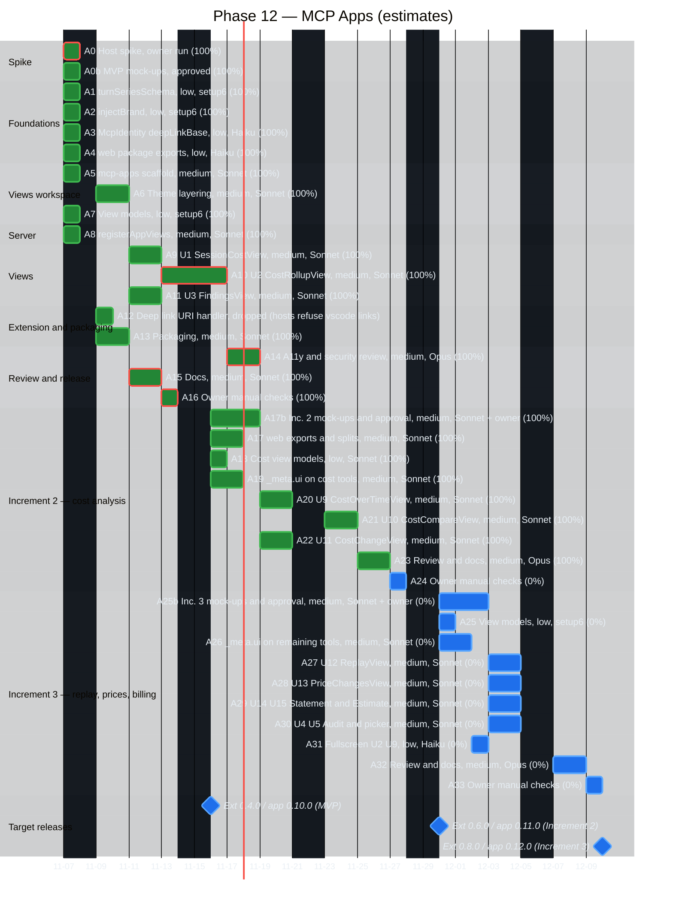

# Implementation plan — Gantt

**Last changed:** 2026-11-10 · **Source:** https://github.com/raulkivi/agent-cost-analyzer

Timeline of [implementation-plan.md](implementation-plan.md) phases. Percentages are step-based: done phases 100%, minus open owner reviews or manual checks; Phase 14 is 8 of 9 steps, with 14.8's docs written and in the owner's review. Dates are first-commit to merge dates from git history (as of 2026-11-07); not-started phases have no dates and are listed below the chart.

```mermaid
%%{init: {
  "theme": "base",
  "themeVariables": {
    "darkMode": true,
    "background": "#0d1117",
    "textColor": "#e6edf3",
    "primaryTextColor": "#e6edf3",
    "lineColor": "#8b949e",
    "sectionBkgColor": "#161b22",
    "sectionBkgColor2": "#1c2129",
    "altSectionBkgColor": "#0d1117",
    "gridColor": "#30363d",
    "excludeBkgColor": "#161b22",
    "todayLineColor": "#f85149",
    "taskBkgColor": "#1f6feb",
    "taskBorderColor": "#58a6ff",
    "taskTextColor": "#ffffff",
    "taskTextLightColor": "#ffffff",
    "taskTextDarkColor": "#ffffff",
    "taskTextOutsideColor": "#e6edf3",
    "doneTaskBkgColor": "#238636",
    "doneTaskBorderColor": "#3fb950",
    "activeTaskBkgColor": "#9e6a03",
    "activeTaskBorderColor": "#d29922",
    "critBkgColor": "#da3633",
    "critBorderColor": "#f85149"
  }
}}%%
gantt
    title Agent Cost Analyzer — implementation phases
    dateFormat YYYY-MM-DD
    axisFormat %m-%d

    section Foundation
    0 Repo scaffolding (100%)               :done, p0, 2026-08-08, 1d
    1 Domain model (100%)                   :done, p1, 2026-08-08, 1d
    2 Learn mode (100%)                     :done, p2, 2026-08-08, 1d
    3 Analyze structural data (100%)        :done, p3, 2026-08-08, 1d
    4 main.jsonl enrichment (100%)          :done, p4, 2026-08-08, 1d
    5 Startup config check (100%)           :done, p5, 2026-08-08, 1d
    6 Analyze-only extras (100%)            :done, p6, 2026-08-08, 1d
    7 Visualization polish (100%)           :done, p7, 2026-08-08, 1d
    8 Industry design system (100%)         :done, p8, 2026-08-08, 1d

    section Log providers
    9 Providers and mitmproxy (100%)        :done, p9, 2026-08-09, 2d
    9.5 Turn inspector (100%)               :done, p95, 2026-08-10, 1d
    9.6 pi provider (100%)                  :done, p96, 2026-09-02, 1d
    9.7 Vendor pi logger (100%)             :done, p97, 2026-09-03, 1d
    9.8 pi logger sidecar (100%)            :done, p98, 2026-09-04, 1d
    9.9 Claude Code provider (100%)         :done, p99, 2026-09-09, 1d

    section Audit and insights
    9.10 Tool-call audit and MCP (100%)     :done, p910, 2026-10-09, 1d
    9.11 Insights dashboard (100%)          :done, p911, 2026-10-12, 1d
    9.12 MCP tools v2 (100%)                :done, p912, 2026-10-12, 1d

    section VS Code extension
    10.0-10.12 Extension build (95%)       :done, p10a, 2026-10-24, 2d
    10.9/10.10 manual checks, review (5%)  :active, p10ar, after p10a, 1d
    10.13-10.15 Agent Host sessions (100%)  :done, p10b, 2026-10-28, 6d
    10.16 UI automation (90%)              :done, p10c, 2026-11-04, 2d
    10.16 owner decisions (10%)            :active, p10cr, after p10c, 1d

    section Simulation and replay
    13 Vendor-aware Learn simulation (95%) :done, p13, 2026-11-04, 4d
    13.8 owner review (5%)                 :active, p13r, after p13, 1d
    14.0-14.7 replay core, API, mock-ups, UI (89%) :done, p14, 2026-11-07, 1d
    14.8 docs written, owner review (11%)  :active, p14r, after p14, 1d

    section MCP Apps
    12 MVP A0-A16: foundations, server, views U1-U3, packaging, review, docs, owner checks (47%) :done, p12a, 2026-11-07, 2d
    12 Increments 2 and 3 (8 of 19 tasks) :active, p12b, after p12a, 1d

    section Cost
    15 Cost by repository and project (95%) :done, p15, 2026-11-05, 3d
    15.15 owner review, real data (5%)     :active, p15r, after p15, 1d

    section Releases
    App v0.3.0-alpha :milestone, r0, 2026-08-09, 0d
    App v0.4.0-alpha :milestone, r1, 2026-08-10, 0d
    App v0.5.0-alpha :milestone, r2, 2026-09-04, 0d
    App v0.6.0-alpha :milestone, r3, 2026-09-09, 0d
    App v0.7.0-alpha :milestone, r4, 2026-09-09, 0d
    App v0.8.0-alpha :milestone, r5, 2026-10-12, 0d
    App v0.9.0-alpha :milestone, r6, 2026-10-24, 0d
    Extension 0.1.0 :milestone, r7, 2026-11-03, 0d
    Extension 0.2.0 :milestone, r8, 2026-11-06, 0d
    Extension 0.2.1 :milestone, r9, 2026-11-06, 0d
    Extension 0.4.0, App v0.10.0 :milestone, r10, 2026-11-10, 0d
    Extension 0.5.0 pre-release :milestone, r11, 2026-11-10, 0d
```

## Not started

- Phase 11 (0%) — pi provider real-capture verification.

## Open items

- Phase 14: steps 14.0-14.7 built; 14.8's docs written, the owner's review and the §13 exit criterion on real sessions open; the extension guide's replay screenshots open (User Guide's done). Step table: [analyze-session-replay.md](plans/analyze-session-replay.md) §12.
- Phase 15: owner's review and exit criterion on real data.
- Phase 13: owner's eyes-on review of step 13.8.
- Phase 12: A0b boards approved 2026-11-07 ([mockups/mcp-apps/](plans/mockups/mcp-apps/README.md)); A5 (views workspace), A6 (theme layering), A7 (view models), A9 (U1 session cost view), A10 (U2 spend view), A11 (U3 findings view) and A13 (packaging), A14 (accessibility and security review) and A15 (docs) done; the copy-flow fix done (owner decision A: an "Open Session…" palette picker; the button copies the session title; one-click open is a follow-up); A16 done 2026-11-10: the owner's checks pass in VS Code Copilot Chat, Claude Desktop and Claude Code, after 12 findings fixed test-first ([results](plans/mcp-apps-a16-results/README.md)); MVP released 2026-11-10 (extension 0.4.0 / app 0.10.0); Increment 2: A17 (web exports), A18 (cost view models) and A19 (`_meta.ui` on the four cost-analysis tools) and A20-A22 (views U9 cost over time, U10 comparison, U11 cost change) done 2026-11-10, A17b boards approved by the owner 2026-11-10 (answers in [mcp-apps.md](plans/mcp-apps.md) §9.1), PRs #193/#194 merged, A23 (review and docs) done 2026-11-10, next A24 (owner checks with [mcp-apps-a24-checklist.md](plans/mcp-apps-a24-checklist.md)) then the Increment 2 release (extension 0.6.0 / app 0.11.0); session handover in [mcp-apps-handover.md](plans/mcp-apps-handover.md) (A0 host spike done 2026-11-07; results in [mcp-apps-spike.md](plans/mcp-apps-spike.md)). See [Phase 12 detail](#phase-12-detail--mcp-apps).

## Phase 12 detail — MCP Apps

Schedule view of the task tables in [mcp-apps.md](plans/mcp-apps.md) §7, §7.1 and §7.2. The design, exit criterion and risks stay there; this file only sequences the work.

- Status: in progress (69%, 25 of 36 tasks; the MVP shipped 2026-11-10 in extension 0.4.0 / app 0.10.0; Increment 2's A17-A22 done 2026-11-10, A17b boards approved 2026-11-10, A23 done 2026-11-10; next A24): A0 done 2026-11-07 (owner ran the spike in VS Code Insiders 1.146 and Claude Desktop; results in `docs/plans/mcp-apps-spike-results/`), A1-A4 done 2026-11-07 (#176), A8 done 2026-11-07 (server views group), A5 done 2026-11-07 (`packages/mcp-apps` scaffold; bundle budget 900 KB by owner decision), A6 done 2026-11-07 (theme layering: `theme-mcp-host.css`, `brand.css`, contrast tests against the fallbacks, the recorded Claude set and the resolved VS Code set), A7 done 2026-11-07 (pure view models for U1-U3 in `packages/mcp-apps/src/view-models/`), A9 done 2026-11-07 (U1 `SessionCostView` with turn drill-down and copy-command button), A10 done 2026-11-07 (U2 `CostRollupView` with in-place drill-down into U1 and a fixed-template "Ask about this session"), A11 done 2026-11-07 (U3 `FindingsView` with kind and severity filters), A13 done 2026-11-07 (build order, `dist/mcp-apps/views.html` in the `.vsix`, `scripts/mcp-server.sh` serving the build), A14 done 2026-11-07 (axe over every view state, keyboard drill-down with focus return, the no-forwarding rule as a static test over every host call site, host style variables filtered, 360px layout fixes; findings in [mcp-apps.md](plans/mcp-apps.md) §6.1), A15 done 2026-11-07 (architecture.md §4.1.1, §4.4 and §11.4, threat-model.md §6.1, implementation-plan.md, User Guide, extension guide, both CHANGELOGs), A0b boards drawn and approved by the owner 2026-11-07 ([mockups/mcp-apps/](plans/mockups/mcp-apps/README.md)); the copy-command text `AI Credits Analyzer: Open Session <id>` adopted. A16 done 2026-11-10 (owner's checks in VS Code Insiders 1.146, Claude Desktop 4.23118.0 and Claude Code pass; 12 findings fixed test-first, among them VS Code's server-prefixed tool names, notes for Unknown input parts, the ranking basis in U1/U2 with an input-tokens chart, the U3 layout, and an `active` flag for sessions with a turn in the last 15 minutes; [results](plans/mcp-apps-a16-results/README.md)). Dependencies met: step 10.13 is done and `ext-v0.1.0` shipped 2026-11-03; the Phase 14 and 15 tools the increments need are done.

- Each increment starts with mock-up boards the owner approves (A0b, A17b, A25b; plan §5.6).
- Scope (updated 2026-11-07): MVP (A0-A16: U1-U3), Increment 2 (A17-A24: cost-analysis views U9-U11), Increment 3 (A25-A33: replay, price changes, statement and estimate, audit, picker). Each increment starts after the previous one's owner checks.
- Target releases (plan §7.3): MVP in extension 0.4.0 / app 0.10.0 (shipped with the Phase 14/15 work), Increment 2 in 0.6.0 / 0.11.0, Increment 3 in 0.8.0 / 0.12.0. Stable extension releases use even minors; an odd minor goes to the Marketplace pre-release channel.
- Estimates, not commitments: low = 1 day, medium = 2 days, spike = 1 day. Weekends are excluded. The start date 2026-11-09 is a placeholder.
- Labels carry task ID, model and complexity. The critical path is marked red.
- A12 is dropped: the A0 spike showed both hosts refuse `vscode://` links (the button copies a command).



### Critical path

MVP: A5 → A6 → A9 → A10 → A14 → A16 (all done). Increment 2: A17b (mock-ups and approval) → A20 → A21 → A23 → A24. Increment 3: A25b (mock-ups and approval) → A27/A28/A29/A30 → A32 → A33.

### Parallel lanes

- A6 and A7 run in parallel (A5 and A1 done); A13 can start any time (A8 done).
- A9 and A11 start together once A6 and A7 finish; A10 follows A9.
- Increment 2: A17, A17b, A18, A19 start together; A20 and A22 run in parallel.
- Increment 3: A25, A25b and A26 start together; A27-A31 run in parallel.

