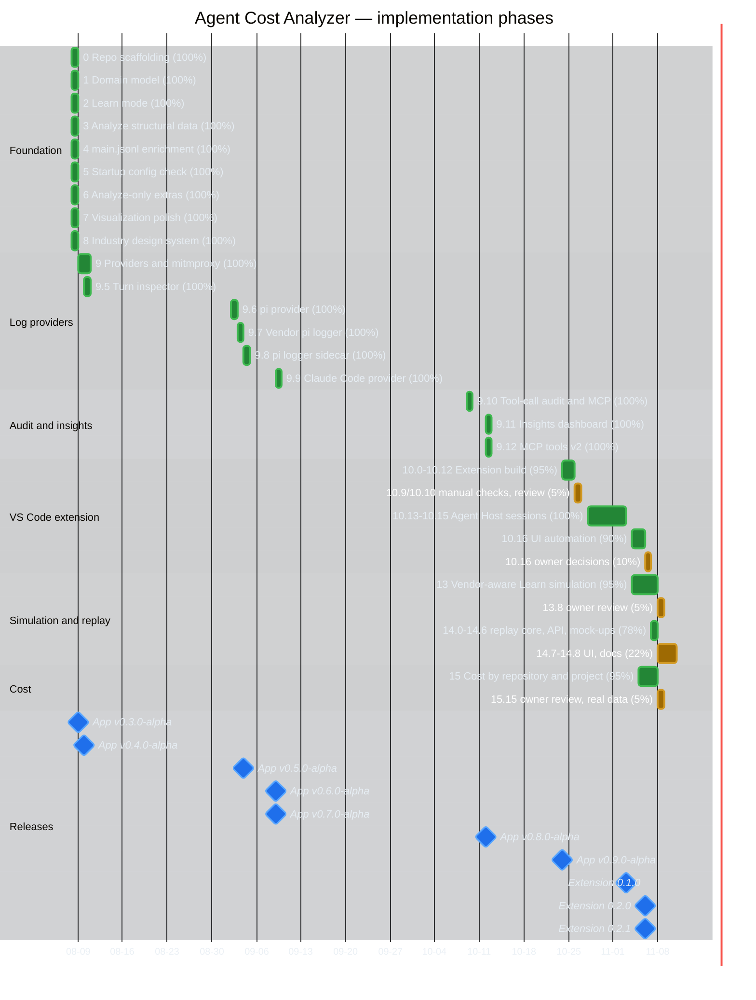
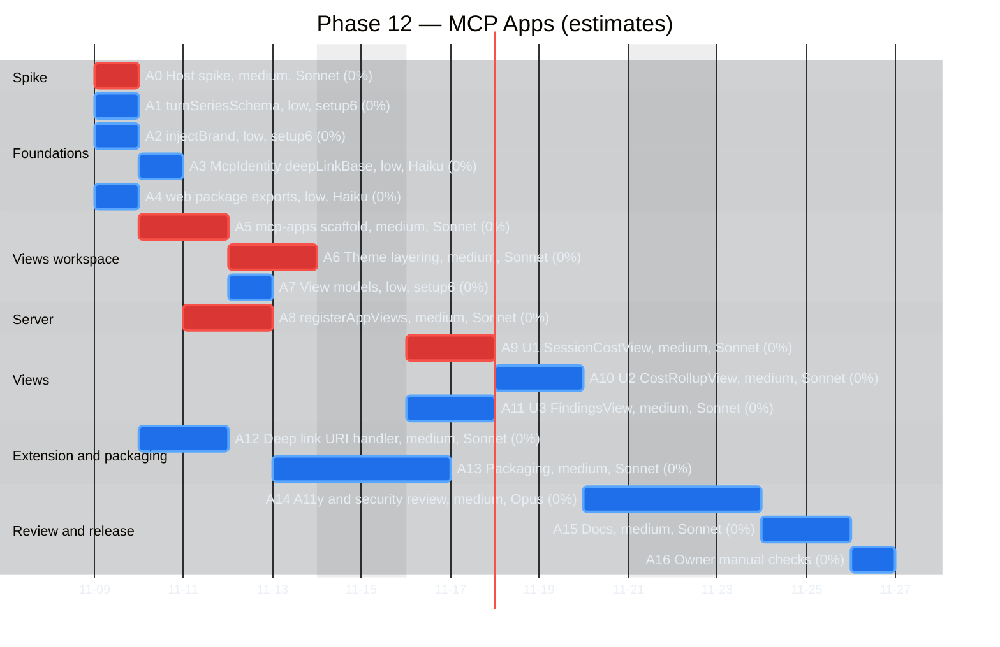
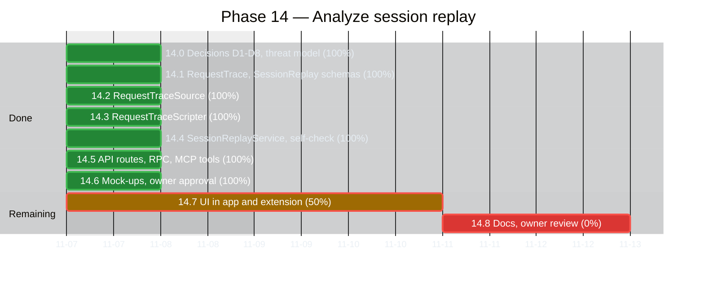

# Implementation plan — Gantt

Timeline of [implementation-plan.md](implementation-plan.md) phases. Percentages are step-based: done phases 100%, minus open owner reviews or manual checks; Phase 14 is 7 of 9 steps. Dates are first-commit to merge dates from git history (as of 2026-11-07); not-started phases have no dates and are listed below the chart.

## Not started

- Phase 11 (0%) — pi provider real-capture verification.
- Phase 12 (0%) — MCP Apps: interactive views in the chat. See [Phase 12 detail](#phase-12-detail--mcp-apps).

## Open items

- Phase 14: steps 14.0-14.6 merged (14.6's boards approved by the owner), 14.7 (UI) in progress. See [Phase 14 detail](#phase-14-detail--analyze-session-replay).
- Phase 15: owner's review and exit criterion on real data.
- Phase 13: owner's eyes-on review of step 13.8.

## Phase 12 detail — MCP Apps

Schedule view of the task table in [mcp-apps.md](plans/mcp-apps.md) §7. The design, exit criterion and risks stay there; this file only sequences the work.

- Status: planned, not started (0%). Blocked on Phase 10 step 10.13's release dependency per [implementation-plan.md](implementation-plan.md).
- Estimates, not commitments: low = 1 day, medium = 2 days, spike = 1 day. Weekends are excluded. The start date 2026-11-09 is a placeholder.
- Labels carry task ID, model and complexity. The critical path is marked red.
- A12 is dropped if the A0 spike shows hosts block `vscode://` links (the button then copies a command).

### Critical path

A0 → A5 → A6 → A9 → A14 → A15 → A16.

### Parallel lanes

- A1, A2, A4 start together; A3 follows A2.
- A12 runs beside A5-A8 once A0 finishes.
- A10 and A11 run in parallel after A9 and A6-A8.

## Phase 14 detail — Analyze session replay

Schedule view of the step table in [analyze-session-replay.md](plans/analyze-session-replay.md) §12. Design, decisions and risks stay there; this file only sequences the work.

- Status (2026-11-07): steps 14.0-14.6 merged (7 of 9, 78%); 14.7 in progress. 14.7-14.8 are estimates.
- Estimates: API/RPC/MCP 2 days, mock-ups 2 days, UI 3 days, docs 2 days. Weekends are excluded.
- 14.6 needs the owner's approval of the boards before 14.7 starts.

### Critical path

14.7 → 14.8 (14.5 and 14.6 done).

### Exit criteria per open step

- 14.7: component, axe and keyboard tests; UI check in three VS Code themes; scenarios pass in `web-e2e` and `extension-ui`.
- 14.8: owner reviews.
