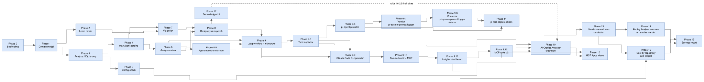

# Implementation Plan: Agent Cost Analyzer and AI Credits Analyzer

**Last changed:** 2026-11-14 · **Source:** https://github.com/raulkivi/agent-cost-analyzer

This plan sequences [architecture.md](architecture.md) into buildable phases.
Phases 0-9.12 build the standalone app, **Agent Cost Analyzer** (every
provider). Phase 10 builds **AI Credits Analyzer**, a Copilot-only VS Code
extension sharing the same code (vision §5). Phase 11 pins the standalone
app's pi provider against a real captured session, postponed from Phase 9.6.
Phase 12 adds branded, interactive MCP Apps views for both products.
Phase 17 makes the UI denser in every host, then gives the standalone app a ledger theme.

**Overall status (2026-11-14):** Phases 0-10 have their code and docs
merged to `main`. The extension's 0.1.0 is released (tag `ext-v0.1.0`,
2026-11-03); the latest stable is 0.6.0 (2026-11-11), and 0.5.0 was a
pre-release (2026-11-10). Open: Phase 10's owner manual checks and decisions (see its
section), Phase 11 (not started), Phase 12 (done: the MVP, A0–A16, released 2026-11-10 in extension 0.4.0 and app 0.10.0, A12 dropped; Increment 2 (A17–A24) released 2026-11-11 in extension 0.6.0 and app 0.11.0; Increment 3 (A25–A33) released 2026-11-12 in extension 0.8.0 and app 0.12.0; follow-ups in plans/mcp-apps.md §11), Phase 13 (in
progress: steps 13.0-13.10 and 13.5a merged, the owner's eyes-on review
of 13.8 open), Phase 14
(steps 14.0-14.7 built and 14.8's docs written; the owner's docs review
and the §13 exit criterion on real sessions open) and Phase 15 (steps 15.0-15.15 done; the owner's docs review and
the exit criterion on real data open). Step 10.19
([plans/classic-subagent-credits-implementation.md](plans/classic-subagent-credits-implementation.md),
design in [plans/classic-subagent-credits.md](plans/classic-subagent-credits.md))
covers classic Copilot Chat subagent AI Credits (done 2026-11-13). Step 10.21
([plans/monthly-allowance.md](plans/monthly-allowance.md)) is done and
Phase 16 ([plans/savings-report.md](plans/savings-report.md)) has its Increment 1 built (the
owner accepted both plans' decisions on 2026-11-12). Phase 17
([plans/dense-ledger-ui.md](plans/dense-ledger-ui.md)) has Increment 1 (density, P0-P7)
and Increment 2 L1-L5 (ledger theme) done 2026-11-14, L6 review next; it holds step 10.22 tasks 1.10-1.14 until it merges.
Each phase has a goal, concrete deliverables, an exit criterion (how you know
it's done), and its dependencies. Phases are ordered so the riskiest/least
certain work (real `main.jsonl` parsing) happens after there's already a
working, demoable app — not before.

Default calls on architecture.md §13's still-open choices, made here so the
plan can proceed (revisit anytime, they're not load-bearing for sequencing):
- Server framework: **Express**.
- Learn-mode scenario fixtures: **JSON files**, validated by the `domain`
  zod schema.

**Engineering practices (every phase, no exceptions):** development is
test-driven (architecture §11.4) — for each deliverable below, the test is
written first, watched to fail, then the minimum code to pass it is written,
then refactored. Module boundaries follow SOLID (architecture §11.5); a new
module that doesn't map to a single responsibility in §4/§10 is a signal to
revisit the design before writing it, not to add it anyway.

## Phase 0 — Repo scaffolding

**Goal**: an empty-but-wired monorepo skeleton, so every later phase adds
features instead of setting up plumbing.

- npm workspaces root (`packages/domain`, `packages/server`, `packages/web`),
  shared TypeScript config, lint/format config.
- `domain` package: empty placeholder export, consumed by both `server` and
  `web` via workspace dependency — proves constraint 3's dependency
  direction (`domain` has no dependency on the other two) before any real
  types exist.
- `server`: Express app with a single `GET /api/health` route, binds to
  `localhost` only (§11.2).
- `web`: Vite + React app that fetches `/api/health` and renders the result.
- Test runner wired (e.g. Vitest). Following TDD, the smoke test for each
  package ("health check returns ok", "web renders health status") is
  written and failing *before* the route/component it verifies exists.

**Exit criterion**: `npm install && npm run dev` starts both server and web,
and the web app displays a successful health check from the server.

**Dependencies**: none.

**Parallel task (not blocking, do it now)**: reload the VS Code window to
activate `github.copilot.chat.agentDebugLog.fileLogging.enabled` (already
set in user settings, per prior session). Real, multi-turn sessions started
from this point on begin accumulating genuine `main.jsonl` usage spans,
which Phase 4 needs as fixture material — the earlier this starts, the more
real fixture data exists by the time Phase 4 begins.

## Phase 1 — Domain model & schema package

**Goal**: the one shared contract (architecture §5) that every later phase
builds against.

- Implement `TokenCount`, `TurnUsage`, `ToolCallRecord`, `Turn`,
  `SystemPromptComponent`, `ToolInventoryEntry`, `Session`, `ConfigWarning`,
  `ConfigStatus` as TypeScript types in `packages/domain`.
- TDD order: for each type, write the `zod` schema-validation test against a
  hand-written sample object first (including a `TokenCount` in both the
  `known: true` and `known: false` shapes) — it will fail with no schema to
  import — then write the schema and type together to make it pass.
- Export both types and schemas from the package's public entry point.

**Exit criterion**: `domain` has 100% of the types from architecture §5,
each with a passing schema-validation test, and zero dependencies on
`server`/`web`.

**Dependencies**: Phase 0.

## Phase 2 — Learn mode (end-to-end, no real-log parsing required)

**Goal**: a fully working, demoable mode that proves out the shared UI layer
(constraint 4) without depending on any of the risky local-file parsing.

- Author 4-6 bundled scenario JSON fixtures seeded from
  [agentic-coding-explained.md](agentic-coding-explained.md) (start with:
  basic cache write/read, a model switch, an MCP tool change, and a
  compaction event — the doc's own worked examples), each already shaped as
  a `Session`/`Turn[]` per the domain schema.
- `data-sources/learn-scenarios` adapter (`server`): loads + validates the
  fixtures against the `domain` zod schema at startup (fail fast on a bad
  fixture rather than serving invalid data).
- API: `GET /api/learn/scenarios`, `GET /api/learn/scenarios/:id`.
- Frontend: `components/TurnsTable`, `components/ExplanationPanel`,
  `components/TimelineScrubber`, `state/session-store`, `api-client` — built
  and wired against Learn-mode data first.
- TDD order: write a failing API test asserting `GET /api/learn/scenarios`
  returns `domain`-schema-valid `Session[]` before implementing the adapter;
  write a failing component test asserting moving the scrubber updates the
  selected turn in both panels before wiring `session-store`.

**Exit criterion**: selecting a Learn scenario in the browser renders the
full shared layout (turns table + explanation panel + scrubber), and moving
the scrubber updates both panels in sync, matching vision §3.1/§3.3.

**Dependencies**: Phase 1.

**Status: done, grown well beyond the initial 4-6.** The bundled set now
has **18** scenarios in `packages/server/fixtures/learn-scenarios/`, each
mapped to its own worked-example doc under
`docs/scenarios/`: cache basics, a subagent's own session, context
compaction, a model switch, an MCP tool change, `/clear`, `/rewind`, session
forking (plus a multi-branch variant), cache TTL expiry (plus a smoke-break
and a 1-hour-breakpoint variant), an instructions-file edit, a silent
`.instructions.md` pull-in, inline-vs-subagent exploration bloat, a
cascading model-switch-then-TTL-lapse, an image attachment invalidating the
cache, toggling extended thinking/reasoning budget, and a subagent on a
cheaper model — see [standalone-app.md](standalone-app.md#using-the-app) for the
user-facing list. This addresses vision.md §7's open question on which
additional advanced scenarios to build; keeping the set in sync with
[agentic-coding-explained.md](agentic-coding-explained.md) as that doc
evolves remains open (still no automated drift-checking, per that same
open question).

## Phase 3 — Analyze mode: structural data only (SQLite, no usage numbers yet)

**Goal**: real sessions rendering in the same shared layout as Learn mode,
using only the always-available SQLite store — before touching the riskier
`main.jsonl` parsing at all.

- `platform/vscode-paths`: resolve the local VS Code user-data directory.
  Implement for this machine's platform (Linux) first; stub the
  interface so macOS/Windows paths are a follow-up, not a redesign
  (tracked in architecture §13).
- `data-sources/sqlite`: read-only queries against `sessions`/`turns`/
  `checkpoints`/`session_files`/`session_refs`, filtered to
  `agent_name = 'GitHub Copilot Chat'` (vision §18.2 scoping rule).
- `services/session-enricher`: for this phase, always sets
  `usageDataAvailable: false` and marks every `TurnUsage` field
  `{ known: false, reason: "main.jsonl parsing not yet implemented" }` —
  intentionally stubbed so the API contract (§8) is exercised end-to-end
  before Phase 4 fills it in for real.
- API: `GET /api/sessions`, `GET /api/sessions/:id`.
- Frontend: real sessions selectable and rendered through the same
  `TurnsTable`/`ExplanationPanel`/`TimelineScrubber` built in Phase 2 — no
  new components needed, proving constraint 3/4 in practice, not just in
  design.
- TDD order: write a failing test against a seeded fixture SQLite DB
  asserting `getTurns`/`getCheckpoints`/`getSessionFiles` return the
  expected shape before implementing the queries; write a failing test
  asserting the stubbed enricher always returns `usageDataAvailable: false`
  before wiring the stub in.

**Exit criterion**: a real local Copilot Chat session (this project's own
history is a ready-made test case) loads in Analyze mode and shows its
actual turns/user-messages/assistant-responses, with token figures
correctly shown as unavailable rather than zero.

**Dependencies**: Phase 1. (Independent of Phase 2, but reuses its
components, so do Phase 2 first in practice.)

## Phase 4 — `main.jsonl` parsing & enrichment

**Goal**: real per-turn token/cache numbers in Analyze mode — the core
value proposition of the whole app.

- `data-sources/jsonl`: streaming line reader + generic envelope parse
  (`{ v, ts, dur, sid, spanId, type, name, status, attrs }`).
- Cheap gating check (architecture §7): does this session's `main.jsonl`
  contain more than the single `session_start` line? If not, short-circuit
  straight to the constraint-8 "enable logging" reason — don't attempt
  extraction.
- Extractor registry: build the first extractor(s) against **real fixture
  lines** captured from this machine now that
  `agentDebugLog.fileLogging.enabled` is on (Phase 0's parallel task) —
  capture and redact a handful of real `main.jsonl` files spanning a full
  session as the initial fixture corpus.
- Unit tests per extractor against captured fixtures, plus one
  "missing/older-shape" synthetic fixture per constraint 6/8 — per TDD, each
  fixture's test is written (and confirmed failing, since no extractor
  exists yet) before that extractor is implemented.
- Wire `services/session-enricher` to use real extraction output instead of
  Phase 3's stub, populating `TurnUsage` for real when spans are found —
  extend Phase 3's enricher test suite first with the new "spans found"
  case before changing the implementation.

**Exit criterion**: loading a session recorded *after* the logging setting
was enabled shows real cache write/read/uncached/tool/vision/reasoning/
output/AI Credits numbers per turn; a session recorded *before* still degrades
cleanly to the Phase 3 behavior.

**Dependencies**: Phase 3. **Blocked on** having real fixture data, which
requires the Phase 0 window-reload step to have happened and some time to
pass generating real sessions — start capturing fixtures as early as
possible so this phase isn't blocked when it starts.

**Status (2026-08-08): done.** With `agentDebugLog.fileLogging.enabled` on
and real GitHub Copilot Chat sessions run since, real `llm_request` spans
were captured (redacted into `packages/server/fixtures/jsonl/`) and used to
build the `llm_request` extractor and per-turn aggregator (which sums the
possibly-multiple `llm_request` spans within one SQLite turn — see
architecture.md §6.2's Phase 4 note for why the join is positional by
`user_message`, not by the log's own `turnId`). This also uncovered and
fixed a real bug: the debug-logs path was resolved as a single
`globalStorage` directory, but real logs live per-workspace under
`workspaceStorage/<hash>/GitHub.copilot-chat/debug-logs/<session-id>/` —
without that fix the extractor would never have found any real file. The
`cacheWrite`/`tool`/`vision`/`reasoning` `TurnUsage` categories stay
permanently unavailable regardless of extraction success because this event
shape does not break them out. Usage is available as `copilotUsageNanoAiu`:
the extractor converts it to `costAiCredits` using
$1\ \text{AI Credit}=10^9\ \text{nano-AIU}$ and sums every request in a turn.
Missing credit data keeps that turn explicitly unavailable rather than
producing a partial total, per constraint 6. Verified against this
machine's own real, live session data (this project's own history, and a
longer session from another project), not just fixtures — exit criterion
met.

## Phase 5 — Startup configuration check

**Goal**: the app tells the user proactively when its core prerequisite
isn't met, instead of only showing symptoms per-session (architecture §6.3,
constraints 9/10).

- `data-sources/vscode-settings`: locate + parse (via `jsonc-parser`) the
  user's `settings.json` using `platform/vscode-paths`.
- `services/config-check`: evaluate `agentDebugLog.fileLogging.enabled`
  (constraint 8) and `maxRetainedSessionLogs >= 200` (constraint 10);
  produce `ConfigWarning[]`.
- Run the check once at server boot (console warning if unmet) and expose
  `GET /api/config/status`.
- Frontend: `components/ConfigWarningBanner`, rendered whenever
  `warnings.length > 0`, showing the exact setting, current vs. recommended
  value, and step-by-step fix instructions.
- TDD order: write a failing test per `ConfigWarning` case (logging
  disabled, retention too low, settings not found — architecture §11.4)
  before implementing the check in `config-check` that produces it.

**Exit criterion**: with the retention setting still at its VS Code default
(50), the banner correctly warns and shows the fix steps; after raising it
to 200+ and reloading VS Code, the warning for that check clears on the
next `GET /api/config/status`.

**Dependencies**: Phase 3 (reuses `platform/vscode-paths`). Independent of
Phase 4 — can be built in parallel with it.

**Status (2026-08-08): done.** `data-sources/vscode-settings` (a new
`resolveVscodeSettingsPath` alongside the existing `platform/vscode-paths`,
plus `readVscodeSettings` parsing via `jsonc-parser`) and
`services/config-check` (`checkConfig`) were built TDD-first per
architecture §11.4, then wired into `GET /api/config/status` and a
startup console warning in `server.ts`. Decisions/facts from this slice:

- Scope matches this phase's bullet list exactly: only the **user**
  `settings.json` is read, not a workspace-level merge — architecture§4.1's
  "and workspace, if present" is not yet implemented (this is a
  single-developer machine with no workspace-level override observed; a
  workspace merge is a candidate for later per architecture §13, not
  required for this phase's exit criterion).
- The deprecated alias `github.copilot.chat.agentDebugLog.enabled` (noted
  in architecture §7) is also honored as satisfying "logging enabled", in
  addition to the current `agentDebugLog.fileLogging.enabled` key.
- `maxRetainedSessionLogs: null` in `ConfigStatus` means "the setting is
  unset in `settings.json`", which `config-check` treats as VS Code's own
  default of 50 (below the 200 minimum) when deciding whether to warn —
  matching the domain schema's documented meaning for that field (§5).
- Verified against this machine's own real `settings.json`
  (`~/.config/Code - Insiders/User/settings.json`, where logging is
  already enabled from Phase 4 but retention was never explicitly raised):
  `GET /api/config/status` correctly returns exactly one
  `retention-too-low` warning with the real settings.json path in its
  `helpSteps` — the exit criterion's "default retention" case, observed
  directly rather than only via fixtures.

**Status (2026-08-13) update: the 200-session retention minimum is now
user-configurable, revisiting this phase rather than opening a new one**
(resolves the architecture §13 open question this phase originally left
open). `ConfigStatus` gained a required `minRetainedSessionLogsThreshold:
number` field — the effective threshold in force (persisted override, or
`config-check`'s own `200` default when nothing was ever written).
Decisions/facts from this slice:

- Persistence: `data-sources/log-providers/app-settings.ts` (already storing
  `activeProviderId`) gained `readMinRetainedSessionLogsThreshold`/
  `writeMinRetainedSessionLogsThreshold`, same shape as the existing
  `activeProviderId` reader/writer (missing/corrupt file → `undefined`,
  never throws). Both writers now go through a shared private
  read-merge-write helper — the prior `writeActiveProviderId` overwrote the
  whole file, which would have silently dropped the other key once a second
  one existed; this was fixed as part of this change, not left for later.
- `config-check.ts` keeps sole ownership of the `200` default
  (`MIN_RETAINED_SESSION_LOGS`); `CheckConfigOptions` gained an optional
  `minRetainedSessionLogsThreshold` that `checkConfig` falls back from,
  threaded into both `buildRetentionTooLowWarning`'s `recommendedValue` and
  the returned `ConfigStatus` unconditionally.
- Routes: `GET /api/config/status` now reads the persisted threshold and
  passes it into `checkConfig`; new `PUT /api/config/retention-threshold`
  (body `{ value: number }`, positive-integer validated in the route
  handler, 400 otherwise) writes it and returns the fresh `ConfigStatus` —
  one response updates both the header control and the warning banner.
- Frontend: `AppHeader` gained optional `minRetainedSessionLogsThreshold`/
  `onRetentionThresholdChange` props rendering a labeled numeric `<input>`
  immediately before the Config button/tag, unconditionally (not gated by
  mode or by `hasConfigWarnings`) whenever both props are supplied —
  commit-on-blur (`defaultValue` + `onBlur`), not per-keystroke, to avoid a
  `PUT` per digit typed. `App.tsx` holds the value in a local `useState`
  (page-chrome tier, alongside `showConfigBanner`, not `session-store`),
  sets it from the existing `fetchConfigStatus()` effect, and updates both
  it and `configWarnings` from the `PUT` response.
- Verified end-to-end against a running server (isolated app-settings dir):
  `GET /api/config/status` defaults to `200`; `PUT
  /api/config/retention-threshold {value:300}` returns `300` immediately and
  the on-disk `settings.json` holds only `{minRetainedSessionLogsThreshold:
  300}` (no spurious `activeProviderId`, confirming the merge fix); a fresh
  server process restarted against the same dir still reads back `300`.

## Phase 6 — Analyze-mode-only extras

**Goal**: the remaining vision §3.2 features that go beyond the shared
layout.

- `components/SystemPromptBreakdown`, `components/ToolInventoryPanel`,
  `components/TurnDetail`.
- Requires extending the Phase 4 extractor registry to also surface
  system-prompt-component and tool-definition/tool-call token detail from
  `attrs` — treat this as a research spike first (confirm the relevant
  event `type`s exist and what shape they're in) before committing to an
  implementation approach.
- TDD order: once the spike confirms the `attrs` shape, write the failing
  extractor/component tests against captured samples before extending the
  registry or building the panels.

**Exit criterion**: selecting a turn in Analyze mode shows which tools were
called and which files were touched with their token counts, and the
session-level view shows system-prompt breakdown and tool
loaded-vs-invoked status.

**Dependencies**: Phase 4.

**In parallel with this phase**: address a 2026-08-08 code/security
review's medium finding (availability classification masking parse failures in
`classifyEnvelopesAvailability`) — isolated to `main-jsonl-reader.ts`'s
classification path and its one `session-enricher` consumer, no overlap
with this phase's extractors. Its high finding (full in-memory envelope
array in `readMainJsonlEnvelopes`) is deferred until after this phase
exits: this phase is adding new consumers
(`tool-inventory.ts`, `prompt-artifact-reader.ts`, the system-prompt
extractor) built against the current whole-array contract of
`readMainJsonlEnvelopes`/`groupEnvelopesByUserMessage`, so reworking that
contract now would mean redoing each extractor as it lands — tracked
alongside architecture.md §13's existing "per-turn lazy loading vs.
whole-session payloads" open question instead.

**Status (2026-08-08): done.** The research spike (against this machine's
own real, unredacted debug-logs directory) found that per-component/
per-tool-call **token counts are not available anywhere** in `main.jsonl`
or its sibling artifacts — see architecture.md §6.2's Phase 6 note for the
full finding and why estimating them would be constraint-6 fabrication.
What Phase 6 *does* deliver, all real (not estimated) data:

- `data-sources/jsonl/prompt-artifact-reader.ts` reads the
  `systemPromptFile`/`toolsFile` artifacts an `llm_request` span's `attrs`
  point to (`system_prompt_N.json`/`tools_N.json`, siblings of `main.jsonl`
  in the session's debug-logs directory) — the definitive system-prompt
  text and loaded-tool-definitions list, previously unused by this app.
- `data-sources/jsonl/tool-inventory.ts` builds `ToolInventoryEntry[]`
  (loaded vs. invoked-per-turn) from that tools artifact plus `tool_call`
  events, joined positionally the same way `session-usage-spans.ts` already
  joins `llm_request` spans to SQLite turns.
- `data-sources/jsonl/system-prompt-breakdown.ts` builds
  `SystemPromptComponent[]` by defensively parsing the "Custom
  Instructions"/"Skill Discovery" log templates (Copilot Chat's own fixed
  debug strings, not model/user content) for repo-instructions/skill names,
  plus one component each for the base prompt blob and the tool-definitions
  list. No `path-scoped-instructions` component is produced yet — no real
  captured log has shown an `applyTo`-scoped instruction actually applying,
  so there's no confirmed template to parse (tracked as an architecture.md
  §13 open question, not implemented speculatively).
- `services/session-enricher` now also merges `tool_call`-only invocations
  (tools with no touched files, e.g. `manage_todo_list`) into a turn's
  `toolCalls`, and populates `Session.systemPrompt`/`toolInventory`.
- `components/SystemPromptBreakdown`, `ToolInventoryPanel`, `TurnDetail`
  render the above; `App.tsx` shows all three only when `session.mode ===
  "analyze"`.

Verified against this project's own real session history (the same
workspace this repo lives in) — a real `system_prompt_0.json`/`tools_0.json`
pair, 145 real tool definitions, and real `tool_call` events all round-trip
through `GET /api/sessions/:id` correctly.

**Post-Phase-6 addendum (2026-08-08): high finding resolved.** The
2026-08-08 code/security review's high finding (full in-memory envelope
array) is now addressed — see architecture.md §6.2's implementation note.
The review doc has been removed now that both its findings are closed.

## Phase 7 — Visualization polish

**Goal**: replace plain numbers/tables with the D3-based visual language
vision §5 calls for.

- `charts/*`: per-token-type bars in the turns table, an AI Credits sparkline,
  a cache-hit ratio indicator — reused by both Learn and Analyze modes
  (constraint 4).
- TDD order: write a failing test asserting each chart renders the correct
  bars/values for a fixed `TurnUsage` fixture before implementing the D3
  rendering code.

**Exit criterion**: both modes render the same chart components from the
same `Turn`/`TurnUsage` data, with no mode-specific chart code.

**Dependencies**: Phases 2 and 4 (needs real usage numbers to be meaningful,
though it can be prototyped against Learn-mode data earlier if useful).

**Status (2026-08-08): done.** Built TDD-first per architecture §11.4: each
of `packages/web/src/charts/TokenTypeBars.tsx`, `CacheHitRatio.tsx`, and
`AiCreditsSparkline.tsx` got a failing test against a fixed `TurnUsage`/`Turn[]`
fixture before its D3-based rendering existed. `d3-scale`/`d3-shape` (the
specific submodules actually used — linear scales and the line-path
generator, not the full `d3` bundle) were added to `packages/web` at their
latest stable versions, `npm audit` clean. Facts/decisions from this slice:

- `TokenTypeBars` renders one SVG bar per token type (cache write/read,
  uncached, tool, vision, reasoning, output), scaled via `d3-scale`'s
  `scaleLinear` against the turn's own largest known value; an unavailable
  `TokenCount` renders as a visually distinct short gray bar with an
  `aria-label` ending in "unavailable" rather than a misleading zero-width
  bar — constraint 6 applied to the chart layer, not just the numeric one.
- `CacheHitRatio` renders `cacheRead / (cacheRead + uncachedInput)` as a
  two-segment bar with a percentage `aria-label`; unavailable when either
  input is unknown.
- `AiCreditsSparkline` draws a `d3-shape` line path across a session's turns'
  known `costAiCredits` points (skipping unknown ones); falls back to a "not
  enough credit data" message when fewer than two turns have a known AI
  Credits value, rather than drawing a misleading single-point or zero-value
  line.
- All three consume only `Turn`/`TurnUsage` (no mode field), and are wired
  once into the already-shared `components/TurnsTable.tsx` (`TokenTypeBars`/
  `CacheHitRatio` per row, `AiCreditsSparkline` once above the table) — since
  `TurnsTable` itself has no `session.mode` branching and is the same
  component instance `App.tsx` renders for both modes, the exit criterion
  ("no mode-specific chart code") holds by construction rather than needing
  a separate check.
- Chart "unavailable"/empty states use `aria-label`s rather than visible
  text nodes, so they don't collide with `TurnsTable`'s existing plain-text
  "unavailable" cells when asserting via `getByText` in tests (a real
  session can have every `TurnUsage` field unavailable at once — Phase 3/4's
  stubbed-enricher case).
- Verified against this project's own real session history in a live
  browser (Playwright + this machine's Chrome, `npm run dev`): the AI Credits
  sparkline, per-turn usage bars, and cache-hit bars all render correctly
  from real turn data, not just fixtures.

**Superseded by Phase 8 (2026-08-08):** `TokenTypeBars`/`CacheHitRatio`
(and their tests) were deleted — the Industry design handoff's 11-column
`TurnsTable` spec doesn't include per-row charts. `AiCreditsSparkline` is the
only chart that survived; it relocated out of `TurnsTable` into the center
column's header row. See Phase 8 below.

## Phase 8 — Apply the "Industry" design system (visual UI polish)

Superseded for the standalone app's look by Phase 17 (2026-11-14); the Industry tokens remain the VS Code/MCP fallback.

**Goal**: replace the unstyled semantic-HTML frontend with the high-fidelity
visual design handed off in `Design/GitHub chat analyser design 2.zip`
(`design_handoff_session_analyser_ui/README.md`, `styles.css`, and the
`Session Analyser.dc.html` interactive prototype) — the "Industry" system:
steel-blue mono-accent palette, Barlow/Barlow Condensed type, flat
hairline-bordered "blueprint" cards with corner registration marks, square
corners throughout. The prototype is a design reference only (its own
`README.md` §"About the Design Files" says so explicitly) — this phase
recreates its layout/markup/behavior natively in `packages/web` (Vite +
React + TS per architecture.md §4.2/§10), wired to the real `GET /api/*`
endpoints, not the prototype's mock data.

This is a **visual/structural** phase, not a data phase: no new usage
numbers are computed and constraint 6 (never fabricate a token count) still
applies — every formatting change below only changes how an already-real
`TokenCount`/`ConfigWarning`/`Session` value is displayed.

**Decisions this phase makes** (the handoff doc leaves some gaps between
the mock and this repo's actual domain model/shipped features — resolved
here so the phase isn't blocked; each is revisitable):

- **Card kickers need two small, real domain fields, not fabricated ones.**
  The mock's session/scenario cards show a kicker like "Learn · Prompt
  caching" or "Analyze · 2026-08-06". Neither a topic label nor a date
  exists on `Session` today. Add two **optional** fields to
  `sessionSchema`: `category?: string` (Learn mode — authored once per
  fixture file, e.g. `"Prompt caching"`, `"Model switching"`; not derived
  at render time) and `startedAt?: string` (Analyze mode — ISO date,
  sourced from the real `sessions.created_at` column already read in
  `data-sources/sqlite/session-store.ts:14` but not yet surfaced through
  `session-enricher`/the API). Card kicker renders `Learn · {category}` /
  `Analyze · {formatted startedAt}` when present, or falls back to just
  `Learn` / `Analyze` (never a fabricated date) when not.
- **TurnsTable adopts the mock's exact 11-column spec**, which differs from
  what's currently shipped: `Turn, Trigger, Uncached in, Cache read, Cache
  write, Tool, Vision, Reasoning, Output, AI Credits, Model` — adding the missing
  **Trigger** (`Turn.triggeredEvent`, pill or em dash) and **Model**
  (`TurnUsage.model`, muted 12px) columns, and reordering the token columns
  to match.
- **Phase 7's per-row `TokenTypeBars`/`CacheHitRatio` chart columns are
  retired from the table.** The handoff's column list and prototype markup
  are exact and deliberate (the "Industry" system is explicitly flat/
  wireframe, no embellishment) and don't include them; keeping them would
  mean 13 columns duplicating numbers the 11 spec'd columns already show.
  Delete `charts/TokenTypeBars.tsx`/`CacheHitRatio.tsx` and their tests,
  and update Phase 7's status note above to record the supersession rather
  than leaving it to drift. `AiCreditsSparkline` is **kept** (it shows a trend
  the plain table can't) but relocates to the center column's header row,
  next to the title/model tag/usage tag — a placement the mock doesn't
  show but doesn't conflict with either, since a session-level trend line
  fits there better than duplicated per-row bars.
- **`TurnDetail`'s per-turn tool-call content folds into the Explanation
  panel** instead of becoming a 4th tab — per the handoff's v2 "resolved
  open questions" §2. The mock specs exactly three right-panel tabs
  (Explanation / System prompt / Tools); `TurnDetail`'s content (tool names
  + files touched for the *selected* turn) renders as a "Tool calls this
  turn" block underneath the explanation body, inside the same `.blueprint`
  card, Analyze mode only — not as a separate table underneath
  `ToolInventoryPanel`. `TurnDetail.tsx` as a standalone component is
  retired; its rendering logic moves into `ExplanationPanel.tsx` as an
  internal, non-exported subcomponent, since it's no longer reused
  elsewhere and SOLID's single-responsibility principle doesn't require a
  separate file for a private implementation detail of one component.
- **`ConfigWarningBanner` keeps its full structured content**
  (architecture.md §6.3 requires the exact setting name, current vs.
  recommended value, and step-by-step fix instructions — more than the
  mock's single illustrative sentence) but adopts the mock's visual chrome
  exactly: `.blueprint` accent-100 frame, "!" badge, bold lead line, and a
  `showConfigBanner` boolean (default true) toggled by the new header
  "Config" button and the banner's own "Dismiss" button — independent of
  whether `warnings[]` is non-empty, matching the mock's decoupled state.
- **Numeric table cells switch from the literal string `"unavailable"` to
  a muted em dash "—"** for an unknown `TokenCount`, per the handoff's
  explicit convention (§3b) — prose contexts (explanation panel body text,
  the two panels' "no artifacts captured" empty states) keep full
  sentences, including surfacing `TokenCount`'s `reason` where one exists.
- **Remaining v2 "resolved open questions" carried through as designed**,
  with no further gap-filling needed: `SessionList` gets a `.input` search
  box (filters by title client-side) above a `max-height: 520px;
  overflow-y: auto` card list, with a muted "No matches." fallback; a
  session/scenario card and a `TurnsTable` row are both `tabIndex="0"` with
  an Enter/Space `onKeyDown` mirroring their `onClick` (`lib/on-key-
  activate.ts`, one shared helper rather than duplicated per component);
  card titles, table `Trigger`/`Model` cells, tool names, and file paths
  get a shared `.truncate` class plus a native `title` attribute where the
  full value matters; the header's Config button becomes a static
  `.tag.tag-neutral` "Config ✓" label (no click handler) when
  `ConfigStatus.warnings` is empty; and a zero-session/zero-scenario
  response renders a centered `.blueprint` empty-state card (mode-specific
  copy) in place of the whole three-column grid, gated on that mode's list
  fetch having resolved (so it doesn't flash before the real data loads).

**Deliverables**:

- **Tokens**: port `styles.css`'s custom properties and base component
  classes (`.blueprint`/`.corner`, `.btn`, `.tag`, `.seg`/`.seg-opt`,
  `.table`, `.card*`, spacing/type scale) into `packages/web/src/theme.css`,
  imported once in `main.tsx`. Keep the Google Fonts `@import` — both font
  stacks already fall back to `system-ui` so it degrades gracefully
  offline; revisit if this tool needs to run fully air-gapped.
- **Primitives** (new, small, composable — SOLID/CUPID per
  architecture.md §11.5, and shared rather than duplicating the four-`<i>`
  corner-mark markup at every call site): `components/ui/Blueprint.tsx`
  (wraps children + the four corner marks), `components/ui/Tag.tsx`
  (`variant: "accent" | "accent-2" | "neutral" | "outline"`),
  `components/ui/SegmentedControl.tsx` (generic radio/button group — reused
  for both the header's Learn/Analyze mode switch and the right column's
  three-tab switcher, so there's exactly one segmented-control
  implementation, not two).
- **New layout components**: `components/AppHeader.tsx` (brand mark,
  wordmark + caption, mode `SegmentedControl`, Config button — new; not in
  today's component table) and `components/SessionList.tsx` (left-column
  scenario/session cards; replaces the current inline `<ul><li><button>`
  lists in `App.tsx`).
- **State**: extend `state/session-store.ts` with `mode: 'learn' |
  'analyze'` and `rightTab: 'explanation' | 'system-prompt' | 'tools'` —
  both are tightly coupled to "what's selected," matching the store's
  existing responsibility, and `setMode`/session-select reset turn index +
  `rightTab` together exactly as the prototype's `setMode`/card `select`
  do. `showConfigBanner` stays local `useState` in `App.tsx` — page chrome,
  not session state.
- **Restyle existing components** against the ported tokens/primitives,
  each getting its markup/classes updated to match the mock 1:1 (colors,
  spacing, blueprint frames) while keeping each component's existing
  props/data contract: `TurnsTable`, `ExplanationPanel` (gains a `mode` and
  `toolCallsAvailable` prop for the folded-in tool-call block),
  `TimelineScrubber`, `SystemPromptBreakdown`, `ToolInventoryPanel`,
  `ConfigWarningBanner` (gains an `onDismiss` prop).
- **Docs**: update architecture.md §4.2's component table (add
  `AppHeader`, `SessionList`, `components/ui/*`, the `mode`/`rightTab`
  additions to `session-store`) and vision.md §3.3's shared-layout diagram
  (header + mode switch + session list + tabbed right column, not just the
  two-panel sketch) in the same change that lands the code — per this
  repo's "treat docs as source of truth, update rather than let drift"
  rule — plus `sessionSchema`'s new `category`/`startedAt` fields in
  architecture.md §5.
- TDD order: for each restyled/new component, write the failing test for
  its new markup/behavior first (e.g. em-dash formatting, `Trigger`/`Model`
  cell rendering, `SegmentedControl`'s selection callback, `AppHeader`'s
  mode toggle, `SessionList`'s card click resetting turn index + tab) —
  then the minimum implementation to pass it. Chart-column removal is a
  delete-and-update-the-test-file change, not new TDD. The `category`/
  `startedAt` schema additions get their own schema test (optional fields,
  existing fixtures/API responses still validate unchanged) before
  `session-enricher`/the learn-scenario fixtures are touched.

**Exit criterion**: the app visually matches the "Industry" design
handoff — header with brand mark/wordmark/mode switch/Config button,
dismissible config banner, three-column layout (session list / turns table
+ scrubber / tabbed explanation-system-prompt-tools panel), all using the
ported design tokens and `.blueprint` treatment pixel-for-pixel per
`styles.css` — while every numeric cell still correctly distinguishes a
known value from `{known: false}` (em dash, never a fabricated 0), and all
existing tests (updated for the new markup) plus new tests for the added
components/behavior pass.

**Dependencies**: Phases 2, 4, 6, 7 (needs both modes' real data end-to-end
and the Analyze-only panels this phase restyles).

**Status (2026-08-08): done.** Built TDD-first per architecture §11.4/§11.5:
`packages/web/src/theme.css` ports every token/base class from the v2
handoff's `styles.css`; `components/ui/{Blueprint,Tag,SegmentedControl}.tsx`
each got a failing test before implementation; `state/session-store.ts`
gained `mode`/`rightTab`/`setMode` (with its own tests, including that
`setMode` clears the loaded session so a stale cross-mode session isn't
shown — a gap the mock's own `setMode` closes by auto-selecting the new
mode's first item, addressed here by clearing to the empty-selection state
instead, which is simpler and equally non-stale); `AppHeader`/`SessionList`
are new; `TurnsTable`/`ExplanationPanel`/`SystemPromptBreakdown`/
`ToolInventoryPanel`/`TimelineScrubber`/`ConfigWarningBanner` were restyled
in place; `TurnDetail.tsx` and `charts/{TokenTypeBars,CacheHitRatio}.tsx`
(plus their tests) were deleted per the retirement decisions above.
`sessionSchema` gained optional `category`/`startedAt`; all four Learn
fixtures got an authored `category`; `session-enricher.ts` now surfaces
`SessionRow.created_at` as `Session.startedAt`. 93 web tests, 240 server
tests, 49 domain tests pass; `tsc --noEmit` clean. Verified against this
machine's real Copilot Chat/Claude Code session history in a live browser
(Playwright + system Chrome, `npm run dev` for both `packages/server` and
`packages/web`): Learn mode, Analyze mode (including a real session's
non-trivial usage numbers, trigger em dashes, and the Tools tab's
loaded/invoked tags), and the mode-switch empty-selection state all render
correctly.

## Phase 8.5 — Agent-traces cache-write/reasoning enrichment

**Goal**: populate `TurnUsage.cacheWrite`/`.reasoning` — always `{known:
false}` from `main.jsonl` alone (Phase 4/6) — from a second, optional local
source, `agent-traces.db`, when the user has it enabled. Purely additive to
the existing direct-wired Analyze mode pipeline (`app.ts` →
`data-sources/sqlite` + `data-sources/jsonl` + `session-enricher`) — not
part of Phase 9's `LogProvider` abstraction, which this phase doesn't
depend on and isn't depended on by.

- Add `responseId` to `main-jsonl-reader.ts`'s `KNOWN_ATTRS_KEYS` allow-list
  and `llm-request-extractor.ts`'s `LlmRequestUsage` — the join key into
  `agent-traces.db`, previously stripped before any extractor saw it.
- New `data-sources/agent-traces/`: path resolution (sharing
  `data-sources/sqlite/copilot-chat-global-storage-path.ts` with
  `session-store-path.ts`) and a read-only `node:sqlite` reader joining
  `agent-traces.db`'s `spans`/`span_attributes` tables by
  `gen_ai.response.id`, returning cache-write/reasoning per `responseId`.
  Missing/locked/corrupt db degrades to an empty result, never a throw —
  this source is explicitly optional.
- `session-usage-spans.ts`: `collectResponseIds` (for `app.ts` to look up
  before grouping into turns) and `extractTurnUsages`'s new, defaulted
  `agentTraceUsageByResponseId` param — sums both fields across a turn's
  requests, all-or-nothing (mirroring `costAiCredits`'s aggregation), with
  a new actionable `AGENT_TRACES_UNAVAILABLE_REASON` distinct from
  `tool`/`vision`'s permanent-gap reason.
- New optional-severity `ConfigWarning` (`code: "agent-traces-unavailable"`)
  surfaced via the existing `GET /api/config/status` check, gated on the VS
  Code setting `github.copilot.chat.otel.dbSpanExporter.enabled`. Adds
  `severity: "required" | "optional"` to `ConfigWarning` (non-defaulted);
  `ConfigWarningBanner.tsx` renders optional warnings in a visually muted
  tone (reusing the existing `--color-accent-2-*` tokens) distinct from
  required ones.
- TDD order: `responseId` allow-list/extractor fix first (everything else
  silently no-ops without it) → path resolution → reader → enrichment
  wiring in `session-usage-spans.ts` → `app.ts` integration → settings
  field → config-check warning/severity → banner styling → documentation.

**Exit criterion**: with `otel.dbSpanExporter.enabled` on and a real
session recorded, `GET /api/sessions/:id` returns real
`{known:true,value}` `cacheWrite`/`reasoning` figures for that session's
turns, matching `agent-traces.db` directly; with it off (the default),
existing behavior is unchanged except for a more actionable `reason`
string, and `GET /api/config/status` surfaces the new optional warning.

**Dependencies**: Phase 6 (`session-usage-spans.ts`/`session-enricher.ts`
exist to extend). No dependency on, or from, Phase 9 at the time this phase
shipped.

**Status (2026-08-10) update: this phase's `app.ts`-level wiring is planned
to be refactored, not left in place.** A follow-up review
(`docs/copilot-chat-source-investigation.md` §5) recommended, and this was confirmed as
the decision to build against, that `agent-traces.db` access moves into
Phase 9's `VscodeLogProvider` adapter rather than staying a direct `app.ts`
path or becoming its own provider id — see the Phase 9 section below. This
phase's own exit criterion already shipped and stays met in
the meantime; the refactor is scoped to Phase 9, not a reopening of this
phase.

## Phase 9 — Extensible log providers and mitmproxy ingestion

**See also**: `docs/copilot-chat-source-investigation.md` §5 for the evidence
behind the `agent-traces.db` sourcing decision referenced below.

**Goal**: make Analyze mode source-extensible without changing its session
endpoints or shared UI, then add mitmproxy as the second provider.

- Define and test the provider-neutral `LogProvider` contract in the domain/
  server boundary: list session summaries and read one normalized session's
  structural, usage, tool, and prompt records. Adapt the existing VS Code
  SQLite/`main.jsonl` path to this contract, folding Phase 8.5's
  `agent-traces.db` enrichment into this same `VscodeLogProvider` adapter
  (decided 2026-08-10 — not a separate provider id, and no longer a direct
  `app.ts` path) before adding the second provider, mitmproxy.
- Implement a server-owned provider registry with stable descriptors
  (`id`, label, availability, unavailable reason), a persisted active-provider
  setting, `GET /api/log-providers`, and `PUT /api/log-providers/active`.
  `GET /api/sessions` and its detail endpoints retain their existing paths and
  domain response shapes, reading from the active provider.
- Implement `data-sources/log-providers/mitmproxy` for a documented local
  capture-file format. It reads only the configured local capture path and
  feeds exchanges through a `MitmExchangeDecoder` registry.
- Implement separate Anthropic and OpenAI decoders. Each recognizes only its
  own protocol shape and converts observed request/response usage into the
  common records; missing, malformed, or unknown-vendor data remains
  explicitly unavailable, never estimated.
- Frontend: fetch generic provider descriptors, render an Analyze-mode
  provider select control, set the active provider through the generic API,
  clear the selected Analyze session, and reload the existing session list.
  No session-list, table, panel, or chart component may branch on provider id.
- TDD order: first write shared provider contract tests and a failing
  active-provider API test. Then write a failing captured-exchange test for
  each Anthropic/OpenAI decoder before its implementation, plus unknown vendor
  and missing-usage fixtures. Finally write the provider-select interaction
  test before wiring the control.

**Exit criterion**: the user can list and select VS Code or mitmproxy in the
Analyze UI. Both providers load sessions through the unchanged `/api/sessions`
contract and shared UI. Anthropic and OpenAI fixture captures normalize to the
same domain schema, and adding a test-only third provider proves no API or
frontend component changes are required.

**Dependencies**: Phase 8 (the Analyze header/state exists), Phases 3-6 (the
VS Code reading/enrichment path exists to adapt), and Phase 8.5 (its
`agent-traces.db` reader is what this phase's `VscodeLogProvider` step folds
in — see the Phase 8.5 status note above).

**Status (2026-08-10): done.** Built TDD-first, module by module — see
architecture.md §6.2.3's implementation note for the full list of
facts/decisions, including the deliberate departure from the original
design sketch's illustrative `ProviderSessionSummary`/`NormalizedSession`
contracts in favor
of `LogProvider` returning the actual `Session` type directly. Summary:
`VscodeLogProvider` (`data-sources/log-providers/vscode/`) is a refactor of
the existing Phases 3-6/8.5 code (agent-traces.db enrichment folded in, not
a separate provider id, resolving the 2026-08-10 sourcing question); `MitmproxyLogProvider`
(`data-sources/log-providers/mitmproxy/`) reads HAR files from a
conventional `<app-settings-dir>/mitmproxy-captures/` directory, redacts
credential headers, and dispatches each exchange through an Anthropic/
OpenAI `MitmExchangeDecoder` registry (SSE-aware, unknown-vendor and
malformed-payload cases degrade to unavailable rather than throwing); a new
`platform/app-settings-dir` + `data-sources/log-providers/registry.ts`
persist the active provider and back `GET /api/log-providers`/
`PUT /api/log-providers/active`; the frontend gained an Analyze-mode-only
provider `<select>` in `AppHeader`. A registry-level test with a third,
in-memory provider proves the OCP exit criterion. Fixtures are hand-authored
synthetic HAR files under `packages/server/fixtures/mitmproxy/` covering
every documented vendor/error case (Anthropic, OpenAI, unknown vendor,
missing usage, malformed payload). **Not run in this change:** the
automated test suite/`tsc` could not be executed in the sandbox this phase
was implemented in (no `npm`/`npx` permission) — verify with
`npm install && npm test` and `tsc --noEmit` before relying on this status
note as proof the suite is green.

## Phase 9.5 — Turn request/response inspector

**Goal**: a per-turn analog of `SystemPromptInspector` — inspect one turn's
actual LLM request/response round-trip(s), scoped to only the content that
turn added, with large text/image content replaced by placeholders
(issue #10).

- Add `readTurnDetail(sessionId, turnIndex)` to the `LogProvider` interface
  (architecture.md §6.2.1) and implement it in both `VscodeLogProvider`
  (a second, bounded, on-demand wide-attrs `main.jsonl` read, isolated to
  one turn's span) and `MitmproxyLogProvider` (the matching HAR entry's full
  raw request/response body, one round).
- New domain type `TurnInspectorDetail` (`packages/domain`), deliberately
  not a field on `Turn` itself.
- New endpoint `GET /api/sessions/:id/turns/:turnIndex`, filling in the row
  architecture.md §8 already lists but has never implemented.
- New `components/TurnInspector.tsx`, structured like `SystemPromptInspector`
  (full-page view, not a tab), one Request/Response card per round-trip,
  reasoning shown inline, placeholders rendered as `Tag`-styled chips.
- TDD order: domain schema → provider-neutral placeholder-detection helper →
  `LogProvider` contract-suite extension → VS Code bounded reader/builder →
  `VscodeLogProvider`/`MitmproxyLogProvider` wiring → API route → frontend.

**Exit criterion**: opening the inspector for a real multi-round Analyze-mode
turn, on either provider, shows one Request/Response card pair per
round-trip with reasoning inline and oversized/file content replaced by
placeholder chips; a turn with no captured round-trip data shows the correct
one of two distinct empty-state messages; no provider-specific branching
exists in the frontend.

**Dependencies**: Phase 9 (the `LogProvider` abstraction this phase extends
already exists).

**Status (2026-08-10): done.** Built TDD-first, module by module — see
architecture.md §6.2.4's implementation
note for the full list of facts/decisions. Summary: `packages/domain/src/
turn-inspector.ts` (`TurnInspectorDetail`/`MessageContentPart`/
`ContentPlaceholder`); `data-sources/log-providers/build-content-parts.ts`
(provider-neutral placeholder detection, `PLACEHOLDER_THRESHOLD_CHARS =
2000`); `readTurnDetail` added to the `LogProvider` interface and its shared
contract test suite; `data-sources/jsonl/turn-inspector-reader.ts` (bounded
second read of `main.jsonl`, isolated to one turn's span) and
`data-sources/log-providers/vscode/turn-inspector-builder.ts` (envelopes →
`TurnInspectorDetail`, per-round suffix diffing); both `VscodeLogProvider`
and `MitmproxyLogProvider` implement `readTurnDetail`; `GET /api/sessions/:id/
turns/:turnIndex` fills in the previously-undocumented route; frontend gained
`components/TurnInspector.tsx` and an "Inspect request/response" button in
`ExplanationPanel`. 46 domain tests, 311 server tests, 235 web tests pass;
`tsc --noEmit`/`vite build` clean.

- **Real shape differed from this phase's own initial design assumptions,
  discovered via live verification.** The design initially assumed
  `llm_request.attrs.inputMessages`/`agent_response.attrs.response` were raw
  arrays. Verified against this machine's own real, unredacted `main.jsonl`
  (not just the repo's privacy-redacted `real-session-with-usage.jsonl`
  fixture, which blanks these fields to placeholder strings and so couldn't
  have caught this): both are actually **JSON-encoded strings** of a
  `[{ role, parts: [{ type, content? }, ...] }, ...]` array — a second layer
  of stringification, the same pattern `requestShape` already has. The
  builder parses this before diffing/extracting text; a value that isn't a
  JSON-encoded array (older/unrecognized shape, or the redacted fixture)
  still falls back to best-effort single-part display rather than throwing.
  Caught by browser-driving this machine's own real Analyze-mode session
  data end-to-end (Playwright via CDP) after the test suite was already
  green — the tests alone (built against the redacted fixture, which
  can't exercise real array/JSON-string content) would not have caught this;
  `turn-inspector-builder.test.ts` was rewritten with hand-authored
  envelopes in the confirmed real shape once found.
- Verified against this machine's own real session history in a live
  browser: opening the inspector on a real multi-round turn shows correctly
  diffed per-round content (each round's request card shows only that
  round's new messages, not a repeat of earlier rounds), real tool-call
  names/args/results with placeholder chips (including a `read_file` call's
  path-based chip even under the size threshold), and both reasoning cases
  (`"[encrypted]"` and real reasoning text) rendered inline.

## Phase 9.6 — `pi` coding-agent log provider

**Goal**: add a third `LogProvider`, reading the
[pi coding agent](https://pi.dev)'s own JSONL session logs directly
(architecture.md §6.2.5), with no changes to the session API contract or
shared frontend components — the same OCP exit criterion Phase 9 proved.

- `platform/pi-agent-paths`: resolve `~/.pi/agent/sessions` and enumerate its
  `*.jsonl` files.
- `data-sources/pi-agent`: a defensive line-by-line JSONL reader
  (`pi-jsonl-reader.ts`); tree reconstruction over pi's fork/rewind-capable
  entry graph (`session-tree.ts`); turn grouping by user message
  (`turn-grouper.ts`, mirroring `groupEnvelopesByUserMessage`); usage/tool
  extraction from pi's already-normalized per-message `usage` object
  (`usage-extractor.ts`); a stable file+leaf session id scheme
  (`session-id.ts`); `readTurnDetail` construction with no VS-Code-style
  diffing needed since pi's entries are already incremental
  (`turn-inspector-builder.ts`); and the `PiAgentLogProvider` class itself
  wiring all of the above to the `LogProvider` contract.
- Since `Session.turns` is a flat array and pi sessions are a branchable tree
  (constraint 12 forbids changing that contract), one `Session` is produced
  per leaf branch — the same "one file → N sessions" precedent as
  mitmproxy's idle-gap split.
- Register the new provider in `app.ts`'s explicit provider array alongside
  `vscodeProvider`/`mitmproxyProvider`.
- TDD order: path resolution → raw parsing → tree reconstruction → turn
  grouping → usage extraction → turn-inspector builder → the provider class
  against `describeLogProviderContract` → `app.ts` wiring → the existing
  `app.test.ts` provider-list assertion updated for a third provider.

**Exit criterion**: listing and selecting the `pi-agent` provider works
through the unchanged `/api/sessions` API and existing frontend components;
`describeLogProviderContract` passes for `PiAgentLogProvider` exactly as it
does for the other two providers.

**Dependencies**: Phase 9 (the `LogProvider` abstraction/registry this phase
extends), Phase 9.5 (`readTurnDetail` is a required interface method).

**Status (2026-09-01): built from pi's published docs schema, TDD-first —
verification against a real captured pi session is still outstanding.**
Every module above is implemented and covered by contract/unit tests against
hand-authored fixtures (`packages/server/fixtures/pi-agent/`) derived from
`https://pi.dev/docs/latest/session-format`, not yet a real capture — this
repo's usual practice (§7, §11.4) is to pin extractors against real,
redacted data before considering them final, and that step remains open for
this provider. Consequently `tool`, `vision`, and `reasoning` token counts
and `costAiCredits` ship permanently `{ known: false }` (see architecture.md
§6.2.5's "Provisional pending a real captured session" note for the full
list of what's confirmed vs. assumed). 61 new server tests pass; the
existing `app.test.ts` provider-list assertion was updated for a third
registered provider; full server suite (414 tests) and `tsc --noEmit` are
clean. Once a real capture is available, revisit `usage-extractor.ts` and
`turn-inspector-builder.ts`'s field-name assumptions and update this status
note and architecture.md §6.2.5 accordingly.

**Status update (2026-10-09): verified against the published schema shipped
in the vendored `@earendil-works/pi-coding-agent` 0.87.1 — still not a real
captured session.** Checked against that package's `docs/session-format.md`,
`docs/message-types.md`, pi-ai `dist/types.d.ts` and `dist/core/
session-manager.d.ts`/`.js`, the provider was dropping data, now fixed
TDD-first: top-level `usage` entries (e.g. a 50k cache-read `cache_warm`)
and optional usage on `toolResult`, `compaction` and `branch_summary`
entries now count toward the turn they fall in (entries before the first
user message toward the first turn); `reasoning` is read from
`Usage.reasoning` (a subset of `output`) instead of hard-coded unavailable;
`ToolCall.arguments` and `ThinkingContent.thinking` are read per the schema
(the hand-authored fixtures had guessed `args`/`text`); and the in-file
`role: "system"` messages (plus a compaction's `systemMessage` checkpoint)
are replayed into `Session.systemPrompt` and, newly, `Session.toolInventory`
— preferred over the Phase 9.8 sidecar, which stays as the fallback for
files without system messages. `tool`/`vision` stay unavailable (confirmed:
no such field in `Usage`), as does `costAiCredits`. A schema-faithful
fixture, `fixtures/pi-agent/schema-v3-session.jsonl`, pins all of this;
pinning against a real, redacted capture remains the one open step. See
architecture.md §6.2.5.

**Status update (2026-10-28): complete.** The exit criterion is met. The
real-capture check moved to its own phase,
[Phase 11](#phase-11--pi-provider-real-capture-verification).

## Phase 9.7 — Vendor `pi-system-prompt-logger`

**Goal**: bring the previously-standalone `pi-system-prompt-logger` Pi
coding-agent extension into this repo as a fourth npm-workspaces package,
`packages/pi-system-prompt-logger` — a first-class part of the app rather
than an external companion tool the docs merely point at. This extension
captures exactly the artifact Phase 9.6/architecture.md §6.2.5 note pi
lacks: the fully assembled system prompt plus selected tools/skills/context
files, written to a JSONL sidecar log
(`~/.pi/agent/logs/system-prompts.jsonl`) from outside pi's own session
format.

- Source (`src/` ports/adapters/domain + `test/`) copied over unchanged —
  same `SystemPromptLoggerExtension` orchestrator wired to pi's
  `before_agent_start` event, same `SystemPromptSink`/`SeenSessionTracker`/
  `FileSystemPort` ports, same 15 unit tests, no logic changes.
- Toolchain aligned to this monorepo's shared conventions: dropped its own
  `typescript`/`@types/node` devDependencies (root already provides
  `typescript ^5.7.2`), `vitest` pinned to `^4.1.10` (matching
  `domain`/`server`), added a `vitest.config.ts` (mirroring `domain`'s,
  excluding `dist/`), package scoped as
  `@agent-cost-analyzer/pi-system-prompt-logger`.
- Registered in the root `package.json`'s `workspaces` array, so it
  participates in `npm run build/test --workspaces --if-present` and the
  root `lint`/`format` scripts automatically.
- A `bundle` npm script (the same esbuild single-file bundle the original
  README documented via a bare `npx esbuild` command) produces
  `dist/pi-system-prompt-logger.js`, the artifact users copy into
  `~/.pi/agent/extensions/` or `.pi/extensions/` to actually install it into
  a running pi.

**Exit criterion**: `npm run build`, `npm test`, and `npm run bundle`, each
scoped to `--workspace=packages/pi-system-prompt-logger`, are clean; the
whole-repo `npm run lint`/`npm run format` pass with no new violations from
the new package. Explicitly **not** part of this phase's exit criterion:
`PiAgentLogProvider` reading the sidecar log this extension produces — no
code in `packages/server`/`packages/web` depends on this package, and
`Session.systemPrompt`/`toolInventory` stay empty for pi sessions exactly as
Phase 9.6 left them. That consumption work is a distinct future phase,
gated on the real-data verification Phase 9.6's status note already flags
as outstanding.

**Dependencies**: none — this package has no dependency on `domain`,
`server`, or `web`, and none of them depend on it (yet).

## Phase 9.8 — Consume the pi-system-prompt-logger sidecar

**Goal**: wire `PiAgentLogProvider` to optionally read the JSONL sidecar log
Phase 9.7's extension produces, closing the exact gap that phase's exit
criterion left open, per two explicit UX requirements: the system prompt
inspector shows the real captured prompt when a session's sidecar record
matches, and a plain-text (no link — an in-UI README link was considered
and explicitly rejected) message pointing at `npm run configure` when it
doesn't.

- `data-sources/pi-agent/system-prompt-sidecar-reader.ts`: streams the
  sidecar log into a `Map` keyed by each record's resolved `sessionFile`
  path — the only reliable join key, since `session-id.ts`'s
  `computePiFileHash` is a one-way hash a `Session.id` can't be reversed
  from. Earliest-record-wins on a shared file (forked/rewound sessions) is
  a known simplification pending real-data verification.
- `data-sources/pi-agent/system-prompt-components.ts`: turns a matched
  record into `SystemPromptComponent[]`, mirroring
  `system-prompt-breakdown.ts`'s VS Code shape (one real-count `built-in`
  component, name-only `repo-instructions`/`skill-manifest` per entry, a
  `tool-definitions` count).
- `platform/pi-agent-paths/resolve-pi-system-prompt-log-path.ts`: env
  override / default path resolution, mirroring
  `resolve-pi-agent-sessions-dir.ts`'s convention.
- `pi-agent-log-provider.ts`: optional `systemPromptLogPath` constructor
  option; sidecar index loaded once per `listSessions()`/`readSession()`
  call (not once per branch); new `readSystemPromptText(sessionId)` method
  (not on the shared `LogProvider` interface — ISP, matching the existing
  VS-Code-only-route precedent).
- `app.ts`: `GET /api/sessions/:id/system-prompt` branches on
  `registry.getActiveProviderId() === "pi-agent"` before the VS-Code-only
  path, delegating to the new method (same 200/404 response contract, no
  new frontend error-parsing needed).
- `SystemPromptBreakdown.tsx`: the inspector button now always renders for
  `pi-agent` sessions (not gated on a `built-in` component, unlike other
  providers); a pi-agent-specific empty-state message.
- `SystemPromptInspector.tsx`/`App.tsx`: new `providerId` prop; the
  fetch-failure message branches to the `npm run configure` text for
  pi-agent, unchanged VS Code text otherwise. Pretty/Raw/Icicle rendering
  needed zero changes — already provider-agnostic.
- `scripts/install.sh`/`scripts/uninstall.sh`: interactive, non-fatal
  build+install / remove of the extension (`CPCHAT_INSTALL_PI_EXTENSION`/
  `CPCHAT_PI_EXTENSIONS_DIR` env overrides for non-interactive/test use,
  mirroring the existing `CPCHAT_ALIAS`/`CPCHAT_PROFILE` convention) —
  independent of the existing alias setup, a build failure warns and
  continues rather than aborting the script.
- TDD order: sidecar reader → components builder → path resolver (each
  fully unit-tested) → provider wiring → route wiring → frontend → scripts
  (manually verified — no automated harness exists for shell scripts in
  this repo).

**Exit criterion**: a pi-agent session whose file has a matching sidecar
record renders its real captured prompt in the inspector identically to a
VS Code session; a session with no match shows the plain-text `npm run
configure` message; the inspector button always renders for pi-agent
sessions; `install.sh`/`uninstall.sh` install/remove the extension
end-to-end (manually verified). Explicitly **not** part of this phase's
exit criterion: `Session.toolInventory` population — a near-zero-cost
natural follow-up, not bundled into this phase.

**Dependencies**: Phase 9.7 (the vendored extension this phase consumes).

**Status (2026-09-04): complete.** Full server suite (439 tests) and full
web suite (284 tests) pass; `install.sh`/`uninstall.sh` verified manually
against a tmpdir (both the accept and decline paths).

## Phase 9.9 — Claude Code CLI log provider

**Goal**: add a fourth `LogProvider`, reading the
[Claude Code CLI](https://claude.com/claude-code)'s own JSONL session logs
directly (architecture.md §6.2.6), with no changes to the session API
contract or shared frontend components — the same OCP exit criterion
Phase 9/9.6 proved, now confirmed against real captures rather than
published-docs inference.

- `platform/claude-code-paths`: resolve `~/.claude/projects` and enumerate
  its `<encoded-cwd>/<session-id>.jsonl` files, walking exactly two levels
  so a session's sibling `subagents/*.jsonl` directory is structurally
  excluded.
- `data-sources/claude-code`: a defensive line-by-line JSONL reader
  (`claude-code-jsonl-reader.ts`); tree reconstruction over Claude Code's
  fork-capable `uuid`/`parentUuid` entry graph, plus resolving the single
  authoritative active branch from `last-prompt.leafUuid`
  (`session-tree.ts`); turn grouping by real user message, distinguishing
  a genuine human turn from a tool-result-delivery `user` line
  (`turn-grouper.ts`); round grouping by `message.id` — the one genuinely
  new algorithm, since one Claude Code response spans multiple JSONL lines
  interleaved with tool results under parallel tool calls, unlike pi's
  one-entry-per-response format (`round-grouper.ts`); usage/tool
  extraction, summing each round's `usage` object once rather than once
  per content-block entry (`usage-extractor.ts`); a stable file-hash
  session id scheme with no branch suffix needed
  (`session-id.ts`); title resolution via an `ai-title`/`slug`/cwd cascade
  (`title-resolver.ts`); `readTurnDetail` construction populating
  `userMessage` (unlike pi-agent's builder) and pairing tool calls with
  results via `round-grouper.ts`'s `findToolResultFor`, preferring the
  richer `toolUseResult` sibling field when present
  (`turn-inspector-builder.ts`); and the `ClaudeCodeLogProvider` class
  itself wiring all of the above to the `LogProvider` contract.
- Since Claude Code's own `last-prompt.leafUuid` names a single
  authoritative active branch, one `Session` is produced **per file**, not
  per leaf branch — deliberately different from pi-agent's (§6.2.5)
  per-leaf split, since there is no need to guess which branch matters here.
  `Session.systemPrompt` and `Session.toolInventory` stay unset (confirmed
  absent from disk entirely for the former, scoped out of v1 for the
  latter) — no third branch is needed on `GET
  /api/sessions/:id/system-prompt`; `claude-code` sessions fall through to
  the same 404 path `mitmproxy` sessions already use.
- `build-content-parts.ts`'s `FILE_READING_TOOL_NAMES` gains `"Read"`
  (Claude Code's confirmed file-reading tool name), alongside pi's
  `read_file`.
- Register the new provider in `app.ts`'s explicit provider array alongside
  `vscodeProvider`/`mitmproxyProvider`/`piAgentProvider`.
- TDD order: path resolution → raw parsing → tree reconstruction → turn
  grouping → round grouping → usage extraction → turn-inspector builder →
  the provider class against `describeLogProviderContract` → `app.ts`
  wiring → the existing `app.test.ts` provider-list assertion updated for a
  fourth provider.
- Fixtures (`packages/server/fixtures/claude-code/`) were authored from
  field shapes confirmed by directly inspecting real captures on this
  machine (including this repo's own session logs) — real multi-block
  responses, real `Read` tool_use/`toolUseResult` pairs, a real
  parallel-tool-calls interleaving pattern, and a real structural
  parentUuid-multiplicity case that turned out to come from parallel tool
  calls, not a conversation fork (see the fork-detection note below) —
  rather than hand-authored from docs, the gap Phase 9.6 explicitly flagged
  as a weakness worth not repeating. A genuine message-edit/resend fork was
  not found in a small real session file on this machine when searched, so
  `forked-session.jsonl`'s branch topology is synthesized (every field
  shape used is still one confirmed elsewhere in the fixture set).

**Exit criterion**: listing and selecting the `claude-code` provider works
through the unchanged `/api/sessions` API and existing frontend components;
`describeLogProviderContract` passes for `ClaudeCodeLogProvider` exactly as
it does for the other three providers.

**Dependencies**: Phase 9 (the `LogProvider` abstraction/registry this
phase extends), Phase 9.5 (`readTurnDetail` is a required interface
method).

**Status (2026-09-09): complete, confirmed against real data.** Unlike
Phase 9.6's pi-agent provider, every shape this provider depends on was
verified directly against real `~/.claude/projects` captures on this
machine before being coded against — no "provisional pending a real
captured session" status applies here. One real-data-driven deviation from
the initial plan sketch: a literal port of pi's fork-point detection
(any `parentUuid` claimed by more than one entry) would have misreported
parallel tool calls as forks, since a real capture shows they also produce
`parentUuid` multiplicities structurally. Checking specifically against a
turn's own `userMessageEntry.parentUuid` (architecture.md §6.2.6) avoids
this without weakening genuine fork detection. All new server tests pass
alongside the full existing suite; `tsc --noEmit` is clean.

## Phase 9.10 — Tool-call audit, MCP interface, audit visualizations

Full design: [plans/tool-call-audit.md](plans/tool-call-audit.md).

- Domain: `ToolCallRecord` gains optional `id`/`kind`/`shell`/`outcome`
  (status, exit code, failure category, classification evidence with a
  redacted ≤200-char excerpt)/timing/`roundIndex`; new `SessionAudit` and
  `AuditRollup` shapes.
- Server: pure `services/tool-audit/*` (shell-command parser, tool-kind
  resolver, output redactor, rule-based failure classifier,
  session-audit/rollup builders); Claude Code provider fills outcomes,
  pairing `tool_result`s by id across the whole file (parallel tool calls
  put N-1 results off the active branch); bounded `argsSummary`;
  `GET /api/sessions/:id/audit` and `GET /api/audit`.
- MCP: stdio server (`npm run mcp`) exposing read-only audit tools over the
  same `AuditQueryService`.
- Web: Audit tab (KPI tiles, per-turn outcome timeline, failure-category
  and program bar charts, filterable failures table, retry groups),
  failure badge in the turns table, status tags in the explanation panel,
  cross-session Audit view.
- Also: VS Code per-turn tool-call count fix (no more name dedupe); pi
  `isError` outcome.

**Exit criterion**: for the real-capture-derived Claude Code fixture,
`GET /api/sessions/:id/audit` and the MCP `get_session_audit` tool report
the correct total/failed/per-category counts, each with evidence; the Audit
tab renders them; a provider without outcome data reports coverage as
unknown with a reason, never "0 failures".

**Dependencies**: Phase 9.5 (inspector pairing), Phase 9.9 (Claude Code
provider).

**Status: complete** (#38).

## Phase 9.11 — Insights dashboard (associative, cross-provider, security signals)

Full design: [plans/insights-dashboard.md](plans/insights-dashboard.md).

- Domain: `InsightsDataset`, a flat star schema (sessions, turns, tool
  calls, findings) with `null` for unknown token figures, plus
  `InsightFinding` (kind, category, severity, rule id, what, when, why,
  redacted evidence).
- Server: `services/insights/*`. `buildInsightRows` flattens sessions
  from **every** registered provider (`LogProviderRegistry.listProviders`).
  It feeds injected `FindingDetector`s: `SecurityScanner` (an ordered
  `SecurityRule` table, open/closed), `AnomalyDetector` (robust z-score
  on session metrics, n ≥ 8), and `BehaviorChangeDetector` (first use of a
  program, tool or model after a baseline). These are served by
  `InsightsService` at `GET /api/insights`. A provider that is unavailable
  or fails is reported, never fatal.
- Web: a generic associative engine (`lib/associative/*`: selected,
  possible, alternative and excluded states, selection reducers, and
  Back history), the insights model, measures and a "What happened"
  narrative (`lib/insights/*`). A new full-width **Dashboard** center
  view offers list boxes, current selections, KPIs with coverage,
  clickable charts, a signals table and the most expensive sessions. It
  stays reachable when the active provider has no sessions.

**Exit criterion**: `GET /api/insights` returns one schema-valid dataset
across every provider, with the real-capture Claude Code fixture's 13 tool
calls. Each security rule has positive and negative tests, including
regression tests for false positives found on real data (an interpreter
running its own `-c`/script, heredoc bodies that are only data). A
list-box or chart click narrows every KPI, chart and list box
associatively, and Back undoes it. Unknown AI Credits are never summed or
charted as 0.

**Dependencies**: Phase 9.10 (tool-call outcomes and kinds), Phase 9.9
(Claude Code provider).

**Status: complete** (#47).

## Phase 9.12 — MCP tools v2: cost, findings, turn drill-down, UX pass

Full design: [plans/mcp-tools-v2.md](plans/mcp-tools-v2.md).

- Domain: `SessionCost`, `CostRollup` (per-measure totals with turn
  coverage, `null` for unknown), `TurnView`, `FindingsQueryResult`.
- Server: pure builders `services/cost/*` (shared `cost-aggregation`),
  `services/insights/findings-query.ts` and
  `services/session-view/turn-view-builder.ts` (redacted, bounded text),
  composed by `services/analysis/AnalysisQueryService` over
  `ProviderLookup` and the insights dataset. `AuditQueryService` gains a
  title/id `query` and `kind`/`offset` tool-call filters (also on
  `GET /api/sessions/:id/tool-calls`).
- MCP: new `get_session_cost`, `get_cost_rollup`, `list_findings` and
  `get_turn` tools; `review_costs` and `security_review` prompts; server
  instructions; an `outputSchema` on every tool; actionable errors. The
  server is split into tool-group modules.

**Exit criterion**: `tools/list` returns 9 read-only tools, each with an
output schema. For the real-capture Claude Code fixture over stdio,
`get_session_cost` reports token totals with full coverage and AI Credits
as unknown (`null`), never 0.

**Dependencies**: Phase 9.10 (MCP server, audit), Phase 9.11 (insights
dataset and detectors).

**Status: complete** (#51).

## Phase 10 — AI Credits Analyzer VS Code extension (in scope since 2026-10-24)

Full plan: [plans/vscode-extension.md](plans/vscode-extension.md)
(steps 10.0-10.16, each with its own exit criterion, plus CI and Marketplace
deployment). The extension, **AI Credits Analyzer**, is a separate,
Copilot-only product that shares code with the standalone app (**Agent Cost
Analyzer**, vision §5). The standalone app keeps every provider. Brought
into scope on 2026-10-24. Previously this was a deferred "future path".

**Status (2026-11-05)**: every step's code and docs are merged (#57-#121).
The integration suite and the `extension-ui` suite (10.16, informational in
CI) run in a real stable VS Code, and every CI run builds an installable
`.vsix`. 0.1.0 is published on the Marketplace and Open VSX. Each step's details
and deviations are in its status note in the plan's §6.

| Step | What | State |
|---|---|---|
| 10.0 | Runtime check: `node:sqlite` works in VS Code's Electron | Done (#57) |
| 10.1 | Transport-neutral `ApiService` (server) | Done (#57) |
| 10.2 | `ApiTransport` seam (web: HTTP or webview) | Done (#57) |
| 10.3 | Extension package, Copilot-only composition, build, bundle boundary | Done (#63) |
| 10.4 | VS Code-derived paths and settings, persisted settings, param validation | Done (#64) |
| 10.5 | Product profile in the UI, host commands, VS Code theme | Done (#66) |
| 10.6 | Native Sessions/Setup sidebar, status bar, selection sync | Done (#67) |
| 10.7 | Accessibility, responsive layout, AsyncView, local fonts, walkthrough, l10n | Done (#69) |
| 10.8 | Copilot-only MCP server in the extension, plus UI follow-ups from 10.7 | Done (#71); real Copilot agent-mode check in 10.9 |
| 10.9 | Integration tests in real VS Code, performance budgets, usability run, packaging | Done (#72; integration suite green in CI); owner's manual checks open |
| 10.10 | Documentation: extension README/listing, extension user guide, two-product README and User Guide | Done (#73); screenshots done; owner review open |
| 10.11 | UX review for VS Code: panel fits any width, readable in light, dark and High Contrast, native look, automated UI check | Done (#77) |
| 10.12 | Learn scenarios in the side bar (a Learn view), like the Sessions view; the panel has no list of its own | Done (#80) |
| 10.13 | Agent Host sessions (the VS Code 1.143+ default) listed with turns, tokens and AI Credits | Done; manual check 1.4 passes |
| 10.14 | Agent Host turn text, tool calls and system prompt from the Copilot CLI event log | Done; owner's check passed 2026-11-02 |
| 10.15 | Cache-write and reasoning tokens for Agent Host sessions | Done (#102); owner's check passed 2026-11-02 |
| 10.16 | UI automation of the manual checks (`wdio-vscode-service`, `test/ui/`) | Merged (#117, #121, #127; later specs #139, #157, #172): 13 spec files, 38 tests; CI job informational, 76 of 78 `main` runs green 2026-11-04 to 2026-11-10; T15 closed by the owner's decision of 2026-11-11 (the job becomes required, step 10.17) ([plans/vscode-ui-automation.md](plans/vscode-ui-automation.md) §6.9) |
| 10.17 | Automated pre-release UI gate: wdio for VS Code and Copilot, Playwright for web; no hand checklist gates a release (owner rule 2026-11-11) | Done 2026-11-11, tasks G0-G7 ([plans/release-ui-gate.md](plans/release-ui-gate.md)): CI and both release workflows run every UI suite; a ruleset on `main` requires 9 checks; extension releases need a passing real-Copilot run recorded on the tagged commit; replaces the manual checks and Phase 12's A24 owner checks |
| 10.18 | Copilot Chat sessions from empty windows (no folder open): read the debug logs Copilot Chat writes under `globalStorage` | Done 2026-11-11 (found by 10.17 G3, owner decision D7) |
| 10.19 | AI Credits of classic Copilot Chat subagents: read each run's debug log and fold it into the parent session's totals, per model ([plans/classic-subagent-credits-implementation.md](plans/classic-subagent-credits-implementation.md), design [plans/classic-subagent-credits.md](plans/classic-subagent-credits.md)) | Done 2026-11-13 (SA0 to SA18, exit criterion met on the owner's logs by `npm run test:real-data`); the release is open |
| 10.20 | Classic subagent tool calls in the tool audit and security findings (follow-up from 10.19 D3) | Follow-up, not planned yet |
| 10.21 | Monthly AI Credits allowance gauge in the extension: status-bar item and Sessions row ([plans/monthly-allowance.md](plans/monthly-allowance.md)) | Done 2026-11-13 (MA0 to MA12, exit criterion met); owner decisions D1-D10 accepted 2026-11-12; mock-up approved 2026-11-13; MA13 (standalone app) later |
| 10.22 | Extension demo recordings: README and User Guide brought up to date with extension 0.12.0 and app 0.14.0 (Phase 0), then GIF demos of the extension in VS Code with Copilot and of the standalone app, recorded by wdio and Playwright under Xvfb (Phase 1) ([plans/docs-refresh-and-demo-recordings.md](plans/docs-refresh-and-demo-recordings.md)) | In progress: owner decisions D1-D8 accepted 2026-11-13; Phase 0 (text fixes) done 2026-11-13; Phase 1 started |
| 10.23 | Claude Desktop demo recordings: MCP App views in Claude Desktop (M1-M6) and fake-host close-ups (F1-F3) (same plan, Phase 2) | Not started; owner decisions D10-D12 accepted 2026-11-13; starts after 10.22's Phase 1 exit |

**Fixes after 0.1.0** (unreleased, in the changelogs): the AI Credits in a
session's list summary and detail now agree (#122); debug-log usage is
attributed to the right turn when logging started mid-session (#126); the
setup banner fits 320/360 px panels (#125).

**Verified in CI** (step 10.9): activation, the panel's data, the
Sessions view, the §3.5 performance budgets with 200 sessions, and the MCP
server (off, on with 9 tools and `get_session_cost`, off again).

**Open before the first release** (owner):
1. The manual checks
   ([plans/vscode-extension-manual-checks.md](plans/vscode-extension-manual-checks.md)):
   the usability script, Copilot agent mode using the MCP server
   (including the Restricted Mode guard), and the Remote-SSH/WSL and Dev
   Container check. Started 2026-10-27 on 0.1.0; 1.1-1.4 and 1.13 pass
   (1.4 only with the Local harness, see item 4); 1.5-1.12, §2 and §3
   are open (see the run log there).
2. The owner's review of the extension README and guide. The 8
   screenshots are in place (manual checks §4).
3. Publishing setup (plan §7.0): done on 2026-10-27; the Open VSX
   ownership claim (#14833) was granted on 2026-10-28, and the owner revoked the
   Open VSX administrator's Reader access on 2026-11-02.
   The Entra ID app, the `release` environment, the Open VSX namespace,
   `OVSX_PAT` and the icon are in place; trusted publishing replaces
   `OVSX_PAT` after the first release.
4. Done: step 10.13 (Agent Host sessions). Since VS Code 1.143 new
   sessions run through the Agent Host; both products now list them with
   turns, tokens and AI Credits. Manual check 1.4 passes with the default
   harness.
5. Done: the first release, tag `ext-v0.1.0` (odd minor, so the
   pre-release channel), 2026-11-03.

The dev-only `@azure/msal-node` advisory was accepted on 2026-10-27 and
fixed on 2026-11-12 (`@azure/identity` 4.14.1; [threat-model.md](threat-model.md) §7).

**Exit criterion**: the plan's §10.

**Dependencies**: Phase 5 (config check), Phase 9 (provider registry),
Phase 9.5 (turn inspector), Phases 9.10-9.12 (audit, insights, MCP). All
are complete. Phase 11 (the pi real-capture check) is **not** a
dependency: the extension ships no pi code (plan §3.1).

## Phase 11 — pi provider real-capture verification

**Goal**: pin `PiAgentLogProvider` (Phase 9.6, architecture.md §6.2.5)
against a real, redacted pi session, the one step Phase 9.6 left open.
Split out of Phase 9.6 on 2026-10-28 so the open pi work is tracked in one
place.

**Deliverables**:
- Redacted real `~/.pi/agent/sessions/**/*.jsonl` captures in
  `packages/server/fixtures/pi-agent/`: one linear session and one with a
  fork or rewind. Capture them with `pi-system-prompt-logger` installed, so
  each has its `system-prompts.jsonl` record beside it.
- The real captures' field names diffed against
  `fixtures/pi-agent/schema-v3-session.jsonl`. Each mismatch gets a failing
  test against the real fixture first, then a fix in `usage-extractor.ts`
  or `turn-inspector-builder.ts`.
- Decisions on the open items in
  [providers/pi-provider.md](providers/pi-provider.md): which turn a
  `branch_summary`'s usage counts toward, fork vs. rewind tagging, the
  sidecar's earliest-record-wins rule for forked sessions, and `sessionId`
  vs. `header.id`.
- architecture.md §6.2.5 and §13, providers/pi-provider.md and this
  section updated to match.

**Exit criterion**: `describeLogProviderContract` and the pi-agent unit
tests pass against both real captures, and architecture.md §6.2.5 no longer
calls the provider provisional.

**Dependencies**: Phase 9.6 (the provider), Phase 9.8 (the sidecar join).
Needs pi installed and one real run on the owner's machine.

**Status (2026-10-28)**: not started.

## Phase 12 — MCP Apps: branded, interactive views in the chat

Full design: [plans/mcp-apps.md](plans/mcp-apps.md).

**Goal**: MCP Apps hosts (VS Code Copilot Chat 1.109+, Claude Desktop)
render a branded, interactive view next to the cost and findings tool
results, instead of only JSON and the model's prose. Hosts without MCP
Apps, such as the Claude Code CLI and pi, keep today's text results
unchanged.

**Deliverables**:
- One-day spike in VS Code Copilot Chat and Claude Desktop. It records
  the host style variables each sends, `toolInfo`, `vscode://` links and
  approval prompts.
- Mock-up boards in `docs/plans/mockups/mcp-apps/`, drawn in both host
  frames in light and dark and approved by the owner before any view
  code: the MVP's after the spike, and one set at the start of each
  increment (plan §5.6).
- Server: a `registerAppViews` tool group with:
  - one `ui://` resource (`text/html;profile=mcp-app`) that the
    `ViewSource` port serves, with the product brand injected from
    `McpIdentity`;
  - `_meta.ui.resourceUri` on `get_session_cost`, `get_cost_rollup` and
    `list_findings`;
  - the app-only `get_turn_series` tool;
  - `@modelcontextprotocol/ext-apps` pinned to 1.7.5, the last line that
    works with `@modelcontextprotocol/sdk` 1.x (2.0.4 on SDK 2 since
    2026-11-12, [plans/mcp-sdk-2-migration.md](plans/mcp-sdk-2-migration.md)).
- New `packages/mcp-apps` workspace: a single-file Vite build of three
  views (session cost, spend rollup, findings). They reuse `packages/web`'s
  UI primitives and charts and are driven by pure view models through an
  `AppHostPort`.
- Branding: the host's theme for structure (`theme-mcp-host.css`), the
  brand for identity and data (`brand.css`: the app icon, product name,
  corner-mark cards, kicker, accent ramp), light and dark, contrast-tested.
- Extension: the views ship in the `.vsix` (`dist/mcp-apps/views.html`).
  The spike showed both hosts refuse `vscode://` links, so there is no URI
  handler (A12 is dropped). Instead, U1's button copies the session title,
  and the extension's palette command **AI Credits Analyzer: Open Session…**
  opens a picker to paste it into (owner decision A, plan §4.4; a one-click
  open is a follow-up).
- Packaging: `mcp-apps` builds before the server and the extension;
  `scripts/mcp-server.sh` passes `--app-views-html` when the build exists,
  and without the file both servers start with no views.
- architecture.md (§4.1.1, §4.4, §11.2, §11.4), threat-model.md §6.1, the
  User Guide ("Interactive views in the chat"), the extension guide and
  both CHANGELOGs updated (A15).
- Increment 2 (after the MVP): views for the Phase 15 cost-analysis
  tools: cost over time for a repository or project (`get_repository_cost`,
  `get_project_cost`), `compare_costs` and `explain_cost_change`, in both
  products.
- Increment 3: views for `replay_session`/`compare_models_for_session`,
  `get_price_changes`, `get_statement` and `estimate_cost` (standalone
  only, as the extension has no billing tools), the audit tools and a
  `list_sessions` picker. `get_price_book`, `list_repositories`,
  `list_projects`, `list_tool_calls` and `list_log_providers` get no view
  (plan §2, §4.6).

**Exit criterion** (MVP; the increments have their own in plan §8): in
VS Code Copilot Chat and Claude Desktop, the three views render in light
and dark with the product brand. Drill-down works without a new model
turn. Every model-visible tool (21 standalone, 19 in the extension)
keeps its name, schemas and `content`, and Claude Code CLI output is
byte-identical. Unknown figures show "Unknown", never 0.

**Dependencies**: Phase 9.12 (cost and findings tools), Phase 10 (the
extension's MCP server and `ext-v0.1.0`); for the increments, Phase 14
step 14.5 (replay tools) and Phase 15 steps 15.7 and 15.10–15.13 (cost
analysis, price change, billing tools in both servers). All are met.

**Target releases** (plan §7.3): MVP in extension 0.4.0 and app 0.10.0
(shipped 2026-11-10), Increment 2 in 0.6.0 and 0.11.0 (shipped 2026-11-11),
Increment 3 in 0.8.0 and 0.12.0 (shipped 2026-11-12). Stable extension releases use even minors.

**Status (2026-11-12)**: done. Increment 3 (A25–A33: views U12, U13, U14/U15, U4, U5 and fullscreen, the A32 review, and A33's checks as specs) released 2026-11-12 in extension 0.8.0 and app 0.12.0, after the real-Copilot gate passed 33 of 33 on `dacf3ed`; the follow-ups are in [plans/mcp-apps.md](plans/mcp-apps.md) §11. The MVP (U1–U3, A0–A16) met its
exit criterion and shipped in extension 0.4.0 and app 0.10.0. Increment 2
(A17–A24, views U9, U10, U11) released 2026-11-11 in extension 0.6.0 and
app 0.11.0. A24 was replaced by the automated pre-release gate (step 10.17);
the real-Copilot run on `964e9a8` passed 22 of 22 required tests. Extension
0.5.0 was a pre-release (2026-11-10). Earlier
Increment 2 detail: the A17b boards are approved (owner's answers in
[plans/mcp-apps.md](plans/mcp-apps.md) §9.1); A23 (review and docs) is done. A1–A4 (turn series, brand
injection and identity, web package exports) and A8 (the `registerAppViews`
server group, `get_turn_series`, `_meta.ui` on three tools, ext-apps 1.7.5, now 2.0.4)
done; A0 host spike done by the owner (both hosts refuse `vscode://`
links, so A12 is dropped and U1 copies the command text); A0b mock-ups
approved; A5 `packages/mcp-apps` scaffold done (single-file Vite build,
`AppHostPort`, view router; bundle budget 900 KB by owner decision); A6 theme layering (host-variable mapping, brand ramps, contrast tests) and A7 pure view models for U1–U3 done; A9 U1 `SessionCostView` (turn drill-down, copy-command button, shared branded shell) and A11 U3 `FindingsView` (filters re-call `list_findings`) done; A10 U2 `CostRollupView` (in-place drill-down into U1) and A13 packaging (views in the `.vsix` and served by `scripts/mcp-server.sh`) done. A15 docs
(architecture, threat model, both guides, both CHANGELOGs) done. Plan
updated to cover the Phase 14 and 15 tools (Increments 2 and 3).

## Phase 13 — Vendor-aware Learn simulation (VS Code first)

Full design: [plans/vendor-aware-learn-simulation.md](plans/vendor-aware-learn-simulation.md).

**Goal**: replay any Learn scenario on any model GitHub Copilot offers.
That vendor's sourced cache rules (TTL, prefix layers, invalidation scope,
cache-write charges) and GitHub's per-token AI credit prices decide each
turn's cache outcome and cost. This replaces the hand-computed fixture
numbers that the [Learn scenarios fact-check](learn-scenarios-fact-check.md)
found wrong (R-01–R-04).

**Deliverables** (steps 13.0–13.10 in the plan):
- Vendor-neutral `ScenarioScript`s for the 18 scenarios, and sourced
  `VendorProfile` data for every vendor and model in GitHub's Copilot price
  table.
- A pure simulator in `services/learn-simulation/`: one `CacheModel`
  strategy per caching kind, plus an invalidation policy and a pricer.
- `ApiService` and extension RPC calls to simulate and compare.
- In the VS Code extension's Learn mode: a vendor/model picker, a "Cache"
  column, a "How vendors differ" card, a Vendors tab, sources footers and
  an assumptions popover. The standalone app gets them last (13.10).

**Exit criterion**: in the VS Code extension, every Learn scenario can be
replayed on every model in GitHub's Copilot price table whose vendor
documents its caching, and the calibration tests match the real captures. Each turn's cache
outcome and AI credits come from the simulator and that vendor's sourced
rules, and every vendor-specific figure links to a dated source or says
unknown.

**Dependencies**: Phase 10 (the extension, its Learn view from step 10.12
and `ext-v0.1.0`). Not Phase 11 or 12.

**Status (2026-11-05)**: in progress, step 13.0 (rule register). The
register is drafted (#115), verified (#116), has the owner's decisions
recorded (#120) and had two unsourced claims corrected (#123). Step
13.1 (domain schemas, #129) is merged; step 13.2 (vendor data) is built, in
review; steps 13.3-13.10 are not started. The owner's decisions are in the plan's §9:
Anthropic, OpenAI, Google and xAI are simulated, while Moonshot AI and
Microsoft are listed but disabled. It ships in extension 0.2.0.

## Phase 14 — Replay real Analyze sessions on another vendor

Full design: [plans/analyze-session-replay.md](plans/analyze-session-replay.md).

**Goal**: answer "what would this real session have cost on another
model?". It reuses Phase 13's simulator on the token shape (sizes, gaps,
events) of a real Analyze session. Owner decision D18 in
[plans/vendor-aware-learn-simulation.md](plans/vendor-aware-learn-simulation.md).

**Deliverables** (steps 14.0–14.8 in the plan): a per-request
`RequestTrace` for Claude Code and Copilot (D1), a `RequestTraceScripter`
that generalises 13.5a's `scriptFromCapture` (compaction, clear, model
switch, 1-hour writes), a `SessionReplayService` with a self-check on the
session's own model, priced on the session's own channel (D2), replay and
compare routes, RPC methods and MCP tools (`replay_session`,
`compare_models_for_session`, and `estimate_cost` with a `model`, D7), and
**Replay on** plus **Compare models** in both products (D4, D5). The
measured figures always stay visible next to the replay, and the replay is
labelled **Simulated**.

**Exit criterion**: the plan's §13.

**Dependencies**: Phase 13 (simulator, vendor profiles, calibration):
merged.

**Status (2026-11-07)**: planned, decisions D1–D8 recorded; steps 14.0
(threat-model rows), 14.1 (domain schemas) and 14.2 (request traces for
Claude Code and Copilot) done; step 14.3 next.

## Phase 15 — Cost by repository and project, price history, billing

Full design: [plans/cost-by-repository-and-project.md](plans/cost-by-repository-and-project.md).

**Goal**: attribute every Analyze session's cost to a repository, group
repositories into user-defined projects, show and compare their cost over
time, split a project's cost by vendor and model, price token-only turns at
the versioned model price in force when they ran (with price changes marked
on every time chart), and produce frozen billing statements and estimates.

**Deliverables** (steps 15.0–15.15 in the plan): per-provider workspace and
turn-time capture, a file-only `RepositoryResolver`, a local projects file
with `GET/PUT /api/projects`, a price book with `effectiveFrom`/`effectiveTo`
versions per channel, `CostFigure`s labelled billed/reported/priced, a cost
cube with time-series, compare, variance, statement and estimate builders,
new Dashboard tabs (Cost over time, Compare, Project, Billing), 10 new
read-only MCP tools and 3 prompts (plan §10.1, each shipped in the step of
the builder it calls), ten end-to-end usage-scenario tests (plan §12.4: a
required Playwright `web-e2e` job for the standalone app, wdio specs for the
extension), and extension grouping by repository.

**Exit criterion**: the plan's §15.

**Dependencies**: Phase 9.11 (insights dataset) for steps 15.1–15.4 and
15.8; Phase 13 step 13.2 (vendor price data) for steps 15.5 onwards.

**Status (2026-11-06)**: in progress. The owner accepted every
recommended decision (D1–D19, plan §13). Steps 15.0–15.13 are done; the
plan's §14 table and §14.1 notes have each step's detail:

- 15.0: threat-model rows for the two new write endpoints.
- 15.1: workspace and turn-time capture in every provider.
- 15.2: repository resolver and remote URL normaliser.
- 15.3: projects file and its API (`GET/PUT /api/projects`,
  `GET /api/repositories`).
- 15.4: attribution in the dataset (repository, project, vendor and
  channel on Insights rows; MCP `list_repositories`/`list_projects`).
- 15.5: price book with history (GitHub Copilot's and the Anthropic,
  OpenAI and Google APIs' prices from 2026-10-01 where a dated source
  proves them; `GET /api/price-book`, `get_price_book`).
- 15.6: `CostPricer` and the billed/reported/priced cost basis on every
  Dashboard turn row, Copilot reconciliation, the Cost basis list box, and
  the basis in `get_session_cost`, `get_cost_rollup` and `get_turn`.
- 15.7: time series, compare and project breakdown over a cost cube
  (`GET /api/cost/timeseries` and `/api/cost/compare`, MCP
  `get_repository_cost`, `get_project_cost`, `compare_costs`, the
  `review_costs` project step, golden outputs).
- 15.8: mock-ups drawn and approved by the owner on 2026-11-05
  ([mockups/cost-by-project/](plans/mockups/cost-by-project/)), and the
  palette tokens.
- 15.9: the Dashboard's Cost over time and Compare tabs with price-change
  markers, unknown cost as a gap and "View as table" on every chart; the
  §12.4.1 Playwright harness with scenarios S2 and S3 in a required
  `web-e2e` CI job; the UI check over the new tabs.
- 15.10: price changes and variance: observed Copilot price changes as
  inferred findings and dashed chart markers, usage/price/mix effects that
  add up exactly (`GET /api/cost/variance`, MCP `explain_cost_change` tool
  and prompt, `get_price_changes`), and the Dashboard's Project tab with
  scenario S4.
- 15.11: billing statements (draft, freeze, exact diff, CSV/JSON/Markdown
  exports; `GET /api/statements`, the issue POST, MCP `get_statement` and
  `prepare_statement`), the Dashboard's Billing tab and the Projects
  editor, with scenarios S1, S5, S6 and S8.
- 15.12: estimates (a p50–p90 range at today's prices from the median and
  p90 cost per active day or session, no range under 5 known units;
  `GET /api/estimates`, MCP `estimate_cost` and `estimate_work`), the
  Billing tab's estimate panel, with scenario S7.
- 15.13: MCP across both products (the `toolGroups` option; the
  extension's server gains the repository, price-book and cost tools, 17
  in all, without billing; cost-basis instructions for both; security
  tests over every tool; the stdio exit criterion and scenario S10).

- 15.14: the VS Code extension (Sessions grouped by repository with a
  title-bar toggle, the status bar per workspace repository, the
  Dashboard's Cost over time and Compare tabs; `projectsAndBilling` keeps
  Project and Billing in the standalone app), with scenario S9 in
  `extension-ui`.

- 15.15: the docs pass (architecture.md §4.1 modules, §6.4 cost data flow
  and the product table, §8 and §12; the User Guide, extension guide,
  vision non-goals and READMEs).

Open: the owner's review of the docs (15.15's exit criterion) and the
phase's exit criterion (plan §15) on a machine with real sessions.

## Phase 16 — Savings report

Full design: [plans/savings-report.md](plans/savings-report.md).

**Goal**: answer "what should I change to spend less, and about how much
would each change save?". One ranked list across sessions and providers,
each opportunity with the change to make, its evidence, and an estimated
saving per week as a range or a labelled upper bound. Recommendations are
text; the app never changes settings or files (vision §6, owner decision D1).

**Deliverables** (tasks SR0–SR22 in the plan):

- Increment 1 (SR0–SR17): a `services/savings` module (counterfactual
  pricer over `CostPricer`, cache-break classifier and detectors for unused
  tools, cache breaks, failed calls and cheaper models, a ranker), the
  HTTP route and RPC method, and a Savings tab in the standalone app and the
  extension, with Playwright and wdio specs.
- Increment 2 (SR18–SR22, after Increment 1 is released): the
  `get_savings_report` MCP tool and its MCP App view (U18).

**Exit criterion**: the plan's §14: over 30 days of real Claude Code and
Copilot sessions, the Savings tab in both products and (after Increment 2)
`get_savings_report` list the same ranked opportunities, each amount
labelled with its basis, range or "up to", and coverage; the owner checks
one idle-expiry break and one unused tool by hand against the turn's tokens
and the price book; the app writes no file and changes no setting.

**Dependencies**: Phase 15 (price book, `CostPricer`, cost figures) and
Phase 14 (replay, for the cheaper-model detector) for Increment 1; Phase 9.10
(tool-call audit); Phase 12 and its MCP Apps views for Increment 2.

**Status (2026-11-13)**: Increment 1 (SR0-SR17) is built, code and docs;
Increment 2 (SR18-SR22) is not started.

- Built: the `services/savings` module with detectors O1-O6 (O1 unused
  tools, O2 idle cache expiry, O3 unexplained cache break, O4 model switch,
  O5 failed calls, O6 cheaper model, Simulated), `GET /api/savings` and RPC
  `getSavingsReport`, and the Savings tab in the standalone app (a Dashboard
  view after Billing) and in the extension (a view after Dashboard, Copilot
  sessions only). Docs: User Guide "The savings report", the extension guide,
  architecture §4.1, §4.2, §5, §6.6, §8 and §11.2, threat-model §4, §6 and §7,
  vision §3.2 and §6, both changelogs.
- Provider coverage (SR0, plan §15): O1 for VS Code local (with debug
  logging) and Claude Code, not Agent Host (total tokens only), pi or
  mitmproxy; O2-O4 for VS Code, Agent Host and Claude Code; O5 where outcomes
  are logged; O6 for VS Code, Agent Host and Claude Code.
- SR16 review (plan §16): five findings fixed (names cleaned by
  `savings-names.ts`, action-text bidi characters, labels that could be
  dropped, focus below 600 px, the Simulated bar's contrast in High
  Contrast), three recorded (D15's provider switch, the redactor's glued-token
  gap, uncapped session ids).
- Open: the owner's docs review; D13 and D14 (SR7's thresholds) and D15
  (the provider switch from "Open in Analyze"); the exit criterion on real
  data (§14); the release. Increment 2 starts after Increment 1 is released.

## Phase 17 — Dense ledger UI

Full design: [plans/dense-ledger-ui.md](plans/dense-ledger-ui.md).

**Goal**: stop the web UI wasting space, then give the standalone app a
pi.dev-style "terminal ledger" theme. The Dashboard is 2,444px tall at
1440x900 on the e2e fixture; it should fit in about 1,470px.

**Deliverables** (tasks P0-P7 and L1-L6 in the plan):

- Increment 1 (P0-P7), density in every host: a smaller token scale, 28px
  table rows, one toolbar row, compact session list, 80px KPI tiles,
  full-width trend chart, collapsed empty panels, a Playwright
  `density.spec.ts`.
- Increment 2 (L1-L6), standalone app only: `html[data-color-mode]` light and
  dark palettes, Commit Mono and Source Serif 4 through `@fontsource`, an
  Auto/Light/Dark switch in the header, ledger component rules, contrast and
  axe checks in both modes, docs and refreshed screenshots.

**Exit criterion**: the plan's exit criterion: on the e2e fixture at
1440x900 the Dashboard is at most 1,470px tall, table rows at most 30px, KPI
tiles at most 80px, the list has no sideways scroll, light and dark both
pass axe colour contrast, the VS Code panel and MCP views keep their colours
and fonts, all suites are green and the owner has reviewed it by eye.

**Dependencies**: none blocking (Phase 8's design system is merged). It holds
step 10.22 tasks 1.10-1.14 (final takes, docs embedding) until it merges
(owner decision D2, 2026-11-14), so the demos are recorded once in the new
look.

**Status (2026-11-14)**: Increment 1 (P0-P7) done: the Dashboard on the e2e
fixture is 1,467px tall at 1440x900 (was 2,444px), checked by
`packages/web/e2e/specs/density.spec.ts`. Increment 2: L1-L5 done 2026-11-14 (tokens and fonts, colour-mode switch, ledger rules, light and dark Playwright projects, docs and media); L6 review next.

## Summary dependency graph



<!-- mermaid-source: diagrams/summary-dependency-graph.drawio.svg
```mermaid
flowchart LR
    P0["Phase 0<br/>Scaffolding"] --&gt; P1["Phase 1<br/>Domain model"]
    P1 --&gt; P2["Phase 2<br/>Learn mode"]
    P1 --&gt; P3["Phase 3<br/>Analyze: SQLite only"]
    P3 --&gt; P4["Phase 4<br/>main.jsonl parsing"]
    P3 --&gt; P5["Phase 5<br/>Config check"]
    P4 --&gt; P6["Phase 6<br/>Analyze extras"]
    P2 --&gt; P7["Phase 7<br/>Viz polish"]
    P4 --&gt; P7
    P6 --&gt; P8["Phase 8<br/>Design system polish"]
    P7 --&gt; P8
    P6 --&gt; P85["Phase 8.5<br/>Agent-traces enrichment"]
    P8 --&gt; P9["Phase 9<br/>Log providers + mitmproxy"]
    P6 --&gt; P9
    P85 --&gt; P9
    P9 --&gt; P95["Phase 9.5<br/>Turn inspector"]
    P95 --&gt; P96["Phase 9.6<br/>pi-agent provider"]
    P96 --&gt; P97["Phase 9.7<br/>Vendor pi-system-prompt-logger"]
    P97 --&gt; P98["Phase 9.8<br/>Consume pi-system-prompt-logger sidecar"]
    P9 --&gt; P99["Phase 9.9<br/>Claude Code CLI provider"]
    P95 --&gt; P99
    P99 --&gt; P910["Phase 9.10<br/>Tool-call audit + MCP"]
    P910 --&gt; P911["Phase 9.11<br/>Insights dashboard"]
    P911 --&gt; P912["Phase 9.12<br/>MCP tools v2"]
    P95 --&gt; P10["Phase 10<br/>AI Credits Analyzer extension"]
    P5 --&gt; P10
    P912 --&gt; P10
    P96 --&gt; P11["Phase 11<br/>pi real-capture check"]
    P98 --&gt; P11
    P912 --&gt; P12["Phase 12<br/>MCP Apps views"]
    P10 --&gt; P12
    P14 --&gt; P12
    P15 --&gt; P12
    P10 --&gt; P13["Phase 13<br/>Vendor-aware Learn simulation"]
    P13 --&gt; P14["Phase 14<br/>Replay Analyze sessions on another vendor"]
    P911 --&gt; P15["Phase 15<br/>Cost by repository and project"]
    P13 --&gt; P15
    P15 --&gt; P16["Phase 16<br/>Savings report"]
    P14 --&gt; P16
    P8 --&gt; P17["Phase 17<br/>Dense ledger UI"]
    P17 --&gt;|"holds 10.22 final takes"| P10
```
-->

Phase 12's MVP (the three views) needs only Phases 9.12 and 10. The edges
from Phases 14 and 15 are for its Increments 2 and 3, whose tools those
phases added. Phase 16 needs Phases 14 and 15. Phase 17 needs Phase 8; its
edge to Phase 10 marks that it holds step 10.22's final takes (owner decision
D2, 2026-11-14), not a build dependency.
