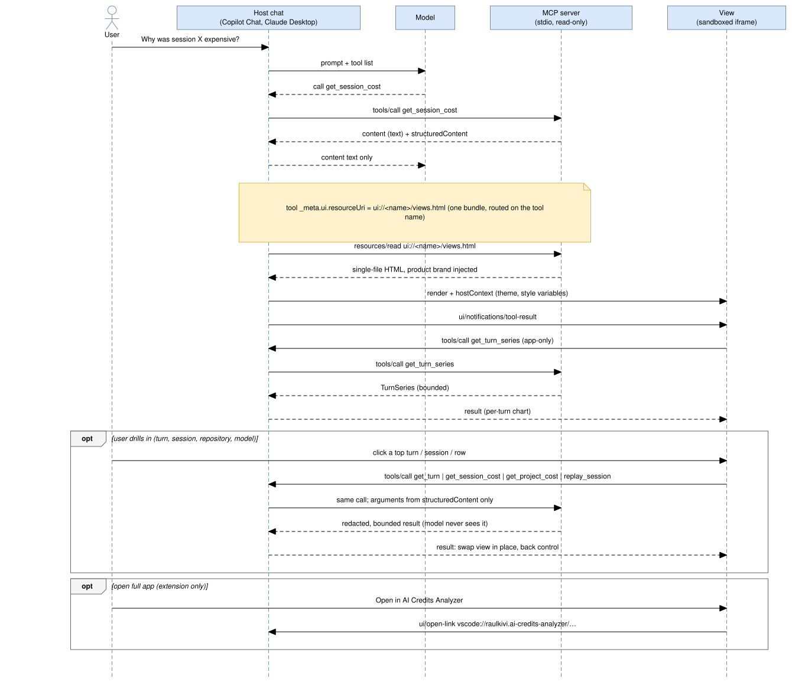
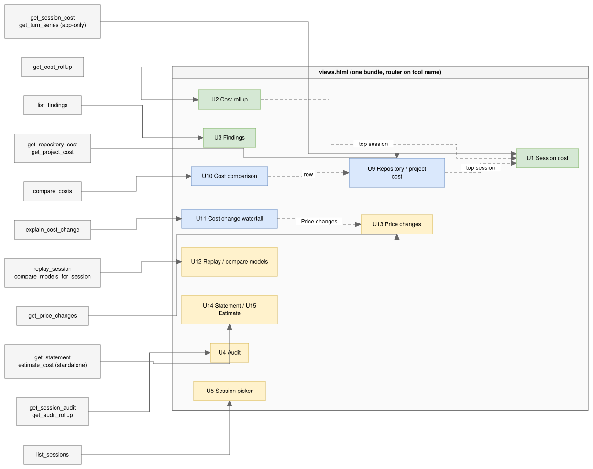

# MCP Apps: branded, interactive cost views in the chat

**Last changed:** 2026-11-11 · **Source:** https://github.com/raulkivi/agent-cost-analyzer

Status: **in progress: the MVP (A0–A16) released 2026-11-10, A12 dropped; Increment 2 (A17–A24, A24 replaced by step 10.17) released 2026-11-11 in extension 0.6.0 and app 0.11.0; next Increment 3 (A25b boards); planned 2026-10-28, updated
2026-11-07 for the Phase 14 and Phase 15 tools.** This is Phase 12 in
[implementation-plan.md](../implementation-plan.md). Its dependencies are
met: Phase 9.12's tools are done, step 10.13 is done and `ext-v0.1.0`
shipped on 2026-11-03.
This plan extends the MCP server from Phase 9.10 and Phase 9.12
([tool-call-audit.md](tool-call-audit.md) §10,
[mcp-tools-v2.md](mcp-tools-v2.md)), and covers the tools that Phase 14
step 14.5 ([analyze-session-replay.md](analyze-session-replay.md)) and
Phase 15 steps 15.4–15.13
([cost-by-repository-and-project.md](cost-by-repository-and-project.md))
added after it was written.

**Tools today.** The standalone server lists 21 model-visible tools. The
extension's server lists 19: every group except `billing`
(`get_statement`, `estimate_cost`; Phase 15 D7). §2 judges every one of
them for a view.

## 1. Context

The MCP server answers cost, audit and security questions as JSON, and the
host's model then writes prose about it. The vision's core value is
*visual*, turn-by-turn exploration (vision.md §2–3), and the chat answer
loses that.

**MCP Apps** (SEP-1865, extension id `io.modelcontextprotocol/ui`, spec
2026-01-26, stable) lets a tool name a `ui://` HTML resource in
`_meta.ui.resourceUri`. The host renders that resource in a sandboxed
iframe next to the tool result and pushes the result to it over
postMessage JSON-RPC. The view can call the server's tools, open links,
send a chat message and ask for fullscreen. A host without support shows
the plain text result.

Hosts that matter here:

| Host | Renders MCP Apps | Reaches our server |
|---|---|---|
| VS Code Copilot Chat | Yes, stable since 1.109. The extension requires ^1.144, so every extension user has it. | Yes. The extension contributes the server (`mcpServerDefinitionProviders`, step 10.8). |
| Claude Desktop | Yes, with local stdio servers ("Allow / Always allow"). | Yes, through `scripts/mcp-server.sh`. |
| claude.ai web, ChatGPT | Yes | No. They need a remote server, which constraint 1 rules out. |
| Claude Code CLI, pi | No (terminal) | Yes. They get the text result, unchanged. |

A2UI was considered and rejected (§10).

## 2. Use-case analysis

Each candidate is a question a user asks the agent, judged by what a view
adds over prose.

| # | User question | Tool | View adds | Verdict |
|---|---|---|---|---|
| U1 | "Why was this session expensive?" | `get_session_cost` | KPI tiles with coverage, AI Credits per turn chart, top turns with event tags, context-overhead bar. Click a turn to see its detail. | **MVP** |
| U2 | "What's driving my spend this week?" | `get_cost_rollup` | Daily spend columns, spend by model and provider bars, a top-sessions table. Click a session to open U1 in place. | **MVP** |
| U3 | "Anything risky in my sessions?" | `list_findings` | Severity tiles, a findings table, kind and severity filters, collapsed redacted evidence. | **MVP** |
| U4 | "Why did tool calls fail?" | `get_session_audit`, `get_audit_rollup` | Failure categories bar, recovery cost, failing commands. | Increment 3 |
| U5 | "Find the session about X" | `list_sessions` | A picker. A click sends "Analyse session <id>" to the chat. | Increment 3, if U1–U3 land well |
| U6 | "Show me turn N" | `get_turn` | Little. Prompt and response are prose, which the model already reads. | Rejected as a standalone view. It's the drill-down inside U1. |
| U7 | `list_tool_calls`, `list_log_providers`, prompts | — | Raw rows or setup data. | Rejected |
| U8 | "Explain prompt caching" (Learn content in chat) | — | Learn diagrams | Follow-up (§11). It isn't a tool-result view. |

### 2.1 Tools added by Phases 14 and 15

| # | User question | Tool | View adds | In | Verdict |
|---|---|---|---|---|---|
| U9 | "What did this repository / project cost, and how did it change?" | `get_repository_cost`, `get_project_cost` | Total tiles per basis with coverage, a cost-over-time chart by bucket with documented and observed price-change markers. For a project, also cost by vendor then model, tokens by type, and top sessions. Click a session to open U1 in place. | both | **Increment 2** |
| U10 | "Which repository or project costs the most?" | `compare_costs` | A comparison table (total, change, cost per session, per active day and per turn, cache-hit ratio) with share bars. Click a row to open U9 for that id in place. | both | **Increment 2** |
| U11 | "Costs went up 30%: why?" | `explain_cost_change` | A waterfall of usage, price and mix effects that add up to the change, a per-model table with unit prices, the "not explained" turns and their reasons, and the documented price changes. "Price changes" opens U13 in place. | both | **Increment 2** |
| U12 | "What would this session have cost on model X?" / "Compare models for this session" | `replay_session`, `compare_models_for_session` | One view, two modes. Compare: simulated totals per model beside the measured total. Replay: simulated per-turn credits beside measured, and the self-check result. Every simulated figure carries the "simulated" tag. Click a model to replay on it in place. | both | **Increment 3** |
| U13 | "When did prices change?" | `get_price_changes` | A timeline that keeps documented and observed changes apart. Each change shows % per token type with its sources. Observed changes are tagged "inferred". | both | **Increment 3** |
| U14 | "What does project X's statement for October say?" | `get_statement` | Statement lines per basis, currency, channel and model, totals per currency, coverage, unknown-cost turns with reasons, and for an issued period the diff against the re-run. No issue button: issuing stays in the app (§11). | standalone | **Increment 3** |
| U15 | "How much will 10 days of work on X cost?" | `estimate_cost` | A p50–p90 range bar in USD labelled "estimate", the sample it came from, and the refusal reason when there is too little data. Never a single number. | standalone | **Increment 3** |
| U16 | "Which prices does the analyzer use?" | `get_price_book` | A long reference table of versions and sources. The model reads it well enough. | — | Rejected as a standalone view. U13 shows the versions behind each change. |
| U17 | "Which repositories / projects are there?" | `list_repositories`, `list_projects` | Lookup lists for picking an id. | — | Rejected as views. U5's picker may later list repositories too. |

"In" is the product whose server registers the tool. The extension has
no projects (Phase 15 D19). There, `get_project_cost` and project
comparisons return their reason, and U9/U10 show that reason instead of
a chart.

**Product fit.** Drill-down from a view goes host → server → view. The
model never sees those results, so exploring a session in the chat spends
no model tokens. A cost analyzer should show this off.

## 3. Scope

- **MVP (this plan):** views for U1, U2 and U3. One app-only tool for the
  per-turn chart. Product branding. A deep link from the view into the
  extension's panel. VS Code Copilot Chat and Claude Desktop as verified
  hosts.
- **Increment 2 (cost analysis, both products):** U9, U10 and U11, for
  the Phase 15 cost-analysis tools. These are the cost questions the
  Dashboard's Cost over time, Compare and Project tabs answer.
- **Increment 3:** U12 (replay), U13 (price changes), U14 and U15
  (statement and estimate, standalone only), U4 (audit), U5 (session
  picker), and fullscreen mode for U2 and U9.
- Each increment reuses the MVP's bundle, theme, `AppHostPort` and
  router, and ships on its own once its exit criterion (§8) is met.
- Text results stay exactly as they are today, for every host.

## 4. Design

### 4.1 Runtime flow



Drill-downs reuse the same host-mediated path for every view (§4.3, §4.5).

### 4.2 Server (`packages/server/src/mcp/apps/`)

- **One view bundle.** One resource, `ui://<identity.name>/views.html`,
  holds all three views. It routes on `hostContext.toolInfo.tool.name`,
  and falls back to the shape of `structuredContent` when `toolInfo` is
  missing. The host fetches and caches one document instead of three, and
  the views share React, the charts and the theme.
- **`registerAppViews(server, deps)`** is a new tool group, the same
  pattern as `registerCostTools`, so it doesn't touch the other groups
  (OCP). It:
  - registers the resource with MIME type `text/html;profile=mcp-app`,
    using `registerAppResource` from `@modelcontextprotocol/ext-apps/server`;
  - registers the app-only tool `get_turn_series`, with
    `_meta.ui.visibility: ["app"]`, so it never reaches the model's tool
    list;
  - gives `get_session_cost`, `get_cost_rollup` and `list_findings`
    `_meta.ui.resourceUri`. Their names, input schemas, output schemas and
    `content` stay unchanged.
- **`get_turn_series`** takes `sessionId`, `provider?` and `maxTurns?`
  (default 500, max 2000). It returns `TurnSeries`, the bounded per-turn
  figures the chart needs. `SessionCost` carries only `topTurns`, and
  adding every turn to it would bloat the model's context. Built by the
  pure `services/cost/turn-series-builder.ts`.
- **`ViewSource`** is a port with `read(): Promise<string>`. The server
  depends on the port, not on file paths (DIP). `FileViewSource(path)`
  reads the built HTML: `packages/mcp-apps/dist/views.html` for the
  standalone server, `dist/mcp-apps/views.html` inside the `.vsix`. Tests
  use an in-memory source.
- **Brand injection.** When the resource is read, the pure
  `injectBrand(html, brand)` fills a placeholder
  `<meta name="aca-brand" content="">` with the escaped JSON of
  `ViewBrand`:
  ```ts
  { productId: "vscode-extension" | "standalone"; displayName: string; version: string; deepLinkBase?: string }
  ```
  `ViewBrand` is derived from `McpIdentity`, which already carries the
  product's `title` (#95):
  - `displayName` is `identity.title`.
  - `deepLinkBase` is the only new identity field.
    `COPILOT_MCP_IDENTITY` ("AI Credits Analyzer") sets it to
    `vscode://raulkivi.ai-credits-analyzer`.
    `STANDALONE_MCP_IDENTITY` ("Agent Cost Analyzer") leaves it out,
    because the standalone web app may not be running, so the view hides
    the button.
  The host already shows the server's icon (`MCP_ICONS` in
  `mcp-branding.ts`, #95) next to the tool call, so the view's mark and
  the host's server icon are the same glyph.
- **Dependency pin.** `@modelcontextprotocol/ext-apps` is pinned to
  **1.7.5** exactly. 2.x needs the split MCP SDK 2 packages
  (`@modelcontextprotocol/server|client|core`), which share no types with
  `@modelcontextprotocol/sdk` 1.x. The wire protocol is the same, so the
  SDK 2 migration is its own follow-up (§11).

### 4.3 Views (`packages/mcp-apps`, new workspace)

- **Build.** Vite with `vite-plugin-singlefile` (the approach the official
  quickstart uses) produces one self-contained `dist/views.html`. Scripts
  and CSS are inline, which the spec's default CSP allows. No
  `connectDomains`, no `resourceDomains`, no network access.
- **Reuse.** `packages/web` exports its presentational modules without
  changing the app: `theme.css`, `components/ui/*` (`Blueprint`,
  `StatTile`, `StatusTag`, `Tag`, `SegmentedControl`), the charts
  (`TrendColumns`, `HorizontalBars`, `StackedColumns`, the sparkline core),
  `components/insights/FindingsTable`, `lib/format-ai-credits` and `lib/contrast`
  (the WCAG maths; added in A6 for the theme's contrast tests).
  Constraint 3 already keeps these free of any data source.
- **Pure view models** live in `src/view-models/`, one per view:
  ```ts
  toSessionCostViewModel(cost: SessionCost, series?: TurnSeries): SessionCostViewModel
  toCostRollupViewModel(rollup: CostRollup): CostRollupViewModel
  toFindingsViewModel(result: FindingsQueryResult, filter: FindingsFilter): FindingsViewModel
  ```
  `FindingsQueryResult`, `SessionCost`, `CostRollup` and `TurnSeries` are
  the domain types. `FindingsFilter` is declared next to the model with
  only `kind` and `minSeverity`; the server's own filter type is a
  superset, so it is assignable. They format every figure for display:
  - AI Credits round to 2 decimal places, like `formatAiCredits`. That
    function takes a `TokenCount`, so its rounding rule is split out to
    take a plain number.
  - A `null` measure shows "Unknown", never 0 (constraint 6).
  - Partial coverage adds a note, e.g. "known for 12 of 40 turns".
  - `estimated: true` adds a visible "estimate" tag.
- **`AppHostPort`** is the view's only gateway to the host:
  `callTool`, `openLink`, `sendMessage`, `requestDisplayMode` and
  `onHostContext`. The adapter wraps ext-apps' `App`. Tests use a fake.
  This mirrors `HostCapabilities` in the web app: components get the
  functions they need as props, and a missing capability hides its
  affordance.
- **Interactions:**
  - U1: clicking a top turn calls `get_turn` and expands the turn inline.
    "Open in AI Credits Analyzer" calls `openLink(deepLinkBase + "/session?id=…")`.
  - U2: clicking a top session calls `get_session_cost` and swaps to the
    U1 view in place, with a back control. A secondary "Ask about this
    session" button sends a fixed template naming only the session id.
  - U3: the severity and kind filters call `list_findings` again.
- **Never forwarded to the model:** logged text (prompts, responses,
  evidence). `sendMessage` carries only fixed templates with ids, and the
  view doesn't call `updateModelContext` in the MVP (§6).
- **Size.** `autoResize` is on. The inline height is capped at about 640px.
  Long tables scroll inside the card.

### 4.4 Deep link (extension)

**A0 result (2026-11-07):** both hosts refuse `openLink` to `vscode://`, so A12 is dropped and the view's button copies a command instead. The copied text was first `AI Credits Analyzer: Open Session <id>` (the A0b placeholder). A15 found that this cannot work: the Command Palette matches command titles only and passes no argument, and `aiCreditsAnalyzer.openSession` was hidden from it.

**Owner decision (2026-11-07), option A:** the extension shows **"AI Credits Analyzer: Open Session…"** in the Command Palette. Run without a session, it opens a QuickPick of the sessions, newest first, filterable by title and id. The view's button copies the **session title**, and its hint says to run that command and paste the title. Claude Desktop and the standalone product show no button.

**Follow-up, option B (after the MVP):** a one-click "Open in AI Credits Analyzer". The view calls an app-only tool, and the MCP server hands the request to the extension over a new local channel, which then opens the panel. That channel is new attack surface and needs a threat-model entry, so it is listed in §11.

The rest of this section is kept for a host that later allows `vscode://`. The rest of this section is kept for a host that later allows `vscode://`.

- The extension adds `window.registerUriHandler` and the `onUri`
  activation event.
- `/session?id=<id>` opens the AI Credits Analyzer panel on that session.
- `/turn?id=<id>&turn=<n>` also selects the turn.
- Parameters are validated against the existing session id rules. The
  handler only navigates. It never runs a command that changes anything.

### 4.5 Views for the Phase 14 and 15 tools (Increments 2 and 3)

- **Same bundle, same router.** U9–U15 are routes in `views.html`, keyed
  on the tool name. Each increment adds `_meta.ui.resourceUri` to its
  tools. Names, input schemas, output schemas and `content` stay as they
  are.
- **Only for registered tools.** `registerAppViews` takes the names of
  the tools the server actually registered (the `toolGroups` and
  optional-deps checks in `createMcpServer`). It adds `_meta.ui` only to
  those. The extension's server therefore never names a view for
  `get_statement` or `estimate_cost`.
- **No new app-only tools.** Drill-down calls tools the model can already
  call: `get_repository_cost`, `get_project_cost`, `get_session_cost`,
  `get_price_changes` and `replay_session`. Arguments come only from the
  current `structuredContent`: ids, keys, periods and the basis.
- **Reuse.** The presentational parts come from `packages/web`:
  - charts: `CostTimeChart`, `Waterfall`, `HorizontalBars`,
    `StackedColumns`, `ReplayCompareBars`, `ChartDataTable`/`ViewAsTable`;
  - `lib/cost/*`: `cost-format`, `series-model`, `series-colors`,
    `project-model`;
  - replay: `SimulatedBadge` and `ReplayPricingNote`.

  The tabs (`CostOverTimeTab`, `CompareTab`, `ProjectTab`, `BillingTab`,
  `EstimatePanel`, `CompareModelsView`) fetch through `api-client`, so the
  views don't import them. Where a tab mixes its rendering with fetching,
  the rendering is split out first, a pure refactor with the web tests
  green (A17).
- **Pure view models**, one per view, alongside §4.3's:
  ```ts
  toCostSeriesViewModel(cost: CostSeries | ProjectCost): CostSeriesViewModel        // U9
  toCostComparisonViewModel(comparison: CostComparison): CostComparisonViewModel    // U10
  toCostVarianceViewModel(variance: CostVariance): CostVarianceViewModel            // U11
  toReplayViewModel(replay: SessionReplay | SessionReplayComparison): ReplayViewModel // U12
  toPriceChangesViewModel(list: PriceChangeList): PriceChangesViewModel             // U13
  toStatementViewModel(answer: StatementAnswer): StatementViewModel                 // U14
  toEstimateViewModel(estimate: CostEstimate): EstimateViewModel                    // U15
  ```
- **Display rules**, on top of §4.3's:
  - Every money figure names its basis (billed, reported or priced) and
    its currency. Currencies stay apart unless the result is in USD.
  - A change against a period with nothing known shows "no earlier
    figure", never "from 0".
  - Replay figures carry "simulated", and the self-check status is shown.
    A failed or missing self-check is called out, not hidden.
  - Estimates show the p50–p90 range and "estimate", never one number. A
    refusal shows its reason.
  - Observed price changes are "inferred" and visually distinct from
    documented ones.
  - Local repositories show the folder name only, as the tools return it.
- **Interactions:**
  - U9: clicking a top session opens U1 in place.
  - U10: clicking a row opens U9 for that id in place.
  - U11: "Price changes" opens U13 in place, filtered to the models with
    the largest price effect.
  - U12: in compare mode, clicking a model calls `replay_session` and
    switches to replay mode.
  - U13, U14 and U15 have no drill-down.

  Each in-place swap has a back control, as in U2.

### 4.6 Tool coverage



Green: MVP. Blue: Increment 2. Yellow: Increment 3. Dotted edges are in-place drill-downs.

| Tool | Group | View |
|---|---|---|
| `list_log_providers` | sessions | — (U7) |
| `list_sessions` | sessions | U5, Increment 3 |
| `get_turn` | sessions | Drill-down in U1 |
| `get_session_audit`, `get_audit_rollup` | audit | U4, Increment 3 |
| `list_tool_calls` | audit | — (U7) |
| `get_session_cost` | cost | U1, MVP |
| `get_cost_rollup` | cost | U2, MVP |
| `get_repository_cost`, `get_project_cost` | costAnalysis | U9, Increment 2 |
| `compare_costs` | costAnalysis | U10, Increment 2 |
| `explain_cost_change` | costAnalysis | U11, Increment 2 |
| `list_findings` | findings | U3, MVP |
| `list_repositories`, `list_projects` | attribution | — (U17) |
| `get_price_book` | pricing | — (U16) |
| `get_price_changes` | pricing | U13, Increment 3 |
| `replay_session`, `compare_models_for_session` | replay | U12, Increment 3 |
| `get_statement`, `estimate_cost` | billing (standalone) | U14, U15, Increment 3 |
| `get_turn_series` (app-only, new) | appViews | Feeds U1's chart |

### 4.7 Active sessions

Found in A16: the newest session's log is incomplete while its chat runs.
The latest turn is undercounted, and cache writes and turn text may be
missing. A rollup read mid-turn then doesn't reconcile with a later
session read.

- **Rule:** a session is **active** when its latest turn started within
  `ACTIVE_SESSION_WINDOW_MINUTES` (15) of now. One rule for every log
  provider, in `sessionActivity` (`packages/server/src/services/cost/session-activity.ts`).
- Only turns' own start times count. A session whose turns have none is
  never active; the session's start is not used as a guess.
- A start after now (clock skew) counts as active.
- A session that just finished is flagged too, so the wording is
  "active: figures may still change", not "in progress".
- `SessionCost` and each `CostRollup.topSessions` entry carry
  `lastTurnAt` (the latest turn start the log records) and `active: true`
  (only within the window). Both are optional.
- The clock is injected: `AnalysisQueryService` takes `now`, defaulting to
  the system clock. The builders never read a clock.
- Text output: when active, `get_session_cost` adds the sentence "This
  session is active (its latest turn started N minutes ago), so its
  figures may still change and the latest turn may be incomplete."
  `get_cost_rollup` adds one sentence naming its active top sessions. The
  sentence follows the JSON as a second text item. Both tool descriptions
  say what `active` means.
- Views: U1 shows an "active" tag beside the meta line and the note "Active session: figures may still change; the latest turn may be incomplete."; U2 shows an "active" tag on the top-sessions row, outside the title button. Both trust the server's flag and never read a clock.

## 5. Branding

**Rule: the brand marks identity and data. The host owns the structure.**
Both host guidelines ask for this. Claude's MCP Apps design guidelines say
to use host tokens for "backgrounds, text, borders, icons" and to keep
brand colours "for accents and identity", in light and dark. It's also
how `theme-vscode.css` already fits the panel into VS Code.

### 5.1 Brand elements

| Element | Treatment | Value comes from |
|---|---|---|
| Product mark | The app icon, inline SVG at 16px. `aria-hidden`; the name next to it is the label. | The SVG in `mcp-branding.ts` (#95), exported once and imported by the view build, so the MCP server icon and the view mark can't drift |
| Product name | In the view header: "AI Credits Analyzer" or "Agent Cost Analyzer" | `ViewBrand.displayName` (`McpIdentity.title`) |
| Card frame | The Industry `.blueprint` card with its four corner marks, the system's signature. Corners in the brand accent, border in the host's `--color-border-primary`. | `theme.css` + host |
| Kicker | 10px uppercase, 0.1em tracking, brand accent text: `AI CREDITS ANALYZER · SESSION COST` | `.card-kicker` |
| Data marks | Bars, columns and the per-turn line use the brand accent ramp. Selected and hover states use `--color-accent-800`/`-100`. | `brand.css` (light and dark ramps) |
| Severity | The host's semantic colours: `--color-text-danger`, `-warning`, `-info`. Severity is meaning, not brand. | host |
| Headings | `--font-heading`: `"Barlow Condensed"` through `local()` only, then the host's `--font-sans` | §5.3 |
| Body, numbers | The host's `--font-sans`, tabular figures | host |
| Footer | `Read-only · local logs · v{version}`, plus the deep-link button when available | `ViewBrand` |

### 5.2 Theme layering (`packages/mcp-apps/src/theme/`)

1. **`theme.css`** (shared with the web app): the Industry tokens and
   components.
2. **`theme-mcp-host.css`**: re-points the Industry tokens at the spec's
   standard host variables, with the Industry palette as each fallback. It
   is scoped under `html[data-host="mcp-app"]` and built the same way as
   `theme-vscode.css`:
   - `--color-text` → `--color-text-primary`
   - `--color-text-muted` → `--color-text-secondary`
   - `--color-surface` → `--color-background-secondary`
   - `--color-divider` → `--color-border-primary`
   - `--font-body` → `--font-sans`
   - radii → `--border-radius-*`

   `--color-bg` is `transparent`. The page declares `color-scheme: light
   dark`, as Claude's transparent-theming guide asks.
3. **`brand.css`**: the fixed brand tokens (mark colour, accent ramp for
   light and dark). Its light/dark switch follows `hostContext.theme`,
   applied with ext-apps' `applyDocumentTheme`, not the OS preference.

Host variables arrive at runtime through `applyHostStyleVariables` and
`applyHostFonts`. A host may send any subset, so every token has a
fallback.

### 5.3 Fonts

The spec's default CSP leaves `font-src` at `'self'` (or `'none'`), so a
bundled `data:` font won't load, and fetching Barlow from a CDN breaks
constraint 1. Headings therefore ask for `local("Barlow Condensed")` and
otherwise use the host font. This matches the extension build, which
already drops the bundled fonts in favour of the editor's (vite.config.ts).
The brand doesn't depend on the typeface. The mark, the corner-mark cards,
the kicker style and the accent ramp carry it.

### 5.4 Don'ts

- No GitHub, Copilot, Microsoft or Anthropic logos or colours, and nothing
  that imitates the host's own chrome. The product is independent (see
  README).
- No brand-coloured fills on large areas, no hard-coded hex outside
  `brand.css`, no emoji (design system rule), no custom scrollbars.
- No `_meta.ui.prefersBorder: false`. The host's frame plus our card frame
  reads as one card.

### 5.5 Wireframe: U1, session cost (inline, about 560px)

```
┌ ▮ AI Credits Analyzer ─────────────────────────── light/dark: host ┐
│ AI CREDITS ANALYZER · SESSION COST                                  │
│ Refactor provider registry        claude-sonnet · 42 turns · Oct 27 │
│ ┌──────────┐ ┌──────────┐ ┌──────────┐ ┌──────────┐                 │
│ │AI Credits│ │Input tok.│ │Cache hit │ │Output    │                 │
│ │ 18.42    │ │ 2.1 M    │ │ 87 %     │ │ 64 k     │                 │
│ │40/42 turn│ │          │ │          │ │ estimate │                 │
│ └──────────┘ └──────────┘ └──────────┘ └──────────┘                 │
│ AI Credits per turn  ▁▁▂▁▇▁▁▃▁▁▁▁▅▁  (compaction ◆ at turn 17)       │
│ Top turns                                       credits  in-tokens  │
│  › 17  "rewrite the decoder…"  [compaction]       4.10     310 k    │
│  › 5   "add tests for…"        [model switch]     2.95     240 k    │
│ Context overhead  system prompt 21 k ███████░░  unused tools 14     │
│ Read-only · local logs · v0.4.0        [ Open in AI Credits Analyzer ]│
└─────────────────────────────────────────────────────────────────────┘
```

U2 and U3 follow the same header, kicker and footer, and use the same
`StatTile` row and table grammar as the web Dashboard.

### 5.6 Mock-ups

The §5.5 wireframe fixes the content, not the look. Each increment
starts with mock-up boards that the owner approves before any view code,
as Phase 14 (step 14.6) and Phase 15 (step 15.8) did.

- **Where:** `docs/plans/mockups/mcp-apps/`, in the same `.dc.html`
  board format as `mockups/cost-by-project/` and `mockups/session-replay/`.
- **Frames:** each view is drawn inside a VS Code Copilot Chat frame and
  a Claude Desktop frame, inline at about 560–640 px, in light and dark.
  The frames use the host variables the A0 spike recorded, so the boards
  show what each host really sends, not a guess. That is why the MVP
  boards come after A0. Billing views (U14, U15) are drawn in the Claude
  Desktop frame only.
- **What each board must show:** the brand layering (§5.1), the in-place
  drill-down and its back control, and the labels the display rules
  require: "Unknown", partial coverage, "simulated", "estimate",
  "inferred", and the extension's "no projects" reason.
- **States boards** cover the cases a single happy-path board hides:
  unknown and partial figures, errors, narrow width, and no deep link
  (the standalone server).
- **What they don't prove:** real rendering in each host. The owner's
  manual checks (A16, A24, A33) do that.

| Task | Boards | Approved before |
|---|---|---|
| A0b | U1, U2, U3; MVP states | A9, A11 |
| A17b | U9 (repository, project), U10, U11, drill-down; "no projects" | A20, A22 |
| A25b | U12 (both modes), U4, U5; states for U13–U15 | A27–A30 |

## 6. Security (threat-model.md §6 to be updated)

- **Same data, same redaction.** The views only show what the tools
  already return, and that output is already redacted and bounded. No new
  data leaves the machine except what the host already receives as tool
  results.
- **Logged text is untrusted.** Prompts, responses and evidence can carry
  injected instructions. React renders them as text, never as HTML. They
  are never passed to `sendMessage` or `updateModelContext`, so a view
  click can't relay an injection into the model.
- **CSP.** The resource declares no `csp` domains, so the view keeps the
  host's default: `connect-src 'none'`, no frames, no external resources.
  It sets no `_meta.ui.domain`, which local stdio servers can't use in
  Claude anyway.
- **App-only tool.** `get_turn_series` is read-only and bounded, with the
  same guard and `isError` handling as the other tools.
- **Deep link.** Only `vscode://raulkivi.ai-credits-analyzer/…`. The
  handler validates parameters and only navigates (§4.4).
- **No billing views in the extension.** The extension's server never
  registers the billing tools, so it never names a view for them (§4.5).
  A test over the extension's `tools/list` asserts this.
- **Read-only billing.** U14 has no issue action, and nothing a view does
  can write a statement, a projects file or a setting.
- **Labels can't be dropped.** "Simulated", "estimate" and "inferred" are
  part of the view models' output, not CSS. A test asserts them, so a
  screenshot of a view can't pass a simulated or estimated figure off as
  measured.

### 6.1 A14 review, 2026-11-07 (U1–U3)

Scope: everything under `packages/mcp-apps/src`, the built
`dist/views.html`, and the server's resource registration and `injectBrand`.

**Checked, holds (now asserted by tests):**

- **CSP.** One self-contained file: the bundle test asserts no external
  script, stylesheet, font or `url(http…)`. A new server test asserts the
  resource declares no `_meta.ui.csp` (no `connectDomains` or
  `resourceDomains`), no `domain`, no `permissions` and no
  `prefersBorder: false`, in both `resources/list` and `resources/read`.
- **No HTML sinks, no network.** A static test finds no
  `dangerouslySetInnerHTML`, `innerHTML`, `outerHTML`, `insertAdjacentHTML`,
  `document.write`, `eval`, `new Function`, `srcdoc`, `fetch`,
  `XMLHttpRequest`, `WebSocket`, `EventSource`, `sendBeacon`, `window.open`
  or `location` navigation in shipped code, and no `<a>` element.
- **Logged text is rendered as text.** Evidence is a text child of
  `<pre>`. Tests render hostile markup in a session title, a top-turn
  prompt, the `get_turn` detail, a rollup session title and finding
  evidence, and find no element created from it.
- **No forwarding.** `test/security/no-forwarding.test.ts` parses every
  shipped source with the TypeScript compiler and finds every mention of
  `sendMessage`, `openLink`, `updateModelContext`, `callTool` and
  `callServerTool`. It fails on any alias or destructuring, so a call site
  can't hide. It asserts: one `sendMessage` site, whose text comes from
  `askAboutSessionText`, a template whose only placeholder is a `string`
  `*Id` parameter; no `openLink` call outside the adapter; no
  `updateModelContext` at all; exactly four tool calls (`get_turn_series`,
  `get_turn`, `get_session_cost`, `list_findings`), through the
  `callParsed` forwarder or directly, by literal name, with arguments that
  are object literals of reviewed names (`sessionId`, `provider`,
  `turnIndex`, `maxTurns`, `kind`, `minSeverity`) or a reviewed builder
  (`toolArguments`), and that read no logged-text field. The ext-apps
  adapter forwards only its own parameters. Mutating a template or adding
  `note: session.title` to a call makes it fail. Each view's dynamic test
  now presses every control it shows (every turn, Hide turn, Retry in each
  failure state, copy, Ask, every kind radio and severity option, every
  evidence toggle) with logged text planted in every field, and checks
  what reached the port.
- **Clipboard.** The only `writeText` outside the port is the copy hook,
  and every caller passes `sessionSearchText(vm.sessionId, vm.title)`: the
  session title on one line (control characters dropped, at most 120
  characters), or the id when there is no title (static test). After the
  owner's decision A (§4.4) the title goes to the clipboard on purpose; it
  reaches the user, never the model.
- **`injectBrand`.** It escapes `& < > " '`, splices with `slice` rather
  than `replace` (no `$&` patterns), and its tests cover a display name
  that tries to leave the attribute. The brand values are the server's own
  identity and version; `readBrand` checks the shape, falls back to the
  generic brand, and the view renders the name as text.

**Fixed:**

- **Host style variables.** ext-apps' `applyHostStyleVariables` calls
  `style.setProperty(key, value)` on `<html>` for every key it is given.
  A key like `display` or `background-image` would restyle the page, and a
  `url()` value would make a request. `bindHostTheme` now passes only
  custom properties (`--*`) and drops values containing `url(`, `image(`,
  `image-set(`, `expression(`, `;`, `{`, `}`, `<`, `>`, `@` or `\`.
  `setProperty` already rejects a `;}` breakout, so this is defence in
  depth. A test checks that all five recorded host sets (Claude light and
  dark, VS Code light, dark and HC dark) pass through unchanged. The theme
  is applied only when it is `light` or `dark`.
- **Session id in the message.** The id comes from the logs (a Claude Code
  id is the log's file name), so a crafted name could carry words into
  "Analyse session <id>". "Ask about this session" is now shown only for a
  plain id (`^[A-Za-z0-9][A-Za-z0-9._:-]{0,127}$`, which covers the
  providers' UUIDs, hex hashes with segment suffixes and slugs), and the
  static test requires that check next to the `sendMessage` call.

**Accessibility (fixed):** axe found one violation, in every state:
`landmark-contentinfo-is-top-level`, because the footer sat inside the
shell's `role="region"`. The shell is now the page's `<main>`, named by its
title. Beyond what axe checks in jsdom:

- Each chart's name now summarises it, e.g. "AI Credits per turn, 4 turns;
  highest 4.10 at turn 2; 1 turn unknown".
- The chart's loading skeleton is a `status` with text.
- Turn toggles have `aria-controls`.
- U3's table scroller is focusable and named, like U1's and U2's.
- The kind filter is a `fieldset` with a legend, not a `radiogroup` around
  native radios.
- The copy button lost a duplicate `aria-live`.
- Dimmed severity tiles use the muted text token, not `opacity: 0.5`,
  which the contrast tests can't see.
- The radios' focus ring uses the host's `--color-ring-primary`.
- Keyboard: focus fell to the document when a drill-down opened, when Back
  closed it, and when "Hide turn" removed itself. It now lands on Back, on
  the session row the user came from, and on the turn's toggle.

Colour contrast isn't checked by axe in jsdom; the A6 contrast tests cover
it.

**Layout (fixed, from screenshots at 560 and 360px, light and dark):**

- The corner marks sat 6px outside the card and scrolled every view 5px
  sideways; the shell now has a 6px margin.
- U2's "Unknown Unknown" overlapped in the narrow value and share columns;
  an unknown row now shows one "Unknown" across both.
- Session titles in U2's table were centred.
- Footer buttons wrapped their labels out of the 26px box at 360px.
- At 360px, U2's table pushed AI Credits, and U3's table pushed Session and
  When, out of view. Provider and model, and kind, session and day, now
  move under the title.
- Chart axis labels drew at about 6px at 360px.
- U3's severity tiles are three across on a narrow host.

**Left open:**

- **Host fonts.** `applyHostFonts` injects the host's `@font-face` CSS as
  given. Claude Desktop's loads `woff2` files from its own asset domain.
  That fetch is the host's, under the host's CSP, not the view's; it
  belongs in the threat model's MCP section (A15).
- **Host trust.** The host can already restyle or replace the frame it
  renders. The variable filter limits what a malformed context can do, not
  what a hostile host can do.
- **Copy command.** The copied text names the raw session id. It goes to
  the user's clipboard, not the model, so the plain-id rule isn't applied
  there.
- **No end-to-end test in a real host.** The checks above run in jsdom and
  in a Chromium harness (`test/visual/`, built on demand, not shipped).
  The hosts themselves are A16.

#### A23 review, 2026-11-10 (U9–U11)

Scope: `CostOverTimeView` (U9), `CostCompareView` (U10), `CostChangeView`
(U11) and their folders, the `packages/web` modules they import, and the
server's unknown-project-id text.

**Checked, holds (now asserted by tests):**

- **No forwarding.** The static scan names U9–U11's files. The only new
  host calls are U10's `get_repository_cost` and `get_project_cost`, with a
  row's own ids, period, basis, pricing and currency. U9 reaches U1 through
  the shared `DrillDown` (`get_session_cost`). U11 calls nothing. Still one
  `sendMessage` site, no `openLink`, no `updateModelContext`, and the
  clipboard only through U1's copy hook.
- **Logged and model-chosen text.** `src/views/hostile-text.test.tsx`
  plants markup and an injected instruction in every text field U9–U11
  show: row, project, session, vendor and model labels, unknown and
  not-explained reasons, provider errors. It presses every control down to
  U1. Nothing planted reaches the port, and no element is made from it.
- **Error as state.** U9, U10 (and a failed U10 row) and U11 render a
  tool's error text as a text node; the tests plant markup in it.
- **Colours.** Every recorded host set holds U11's rise (danger) and fall
  (success) at 3:1 or more on every ground and the surface. The tightest is
  3.16:1, the rise on VS Code Light Modern.
- **Keyboard.** U10 → U9 → U1 and Back at each level, Back from a failed
  row, from the no-projects state and from a session that failed two levels
  down, U9's top session and back, U9's currency switch, U11's model rows
  (Enter opens, Space closes, focus stays) and View as table all work and
  return focus to the control that opened them. No view change was needed.
- **axe.** U9 and U10 were already covered by A20–A21, in every state the
  task lists. U11 now runs in `a11y.test.tsx` too: loaded, expanded, the
  waterfall as a table, two currencies with a fall, logs not fully read, no
  earlier figure, every turn explained, nothing priced, errors, unreadable
  and waiting. None had violations.

**Fixed:**

- **No-projects spoofing.** U9 and U10 found the no-projects state with a
  regex that took any text after the unknown-id answer as the reason. The
  project id is the model's argument, so a crafted id could put its own
  text in that state in a product that has projects. The domain now owns
  the wording: `unknownProjectIdText` (used by `get_project_cost`,
  `get_statement` and `estimate_cost`) and `parseUnknownProjectIdText`,
  which accepts only a reason the domain knows. The quoted id is capped at
  120 characters.
- **Allow list.** `maxTurns` was reviewed but no call sends it; it is
  dropped, and a test now fails on any unused tool or argument name.
  `label`, `name`, `reason`, `reasons`, `error`, `errorText`, `answer` and
  `displayOnly` joined the fields a tool call may not read.
- **Sinks beyond `src/`.** The sink scan now also covers every `web`
  module the views import (Waterfall, ViewAsTable, SegmentedControl and
  their imports), and a new test finds no URL attribute (`href`, `src`,
  `action` and the like) on any element. Both found nothing.
- **Contrast.** The period-total bars (theme.css series 1) were 2.99:1 on
  Claude dark; they now use the brand's data colour, like U9's bars. On a
  dark host that sends no colours, the diverging red and series-6 green
  fell to 2.4–3.0:1; brand.css now has `--brand-fb-danger` and
  `--brand-fb-success` as the fallbacks (theme.css's red and green in light,
  lighter values in dark). The recorded VS Code palettes gained
  `testing.iconPassed`.
- **U11.** The model toggles had no `aria-controls`; the waterfall key's
  swatches were not hidden from assistive tech. The "Not explained" tile
  showed "0 turns"; it is now drawn only when turns are unexplained, as the
  board does. U11's classes moved from U10's `cc-` prefix to its own `cv-`,
  and the class-ownership test has no exemption left.
- **U9 markers.** On a monthly chart an observed change drew at the start
  of the month, not of its week (found in the visual harness).

**Decision: U9's price-change markers stay out of the tab order.** The chart
is one `role="img"` whose name counts the documented and inferred changes.
The list under the chart gives each one's model, channel, date and prices
as text, next in reading order. Focusable markers would need the chart
restructured (children of an image are presentational) and would add one
tab stop per marker that repeats the list. A test asserts the markers have
no `tabindex`, the name counts them and the list has one item per marker.

**Left open:**

- **Narrow widths.** jsdom has no layout, so the 360px rules are not in the
  component tests. U9 (project) and U11 were checked in the visual harness
  at 360px light and 600px dark. At 600px U11's by-model table scrolls
  sideways (Price out of view) inside its named, focusable scroller; A24
  can judge whether that needs a narrower layout.
- **Period-total colour.** The brand data colour replaces the board's
  series-1 blue. A24 confirms it.
- **Colours not recorded.** Dark High Contrast's `testing.iconPassed` is
  VS Code's registered default, not a recording, and Light High Contrast is
  still not covered.

## 7. Tasks

TDD throughout: each task starts with a failing test (architecture.md
§11.4). "setup6" marks a task that fits the local model: three files or
fewer, an exact spec, and acceptance tests the local agent never sees.

| # | Task | Complexity | Model | Depends on |
|---|---|---|---|---|
| A0 | **Spike** (1 day, time-boxed). A hard-coded view on `get_session_cost` in VS Code Copilot Chat and Claude Desktop. Record: the host variables each sends, whether `toolInfo` is present, `local()` fonts, `openLink` to `vscode://`, app-initiated `tools/call` approval prompts, display modes, High Contrast. Results go into §9. The kit and the owner's checklist are in [mcp-apps-spike.md](mcp-apps-spike.md). | medium | Sonnet | — |
| A0b | **MVP mock-ups** (§5.6): U1, U2 and U3 in a VS Code Copilot Chat frame and a Claude Desktop frame, light and dark, using the host variables A0 recorded; one states board (Unknown, partial coverage, error, narrow width, no deep link). The owner approves them before A9. **Drawn and approved by the owner (2026-11-07):** [mockups/mcp-apps/](mockups/mcp-apps/README.md). | medium | Sonnet (frontend-design skill) + owner | A0 |
| A1 | `turnSeriesSchema` in `packages/domain/src/cost.ts`, and `buildTurnSeries(session: Session, maxTurns = 500): TurnSeries` in `services/cost/turn-series-builder.ts` | low | setup6 | — |
| A2 | `injectBrand(html: string, brand: ViewBrand): string` in `mcp/apps/inject-brand.ts`. Throws when the placeholder is missing; escapes HTML attribute characters. | low | setup6 | — |
| A3 | `McpIdentity.deepLinkBase` (Copilot identity only), `toViewBrand(identity, version)`, and the icon SVG exported from `mcp-branding.ts` | low | Haiku | A2 |
| A4 | `packages/web` package exports for the reusable modules (§4.3), with no app change. Typecheck and the web tests stay green. | low | Haiku | — |
| A5 | `packages/mcp-apps` scaffold: Vite single-file build, ext-apps 1.7.5 pinned, `AppHostPort` plus `App` adapter and fake, the view router, a bundle size budget test (≤ 900 KB uncompressed; raised from 450 KB by the owner 2026-11-07 because ext-apps pulls in zod, no patching of dependencies). Done 2026-11-07: `dist/views.html` is 672,801 bytes | medium | Sonnet | A0, A4 |
| A6 | Theme layering: `theme-mcp-host.css`, `brand.css`, contrast tests (text ≥ 4.5:1, marks ≥ 3:1) against the fallbacks and against recorded VS Code and Claude variable sets from A0, light and dark. **Done 2026-11-07:** the CSS is in `packages/mcp-apps/src/theme/` and `main.tsx` imports it after `theme.css`; `bindHostTheme` sets `data-host="mcp-app"` and applies `applyDocumentTheme`, `applyHostStyleVariables` and `applyHostFonts` from the host context, through `AppHostPort` (`HostContext.styles` added). The contrast tests (`test/theme/`) read the real CSS and cover the fallbacks, the recorded Claude set and the recorded VS Code references resolved against Light Modern, Dark Modern and Dark High Contrast (Light High Contrast was not recorded). The worst margin is 3.42:1 for marks (3:1 needed) and 5.3:1 for text (4.5:1 needed). Bundle: `dist/views.html` 693.5 KiB | medium | Sonnet (frontend-design skill) | A0, A5 |
| A7 | View models: `toSessionCostViewModel`, `toCostRollupViewModel`, `toFindingsViewModel` (§4.3), one run each. **Done 2026-11-07:** `packages/mcp-apps/src/view-models/`, one module per view plus `format.ts`, with unit and fast-check tests. `formatAiCreditsValue(value: number)` split out of `formatAiCredits` in `packages/web`. `FindingsFilter` lives in `packages/server`, so the view models declare the two fields the view offers (`kind`, `minSeverity`) themselves. Logged text (turn excerpt, finding `detail`) sits under fields named for display only | low | setup6 | A1, A5 |
| A8 | Server group `registerAppViews`, `ViewSource`/`FileViewSource`, `get_turn_series`, `_meta.ui` on three tools. In-memory client tests: `tools/list` metadata, `resources/read` MIME type and the injected brand, unchanged `content`. | medium | Sonnet | A1, A2, A3 |
| A9 | U1 `SessionCostView`, with the turn drill-down and the copy-command button. **Done 2026-11-07:** `packages/mcp-apps/src/views/SessionCostView.tsx` plus `views/session-cost/`. KPI tiles (`StatTile`, `Tag`), a per-turn column chart with a hatched gap for Unknown and diamond event markers, top turns that call `get_turn` through the port and expand inline (loading, error, retry), the context-overhead bar, and a copy button behind a `ClipboardPort` (hidden without a clipboard and for the standalone product; no `openLink`). `ViewShell` is now the branded frame (mark, kicker, corner marks, read-only footer) with optional `meta` and `actions` props. `StatTile.note` takes a `ReactNode`. The context-overhead view model gained raw `value` fields to size the bar. A test asserts no `sendMessage`, `updateModelContext` or `openLink` call carries logged text | medium | Sonnet | A0b, A6, A7, A8 |
| A10 | U2 `CostRollupView`, with in-place drill-down into U1. **Done 2026-11-07:** `src/views/CostRollupView.tsx` plus `views/cost-rollup/`. KPI tiles, daily spend columns (hatched gap for an Unknown day), spend by model and provider as bars (an Unknown row has no bar), and a top-sessions table with coverage notes. Clicking a session calls `get_session_cost` with `{ sessionId, provider }` through the port and renders the U1 `SessionCostView` in place, with loading, error and retry states and a "Back to cost rollup" control that refetches nothing (`ViewShell` gained a `lead` slot; `SessionCostView` takes an optional `frame` for the kicker trail, the lead and extra footer actions). "Ask about this session" sends the fixed text `Analyse session <id>`; `AppHostPort` has no capability probe, so the button is always shown and a declined message is reported in the footer. Only the shared charts' `StatTile` is reused: `TrendColumns` and `HorizontalBars` cannot draw an Unknown gap. Kicker and title read "Cost rollup" (the board says "Spend rollup" and "Spend this week") | medium | Sonnet | A9 |
| A11 | U3 `FindingsView`, with filters. **Done 2026-11-07:** `src/views/FindingsView.tsx` and `src/views/findings/` (severity tiles, kind radio group and minimum-severity select, table scrolling inside the card, evidence collapsed by default and shown as text). A filter change calls `list_findings` with `kind` and `minSeverity`, plus the model's own arguments (window, provider, limits) from `onToolInput`; the previous result stays visible while loading and after an error (Retry). Stale answers are ignored. `App` now passes the port and the tool result to the view. No `sendMessage`, `openLink` or `updateModelContext` call. The shared footer is left to A9's `ViewShell` | medium | Sonnet | A0b, A6, A7, A8 |
| A12 | Deep link: the extension's URI handler and `onUri` activation (§4.4), with unit tests for parameter validation and an integration test | medium | Sonnet | A0 |
| A13 | Packaging: build order (views before extension and server), `dist/mcp-apps/views.html` in the `.vsix` (asserted by the package-contents test), `scripts/mcp-server.sh` serving the standalone build. **Done 2026-11-07:** root workspaces build `mcp-apps` before `server` and `vscode-extension`, and the extension's own `build` builds it first (as it does the web app), so CI's `npm run build --workspace=packages/vscode-extension` and the release build both have `packages/mcp-apps/dist/views.html`. `scripts/build.mts` copies it to `dist/mcp-apps/views.html` and fails if it is missing; `.vscodeignore` allows it and `packaging.test.ts` lists it. One helper, `resolveAppViews(path, onMissing)` (`server/src/mcp/apps/resolve-app-views.ts`), turns a path into the `appViews` option, or into nothing when the file does not exist (a bare `FileViewSource` would register the resource and tag the tools, then fail at `resources/read`); the standalone `stdio.ts` (`--app-views-html`) and the extension's `createCopilotMcpServer({ appViewsHtml })` both use it. The child process passes `<dist>/mcp-apps/views.html` with no new command-line input. `scripts/mcp-server.sh` adds `--app-views-html packages/mcp-apps/dist/views.html` when that file exists; a caller's own flag comes later and wins. Tests: resolver, real stdio entry point and the built extension bundle, with and without the file; the script's arguments; the workspace build order | medium | Sonnet | A8 |
| A14 | Accessibility and security review of the views: axe in the component tests, keyboard drill-down, the no-forwarding rule (§6) as a test over every `sendMessage` call site. **Done 2026-11-07:** axe-core 4.14.0 (devDependency) over every state of U1–U3 and the no-view state (`src/views/a11y.test.tsx`); keyboard tests with user-event (`src/views/keyboard.test.tsx`) and focus returned after drill-in, Back and Hide turn; the rule as a static test over every host call site in `src/` (`test/security/no-forwarding.test.ts`), paired with a dynamic test per view that presses every control; host style variables filtered; the "Ask" button only for a plain session id; 360px layout fixes. Findings and what is left open: §6.1 | medium | Opus | A9–A11 |
| A15 | Docs: architecture.md §4.1/§11.2/§12, threat-model.md §6, implementation-plan.md Phase 12 and its dependency graph, UserGuide, vscode-extension-guide, both CHANGELOGs. **Done 2026-11-07:** architecture.md gained §4.1.1 (runtime flow), §4.4 (the `packages/mcp-apps` module map and dependency rules), a §10 tree entry, a §11.2 bullet and a §11.4 testing bullet; threat-model.md gained §6.1 (MCP Apps) and its standalone-server row now lists `--project-billing-details` and `--app-views-html`; implementation-plan.md's Phase 12 section and the Gantt are current (the summary graph's edges were already right; a note says the Phase 14 and 15 edges are for the increments); the User Guide has "Interactive views in the chat" and the extension guide "Interactive views in Copilot Chat" (screenshots follow in A16); both CHANGELOGs list the views, the copy button and the unchanged text output. Written from the code. Open for A14 and the owner: `aiCreditsAnalyzer.openSession` is hidden from the Command Palette (`when: false`) and takes a session id as an argument, so the copied text `AI Credits Analyzer: Open Session <id>` does not run it when pasted; the guides send the user to the Sessions view as a fallback | medium | Sonnet | A13 |
| A16 | Owner's manual checks: VS Code Copilot Chat in light, dark and High Contrast; Claude Desktop in light and dark; Claude Code CLI text output unchanged. Checklist and results table: [mcp-apps-a16-checklist.md](mcp-apps-a16-checklist.md). **Done 2026-11-10:** every row passes in VS Code Insiders 1.146, Claude Desktop 4.23118.0 and Claude Code; results and screenshots in [mcp-apps-a16-results/](mcp-apps-a16-results/README.md). Twelve findings were fixed test-first before sign-off: the router matches VS Code's server-prefixed tool names (`AI-Credits-Analyzer-get_session_cost`); Unknown input and cache-hit tiles name the known parts and what is not logged; an unlogged prompt reads "Prompt not recorded"; the server's turn explanation names cache writes and pluralises; U1's chart has turn numbers and plots the ranking measure (input tokens per turn when the server ranks by input tokens); U1 and U2 name the ranking and U2 has an Input tok. column; U3 renders backtick spans as code, its filters as chips and its detail as a full-width row; the overhead bar uses the chart colour; sessions with a turn in the last 15 minutes are flagged `active` (§4.7); and the narrow-width and copy-confirmation fixes | — | owner | A13 |

A0 result (2026-11-07): both hosts refuse `vscode://` links, so A12 is dropped
and the button copies a command.

### 7.1 Increment 2: cost analysis views (U9–U11)

Starts after the MVP's exit criterion is met (A16).

| # | Task | Complexity | Model | Depends on |
|---|---|---|---|---|
| A17b | **Increment 2 mock-ups** (§5.6): U9 for a repository and a project, U10, U11, the U10 → U9 → U1 drill-down, and the extension's "no projects" state, in both host frames, light and dark. The owner approves them before A20. **Drawn 2026-11-10, approved by the owner 2026-11-10 with the answers in §9.1:** `CostOverTime`, `CostCompare`, `CostChange` and `Increment2States` boards in [mockups/mcp-apps/](mockups/mcp-apps/README.md). Open questions for the owner are in §9 (Increment 2 boards). | medium | Sonnet (frontend-design skill) + owner | A16 |
| A17 | `packages/web` exports for the Phase 14/15 presentational modules (§4.5). Where a tab mixes rendering with fetching, split the rendering out first. A pure refactor: typecheck and the web and e2e tests stay green. **Done 2026-11-10:** eleven export paths (`charts/CostTimeChart`, `Waterfall`, `ReplayCompareBars`, `ChartDataTable`, `ViewAsTable`; `lib/cost/cost-format`, `series-model`, `series-colors`, `project-model`; `replay/SimulatedBadge`, `ReplayPricingNote`); `HorizontalBars` and `StackedColumns` were already exported. No split was needed: no exported module's import closure reaches `api-client`, `/host/` or `fetch(`, which `package-exports.test.ts` asserts. | medium | Sonnet | A16 |
| A18 | View models `toCostSeriesViewModel`, `toCostComparisonViewModel` and `toCostVarianceViewModel` (§4.5), one run each, with the basis, currency and "no earlier figure" rules. **Done 2026-11-10:** `view-models/cost-series.ts`, `cost-comparison.ts`, `cost-variance.ts`, shared `money.ts` and `analysis-common.ts`, with example and fast-check tests (no "from 0", null stays a gap, the waterfall adds up, drill-down arguments only from the input, logged text under `displayOnly`). Choices: U10 rows sort most expensive first; U11's waterfall is usage + price + mix (not-explained turns are shown apart, the type has no effect for them); U11 reads `costA === 0` as "no earlier figure". `money.ts` duplicates web's `cost-format` helpers until A20 switches to the A17 exports | low | Sonnet (no local model in this repo) | A16 |
| A19 | `registerAppViews` takes the registered tool names and adds `_meta.ui` to `get_repository_cost`, `get_project_cost`, `compare_costs` and `explain_cost_change`. In-memory client tests over both tool-group sets: metadata present only for registered tools, `content` unchanged. **Done 2026-11-10:** `registerAppViews` already took the registered-tools map (`captureRegisteredTools`), so the four names joined `APP_VIEW_TOOL_NAMES`; both products register all four (the extension's projects are empty). Tool counts unchanged. Until A20–A22 add routes, the router answers `none` and hosts show the "No view for this result" state for the four tools. | medium | Sonnet | A16 |
| A20 | U9 `CostOverTimeView`: series chart with price-change markers, project breakdowns, top sessions drilling into U1, and the extension's "no projects" reason. **Done 2026-11-10, built on the unapproved A17b boards (owner instruction to proceed):** `views/CostOverTimeView.tsx` plus `views/cost-over-time/`: basis tiles with one line per currency and coverage, a locally drawn weekly chart (hatched partly known, gap for Unknown, "0 turns" for idle buckets; `CostTimeChart` needs `d3-scale` and the web stylesheet), solid documented and dashed "inferred" markers, a currency switch (web `SegmentedControl`), and for a project vendor then model, tokens by type and top sessions opening U1 in place through the shared `DrillDown` (now with an `origin`). `AppHostPort`'s `ToolResult` gained `errorText`; `get_project_cost` appends the product's no-projects reason to its unknown-id error when there are no projects (extension only), and U9 shows it as plain text. `money.ts` now uses web's `formatAmount`; `formatUnitPrice`, `UNKNOWN` and `coverageNote` stay local because their outputs differ | medium | Sonnet | A17, A17b, A18, A19 |
| A21 | U10 `CostCompareView`, with in-place drill-down into U9. **Done 2026-11-10:** `views/CostCompareView.tsx` plus `views/cost-compare/`: table with share bars, signed change ("no earlier figure"), per session, active day and turn, cache hit, a "Together" row (totals only: the tool returns no combined change) and mixed currencies apart. A row calls `get_repository_cost` or `get_project_cost` with the row's `drillDown.arguments` and renders U9 in place, so U10 → U9 → U1 works with a Back control and trail at each level (`BackButton` exported from `DrillDown`, `CostOverTimeView` takes a `frame`). Both calls are in the reviewed list of `no-forwarding.test.ts`. In the extension a project comparison returns zero-turn rows and no reason, so U10 shows a fixed copy of `EXTENSION_NO_PROJECTS_REASON` when every project row is empty | medium | Sonnet | A20 |
| A22 | U11 `CostChangeView`: waterfall, per-model table, not-explained turns. **Done 2026-11-10:** `views/CostChangeView.tsx` plus `views/cost-change/`: web `Waterfall` per currency (rises in the host's danger colour, falls in info, the sign always written; A23 changed falls to the success colour per §9.1), a per-model table whose rows expand to token types, unit prices and price versions, not-explained turns with their reasons (display only), documented price changes, and a disabled "Price changes" control with a visible note until U13 (A28) adds the drill-down. U11 calls no tool. An error result shows the tool's text as plain text; tile notes follow the pricing mode | medium | Sonnet | A17, A17b, A18, A19 |
| A23 | Accessibility and security review of U9–U11 (as A14), and docs: User Guide, extension guide, both CHANGELOGs. **Review done 2026-11-10:** axe over every U11 state in `a11y.test.tsx` (U9 and U10 were covered), none failing; keyboard tests for U10 → U9 → U1 and Back after a failure or the no-projects state, and U11's rows and View as table, all passing as built; `hostile-text.test.tsx` plants markup and an injection in every U9–U11 text field and presses every control; the static no-forwarding scan names U9–U11, covers the `web` modules they import and URL attributes, fails on unused allow-list names (`maxTurns` dropped) and on display-text fields (`label`, `reason` and others) in tool arguments. Fixed: no-projects spoofing by a crafted project id (domain's `unknownProjectIdText`/`parseUnknownProjectIdText`, known reasons only), U11's waterfall colours under 3:1 (period total on Claude dark, red and green on a dark host with no colours), U11's toggles without `aria-controls`, its swatches, its "0 turns" tile, its `cc-` classes (now `cv-`), and U9's observed marker on a monthly chart. U9's markers stay out of the tab order (decision in §6.1). Findings and what is left open: §6.1. **Docs done 2026-11-10:** U9–U11 sections in the User Guide and the extension guide, both CHANGELOGs' `[Unreleased]` entries checked against the code, and the A24 checklist ([mcp-apps-a24-checklist.md](mcp-apps-a24-checklist.md)). Owner decisions from §9.1 applied: a fall in the success colour, the "Not explained" tile as "N turns". Period totals use the brand data colour (`--color-accent`), not the board's series-1 blue, which failed 3:1 on Claude dark; confirmed by the owner 2026-11-10 (§9.1). Owner decision after A23: U11's by-model table drops costs A and B from 640 px so Price fits at about 600 px | medium | Opus | A21, A22 |
| A24 | Replaced by step 10.17 tasks G4, G5 and G6 (owner rule, 2026-11-11): U9–U11 in VS Code Copilot Chat (wdio) and Claude Desktop (Playwright fake host), light and dark, with the High Contrast sets recorded by wdio. **VS Code rows covered by G4 (2026-11-11):** A24 §1 rows 1.1–1.9 and A16 §1 (U1, U2, U3, themes, narrow width, keyboard) are tests of the real-Copilot suite (`copilot-views.e2e.ts`), named after their rows and required by the release gate; what a real Copilot chat can't show (U11's priced states, the server-stopped error, Ask about this session, findings evidence) stays with G5 and the view tests ([release-ui-gate.md](release-ui-gate.md) G4). **Done 2026-11-11** with the extension 0.6.0 release gate (22/22 required tests on VS Code 1.146, commit `964e9a8`). G4 found and fixed one view bug: U11's Not explained reasons widened the view in Copilot Chat | — | none (automated, step 10.17) | A23 |

### 7.2 Increment 3: replay, prices, billing, audit, picker

Starts after Increment 2's exit criterion is met (A24, now step 10.17 G4-G6).

| # | Task | Complexity | Model | Depends on |
|---|---|---|---|---|
| A25b | **Increment 3 mock-ups** (§5.6): U12 in compare and replay modes (with a failed self-check), U4 and U5 in both host frames, light and dark; one states board for U13, U14 and U15 (documented vs inferred changes, an issued statement with a diff, an estimate range and a refusal), drawn in the Claude Desktop frame only for U14/U15. The owner approves them before A27. **Drawn 2026-11-11, approved by the owner 2026-11-11 (all 17 defaults in §9.2 kept):** `Replay`, `ToolCallAudit`, `SessionPicker` and `Increment3States` boards in [mockups/mcp-apps/](mockups/mcp-apps/README.md). The owner's questions are in §9.2. | medium | Sonnet (frontend-design skill) + owner | A24 |
| A25 | View models `toReplayViewModel`, `toPriceChangesViewModel`, `toStatementViewModel` and `toEstimateViewModel` (§4.5), one run each, with tests that the "simulated", "inferred" and "estimate" labels are always there. **Done 2026-11-11:** four pure view models in `packages/mcp-apps/src/view-models/` (`replay`, `price-changes`, `statement`, `estimate`), each with its test file plus `increment3.property.test.ts` (labels always present, null reads "Unknown", AI Credits before USD); exported from `index.ts` | low | Sonnet (Haiku ran out of budget) | A24 |
| A26 | `_meta.ui` on `replay_session`, `compare_models_for_session`, `get_price_changes`, `get_statement`, `estimate_cost`, `get_session_audit`, `get_audit_rollup` and `list_sessions`. The test asserts that the extension's `tools/list` names no billing view. **Done 2026-11-11:** the eight names joined `APP_VIEW_TOOL_NAMES`; the extension tags 13 tools (no `get_statement`/`estimate_cost`), the standalone 15; tool counts unchanged; plain-text test extended; the router answers `none` for the new tools until A27–A30. | medium | Sonnet | A24 |
| A27 | U12 `ReplayView`, compare and replay modes, with the self-check status | medium | Sonnet | A25, A25b, A26 |
| A28 | U13 `PriceChangesView`, and the U11 → U13 drill-down | medium | Sonnet | A25, A25b, A26 |
| A29 | U14 `StatementView` and U15 `EstimateView`, standalone only, read-only | medium | Sonnet | A25, A25b, A26 |
| A30 | U4 `AuditView` and U5 `SessionPickerView` (the picker sends only the fixed "Analyse session <id>" template) | medium | Sonnet | A25b, A26 |
| A31 | Fullscreen mode for U2 and U9 (`requestDisplayMode`) | low | Haiku | A26 |
| A32 | Accessibility and security review of A27–A31 (as A14), and docs: architecture.md, threat-model.md §6, User Guide, extension guide, both CHANGELOGs | medium | Opus | A27–A31 |
| A33 | Increment 3 checks, written as wdio and Playwright specs (step 10.17), not manual: VS Code Copilot Chat (no U14/U15 there) and Claude Desktop, light and dark | — | none (specs, step 10.17) | A32 |

### 7.3 Target releases

Both changelogs follow Semantic Versioning. Before 1.0, each increment
adds features, so each one is a minor release of both products. The MVP
shipped on 2026-11-10 together with the Phase 14 and 15 work, as extension
0.4.0 and app 0.10.0. A stable extension release takes an even minor: the
release workflow sends an odd minor to the Marketplace pre-release channel.

| Release | Ships after | Extension (AI Credits Analyzer, tag `ext-v*`) | Standalone app (Agent Cost Analyzer, tag `app-v*`) |
|---|---|---|---|
| MVP: U1–U3 | A16 | **0.4.0** (stable) | **0.10.0** (shipped 2026-11-10) |
| Increment 2: U9–U11 | A24 (now step 10.17 G4-G6) | **0.6.0** (shipped 2026-11-11) | **0.11.0** (shipped 2026-11-11) |
| Increment 3: U4, U5, U12–U15 | A33 | **0.8.0** (no U14/U15) | **0.12.0** |

- The MVP shipped in the same release as the Phase 14/15 work, so the app
  rows moved down one minor version. The extension skipped 0.3.0 (an odd
  minor would be a pre-release) and shipped the MVP as stable 0.4.0.
- A fix found in an owner's manual check after a release is a patch
  release (for example 0.4.1). It doesn't move the next increment's
  target.
- The odd-minor pre-release rule in
  [vscode-extension.md](vscode-extension.md) §7 is still in the release
  workflow (`release-check.mts` marks an odd minor as a pre-release), so
  every extension row uses an even minor to stay a stable Marketplace and
  Open VSX release.
- Each release updates both changelogs and the version in
  `packages/vscode-extension/package.json` and the root `package.json`.

## 8. Exit criterion

### 8.1 MVP (U1–U3)

- In VS Code Copilot Chat and Claude Desktop, asking about a session's
  cost, the week's spend and security findings renders the U1, U2 and U3
  views in the host's light and dark themes, with the product mark, name
  and accent.
- Drilling into a turn or a top session works without a new model turn.
- `tools/list` returns 22 tools on the standalone server and 20 on the
  extension's: today's 21 and 19 plus the app-only `get_turn_series`.
  Every model-visible tool keeps the name, schemas and `content` it has
  after Phase 14 step 14.5 and Phase 15 step 15.13, and Claude Code CLI
  output is byte-identical.
- Unknown figures show "Unknown", never 0, in every view (constraint 6).
- Every view model and `injectBrand` has unit tests. The contrast tests
  pass for the fallbacks and for each recorded host variable set.
- The views match the owner-approved A0b boards.

### 8.2 Increment 2 (U9–U11)

- In both hosts, asking what a repository cost, comparing repositories,
  and asking why cost changed renders U9, U10 and U11 in light and dark.
- U10 → U9 → U1 and U11's drill-down work without a new model turn.
- In the extension, project questions show the "no projects" reason, not
  an empty chart.
- Every money figure names its basis and currency. A change from an
  unknown period never reads "from 0".
- `tools/list` keeps the same tool count. Only `_meta.ui` is added, on
  the four tools.
- The views match the owner-approved A17b boards.

### 8.3 Increment 3 (U4, U5, U12–U15)

- U12 and U13 render in both hosts. U14 and U15 render in Claude
  Desktop. The extension's `tools/list` names no billing view.
- Every replay figure says "simulated", every estimate is a range that
  says "estimate", and every observed price change says "inferred".
- U4 and U5 render in both hosts. The picker sends only its fixed
  template.
- No view can write anything (§6).
- The views match the owner-approved A25b boards.

## 9. Open questions and risks

| Item | Risk | Resolved by |
|---|---|---|
| VS Code's host variable coverage and High Contrast behaviour | **Resolved (A0, 2026-11-07):** VS Code (Insiders 1.146) sends all 76 variables as `var(--vscode-*)` references; Dark HC sends the same set and reports `dark`, with no HC flag. Light HC not run. | — |
| `toolInfo` present in each host | **Resolved:** Claude Desktop sends it (full tool definition); VS Code does not (only `hostContext.toolCall` with the tool name). The router uses `toolCall.toolName` when `toolInfo` is absent, else shape detection. | — |
| `openLink` to `vscode://` | **Resolved:** refused in both hosts (`isError`). A12 is dropped; the button copies a command (§4.4). | — |
| Approval prompts on app-initiated `tools/call` | **Resolved:** none in either host for `get_turn_series`. | — |
| Display modes | **Resolved:** VS Code `inline` only; Claude Desktop `inline` and `fullscreen`. Views must not depend on fullscreen. | — |
| Claude Desktop sends concrete `light-dark()` colours and fonts; VS Code sends `var(--vscode-*)` | A6 layers both onto the brand tokens | A6, using the recorded sets in `mcp-apps-spike-results/` |
| `local()` heading font | Usually absent, so the host font is used. Accepted (§5.3). | — |
| Spec draft changes (App-provided tools, `object-src 'none'`) | Minor | Pin 1.7.5; review at the SDK 2 migration |
| Bundle size (React, d3 parts) | Slow first render | Budget test in A5 |
| A shorter `content` for UI-capable clients would save model tokens | Changes what the model sees per host | Follow-up decision (§11) |
| Tabs that mix fetching and rendering (Phase 15's Dashboard tabs, `CompareModelsView`, `EstimatePanel`) | The split in A17 grows into a web refactor | A17 splits only what U9–U15 render. Anything else stays. |
| Mock-ups drawn before A0 would guess the host variables | Boards redrawn | A0b starts after A0 and uses its recorded variables |
| Bundle size with the Increment 2/3 views | Over the 900 KB budget (the scaffold alone is 657 KiB, mostly React and zod via ext-apps) | Lazy route chunks inlined into the single file, or a raised budget. **A20–A22: not needed**, `dist/views.html` is 861,899 bytes (842 KiB) with U9–U11; Increment 3 will likely pass 900 KiB, so decide at A27 |
| Approval prompts on view-initiated calls to model-visible tools (U9–U12 drill-down) | Each click asks the user | **Resolved (A0):** `get_turn_series` is an app-only tool and did not prompt. Prompts for model-visible tools are not yet tested; check in A9. |

### 9.1 Increment 2 boards: questions for the owner (A17b, 2026-11-10)

A20–A22 were built on the coordinator's default for each. The owner answered all six on 2026-11-10 when approving the boards: defaults kept for 1–3, 5 and 6; question 4 changed (a fall uses the host's success colour). The owner also set U11's "Not explained" tile wording. A23 applies both changes test-first. Question 1 is implemented for U9 (the server's error text) and U10 (a fixed copy of the reason, because `compare_costs` returns zero-turn rows and no reason).

| # | Question | Default used in A20–A22 |
|---|---|---|
| 1 | In the extension, `get_project_cost` answers `Unknown project id "…"` with no `structuredContent`, so there is nothing to render the "no projects" reason from. | The error text names the product's no-projects reason (`EXTENSION_NO_PROJECTS_REASON`) when the attribution has no projects, and U9/U10 show an error result's text as a state, never an empty chart. |
| 2 | `get_repository_cost` returns no top sessions, so the extension has no U9 → U1 path. Add `topSessions`? | No: the tool's output stays as it is; the drill-down to U1 exists for projects only. |
| 3 | Show vendor then model for a repository too (the data is there)? | No: as the board, per §2's U9 scope. |
| 4 | Waterfall colours: danger for a rise, info for a fall, plus the written sign. | As the board. |
| 5 | Mixed-currency cells list AI Credits first, then USD with "$", the header naming both. | As the board. |
| 6 | `explain_cost_change` when period A has no priced turns. | U11 shows "no earlier figure" (A18's `costA === 0` rule). |

| # | Owner's answer (2026-11-10) |
|---|---|
| 1 | Keep: the error text shows as a state. A23 adds a test that ties the views' copy of the reason to the server's wording. |
| 2 | Keep: no `topSessions` on `get_repository_cost`; U1 drill-down for projects only. |
| 3 | Keep: no vendor-then-model breakdown for a repository. |
| 4 | **Changed:** a rise uses the host's danger colour, a fall the host's success colour, each with the written sign. Info blue is dropped because it sits close to the period-total blue. |
| 5 | Keep: AI Credits first, then USD with "$"; the header names both. |
| 6 | Keep: "no earlier figure". |
| – | U11's "Not explained" tile: value "3 turns" (the count), note "no price for these turns; not counted as 0". |
| – | After A23 (2026-11-10): period totals keep the brand data colour (`--color-accent`), not the board's series-1 blue, which failed 3:1 on Claude dark. |
| – | After A23 (2026-11-10): U11's by-model table drops costs A and B from 640 px (was 480 px), so Price stays in view at about 600 px. |
| – | After A23 (2026-11-10): the owner records the VS Code Dark and Light High Contrast colours during A24 (checklist step 1.7a); Claude adds them to the contrast tests. |

### 9.2 Increment 3 boards: questions for the owner (A25b, 2026-11-11)

Drawn 2026-11-11 and approved by the owner the same day, who answered all 17 in an interview: every default kept. A27–A30 build on these answers. Boards: [Replay](mockups/mcp-apps/Replay.dc.html) (U12), [ToolCallAudit](mockups/mcp-apps/ToolCallAudit.dc.html) (U4), [SessionPicker](mockups/mcp-apps/SessionPicker.dc.html) (U5) and [Increment3States](mockups/mcp-apps/Increment3States.dc.html) (U13–U15, Unknown replay, narrow 360 px).

| # | Question | Default drawn (kept by the owner) |
|---|---|---|
| 1 | `SessionReplayComparison` has no `selfCheck` (only `SessionReplay` does), but §4.5 wants the status shown. What does compare mode say? | A line "Own-model check" built from the entry flagged `isMeasuredModel`: its simulated total against the measured one (183.90 vs 186.40, −1.3 %). The request-by-request self-check shows in replay mode only. |
| 2 | A failed self-check: show the simulated figures, or hide them? | Show them under a danger-coloured alert with the counts ("matched 37 of 44 requests") and "treat them as rough". The chart and tiles keep the "Simulated" tag. |
| 3 | Turns not replayed (partial coverage). The tool's `difference` still compares a partial simulated total with the full measured one. | Compare rows show "≥ total", "known for 40 of 42 turns" and "partial" in place of a percent. Replay mode shows the tool's difference with the note that the 2 turns not replayed (7.61 measured) are only in Measured; the chart leaves a hatched gap. |
| 4 | Compare mode: row order and the measured row. | Measured row first, then the entries in the tool's order (the session's own model first), not sorted by cost. A model with no price shows "Unknown" and no bar. |
| 5 | U12 cues: measured and simulated are told apart without colour. | Measured solid bar or solid line with filled dots; simulated hatched bar or dashed line with open diamonds; both lines carry a direct label. |
| 6 | U5: how does a user pick? | A "Analyse" button per row (the row itself is not a click target). After the click the button reads "Sent" and is disabled. The hint line states that only "Analyse session <id>" is sent and never a title. |
| 7 | U5 in a host without `sendMessage`. | The button is hidden and the hint reads "Ask in the chat: Analyse session <id>". Rows stay as a plain list. |
| 8 | U5 rows: what do they show? | Title (truncated, full text in a tooltip), short id, start, turn count, model and repository key; no cost, because `list_sessions` returns none. No match shows "No sessions match" with what to try. |
| 9 | U4 recovery cost: `get_session_audit` gives tokens of the affected turns, not AI Credits. | Show tokens, labelled "tokens, not AI Credits", with the note that per-round tokens are not recorded; no conversion. |
| 10 | U4 rollup: do session rows open that session's audit in place (like U2)? §4.5 lists no U4 drill-down. | No: the sessions table is display only. Sessions with unrecorded tool calls are named ("3 sessions", with the reason) and left out of every figure. |
| 11 | U13 rises and falls: colour. | As U11 (§9.1 question 4): a rise in the host's danger text colour, a fall in the success colour, each with the written sign, including for inferred changes. Documented and inferred stay apart by tag, solid or dashed diamond, solid or dashed rail, and the weekly table. |
| 12 | U13 opened from U11 is "filtered to the models with the largest price effect". How many? | Up to 3 models, by the size of the price effect in U11's change; the view says which models and "2 of 4 changes in the range". |
| 13 | U14 statement lines: which columns? | Basis, channel, model, turns and amount in the line's currency, one table per currency with AI Credits first; tokens and unit prices are not shown. Channel hides at 480 px or less. |
| 14 | U14 diff wording and scope. | An amber alert "A re-run today differs from the issued copy. The issued copy stays the statement of record." Then issued, re-run and difference per changed line, per currency total, added sessions, unknown turns and whether the price book or projects file changed. No issue, re-issue or export control, and a draft says why it cannot be issued yet. |
| 15 | U15: show the run rate? | No. History shows units and coverage; the per-active-day figure is a p50–p90 range. A single `runRate` number would read as an estimate. |
| 16 | U15 on another model. | The title carries "estimate" and "Simulated"; a block lists sessions and turns replayed, turns not replayed with the reason, and the self-check count ("5 of 6 passed, 1 failed, the range may be off"). |
| 17 | Footer versions on the boards. | The Increment 3 targets from §7.3: AI Credits Analyzer v0.8.0 and Agent Cost Analyzer v0.12.0. |

## 10. Rejected: A2UI

A2UI (pre-1.0) streams declarative component trees that an agent composes
at run time from a client-side catalog. These views are fixed and driven
by data, so A2UI's flexibility buys nothing. None of the target hosts
renders it, so we would ship the renderer and the catalog ourselves.
Revisit if Copilot Chat or Claude adopts it.

## 11. Out of scope (follow-ups)

- Migrating to MCP SDK 2 and ext-apps 2.x.
- Views for `get_price_book`, `list_repositories` and `list_projects`
  (U16, U17).
- A shorter `content` when the client declares `io.modelcontextprotocol/ui`.
  The model would get a summary, the view would get `structuredContent`,
  and the saving would be measured with the tool itself.
- Learn-mode explainer cards in the chat (U8).
- A remote server for claude.ai or ChatGPT. It conflicts with constraint 1.
- Any write action from a view.
- One-click "Open in AI Credits Analyzer" from U1 (§4.4 option B): an
  app-only tool plus a local server-to-extension channel. It replaces the
  copy-and-pick flow and needs a threat-model entry for the new channel.

## Sources

- Spec 2026-01-26: <https://github.com/modelcontextprotocol/ext-apps/blob/main/specification/2026-01-26/apps.mdx>
- ext-apps 2.x migration (SDK split): <https://github.com/modelcontextprotocol/ext-apps/blob/main/docs/migrate-to-2.md>
- Client matrix: <https://modelcontextprotocol.io/extensions/client-matrix>
- VS Code 1.109 release notes: <https://code.visualstudio.com/updates/v1_109>
- Claude MCP Apps design guidelines: <https://claude.com/docs/connectors/building/mcp-apps/design-guidelines>
- Claude transparent theming: <https://claude.com/docs/connectors/building/mcp-apps/transparent-theming>
- Quickstart (single-file build): <https://github.com/modelcontextprotocol/ext-apps/blob/main/docs/quickstart.md>
