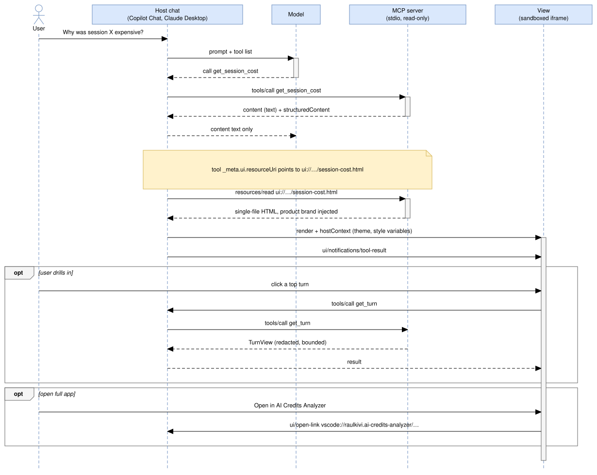

# MCP Apps: branded, interactive cost views in the chat

Status: **planned (2026-10-28), not started.** This is Phase 12 in
[implementation-plan.md](../implementation-plan.md). It starts after
`ext-v0.1.0` ships, because step 10.13 blocks that release.
This plan extends the MCP server from Phase 9.10 and Phase 9.12
([tool-call-audit.md](tool-call-audit.md) §10,
[mcp-tools-v2.md](mcp-tools-v2.md)).

## 1. Context

The MCP server answers cost, audit and security questions as JSON, and the
host's model then writes prose about it. The vision's core value is
*visual*, turn-by-turn exploration (vision.md §2–3), and the chat answer
loses that.

**MCP Apps** (SEP-1865, extension id `io.modelcontextprotocol/ui`, spec
2026-01-26, stable) lets a tool name a `ui://` HTML resource in
`_meta.ui.resourceUri`. The host renders that resource in a sandboxed
iframe next to the tool result and pushes the result to it over
postMessage JSON-RPC. The view can call the server's tools, open links,
send a chat message and ask for fullscreen. A host without support shows
the plain text result.

Hosts that matter here:

| Host | Renders MCP Apps | Reaches our server |
|---|---|---|
| VS Code Copilot Chat | Yes, stable since 1.109. The extension requires ^1.143, so every extension user has it. | Yes. The extension contributes the server (`mcpServerDefinitionProviders`, step 10.8). |
| Claude Desktop | Yes, with local stdio servers ("Allow / Always allow"). | Yes, through `scripts/mcp-server.sh`. |
| claude.ai web, ChatGPT | Yes | No. They need a remote server, which constraint 1 rules out. |
| Claude Code CLI, pi | No (terminal) | Yes. They get the text result, unchanged. |

A2UI was considered and rejected (§10).

## 2. Use-case analysis

Each candidate is a question a user asks the agent, judged by what a view
adds over prose.

| # | User question | Tool | View adds | Verdict |
|---|---|---|---|---|
| U1 | "Why was this session expensive?" | `get_session_cost` | KPI tiles with coverage, AI Credits per turn chart, top turns with event tags, context-overhead bar. Click a turn to see its detail. | **MVP** |
| U2 | "What's driving my spend this week?" | `get_cost_rollup` | Daily spend columns, spend by model and provider bars, a top-sessions table. Click a session to open U1 in place. | **MVP** |
| U3 | "Anything risky in my sessions?" | `list_findings` | Severity tiles, a findings table, kind and severity filters, collapsed redacted evidence. | **MVP** |
| U4 | "Why did tool calls fail?" | `get_session_audit`, `get_audit_rollup` | Failure categories bar, recovery cost, failing commands. | Increment 2 |
| U5 | "Find the session about X" | `list_sessions` | A picker. A click sends "Analyse session <id>" to the chat. | Increment 2, if U1–U3 land well |
| U6 | "Show me turn N" | `get_turn` | Little. Prompt and response are prose, which the model already reads. | Rejected as a standalone view. It's the drill-down inside U1. |
| U7 | `list_tool_calls`, `list_log_providers`, prompts | — | Raw rows or setup data. | Rejected |
| U8 | "Explain prompt caching" (Learn content in chat) | — | Learn diagrams | Follow-up (§11). It isn't a tool-result view. |

**Product fit.** Drill-down from a view goes host → server → view. The
model never sees those results, so exploring a session in the chat spends
no model tokens. A cost analyzer should show this off.

## 3. Scope

- **MVP (this plan):** views for U1, U2 and U3. One app-only tool for the
  per-turn chart. Product branding. A deep link from the view into the
  extension's panel. VS Code Copilot Chat and Claude Desktop as verified
  hosts.
- **Increment 2:** U4, U5, fullscreen mode for U2.
- Text results stay exactly as they are today, for every host.

## 4. Design

### 4.1 Runtime flow



### 4.2 Server (`packages/server/src/mcp/apps/`)

- **One view bundle.** One resource, `ui://<identity.name>/views.html`,
  holds all three views. It routes on `hostContext.toolInfo.tool.name`,
  and falls back to the shape of `structuredContent` when `toolInfo` is
  missing. The host fetches and caches one document instead of three, and
  the views share React, the charts and the theme.
- **`registerAppViews(server, deps)`** is a new tool group, the same
  pattern as `registerCostTools`, so it doesn't touch the other groups
  (OCP). It:
  - registers the resource with MIME type `text/html;profile=mcp-app`,
    using `registerAppResource` from `@modelcontextprotocol/ext-apps/server`;
  - registers the app-only tool `get_turn_series`, with
    `_meta.ui.visibility: ["app"]`, so it never reaches the model's tool
    list;
  - gives `get_session_cost`, `get_cost_rollup` and `list_findings`
    `_meta.ui.resourceUri`. Their names, input schemas, output schemas and
    `content` stay unchanged.
- **`get_turn_series`** takes `sessionId`, `provider?` and `maxTurns?`
  (default 500, max 2000). It returns `TurnSeries`, the bounded per-turn
  figures the chart needs. `SessionCost` carries only `topTurns`, and
  adding every turn to it would bloat the model's context. Built by the
  pure `services/cost/turn-series-builder.ts`.
- **`ViewSource`** is a port with `read(): Promise<string>`. The server
  depends on the port, not on file paths (DIP). `FileViewSource(path)`
  reads the built HTML: `packages/mcp-apps/dist/views.html` for the
  standalone server, `dist/mcp-apps/views.html` inside the `.vsix`. Tests
  use an in-memory source.
- **Brand injection.** When the resource is read, the pure
  `injectBrand(html, brand)` fills a placeholder
  `<meta name="aca-brand" content="">` with the escaped JSON of
  `ViewBrand`:
  ```ts
  { productId: "vscode-extension" | "standalone"; displayName: string; version: string; deepLinkBase?: string }
  ```
  `ViewBrand` is derived from `McpIdentity`, which already carries the
  product's `title` (#95):
  - `displayName` is `identity.title`.
  - `deepLinkBase` is the only new identity field.
    `COPILOT_MCP_IDENTITY` ("AI Credits Analyzer") sets it to
    `vscode://raulkivi.ai-credits-analyzer`.
    `STANDALONE_MCP_IDENTITY` ("Agent Cost Analyzer") leaves it out,
    because the standalone web app may not be running, so the view hides
    the button.
  The host already shows the server's icon (`MCP_ICONS` in
  `mcp-branding.ts`, #95) next to the tool call, so the view's mark and
  the host's server icon are the same glyph.
- **Dependency pin.** `@modelcontextprotocol/ext-apps` is pinned to
  **1.7.5** exactly. 2.x needs the split MCP SDK 2 packages
  (`@modelcontextprotocol/server|client|core`), which share no types with
  `@modelcontextprotocol/sdk` 1.x. The wire protocol is the same, so the
  SDK 2 migration is its own follow-up (§11).

### 4.3 Views (`packages/mcp-apps`, new workspace)

- **Build.** Vite with `vite-plugin-singlefile` (the approach the official
  quickstart uses) produces one self-contained `dist/views.html`. Scripts
  and CSS are inline, which the spec's default CSP allows. No
  `connectDomains`, no `resourceDomains`, no network access.
- **Reuse.** `packages/web` exports its presentational modules without
  changing the app: `theme.css`, `components/ui/*` (`Blueprint`,
  `StatTile`, `StatusTag`, `Tag`, `SegmentedControl`), the charts
  (`TrendColumns`, `HorizontalBars`, `StackedColumns`, the sparkline core),
  `components/insights/FindingsTable` and `lib/format-ai-credits`.
  Constraint 3 already keeps these free of any data source.
- **Pure view models** live in `src/view-models/`, one per view:
  ```ts
  toSessionCostViewModel(cost: SessionCost, series?: TurnSeries): SessionCostViewModel
  toCostRollupViewModel(rollup: CostRollup): CostRollupViewModel
  toFindingsViewModel(result: FindingsQueryResult, filter: FindingsFilter): FindingsViewModel
  ```
  They format every figure for display:
  - AI Credits round to 2 decimal places, like `formatAiCredits`. That
    function takes a `TokenCount`, so its rounding rule is split out to
    take a plain number.
  - A `null` measure shows "Unknown", never 0 (constraint 6).
  - Partial coverage adds a note, e.g. "known for 12 of 40 turns".
  - `estimated: true` adds a visible "estimate" tag.
- **`AppHostPort`** is the view's only gateway to the host:
  `callTool`, `openLink`, `sendMessage`, `requestDisplayMode` and
  `onHostContext`. The adapter wraps ext-apps' `App`. Tests use a fake.
  This mirrors `HostCapabilities` in the web app: components get the
  functions they need as props, and a missing capability hides its
  affordance.
- **Interactions:**
  - U1: clicking a top turn calls `get_turn` and expands the turn inline.
    "Open in AI Credits Analyzer" calls `openLink(deepLinkBase + "/session?id=…")`.
  - U2: clicking a top session calls `get_session_cost` and swaps to the
    U1 view in place, with a back control. A secondary "Ask about this
    session" button sends a fixed template naming only the session id.
  - U3: the severity and kind filters call `list_findings` again.
- **Never forwarded to the model:** logged text (prompts, responses,
  evidence). `sendMessage` carries only fixed templates with ids, and the
  view doesn't call `updateModelContext` in the MVP (§6).
- **Size.** `autoResize` is on. The inline height is capped at about 640px.
  Long tables scroll inside the card.

### 4.4 Deep link (extension)

- The extension adds `window.registerUriHandler` and the `onUri`
  activation event.
- `/session?id=<id>` opens the AI Credits Analyzer panel on that session.
- `/turn?id=<id>&turn=<n>` also selects the turn.
- Parameters are validated against the existing session id rules. The
  handler only navigates. It never runs a command that changes anything.

## 5. Branding

**Rule: the brand marks identity and data. The host owns the structure.**
Both host guidelines ask for this. Claude's MCP Apps design guidelines say
to use host tokens for "backgrounds, text, borders, icons" and to keep
brand colours "for accents and identity", in light and dark. It's also
how `theme-vscode.css` already fits the panel into VS Code.

### 5.1 Brand elements

| Element | Treatment | Value comes from |
|---|---|---|
| Product mark | The app icon, inline SVG at 16px. `aria-hidden`; the name next to it is the label. | The SVG in `mcp-branding.ts` (#95), exported once and imported by the view build, so the MCP server icon and the view mark can't drift |
| Product name | In the view header: "AI Credits Analyzer" or "Agent Cost Analyzer" | `ViewBrand.displayName` (`McpIdentity.title`) |
| Card frame | The Industry `.blueprint` card with its four corner marks, the system's signature. Corners in the brand accent, border in the host's `--color-border-primary`. | `theme.css` + host |
| Kicker | 10px uppercase, 0.1em tracking, brand accent text: `AI CREDITS ANALYZER · SESSION COST` | `.card-kicker` |
| Data marks | Bars, columns and the per-turn line use the brand accent ramp. Selected and hover states use `--color-accent-800`/`-100`. | `brand.css` (light and dark ramps) |
| Severity | The host's semantic colours: `--color-text-danger`, `-warning`, `-info`. Severity is meaning, not brand. | host |
| Headings | `--font-heading`: `"Barlow Condensed"` through `local()` only, then the host's `--font-sans` | §5.3 |
| Body, numbers | The host's `--font-sans`, tabular figures | host |
| Footer | `Read-only · local logs · v{version}`, plus the deep-link button when available | `ViewBrand` |

### 5.2 Theme layering (`packages/mcp-apps/src/theme/`)

1. **`theme.css`** (shared with the web app): the Industry tokens and
   components.
2. **`theme-mcp-host.css`**: re-points the Industry tokens at the spec's
   standard host variables, with the Industry palette as each fallback. It
   is scoped under `html[data-host="mcp-app"]` and built the same way as
   `theme-vscode.css`:
   - `--color-text` → `--color-text-primary`
   - `--color-text-muted` → `--color-text-secondary`
   - `--color-surface` → `--color-background-secondary`
   - `--color-divider` → `--color-border-primary`
   - `--font-body` → `--font-sans`
   - radii → `--border-radius-*`

   `--color-bg` is `transparent`. The page declares `color-scheme: light
   dark`, as Claude's transparent-theming guide asks.
3. **`brand.css`**: the fixed brand tokens (mark colour, accent ramp for
   light and dark). Its light/dark switch follows `hostContext.theme`,
   applied with ext-apps' `applyDocumentTheme`, not the OS preference.

Host variables arrive at runtime through `applyHostStyleVariables` and
`applyHostFonts`. A host may send any subset, so every token has a
fallback.

### 5.3 Fonts

The spec's default CSP leaves `font-src` at `'self'` (or `'none'`), so a
bundled `data:` font won't load, and fetching Barlow from a CDN breaks
constraint 1. Headings therefore ask for `local("Barlow Condensed")` and
otherwise use the host font. This matches the extension build, which
already drops the bundled fonts in favour of the editor's (vite.config.ts).
The brand doesn't depend on the typeface. The mark, the corner-mark cards,
the kicker style and the accent ramp carry it.

### 5.4 Don'ts

- No GitHub, Copilot, Microsoft or Anthropic logos or colours, and nothing
  that imitates the host's own chrome. The product is independent (see
  README).
- No brand-coloured fills on large areas, no hard-coded hex outside
  `brand.css`, no emoji (design system rule), no custom scrollbars.
- No `_meta.ui.prefersBorder: false`. The host's frame plus our card frame
  reads as one card.

### 5.5 Wireframe: U1, session cost (inline, about 560px)

```
┌ ▮ AI Credits Analyzer ─────────────────────────── light/dark: host ┐
│ AI CREDITS ANALYZER · SESSION COST                                  │
│ Refactor provider registry        claude-sonnet · 42 turns · Oct 27 │
│ ┌──────────┐ ┌──────────┐ ┌──────────┐ ┌──────────┐                 │
│ │AI Credits│ │Input tok.│ │Cache hit │ │Output    │                 │
│ │ 18.42    │ │ 2.1 M    │ │ 87 %     │ │ 64 k     │                 │
│ │40/42 turn│ │          │ │          │ │ estimate │                 │
│ └──────────┘ └──────────┘ └──────────┘ └──────────┘                 │
│ AI Credits per turn  ▁▁▂▁▇▁▁▃▁▁▁▁▅▁  (compaction ◆ at turn 17)       │
│ Top turns                                       credits  in-tokens  │
│  › 17  "rewrite the decoder…"  [compaction]       4.10     310 k    │
│  › 5   "add tests for…"        [model switch]     2.95     240 k    │
│ Context overhead  system prompt 21 k ███████░░  unused tools 14     │
│ Read-only · local logs · v0.2.0        [ Open in AI Credits Analyzer ]│
└─────────────────────────────────────────────────────────────────────┘
```

U2 and U3 follow the same header, kicker and footer, and use the same
`StatTile` row and table grammar as the web Dashboard.

## 6. Security (threat-model.md §6 to be updated)

- **Same data, same redaction.** The views only show what the tools
  already return, and that output is already redacted and bounded. No new
  data leaves the machine except what the host already receives as tool
  results.
- **Logged text is untrusted.** Prompts, responses and evidence can carry
  injected instructions. React renders them as text, never as HTML. They
  are never passed to `sendMessage` or `updateModelContext`, so a view
  click can't relay an injection into the model.
- **CSP.** The resource declares no `csp` domains, so the view keeps the
  host's default: `connect-src 'none'`, no frames, no external resources.
  It sets no `_meta.ui.domain`, which local stdio servers can't use in
  Claude anyway.
- **App-only tool.** `get_turn_series` is read-only and bounded, with the
  same guard and `isError` handling as the other tools.
- **Deep link.** Only `vscode://raulkivi.ai-credits-analyzer/…`. The
  handler validates parameters and only navigates (§4.4).

## 7. Tasks

TDD throughout: each task starts with a failing test (architecture.md
§11.4). "setup6" marks a task that fits the local model: three files or
fewer, an exact spec, and acceptance tests the local agent never sees.

| # | Task | Complexity | Model | Depends on |
|---|---|---|---|---|
| A0 | **Spike** (1 day, time-boxed). A hard-coded view on `get_session_cost` in VS Code Copilot Chat and Claude Desktop. Record: the host variables each sends, whether `toolInfo` is present, `local()` fonts, `openLink` to `vscode://`, app-initiated `tools/call` approval prompts, display modes, High Contrast. Results go into §9. | medium | Sonnet | — |
| A1 | `turnSeriesSchema` in `packages/domain/src/cost.ts`, and `buildTurnSeries(session: Session, maxTurns = 500): TurnSeries` in `services/cost/turn-series-builder.ts` | low | setup6 | — |
| A2 | `injectBrand(html: string, brand: ViewBrand): string` in `mcp/apps/inject-brand.ts`. Throws when the placeholder is missing; escapes HTML attribute characters. | low | setup6 | — |
| A3 | `McpIdentity.deepLinkBase` (Copilot identity only), `toViewBrand(identity, version)`, and the icon SVG exported from `mcp-branding.ts` | low | Haiku | A2 |
| A4 | `packages/web` package exports for the reusable modules (§4.3), with no app change. Typecheck and the web tests stay green. | low | Haiku | — |
| A5 | `packages/mcp-apps` scaffold: Vite single-file build, ext-apps 1.7.5 pinned, `AppHostPort` plus `App` adapter and fake, the view router, a bundle size budget test (≤ 450 KB uncompressed) | medium | Sonnet | A0, A4 |
| A6 | Theme layering: `theme-mcp-host.css`, `brand.css`, contrast tests (text ≥ 4.5:1, marks ≥ 3:1) against the fallbacks and against recorded VS Code and Claude variable sets from A0, light and dark | medium | Sonnet (frontend-design skill) | A0, A5 |
| A7 | View models: `toSessionCostViewModel`, `toCostRollupViewModel`, `toFindingsViewModel` (§4.3), one run each | low | setup6 | A1, A5 |
| A8 | Server group `registerAppViews`, `ViewSource`/`FileViewSource`, `get_turn_series`, `_meta.ui` on three tools. In-memory client tests: `tools/list` metadata, `resources/read` MIME type and the injected brand, unchanged `content`. | medium | Sonnet | A1, A2, A3 |
| A9 | U1 `SessionCostView`, with the turn drill-down and the deep-link button | medium | Sonnet | A6, A7, A8 |
| A10 | U2 `CostRollupView`, with in-place drill-down into U1 | medium | Sonnet | A9 |
| A11 | U3 `FindingsView`, with filters | medium | Sonnet | A6, A7, A8 |
| A12 | Deep link: the extension's URI handler and `onUri` activation (§4.4), with unit tests for parameter validation and an integration test | medium | Sonnet | A0 |
| A13 | Packaging: build order (views before extension and server), `dist/mcp-apps/views.html` in the `.vsix` (asserted by the package-contents test), `scripts/mcp-server.sh` serving the standalone build | medium | Sonnet | A8 |
| A14 | Accessibility and security review of the views: axe in the component tests, keyboard drill-down, the no-forwarding rule (§6) as a test over every `sendMessage` call site | medium | Opus | A9–A11 |
| A15 | Docs: architecture.md §4.1/§11.2/§12, threat-model.md §6, implementation-plan.md Phase 12 and its dependency graph, UserGuide, vscode-extension-guide, both CHANGELOGs | medium | Sonnet | A13 |
| A16 | Owner's manual checks: VS Code Copilot Chat in light, dark and High Contrast; Claude Desktop in light and dark; Claude Code CLI text output unchanged | — | owner | A13 |

A0 decides whether A12 is still needed: if hosts block `vscode://` links,
the button falls back to copying a command.

## 8. Exit criterion

- In VS Code Copilot Chat and Claude Desktop, asking about a session's
  cost, the week's spend and security findings renders the U1, U2 and U3
  views in the host's light and dark themes, with the product mark, name
  and accent.
- Drilling into a turn or a top session works without a new model turn.
- `tools/list` returns 10 tools. `get_turn_series` is app-only. The 9
  model-visible tools have the same names, schemas and `content` as
  Phase 9.12, and Claude Code CLI output is byte-identical.
- Unknown figures show "Unknown", never 0, in every view (constraint 6).
- Every view model and `injectBrand` has unit tests. The contrast tests
  pass for the fallbacks and for each recorded host variable set.

## 9. Open questions and risks

| Item | Risk | Resolved by |
|---|---|---|
| VS Code's host variable coverage and High Contrast behaviour | Not verified from a primary source | A0 |
| `toolInfo` present in each host | Router falls back to shape detection | A0 |
| `openLink` to `vscode://` | A host may allow only https | A0. Fallback: copy a command. |
| Approval prompts on app-initiated `tools/call` | Drill-down feels slow | A0 |
| `local()` heading font | Usually absent, so the host font is used. Accepted (§5.3). | — |
| Spec draft changes (App-provided tools, `object-src 'none'`) | Minor | Pin 1.7.5; review at the SDK 2 migration |
| Bundle size (React, d3 parts) | Slow first render | Budget test in A5 |
| A shorter `content` for UI-capable clients would save model tokens | Changes what the model sees per host | Follow-up decision (§11) |

## 10. Rejected: A2UI

A2UI (pre-1.0) streams declarative component trees that an agent composes
at run time from a client-side catalog. These views are fixed and driven
by data, so A2UI's flexibility buys nothing. None of the target hosts
renders it, so we would ship the renderer and the catalog ourselves.
Revisit if Copilot Chat or Claude adopts it.

## 11. Out of scope (follow-ups)

- Migrating to MCP SDK 2 and ext-apps 2.x.
- U4 (audit view) and U5 (session picker).
- A shorter `content` when the client declares `io.modelcontextprotocol/ui`.
  The model would get a summary, the view would get `structuredContent`,
  and the saving would be measured with the tool itself.
- Learn-mode explainer cards in the chat (U8).
- A remote server for claude.ai or ChatGPT. It conflicts with constraint 1.
- Any write action from a view.

## Sources

- Spec 2026-01-26: <https://github.com/modelcontextprotocol/ext-apps/blob/main/specification/2026-01-26/apps.mdx>
- ext-apps 2.x migration (SDK split): <https://github.com/modelcontextprotocol/ext-apps/blob/main/docs/migrate-to-2.md>
- Client matrix: <https://modelcontextprotocol.io/extensions/client-matrix>
- VS Code 1.109 release notes: <https://code.visualstudio.com/updates/v1_109>
- Claude MCP Apps design guidelines: <https://claude.com/docs/connectors/building/mcp-apps/design-guidelines>
- Claude transparent theming: <https://claude.com/docs/connectors/building/mcp-apps/transparent-theming>
- Quickstart (single-file build): <https://github.com/modelcontextprotocol/ext-apps/blob/main/docs/quickstart.md>
