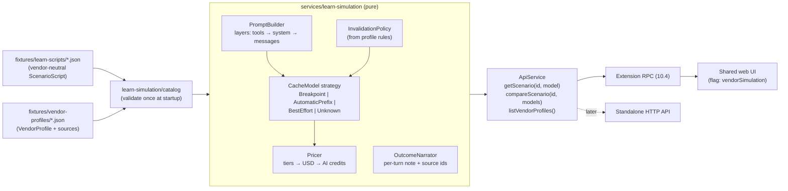

# Phase 13: Vendor-aware Learn simulation

Status: **Proposed** (2026-11-03), not started. Owner decisions so far:
cover **every vendor and model GitHub Copilot offers**, do **true
simulation** (each vendor's own cache rules decide hit or miss, not just its
prices), and ship in the **VS Code extension first**.

Background: [learn-scenarios-fact-check.md](../learn-scenarios-fact-check.md)
found that the 18 Learn scenarios mix vendor-specific behaviour into fixed,
hand-computed numbers. The clearest cases:
- a cache miss is billed twice (R-01);
- the 1-hour write rate is wrong (R-02);
- the scope of image invalidation is wrong (R-03);
- scenarios 1 and 15 contradict each other (R-04).

This phase replaces the hand-computed numbers with a simulator. Those four
findings are then fixed by construction, not by hand edits.

## Contents

1. [Goals and non-goals](#1-goals-and-non-goals)
2. [What the user sees (VS Code)](#2-what-the-user-sees-vs-code)
3. [Architecture](#3-architecture)
4. [Domain model](#4-domain-model)
5. [Simulation rules](#5-simulation-rules)
6. [Vendor data and sources](#6-vendor-data-and-sources)
7. [Implementation steps](#7-implementation-steps-tdd-each-with-an-exit-criterion)
8. [Risks](#8-risks)
9. [Open questions](#9-open-questions)
10. [Exit criterion](#10-exit-criterion)

## 1. Goals and non-goals

**Goals**

1. Any Learn scenario can be replayed on any model Copilot offers: OpenAI,
   Anthropic, Google, xAI, Microsoft and Moonshot AI, with GitHub's
   per-token AI credit prices.
2. The vendor's documented cache rules decide each turn's cache read, cache
   write and uncached input: TTL, prefix layers, what invalidates what,
   whether writes cost extra, and the minimum cacheable length.
3. Every vendor-specific number or outcome can be traced to a cited source
   with a check date. Where a vendor documents nothing, the UI says
   "unknown" (architecture.md constraint 6). It never borrows another
   vendor's rule silently.
4. Compare vendors side by side: same scenario, per-turn outcome and total
   AI credits per model.
5. VS Code extension first. The standalone app gets it behind the same
   `ProductProfile` flag in a later step.

**Non-goals**

- Simulating Analyze-mode (real) sessions. Real sessions keep their
  measured numbers; a "what if on vendor X" replay of real sessions is a
  possible later phase (§9 Q6).
- Predicting real bills exactly. The output is labelled **Simulated**
  everywhere, and the assumptions it rests on (e.g. where Copilot places
  cache breakpoints) are listed in the UI.
- Live price fetching. Prices ship as reviewed data with sources
  (§6), so the extension stays offline (vscode-extension.md §5).

## 2. What the user sees (VS Code)

The Learn view in the side bar is unchanged (step 10.12). Opening a
scenario shows the panel with three additions:

```
┌ Cache Basics: An 8-Turn Session ───────────────── Simulated ┐
│ Simulate on: [Anthropic ▾] [Claude Sonnet 5.5 ▾]  ⓘ 3 assumptions │
├──────────────────────────────────────────────────────────────┤
│ Turns table (existing 13 columns, simulated values)          │
│  + "Cache" column: ● hit  ◐ partial  ○ miss  ? unknown        │
├──────────────────────────────────────────────────────────────┤
│ Right column tabs: Explanation | System prompt | Tools | Vendors │
└──────────────────────────────────────────────────────────────┘
```

1. **Vendor and model picker** in the Learn header. Models are grouped by
   vendor, in the order of GitHub's price table. Vendors whose caching is
   undocumented are marked "cache behaviour unknown". The pick is
   remembered in the webview state. The scenario's second model (the
   "cheaper model" in scenarios 4, 14 and 18) maps to the vendor's
   designated cheaper sibling (§4.3).
2. **Explanation tab**:
   - the scenario's vendor-neutral prose;
   - a generated line, "On Claude Sonnet 5.5: the image invalidated the
     conversation cache; tools and system prompt (3,000 tokens) were still
     read from cache";
   - a **How vendors differ** card for turns with a cache event, one row per
     vendor (its default model), giving the outcome, the turn's AI credits
     and a source link.
3. **Vendors tab**: an accessible table with one row per model and columns
   for total AI credits, cache-hit ratio, misses and the most expensive
   turn. It can be sorted, and has a per-turn strip of hit/partial/miss
   marks. A chart is optional and comes after the table (10.11's
   "fits any panel width" rule).
4. **Sources footer** on every vendor-specific panel: source links and
   "checked 2026-11-03". The footer turns into a warning when the data is
   more than 90 days old.
5. **Assumptions popover** (the ⓘ in the header). It lists what the
   simulation assumes because no vendor or GitHub doc states it. Example:
   "Copilot places cache breakpoints after tools, after the system prompt
   and after the last message."

All of it follows 10.11's standards: any panel width, every theme, and
keyboard and screen-reader access. At narrow widths the card collapses to
one row per vendor.

## 3. Architecture

Pure core, data at the edges, strategies per vendor (SOLID: each
cache-model strategy is closed for modification and open for new vendors).



| Unit | Package | Responsibility |
|---|---|---|
| `vendor-profile.ts`, `scenario-script.ts`, `simulation.ts` | `domain` | zod schemas and types (§4) |
| `fixtures/learn-scripts/` | `server` | the 18 scenarios as vendor-neutral scripts |
| `fixtures/vendor-profiles/` | `server` | one file per vendor: prices, cache rules, sources |
| `services/learn-simulation/prompt-builder.ts` | `server` | builds each turn's request as layered segments |
| `services/learn-simulation/cache-models/*` | `server` | one `CacheModel` per caching kind |
| `services/learn-simulation/invalidation-policy.ts` | `server` | maps script events to "invalidated from layer X" using profile rules |
| `services/learn-simulation/pricer.ts` | `server` | token counts × price tier → USD → AI credits (1 credit = $0.01) |
| `services/learn-simulation/simulate-scenario.ts` | `server` | script + model → Learn `Session` (pure) |
| `services/learn-simulation/compare-vendors.ts` | `server` | script + models → `VendorComparison` |
| `data-sources/learn-scenarios/` | `server` | becomes a thin adapter: catalog → simulated `Session` |
| `components/learn/VendorPicker`, `VendorDifferencesCard`, `VendorsTab`, `SourcesFooter`, `AssumptionsPopover` | `web` | UI (§2) |

Dependency rule: the simulator depends on domain types and the
`CacheModel` interface only. It never depends on concrete vendor files
(DIP). Adding a vendor means adding a data file, plus a new strategy only
if its caching kind is new.

## 4. Domain model

### 4.1 `ScenarioScript` (vendor-neutral)

```ts
ScenarioScript = {
  id, title, category,
  sessionKind: "main" | "subagent", parentScenarioId?,
  staticPrefix: { toolsTokens, systemTokens },
  steps: ScriptStep[],
}
ScriptStep = {
  index, userMessage, assistantResponse, toolCalls,
  explanation,               // vendor-neutral prose, no numbers
  idleMinutesBefore?: number,
  newContent: { userTokens, toolResultTokens, visionTokens, reasoningTokens, outputTokens },
  events: ScriptEvent[],
}
ScriptEvent =
  | { type: "model-switch"; toRole: "primary" | "cheaper" }
  | { type: "tools-changed"; deltaTokens }
  | { type: "system-changed"; deltaTokens; cause: "edit" | "applyTo" }
  | { type: "image-added" } | { type: "image-removed" }
  | { type: "thinking-changed"; enabled: boolean }
  | { type: "compaction"; summaryTokens }
  | { type: "clear" }
  | { type: "rewind"; toStep }
  | { type: "fork"; branch: string; fromStep }
  | { type: "extended-ttl" }            // e.g. Anthropic's 1-hour breakpoint
```

These events extend the existing `TriggeredEvent` enum
(`packages/domain/src/turn.ts`) and don't replace it. The simulated
`Turn.triggeredEvent` stays as it is today.

### 4.2 `VendorProfile` (data, with sources)

```ts
Source = { id, title, url, quote?, checkedAt }
Confidence = "documented" | "inferred" | "unknown"
ModelPrice = {
  modelId, displayName, vendorId, releaseStatus,
  tiers: { maxInputTokens?: number; inputUsdPerM; cachedInputUsdPerM;
           cacheWriteUsdPerM: number | null; extendedCacheWriteUsdPerM?: number;
           outputUsdPerM }[],
  cachingKind?: CachingKind,          // overrides the vendor default (e.g. GPT-5.6+)
  cheaperSiblingId?: string,
  promoEndsAt?: string,
  sourceIds: string[],
}
CachingKind =
  | { kind: "breakpoints"; defaultTtlMinutes; extendedTtlMinutes?; refreshOnHit; minCacheableTokens; layers: Layer[] }
  | { kind: "automatic-prefix"; ttlMinutes: { min; max } | { fixed }; writeCharged: boolean; minCacheableTokens; incrementTokens? }
  | { kind: "best-effort"; note }
  | { kind: "unknown"; reason }
InvalidationRule = { change: ChangeKind; invalidatesFrom: Layer | "nothing" | "unknown";
                     modelSpecific?: boolean; confidence: Confidence; sourceIds }
VendorProfile = { vendorId, displayName, defaultModelId, caching: CachingKind,
                  invalidation: InvalidationRule[], models: ModelPrice[],
                  assumptions: { text; confidence }[], sources: Source[] }
```

### 4.3 Simulation output

The simulator emits the existing `Session` and `Turn` shapes, so the turns
table, KPI tiles and sparkline need no changes. It adds one optional field
to `Turn`:

```ts
simulation?: {
  vendorId, modelId,
  cacheOutcome: "hit" | "partial" | "miss" | "unknown",
  invalidatedFrom?: Layer,
  note: string,                    // generated, e.g. "image invalidated the conversation cache"
  confidence: Confidence,
  sourceIds: string[],
}
```

When the caching kind is `unknown`, the cache fields are
`unavailableTokenCount(reason)` and so is `costAiCredits`. The Vendors tab
then shows a **bound** next to them, "≤ X AI credits (no caching
assumed)", labelled as a bound (§9 Q3).

## 5. Simulation rules

Each rule below gets its own failing test first. The test name cites the
rule's source id, and the rule is implemented only once that test exists.

| # | Rule | Applies to | Source |
|---|---|---|---|
| S1 | Prompt = tools → system → messages, as contiguous segments | all | Anthropic: what invalidates the cache |
| S2 | `cacheRead + cacheWrite + uncachedInput` = the turn's input tokens (no double counting) | all | Anthropic usage FAQ (fixes R-01) |
| S3 | Breakpoint model: reads up to the longest still-valid breakpoint; writes from there to the last breakpoint; the rest is uncached | Anthropic | Anthropic: prompt caching |
| S4 | TTL counts from the request start; a hit refreshes it for free | Anthropic | Anthropic FAQ |
| S5 | 1-hour write = 2x base input; 5-minute write = 1.25x | Anthropic | Anthropic pricing (fixes R-02) |
| S6 | Below the minimum cacheable length nothing is cached, with no error | per model | Anthropic: cache limitations |
| S7 | Automatic prefix model: longest cached prefix in fixed increments; write charge depends on family | OpenAI | OpenAI prompt caching; GitHub pricing |
| S8 | Images, `tool_choice`: invalidate from messages | Anthropic | invalidation table (fixes R-03, R-04) |
| S9 | System change: invalidates from system | Anthropic | invalidation table |
| S10 | Tools change: invalidates everything | Anthropic | invalidation table |
| S11 | Thinking/effort change: messages always; tools and system when `modelSpecific` | Anthropic | thinking and prompt caching |
| S12 | Model switch: nothing carries over (per-model cache) | all | Anthropic cache diagnostics |
| S13 | Compaction: one request reads the warm prefix, then the summary becomes the messages layer | all | Claude Code: compacting; Anthropic compaction |
| S14 | `/clear`: messages dropped; tools and system still match (project context only if unchanged) | Claude Code harness | Claude Code: how the cache is organized |
| S15 | Rewind and fork: the prefix up to the chosen step still matches while within TTL | all | Claude Code: rewinding; subagents and the cache |
| S16 | Subagent: its own prefix; the parent pays only the returned summary | all | Claude Code / VS Code subagents |
| S17 | Best-effort and unknown kinds: outcome `unknown` unless the vendor documents otherwise | xAI, Moonshot, Microsoft | xAI caching; GitHub model hosting |
| S18 | Tiered prices: a turn whose input exceeds the threshold uses the higher tier | OpenAI, xAI, Haiku 5.5 | GitHub pricing |

Where Copilot's own behaviour is unknown, the profile's `assumptions`
records it, and the UI shows it in the assumptions popover. The main
example is where Copilot places cache breakpoints.

## 6. Vendor data and sources

- **Prices**: GitHub's `models-and-pricing` table (USD per 1M tokens:
  input, cached input, cache write, output, tiers). It is converted with
  1 AI credit = $0.01. As of 2026-11-03 it lists 29 models from six
  vendors: OpenAI 10, Anthropic 12, Google 2, xAI 3, Microsoft 1,
  Moonshot AI 1. Promotional prices (Gemini) carry `promoEndsAt`.
- **Cache rules**: the vendor docs cited in the fact-check report's claim
  register.
- **Freshness**: every `Source` has `checkedAt`. A test fails if any model
  or rule lacks a source id. The UI warns after 90 days. Updating is a
  data-only change: edit the JSON, cite the source, run the golden tests,
  and review the snapshot diff.
- **Scale change**: real prices make Learn numbers about 40-100x larger than
  today's illustrative 0.005-credits-per-1K rate. For example, a
  4,500-token cache write on Claude Sonnet 5.5 costs about 1.1 AI credits,
  not 0.028. Scenario prose must not quote absolute numbers. Generated
  notes do.

## 7. Implementation steps (TDD, each with an exit criterion)

Every step starts with a failing test, and steps run in order. Each step is
committed once its exit criterion holds.

| Step | Work | Exit criterion |
|---|---|---|
| 13.0 | **Rule register**: turn §5 into a table in the fact-check report, one row per (vendor, rule) with a source or "unknown". Owner reviews it | Every vendor × rule cell has a source id or is marked unknown; owner sign-off |
| 13.1 | **Domain schemas**: `ScenarioScript`, `VendorProfile`, `Turn.simulation` (zod) | Schema tests pass; the existing `Turn`/`Session` tests are unchanged |
| 13.2 | **Vendor data**: six profile files from GitHub prices + cache docs; loader with injectable dir (G4 pattern) | Tests: every Copilot model in the price table is present; every model and rule has a source; prices round-trip |
| 13.3 | **Simulator core**: `PromptBuilder`, `Pricer`, `BreakpointCacheModel`; invariants S1–S6 | Property test: S2 conservation holds for random scripts; Anthropic rules S3–S6 each pinned by a named test |
| 13.4 | **Other cache models and invalidation**: `AutomaticPrefix`, `BestEffort`, `Unknown`; `InvalidationPolicy`; S7–S18 | Each rule has a passing named test; unknown vendors produce unavailable counts, never zeros |
| 13.5 | **Scripts**: convert the 18 fixtures to `ScenarioScript`; golden snapshots per scenario × vendor default model | 18 × 6 snapshots reviewed; R-01–R-04 no longer reproducible; the old fixture-arithmetic test is replaced by simulator tests |
| 13.6 | **Service + RPC**: `getScenario(id, modelId)`, `compareScenario(id, modelIds)`, `listVendorProfiles()` in `ApiService`; extension RPC; `ProductProfile.features.vendorSimulation` (extension: on, standalone: off) | Server and extension contract tests pass; bundle-size test passes with the profile data included |
| 13.7 | **UI, part 1**: vendor/model picker, "Cache" column, generated note, sources footer, assumptions popover | Web tests for each component; a11y test; UI check (10.11) green in every theme at narrow width |
| 13.8 | **UI, part 2**: How vendors differ card, Vendors tab (table first, chart optional) | Web tests; manual check in a real VS Code: pick 3 vendors on scenario 15 and confirm the outcomes match the rule register |
| 13.9 | **Docs**: UserGuide and vscode-extension-guide Learn sections, scenario docs (numbers become "simulated on <model>"), fact-check report closes R-01–R-06, architecture.md updated | Docs reviewed by the owner; `docs.test.ts` passes |
| 13.10 | **Standalone app**: turn the flag on, HTTP routes for the 13.6 calls | Standalone tests pass; Learn shows the same simulated numbers in both products |

## 8. Risks

| Risk | Mitigation |
|---|---|
| Vendor docs change after release | `checkedAt` everywhere, 90-day UI warning, data-only update path with golden diffs |
| Copilot's own caching (breakpoint placement, routing) is undocumented | Shown as explicit assumptions; the simulation is labelled, never presented as a bill |
| "True simulation" suggests more precision than the inputs support | `confidence` per outcome; unknown stays unknown; bounds labelled as bounds |
| 29 models × 18 scenarios is a large snapshot surface | Golden tests on each vendor's default model only; other models covered by pricer unit tests |
| Extension bundle size | Profiles are small JSON; covered by the existing bundle-size test |
| Phase 10's 0.1.0 release is still open | Phase 13 starts after `ext-v0.1.0` is tagged and ships in 0.2.0 (§9 Q5) |

## 9. Open questions

| # | Question | Needed before |
|---|---|---|
| Q1 | Default model when a scenario opens: the vendor's default (e.g. Claude Sonnet 5.5), or the model the user last used in Copilot (the extension could read it from Analyze data)? | 13.7 |
| Q2 | Which model is each vendor's "cheaper sibling" for the 2-model scenarios (e.g. Sonnet 5.5 → Haiku 5.5, GPT-6 Sol → GPT-6 Luna)? | 13.2 |
| Q3 | For vendors with unknown caching (Moonshot, Microsoft; xAI is best-effort): show only "unknown", or also the labelled "no caching" upper bound? | 13.4 |
| Q4 | Scenario docs: generate their tables from the simulator for one reference model, or keep the hand-written tables and link to the app? | 13.9 |
| Q5 | Release: start after `ext-v0.1.0` and ship in 0.2.0 (recommended), or fold into 0.1.0? | 13.0 |
| Q6 | Later: offer the same "replay on vendor X" for real Analyze sessions? (out of scope for Phase 13) | after 13.10 |

## 10. Exit criterion

In the VS Code extension, every Learn scenario can be replayed on every
model in GitHub's Copilot price table. Each turn's cache outcome and AI
credits come from the simulator and that vendor's sourced rules. The Vendors
tab compares models side by side. Every vendor-specific figure links to a
dated source or says unknown. The fact-check findings R-01 to R-04 can no
longer be reproduced.
