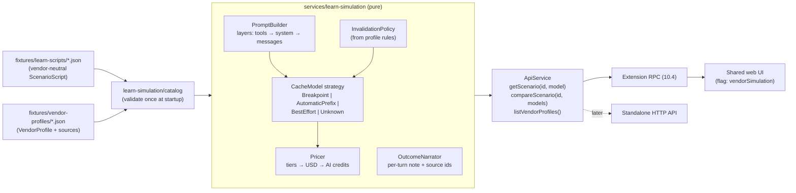

# Phase 13: Vendor-aware Learn simulation

Status: **In progress** (planned 2026-11-03; step 13.0 started 2026-11-04,
after `ext-v0.1.0` was tagged). As of 2026-11-05 the rule register is
drafted, verified and has the owner's decisions recorded (#115, #116,
#120, #123); step 13.1 (domain schemas, #129) is merged; step 13.2 (vendor data) is merged (#130); step 13.3 (simulator core) is merged (#131); step 13.4 (cache models, InvalidationPolicy) is merged (#132); step 13.5 (18 scripts, `simulateScenario`, 69 golden snapshots) is merged (#133); steps 13.6 and 13.7 (service, RPC, Learn picker, Cache column, notes, sources) are merged (#136); steps 13.8 (How vendors differ card, Vendors tab), 13.9 (`npm run scenarios:docs` with a drift test, the weekly `vendor-prices.yml` workflow, docs) and 13.10 (standalone simulation, old fixtures removed) are built, in review; open: 13.5a (calibration against real captures) and the owner's eyes-on review of 13.8 (the outcomes check is automated by `learn-vendors.e2e.ts`, which passes in a real VS Code). It ships in extension 0.2.0. The owner's decisions
from the 2026-11-03 interview are recorded in [§9](#9-decisions). In short:
- simulate **every Copilot vendor whose caching is documented** (Anthropic,
  OpenAI, Google, xAI);
- list Moonshot AI and Microsoft but disable them;
- do **true simulation**: each vendor's cache rules decide hit or miss, not
  just its prices;
- ship in the **VS Code extension first**.

Background: [learn-scenarios-fact-check.md](../learn-scenarios-fact-check.md)
found that the 18 Learn scenarios mix vendor-specific behaviour into fixed,
hand-computed numbers. The clearest cases:
- a cache miss is billed twice (R-01);
- the 1-hour write rate is wrong (R-02);
- the scope of image invalidation is wrong (R-03);
- scenarios 1 and 15 contradict each other (R-04).

This phase replaces the hand-computed numbers with a simulator. Those four
findings are then fixed by construction, not by hand edits.

## Contents

1. [Goals and non-goals](#1-goals-and-non-goals)
2. [What the user sees (VS Code)](#2-what-the-user-sees-vs-code)
3. [Architecture](#3-architecture)
4. [Domain model](#4-domain-model)
5. [Simulation rules](#5-simulation-rules)
6. [Vendor data and sources](#6-vendor-data-and-sources)
7. [Implementation steps](#7-implementation-steps-tdd-each-with-an-exit-criterion)
8. [Risks](#8-risks)
9. [Decisions](#9-decisions)
10. [Exit criterion](#10-exit-criterion)

## 1. Goals and non-goals

**Goals**

1. Any Learn scenario can be replayed on any Copilot model whose vendor
   documents its caching: OpenAI, Anthropic, Google and xAI, 27 of the 29
   models in GitHub's price table, at GitHub's per-token AI credit prices.
   Moonshot AI (Kimi) and Microsoft (MAI) are listed in the picker but
   disabled: "Not simulated: caching behaviour isn't documented".
2. The vendor's documented cache rules decide each turn's cache read, cache
   write and uncached input: TTL, prefix layers, what invalidates what,
   whether writes cost extra, and the minimum cacheable length.
3. Every vendor-specific number or outcome can be traced to a cited source
   with a check date. Where a vendor leaves one rule undocumented, the
   outcome is "unknown" (architecture.md constraint 6). The simulator never
   borrows another vendor's rule silently. A vendor that documents no
   caching at all is not simulated (goal 1).
4. The simulator is calibrated against real, redacted captures: replaying a
   real session's shape reproduces its recorded cache hits and misses.
5. Compare vendors side by side: same scenario, per-turn outcome and total
   AI credits per model.
6. VS Code extension first. The standalone app gets it behind the same
   `ProductProfile` flag in a later step.

**Non-goals**

- Simulating Analyze-mode (real) sessions in this phase. Real sessions keep their
  measured numbers; a "what if on vendor X" replay of real sessions is a
  planned follow-up, Phase 14 (§9 D18).
- Predicting real bills exactly. The output is labelled **Simulated**
  everywhere, and the assumptions it rests on (e.g. where Copilot places
  cache breakpoints) are listed in the UI.
- Live price fetching. Prices ship as reviewed data with sources
  (§6), so the extension stays offline (vscode-extension.md §5).

## 2. What the user sees (VS Code)

The Learn view in the side bar is unchanged (step 10.12). Opening a
scenario shows the panel with three additions:

```
┌ Cache Basics: An 8-Turn Session ───────────────── Simulated ┐
│ Simulate on: [Anthropic ▾] [Claude Sonnet 5.5 ▾]  ⓘ 3 assumptions │
├──────────────────────────────────────────────────────────────┤
│ Turns table (existing 13 columns, simulated values)          │
│  + "Cache" column: ● hit  ◐ partial  ○ miss  ? unknown        │
├──────────────────────────────────────────────────────────────┤
│ Right column tabs: Explanation | System prompt | Tools | Vendors │
└──────────────────────────────────────────────────────────────┘
```

1. **Vendor and model picker** in the Learn header. Models are grouped by
   vendor, in the order of GitHub's price table. Moonshot AI and Microsoft
   models are listed but disabled, with the reason as their description.
   - **Default model**: the model used most in the user's recent Analyze
     sessions (Copilot model ids are mapped to price-table names). It falls
     back to Claude Sonnet 5.5 when there are none or the model isn't
     simulated.
   - An explicit pick is remembered in the webview state.
   - The scenario's second model (the "cheaper model" in scenarios 4, 14
     and 18) is the vendor's **curated** cheaper sibling (§4.2,
     `cheaperSiblingId`), reviewed in step 13.0.
2. **Explanation tab**:
   - the scenario's vendor-neutral prose;
   - a generated line, "On Claude Sonnet 5.5: the image invalidated the
     conversation cache; tools and system prompt (3,000 tokens) were still
     read from cache";
   - a **How vendors differ** card for turns with a cache event, one row per
     vendor (its default model), giving the outcome, the turn's AI credits
     and a source link.
3. **Vendors tab**: an accessible table with one row per model and columns
   for total AI credits, cache-hit ratio, misses and the most expensive
   turn. It starts with **each simulated vendor's default model**
   (Anthropic, OpenAI, Google, xAI), and the user can add more models. It can be sorted, and has a per-turn strip of hit/partial/miss
   marks. A chart is optional and comes after the table (10.11's
   "fits any panel width" rule).
4. **Sources footer** on every vendor-specific panel: source links and
   "checked 2026-11-03". The footer turns into a warning when the data is
   more than 90 days old.
5. **Costs** are shown in AI credits, matching Copilot billing. A
   tooltip on every figure and a column in the Vendors tab add the USD
   equivalent (1 AI credit = $0.01). There is no "illustrative" option:
   every figure comes from a real model's prices and rules (D16).
6. **Copilot-only scenarios**: the extension's Learn view lists the 17
   scenarios that apply to Copilot. Scenario 6 (`/clear`) and scenario 7
   (`/rewind`) use their VS Code wording: a new chat, and restoring a
   checkpoint or editing a previous request. Scenario 13 (Anthropic's
   1-hour cache) is hidden, because Copilot users can't choose it. The
   standalone app keeps all 18, with Claude Code wording plus the VS Code
   equivalent (D13, D14).
7. **Assumptions popover** (the ⓘ in the header). It lists what the
   simulation assumes because no vendor or GitHub doc states it. Example:
   "Copilot places cache breakpoints after tools, after the system prompt
   and after the last message."

All of it follows 10.11's standards: any panel width, every theme, and
keyboard and screen-reader access. At narrow widths the card collapses to
one row per vendor.

## 3. Architecture

Pure core, data at the edges, strategies per vendor (SOLID: each
cache-model strategy is closed for modification and open for new vendors).



| Unit | Package | Responsibility |
|---|---|---|
| `vendor-profile.ts`, `scenario-script.ts`, `simulation.ts` | `domain` | zod schemas and types (§4) |
| `fixtures/learn-scripts/` | `server` | the 18 scenarios as vendor-neutral scripts |
| `fixtures/vendor-profiles/` | `server` | one file per vendor: prices, cache rules, sources |
| `services/learn-simulation/prompt-builder.ts` | `server` | builds each turn's request as layered segments |
| `services/learn-simulation/cache-models/*` | `server` | one `CacheModel` per caching kind |
| `services/learn-simulation/invalidation-policy.ts` | `server` | maps script events to "invalidated from layer X" using profile rules |
| `services/learn-simulation/pricer.ts` | `server` | token counts × price tier → USD → AI credits (1 credit = $0.01) |
| `services/learn-simulation/simulate-scenario.ts` | `server` | script + model → Learn `Session` (pure) |
| `services/learn-simulation/compare-vendors.ts` | `server` | script + models → `VendorComparison` |
| `data-sources/learn-scenarios/` | `server` | becomes a thin adapter: catalog → simulated `Session` |
| `components/learn/VendorPicker`, `VendorDifferencesCard`, `VendorsTab`, `SourcesFooter`, `AssumptionsPopover` | `web` | UI (§2) |

Dependency rule: the simulator depends on domain types and the
`CacheModel` interface only. It never depends on concrete vendor files
(DIP). Adding a vendor means adding a data file, plus a new strategy only
if its caching kind is new.

## 4. Domain model

### 4.1 `ScenarioScript` (vendor-neutral)

```ts
ScenarioScript = {
  id, title, category,
  harnesses: Harness[],       // where the scenario applies (D13)
  textByHarness?: Partial<Record<Harness, { title?; userMessages?; explanations? }>>,
  sessionKind: "main" | "subagent", parentScenarioId?,
  staticPrefix: { toolsTokens, systemTokens },
  steps: ScriptStep[],
}
ScriptStep = {
  index, userMessage, assistantResponse, toolCalls,
  explanation,               // vendor-neutral prose, no numbers
  idleMinutesBefore?: number,
  newContent: { userTokens, toolResultTokens, reasoningTokens, outputTokens,
                images?: { width: number; height: number }[] },   // D15
  events: ScriptEvent[],
}
ScriptEvent =
  | { type: "model-switch"; toRole: "primary" | "cheaper" }
  | { type: "tools-changed"; deltaTokens }
  | { type: "system-changed"; deltaTokens; cause: "edit" | "applyTo" }
  | { type: "image-added" } | { type: "image-removed" }
  | { type: "thinking-changed"; enabled: boolean }
  | { type: "compaction"; summaryTokens }
  | { type: "clear" }
  | { type: "rewind"; toStep }
  | { type: "fork"; branch: string; fromStep }
  | { type: "extended-ttl" }            // e.g. Anthropic's 1-hour breakpoint
```

`Harness = "vscode-local" | "copilot-agent-host" | "claude-code"`.

Text stays in vendor-neutral token counts, and tokenizer differences
between vendors are out of scope. Images are given as pixel sizes, and each
vendor profile converts them with its documented formula (Anthropic:
⌈w/28⌉ × ⌈h/28⌉ with its caps). A vendor without a published formula falls
back to an estimate marked `estimated: true`.

These events extend the existing `TriggeredEvent` enum
(`packages/domain/src/turn.ts`) and don't replace it. The simulated
`Turn.triggeredEvent` stays as it is today.

### 4.2 `VendorProfile` (data, with sources)

```ts
Source = { id, title, url, quote?, checkedAt }
Confidence = "documented" | "inferred" | "unknown"
ModelPrice = {
  modelId, displayName, vendorId, releaseStatus,
  tiers: { maxInputTokens?: number; inputUsdPerM; cachedInputUsdPerM;
           cacheWriteUsdPerM: number | null; extendedCacheWriteUsdPerM?: number;
           outputUsdPerM }[],
  cachingKind?: CachingKind,          // overrides the vendor default (e.g. GPT-5.6+)
  cheaperSiblingId?: string,
  promoEndsAt?: string,
  sourceIds: string[],
}
CachingKind =
  | { kind: "breakpoints"; defaultTtlMinutes; extendedTtlMinutes?; refreshOnHit; minCacheableTokens; layers: Layer[] }
  | { kind: "automatic-prefix"; ttlMinutes: { min; max } | { fixed }; writeCharged: boolean; minCacheableTokens; incrementTokens? }
  | { kind: "best-effort"; note }
  | { kind: "unknown"; reason }
InvalidationRule = { change: ChangeKind; invalidatesFrom: Layer | "nothing" | "unknown";
                     modelSpecific?: boolean; confidence: Confidence; sourceIds }
VendorProfile = { vendorId, displayName, defaultModelId, caching: CachingKind,
                  invalidation: InvalidationRule[], models: ModelPrice[],
                  assumptions: { text; confidence }[], sources: Source[] }
```

### 4.3 Simulation output

The simulator emits the existing `Session` and `Turn` shapes, so the turns
table, KPI tiles and sparkline need no changes. It adds one optional field
to `Turn`:

```ts
simulation?: {
  vendorId, modelId,
  cacheOutcome: "hit" | "partial" | "miss" | "unknown",
  invalidatedFrom?: Layer,
  note: string,                    // generated, e.g. "image invalidated the conversation cache"
  confidence: Confidence,
  sourceIds: string[],
}
```

When one rule a turn depends on is `unknown` for the chosen vendor, that
turn's cache fields are `unavailableTokenCount(reason)`, and so is its
`costAiCredits`. Vendors whose whole caching kind is `unknown` aren't
simulated (§1 goal 1). Their models are returned with `simulated: false`
and a reason, so the picker can list them disabled.

## 5. Simulation rules

Each rule below gets its own failing test first. The test name cites the
rule's source id, and the rule is implemented only once that test exists.

| # | Rule | Applies to | Source |
|---|---|---|---|
| S1 | Prompt = tools → system → messages, as contiguous segments | all | Anthropic: what invalidates the cache |
| S2 | `cacheRead + cacheWrite + uncachedInput` = the turn's input tokens (no double counting) | all | Anthropic usage FAQ (fixes R-01) |
| S3 | Breakpoint model: reads up to the longest still-valid breakpoint; writes from there to the last breakpoint; the rest is uncached | Anthropic | Anthropic: prompt caching |
| S4 | TTL counts from the request start; a hit refreshes it for free | Anthropic | Anthropic FAQ |
| S5 | 1-hour write = 2x base input; 5-minute write = 1.25x | Anthropic | Anthropic pricing (fixes R-02) |
| S6 | Below the minimum cacheable length nothing is cached, with no error | per model | Anthropic: cache limitations |
| S7 | Automatic prefix model: longest cached prefix in fixed increments; write charge depends on family | OpenAI | OpenAI prompt caching; GitHub pricing |
| S8 | Images, `tool_choice`: invalidate from messages | Anthropic | invalidation table (fixes R-03, R-04) |
| S9 | System change: invalidates from system | Anthropic | invalidation table |
| S10 | Tools change: invalidates everything | Anthropic | invalidation table |
| S11 | Thinking/effort change: messages always; tools and system when `modelSpecific` | Anthropic | thinking and prompt caching |
| S12 | Model switch: nothing carries over (per-model cache) | all | Anthropic cache diagnostics |
| S13 | Compaction: one request reads the warm prefix, then the summary becomes the messages layer | all | Claude Code: compacting; Anthropic compaction |
| S14 | `/clear`: messages dropped; tools and system still match (project context only if unchanged) | Claude Code harness | Claude Code: how the cache is organized |
| S15 | Rewind and fork: the prefix up to the chosen step still matches while within TTL | all | Claude Code: rewinding; subagents and the cache |
| S16 | Subagent: its own prefix; the parent pays only the returned summary | all | Claude Code / VS Code subagents |
| S17 | Best-effort kind: prefix matching like S7, with a cache lifetime marked *assumed* (shown in the assumptions popover); unknown kind: not simulated | xAI (best-effort); Moonshot, Microsoft (not simulated) | xAI caching; GitHub model hosting |
| S18 | Tiered prices: a turn whose input exceeds the threshold uses the higher tier | OpenAI, xAI, Haiku 5.5 | GitHub pricing |

Where Copilot's own behaviour is unknown, the profile's `assumptions`
records it, and the UI shows it in the assumptions popover. The main
example is where Copilot places cache breakpoints.

## 6. Vendor data and sources

- **Prices**: GitHub's `models-and-pricing` table (USD per 1M tokens:
  input, cached input, cache write, output, tiers). It is converted with
  1 AI credit = $0.01. As of 2026-11-03 it lists 29 models from six
  vendors: OpenAI 10, Anthropic 12, Google 2, xAI 3, Microsoft 1,
  Moonshot AI 1. 27 are simulated, and Microsoft's and Moonshot's are listed
  but disabled. Promotional prices (Gemini) carry `promoEndsAt`.
- **Cache rules**: the vendor docs cited in the fact-check report's claim
  register.
- **Freshness**:
  - Every `Source` has `checkedAt`, and a test fails if any model or rule
    lacks a source id.
  - The UI warns when data is over 90 days old.
  - A **weekly scheduled workflow** (`.github/workflows/vendor-prices.yml`)
    diffs the profile prices against GitHub's published
    `data/tables/copilot/models-and-pricing.yml` in `github/docs`. It opens
    (or updates) an issue listing added, removed and changed models; it
    never commits.
  - Cache-rule changes are reviewed by hand.
  - Updating is a data-only change: edit
    `fixtures/price-book/github-copilot.json` (prices, Phase 15 step 15.5)
    or the profile JSON (cache rules), cite the source, run the
    golden tests, and review the snapshot diff.
- **Scale change**: real prices make Learn numbers about 40-100x larger than
  today's illustrative 0.005-credits-per-1K rate. For example, a
  4,500-token cache write on Claude Sonnet 5.5 costs about 1.1 AI credits,
  not 0.028. Scenario prose must not quote absolute numbers. Generated
  notes do.

## 7. Implementation steps (TDD, each with an exit criterion)

Every step starts with a failing test, and steps run in order. Each step is
committed once its exit criterion holds.

| Step | Work | Exit criterion |
|---|---|---|
| 13.0 | **Rule register**: turn §5 into a table in the fact-check report, one row per (vendor, rule) with a source or "unknown", plus the curated cheaper-sibling list and the Copilot-to-price-table model-id mapping. Owner reviews it | Every vendor × rule cell has a source id or is marked unknown; owner sign-off on rules, siblings and mapping |
| 13.1 | **Domain schemas**: `ScenarioScript`, `VendorProfile`, `Turn.simulation` (zod) | Schema tests pass; the existing `Turn`/`Session` tests are unchanged |
| 13.2 | **Vendor data**: six profile files from GitHub prices + cache docs; loader with injectable dir (G4 pattern) | Tests: every Copilot model in the price table is present; every model and rule has a source; prices round-trip |
| 13.3 | **Simulator core**: `PromptBuilder`, `Pricer`, `BreakpointCacheModel`; invariants S1–S6 | Property test: S2 conservation holds for random scripts; Anthropic rules S3–S6 each pinned by a named test |
| 13.4 | **Other cache models and invalidation**: `AutomaticPrefix`, `BestEffort`, `Unknown`; `InvalidationPolicy`; S7–S18 | Each rule has a passing named test; unknown vendors produce unavailable counts, never zeros |
| 13.5 | **Scripts**: convert the 18 fixtures to `ScenarioScript`; golden snapshots per scenario × simulated vendor's default model | 18 × 4 snapshots reviewed; R-01–R-04 no longer reproducible; the old fixture-arithmetic test is replaced by simulator tests |
| 13.5a | **Calibration**: one redacted real Claude Code capture and one Copilot (Anthropic-model) capture, reduced to script shape (token sizes, gaps, events; no content) in `fixtures/learn-calibration/` | A calibration test replays each and matches the recorded hit/miss per turn, with each turn's cache read **within 5%** of the recorded figure (D12). A mismatch fails the test and is resolved by fixing a rule or an assumption, never by editing the capture |
| 13.6 | **Service + RPC**: `getScenario(id, modelId)`, `compareScenario(id, modelIds)`, `listVendorProfiles()` in `ApiService`; extension RPC; `ProductProfile.features.vendorSimulation` (extension: on, standalone: off) | Server and extension contract tests pass; bundle-size test passes with the profile data included |
| 13.7 | **UI, part 1 (first usable cut)**: vendor/model picker (default from Analyze usage; Moonshot/Microsoft disabled with reason), re-simulated turns table, "Cache" column, generated note, AI credits with USD tooltips, sources footer, assumptions popover; the extension's Learn view lists the 17 Copilot scenarios with VS Code wording | Web tests for each component; a11y test; UI check (10.11) green in every theme at narrow width |
| 13.8 | **UI, part 2**: How vendors differ card, Vendors tab (vendor defaults + user-added models; table first, chart optional) | Web tests; manual check in a real VS Code: pick 3 vendors on scenario 15 and confirm the outcomes match the rule register |
| 13.9 | **Docs and data upkeep**: a script (`npm run scenarios:docs`) regenerates each `docs/scenarios/*.md` table, and all-scenarios.md, from the simulator for the reference model (Claude Sonnet 5.5); a drift test fails if the docs differ. UserGuide and vscode-extension-guide Learn sections; fact-check report closes R-01–R-06; architecture.md updated; the weekly `vendor-prices.yml` workflow | Docs reviewed by the owner; drift test and `docs.test.ts` pass; the workflow's dry run reports no diff against current prices |
| 13.10 | **Standalone app**: turn the flag on, HTTP routes for the 13.6 calls | Standalone tests pass; Learn shows the same simulated numbers in both products |

## 8. Risks

| Risk | Mitigation |
|---|---|
| Vendor docs change after release | `checkedAt` everywhere, 90-day UI warning, data-only update path with golden diffs |
| Copilot's own caching (breakpoint placement, routing) is undocumented | Shown as explicit assumptions; the simulation is labelled, never presented as a bill |
| "True simulation" suggests more precision than the inputs support | `confidence` per outcome; unknown stays unknown; bounds labelled as bounds |
| 27 simulated models × 18 scenarios is a large snapshot surface | Golden tests on each vendor's default model only; other models covered by pricer unit tests |
| Extension bundle size | Profiles are small JSON; covered by the existing bundle-size test |
| Real captures leak content | Calibration fixtures keep only token sizes, gaps and event types; redaction reuses the existing redactor and is tested |
| GitHub renames the price table or changes its format | The weekly workflow fails loudly (issue titled "price diff failed") instead of reporting "no changes" |
| Phase 10's 0.1.0 release is still open | Resolved: `ext-v0.1.0` was tagged 2026-11-03; Phase 13 ships in 0.2.0 (§9 D6) |

## 9. Decisions

From the owner interviews, 2026-11-03.

| # | Decision | Applies in |
|---|---|---|
| D1 | Scope: every Copilot vendor whose caching is documented (Anthropic, OpenAI, Google, xAI). Moonshot AI and Microsoft are listed in the picker but disabled, with "Not simulated: caching behaviour isn't documented" | 13.2, 13.7 |
| D2 | True simulation: vendor cache rules decide hit and miss, not just prices | 13.3–13.5 |
| D3 | Default model: the model used most in the user's recent Analyze sessions, falling back to Claude Sonnet 5.5 | 13.7 |
| D4 | The cheaper model for two-model scenarios is curated per vendor in the profile data and reviewed in 13.0 | 13.0, 13.2 |
| D5 | xAI is simulated with best-effort caching; its cache lifetime is shown as an assumption | 13.4 |
| D6 | Release: start after `ext-v0.1.0`, ship in extension 0.2.0 | — |
| D7 | Scenario docs' tables are generated from the simulator (reference model Claude Sonnet 5.5), with a drift test | 13.9 |
| D8 | First usable cut: picker + re-simulated table + cache column + sources | 13.7 |
| D9 | Data upkeep: a weekly CI diff against GitHub's price table opens an issue; cache rules are reviewed by hand | 13.9 |
| D10 | Calibrate against redacted real captures (Claude Code and Copilot) | 13.5a |
| D11 | Vendors tab compares each vendor's default model, plus models the user adds | 13.8 |
| D12 | Calibration tolerance: each turn's cache read within 5% of the recorded figure, plus an exact hit/miss match | 13.5a |
| D13 | Extension shows Copilot-applicable scenarios only: 6 and 7 stay with VS Code wording, and 13 (1-hour cache) is hidden, leaving 17. The standalone app shows all 18 | 13.5, 13.7 |
| D14 | One script per scenario with harness-specific text (`textByHarness`); no copies | 13.1, 13.5 |
| D15 | Content sizes come from real inputs (image pixel sizes); vendor formulas turn them into tokens; no formula means an estimate marked `estimated` | 13.1, 13.4 |
| D16 | No "Illustrative" option; real models only | 13.7 |
| D17 | The standalone app gets the simulation inside Phase 13 as its last step (13.10) | 13.10 |
| D18 | "Replay a real Analyze session on vendor X" is planned as Phase 14 | Phase 14 |
| D19 | Costs shown in AI credits, with the USD equivalent on hover and in the Vendors tab | 13.7, 13.8 |

Still open: nothing. D12–D19 come from the follow-up interview (same day), and Phase 14 covers Analyze replay.

## 10. Exit criterion

In the VS Code extension, every Learn scenario can be replayed on every
model in GitHub's Copilot price table whose vendor documents its caching.
Moonshot AI and Microsoft models are listed, disabled, with the reason.
The calibration tests match the real captures. Each turn's cache outcome and AI
credits come from the simulator and that vendor's sourced rules. The Vendors
tab compares models side by side. Every vendor-specific figure links to a
dated source or says unknown. The fact-check findings R-01 to R-04 can no
longer be reproduced.
