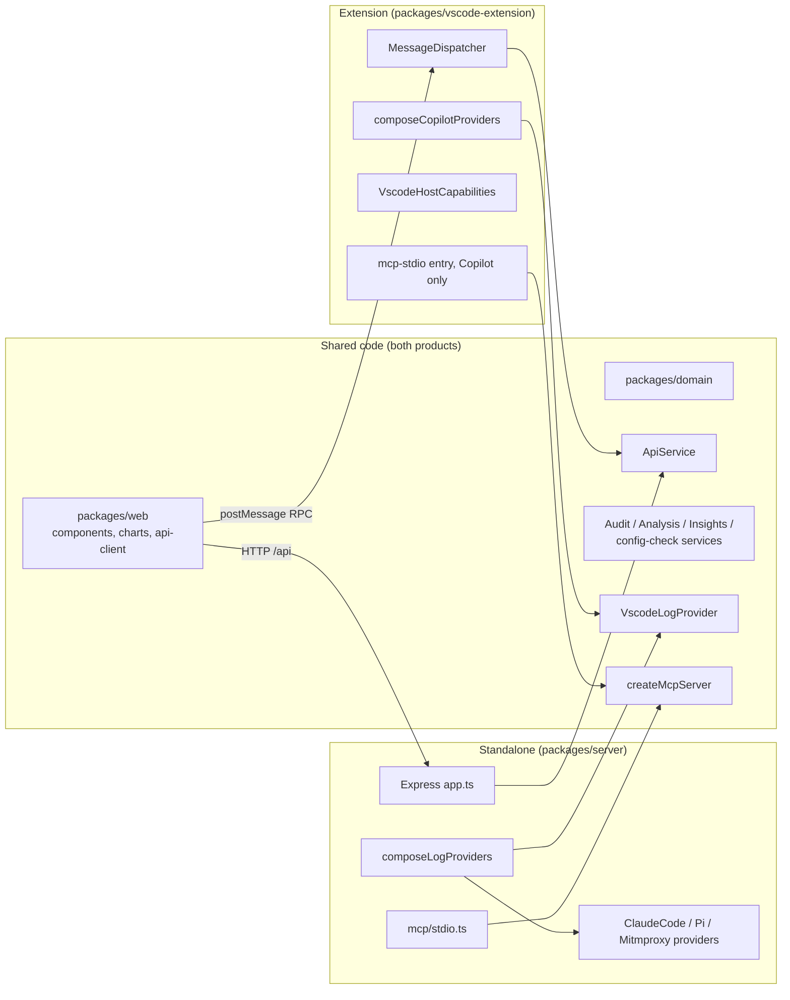

# VS Code extension: implementation and deployment plan

Status: **in progress (Phase 10).** This plan expands
[implementation-plan.md](../implementation-plan.md) Phase 10 and
[architecture.md](../architecture.md) §12 into concrete, test-first steps.
Each step's status is recorded under its heading in §6.

## 1. Context

The app ships today as two local processes: an Express API on
`127.0.0.1:3001` (`packages/server`) and a Vite + React SPA
(`packages/web`). Vision §5 lists one future path: repackage the app as a
VS Code extension with a webview. Phase 10 is the only phase in the plan
that hasn't started.

### 1.1 Two products, one codebase

Decided on 2026-10-24: the repo will ship **two separate products** that
share most of their code (vision §5).

| | **Extension** | **Standalone app** |
|---|---|---|
| Name (§3.4) | **AI Credits Analyzer** | **Agent Cost Analyzer** |
| Audience | VS Code + GitHub Copilot Chat users (Marketplace, Open VSX) | Developers using several coding agents |
| Log providers | **VS Code / Copilot Chat only** | VS Code, Claude Code, pi, mitmproxy (all of today's providers) |
| Learn mode | yes | yes |
| Analyze mode, turn inspector, system prompt | yes | yes |
| Tool audit, insights dashboard | **yes** (over the Copilot provider only) | yes (across every provider) |
| MCP server | **yes**, Copilot data only, registered with VS Code | yes, stdio (`npm run mcp`), every provider |
| Extension-only UX | Activity Bar sidebar (sessions, setup), status-bar AI Credits, one-click setting fixes, VS Code merged settings, VS Code-supplied paths | — |
| Delivery | `.vsix` from the Marketplace / Open VSX | `npm start` from the repo |
| Version | independent (`ext-v*` tags) | independent (`app-v*` tags) |

The standalone app stays a strict superset: it keeps VS Code support.

### 1.2 Goals

1. Install the extension from the VS Code Marketplace (and Open VSX) as
   one `.vsix`. No `npm install`, no second terminal, no browser tab.
2. Reuse `packages/web`'s components and charts and `packages/server`'s
   data sources and services unchanged, or with only refactors that also
   help the standalone app.
3. The extension contains **no** Claude Code, pi or mitmproxy code. A test
   enforces this; it isn't left as a convention (§3.1).
4. Keep the standalone web app and its stdio MCP server working exactly as
   today.
5. Use what only an extension can do. Settings warnings become one-click
   fixes, settings are read through VS Code's own merged configuration, and
   the VS Code user-data directory comes from VS Code itself on every
   platform.

Non-goals for this plan: a multi-user or cloud-hosted variant (vision §6),
a Copilot Chat participant, and telemetry. Constraint 1 forbids outbound
network calls, so neither product sends telemetry.

## 2. Analysis of the existing code

### 2.1 What already fits

| Area | Finding | Consequence |
|---|---|---|
| Provider registry | `composeLogProviders()` (`packages/server/src/composition/compose-log-providers.ts`) is the only place that chooses which providers exist. It has no Express dependency, and every path can be overridden through `LogProviderCompositionOptions`. The registry is open/closed (constraint 12). | The product split is a **second composition root**, not a fork (§3.1). |
| Query services | `AuditQueryService`, `AnalysisQueryService` and `createInsightsService` take a registry and are already shared by HTTP and MCP. | Both products reuse them; insights and audit simply see one provider in the extension. |
| MCP server | `createMcpServer` (`packages/server/src/mcp/mcp-server.ts`) takes its services as arguments; only `mcp/stdio.ts` composes them. | The extension gets its own Copilot-only MCP entry point with no change to the tools. |
| Web data access | All but one call goes through `packages/web/src/api-client/*`, which uses three helpers in `http.ts` (`getJson`, `getText`, `putJson`). | That one module is the transport seam (architecture §12). |
| Domain | Every response shape has a zod schema in `packages/domain`. | The host can validate messages at the boundary for free. |
| Config warnings | `ConfigWarning` already carries `settingId`. | A "Fix" button can open exactly that setting. |
| SQLite | Reads use the built-in `node:sqlite` (`DatabaseSync`), read-only, with no native npm module. | No `node-gyp` or per-platform prebuilt binaries to ship, if the extension host's Node supports it (risk R1). |

### 2.2 Gaps to close

| # | Gap | Location | Fix (step in §6) |
|---|---|---|---|
| G1 | Route logic lives inline in `app.ts`. The `/api/sessions/:id/system-prompt` route (~70 lines of VS Code/pi branching) and the turn-index validation can't be reused without Express. The pi branch also hard-wires a pi dependency into shared logic. | `packages/server/src/app.ts` | Extract an `ApiService`, with system-prompt reading behind an optional per-provider `SystemPromptTextReader` (10.1) |
| G2 | `App.tsx` calls `fetch("/api/health")` directly, bypassing `api-client`. | `packages/web/src/App.tsx:93` | Move into `api-client/health.ts` (10.2) |
| G3 | `api-client` is bound to `fetch` and relative `/api/...` URLs. | `packages/web/src/api-client/http.ts` | `ApiTransport` port with HTTP and webview adapters (10.2) |
| G4 | `import.meta.url` locates the learn-scenario fixtures and `package.json`. This breaks once the code is bundled into one CJS file. | `learn-scenarios/loader.ts:13`, `app.ts:29`, `mcp/stdio.ts:12` | Inject the fixtures dir and version (10.1) |
| G5 | `resolveUserDataDir` is Linux-only, so on macOS and Windows the VS Code provider is always unavailable. | `platform/vscode-paths/resolve-user-data-dir.ts` | In the extension, derive it from `context.globalStorageUri` (10.4). Separately, add macOS/Windows candidates for the standalone app. |
| G6 | The config check reads only the user `settings.json` (workspace merge not implemented, Phase 5 note). | `services/config-check` | `SettingsSource` port with a `vscode.workspace.getConfiguration` adapter (10.4) |
| G7 | The Vite build emits `/assets/...` absolute URLs and no manifest. Webviews need `asWebviewUri` URLs and a strict CSP. | `packages/web/vite.config.ts`, `index.html` | Extension build mode with `base: './'` and `build.manifest` (10.3) |
| G8 | `navigator.clipboard` (advice export) isn't reliable in every webview host. | `AdviceExportDialog.tsx:30` | `HostCapabilities` port: clipboard, open setting, open text document (10.5) |
| G9 | ESM-only workspace (`"type": "module"`), with `domain` exporting TypeScript source. | all `package.json` | esbuild bundle to CJS `dist/extension.js` and `dist/mcp-stdio.js` (10.3, 10.8) |
| G10 | The UI assumes a multi-provider product: the header provider select, "across every provider" wording on the dashboard, and the provider column. It also says nothing about which product it is. | `AppHeader.tsx`, `components/insights/*` | `ProductProfile` sent by the host; the UI renders from it, never from `isExtension` checks (10.5) |
| G11 | `composeLogProviders` imports all four providers statically, so any bundle that imports it includes them. | `composition/compose-log-providers.ts` | Split per-provider factories, plus a `composeCopilotProviders` root (10.3) |
| G12 | `theme.css` loads Barlow fonts from Google Fonts. The webview CSP blocks that (and it's a network call, constraint 1). | `packages/web/src/theme.css:5` | Extension build uses the VS Code font; the standalone app bundles the fonts locally (10.7) |
| G13 | No accessibility checks, one layout breakpoint (900 px, dashboard only), no `prefers-reduced-motion`, and loading/empty/error states differ per view. | `packages/web/src/*` | UX standards §3.5, step 10.7 |

## 3. Target architecture



### 3.1 Product boundary

- **Option A (adopted): one repo, two composition roots.** The extension
  imports only `composeCopilotProviders()`, which registers just
  `VscodeLogProvider`. The standalone app keeps `composeLogProviders()`,
  which builds on the same per-provider factories. No packages move.
- **Boundary test (TDD, step 10.3).** `bundle-boundary.test.ts` reads
  esbuild's metafile for `dist/extension.js` and `dist/mcp-stdio.js` and
  fails if any input path matches `data-sources/(claude-code|pi-agent|
  log-providers/mitmproxy)/` or `platform/(claude-code|pi-agent)-paths/`.
  This turns "Copilot-only" into a test that can fail.
- **Option B (deferred): package split.** Split into `core`,
  `provider-vscode`, `provider-claude-code`, `provider-pi`,
  `provider-mitmproxy` plus the two app packages. Do this only if the
  products need separate contributors or the boundary test keeps
  catching leaks. It's a mechanical move once Option A's factories exist.

### 3.2 Decisions

- **D1: In-process message bridge, no embedded HTTP server.** Running
  Express inside the extension host would open a loopback port that any
  local process could reach, and would need webview port mapping and
  Host-guard changes. A typed `postMessage` RPC opens no port at all and is
  the design architecture §12 already describes.
- **D2: One transport-neutral `ApiService` in `packages/server`.** Express
  routes and the extension dispatcher both become thin adapters over it, so
  there's a single implementation (SRP, DIP). Its methods mirror the
  existing REST surface: `listSessions`, `getSession`, `getTurnDetail`,
  `getSystemPromptText`, `getConfigStatus`, `setRetentionThreshold`,
  `listLearnScenarios`, `getLearnScenario`, `getLogProviderStatus`,
  `setActiveLogProvider`, `getSessionAudit`, `listToolCalls`,
  `getAuditRollup`, `getInsights` and `getHealth`. It adds one new method,
  `getProductProfile`. `ApiService` doesn't know which product it runs in;
  it only sees the registry it was given.
- **D3: A new workspace, `packages/vscode-extension`.** It holds only
  VS Code glue: activation, panel, sidebar trees, dispatcher, VS Code
  adapters, the
  Copilot composition root, the MCP definition provider and packaging. It's
  the only package that imports `vscode`.
- **D4: Paths come from VS Code.**
  `context.globalStorageUri` = `<userData>/User/globalStorage/<extension-id>`,
  so the user-data dir is three levels up. That works on every platform and
  for Stable, Insiders, portable and remote servers, and it removes G5 for
  the extension.
- **D5: App-owned settings.** The extension stores its own settings
  (retention threshold) in `context.globalState` behind an
  `AppSettingsStore` port. The standalone app keeps its file in
  `resolveAppSettingsDir()`. The two products are independent, so one
  can't change the other's active provider. Constraint §11.2 holds: neither
  product writes to VS Code's own files.
- **D6: `extensionKind: ["workspace"]`.** Copilot Chat writes its logs
  where its own extension host runs. On Remote-SSH, WSL and Dev Containers
  that's the remote side, so this extension must run there too to see the
  same files. Validate in step 10.9.
- **D7: Copilot-only MCP in the extension.** The extension registers an MCP
  server definition with VS Code whose process composes only the Copilot
  provider (step 10.8). The tool list and schemas are identical to the
  standalone server's; only the data behind them differs.
- **D8: Independent versions and names.** Each product has its own
  version, changelog, tag prefix and listing. The shared packages stay
  private and unversioned.
- **D9: Minimum VS Code version = the current stable release at the time
  of each release** (decided 2026-10-24). Every extension release sets
  `engines.vscode` to `^<current stable>` (e.g. `^1.112.0`). This keeps
  one supported runtime, so there's no compatibility matrix: one Electron
  and Node version for `node:sqlite` (R1) and one VS Code API level for
  MCP registration (D7). The trade-off is that users on an older VS Code
  keep the last extension version that was compatible with their editor.
  The Marketplace handles this automatically.
- **D10: Native sidebar for navigation, editor panel for analysis**
  (decided 2026-10-24). The extension adds an Activity Bar icon whose view
  container holds native TreeViews (not webviews): **Sessions** and
  **Setup** in v1, **Findings** and **Learn scenarios** in a later minor
  release. A status-bar item shows today's AI Credits. Anything wide (the
  turns table, charts, dashboard, audit, inspector) stays in the editor
  panel, because the side bar is only 250-400 px wide. Picking a session
  in the tree opens or switches the panel to it. Tree code is VS Code-only
  and lives in `packages/vscode-extension`; it reads through the same
  `ApiService`, so the numbers can't differ from the panel's.

### 3.3 `ProductProfile`

A new schema in `packages/domain`, returned by `getProductProfile` (and by
`GET /api/product` in the standalone app):

```ts
type ProductProfile = {
  productId: "vscode-extension" | "standalone";
  displayName: string;
  version: string;
  features: {
    providerSelect: boolean;          // false when exactly one provider
    crossProviderInsights: boolean;   // drives dashboard wording and provider facet
    settingFixes: boolean;            // "Fix" buttons on config warnings
    openInEditor: boolean;            // system prompt -> editor document
  };
};
```

The web app reads this once at startup. Components take the flags they
need as props (ISP), so no component knows which product it's in.

### 3.4 Naming and Marketplace metadata

The extension's name doesn't include "GitHub Copilot". On the VS Code
Marketplace the audience is already VS Code users, and Copilot support is
stated where people search and read instead. This also avoids putting
another company's trademark in the product name.

- **Names (decided 2026-10-24):** the extension is **AI Credits
  Analyzer** and the standalone app is **Agent Cost Analyzer**.
- `displayName`: `AI Credits Analyzer`. `name` (the Marketplace id under
  the publisher): `ai-credits-analyzer`. The Marketplace rejects a
  `displayName` already in use, so confirm it's free before the first
  publish (step 10.9). If it's taken, fall back to "AI Credits Analyzer
  for VS Code" rather than adding "Copilot".
- `description`: names the use case, e.g. "See where your GitHub Copilot
  Chat tokens and AI Credits go: prompt caching, per-turn cost, tool-call
  failures and insights, from your local logs."
- `keywords` (Marketplace allows at most 30): `copilot`, `github copilot`,
  `copilot chat`, `ai credits`, `tokens`, `token usage`, `cost`,
  `prompt caching`, `llm`, `agent`, `mcp`.
- `categories`: `Visualization`, `AI`, `Chat`, `Other` (only values VS Code
  accepts for this field).
- Command, setting and view ids use the product prefix
  (`aiCreditsAnalyzer.*`), never `copilot*`.
- The README and listing refer to GitHub Copilot only to describe what
  the extension works with.
- The standalone app shows "Agent Cost Analyzer" through
  `ProductProfile.displayName` (step 10.5). The repo name, the internal
  `@copilot-cost-analyzer/*` package scope and the app settings directory
  stay as they are, to avoid a migration.

### 3.5 UX and accessibility standards

Decided 2026-10-24. These rules apply to every surface of the extension.
The UI code is shared, so they also apply to the standalone app.
"Test" means an automated check that fails CI; "manual" means a step in
the per-release usability script.

| Area | Rule | Check |
|---|---|---|
| VS Code fit | Follow the VS Code UX guidelines (code.visualstudio.com/api/ux-guidelines). Every command sits under the category "AI Credits Analyzer". | Test (manifest test) |
| VS Code fit | Contributions use codicons. The webview uses the bundled `@vscode/codicons` font and `--vscode-*` colour, font and focus variables. | Test (manifest test) + manual |
| VS Code fit | Don't use the Webview UI Toolkit, which Microsoft deprecated in 2025. Build on plain CSS variables and the shared `components/ui/*` primitives. | Review |
| VS Code fit | No unprompted notifications. Setup lives in the Setup view and the walkthrough. Host work over 1 s shows `withProgress` on the view; webview work shows inline progress. | Review + manual |
| VS Code fit | Settings have `markdownDescription`, `order` and enum descriptions. | Test (manifest test) |
| Onboarding | A Get Started walkthrough (`contributes.walkthroughs`) has 5 steps: enable logging, keep 200 sessions, open a session, Learn mode, MCP (optional). Steps complete through `completionEvents` (`onSettingChanged:…`, `onCommand:…`). | Test (manifest test) + manual |
| Accessibility | WCAG 2.2 AA. axe-core reports no violations for every view in dark, light and high-contrast themes. | Test (`vitest-axe`) |
| Accessibility | Everything works by keyboard. Arrow keys move through lists and the turns table, Enter opens, and Escape closes the inspector and drawers. Focus is always visible (`--vscode-focusBorder`) and never trapped. | Test (`@testing-library/user-event`) + manual |
| Accessibility | Every chart has a text alternative: an `aria-label` summary plus a "View as table" toggle. | Test |
| Accessibility | Text contrast is at least 4.5:1. High-contrast themes show `--vscode-contrastBorder` outlines. Severity and status are never shown by colour alone (icon plus text). | Test (axe) + manual |
| Accessibility | `prefers-reduced-motion` turns off transitions and animated progress. Async results are announced through an `aria-live="polite"` region. | Test |
| Layout | Layout depends on the panel's width, not the window's. At 1100 px and up: table plus right column. From 700 to 1099 px: the right column becomes a drawer. Below 700 px: priority columns (Turn, Trigger, AI Credits, Cumulative), a details drawer, and a view `<select>`. Minimum width 360 px. Users choose and keep the visible columns. | Test (pure `layoutFor(width)`) + manual |
| States | Every data view uses one `AsyncView` pattern. **Loading:** a skeleton matching the final layout, shown after 300 ms so it doesn't flash, with Cancel for long loads. **Empty:** says why, plus a next step. **Error:** what failed, that nothing was changed, Retry and Copy details. **Partial:** a warning, never a zero (constraint 6). | Test |
| Content | Sentence case and plain language. Units are always shown. AI Credits have 2 decimals and use tabular numbers. Dates are relative ("Today 14:02") with the absolute time in a tooltip. | Review |
| Performance | First render of the panel in under 1 s with 200 sessions. Sessions tree in under 500 ms. Interactions respond in under 100 ms. | Test (integration timing) |
| Localization | Host strings use `vscode.l10n` / `package.nls.json`, and webview strings go through one messages module. English only for now. | Test (no unused or missing keys) |
| Usability | No telemetry, so each release runs a short manual script: first run, logging off, no sessions, a large session, keyboard only, high contrast. Screenshots go in the release PR. | Manual |

### 3.6 UI mock-ups (for review)

The mock-ups are on a Design canvas:
**https://claude.ai/artifact/KXwmLWv77nG1arL5gENFYe**. The link is private
until the owner shares it from the page's Share menu. Reviewers comment
on the canvas. The source files are versioned in
[mockups/vscode-extension/](mockups/vscode-extension/). They're
`.dc.html` files rendered by the canvas, not standalone pages.

All numbers in the mock-ups are sample data. Colours follow VS Code's
default Dark Modern theme. The first board has a theme switch (dark,
light, high contrast).

| # | Board | Shows | Plan link |
|---|---|---|---|
| 1 | Session analysis | Activity Bar icon; Sessions tree grouped by day with AI Credits (and "unknown"); Setup view; panel with KPIs, view tabs, turns table with a column chooser, Explanation/System prompt/Tools column; status-bar AI Credits | D10, 10.5, 10.6 |
| 2 | First run | Setup view with Enable and Keep 200 buttons; Sessions welcome view pointing to Learn mode; panel with a 3-step checklist; status bar "setup needed" | 10.4-10.6, §3.5 Onboarding |
| 3 | Get Started walkthrough | 5 steps with progress, the current step open, and an illustration of the Sessions view | §3.5 Onboarding, 10.7 |
| 4 | Narrow panel (640 px) | 2×2 KPIs, view select, priority columns, and a details drawer with the hidden metrics | §3.5 Layout, 10.7 |
| 5 | Loading, empty and error states | Skeleton with progress and Cancel; empty state with why and a next step; error with Retry; partial-data warning | §3.5 States, 10.7 |
| 6 | Dashboard and Findings tree | Findings tree (later minor); dashboard with selection chips and Back, KPIs with coverage, a per-day chart with "View as table", a Model list box, signals | 10.5, D10 later minor |

**Review gate:** the mock-ups are reviewed and their comments resolved
before step 10.5 starts. Agreed changes are made on the canvas and in
the versioned copies in the same change.

**Status:** approved by the owner on 2026-10-24 with no change requests.
The gate is passed.

## 4. Message protocol

In `packages/domain/src/rpc.ts`, so both sides share it:

```ts
// webview -> host
type RpcRequest = { kind: "request"; id: string; method: ApiMethod; params: unknown };
// host -> webview
type RpcResponse =
  | { kind: "response"; id: string; ok: true; result: unknown }
  | { kind: "response"; id: string; ok: false; error: { status: 400 | 404 | 500; message: string } };
// host -> webview, unsolicited (e.g. settings changed -> refetch config status)
type HostEvent = {
  kind: "event";
  name: "configChanged" | "themeChanged" | "selectSession"; // selectSession: the sidebar picked a session (D10)
  payload?: unknown;
};
```

- The host validates `method` against an allow-list and validates
  `params` with a per-method zod schema before dispatching. Anything else
  is rejected with `400` (§11.2 defence in depth: the webview is
  untrusted content).
- `setActiveLogProvider` with any id other than `vscode` returns `400` in
  the extension, from the registry itself (no special case).
- Error `status` values match the HTTP API's, so the web code handles
  "unknown session" (404) the same way on both transports.
- The webview transport correlates responses by `id`, rejects after a
  timeout (default 60 s, since insights over large histories can be slow),
  and rejects with the same `Error` message format as `http.ts`.
- Payloads are structured-cloned. Big sessions are already fetched per
  turn (`getTurnDetail`), which matches architecture §11.1.

## 5. Webview security

- CSP: `default-src 'none'; script-src 'nonce-…'; style-src ${cspSource}
  'unsafe-inline'; img-src ${cspSource} data:; font-src ${cspSource};
  connect-src 'none'`. `connect-src 'none'` makes "no network from the UI"
  enforceable rather than a convention.
- `localResourceRoots` is restricted to the extension's `media/` folder.
  The webview never gets file URIs for user logs, and all log reads stay
  on the host.
- Existing redaction (`redactSecrets`) and `isValidSessionId` path
  validation are reused unchanged, because the same services run. The
  extension never contains the mitmproxy code, so HAR captures with
  credential headers can't reach it at all.
- No `retainContextWhenHidden` by default (memory). State is restored via
  `vscode.setState`/`getState` for the selected mode, session and turn.

## 6. Implementation steps (TDD, each with an exit criterion)

Each step follows architecture §11.4/§11.5: write the failing test first,
make it pass, refactor. Commit when the step's exit criterion is met.
Steps 10.1 and 10.2 are pure refactors of existing packages. The whole
existing suite must stay green and the standalone app must behave
identically.

### 10.0 Spike: runtime check (time-boxed, about half a day)

- In a throwaway extension on the current stable VS Code (D9), confirm
  that `require('node:sqlite')` works in the extension host, read-only,
  without flags (R1). Also confirm that an esbuild CJS bundle of
  `VscodeLogProvider` loads, and that `vscode.lm.registerMcpServerDefinitionProvider`
  is available on that version (D7).
- Record the result in architecture §12.
- **Exit:** a short decision note. Either `node:sqlite` is usable, or we
  fall back to a `SqliteReader` port with a WASM adapter (`sql.js`, latest
  stable, §11.6), chosen before step 10.4.

**Status (2026-10-24): done. Keep `node:sqlite`; no WASM fallback.**
- **Versions.**
  - Stable VS Code is 1.143.0, inferred from the newest `microsoft/vscode`
    release tag; `update.code.visualstudio.com` is blocked from the dev
    container.
  - It ships Electron 43.7.7 (`.npmrc` `target`, the same for 1.141-1.143),
    which bundles Node 24.21.0 (electron `DEPS`).
- **`node:sqlite`.** Under `ELECTRON_RUN_AS_NODE=1` with that Electron,
  `require('node:sqlite')` works without flags or warnings.
  `new DatabaseSync(path, { readOnly: true })` reads rows, and a write on
  that handle throws "attempt to write a readonly database".
- **Bundling.** esbuild keeps `node:` builtins external by default, and the
  bundled CJS file ran under the same Electron.
- **MCP API.** `vscode.lm.registerMcpServerDefinitionProvider`,
  `McpStdioServerDefinition` and the `mcpServerDefinitionProviders`
  contribution are in the stable API (`@types/vscode` 1.140.0, the newest
  typings published).
- **Packaging note.** vsce requires `@types/vscode` ≤ `engines.vscode`, so
  D9's `^<current stable>` can be ahead of the newest typings.
- **Not verified here.** The real extension host, because VS Code can't be
  downloaded in this container. The 10.9 integration tests run in CI, where
  it can, and confirm it.

### 10.1 Transport-neutral `ApiService` (server)

- Tests first: `services/api/api-service.test.ts` covers every method from
  D2 with fakes for the registry and services (`test-support/*`). It
  covers success, unknown id → `NotFound`, bad input → `BadRequest`
  (turn index, retention threshold, provider id), and provider failure →
  `Internal`.
- Move the logic out of `app.ts` into `ApiService` (G1). System-prompt
  text becomes an optional `SystemPromptTextReader` capability per
  provider. `VscodeLogProvider` gets the existing `main.jsonl` logic, and
  `PiAgentLogProvider` already has `readSystemPromptText`. The
  `=== "pi-agent"` branch goes away, and `ApiService` no longer imports
  any provider (OCP). `app.ts` becomes a thin adapter that maps typed
  errors to status codes. Existing `app*.test.ts` stay unchanged and
  green; they're the regression net.
- `AppSettingsStore` port (D5): the existing file-backed implementation is
  the standalone default.
- G4: `loadLearnScenarios({ fixturesDir })` and an injected `appVersion`.
  The defaults keep the current `import.meta.url` behaviour for the
  standalone app.
- `ProductProfile` schema in `domain` (tests first), plus
  `getProductProfile` and `GET /api/product` for the standalone app.
- **Exit:** `npm test`, `npm run typecheck` and `npm run lint` are green,
  `app.ts` holds no business logic, and existing HTTP API responses are
  byte-identical.

**Status (2026-10-24): done.**
- **`ApiService`** (`services/api/api-service.ts`) has the 16 `ApiMethod`
  methods (`packages/domain/src/rpc.ts`). It takes raw inputs and the raw
  query object, and validates them with the existing parsers, so both
  transports get the same 400 messages.
- **Errors.** `BadRequestError`, `NotFoundError` and `InternalError` extend
  `ApiError` (`api-errors.ts`), and `statusForApiError` maps them to
  statuses.
- **Composition and the HTTP layer.**
  `composition/create-standalone-api-service.ts` builds the service.
  `app.ts` only picks inputs and maps errors; any other error still goes
  to Express's default handler.
- **Regression check.** The existing `app*.test.ts` files are unchanged and
  green. A temporary side-by-side harness compared about 1,760 requests
  across all 4 providers and found identical status, content type and
  body. It also caught and fixed one `text/plain` 404 regression.
- **G1.** The optional `SystemPromptTextReader` capability
  (`lookupSystemPromptText`: found, not-captured or unknown-session) is
  implemented by `VscodeLogProvider` and `PiAgentLogProvider`.
  - **Intended change:** with mitmproxy or claude-code active, every id now
    returns 404 "Unknown session id". Before, VS Code ids fell through to
    the VS Code store.
- **D5.** `AppSettingsStore` (active provider id and retention threshold)
  has a `FileAppSettingsStore` default, plus a reusable contract suite
  (`describeAppSettingsStoreContract`). `LogProviderRegistry` takes the
  store.
- **G4.** `loadLearnScenarios({ fixturesDir })` and
  `readAppVersion(packageJsonPath?)` (also used by `mcp/stdio.ts`) resolve
  `import.meta.url` only when nothing is injected.
- **ProductProfile.** The schema is in `domain`. `GET /api/product`
  returns the standalone profile ("Agent Cost Analyzer").
- **Follow-up after merge.** The web `ApiMethodName` is now the domain's
  `ApiMethod`, and the transport contract test checks it covers every
  method.
- **Tests.** 1,390 before, 1,590 after the 10.1 + 10.2 merge (domain 82,
  server 977, web 516, pi-logger 15).

### 10.2 `ApiTransport` seam (web)

- Tests first: `api-client/transport.test.ts` defines an
  `ApiTransport { call(method, params): Promise<unknown> }` contract that
  both adapters must pass. Write `HttpTransport` (maps methods to today's
  URLs, keeps the error messages) and `WebviewTransport` (with a fake
  `acquireVsCodeApi` and `window` message events; covers correlation,
  timeout, error propagation and out-of-order replies).
- Rewrite `api-client/*` functions to take the transport via a small
  provider (`setApiTransport` or a React context). Components and charts
  don't change (architecture §12). Move the health check into
  `api-client/health.ts` (G2).
- Select the transport at startup: `WebviewTransport` when
  `acquireVsCodeApi` exists, `HttpTransport` otherwise.
- **Exit:** the web suite is green and `rg 'fetch\(' packages/web/src`
  finds matches only in `api-client/http-transport.ts`.

**Status (2026-10-24): done.**
- **Transport.** `api-client/transport.ts` defines `ApiTransport` and a
  local `ApiMethodName` union. That union mirrors the domain's `ApiMethod`,
  which arrives in 10.1.
- **Adapters.** `HttpTransport` (`http-transport.ts`, the only `fetch` in
  the web package) keeps today's URLs, verbs and error messages.
  `WebviewTransport` (`webview-transport.ts`) adds request ids, timeouts,
  out-of-order replies and `onEvent` for host events. Both pass one shared
  contract suite.
- **How api-client gets its transport.** `current-transport.ts` is a
  module-level setter/getter that defaults to HTTP, so no component
  changed. `main.tsx` installs the result of `selectTransport(window)`, and
  the health check moved to `api-client/health.ts` (G2).
- **Tests.** Web tests went from 409 to 514, and every existing test passes
  unchanged.
- **Param keys the host must match in 10.4.** `id`, `sessionId` and
  `turnIndex`, `value` (retention threshold), and the audit, tool-call and
  insights query fields as named in the HTTP API.

### 10.3 Extension skeleton, Copilot composition root, build

- **Composition (G11), tests first.** Split `composeLogProviders` into
  per-provider factories (`createVscodeProvider(paths)`, and the same for
  each other provider). Add `composeCopilotProviders(options)` in
  `packages/server/src/composition/compose-copilot-providers.ts`, which
  registers `VscodeLogProvider` only. `composeLogProviders` keeps its
  signature and behaviour, built on the same factories. Tests: the Copilot
  registry lists exactly `["vscode"]`, and the standalone registry is
  unchanged.
- New workspace, `packages/vscode-extension`:
  - `package.json` with `name` and `displayName` from §3.4, `publisher`
    `raulkivi` (§7.0), its own `version` (D8), `engines.vscode` per D9,
    `main: ./dist/extension.js`, `extensionKind: ["workspace"]`, and
    contributed command `aiCreditsAnalyzer.open`. Commands activate
    implicitly, with no `*` activation. It also adds an `icon`. The
    sidebar and status bar come in step 10.6.
  - `src/extension.ts` with `activate`/`deactivate`, wired through a
    composition root (`src/composition.ts`) as the only place that
    constructs concrete classes. It uses `composeCopilotProviders`, never
    `composeLogProviders`.
  - `src/panel/analyzer-panel.ts`: singleton `WebviewPanel`, CSP/nonce HTML
    built from the Vite manifest, `asWebviewUri` for assets.
- Build: `esbuild src/extension.ts --bundle --platform=node --format=cjs
  --external:vscode --metafile=dist/meta.json --outfile=dist/extension.js`.
  The web build gets an `extension` mode (`base: './'`,
  `build.manifest: true`, `outDir: ../vscode-extension/media`).
  Learn-scenario fixtures are copied to `media/learn-scenarios/` (they're
  data, not code).
- Tests first:
  - `panel-html.test.ts` (pure function: manifest + nonce + `cspSource` →
    HTML that contains the CSP, no absolute `/assets` URLs, nonce on every
    script).
  - `bundle-boundary.test.ts` (§3.1). It fails first against a bundle
    built from `composeLogProviders`, then passes with
    `composeCopilotProviders`.
- **Exit:** `npm run build` produces `dist/extension.js` and `media/`, the
  boundary test passes, and running the extension (F5) opens a panel
  showing Learn mode.

### 10.4 Host dispatcher and VS Code adapters

- `src/rpc/message-dispatcher.ts`: tests first. Unknown method → 400,
  invalid params → 400, `ApiService` typed errors → their status, and
  thrown errors → 500 without stack traces. It depends only on `ApiService`
  plus `HostCapabilities` interfaces (DIP), so it's testable without
  `vscode`.
- `src/platform/vscode-user-data-dir.ts`: pure function from a
  `globalStorageUri` path to the user-data dir, tested for Linux, macOS,
  Windows, Insiders and remote-server layouts (D4). Its result feeds
  `composeCopilotProviders({ sessionStoreDbPath, debugLogsDirPaths,
  agentTracesDbPath, vscodeSettingsPath })`.
- `SettingsSource` port in `services/config-check` (G6):
  `checkConfig({ settings })` reads `get(settingId)`. Adapters are the
  existing JSONC `settings.json` file reader (standalone, default) and
  `VscodeSettingsSource` using `vscode.workspace.getConfiguration()`. Tests
  first, and both adapters pass a shared contract test.
- `GlobalStateAppSettingsStore` (D5), passing the same `AppSettingsStore`
  contract test as the file-backed store.
- Re-run the config check on `workspace.onDidChangeConfiguration` for the
  two `agentDebugLog` settings and push a `configChanged` event.
- **Exit:** in a dev host, Analyze mode lists real VS Code sessions on
  Linux and on macOS or Windows (G5 resolved for the extension). The
  `ConfigStatus` matches the effective setting, including a
  workspace-level override. The tool audit and insights dashboard render
  for those sessions.

### 10.5 Product profile in the UI and extension-only UX

Starts after the mock-up review gate (§3.6).

- **`ProductProfile` (G10), tests first:**
  - `AppHeader` hides the provider select when
    `features.providerSelect` is false.
  - The insights dashboard drops the provider list box and changes its
    "across every provider" wording when `crossProviderInsights` is false.
  - The header and the advice-export bundle show `displayName`.
  - Snapshot-free component tests cover both profiles.
- **`HostCapabilities`** (web port; the standalone implementation keeps
  today's behaviour):
  - `openSetting(settingId)` → `workbench.action.openSettings` with the
    id. This is the "Fix" button on `ConfigWarningBanner`, shown only when
    `features.settingFixes` is true.
  - `copyToClipboard(text)` → `vscode.env.clipboard.writeText` (G8).
  - `openTextDocument(text, language)`: "Open system prompt in editor"
    from `SystemPromptInspector` as an untitled read-only document.
- Theme: map `theme.css` tokens to `--vscode-*` variables when
  `body.vscode-light`, `body.vscode-dark` or `body.vscode-high-contrast`
  is present. Keep the Industry palette as the fallback, and keep the
  standalone look unchanged.
- Tests first: component tests for the Fix button (rendered only with
  the flag; calls `openSetting` with the warning's `settingId`) and the
  capability-absent fallbacks.
- **Exit:** clicking Fix on a `logging-disabled` warning opens the
  settings UI on `github.copilot.chat.agentDebugLog.fileLogging.enabled`.
  The extension shows no provider select, and the standalone app looks
  unchanged.

### 10.6 Native sidebar and status bar (D10)

Everything here is built on pure, `vscode`-free modules that are tested
first with fakes. Only thin registration code touches the `vscode` API.

- **Contributions** (`package.json`):
  - `viewsContainers.activitybar`: `aiCreditsAnalyzer` with a monochrome
    SVG icon.
  - `views`: `aiCreditsAnalyzer.sessions` ("Sessions") and
    `aiCreditsAnalyzer.setup` ("Setup").
  - `viewsWelcome` for both views.
  - `menus.view/title`: Refresh and Open analyzer.
  - `menus.view/item/context`: Open, Show tool audit, Copy advice bundle.
  - Commands `aiCreditsAnalyzer.refreshSessions`,
    `aiCreditsAnalyzer.openSession` (args: session id and an optional
    right-panel tab, used by "Show tool audit") and
    `aiCreditsAnalyzer.fixSetting` (arg: setting id; defaults to the
    debug-logging setting).
- **Sessions tree, tests first.** `sessions-tree-model.ts` is a pure
  function from `Session[]` plus `now` to tree nodes:
  - Group by day ("Today", "Yesterday", then ISO dates), newest first.
  - Label is the session title. Description is the AI Credits total
    rounded to 2 decimals, or "AI Credits unknown" when
    `costAiCredits.known` is false (constraint 6, never "0").
  - Tooltip shows the turn count, start time and model.
  - Sessions without `startedAt` go in an "Undated" group, never a
    fabricated date.

  Tests cover grouping across midnight and time zones, unknown cost,
  empty input, and stable ordering. `SessionsTreeProvider` adapts the
  model to `vscode.TreeDataProvider` and reads `ApiService.listSessions`.
  It refreshes on the Refresh button and when the view becomes visible,
  with no background polling or file watchers in v1.
- **Selection sync.** `openSession(id)` opens the panel if it's closed,
  then posts `selectSession`. The web app handles it like a click in its
  own session list. Test the web handler (the event selects the session
  and fetches it) and the host command (it creates the panel once and
  posts once).
- **Setup view, tests first.** `setup-view-model.ts` maps `ConfigStatus`
  to either an empty tree, which shows the `viewsWelcome` content, or one
  node per warning. Each node has a severity icon and an inline **Fix**
  action that runs `openSetting(settingId)` from step 10.5. Welcome
  content: "Debug logging is off, so sessions have no token data.
  [Enable logging](command:aiCreditsAnalyzer.fixSetting)". It refreshes on
  the `configChanged` signal from step 10.4.
- **Status bar, tests first.** `status-bar-model.ts` is a pure function
  from today's sessions to `{ text, tooltip }`:
  - It sums only known `costAiCredits`, and the tooltip names the
    coverage ("3 of 5 sessions have cost data").
  - It shows "AI Credits: unknown" when none are known, and is hidden
    when there are no sessions today.
  - Clicking it opens the panel.
- **Later minor release, not in v1:** a **Findings** tree, like the
  Problems view: insights findings by severity, click → session and turn.
  Also a **Learn scenarios** tree.
- **Exit:** in a dev host the Activity Bar icon shows the Sessions tree
  with real Copilot sessions grouped by day. Clicking one opens the panel
  on that session. With debug logging off, the Setup view's Enable button
  opens the setting. The status bar shows today's known AI Credits with
  coverage in the tooltip. Every tree and status-bar model has unit
  tests, and none of the model modules import `vscode`.

### 10.7 UX polish, accessibility and onboarding (§3.5)

Implements §3.5 against the reviewed mock-ups (§3.6). Most of it lives in
`packages/web`, so the standalone app gets the same improvements.

- **Tests first:**
  - `vitest-axe` runs for every view in three theme fixtures (dark,
    light, high contrast, set through `--vscode-*` variables on `body`).
  - Keyboard tests with `user-event`: Tab order, arrow keys in lists and
    the turns table, Enter to open, Escape to close.
  - A pure `layoutFor(width)` with cases at 360, 640, 900, 1100 and
    1280 px. A `useContainerWidth` hook (ResizeObserver) feeds it.
  - The `AsyncView` component covers loading (with the 300 ms delay),
    empty, error with Retry, and partial.
  - The reduced-motion stylesheet is checked.
  - A manifest test checks that every command has the category, every
    walkthrough step's command and media exist, `completionEvents` name
    contributed settings or commands, and every `%key%` exists in
    `package.nls.json`.
- **Build:**
  - Narrow layouts with a column chooser (kept in webview state).
  - A details drawer for small widths, and "View as table" for charts.
  - `AsyncView` adopted by every data view.
  - The walkthrough (`contributes.walkthroughs` plus Markdown/SVG media).
  - `vscode.l10n` for host strings.
  - G12: the extension build drops the Google Fonts import and uses
    `--vscode-font-family`; the standalone app bundles Barlow locally.
- **Performance:** the webview posts timing marks (first render, data
  ready) to the host. The integration tests (10.9) assert the §3.5
  budgets.
- **Exit:**
  - axe reports no violations in all three themes.
  - The keyboard-only script passes.
  - The panel is usable at 360, 640 and 1280 px and matches mock-ups 1-6
    as approved.
  - The walkthrough marks steps done when settings change.
  - The manual usability script has run once, with its notes in the PR.
  - The standalone app passes the same axe and keyboard tests.

### 10.8 Copilot-only MCP server in the extension (D7)

- Tests first: `createCopilotMcpServices()` builds the same services as
  `mcp/stdio.ts` over `composeCopilotProviders`. Test that `tools/list`
  returns the same 9 tools and output schemas as the standalone server,
  and that `get_cost_rollup` only ever reports the `vscode` provider.
- Bundle `src/mcp/stdio.ts` as `dist/mcp-stdio.js` (covered by the
  boundary test). Paths reach the child process as CLI args or env
  computed from D4 in the host, since the child has no `vscode` API.
- Register it with `vscode.lm.registerMcpServerDefinitionProvider`
  (contribution `mcpServerDefinitionProviders`). The command is
  `process.execPath` with `ELECTRON_RUN_AS_NODE=1`, so users don't need a
  separate Node install.
- Gate it behind a setting, `aiCreditsAnalyzer.mcp.enabled` (default
  `false`, with a description that explains what data it exposes),
  because it returns redacted session data to whichever model the chat
  uses (architecture §11.2).
- **Exit:** with the setting on, Copilot Chat agent mode lists the 9
  read-only tools, and `get_session_cost` answers for a real Copilot
  session. With it off, no server is registered.

### 10.9 Integration tests, remote check, packaging

- Performance budgets from §3.5, using the timing marks from 10.7.
- `@vscode/test-cli` + `@vscode/test-electron` integration suite, run
  against the `stable` VS Code build (D9). It
  activates the extension, opens the panel, checks that the Sessions view
  lists the seeded session and that selecting it opens the panel on it,
  and round-trips `getHealth`,
  `getProductProfile`, `listLearnScenarios` and `getConfigStatus` (temp
  user-data dir with a seeded `settings.json` and `temp-sqlite-db`
  fixture).
- Manual check on Remote-SSH or WSL and a Dev Container (D6), recorded in
  architecture §12.
- `vsce package --no-dependencies` (everything is bundled). Add
  `.vscodeignore` (ship only `dist/` minus `meta.json`, `media/`,
  `README.md`, `LICENSE`, `CHANGELOG.md`, `icon.png`) and a size budget
  (proposal: under 5 MB).
- **Exit:** `<name>-<version>.vsix` installs into a clean VS Code via
  "Install from VSIX…" and passes the 10.4-10.8 exit checks
  with no repo checkout present.

## 7. Deployment

### 7.0 Publisher setup (one-time, manual, before step 10.3)

The extension is published under the owner's **personal account**. The
Marketplace still requires a *publisher*: the namespace in the extension
id (`<publisher>.<name>`) and the identity shown on the listing. A
personal account can own one; no company or organization is needed.

- **Publisher id: `raulkivi`** (proposed, matching the GitHub handle).
  The id is permanent and must be unique, using lowercase letters, digits
  and hyphens. The extension id becomes `raulkivi.ai-credits-analyzer`,
  and the `publisher` field in `packages/vscode-extension/package.json`
  must match it. Display name: the owner's name.

**VS Code Marketplace**

1. Sign in with a personal Microsoft account at
   `https://marketplace.visualstudio.com/manage` and create the
   publisher: id `raulkivi`, display name, and optionally a description,
   website (the GitHub repo) and support link.
2. Create a free Azure DevOps organization with the same Microsoft
   account. It's needed only to issue the publishing token.
3. Create a Personal Access Token there, scoped to **Marketplace →
   Manage**, with organization "All accessible organizations" (vsce
   requires that), and the longest lifetime allowed (up to 1 year).
   Put a calendar reminder for rotation (R5).
4. Check locally with `npx @vscode/vsce login raulkivi`, then store the
   token as the `VSCE_PAT` secret in the protected `release` GitHub
   environment (§7.2), never as a plain repository secret.
5. Check the current vsce docs at setup time: Microsoft is moving
   Marketplace auth toward Microsoft Entra ID (`vsce publish
   --azure-credential` with a federated GitHub identity), which removes
   the long-lived PAT. Use it if it's available for personal accounts.

**Open VSX** (VSCodium, Cursor, Gitpod and others)

1. Sign in at `https://open-vsx.org` with GitHub, then link an
   eclipse.org account and accept the Eclipse Publisher Agreement. Open
   VSX requires this before publishing.
2. Create an access token in the Open VSX user settings, and run
   `npx ovsx create-namespace raulkivi -p <token>` once. The namespace
   must equal the `publisher` field.
3. Store the token as `OVSX_PAT` in the same `release` environment.
4. Optional: request namespace ownership verification so the listing
   shows as verified rather than unverified.

**Listing prerequisites checked before the first publish (step 10.9)**

- `icon`: a PNG of at least 128×128 px. The Marketplace rejects SVG icons.
  The Activity Bar icon (10.6) is a separate monochrome SVG.
- `repository`, `bugs`, `homepage` and `license` (MIT) set in
  `package.json`. vsce warns or fails without them.
- README images use absolute HTTPS URLs (vsce rewrites relative links
  only when `repository` is set) and no SVG images, which the
  Marketplace blocks unless they come from trusted badge providers.
- `displayName` "AI Credits Analyzer" isn't already taken (§3.4).
- Optional, later: the verified-publisher badge needs a domain the owner
  controls, DNS verification, and a publisher that has existed for a
  while. Not needed for v1.

**Exit:** `vsce login raulkivi` and `ovsx verify-pat raulkivi` both
succeed, and both secrets exist in the `release` environment.

### 7.1 CI (every PR)

Extend `.github/workflows/ci.yml` with a second job, `extension`, on
`ubuntu-latest`. The existing `test` job keeps covering the standalone app.

1. `npm ci`, then `npm run build --workspace=packages/vscode-extension`
   (it builds web in `extension` mode first).
2. Run the unit tests, including the bundle-boundary test.
3. `xvfb-run -a npm run test:integration --workspace=packages/vscode-extension`.
4. `npx vsce package` and upload the `.vsix` as a workflow artifact
   (`actions/upload-artifact`, pinned by SHA like the existing actions).

Optional matrix: `macos-latest` and `windows-latest` for the integration
suite only, to cover the D4 path derivation for real.

### 7.2 Releases (independent per product, D8)

**Extension, on tag `ext-v*`.** New workflow
`.github/workflows/release-extension.yml`:

1. **Engine check (D9).** A script reads the current stable version from
   `https://update.code.visualstudio.com/api/releases/stable` and fails
   the release if `engines.vscode` doesn't match it. The fix is a one-line
   bump in the release PR. Only CI makes this network call; the extension
   itself never does (constraint 1).
2. Build and test as in CI. The integration tests run on that same
   stable build.
3. `vsce publish --packagePath *.vsix` with `VSCE_PAT` (Azure DevOps PAT
   with Marketplace "Manage" scope) as a repository secret, in a
   protected `release` environment with required reviewers.
4. `ovsx publish *.vsix` with `OVSX_PAT` for Open VSX (VSCodium, Cursor,
   and others).
5. Attach the `.vsix` to a GitHub Release named after the extension.

- **Versioning:** the version lives in `packages/vscode-extension/package.json`
  and starts at `0.1.0`. Use the Marketplace pre-release channel
  (`--pre-release`, odd minor) until 10.9's remote check passes, then
  publish a stable even minor.
- **Marketplace listing:** README (Learn/Analyze/dashboard screenshots), a
  privacy statement ("reads local Copilot Chat logs only; no network; no
  telemetry"), `CHANGELOG.md`, and the description, categories and
  keywords from §3.4. It links to the standalone app for users of other
  agents.

**Standalone app, on tag `app-v*`.** A GitHub Release with notes only (it
runs from source), and the root `package.json` version bump. Its
changelog sits at the repo root.

- **Permissions:** `contents: write` only on the release jobs (for GitHub
  Releases); everything else stays `contents: read`.

### 7.3 Manual and sideload distribution

Until the publisher (§7.0) is set up, the `.vsix` from the CI artifact or the
GitHub Release installs with
`code --install-extension <name>-<version>.vsix`.

## 8. Risks

| # | Risk | Mitigation |
|---|---|---|
| R1 | `node:sqlite` is missing or flagged in the extension host's Electron/Node. | Spike 10.0. Fallback: a `SqliteReader` port with a WASM adapter, used only by the extension. |
| R2 | The webview `postMessage` payload for a large insights dataset is slow. | Insights already accept `limit`. Measure in 10.4, and stream by provider if needed (§11.1 open question). |
| R3 | Copilot Chat's storage layout differs on remote hosts. | D6 plus the manual remote check in 10.9. The provider reports "unavailable" with a reason, never a crash (§11.3). |
| R4 | Bundling ESM code that relies on `import.meta.url`. | G4 refactor in 10.1, and an integration test that loads the bundled file. |
| R5 | Marketplace PAT leakage. | Protected environment, PAT scoped to Marketplace only, rotated yearly. Open VSX token separate. |
| R6 | Non-Copilot code leaks into the extension through a shared import. | Bundle-boundary test in CI (§3.1). Move to Option B if it keeps failing. |
| R7 | The two products drift (a fix lands in only one). | Shared code has one implementation; product-specific code is limited to composition roots, adapters and `ProductProfile`. Both CI jobs run on every PR. |

## 9. Open questions (need a decision before the step named)

None. Every decision needed before step 10.0 is made. The publisher id
`raulkivi` (§7.0) is proposed and becomes final when it's registered.

Settled on 2026-10-24: the extension is Copilot-only; it includes the
tool audit and insights dashboard; both products ship an MCP server; the
products have separate names (AI Credits Analyzer and Agent Cost
Analyzer, §3.4) and independent versions; and the standalone app keeps
VS Code support. The minimum VS Code version is the current stable at
each release (D9). The extension is published under the owner's
personal account, with its own publisher id (§7.0). It has a native
sidebar (Sessions, Setup) and a status-bar item in v1, with analysis in
the editor panel (D10).

## 10. Exit criterion (Phase 10 as a whole)

A clean VS Code (no repo checkout, no Node install) installs the
extension from the Marketplace or a `.vsix`. Its "Open" command shows
Learn mode. On Linux, macOS and Windows it shows the user's real Copilot
Chat sessions in Analyze mode, the tool audit and the insights dashboard,
with the same numbers as the standalone app for the same session. A
`logging-disabled` warning's Fix button opens that exact setting. The
Activity Bar icon opens a Sessions tree, and picking a session opens it in
the panel. axe reports no violations in dark, light and high-contrast
themes, the panel works by keyboard alone and at 360 px wide, and the
walkthrough completes. With
MCP enabled, Copilot Chat lists the same 9 read-only tools, backed by
Copilot data only. The bundle-boundary test proves no Claude Code, pi or
mitmproxy code ships in the `.vsix`. The webview makes no network
requests (CSP `connect-src 'none'`). The standalone app, its HTTP API and
its stdio MCP server suites are unchanged and green.
