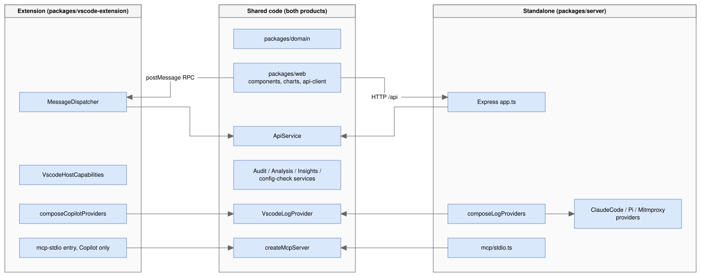

# VS Code extension: implementation and deployment plan

Status: **code and docs complete (Phase 10, #57-#80); not yet released.**
The owner's tasks before the first release are listed in
[implementation-plan.md](../implementation-plan.md) Phase 10. This plan expands
[implementation-plan.md](../implementation-plan.md) Phase 10 and
[architecture.md](../architecture.md) §12 into concrete, test-first steps.
Each step's status is recorded under its heading in §6.

Progress (2026-10-24):

| Step | What | State |
|---|---|---|
| 10.0 | Runtime check: `node:sqlite` works in VS Code's Electron | Done (#57) |
| 10.1 | Transport-neutral `ApiService` (server) | Done (#57) |
| 10.2 | `ApiTransport` seam (web: HTTP or webview) | Done (#57) |
| 10.3 | Extension package, Copilot-only composition, build, bundle boundary | Done (#63) |
| 10.4 | VS Code-derived paths and settings, persisted settings, param validation | Done (#64) |
| 10.5 | Product profile in the UI, host commands, VS Code theme | Done (#66) |
| 10.6 | Native Sessions/Setup sidebar, status bar, selection sync | Done (#67) |
| 10.7 | Accessibility, responsive layout, AsyncView, local fonts, walkthrough, l10n | Done (#69) |
| 10.8 | Copilot-only MCP server in the extension, plus UI follow-ups from 10.7 | Done (#71); server verified in CI (10.9); Copilot agent mode in the owner's manual checks |
| 10.9 | Integration tests in real VS Code, performance budgets, usability run, packaging | Done (#72; integration suite green in CI); owner's manual checks open |
| 10.10 | Documentation: extension README/listing, extension user guide, two-product README and User Guide | Done (#73); screenshots done; owner review open |
| 10.11 | UX review for VS Code: panel fits any width, readable in light, dark and High Contrast, native look, automated UI check | Done (#77) |
| 10.12 | Learn scenarios in the side bar (a Learn view), like the Sessions view; the panel has no list of its own | Done (#80) |


## 1. Context

The app ships today as two local processes: an Express API on
`127.0.0.1:3001` (`packages/server`) and a Vite + React SPA
(`packages/web`). Vision §5 lists one future path: repackage the app as a
VS Code extension with a webview. Phase 10 is the only phase in the plan
that hasn't started.

### 1.1 Two products, one codebase

Decided on 2026-10-24: the repo will ship **two separate products** that
share most of their code (vision §5).

| | **Extension** | **Standalone app** |
|---|---|---|
| Name (§3.4) | **AI Credits Analyzer** | **Agent Cost Analyzer** |
| Audience | VS Code + GitHub Copilot Chat users (Marketplace, Open VSX) | Developers using several coding agents |
| Log providers | **VS Code / Copilot Chat only** | VS Code, Claude Code, pi, mitmproxy (all of today's providers) |
| Learn mode | yes | yes |
| Analyze mode, turn inspector, system prompt | yes | yes |
| Tool audit, insights dashboard | **yes** (over the Copilot provider only) | yes (across every provider) |
| MCP server | **yes**, Copilot data only, registered with VS Code | yes, stdio (`npm run mcp`), every provider |
| Extension-only UX | Activity Bar sidebar (sessions, setup), status-bar AI Credits, one-click setting fixes, VS Code merged settings, VS Code-supplied paths | — |
| Delivery | `.vsix` from the Marketplace / Open VSX | `npm start` from the repo |
| Version | independent (`ext-v*` tags) | independent (`app-v*` tags) |

The standalone app stays a strict superset: it keeps VS Code support.

### 1.2 Goals

1. Install the extension from the VS Code Marketplace (and Open VSX) as
   one `.vsix`. No `npm install`, no second terminal, no browser tab.
2. Reuse `packages/web`'s components and charts and `packages/server`'s
   data sources and services unchanged, or with only refactors that also
   help the standalone app.
3. The extension contains **no** Claude Code, pi or mitmproxy code. A test
   enforces this; it isn't left as a convention (§3.1).
4. Keep the standalone web app and its stdio MCP server working exactly as
   today.
5. Use what only an extension can do. Settings warnings become one-click
   fixes, settings are read through VS Code's own merged configuration, and
   the VS Code user-data directory comes from VS Code itself on every
   platform.

Non-goals for this plan: a multi-user or cloud-hosted variant (vision §6),
a Copilot Chat participant, and telemetry. Constraint 1 forbids outbound
network calls, so neither product sends telemetry.

## 2. Analysis of the existing code

### 2.1 What already fits

| Area | Finding | Consequence |
|---|---|---|
| Provider registry | `composeLogProviders()` (`packages/server/src/composition/compose-log-providers.ts`) is the only place that chooses which providers exist. It has no Express dependency, and every path can be overridden through `LogProviderCompositionOptions`. The registry is open/closed (constraint 12). | The product split is a **second composition root**, not a fork (§3.1). |
| Query services | `AuditQueryService`, `AnalysisQueryService` and `createInsightsService` take a registry and are already shared by HTTP and MCP. | Both products reuse them; insights and audit simply see one provider in the extension. |
| MCP server | `createMcpServer` (`packages/server/src/mcp/mcp-server.ts`) takes its services as arguments; only `mcp/stdio.ts` composes them. | The extension gets its own Copilot-only MCP entry point with no change to the tools. |
| Web data access | All but one call goes through `packages/web/src/api-client/*`, which uses three helpers in `http.ts` (`getJson`, `getText`, `putJson`). | That one module is the transport seam (architecture §12). |
| Domain | Every response shape has a zod schema in `packages/domain`. | The host can validate messages at the boundary for free. |
| Config warnings | `ConfigWarning` already carries `settingId`. | A "Fix" button can open exactly that setting. |
| SQLite | Reads use the built-in `node:sqlite` (`DatabaseSync`), read-only, with no native npm module. | No `node-gyp` or per-platform prebuilt binaries to ship, if the extension host's Node supports it (risk R1). |

### 2.2 Gaps to close

| # | Gap | Location | Fix (step in §6) |
|---|---|---|---|
| G1 | Route logic lives inline in `app.ts`. The `/api/sessions/:id/system-prompt` route (~70 lines of VS Code/pi branching) and the turn-index validation can't be reused without Express. The pi branch also hard-wires a pi dependency into shared logic. | `packages/server/src/app.ts` | Extract an `ApiService`, with system-prompt reading behind an optional per-provider `SystemPromptTextReader` (10.1) |
| G2 | `App.tsx` calls `fetch("/api/health")` directly, bypassing `api-client`. | `packages/web/src/App.tsx:93` | Move into `api-client/health.ts` (10.2) |
| G3 | `api-client` is bound to `fetch` and relative `/api/...` URLs. | `packages/web/src/api-client/http.ts` | `ApiTransport` port with HTTP and webview adapters (10.2) |
| G4 | `import.meta.url` locates the learn-scenario fixtures and `package.json`. This breaks once the code is bundled into one CJS file. | `learn-scenarios/loader.ts:13`, `app.ts:29`, `mcp/stdio.ts:12` | Inject the fixtures dir and version (10.1) |
| G5 | `resolveUserDataDir` is Linux-only, so on macOS and Windows the VS Code provider is always unavailable. | `platform/vscode-paths/resolve-user-data-dir.ts` | In the extension, derive it from `context.globalStorageUri` (10.4). Separately, add macOS/Windows candidates for the standalone app. |
| G6 | The config check reads only the user `settings.json` (workspace merge not implemented, Phase 5 note). | `services/config-check` | `SettingsSource` port with a `vscode.workspace.getConfiguration` adapter (10.4) |
| G7 | The Vite build emits `/assets/...` absolute URLs and no manifest. Webviews need `asWebviewUri` URLs and a strict CSP. | `packages/web/vite.config.ts`, `index.html` | Extension build mode with `base: './'` and `build.manifest` (10.3) |
| G8 | `navigator.clipboard` (advice export) isn't reliable in every webview host. | `AdviceExportDialog.tsx:30` | `HostCapabilities` port: clipboard, open setting, open text document (10.5) |
| G9 | ESM-only workspace (`"type": "module"`), with `domain` exporting TypeScript source. | all `package.json` | esbuild bundle to CJS `dist/extension.js` and `dist/mcp-stdio.js` (10.3, 10.8) |
| G10 | The UI assumes a multi-provider product: the header provider select, "across every provider" wording on the dashboard, and the provider column. It also says nothing about which product it is. | `AppHeader.tsx`, `components/insights/*` | `ProductProfile` sent by the host; the UI renders from it, never from `isExtension` checks (10.5) |
| G11 | `composeLogProviders` imports all four providers statically, so any bundle that imports it includes them. | `composition/compose-log-providers.ts` | Split per-provider factories, plus a `composeCopilotProviders` root (10.3) |
| G12 | `theme.css` loads Barlow fonts from Google Fonts. The webview CSP blocks that (and it's a network call, constraint 1). | `packages/web/src/theme.css:5` | Extension build uses the VS Code font; the standalone app bundles the fonts locally (10.7) |
| G13 | No accessibility checks, one layout breakpoint (900 px, dashboard only), no `prefers-reduced-motion`, and loading/empty/error states differ per view. | `packages/web/src/*` | UX standards §3.5, step 10.7 |

## 3. Target architecture



<!-- mermaid-source: diagrams/3-target-architecture.drawio.svg
```mermaid
flowchart LR
  subgraph Shared["Shared code (both products)"]
    DOM[packages/domain]
    UI[packages/web<br/>components, charts, api-client]
    API[ApiService]
    SVC[Audit / Analysis / Insights /<br/>config-check services]
    VSP[VscodeLogProvider]
    MCP[createMcpServer]
  end
  subgraph Ext["Extension (packages/vscode-extension)"]
    CR1[composeCopilotProviders] --&gt; VSP
    D[MessageDispatcher] --&gt; API
    CAP[VscodeHostCapabilities]
    MCP1[mcp-stdio entry, Copilot only] --&gt; MCP
  end
  subgraph App["Standalone (packages/server)"]
    CR2[composeLogProviders] --&gt; VSP
    CR2 --&gt; OTH[ClaudeCode / Pi / Mitmproxy providers]
    HTTP[Express app.ts] --&gt; API
    MCP2[mcp/stdio.ts] --&gt; MCP
  end
  UI --&gt;|postMessage RPC| D
  UI --&gt;|HTTP /api| HTTP
```
-->

### 3.1 Product boundary

- **Option A (adopted): one repo, two composition roots.** The extension
  imports only `composeCopilotProviders()`, which registers just
  `VscodeLogProvider`. The standalone app keeps `composeLogProviders()`,
  which builds on the same per-provider factories. No packages move.
- **Boundary test (TDD, step 10.3).** `bundle-boundary.test.ts` reads
  esbuild's metafile for `dist/extension.js` and `dist/mcp-stdio.js` and
  fails if any input path matches `data-sources/(claude-code|pi-agent|
  log-providers/mitmproxy)/` or `platform/(claude-code|pi-agent)-paths/`.
  This turns "Copilot-only" into a test that can fail.
- **Option B (deferred): package split.** Split into `core`,
  `provider-vscode`, `provider-claude-code`, `provider-pi`,
  `provider-mitmproxy` plus the two app packages. Do this only if the
  products need separate contributors or the boundary test keeps
  catching leaks. It's a mechanical move once Option A's factories exist.

### 3.2 Decisions

- **D1: In-process message bridge, no embedded HTTP server.** Running
  Express inside the extension host would open a loopback port that any
  local process could reach, and would need webview port mapping and
  Host-guard changes. A typed `postMessage` RPC opens no port at all and is
  the design architecture §12 already describes.
- **D2: One transport-neutral `ApiService` in `packages/server`.** Express
  routes and the extension dispatcher both become thin adapters over it, so
  there's a single implementation (SRP, DIP). Its methods mirror the
  existing REST surface: `listSessions`, `getSession`, `getTurnDetail`,
  `getSystemPromptText`, `getConfigStatus`, `setRetentionThreshold`,
  `listLearnScenarios`, `getLearnScenario`, `getLogProviderStatus`,
  `setActiveLogProvider`, `getSessionAudit`, `listToolCalls`,
  `getAuditRollup`, `getInsights` and `getHealth`. It adds one new method,
  `getProductProfile`. `ApiService` doesn't know which product it runs in;
  it only sees the registry it was given.
- **D3: A new workspace, `packages/vscode-extension`.** It holds only
  VS Code glue: activation, panel, sidebar trees, dispatcher, VS Code
  adapters, the
  Copilot composition root, the MCP definition provider and packaging. It's
  the only package that imports `vscode`.
- **D4: Paths come from VS Code.**
  `context.globalStorageUri` = `<userData>/User/globalStorage/<extension-id>`,
  so the user-data dir is three levels up. That works on every platform and
  for Stable, Insiders, portable and remote servers, and it removes G5 for
  the extension.
- **D5: App-owned settings.** The extension stores its own settings
  (retention threshold) in `context.globalState` behind an
  `AppSettingsStore` port. The standalone app keeps its file in
  `resolveAppSettingsDir()`. The two products are independent, so one
  can't change the other's active provider. Constraint §11.2 holds: neither
  product writes to VS Code's own files.
- **D6: `extensionKind: ["workspace"]`.** Copilot Chat writes its logs
  where its own extension host runs. On Remote-SSH, WSL and Dev Containers
  that's the remote side, so this extension must run there too to see the
  same files. Validate in step 10.9.
- **D7: Copilot-only MCP in the extension.** The extension registers an MCP
  server definition with VS Code whose process composes only the Copilot
  provider (step 10.8). The tool list and schemas are identical to the
  standalone server's; only the data behind them differs.
- **D8: Independent versions and names.** Each product has its own
  version, changelog, tag prefix and listing. The shared packages stay
  private and unversioned.
- **D9: Minimum VS Code version = the current stable release at the time
  of each release** (decided 2026-10-24). Every extension release sets
  `engines.vscode` to `^<current stable>` (e.g. `^1.112.0`). This keeps
  one supported runtime, so there's no compatibility matrix: one Electron
  and Node version for `node:sqlite` (R1) and one VS Code API level for
  MCP registration (D7). The trade-off is that users on an older VS Code
  keep the last extension version that was compatible with their editor.
  The Marketplace handles this automatically.
- **D10: Native sidebar for navigation, editor panel for analysis**
  (decided 2026-10-24). The extension adds an Activity Bar icon whose view
  container holds native TreeViews (not webviews): **Sessions** and
  **Setup** in v1, **Findings** and **Learn scenarios** in a later minor
  release. A status-bar item shows today's AI Credits. Anything wide (the
  turns table, charts, dashboard, audit, inspector) stays in the editor
  panel, because the side bar is only 250-400 px wide. Picking a session
  in the tree opens or switches the panel to it. Tree code is VS Code-only
  and lives in `packages/vscode-extension`; it reads through the same
  `ApiService`, so the numbers can't differ from the panel's.

### 3.3 `ProductProfile`

A new schema in `packages/domain`, returned by `getProductProfile` (and by
`GET /api/product` in the standalone app):

```ts
type ProductProfile = {
  productId: "vscode-extension" | "standalone";
  displayName: string;
  version: string;
  features: {
    providerSelect: boolean;          // false when exactly one provider
    crossProviderInsights: boolean;   // drives dashboard wording and provider facet
    settingFixes: boolean;            // "Fix" buttons on config warnings
    openInEditor: boolean;            // system prompt -> editor document
  };
};
```

The web app reads this once at startup. Components take the flags they
need as props (ISP), so no component knows which product it's in.

### 3.4 Naming and Marketplace metadata

The extension's name doesn't include "GitHub Copilot". On the VS Code
Marketplace the audience is already VS Code users, and Copilot support is
stated where people search and read instead. This also avoids putting
another company's trademark in the product name.

- **Names (decided 2026-10-24):** the extension is **AI Credits
  Analyzer** and the standalone app is **Agent Cost Analyzer**.
- `displayName`: `AI Credits Analyzer`. `name` (the Marketplace id under
  the publisher): `ai-credits-analyzer`. The Marketplace rejects a
  `displayName` already in use, so confirm it's free before the first
  publish (step 10.10). If it's taken, fall back to "AI Credits Analyzer
  for VS Code" rather than adding "Copilot".
- `description`: names the use case, e.g. "See where your GitHub Copilot
  Chat tokens and AI Credits go: prompt caching, per-turn cost, tool-call
  failures and insights, from your local logs."
- `keywords` (Marketplace allows at most 30): `copilot`, `github copilot`,
  `copilot chat`, `ai credits`, `tokens`, `token usage`, `cost`,
  `prompt caching`, `llm`, `agent`, `mcp`.
- `categories`: `Visualization`, `AI`, `Chat`, `Other` (only values VS Code
  accepts for this field).
- Command, setting and view ids use the product prefix
  (`aiCreditsAnalyzer.*`), never `copilot*`.
- The README and listing refer to GitHub Copilot only to describe what
  the extension works with.
- The standalone app shows "Agent Cost Analyzer" through
  `ProductProfile.displayName` (step 10.5). The repo name and the
  `@agent-cost-analyzer/*` package scope were renamed on 2026-10-25 to match
  the product. The app settings directory stays as it is, to avoid a
  migration.

### 3.5 UX and accessibility standards

Decided 2026-10-24. These rules apply to every surface of the extension.
The UI code is shared, so they also apply to the standalone app.
"Test" means an automated check that fails CI; "manual" means a step in
the per-release usability script.

| Area | Rule | Check |
|---|---|---|
| VS Code fit | Follow the VS Code UX guidelines (code.visualstudio.com/api/ux-guidelines). Every command sits under the category "AI Credits Analyzer". | Test (manifest test) |
| VS Code fit | Contributions use codicons. The webview uses the bundled `@vscode/codicons` font and `--vscode-*` colour, font and focus variables. | Test (manifest test) + manual |
| VS Code fit | Don't use the Webview UI Toolkit, which Microsoft deprecated in 2025. Build on plain CSS variables and the shared `components/ui/*` primitives. | Review |
| VS Code fit | No unprompted notifications. Setup lives in the Setup view and the walkthrough. Host work over 1 s shows `withProgress` on the view; webview work shows inline progress. | Review + manual |
| VS Code fit | Settings have `markdownDescription`, `order` and enum descriptions. | Test (manifest test) |
| Onboarding | A Get Started walkthrough (`contributes.walkthroughs`) has 5 steps: enable logging, keep 200 sessions, open a session, Learn mode, MCP (optional). Steps complete through `completionEvents` (`onSettingChanged:…`, `onCommand:…`). | Test (manifest test) + manual |
| Accessibility | WCAG 2.2 AA. axe-core reports no violations for every view in dark, light and high-contrast themes. | Test (`vitest-axe`) |
| Accessibility | Everything works by keyboard. Arrow keys move through lists and the turns table, Enter opens, and Escape closes the inspector and drawers. Focus is always visible (`--vscode-focusBorder`) and never trapped. | Test (`@testing-library/user-event`) + manual |
| Accessibility | Every chart has a text alternative: an `aria-label` summary plus a "View as table" toggle. | Test |
| Accessibility | Text contrast is at least 4.5:1. High-contrast themes show `--vscode-contrastBorder` outlines. Severity and status are never shown by colour alone (icon plus text). | Test (axe) + manual |
| Accessibility | `prefers-reduced-motion` turns off transitions and animated progress. Async results are announced through an `aria-live="polite"` region. | Test |
| Layout | Layout depends on the panel's width, not the window's. At 1100 px and up: table plus right column. From 700 to 1099 px: the right column becomes a drawer. Below 700 px: priority columns (Turn, Trigger, AI Credits, Cumulative), a details drawer, and a view `<select>`. Minimum width 360 px. Users choose and keep the visible columns. | Test (pure `layoutFor(width)`) + manual |
| States | Every data view uses one `AsyncView` pattern. **Loading:** a skeleton matching the final layout, shown after 300 ms so it doesn't flash, with Cancel for long loads. **Empty:** says why, plus a next step. **Error:** what failed, that nothing was changed, Retry and Copy details. **Partial:** a warning, never a zero (constraint 6). | Test |
| Content | Sentence case and plain language. Units are always shown. AI Credits have 2 decimals and use tabular numbers. Dates are relative ("Today 14:02") with the absolute time in a tooltip. | Review |
| Performance | First render of the panel in under 1 s with 200 sessions. Sessions tree in under 500 ms. Interactions respond in under 100 ms. | Test (integration timing) |
| Localization | Host strings use `vscode.l10n` / `package.nls.json`, and webview strings go through one messages module. English only for now. | Test (no unused or missing keys) |
| Usability | No telemetry, so each release runs a short manual script: first run, logging off, no sessions, a large session, keyboard only, high contrast. Screenshots go in the release PR. | Manual |

### 3.6 UI mock-ups (for review)

The mock-ups are on a Design canvas:
**https://claude.ai/artifact/KXwmLWv77nG1arL5gENFYe**. The link is private
until the owner shares it from the page's Share menu. Reviewers comment
on the canvas. The source files are versioned in
[mockups/vscode-extension/](mockups/vscode-extension/). They're
`.dc.html` files rendered by the canvas, not standalone pages.

All numbers in the mock-ups are sample data. Colours follow VS Code's
default Dark Modern theme. The first board has a theme switch (dark,
light, high contrast).

| # | Board | Shows | Plan link |
|---|---|---|---|
| 1 | Session analysis | Activity Bar icon; Sessions tree grouped by day with AI Credits (and "unknown"); Setup view; panel with KPIs, view tabs, turns table with a column chooser, Explanation/System prompt/Tools column; status-bar AI Credits | D10, 10.5, 10.6 |
| 2 | First run | Setup view with Enable and Keep 200 buttons; Sessions welcome view pointing to Learn mode; panel with a 3-step checklist; status bar "setup needed" | 10.4-10.6, §3.5 Onboarding |
| 3 | Get Started walkthrough | 5 steps with progress, the current step open, and an illustration of the Sessions view | §3.5 Onboarding, 10.7 |
| 4 | Narrow panel (640 px) | 2×2 KPIs, view select, priority columns, and a details drawer with the hidden metrics | §3.5 Layout, 10.7 |
| 5 | Loading, empty and error states | Skeleton with progress and Cancel; empty state with why and a next step; error with Retry; partial-data warning | §3.5 States, 10.7 |
| 6 | Dashboard and Findings tree | Findings tree (later minor); dashboard with selection chips and Back, KPIs with coverage, a per-day chart with "View as table", a Model list box, signals | 10.5, D10 later minor |

**Review gate:** the mock-ups are reviewed and their comments resolved
before step 10.5 starts. Agreed changes are made on the canvas and in
the versioned copies in the same change.

**Status:** approved by the owner on 2026-10-24 with no change requests.
The gate is passed.

## 4. Message protocol

In `packages/domain/src/rpc.ts`, so both sides share it:

```ts
// webview -> host
type RpcRequest = { kind: "request"; id: string; method: ApiMethod; params: unknown };
// host -> webview
type RpcResponse =
  | { kind: "response"; id: string; ok: true; result: unknown }
  | { kind: "response"; id: string; ok: false; error: { status: 400 | 404 | 500; message: string } };
// host -> webview, unsolicited (e.g. settings changed -> refetch config status)
type HostEvent = {
  kind: "event";
  name: "configChanged" | "themeChanged" | "selectSession"; // selectSession: the sidebar picked a session (D10)
  payload?: unknown;
};
```

- The host validates `method` against an allow-list and validates
  `params` with a per-method zod schema before dispatching. Anything else
  is rejected with `400` (§11.2 defence in depth: the webview is
  untrusted content).
- `setActiveLogProvider` with any id other than `vscode` returns `400` in
  the extension, from the registry itself (no special case).
- Error `status` values match the HTTP API's, so the web code handles
  "unknown session" (404) the same way on both transports.
- The webview transport correlates responses by `id`, rejects after a
  timeout (default 60 s, since insights over large histories can be slow),
  and rejects with the same `Error` message format as `http.ts`.
- Payloads are structured-cloned. Big sessions are already fetched per
  turn (`getTurnDetail`), which matches architecture §11.1.

## 5. Webview security

- CSP: `default-src 'none'; script-src 'nonce-…'; style-src ${cspSource}
  'unsafe-inline'; img-src ${cspSource} data:; font-src ${cspSource};
  connect-src 'none'`. `connect-src 'none'` makes "no network from the UI"
  enforceable rather than a convention.
- `localResourceRoots` is restricted to the extension's `media/` folder.
  The webview never gets file URIs for user logs, and all log reads stay
  on the host.
- Existing redaction (`redactSecrets`) and `isValidSessionId` path
  validation are reused unchanged, because the same services run. The
  extension never contains the mitmproxy code, so HAR captures with
  credential headers can't reach it at all.
- No `retainContextWhenHidden` by default (memory). State is restored via
  `vscode.setState`/`getState` for the selected mode, session and turn.

## 6. Implementation steps (TDD, each with an exit criterion)

Each step follows architecture §11.4/§11.5: write the failing test first,
make it pass, refactor. Commit when the step's exit criterion is met.
Steps 10.1 and 10.2 are pure refactors of existing packages. The whole
existing suite must stay green and the standalone app must behave
identically.

### 10.0 Spike: runtime check (time-boxed, about half a day)

- In a throwaway extension on the current stable VS Code (D9), confirm
  that `require('node:sqlite')` works in the extension host, read-only,
  without flags (R1). Also confirm that an esbuild CJS bundle of
  `VscodeLogProvider` loads, and that `vscode.lm.registerMcpServerDefinitionProvider`
  is available on that version (D7).
- Record the result in architecture §12.
- **Exit:** a short decision note. Either `node:sqlite` is usable, or we
  fall back to a `SqliteReader` port with a WASM adapter (`sql.js`, latest
  stable, §11.6), chosen before step 10.4.

**Status (2026-10-24): done. Keep `node:sqlite`; no WASM fallback.**
- **Versions.**
  - Stable VS Code is 1.143.0, inferred from the newest `microsoft/vscode`
    release tag; `update.code.visualstudio.com` is blocked from the dev
    container.
  - It ships Electron 43.7.7 (`.npmrc` `target`, the same for 1.141-1.143),
    which bundles Node 24.21.0 (electron `DEPS`).
- **`node:sqlite`.** Under `ELECTRON_RUN_AS_NODE=1` with that Electron,
  `require('node:sqlite')` works without flags or warnings.
  `new DatabaseSync(path, { readOnly: true })` reads rows, and a write on
  that handle throws "attempt to write a readonly database".
- **Bundling.** esbuild keeps `node:` builtins external by default, and the
  bundled CJS file ran under the same Electron.
- **MCP API.** `vscode.lm.registerMcpServerDefinitionProvider`,
  `McpStdioServerDefinition` and the `mcpServerDefinitionProviders`
  contribution are in the stable API (`@types/vscode` 1.140.0, the newest
  typings published).
- **Packaging note.** vsce requires `@types/vscode` ≤ `engines.vscode`, so
  D9's `^<current stable>` can be ahead of the newest typings.
- **Not verified here.** The real extension host, because VS Code can't be
  downloaded in this container. The 10.9 integration tests run in CI, where
  it can, and confirm it.

### 10.1 Transport-neutral `ApiService` (server)

- Tests first: `services/api/api-service.test.ts` covers every method from
  D2 with fakes for the registry and services (`test-support/*`). It
  covers success, unknown id → `NotFound`, bad input → `BadRequest`
  (turn index, retention threshold, provider id), and provider failure →
  `Internal`.
- Move the logic out of `app.ts` into `ApiService` (G1). System-prompt
  text becomes an optional `SystemPromptTextReader` capability per
  provider. `VscodeLogProvider` gets the existing `main.jsonl` logic, and
  `PiAgentLogProvider` already has `readSystemPromptText`. The
  `=== "pi-agent"` branch goes away, and `ApiService` no longer imports
  any provider (OCP). `app.ts` becomes a thin adapter that maps typed
  errors to status codes. Existing `app*.test.ts` stay unchanged and
  green; they're the regression net.
- `AppSettingsStore` port (D5): the existing file-backed implementation is
  the standalone default.
- G4: `loadLearnScenarios({ fixturesDir })` and an injected `appVersion`.
  The defaults keep the current `import.meta.url` behaviour for the
  standalone app.
- `ProductProfile` schema in `domain` (tests first), plus
  `getProductProfile` and `GET /api/product` for the standalone app.
- **Exit:** `npm test`, `npm run typecheck` and `npm run lint` are green,
  `app.ts` holds no business logic, and existing HTTP API responses are
  byte-identical.

**Status (2026-10-24): done.**
- **`ApiService`** (`services/api/api-service.ts`) has the 16 `ApiMethod`
  methods (`packages/domain/src/rpc.ts`). It takes raw inputs and the raw
  query object, and validates them with the existing parsers, so both
  transports get the same 400 messages.
- **Errors.** `BadRequestError`, `NotFoundError` and `InternalError` extend
  `ApiError` (`api-errors.ts`), and `statusForApiError` maps them to
  statuses.
- **Composition and the HTTP layer.**
  `composition/create-standalone-api-service.ts` builds the service.
  `app.ts` only picks inputs and maps errors; any other error still goes
  to Express's default handler.
- **Regression check.** The existing `app*.test.ts` files are unchanged and
  green. A temporary side-by-side harness compared about 1,760 requests
  across all 4 providers and found identical status, content type and
  body. It also caught and fixed one `text/plain` 404 regression.
- **G1.** The optional `SystemPromptTextReader` capability
  (`lookupSystemPromptText`: found, not-captured or unknown-session) is
  implemented by `VscodeLogProvider` and `PiAgentLogProvider`.
  - **Intended change:** with mitmproxy or claude-code active, every id now
    returns 404 "Unknown session id". Before, VS Code ids fell through to
    the VS Code store.
- **D5.** `AppSettingsStore` (active provider id and retention threshold)
  has a `FileAppSettingsStore` default, plus a reusable contract suite
  (`describeAppSettingsStoreContract`). `LogProviderRegistry` takes the
  store.
- **G4.** `loadLearnScenarios({ fixturesDir })` and
  `readAppVersion(packageJsonPath?)` (also used by `mcp/stdio.ts`) resolve
  `import.meta.url` only when nothing is injected.
- **ProductProfile.** The schema is in `domain`. `GET /api/product`
  returns the standalone profile ("Agent Cost Analyzer").
- **Follow-up after merge.** The web `ApiMethodName` is now the domain's
  `ApiMethod`, and the transport contract test checks it covers every
  method.
- **Tests.** 1,390 before, 1,590 after the 10.1 + 10.2 merge (domain 82,
  server 977, web 516, pi-logger 15).

### 10.2 `ApiTransport` seam (web)

- Tests first: `api-client/transport.test.ts` defines an
  `ApiTransport { call(method, params): Promise<unknown> }` contract that
  both adapters must pass. Write `HttpTransport` (maps methods to today's
  URLs, keeps the error messages) and `WebviewTransport` (with a fake
  `acquireVsCodeApi` and `window` message events; covers correlation,
  timeout, error propagation and out-of-order replies).
- Rewrite `api-client/*` functions to take the transport via a small
  provider (`setApiTransport` or a React context). Components and charts
  don't change (architecture §12). Move the health check into
  `api-client/health.ts` (G2).
- Select the transport at startup: `WebviewTransport` when
  `acquireVsCodeApi` exists, `HttpTransport` otherwise.
- **Exit:** the web suite is green and `rg 'fetch\(' packages/web/src`
  finds matches only in `api-client/http-transport.ts`.

**Status (2026-10-24): done.**
- **Transport.** `api-client/transport.ts` defines `ApiTransport` and a
  local `ApiMethodName` union. That union mirrors the domain's `ApiMethod`,
  which arrives in 10.1.
- **Adapters.** `HttpTransport` (`http-transport.ts`, the only `fetch` in
  the web package) keeps today's URLs, verbs and error messages.
  `WebviewTransport` (`webview-transport.ts`) adds request ids, timeouts,
  out-of-order replies and `onEvent` for host events. Both pass one shared
  contract suite.
- **How api-client gets its transport.** `current-transport.ts` is a
  module-level setter/getter that defaults to HTTP, so no component
  changed. `main.tsx` installs the result of `selectTransport(window)`, and
  the health check moved to `api-client/health.ts` (G2).
- **Tests.** Web tests went from 409 to 514, and every existing test passes
  unchanged.
- **Param keys the host must match in 10.4.** `id`, `sessionId` and
  `turnIndex`, `value` (retention threshold), and the audit, tool-call and
  insights query fields as named in the HTTP API.

### 10.3 Extension skeleton, Copilot composition root, build

- **Composition (G11), tests first.** Split `composeLogProviders` into
  per-provider factories (`createVscodeProvider(paths)`, and the same for
  each other provider). Add `composeCopilotProviders(options)` in
  `packages/server/src/composition/compose-copilot-providers.ts`, which
  registers `VscodeLogProvider` only. `composeLogProviders` keeps its
  signature and behaviour, built on the same factories. Tests: the Copilot
  registry lists exactly `["vscode"]`, and the standalone registry is
  unchanged.
- New workspace, `packages/vscode-extension`:
  - `package.json` with `name` and `displayName` from §3.4, `publisher`
    `raulkivi` (§7.0), its own `version` (D8), `engines.vscode` per D9,
    `main: ./dist/extension.js`, `extensionKind: ["workspace"]`, and
    contributed command `aiCreditsAnalyzer.open`. Commands activate
    implicitly, with no `*` activation. It also adds an `icon`. The
    sidebar and status bar come in step 10.6.
  - `src/extension.ts` with `activate`/`deactivate`, wired through a
    composition root (`src/composition.ts`) as the only place that
    constructs concrete classes. It uses `composeCopilotProviders`, never
    `composeLogProviders`.
  - `src/panel/analyzer-panel.ts`: singleton `WebviewPanel`, CSP/nonce HTML
    built from the Vite manifest, `asWebviewUri` for assets.
- Build: `esbuild src/extension.ts --bundle --platform=node --format=cjs
  --external:vscode --metafile=dist/meta.json --outfile=dist/extension.js`.
  The web build gets an `extension` mode (`base: './'`,
  `build.manifest: true`, `outDir: ../vscode-extension/media`).
  Learn-scenario fixtures are copied to `media/learn-scenarios/` (they're
  data, not code).
- Tests first:
  - `panel-html.test.ts` (pure function: manifest + nonce + `cspSource` →
    HTML that contains the CSP, no absolute `/assets` URLs, nonce on every
    script).
  - `bundle-boundary.test.ts` (§3.1). It fails first against a bundle
    built from `composeLogProviders`, then passes with
    `composeCopilotProviders`.
- **Exit:** `npm run build` produces `dist/extension.js` and `media/`, the
  boundary test passes, and running the extension (F5) opens a panel
  showing Learn mode.

**Status (2026-10-24): done.**
- **Composition.** `composeLogProviders` is split into per-provider
  factories (`composition/providers/`). `composeCopilotProviders` registers
  only `vscode`, and `createExtensionApiService` composes the extension's
  `ApiService` with the "AI Credits Analyzer" `ProductProfile` (setting
  fixes and open-in-editor stay off until 10.5).
- **New package.** `packages/vscode-extension` (`raulkivi.ai-credits-analyzer`
  0.1.0, `engines.vscode ^1.143.0`, `@types/vscode` 1.140.0) contains:
  - a composition root, `src/composition.ts`;
  - a singleton panel with the §5 CSP (`panel-html.ts`, `analyzer-panel.ts`);
  - one `vscode` adapter;
  - a `MessageDispatcher` that validates the method against
    `apiMethodSchema`, maps typed errors to 400/404/500, and returns a
    generic 500 for anything else. This moved forward from 10.4; per-method
    zod param schemas remain in 10.4.
- **Settings.** An in-memory `SessionAppSettingsStore` until 10.4's
  globalState store.
- **Build.**
  - esbuild bundle: `scripts/esbuild-options.mts`, CJS,
    `mainFields: ["module", "main"]`, because jsonc-parser's UMD build
    can't be bundled.
  - `vite build --mode extension` writes to `media/` with a relative base
    and `media/manifest.json`. The learn fixtures are copied to
    `media/learn-scenarios`.
  - The build scripts are `.mts` files run directly by Node, which needs
    Node ≥ 22.18. The root `engines` is raised to match.
- **G12.** A Vite plugin strips remote CSS `@import`s, in extension mode
  only. The standalone build is byte-identical.
- **Bundle-boundary test.** Built in memory from the same options. It
  failed with 37 leaked inputs on the standalone composition root and
  flags Express. `bundle-load.test.ts` loads the built bundle with a stub
  `vscode` and serves Learn mode.
- **Electron check.** Under Electron 43.7.7: activation, open/reveal, and
  Learn scenarios over the bridge all work. Setting the provider to
  `claude-code` gives 400.
- **Sizes.** `dist/extension.js` is 4.3 MB unminified (mostly gpt-tokenizer
  and zod) and `media/` is 0.57 MB. Trimming against the 5 MB budget is in
  10.9.
- **Deferred.**
  - The `icon` (PNG ≥ 128 px) moves to 10.9.
  - VS Code-derived paths and globalState settings are 10.4.
  - The boundary test covers `dist/mcp-stdio.js` in 10.8.
  - The real-VS Code F5 check is 10.9, because VS Code can't be downloaded
    here.
- **Tests.** 1,590 → 1,663 (server 990, web 528, extension 48).

### 10.4 Host dispatcher and VS Code adapters

- `src/rpc/message-dispatcher.ts`: tests first. Unknown method → 400,
  invalid params → 400, `ApiService` typed errors → their status, and
  thrown errors → 500 without stack traces. It depends only on `ApiService`
  plus `HostCapabilities` interfaces (DIP), so it's testable without
  `vscode`.
- `src/platform/vscode-user-data-dir.ts`: pure function from a
  `globalStorageUri` path to the user-data dir, tested for Linux, macOS,
  Windows, Insiders and remote-server layouts (D4). Its result feeds
  `composeCopilotProviders({ sessionStoreDbPath, debugLogsDirPaths,
  agentTracesDbPath, vscodeSettingsPath })`.
- `SettingsSource` port in `services/config-check` (G6):
  `checkConfig({ settings })` reads `get(settingId)`. Adapters are the
  existing JSONC `settings.json` file reader (standalone, default) and
  `VscodeSettingsSource` using `vscode.workspace.getConfiguration()`. Tests
  first, and both adapters pass a shared contract test.
- `GlobalStateAppSettingsStore` (D5), passing the same `AppSettingsStore`
  contract test as the file-backed store.
- Re-run the config check on `workspace.onDidChangeConfiguration` for the
  two `agentDebugLog` settings and push a `configChanged` event.
- **Exit:** in a dev host, Analyze mode lists real VS Code sessions on
  Linux and on macOS or Windows (G5 resolved for the extension). The
  `ConfigStatus` matches the effective setting, including a
  workspace-level override. The tool audit and insights dashboard render
  for those sessions.

**Status (2026-10-24): done.**
- **Param validation.** Per-method param schemas (`apiMethodParamsSchemas`)
  and the `RpcRequest`, `RpcResponse` and `HostEvent` types now live in
  `packages/domain/src/rpc.ts`.
  - The dispatcher answers 400 `Invalid params for <method>: …` and strips
    unknown fields.
  - The turn index, the retention value and the provider id stay with
    `ApiService`, so its messages are unchanged.
  - An empty id now gets 400 instead of 404.
- **Paths (D4, G5).**
  - `userDataDirFromGlobalStorage` maps `<userData>/User/globalStorage/<id>`
    to `<userData>`. It's tested for Linux, macOS, Windows, Insiders,
    portable (both OSes) and the remote server, and returns null for any
    other shape.
  - `copilotLogPathsFromUserDataDir` derives the session store,
    agent-traces, debug-log dirs and `settings.json` from shared server
    helpers.
  - An unrecognised layout reads no Copilot data and logs a warning. It
    never falls back to this machine's defaults.
- **Settings (G6).** `SettingsSource` port (`get`, `describe`), shared by
  `JsoncFileSettingsSource` (the standalone default; HTTP API unchanged)
  and `VscodeSettingsSource`, with one contract suite.
- **Persisted settings (D5).** `GlobalStateAppSettingsStore`: a cached
  synchronous read, background `update` with an `onError` hook, and the
  `describeAppSettingsStoreContract` suite. `SessionAppSettingsStore` is
  removed.
- **Config events.** `watchConfigChanges` → `AnalyzerPanel.post` →
  `configChanged` → `onHostEvent` in the web app, which refetches the config
  status. The HTTP transport has no events, so the standalone app is
  unaffected.
- **Bundle-load test.** It covers the whole path with a stub `vscode`.
- **Not verified here.** Real sessions in a VS Code dev host, and a real
  workspace override. VS Code can't be downloaded in this container, so the
  10.9 CI integration tests cover them.
- **TDD note.** Four modules had their tests written alongside the code
  rather than seen failing first: `userDataDirFromGlobalStorage`,
  `copilotLogPathsFromUserDataDir`, `VscodeSettingsSource` and
  `GlobalStateAppSettingsStore`. Their tests cover the cases listed above.
- **Known limits.**
  - Debug-log folders were listed only at activation. Resolved in 10.6:
    every full refresh re-lists them.
  - Folder-level settings in multi-root workspaces aren't read.
  - `readVscodeSettings` is now only used by its own tests.
- **Tests.** 1,663 → 1,781 (domain 113, server 1,014, web 532, extension
  107).

### 10.5 Product profile in the UI and extension-only UX

Starts after the mock-up review gate (§3.6).

- **`ProductProfile` (G10), tests first:**
  - `AppHeader` hides the provider select when
    `features.providerSelect` is false.
  - The insights dashboard drops the provider list box and changes its
    "across every provider" wording when `crossProviderInsights` is false.
  - The header and the advice-export bundle show `displayName`.
  - Snapshot-free component tests cover both profiles.
- **`HostCapabilities`** (web port; the standalone implementation keeps
  today's behaviour):
  - `openSetting(settingId)` → `workbench.action.openSettings` with the
    id. This is the "Fix" button on `ConfigWarningBanner`, shown only when
    `features.settingFixes` is true.
  - `copyToClipboard(text)` → `vscode.env.clipboard.writeText` (G8).
  - `openTextDocument(text, language)`: "Open system prompt in editor"
    from `SystemPromptInspector` as an untitled read-only document.
- Theme: map `theme.css` tokens to `--vscode-*` variables when
  `body.vscode-light`, `body.vscode-dark` or `body.vscode-high-contrast`
  is present. Keep the Industry palette as the fallback, and keep the
  standalone look unchanged.
- Tests first: component tests for the Fix button (rendered only with
  the flag; calls `openSetting` with the warning's `settingId`) and the
  capability-absent fallbacks.
- **Exit:** clicking Fix on a `logging-disabled` warning opens the
  settings UI on `github.copilot.chat.agentDebugLog.fileLogging.enabled`.
  The extension shows no provider select, and the standalone app looks
  unchanged.

**Status (2026-10-24): done.**
- **Product profile (G10).** The web app fetches the `ProductProfile` once.
  If that fails, it falls back to today's standalone UI. Flags reach
  components only as props:
  - `AppHeader`: `displayName`, `providerSelect`.
  - `InsightsDashboard` and the narrative: `crossProvider` drops the
    Provider list box and column and the "every provider" wording.
  - `AdviceExportDialog` and `buildAdviceBundle`: `productName`.
- **Standalone app.** Its header now reads "Agent Cost Analyzer", taken
  from its profile (§3.4).
- **Host commands (G8).** The protocol lives in `packages/domain/src/rpc.ts`:
  `{kind:"command", id, command, args}`, answered with the same response
  shape as API calls.
  - The allow-list is `openSetting`, `copyToClipboard` and
    `openTextDocument` (`plaintext`, `markdown` or `json`). Text is capped at
    5 Mi UTF-16 units.
  - `HostCommandHandler` accepts `openSetting` only for setting ids in the
    current `ConfigStatus` warnings or the two watched Copilot settings.
    Everything else gets 400.
  - `createVscodeHostCommands` calls `workbench.action.openSettings`,
    `env.clipboard.writeText` and `openTextDocument`/`showTextDocument`.
  - The extension profile now sets `settingFixes` and `openInEditor` to
    true.
- **Web side.** The `HostCapabilities` port (`host/`) has a standalone
  version (browser clipboard only) and one built on the transport.
  - `ConfigWarningBanner` labels its buttons per the mock-ups: Enable,
    Change, or Open setting.
  - `SystemPromptInspector` adds "Open prompt in editor".
- **Theme.** `theme-vscode.css` maps theme tokens to `--vscode-*`
  variables, with every rule scoped under `body.vscode-light`,
  `body.vscode-dark` or `body.vscode-high-contrast` and every variable
  falling back to the Industry value. The fonts follow
  `--vscode-font-family` and `--vscode-font-size`. The standalone CSS
  output only gained scoped rules: the old CSS is a byte-for-byte prefix of
  the new.
- **Bundle-load test.** It covers: Fix sends
  `…fileLogging.enabled` and the host calls `openSettings` with it; a
  disallowed id gets 400; clipboard and document round trips work.
- **Handed to 10.7.**
  - Hold the header until the profile resolves (no fallback flash).
  - A read-only system-prompt document.
  - A contrast check on dark themes.
- **TDD.** Every new module and behaviour was seen failing first. The
  exceptions are a refactor done while tests were green
  (`describe-issues.ts`) and the last bundle-load case, which was written
  after the code.
- **Tests.** 1,781 → 1,895 (domain 120, web 601, extension 145).

### 10.6 Native sidebar and status bar (D10)

Everything here is built on pure, `vscode`-free modules that are tested
first with fakes. Only thin registration code touches the `vscode` API.

- **Contributions** (`package.json`):
  - `viewsContainers.activitybar`: `aiCreditsAnalyzer` with a monochrome
    SVG icon.
  - `views`: `aiCreditsAnalyzer.sessions` ("Sessions") and
    `aiCreditsAnalyzer.setup` ("Setup").
  - `viewsWelcome` for both views.
  - `menus.view/title`: Refresh and Open analyzer.
  - `menus.view/item/context`: Open, Show tool audit, Copy advice bundle.
  - Commands `aiCreditsAnalyzer.refreshSessions`,
    `aiCreditsAnalyzer.openSession` (args: session id and an optional
    right-panel tab, used by "Show tool audit") and
    `aiCreditsAnalyzer.fixSetting` (arg: setting id; defaults to the
    debug-logging setting).
- **Sessions tree, tests first.** `sessions-tree-model.ts` is a pure
  function from `Session[]` plus `now` to tree nodes:
  - Group by day ("Today", "Yesterday", then ISO dates), newest first.
  - Label is the session title. Description is the AI Credits total
    rounded to 2 decimals, or "AI Credits unknown" when
    `costAiCredits.known` is false (constraint 6, never "0").
  - Tooltip shows the turn count, start time and model.
  - Sessions without `startedAt` go in an "Undated" group, never a
    fabricated date.

  Tests cover grouping across midnight and time zones, unknown cost,
  empty input, and stable ordering. `SessionsTreeProvider` adapts the
  model to `vscode.TreeDataProvider` and reads `ApiService.listSessions`.
  It refreshes on the Refresh button and when the view becomes visible,
  with no background polling or file watchers in v1. A refresh also
  re-lists the per-workspace `debug-logs` folders, which 10.4 lists once
  at activation. Without that, a workspace first opened after activation
  only appears after a reload.
- **Selection sync.** `openSession(id)` opens the panel if it's closed,
  then posts `selectSession`. The web app handles it like a click in its
  own session list. Test the web handler (the event selects the session
  and fetches it) and the host command (it creates the panel once and
  posts once).
- **Setup view, tests first.** `setup-view-model.ts` maps `ConfigStatus`
  to either an empty tree, which shows the `viewsWelcome` content, or one
  node per warning. Each node has a severity icon and an inline **Fix**
  action that runs `openSetting(settingId)` from step 10.5. Welcome
  content: "Debug logging is off, so sessions have no token data.
  [Enable logging](command:aiCreditsAnalyzer.fixSetting)". It refreshes on
  the `configChanged` signal from step 10.4.
- **Status bar, tests first.** `status-bar-model.ts` is a pure function
  from today's sessions to `{ text, tooltip }`:
  - It sums only known `costAiCredits`, and the tooltip names the
    coverage ("3 of 5 sessions have cost data").
  - It shows "AI Credits: unknown" when none are known, and is hidden
    when there are no sessions today.
  - Clicking it opens the panel.
- **Later minor release, not in v1:** a **Findings** tree, like the
  Problems view: insights findings by severity, click → session and turn.
  Also a **Learn scenarios** tree.
- **Exit:** in a dev host the Activity Bar icon shows the Sessions tree
  with real Copilot sessions grouped by day. Clicking one opens the panel
  on that session. With debug logging off, the Setup view's Enable button
  opens the setting. The status bar shows today's known AI Credits with
  coverage in the tooltip. Every tree and status-bar model has unit
  tests, and none of the model modules import `vscode`.

**Status (2026-10-24): done.**
- **Sidebar.** An Activity Bar container `aiCreditsAnalyzer`
  (`resources/activity-bar.svg`, `currentColor`) with the native
  **Sessions** and **Setup** TreeViews and their welcome views.
- **Pure models** (none imports `vscode`):
  - `buildSessionsTree`: local-day groups (Today, Yesterday, ISO dates,
    Undated last; never a made-up date). Rows show "4.82" or "AI Credits
    unknown". Group totals count only known costs ("12.40 · 1 unknown").
  - `buildSetupTree`: one node per warning, marked "Required" or "Optional"
    with an icon, plus an inline and context-menu Fix.
  - `buildStatusBarState`: "$(graph) 12.40 AI Credits today", with coverage
    in the tooltip; "AI Credits: unknown"; hidden when no session started
    today; "$(warning) AI Credits: setup needed" when a required warning
    exists, which opens the Setup view.
- **Debug-log re-listing.** `VscodeLogProvider` accepts a `() => string[]`
  lister (the standalone app still passes arrays). Every full refresh
  re-lists the per-workspace `debug-logs` folders: the Refresh command, the
  view becoming visible, and activation. A bundle-load test proves a
  workspace created after activation appears after Refresh.
- **Selection sync.** `openSession`, `showToolAudit` and `copyAdviceBundle`
  open the panel and `postWhenReady` a `selectSession` event
  (`{sessionId, tab?, view?, adviceDialog?}`, schema in domain). If the
  webview isn't ready, the event is held and delivered on its first
  message. Readiness resets when the panel is hidden. The web app handles
  the event like a click in its own session list.
- **Commands.** `refreshSessions` (under `withProgress`), `openSession`,
  `showToolAudit`, `copyAdviceBundle`, `fixSetting` (same allow-list as
  `openSetting`) and `openLearnMode`, all in the "AI Credits Analyzer"
  category with codicons. Commands that need arguments are hidden from the
  Command Palette. A manifest test checks ids, categories, menus, welcome
  links and views.
- **Deviations from the text above.**
  - Activation is `onStartupFinished`, so the status bar has data. That
    reads the session list once per VS Code start.
  - "Show tool audit" opens the Tool audit centre view (`view`), not a
    right-panel tab.
  - "Copy advice bundle" opens the session with the advice dialog open,
    because the bundle builder needs fully fetched sessions and lives in the
    web code.
  - The Setup welcome view reads "No setup problems found…", since an empty
    tree means nothing needs fixing. Warnings show as rows.
  - `openLearnMode` only opens the panel.
  - Day labels and the status bar update on the next refresh, not at
    midnight.
- **Not verified here.** A real VS Code dev host; 10.9's CI tests cover it.
- **TDD.** Exceptions to red-first: `setup-view-model`, and the bundle-load
  checks, which were written after the code; the relist and visibility
  checks were mutation-tested. One "ignores an invalid payload" test passed
  before its code existed. One export was a refactor done while tests were
  green.
- **Tests.** 1,895 → 2,025 (domain 123, server 1,015, web 607, extension
  265).

### 10.7 UX polish, accessibility and onboarding (§3.5)

Implements §3.5 against the reviewed mock-ups (§3.6). Most of it lives in
`packages/web`, so the standalone app gets the same improvements.

- **Tests first:**
  - `vitest-axe` runs for every view in three theme fixtures (dark,
    light, high contrast, set through `--vscode-*` variables on `body`).
  - Keyboard tests with `user-event`: Tab order, arrow keys in lists and
    the turns table, Enter to open, Escape to close.
  - A pure `layoutFor(width)` with cases at 360, 640, 900, 1100 and
    1280 px. A `useContainerWidth` hook (ResizeObserver) feeds it.
  - The `AsyncView` component covers loading (with the 300 ms delay),
    empty, error with Retry, and partial.
  - The reduced-motion stylesheet is checked.
  - A manifest test checks that every command has the category, every
    walkthrough step's command and media exist, `completionEvents` name
    contributed settings or commands, and every `%key%` exists in
    `package.nls.json`.
- **Build:**
  - Narrow layouts with a column chooser (kept in webview state).
  - A details drawer for small widths, and "View as table" for charts.
  - `AsyncView` adopted by every data view.
  - The walkthrough (`contributes.walkthroughs` plus Markdown/SVG media).
  - `vscode.l10n` for host strings.
  - G12: the extension build drops the Google Fonts import and uses
    `--vscode-font-family`; the standalone app bundles Barlow locally.
  - Hold the header until the `ProductProfile` resolves (or fails), so the
    extension never flashes the standalone fallback (the "Session Analyzer"
    wordmark and a provider select). Found in 10.5.
  - Open the system prompt as a read-only document, using a content
    provider with its own URI scheme. In 10.5 it's untitled but editable.
  - Contrast check of the system-prompt inspector's pastel segment colours
    on dark themes (axe).
- **Performance:** the webview posts timing marks (first render, data
  ready) to the host. The integration tests (10.9) assert the §3.5
  budgets.
- **Exit:**
  - axe reports no violations in all three themes.
  - The keyboard-only script passes.
  - The panel is usable at 360, 640 and 1280 px and matches mock-ups 1-6
    as approved.
  - The walkthrough marks steps done when settings change.
  - The manual usability script has run once, with its notes in the PR.
  - The standalone app passes the same axe and keyboard tests.

**Status (2026-10-24): done, with the items below still open.** It was
built in two parallel halves.

*Web (shared by both products):*
- **Accessibility.**
  - `a11y.test.tsx` runs axe-core 4.14 over every view in four fixtures:
    standalone, `vscode-dark`, `vscode-light` and `vscode-high-contrast`.
  - It fixed an unlabelled timeline slider and a badge without a role. The
    keyboard work fixed a nested-interactive session card, an unlabelled
    search box and a dialog without a role.
- **Contrast.** axe can't check colour contrast in jsdom, so
  `theme-contrast.test.ts` checks every text/background pair at ≥ 4.5:1.
  - New tokens `--color-text-muted` (70 %), `--color-accent-text` and
    `--color-accent-fill` (`#416180`). The standalone accent text and
    primary buttons are slightly darker as a result.
  - The system-prompt pastel segments now use dark text: worst 12.7:1,
    previously 1.47:1 under Dark Modern.
- **Keyboard and focus.** Arrow keys and Enter in lists and the turns
  table. Escape closes the top view only. Dialogs trap focus and restore it
  on close. Focus outlines use `--vscode-focusBorder` in webviews.
- **Layout.**
  - `layoutFor(width)` returns wide (≥ 1100), medium (700-1099) or narrow
    (< 700). `useContainerWidth` feeds it.
  - Medium: the right column becomes a side drawer.
  - Narrow: priority columns, an inline details drawer, a View `<select>`
    and 2×2 KPIs. Minimum width is 360 px.
  - A column chooser keeps its choice in webview state or `localStorage`.
- **States.** `AsyncView` handles loading (skeleton after 300 ms), empty
  (why plus a next step), error (Retry, Copy details, "nothing was
  changed") and partial (a warning, never 0), with a polite live region.
  Every data view uses it.
- **Header hold.** The brand and provider select are hidden until the
  `ProductProfile` settles, so there's no fallback flash.
- **Motion and fonts.** A `prefers-reduced-motion` block. G12: Barlow is
  bundled locally (`@fontsource`, used weights only, about 110 KB that a
  browser actually fetches). The extension build omits the fonts. Neither
  build references Google Fonts.
- **Performance marks.** "first-render" and "data-ready".

*Extension:*
- **Walkthrough.** `aiCreditsAnalyzer.getStarted` has 5 steps, following
  mock-up board 3.
  - Completion events: the two logging settings, open, and Learn mode.
    Step 5 (MCP) reads "Coming in a later version" until 10.8.
  - Media lives in `resources/walkthrough/`.
- **Walkthrough on first run (decided 2026-10-24).** It opens once, on
  first activation, as an editor tab, never as a notification. A
  `globalState` flag keeps it from repeating, and an `openWalkthrough`
  command reopens it.
- **Localization.** Every user-visible manifest string is in
  `package.nls.json` (28 keys). Host strings go through a `Translate` seam
  over `vscode.l10n.t`. Tests fail on a missing, unused or literal string.
- **Read-only prompt document.** The system prompt opens through a
  `TextDocumentContentProvider` (scheme `ai-credits-analyzer-doc`) backed
  by a bounded store: 20 documents, 5 Mi each.

*Dependencies:* `axe-core` 4.14.0 and `@testing-library/user-event` 14.6.8
(dev); `@fontsource/barlow` and `@fontsource/barlow-condensed` 5.3.0.
`npm audit` reports 0.

*Still open (moved to 10.8 and 10.9 on 2026-10-24):*
- "View as table" for charts.
- Keyboard access to icicle cells; the structure menu is the keyboard
  path for now.
- The column chooser doesn't close on an outside click.
- Posting the performance marks to the host (for 10.9's budgets).
- Cancel in `AsyncView`; no call can be aborted yet.
- The manual usability script, which needs a person in a real VS Code.

The exit criterion's "usable at 360/640/1280 px and matches mock-ups 1-6"
is verified in jsdom at those widths, not visually.

*TDD exceptions to red-first:*
- The `SessionKpiTiles` test was written together with its code.
- Two guard tests were green before their code existed.
- Some wiring has no test of its own.
- One refactor was done while tests were green.

*Tests:* 2,025 → 2,380 (web 900, extension 327).

### 10.8 Copilot-only MCP server in the extension (D7)

- Tests first: `createCopilotMcpServices()` builds the same services as
  `mcp/stdio.ts` over `composeCopilotProviders`. Test that `tools/list`
  returns the same 9 tools and output schemas as the standalone server,
  and that `get_cost_rollup` only ever reports the `vscode` provider.
- Bundle `src/mcp/stdio.ts` as `dist/mcp-stdio.js` (covered by the
  boundary test). Paths reach the child process as CLI args or env
  computed from D4 in the host, since the child has no `vscode` API.
- Register it with `vscode.lm.registerMcpServerDefinitionProvider`
  (contribution `mcpServerDefinitionProviders`). The command is
  `process.execPath` with `ELECTRON_RUN_AS_NODE=1`, so users don't need a
  separate Node install.
- Gate it behind a setting, `aiCreditsAnalyzer.mcp.enabled` (default
  `false`, with a description that explains what data it exposes),
  because it returns redacted session data to whichever model the chat
  uses (architecture §11.2).
- **UI follow-ups carried over from 10.7** (shared web code, TDD as
  usual):
  - "View as table" for each chart. It shows the chart's data in an
    accessible table and passes the axe suite.
  - Keyboard access to the system-prompt icicle cells: arrow keys move
    between cells, and Enter selects the same section as a click.
  - The turns-table column chooser closes on an outside click, as well as
    on Escape.
  - Cancel in `AsyncView` for long loads. This needs an abortable call
    (an `AbortSignal` through `ApiTransport` and the host dispatcher), or
    the button stays hidden.
- **Exit:** with the setting on, Copilot Chat agent mode lists the 9
  read-only tools, and `get_session_cost` answers for a real Copilot
  session. With it off, no server is registered.

**Status (2026-10-24): done, except the real-VS Code exit check.**

*MCP server:*
- `createMcpServices(registry, version)` is now the single wiring of the
  MCP services; the standalone `mcp/stdio.ts` uses it.
  `createCopilotMcpServices({sessionStoreDbPath, debugLogsDirPaths,
  agentTracesDbPath, appVersion})` runs it over `composeCopilotProviders`
  with a settings store that never writes. Tests: same 9 tools, prompts
  and instructions as the standalone server (`toEqual`); only `vscode`
  is listed; `get_cost_rollup` reports only `vscode`; every `provider`
  argument naming another provider gets the standard "unknown provider"
  error.
- `src/mcp/stdio.ts` is bundled as `dist/mcp-stdio.js` (plus
  `dist/meta-mcp-stdio.json`). Its only input is `--user-data-dir <path>`
  (`parseMcpServerArgs`): an absolute, normalized path with a `User`
  folder, no control characters, no other arguments, no env vars. A bad
  command line exits with 2 and a usage line on stderr; stdout carries
  only JSON-RPC.
- The bundle-boundary test runs over both bundles. A deliberate
  `composeLogProviders` entry made it fail with 37 leaked modules. The
  MCP bundle contains none of the host's `vscode/`, `panel/`, `sidebar/`
  or `rpc/` code. A bundle-level test spawns the real `dist/mcp-stdio.js`
  and speaks raw JSON-RPC.
- Registration: contribution `mcpServerDefinitionProviders`
  (`aiCreditsAnalyzer.mcp`). The decision logic
  (`mcp-server-definitions.ts`) has no `vscode` import; a thin adapter
  calls `vscode.lm.registerMcpServerDefinitionProvider`. The command is
  `process.execPath` with `ELECTRON_RUN_AS_NODE=1`. The change event fires
  only when `aiCreditsAnalyzer.mcp.enabled` changes.
- Setting scope: merged as `scope: "machine"`, then changed after the
  merge (owner's decision, 2026-10-24) to the default scope plus a trust
  guard. The manifest declares `capabilities.untrustedWorkspaces`
  `supported: "limited"` with `restrictedConfigurations:
  ["aiCreditsAnalyzer.mcp.enabled"]`, so in Restricted Mode an untrusted
  workspace's `.vscode/settings.json` can't turn the server on; a trusted
  workspace can. This also lets the extension run in Restricted Mode,
  where an extension that declares nothing is disabled.
- Fixed after the merge: the turn inspector's round selection could snap
  back to round 0 when data arrived just after a click, because the reset
  ran on every load-state change (a 10.8 regression from the Cancel
  wiring). The selection now belongs to the loaded detail.
- Walkthrough step 5 is real: it links the setting and completes on
  `onSettingChanged:aiCreditsAnalyzer.mcp.enabled`; `mcp.md` explains what
  the model sees. `fixSetting` accepts the setting; the webview's
  `openSetting` allow-list doesn't.

*UI follow-ups from 10.7:*
- `ChartDataTable` (caption, column and row headers; `null` shows
  "unknown", never 0) and a `ViewAsTable` toggle (`aria-pressed`) on all
  five charts: sparkline, horizontal bars, stacked columns, trend columns
  and the icicle. Axe passes in all four theme fixtures in table view.
- The icicle is `role="group"` of `role="button"` cells with a roving
  tabindex: Left/Right along a level, Home/End, Down to the first child,
  Up to the parent, Enter/Space as a click.
- The column chooser closes on an outside `pointerdown` (focus stays
  where it is); Escape still returns focus to the toggle.
- Cancel: `{kind:"cancel", id}` (`rpcCancelSchema`) in the webview RPC;
  `ApiTransport.call(method, params?, signal?)`; `HttpTransport` passes the
  signal to `fetch`; `WebviewTransport` posts the cancel and rejects with
  `AbortError`. The host dispatcher drops the reply to a cancelled request;
  the synchronous `ApiService` call itself isn't interrupted. A shared
  `useCancellableLoad` hook gives Insights, the audit rollup and the turn
  inspector a Cancel button and a "Loading cancelled" state with Retry.

*Deviations:*
- The exit check (Copilot agent mode lists the tools, `get_session_cost`
  on a real session) needs a real VS Code and moves to 10.9. It's
  verified here by spawning the bundle and through the stubbed
  `vscode.lm` in `bundle-load.test.ts`.
- The extension's MCP server reuses `createMcpServer` unchanged, so its
  name (`agent-cost-analyzer`), instructions and `provider` argument
  descriptions still mention the other providers. A product-specific
  name and instructions are a small option on `createMcpServer`, for 10.9.
- `dist/mcp-stdio.js` is 5.15 MB and `dist/extension.js` 4.37 MB
  unminified; the 5 MB VSIX budget is handled in 10.9 (minify;
  `.vscodeignore` must also exclude `meta-mcp-stdio.json`).
- Node prints an `ExperimentalWarning` for SQLite on stderr at startup.
- The signal is threaded only through the four long-load api-client
  functions; `SessionAuditPanel` has no Cancel.
- No guard for a missing `vscode.lm` (D9 makes it always present).
- New devDependency: `@modelcontextprotocol/sdk` in the extension.

*TDD exceptions to red-first:* three refactors done while green (`stdio.ts`
onto `createMcpServices`, the shared esbuild options, a generic adapter);
the `copilot-session-store` test helper written with its code; the new
axe table tests and two column-chooser guard tests green on first run.

*Tests:* 2,380 → 2,541 (domain 125, server 1,033, web 978, extension 390).

### 10.9 Integration tests, remote check, packaging

- Carried over from 10.8: the integration suite checks that, with
  `aiCreditsAnalyzer.mcp.enabled` on, Copilot Chat agent mode lists the 9
  tools and `get_session_cost` answers for a real Copilot session (off:
  no server). Give the extension's MCP server its own name and
  Copilot-only instructions through an option on `createMcpServer`.
- Performance budgets from §3.5. The webview posts its "first-render"
  and "data-ready" timing marks (emitted since 10.7) to the host through a
  host event or command. The integration suite asserts the budgets from
  them. (Moved here from 10.7.)
- The manual usability script from §3.5 (first run, logging off, no
  sessions, a large session, keyboard only, high contrast), run once by
  the owner in a real VS Code, with notes and screenshots in the PR.
  (Moved here from 10.7.) The script, the MCP agent-mode check and the
  remote check are in
  [vscode-extension-manual-checks.md](vscode-extension-manual-checks.md).
- `@vscode/test-cli` + `@vscode/test-electron` integration suite, run
  against the `stable` VS Code build (D9). It
  activates the extension, opens the panel, checks that the Sessions view
  lists the seeded session and that selecting it opens the panel on it,
  and round-trips `getHealth`,
  `getProductProfile`, `listLearnScenarios` and `getConfigStatus` (temp
  user-data dir with a seeded `settings.json` and `temp-sqlite-db`
  fixture).
- Manual check on Remote-SSH or WSL and a Dev Container (D6), recorded in
  architecture §12.
- `vsce package --no-dependencies` (everything is bundled). Add
  `.vscodeignore` (ship only `dist/` minus `meta.json`, `media/`,
  `README.md`, `LICENSE`, `CHANGELOG.md`, `icon.png`) and a size budget
  (proposal: under 5 MB).
- **Exit:** `<name>-<version>.vsix` installs into a clean VS Code via
  "Install from VSIX…" and passes the 10.4-10.8 exit checks
  with no repo checkout present.

**Status (2026-10-24): code done and green in a real VS Code in CI; the
owner's manual checks are open.**

*First real run (#72's CI, `extension` job):* stable VS Code under
`xvfb-run`, all 7 integration tests passed in 3 s: activation (105 ms),
panel round-trips (438 ms), Sessions view and open session (516 ms), the
§3.5 budgets (301 ms), and the three MCP tests. The job then packaged
the VSIX (35 files, 2.59 MB) and uploaded it as the `vsix` artifact.

*Performance marks and budgets:*
- `{kind:"perfMark", name, timeMs}` (domain `rpc.ts`): one-way, names
  allow-listed (`first-render`, `data-ready`), `timeMs` finite, 0-24 h.
  The webview's `createPerformanceMarks` reports each mark once through
  `WebviewTransport.reportPerformanceMark`; the standalone app is
  unchanged.
- The host's `MessageDispatcher` validates and forwards marks to a pure
  `PerformanceRecorder` (injected clock, last 100 marks). A webview mark is
  timed on the host from `AnalyzerPanel.onPageLoad`, so webview start-up
  counts. `SidebarController` times a full Sessions refresh.
- `evaluateBudgets` judges the latest mark of each name against §3.5:
  first-render and data-ready < 1000 ms, Sessions tree < 500 ms. A missing
  mark fails. "Interactions < 100 ms" has no mark and isn't measured.

*Integration suite* (`@vscode/test-cli` 0.0.15, `@vscode/test-electron`
3.1.0, mocha 12 via a root override because mocha 11 pulls in vulnerable
`diff`/`serialize-javascript`):
- Stable VS Code, `--disable-extensions`, a seeded temp user-data dir with
  `settings.json` and 200 Copilot sessions (one with a real debug log),
  built by `scripts/integration-fixture.mts` from the server's seeding
  helpers.
- Tests: activation registers every command; the panel round-trips
  `getHealth`, `getProductProfile`, `listLearnScenarios`,
  `getConfigStatus`, `listSessions`; the Sessions view lists all 200 and
  `openSession` makes the webview load that session; the §3.5 budgets;
  MCP off → no server, on → one server that, started from its own
  definition with VS Code's Electron as Node, lists 9 tools and answers
  `get_session_cost`, off again → none.
- Test hooks (`aiCreditsAnalyzer.internal.*`: perf marks, an RPC trace of
  method/outcome only, the Sessions tree, MCP definitions, reset) are
  registered only when `extensionMode === Test` and never contributed; a
  manifest test and the bundle-load test check both.
- CI: a second job, `extension`, builds, runs the unit tests, runs the
  suite under `xvfb-run`, packages the VSIX and uploads it as the `vsix`
  artifact.

*Packaging:*
- `createMcpServer` takes an `McpIdentity`; the extension's server is
  `ai-credits-analyzer` with Copilot-only instructions and argument
  descriptions. The standalone server is byte-for-byte unchanged (pinned
  by a test). Tool names, schemas and prompts are identical.
- Both bundles are minified: `extension.js` 4.37 → 3.32 MB,
  `mcp-stdio.js` 5.15 → 3.68 MB. `bundle-size.test.ts` holds per-bundle
  budgets (4 MB, 4.25 MB) and a deflate estimate of the package (< 5 MB).
- `.vscodeignore` is an allow-list (vsce lets any `!` pattern win, so
  `dist/` is allowed file by file to keep metafiles out).
  `packaging.test.ts` runs `vsce ls` offline and checks exactly those
  files ship, plus the listing prerequisites. `npm run package` gives
  `ai-credits-analyzer-0.1.0.vsix`: 35 files, 2.59 MB. The extension
  ships the MIT `LICENSE`.

*Release workflows (§7.2):* `release-extension.yml` (`ext-v*`) and
`release-app.yml` (`app-v*`). Pure, tested helpers in
`scripts/release-checks.mts` (tag → version, odd minor → pre-release,
D9 engine = current stable, changelog section) behind `release-check.mts`
and `release-notes.mts`. The extension job builds, tests (unit and
integration), packages, then publishes from the `release` environment:
Marketplace through `azure/login` + `vsce publish --azure-credential`,
Open VSX through `ovsx` with `OVSX_PAT`, and a GitHub Release with the
VSIX. Actions are pinned by commit SHA.

*Manual checks:* the usability script, the MCP agent-mode check (10.8's
exit), the remote check and the screenshot list are in
[vscode-extension-manual-checks.md](vscode-extension-manual-checks.md),
for the owner to run on the CI-built VSIX and record in the PR.

*Not verified here:*
- The integration suite can't run in the development container (VS Code
  can't be downloaded there); it runs in CI (see above). Locally:
  it typechecks, a unit test bundles and loads it with a stub `vscode`
  (all 7 tests register), `vscode-test --list-configuration` resolves,
  and the fixture is read back through the extension's own `ApiService`.
- The release workflows: they run only on tags. The first `ext-v*` tag is
  also the first test of Entra ID sign-in on GitHub Actions (§7.0).

*Deviations:*
- data-ready marks the Learn scenario list (the app starts in Learn mode);
  the 200 sessions load on mount but data-ready doesn't wait for them.
- Marks and the RPC trace are recorded in production too (bounded, no
  payloads); only reading them is limited to Test mode.
- Integration-test esbuild options are separate
  (`scripts/integration-test-options.mts`): several entry points, outdir,
  inline sourcemaps.
- `npm audit` reports `@azure/msal-node` 6.0.1 (GHSA-xcx6-jx8p-x3h5,
  authorization-code flow) under `@vscode/vsce` → `@azure/identity`. Dev
  only, never shipped; packaging never signs in and publishing uses the
  `az` CLI credential. No `@azure/identity` that vsce 4 accepts avoids the
  range; vsce 3.9.2 avoids it but adds native `keytar`. Open for the
  owner's decision.

*TDD exceptions to red-first:* guard tests green on first run (perfMark
drop cases, the internal-commands manifest check, "none in production");
the integration suite, its config, build script, tsconfig and the CI and
release workflow YAML have no red step (only a real run tests them); the
server-side identity tests failed only on the missing import before going
green; listing-prerequisite tests passed on first run.

*Tests:* 2,541 → 2,647 (domain 129, server 1,037, web 982, pi-logger 15,
extension 484).

### 10.12 Learn scenarios in the side bar (owner's request, 2026-10-24)

After 10.11 the owner found the Analyze presentation right (sessions in
the side bar's Sessions view, the panel's full width for the turns) and
asked for Learn to work the same way.

**Status (2026-10-24): done.**

- A **Learn view** (`aiCreditsAnalyzer.learn`) between Sessions and Setup:
  the 18 bundled scenarios grouped by category, in the server's order,
  each with its turn count and AI Credits (unknown as unknown). Pure model
  `sidebar/learn-tree-model.ts`; `SidebarController.learnTree()` reads the
  scenarios once (they ship with the extension) and retries after a failed
  read; `registerLearnView` renders it.
- A click runs **Open Scenario** (`aiCreditsAnalyzer.openScenario`, hidden
  from the Command Palette), which posts `selectSession` with the new
  `mode: "learn"` (domain `selectSessionPayloadSchema`).
- The web app: `ProductProfile.sessionSidebar` now drops the panel's list
  in both modes. A `mode: "learn"` event switches to Learn and opens the
  scenario from the loaded list, or as soon as it loads. With nothing
  picked, the panel points to the Learn view. The standalone app keeps its
  in-panel lists.
- The UI check opens its Learn scenario the way the Learn view does; 84/84.
- Not done: **Open Learn Mode** doesn't reveal the Learn view (it needs a
  view-focus seam through the composition root); its welcome links already
  sit in the side bar next to it.

*Tests:* 2,871 → 2,892 (domain 131, web 1,143, extension 566).

### 10.11 UX review for VS Code (owner's report, 2026-10-24)

The owner's first local test found two problems: content cut off on the
right of the editor panel ("the design wasn't suitable for a VS Code
extension"), and the system prompt inspector's coloured text hard to read
in a dark theme. Both must work in light and dark themes. A critical review
of every view followed.

**Status (2026-10-24): done.**

*How it was found and checked.* A new **UI check**
(`packages/vscode-extension/scripts/ui-check/`, `npm run test:ui`) runs the
real webview build in Chromium, answered by the real `MessageDispatcher`
and `ApiService` over a seeded Copilot fixture, with VS Code's Dark Modern,
Light Modern and High Contrast variables and its default webview styles
(including the 20 px page padding). Seven views (Learn, a Learn scenario,
a session, the system prompt inspector, its icicle, the turn inspector, the
dashboard) at 600, 900, 1200 and 1600 px in each theme: 84 combinations.
It fails on anything sticking out past the panel's right edge (clipped
content counts; content inside a scroll box that fits doesn't) and on any
text under WCAG AA against the ground it is actually painted on (SVG text
included). Its pure parts (`contrast.mts`, `judge.mts`) are unit-tested.
Before the fixes it failed 30 of 84; after, 0. CI runs it in the
`extension` job (and the release workflow) after installing Playwright's
Chromium (`playwright` 1.63.0 pinned). Merged as #77.

*Findings and fixes (in priority order):*
1. **Content cut off on the right** (owner's issue 1). The grid's centre
   was `1fr` (it can't shrink below the turns table's ~965 px), the table
   only scrolled below wide widths, and the layout thresholds ignored the
   session list column and VS Code's page padding. At 1280 px the right
   column was entirely off-screen. Fix: the centre is `minmax(0, 1fr)`, the
   table always scrolls inside its column, and `layoutFor(width,
   { listColumn })` picks the layout from the room left for the turns
   (wide from 960 px of content, medium from 480 px).
2. **The panel duplicated the sidebar's session list** (280 px, and at
   narrow widths it stacked above the data). New `ProductProfile` feature
   `sessionSidebar` (extension: true): in Analyze mode the panel shows no
   list of its own and points to the Sessions view; Learn keeps its
   scenario list.
3. **Unreadable prompt colours in dark** (owner's issue 2). The text-pane
   tints were mixed with white and their text pinned dark. They are now
   mixed with transparent, so they sit on the theme's own ground, and the
   text keeps the theme's colour. Tests check the theme text at 4.5:1 on
   every tint in Dark Modern, Light Modern and High Contrast.
4. **Black SVG caption** ("not enough credit data") in dark: it now uses
   the theme's muted text colour.
5. **Other contrast failures found by checking real theme colours:** the
   "Info" severity tag (dark text on a dark ground in dark themes), and
   alert numbers and failure badges in Light Modern (its
   `errorForeground` is 3.4:1 on white). `theme-contrast.test.ts` now also
   checks Dark Modern, Light Modern and High Contrast, not only the
   fallback palette.
6. **Not VS Code-like:** a brand block and a "GitHub Copilot Chat" caption
   under the editor tab that already names the panel (the caption was also
   wrong for the all-provider standalone app, so it's gone in both), a
   server status line, Industry corner marks on every card, uppercase card
   labels, and a 240 px retention field. In VS Code the brand, the status
   line and the corner marks are hidden, card labels are normal case, form
   controls and scrollbars follow the theme (`color-scheme`), and the
   retention field is 6em wide.
7. **High Contrast showed no selection:** a checked option used the
   theme's black button colour on the black page. It now has the theme's
   active-border outline (`contrastActiveBorder`).
8. **Timeline slider:** a white track in dark, an invisible thumb in High
   Contrast. VS Code draws it from theme colours.
9. **Cards repeated the mode** ("ANALYZE · just now" on every card): the
   kicker is now just the category or the time.
10. **System prompt inspector** had fixed 280/1fr/320 px columns (83 px
    past a 600 px panel): it stacks by its own width (`inspectorLayout`).
11. **Dashboard at medium widths** stacked every filter list above the
    insights: a slimmer filter column down to 720 px, then insights first.
12. The standalone page title still had the old name.

*Not changed (checked):* every session card's checkbox already has an
accessible name and a tooltip.

*TDD exceptions:* the dashboard's breakpoints and order (CSS media
queries, which jsdom can't apply) are covered only by the UI check's
screenshots and overflow check; the UI check's own browser glue
(`webview-harness.mts`, `probe.mts`) has no unit tests, and two of its
hand-computed contrast expectations were wrong at first (the code was
right).

*Tests:* 2,698 → 2,871 unit tests (domain 130, server 1,037, web 1,141,
pi-logger 15, extension 548), plus the UI check (84 combinations).

### 10.10 Documentation and Marketplace listing

Added 2026-10-24 after a review of the docs. The plan already named the
listing contents (§3.4, §7.2), but no step wrote them, and the root
README and User Guide still describe only the standalone app under its
old name. This step runs after 10.9, because it needs the packaged build
and the owner's screenshots from a real VS Code, and before the first
publish (§7.2).

Docs aren't test-driven, so the exit is backed by automated doc checks,
written test-first like any other code (`scripts/` or a Vitest suite in
`packages/vscode-extension`, run by `npm test`).

**Defaults (open to change before the step starts):** the extension guide
lives in the repo as `docs/vscode-extension-guide.md` and the extension
README links to it, because the Marketplace page has to stay short. The
root README takes the name **Agent Cost Analyzer**; the repo was renamed
from `copilot-cost-analyzer` to `agent-cost-analyzer` on 2026-10-25.

- **Extension README** (`packages/vscode-extension/README.md`, which is the
  Marketplace and Open VSX page): what it does in one paragraph, a hero
  screenshot, features (panel, Sessions/Setup sidebar, status bar,
  insights, tool audit, MCP server), getting started (install, the
  walkthrough, turning on Copilot debug logging), settings and commands,
  the privacy statement ("reads local Copilot Chat logs only; no network;
  no telemetry"), requirements (current stable VS Code, D9), a link to the
  full guide, and a link to Agent Cost Analyzer for users of other agents.
  It follows §3.4: Copilot is named only to describe what the extension
  works with.
- **Extension user guide** (`docs/vscode-extension-guide.md`):
  - install from the Marketplace, Open VSX or a VSIX, and uninstall;
  - the first-run walkthrough;
  - the analyzer panel and how it maps to the standalone app's views;
  - the Sessions and Setup sidebar, the status-bar item and selection sync;
  - every command and setting, with what each Fix button changes;
  - the MCP server: turning it on, what Copilot agent mode can ask, what
    data goes to the model, and turning it off;
  - Remote-SSH, WSL and Dev Containers (from 10.9's remote check);
  - accessibility (keyboard, "View as table", high contrast, narrow
    panels);
  - troubleshooting: no sessions, logging off, "unknown" costs, a locked
    database;
  - privacy and what the extension reads.
- **Extension changelog** (`packages/vscode-extension/CHANGELOG.md`), with
  its own versions (D8), starting at the first published version. The
  root `CHANGELOG.md` stays the standalone app's.
- **Root README:** retitled to Agent Cost Analyzer, with a short "Which
  product should I use?" section near the top: VS Code with Copilot Chat
  goes to the extension; Claude Code, pi or mitmproxy captures go to the
  standalone app. Setup and "Using the app" stay standalone; the doc index
  gains the extension guide.
- **User Guide** (`docs/UserGuide.md`): the new name, a pointer to the
  extension guide, and the 10.7-10.8 features it doesn't cover yet
  ("View as table", Cancel, narrow and medium layouts, keyboard use).
- **Threat model** (`docs/threat-model.md`): the extension's surfaces:
  the webview (CSP, nonce, `connect-src 'none'`), the RPC and host
  command allow-lists, the read-only document provider, and the MCP child
  process (argument validation, the setting's trust guard (`restrictedConfigurations`), data sent to
  the chat model).
- **CONTRIBUTING:** the `vscode-extension` package, how to build it, run it
  with F5 in an Extension Development Host, and run its unit and
  integration tests.
- **Screenshots:** taken by the owner in a real VS Code during 10.9's
  usability run (dark and light theme, panel, sidebar, walkthrough, MCP in
  agent mode), saved in `docs/images/vscode/` as PNG. The extension README
  refers to them by absolute HTTPS URL (§7.0 listing prerequisites).
- **Doc checks (automated):**
  - every command, setting and view contributed in `package.json` appears
    in the extension guide;
  - the extension README uses only absolute HTTPS image URLs, no SVG
    images, and no relative links that vsce can't rewrite;
  - the extension README and guide never put "Copilot" in the product's
    name;
  - every relative link in the changed docs resolves to an existing file
    and heading.
- **Exit:** the doc checks pass; `vsce package` shows the README,
  CHANGELOG and icon correctly (checked in the packaged `extension/`
  folder); and the owner reviews the rendered extension README and guide.

**Status (2026-10-24): written and checked; screenshots and the owner's
review are open.**

*Written:*
- `packages/vscode-extension/README.md`, the Marketplace and Open VSX
  page: summary, features, getting started, commands, settings, privacy
  (local Copilot Chat logs only, no network or telemetry, never writes
  logs or settings, Fix only opens a setting, what the MCP server sends
  when on, the trust guard), requirements, links (all absolute HTTPS) and
  a pointer to Agent Cost Analyzer.
- `docs/vscode-extension-guide.md`: install and uninstall, the
  walkthrough, the panel (linking the User Guide's sections rather than
  repeating them), the sidebar, Fix buttons per warning, status bar,
  every command and setting, the MCP server, remote windows (stated as
  not yet manually verified), accessibility, troubleshooting, and the
  exact files read.
- `packages/vscode-extension/CHANGELOG.md` with its own versions (D8):
  `[Unreleased]` and an undated `[0.1.0]`, which `release-notes.mts`
  extracts.
- Root `README.md` retitled Agent Cost Analyzer, with "Which product
  should I use?", the doc index, and the Claude Code entry under "How
  each provider finds your logs" (it was missing).
- `docs/UserGuide.md`: the new name, a pointer to the extension guide,
  Claude Code as a source, the column chooser, and sections on charts as
  tables, cancelling long loads, narrow and medium windows, keyboard use
  and reduced motion.
- `docs/threat-model.md`: §6 extension surfaces (webview CSP and
  `localResourceRoots`, the RPC and host-command allow-lists, read-only
  documents, settings, the MCP child process and its setting, test hooks)
  and §7 residual risks (the `@azure/msal-node` advisory, open for the
  owner's decision; the webview's `style-src 'unsafe-inline'`).
- `CONTRIBUTING.md`: building, F5, unit and integration tests, packaging
  and the manual checks.

*Doc checks* (`src/docs.test.ts` over pure helpers in
`src/docs/markdown.ts`: GitHub heading slugs, anchors, link extraction):
every contributed command, setting and view is in the guide; the
extension README has only absolute HTTPS links and images, no SVG, and
any URL into this repo's `main` names an existing file and heading; no
"Copilot" in the product's name; every relative link and anchor in the
root README, User Guide, extension guide, CONTRIBUTING, threat model and
extension CHANGELOG resolves. Mutation-checked: 7 deliberate breakages
each failed a test.

*Packaging:* the VSIX now ships the README and CHANGELOG (37 files,
2.6 MB), with no vsce warnings.

*Corrections found while writing (checked in code):*
- Fix buttons and `openSetting` only open the Settings editor; the
  extension never writes VS Code settings. The `settings-not-found`
  warning can't occur in the extension.
- The panel follows VS Code's UI font (`--vscode-font-family`), not the
  editor font.

*Open:*
- Screenshots: done (manual-checks §4). The 5 panel images are
  generated by `npm run screenshots` from made-up data; the side bar,
  walkthrough and Copilot agent-mode images were taken in a real VS Code
  over the same data. The doc checks require each referenced image to
  exist.
- The owner reviews the rendered README and guide.
- No `icon` yet (owner).
- The guide's install routes via Marketplace/Open VSX work only once
  published.
- Not tried in a browser: that the column choice is remembered and that
  the timeline scrubber takes arrow keys (both follow from the code).

*TDD:* the Markdown helpers and doc checks were red first (missing module,
then 20 failures on the missing docs); the prose isn't test-driven.

*Tests:* 2,647 → 2,698 (extension 535).

## 7. Deployment

### 7.0 Publisher setup (one-time, manual, before step 10.3)

The extension is published under the owner's **personal account**. The
Marketplace still requires a *publisher*: the namespace in the extension
id (`<publisher>.<name>`) and the identity shown on the listing. A
personal account can own one; no company or organization is needed.

**Status (2026-10-24):** the VS Code Marketplace publisher `raulkivi` is
registered (marketplace.visualstudio.com/manage/publishers/raulkivi).
Still to do:
- **VS Code Marketplace:** the Entra ID setup below (global PATs retire
  on 1 December 2026).
- **Open VSX:** the whole section below.
- **Listing:** the listing prerequisites.

- **Publisher id: `raulkivi`** (registered, matching the GitHub handle).
  The id is permanent and must be unique, using lowercase letters, digits
  and hyphens. The extension id becomes `raulkivi.ai-credits-analyzer`,
  and the `publisher` field in `packages/vscode-extension/package.json`
  must match it. Display name: the owner's name.

**VS Code Marketplace** (revised 2026-10-24)

Azure DevOps retires global PATs on **1 December 2026**, and the
Marketplace PAT route (`VSCE_PAT`) needs one. So the release workflow
signs in with **Microsoft Entra ID** (`vsce publish --azure-credential`,
vsce ≥ 2.26.1) through GitHub OIDC, with no long-lived secret. A PAT is
only a stop-gap if the first publish happens before that date and Entra
ID isn't set up yet.

1. Publisher `raulkivi`: done.
2. In the Azure portal (same Microsoft account; a free tenant is enough),
   create an **app registration**, e.g. `ai-credits-analyzer-release`.
   Note its *Application (client) ID* and *Directory (tenant) ID*.
3. Under that app: *Certificates & secrets → Federated credentials → Add*,
   scenario *GitHub Actions deploying Azure resources*: organization
   `raulkivi`, repository `agent-cost-analyzer`, entity type
   *Environment*, environment `release`. Only release jobs in that
   environment can then sign in.
4. Add the app as a **member of the publisher**: at
   `marketplace.visualstudio.com/manage/publishers/raulkivi` → *Members*,
   add it (by its service principal / object id, as the current docs
   describe) with the *Contributor* role.
5. In GitHub: *Settings → Environments → New environment* `release`, with
   yourself as required reviewer and deployment limited to `ext-v*` tags.
   Add environment **variables** (not secrets) `AZURE_CLIENT_ID` and
   `AZURE_TENANT_ID`. The workflow uses `azure/login` with
   `allow-no-subscriptions: true` and `id-token: write`, then
   `vsce publish --azure-credential`.
6. Microsoft documents this for Azure Pipelines; on GitHub Actions it's
   reported working by other projects, so the first real publish is the
   test. Fallback: an Azure DevOps PAT (Marketplace → Manage, "All
   accessible organizations") as the `VSCE_PAT` secret in `release`, valid
   only until 1 December 2026.
7. Don't use `vsce publish --oidc` (trusted publishing); it isn't
   available yet.

**Open VSX** (VSCodium, Cursor, Gitpod and others)

1. Sign in at `https://open-vsx.org` with GitHub. In *Settings → Profile*,
   log in with an eclipse.org account (create one if needed; its GitHub
   username must match) and sign the **Eclipse Foundation Open VSX
   Publisher Agreement** (not the Eclipse Contributor Agreement).
2. *Settings → Access Tokens → Generate New Token*. Copy it once.
3. Create the namespace once, locally:
   `npx ovsx create-namespace raulkivi -p <token>`. It must equal the
   `publisher` field.
4. Claim the namespace: until ownership is granted, anyone can publish
   into it. Open an issue at `github.com/EclipseFdn/open-vsx.org` (type
   "Claim namespace ownership") naming `raulkivi`.
5. Generate a separate token for CI (Open VSX 1.3 can scope a token to
   the namespace and to publishing only; use that). Store it as the
   `OVSX_PAT` **secret** in the `release` environment.
6. Check: `npx ovsx verify-pat raulkivi -p <token>`.

**Listing prerequisites checked before the first publish (step 10.9)**

- `icon`: a PNG of at least 128×128 px. The Marketplace rejects SVG icons.
  The Activity Bar icon (10.6) is a separate monochrome SVG.
- `repository`, `bugs`, `homepage` and `license` (MIT) set in
  `package.json`. vsce warns or fails without them.
- README images use absolute HTTPS URLs (vsce rewrites relative links
  only when `repository` is set) and no SVG images, which the
  Marketplace blocks unless they come from trusted badge providers.
- `displayName` "AI Credits Analyzer" isn't already taken (§3.4).
- Optional, later: the verified-publisher badge needs a domain the owner
  controls, DNS verification, and a publisher that has existed for a
  while. Not needed for v1.

**Exit:** the `release` environment holds `AZURE_CLIENT_ID`,
`AZURE_TENANT_ID` (variables) and `OVSX_PAT` (secret); `ovsx verify-pat
raulkivi` succeeds; the Entra ID app is a member of the publisher.

### 7.1 CI (every PR)

Extend `.github/workflows/ci.yml` with a second job, `extension`, on
`ubuntu-latest`. The existing `test` job keeps covering the standalone app.

1. `npm ci`, then `npm run build --workspace=packages/vscode-extension`
   (it builds web in `extension` mode first).
2. Run the unit tests, including the bundle-boundary test.
3. `xvfb-run -a npm run test:integration --workspace=packages/vscode-extension`.
4. `npx vsce package` and upload the `.vsix` as a workflow artifact
   (`actions/upload-artifact`, pinned by SHA like the existing actions).

Optional matrix: `macos-latest` and `windows-latest` for the integration
suite only, to cover the D4 path derivation for real.

### 7.2 Releases (independent per product, D8)

**Extension, on tag `ext-v*`.** New workflow
`.github/workflows/release-extension.yml`:

1. **Engine check (D9).** A script reads the current stable version from
   `https://update.code.visualstudio.com/api/releases/stable` and fails
   the release if `engines.vscode` doesn't match it. The fix is a one-line
   bump in the release PR. Only CI makes this network call; the extension
   itself never does (constraint 1).
2. Build and test as in CI. The integration tests run on that same
   stable build.
3. `azure/login` (OIDC, `allow-no-subscriptions`), then
   `vsce publish --azure-credential --packagePath *.vsix`, in the
   protected `release` environment with required reviewers (§7.0).
4. `ovsx publish *.vsix` with `OVSX_PAT` for Open VSX (VSCodium, Cursor,
   and others).
5. Attach the `.vsix` to a GitHub Release named after the extension.

- **Versioning:** the version lives in `packages/vscode-extension/package.json`
  and starts at `0.1.0`. Use the Marketplace pre-release channel
  (`--pre-release`, odd minor) until 10.9's remote check passes, then
  publish a stable even minor. Nothing is published before 10.10's
  documentation is done.
- **Marketplace listing** (written in step 10.10): README (Learn/Analyze/dashboard screenshots), a
  privacy statement ("reads local Copilot Chat logs only; no network; no
  telemetry"), `CHANGELOG.md`, and the description, categories and
  keywords from §3.4. It links to the standalone app for users of other
  agents.

**Standalone app, on tag `app-v*`.** A GitHub Release with notes only (it
runs from source), and the root `package.json` version bump. Its
changelog sits at the repo root.

- **Permissions:** `contents: write` only on the release jobs (for GitHub
  Releases); everything else stays `contents: read`.

### 7.3 Manual and sideload distribution

Until the publisher (§7.0) is set up, the `.vsix` from the CI artifact or the
GitHub Release installs with
`code --install-extension <name>-<version>.vsix`.

## 8. Risks

| # | Risk | Mitigation |
|---|---|---|
| R1 | `node:sqlite` is missing or flagged in the extension host's Electron/Node. | Spike 10.0. Fallback: a `SqliteReader` port with a WASM adapter, used only by the extension. |
| R2 | The webview `postMessage` payload for a large insights dataset is slow. | Insights already accept `limit`. Measure in 10.4, and stream by provider if needed (§11.1 open question). |
| R3 | Copilot Chat's storage layout differs on remote hosts. | D6 plus the manual remote check in 10.9. The provider reports "unavailable" with a reason, never a crash (§11.3). |
| R4 | Bundling ESM code that relies on `import.meta.url`. | G4 refactor in 10.1, and an integration test that loads the bundled file. |
| R5 | Marketplace PAT leakage. | Protected environment, PAT scoped to Marketplace only, rotated yearly. Open VSX token separate. |
| R6 | Non-Copilot code leaks into the extension through a shared import. | Bundle-boundary test in CI (§3.1). Move to Option B if it keeps failing. |
| R7 | The two products drift (a fix lands in only one). | Shared code has one implementation; product-specific code is limited to composition roots, adapters and `ProductProfile`. Both CI jobs run on every PR. |

## 9. Open questions (need a decision before the step named)

None. Every decision needed before step 10.0 is made. The Marketplace
publisher id `raulkivi` is registered (§7.0).

Settled on 2026-10-24: the extension is Copilot-only; it includes the
tool audit and insights dashboard; both products ship an MCP server; the
products have separate names (AI Credits Analyzer and Agent Cost
Analyzer, §3.4) and independent versions; and the standalone app keeps
VS Code support. The minimum VS Code version is the current stable at
each release (D9). The extension is published under the owner's
personal account, with its own publisher id (§7.0). It has a native
sidebar (Sessions, Setup) and a status-bar item in v1, with analysis in
the editor panel (D10).

## 10. Exit criterion (Phase 10 as a whole)

A clean VS Code (no repo checkout, no Node install) installs the
extension from the Marketplace or a `.vsix`. Its "Open" command shows
Learn mode. On Linux, macOS and Windows it shows the user's real Copilot
Chat sessions in Analyze mode, the tool audit and the insights dashboard,
with the same numbers as the standalone app for the same session. A
`logging-disabled` warning's Fix button opens that exact setting. The
Activity Bar icon opens a Sessions tree, and picking a session opens it in
the panel. axe reports no violations in dark, light and high-contrast
themes, the panel works by keyboard alone and at 360 px wide, and the
walkthrough completes. With
MCP enabled, Copilot Chat lists the same 9 read-only tools, backed by
Copilot data only. The bundle-boundary test proves no Claude Code, pi or
mitmproxy code ships in the `.vsix`. The webview makes no network
requests (CSP `connect-src 'none'`). The standalone app, its HTTP API and
its stdio MCP server suites are unchanged and green.
