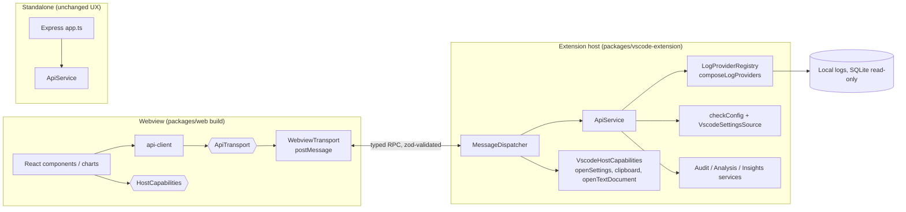

# VS Code extension: implementation and deployment plan

Status: **planned (Phase 10), not started.** This plan expands
[implementation-plan.md](../implementation-plan.md) Phase 10 and
[architecture.md](../architecture.md) §12 into concrete, test-first steps.
Nothing here is implemented yet.

## 1. Context

The app ships today as two local processes: an Express API on
`127.0.0.1:3001` (`packages/server`) and a Vite + React SPA
(`packages/web`). Vision §5 lists one future path: repackage the app as a
VS Code extension with a webview. Phase 10 is the only phase in the plan
that hasn't started.

Goals:

1. Install the app from the VS Code Marketplace (and Open VSX) as one
   `.vsix`. No `npm install`, no second terminal, no browser tab.
2. Reuse `packages/web`'s components and charts and `packages/server`'s
   data sources and services unchanged, or with only refactors that also
   help the standalone app.
3. Keep the standalone web app and the stdio MCP server working. They
   share the same core.
4. Use what only an extension can do. Settings warnings become one-click
   fixes, settings are read through VS Code's own merged configuration, and
   the VS Code user-data directory comes from VS Code itself on every
   platform.

Non-goals for this plan: a multi-user or cloud-hosted variant (vision §6),
a Copilot Chat participant, and telemetry. Constraint 1 forbids outbound
network calls, so the extension sends no telemetry.

## 2. Analysis of the existing code

### 2.1 What already fits

| Area | Finding | Consequence |
|---|---|---|
| Data sources and services | `composeLogProviders()` (`packages/server/src/composition/compose-log-providers.ts`) builds the full provider registry. It has no Express dependency, and every path can be overridden through `LogProviderCompositionOptions`. The stdio MCP server already reuses it. | The extension host can call it in-process with VS Code-supplied paths. |
| Query services | `AuditQueryService`, `AnalysisQueryService` and `createInsightsService` are transport-neutral and already shared by HTTP and MCP. | Reuse them as they are. |
| Web data access | All but one call goes through `packages/web/src/api-client/*`, which uses three helpers in `http.ts` (`getJson`, `getText`, `putJson`). | That one module is the seam (architecture §12). |
| Domain | Every response shape has a zod schema in `packages/domain`. | The host can validate messages at the boundary for free. |
| Config warnings | `ConfigWarning` already carries `settingId`. | A "Fix" button can open exactly that setting. |
| SQLite | Reads use the built-in `node:sqlite` (`DatabaseSync`), read-only, with no native npm module. | No `node-gyp` or per-platform prebuilt binaries to ship, if the extension host's Node supports it (risk R1). |

### 2.2 Gaps to close

| # | Gap | Location | Fix (step in §6) |
|---|---|---|---|
| G1 | Route logic lives inline in `app.ts`. The `/api/sessions/:id/system-prompt` route (~70 lines of VS Code/pi branching) and the turn-index validation can't be reused without Express. | `packages/server/src/app.ts` | Extract an `ApiService` (10.1) |
| G2 | `App.tsx` calls `fetch("/api/health")` directly, bypassing `api-client`. | `packages/web/src/App.tsx:93` | Move into `api-client/health.ts` (10.2) |
| G3 | `api-client` is bound to `fetch` and relative `/api/...` URLs. | `packages/web/src/api-client/http.ts` | `ApiTransport` port with HTTP and webview adapters (10.2) |
| G4 | `import.meta.url` locates the learn-scenario fixtures and `package.json`. This breaks once the code is bundled into one CJS file. | `learn-scenarios/loader.ts:13`, `app.ts:29`, `mcp/stdio.ts:12` | Inject the fixtures dir and version (10.1) |
| G5 | `resolveUserDataDir` is Linux-only, so on macOS and Windows the VS Code provider is always unavailable. | `platform/vscode-paths/resolve-user-data-dir.ts` | In the extension, derive it from `context.globalStorageUri` (10.4). Separately, add macOS/Windows candidates for the standalone app. |
| G6 | The config check reads only the user `settings.json` (workspace merge not implemented, Phase 5 note). | `services/config-check` | `SettingsSource` port with a `vscode.workspace.getConfiguration` adapter (10.4) |
| G7 | The Vite build emits `/assets/...` absolute URLs and no manifest. Webviews need `asWebviewUri` URLs and a strict CSP. | `packages/web/vite.config.ts`, `index.html` | Extension build mode with `base: './'` and `build.manifest` (10.3) |
| G8 | `navigator.clipboard` (advice export) isn't reliable in every webview host. | `AdviceExportDialog.tsx:30` | `HostCapabilities` port: clipboard, open setting, open text document (10.5) |
| G9 | ESM-only workspace (`"type": "module"`), with `domain` exporting TypeScript source. | all `package.json` | esbuild bundle to a single CJS `dist/extension.js` (10.3) |

## 3. Target architecture



Decisions (recommended defaults; §9 lists the ones still open):

- **D1: In-process message bridge, no embedded HTTP server.** Running
  Express inside the extension host would open a loopback port that any
  local process could reach, and would need webview port mapping and
  Host-guard changes. A typed `postMessage` RPC opens no port at all and is
  the design architecture §12 already describes.
- **D2: One transport-neutral `ApiService` in `packages/server`.** Express
  routes and the extension dispatcher both become thin adapters over it, so
  there's a single implementation (SRP, DIP). The message contract is the
  existing REST surface as named methods (`listSessions`, `getSession`,
  `getTurnDetail`, `getSystemPromptText`, `getConfigStatus`,
  `setRetentionThreshold`, `listLearnScenarios`, `getLearnScenario`,
  `getLogProviderStatus`, `setActiveLogProvider`, `getSessionAudit`,
  `listToolCalls`, `getAuditRollup`, `getInsights`, `getHealth`).
- **D3: A new workspace, `packages/vscode-extension`.** It holds only
  VS Code glue: activation, panel, dispatcher, VS Code adapters and
  packaging. It's the only package that imports `vscode`.
- **D4: Paths come from VS Code.**
  `context.globalStorageUri` = `<userData>/User/globalStorage/<extension-id>`,
  so its grandparent's parent is the user-data dir. That works on every
  platform and for Stable, Insiders, portable and remote servers, and it
  removes G5 for the extension.
- **D5: App-owned settings stay in the existing app settings directory**
  (`resolveAppSettingsDir`), so the standalone app and the extension agree
  on the active provider and the retention threshold. Constraint §11.2
  holds: the app never writes to VS Code's own files.
- **D6: `extensionKind: ["workspace"]`.** Copilot Chat writes its logs
  where its own extension host runs. On Remote-SSH, WSL and Dev Containers
  that's the remote side, so this extension must run there too to see the
  same files. Validate in step 10.7.

## 4. Message protocol

In `packages/domain/src/rpc.ts`, so both sides share it:

```ts
// webview -> host
type RpcRequest = { kind: "request"; id: string; method: ApiMethod; params: unknown };
// host -> webview
type RpcResponse =
  | { kind: "response"; id: string; ok: true; result: unknown }
  | { kind: "response"; id: string; ok: false; error: { status: 400 | 404 | 500; message: string } };
// host -> webview, unsolicited (e.g. settings changed -> refetch config status)
type HostEvent = { kind: "event"; name: "configChanged" | "themeChanged"; payload?: unknown };
```

- The host validates `method` against an allow-list and validates
  `params` with a per-method zod schema before dispatching. Anything else
  is rejected with `400` (§11.2 defence in depth: the webview is
  untrusted content).
- Error `status` values match the HTTP API's, so the web code handles
  "unknown session" (404) the same way on both transports.
- The webview transport correlates responses by `id`, rejects after a
  timeout (default 60 s, since insights over large histories can be slow),
  and rejects with the same `Error` message format as `http.ts`.
- Payloads are structured-cloned. Big sessions are already fetched per
  turn (`getTurnDetail`), which matches architecture §11.1.

## 5. Webview security

- CSP: `default-src 'none'; script-src 'nonce-…'; style-src ${cspSource}
  'unsafe-inline'; img-src ${cspSource} data:; font-src ${cspSource};
  connect-src 'none'`. `connect-src 'none'` makes "no network from the UI"
  enforceable rather than a convention.
- `localResourceRoots` is restricted to the extension's `media/` folder.
  The webview never gets file URIs for user logs, and all log reads stay
  on the host.
- Existing redaction (`redactSecrets`, mitmproxy header stripping) and
  `isValidSessionId` path validation are reused unchanged, because the same
  services run.
- No `retainContextWhenHidden` by default (memory). State is restored via
  `vscode.setState`/`getState` for the selected mode, session and turn.

## 6. Implementation steps (TDD, each with an exit criterion)

Each step follows architecture §11.4/§11.5: write the failing test first,
make it pass, refactor. Commit when the step's exit criterion is met.
Steps 10.1 and 10.2 are pure refactors of existing packages. The whole
existing suite must stay green and the standalone app must behave
identically.

### 10.0 Spike: runtime check (time-boxed, about half a day)

- In a throwaway extension on the minimum supported VS Code version
  (proposal: the release from 3 months before the start date), confirm
  that `require('node:sqlite')` works in the extension host, read-only,
  without flags (R1). Also confirm that an esbuild CJS bundle of
  `composeLogProviders` loads.
- Record the result in architecture §12.
- **Exit:** a short decision note. Either `node:sqlite` is usable, or we
  fall back to a `SqliteReader` port with a WASM adapter (`sql.js`, latest
  stable, §11.6), chosen before step 10.4.

### 10.1 Transport-neutral `ApiService` (server)

- Tests first: `services/api/api-service.test.ts` covers every method from
  D2 with fakes for the registry and services (`test-support/*`). It
  covers success, unknown id → `NotFound`, bad input → `BadRequest`
  (turn index, retention threshold, provider id), and provider failure →
  `Internal`.
- Move the logic out of `app.ts` into `ApiService`, including the
  system-prompt branching (G1). `app.ts` becomes a thin adapter that maps
  typed errors to status codes. Existing `app*.test.ts` stay unchanged and
  green; they're the regression net.
- G4: `loadLearnScenarios({ fixturesDir })` and an injected `appVersion`.
  The defaults keep the current `import.meta.url` behaviour for the
  standalone app.
- **Exit:** `npm test`, `npm run typecheck` and `npm run lint` are green,
  `app.ts` holds no business logic, and the HTTP API's responses are
  byte-identical.

### 10.2 `ApiTransport` seam (web)

- Tests first: `api-client/transport.test.ts` defines an
  `ApiTransport { call(method, params): Promise<unknown> }` contract that
  both adapters must pass. Write `HttpTransport` (maps methods to today's
  URLs, keeps the error messages) and `WebviewTransport` (with a fake
  `acquireVsCodeApi` and `window` message events; covers correlation,
  timeout, error propagation and out-of-order replies).
- Rewrite `api-client/*` functions to take the transport via a small
  provider (`setApiTransport` or a React context). Components and charts
  don't change (architecture §12). Move the health check into
  `api-client/health.ts` (G2).
- Select the transport at startup: `WebviewTransport` when
  `acquireVsCodeApi` exists, `HttpTransport` otherwise.
- **Exit:** the web suite is green and `rg 'fetch\(' packages/web/src`
  finds matches only in `api-client/http-transport.ts`.

### 10.3 Extension skeleton and build

- New workspace, `packages/vscode-extension`:
  - `package.json` with `name: copilot-cost-analyzer`, `publisher`
    (tbd, §9), `engines.vscode` from 10.0, `main: ./dist/extension.js`,
    `extensionKind: ["workspace"]`, and contributed command
    `copilotCostAnalyzer.open` ("Copilot Cost Analyzer: Open"). Commands
    activate implicitly, with no `*` activation. It also adds a status-bar
    entry point and an `icon`.
  - `src/extension.ts` with `activate`/`deactivate`, wired through a
    composition root (`src/composition.ts`) as the only place that
    constructs concrete classes.
  - `src/panel/analyzer-panel.ts`: singleton `WebviewPanel`, CSP/nonce HTML
    built from the Vite manifest, `asWebviewUri` for assets.
- Build: `esbuild src/extension.ts --bundle --platform=node --format=cjs
  --external:vscode --outfile=dist/extension.js`. The web build gets an
  `extension` mode (`base: './'`, `build.manifest: true`,
  `outDir: ../vscode-extension/media`). Learn-scenario fixtures are copied
  to `media/learn-scenarios/` (they're data, not code).
- Tests first: `panel-html.test.ts` (pure function: manifest + nonce +
  `cspSource` → HTML that contains the CSP, no absolute `/assets` URLs,
  nonce on every script).
- **Exit:** `npm run build` produces `dist/extension.js` and `media/`, and
  running the extension (F5) opens a panel showing Learn mode. Analyze
  mode can show "not connected" at this point.

### 10.4 Host dispatcher and VS Code adapters

- `src/rpc/message-dispatcher.ts`: tests first. Unknown method → 400,
  invalid params → 400, `ApiService` typed errors → their status, and
  thrown errors → 500 without stack traces. It depends only on `ApiService`
  plus `HostCapabilities` interfaces (DIP), so it's testable without
  `vscode`.
- `src/platform/vscode-user-data-dir.ts`: pure function from a
  `globalStorageUri` path to the user-data dir, tested for Linux, macOS,
  Windows, Insiders and remote-server layouts (D4). Its result feeds
  `composeLogProviders({ sessionStoreDbPath, debugLogsDirPaths,
  agentTracesDbPath, vscodeSettingsPath })`.
- `SettingsSource` port in `services/config-check` (G6):
  `checkConfig({ settings })` reads `get(settingId)`. Adapters are the
  existing JSONC `settings.json` file reader (standalone, default) and
  `VscodeSettingsSource` using `vscode.workspace.getConfiguration()`. Tests
  first, and both adapters pass a shared contract test.
- Re-run the config check on `workspace.onDidChangeConfiguration` for the
  two `agentDebugLog` settings and push a `configChanged` event.
- **Exit:** in a dev host, Analyze mode lists real VS Code sessions on
  Linux and on macOS or Windows (G5 resolved for the extension). The
  `ConfigStatus` matches the effective setting, including a
  workspace-level override.

### 10.5 Extension-only UX

- `HostCapabilities` (web port; the standalone implementation keeps
  today's behaviour):
  - `openSetting(settingId)` → `workbench.action.openSettings` with the
    id. This is the "Fix" button on `ConfigWarningBanner`, shown only
    when the capability exists.
  - `copyToClipboard(text)` → `vscode.env.clipboard.writeText` (G8).
  - `openTextDocument(text, language)`: "Open system prompt in editor"
    from `SystemPromptInspector` as an untitled read-only document.
- Theme: map `theme.css` tokens to `--vscode-*` variables when
  `body.vscode-light`, `body.vscode-dark` or `body.vscode-high-contrast`
  is present. Keep the Industry palette as the fallback, and keep the
  standalone look unchanged.
- Tests first: component tests for the Fix button (rendered only with
  the capability; calls `openSetting` with the warning's `settingId`) and
  the capability-absent fallbacks.
- **Exit:** clicking Fix on a `logging-disabled` warning opens the
  settings UI on `github.copilot.chat.agentDebugLog.fileLogging.enabled`.

### 10.6 Optional: MCP server definition in the extension

- Register the existing stdio server with
  `vscode.lm.registerMcpServerDefinitionProvider` (contribution
  `mcpServerDefinitionProviders`). Bundle `mcp/stdio.ts` as
  `dist/mcp-stdio.js`. The command is `process.execPath` with
  `ELECTRON_RUN_AS_NODE=1`, so users don't need a separate Node install.
- Gate it behind a setting, `copilotCostAnalyzer.mcp.enabled` (default
  `false`), because it exposes redacted session data to whichever model
  the chat uses (architecture §11.2).
- **Exit:** with the setting on, Copilot Chat agent mode lists the 9
  read-only tools, and `get_session_cost` answers for a real session.

### 10.7 Integration tests, remote check, packaging

- `@vscode/test-cli` + `@vscode/test-electron` integration suite. It
  activates the extension, opens the panel, and round-trips `getHealth`,
  `listLearnScenarios` and `getConfigStatus` (temp user-data dir with a
  seeded `settings.json` and `temp-sqlite-db` fixture).
- Manual check on Remote-SSH or WSL and a Dev Container (D6), recorded in
  architecture §12.
- `vsce package --no-dependencies` (everything is bundled). Add
  `.vscodeignore` (ship only `dist/`, `media/`, `README.md`, `LICENSE`,
  `CHANGELOG.md`, `icon.png`) and a size budget (proposal: under 5 MB).
- **Exit:** `copilot-cost-analyzer-<version>.vsix` installs into a clean
  VS Code via "Install from VSIX…" and passes the 10.4/10.5 exit checks
  with no repo checkout present.

## 7. Deployment

### 7.1 CI (every PR)

Extend `.github/workflows/ci.yml` with a second job, `extension`, on
`ubuntu-latest`:

1. `npm ci`, then `npm run build --workspace=packages/vscode-extension`
   (it builds web in `extension` mode first).
2. `xvfb-run -a npm run test:integration --workspace=packages/vscode-extension`.
3. `npx vsce package` and upload the `.vsix` as a workflow artifact
   (`actions/upload-artifact`, pinned by SHA like the existing actions).

Optional matrix: `macos-latest` and `windows-latest` for the integration
suite only, to cover the D4 path derivation for real.

### 7.2 Release (on tag `v*`)

New workflow `.github/workflows/release-extension.yml`:

1. Build and test as in CI.
2. `vsce publish --packagePath *.vsix` with `VSCE_PAT` (Azure DevOps PAT
   with Marketplace "Manage" scope) as a repository secret, in a
   protected `release` environment with required reviewers.
3. `ovsx publish *.vsix` with `OVSX_PAT` for Open VSX (VSCodium, Cursor,
   and others).
4. Attach the `.vsix` to a GitHub Release.

- **Versioning:** the extension version follows the root `package.json`
  (`0.8.0` today). Use the Marketplace pre-release channel
  (`--pre-release`, odd minor) until 10.7's remote check passes, then
  publish a stable even minor.
- **Permissions:** `contents: write` only on the release job (for the
  GitHub Release); everything else stays `contents: read`.
- **Marketplace listing:** README (Learn/Analyze screenshots), a privacy
  statement ("reads local logs only; no network; no telemetry"),
  `CHANGELOG.md`, categories `Visualization` and `Other`, and keywords.

### 7.3 Manual and sideload distribution

Until a publisher is set up, the `.vsix` from the CI artifact or the
GitHub Release installs with
`code --install-extension copilot-cost-analyzer-<version>.vsix`.

## 8. Risks

| # | Risk | Mitigation |
|---|---|---|
| R1 | `node:sqlite` is missing or flagged in the extension host's Electron/Node. | Spike 10.0. Fallback: a `SqliteReader` port with a WASM adapter, used only by the extension. |
| R2 | The webview `postMessage` payload for a large insights dataset is slow. | Insights already accept `limit`. Measure in 10.4, and stream by provider if needed (§11.1 open question). |
| R3 | Copilot Chat's storage layout differs on remote hosts. | D6 plus the manual remote check in 10.7. The provider reports "unavailable" with a reason, never a crash (§11.3). |
| R4 | Bundling ESM code that relies on `import.meta.url`. | G4 refactor in 10.1, and an integration test that loads the bundled file. |
| R5 | Marketplace PAT leakage. | Protected environment, PAT scoped to Marketplace only, rotated yearly. Open VSX token separate. |

## 9. Open questions (need a decision before the step named)

1. **Publisher id and display name** (before 10.3): is
   "Copilot Cost Analyzer" acceptable on the Marketplace? It names
   GitHub's product, so check the trademark guidance.
2. **Minimum VS Code version** (10.0): this depends on `node:sqlite` and on
   the MCP provider API if 10.6 is in scope.
3. **Is 10.6 (MCP in the extension) in the first release?** Proposal: no,
   ship it in the following minor.
4. **Keep the standalone web app long-term?** Proposal: yes. It costs
   little after 10.1/10.2 and serves Claude Code, pi and mitmproxy users
   who don't run VS Code.
5. **Webview placement:** an editor-area panel only, or also an
   activity-bar view with the session list? Proposal: panel only in v1.

## 10. Exit criterion (Phase 10 as a whole)

A clean VS Code (no repo checkout, no Node install) installs the
extension from the Marketplace or a `.vsix`. Running
"Copilot Cost Analyzer: Open" shows Learn mode. On Linux, macOS and Windows
it shows the user's real Copilot Chat sessions in Analyze mode, with the
same numbers as the standalone app for the same session. A
`logging-disabled` warning's Fix button opens that exact setting. The
webview makes no network requests (CSP `connect-src 'none'`). The existing
standalone app, HTTP API and stdio MCP server suites are unchanged and
green.
