# Scenario 1: Cache Basics — An 8-Turn Session

> Extracted from [docs/agentic-coding-explained.md](../agentic-coding-explained.md#9-worked-example-a-multi-turn-session-showing-every-token-type), Section 9.

The example below is an illustrative (not literal) 8-turn session for the task
*"Add a caching layer to the API and write tests for it"*. It shows how each token
type shows up turn by turn, how cache reuse changes the mix as the session grows,
what a **subagent's own session** looks like when it's spawned mid-way through
(turn 2, see [Scenario 2](02-subagent-own-session.md)), and what happens when the
user asks for a **git commit** at the end (turns 7-8).

Each turn both **reads** everything cached by prior turns and **writes** its own
new content (the new user message, tool results, reasoning, and reply) to the cache
so the *next* turn can read it back cheaply. That's why cache read isn't capped by
a single write — it's capped by the running **cache size**, i.e. the sum of every
write so far:

<!-- scenarios:generated:start -->
Simulated on Claude Sonnet 5.5 (and its cheaper sibling where a scenario switches models) with the real per-token prices in GitHub's Copilot price table, checked 2026-11-04. The figures come from the Learn simulator, not from a live session. Tool and Vision tokens are part of the input columns, not added to them.

| Turn | What happens | Cache write | Cache read | Cache size after | Uncached input | Tool (in input) | Vision (in input) | Reasoning | Output text | **Turn total** | **Turn AI Credits** |
|---|---|---:|---:|---:|---:|---:|---:|---:|---:|---:|---:|
| 1 | First turn: nothing is cached yet, so the whole prompt (instructions, tool definitions and this turn's content) is written to the cache. The file read and search results are small enough to count as ordinary input. | 4950 | 0 | 4950 | 0 | 0 | 0 | 300 | 250 | **5500** | **1.79** |
| 2 | Everything cached so far is reused. A screenshot adds image tokens. The subagent runs in its own isolated session with its own cache; only its compact summary lands here as tool-result tokens. | 1350 | 4950 | 6300 | 0 | 800 | 0 | 200 | 180 | **6680** | **0.77** |
| 3 | The conversation so far is read back from the cache, and this turn's new content is added so the next turn can reuse it. | 730 | 6300 | 7030 | 0 | 400 | 0 | 250 | 280 | **7560** | **0.78** |
| 4 | Tool tokens spike because the test runner's terminal output is verbose. This is the most common source of unexpectedly expensive turns, and it is unrelated to cache behaviour. | 2180 | 7030 | 9210 | 0 | 1800 | 0 | 150 | 300 | **9660** | **1.07** |
| 5 | Debugging adds another tool-token spike from re-running tests and searching logs, though smaller than the first verbose run. | 1030 | 9210 | 10240 | 0 | 600 | 0 | 220 | 260 | **10720** | **0.83** |
| 6 | No tool calls: a pure confirmation message that reuses the large existing cache, so this is among the cheapest turns of the session. | 340 | 10240 | 10580 | 0 | 0 | 0 | 50 | 120 | **10750** | **0.36** |
| 7 | A commit behaves like any other tool-using turn, with no special token type. It reads the session's largest cache so far and adds a moderate tool-token bump from the git output. | 1110 | 10580 | 11690 | 0 | 900 | 0 | 180 | 200 | **12070** | **0.76** |
| 8 | Final cheap turn: no tool calls, and the long cached history keeps it inexpensive. | 260 | 11690 | 11950 | 0 | 0 | 0 | 30 | 90 | **12070** | **0.30** |

Session total: **6.65 AI Credits** (≈ $0.0665); most expensive turn: **turn 1** (1.79 AI Credits).

Running totals by token type:

| Cumulative through turn | What happens | Cache write | Cache read | Uncached input | Tool (in input) | Vision (in input) | Reasoning | Output text | **Session total** | **Running AI Credits** |
|---|---|---:|---:|---:|---:|---:|---:|---:|---:|---:|
| 1 | First turn: nothing is cached yet, so the whole prompt (instructions, tool definitions and this turn's content) is written to the cache. The file read and search results are small enough to count as ordinary input. | 4950 | 0 | 0 | 0 | 0 | 300 | 250 | **5500** | **1.79** |
| 2 | Everything cached so far is reused. A screenshot adds image tokens. The subagent runs in its own isolated session with its own cache; only its compact summary lands here as tool-result tokens. | 6300 | 4950 | 0 | 800 | 0 | 500 | 430 | **12180** | **2.55** |
| 3 | The conversation so far is read back from the cache, and this turn's new content is added so the next turn can reuse it. | 7030 | 11250 | 0 | 1200 | 0 | 750 | 710 | **19740** | **3.33** |
| 4 | Tool tokens spike because the test runner's terminal output is verbose. This is the most common source of unexpectedly expensive turns, and it is unrelated to cache behaviour. | 9210 | 18280 | 0 | 3000 | 0 | 900 | 1010 | **29400** | **4.40** |
| 5 | Debugging adds another tool-token spike from re-running tests and searching logs, though smaller than the first verbose run. | 10240 | 27490 | 0 | 3600 | 0 | 1120 | 1270 | **40120** | **5.22** |
| 6 | No tool calls: a pure confirmation message that reuses the large existing cache, so this is among the cheapest turns of the session. | 10580 | 37730 | 0 | 3600 | 0 | 1170 | 1390 | **50870** | **5.58** |
| 7 | A commit behaves like any other tool-using turn, with no special token type. It reads the session's largest cache so far and adds a moderate tool-token bump from the git output. | 11690 | 48310 | 0 | 4500 | 0 | 1350 | 1590 | **62940** | **6.35** |
| 8 | Final cheap turn: no tool calls, and the long cached history keeps it inexpensive. | 11950 | 60000 | 0 | 4500 | 0 | 1380 | 1680 | **75010** | **6.65** |

```mermaid
xychart-beta
    title "Tokens per turn by type (simulated)"
    x-axis [Turn1, Turn2, Turn3, Turn4, Turn5, Turn6, Turn7, Turn8]
    y-axis "Tokens" 0 --> 12000
    bar "Cache write" [4950, 1350, 730, 2180, 1030, 340, 1110, 260]
    bar "Cache read" [0, 4950, 6300, 7030, 9210, 10240, 10580, 11690]
    bar "Uncached input" [0, 0, 0, 0, 0, 0, 0, 0]
    bar "Tool" [0, 800, 400, 1800, 600, 0, 900, 0]
    bar "Vision" [0, 0, 0, 0, 0, 0, 0, 0]
    bar "Reasoning" [300, 200, 250, 150, 220, 50, 180, 30]
    bar "Output text" [250, 180, 280, 300, 260, 120, 200, 90]
```

<!-- scenarios:generated:end -->

**Sources** (checked 2026-11-03):

- [Anthropic: prompt caching pricing](https://platform.claude.com/docs/en/build-with-claude/prompt-caching#pricing): cache write 1.25x / read 0.1x base input
- [Anthropic: prompt caching](https://platform.claude.com/docs/en/build-with-claude/prompt-caching): prefix reuse, 5-minute lifetime
- [Anthropic: vision, resolution and token cost](https://platform.claude.com/docs/en/build-with-claude/vision): image token cost
- [OpenAI: reasoning (billed as output tokens)](https://developers.openai.com/api/docs/guides/reasoning): reasoning billed as output
- [GitHub: Copilot models and pricing (AI credits, per-token prices)](https://docs.github.com/en/copilot/reference/copilot-billing/models-and-pricing): Copilot bills per token in AI credits

Fact-check: see [learn-scenarios-fact-check.md](../learn-scenarios-fact-check.md#per-scenario-verdicts). Open findings for this scenario: R-04, R-05, R-06.
