# Scenario 2: The Subagent's Own Session

> Extracted from [docs/agentic-coding-explained.md](../agentic-coding-explained.md#9-worked-example-a-multi-turn-session-showing-every-token-type), Section 9 ("The subagent's own session" subsection). Companion to [Scenario 1](01-cache-basics-8-turn-session.md), where this subagent is spawned mid-way through parent turn 2.

The subagent spawned in parent turn 2 runs in its **own isolated context** — it has
its own system prompt, its own turns, and its own token usage, none of which is
visible to (or paid for again by) the parent session. Only its final summary
crosses back over, counted as tool tokens in the parent's turn 2 row.

<!-- scenarios:generated:start -->
Simulated on Claude Sonnet 5.5 (and its cheaper sibling where a scenario switches models) with the real per-token prices in GitHub's Copilot price table, checked 2026-11-04. The figures come from the Learn simulator, not from a live session. Tool and Vision tokens are part of the input columns, not added to them.

| Turn | What happens | Cache write | Cache read | Cache size after | Uncached input | Tool (in input) | Vision (in input) | Reasoning | Output text | **Turn total** | **Turn AI Credits** |
|---|---|---:|---:|---:|---:|---:|---:|---:|---:|---:|---:|
| 1 | The subagent has its own isolated context, separate from the parent session that spawned it. This first turn writes its own prefix plus new content like any session's first turn; nothing from the parent's cache is inherited or paid for again. | 2050 | 0 | 2050 | 0 | 600 | 0 | 180 | 120 | **2350** | **0.81** |
| 2 | A normal cache-building turn inside the subagent's own session. It reads back what its first turn wrote and adds a large tool-result spike from reading the matched files in full. | 1120 | 2050 | 3170 | 0 | 900 | 0 | 150 | 90 | **3410** | **0.54** |
| 3 | Final subagent turn: it writes the compact summary that crosses back to the parent session. The subagent's whole trajectory stays isolated from the parent; the parent only ever sees the small summary. | 140 | 3170 | 3310 | 0 | 0 | 0 | 100 | 200 | **3610** | **0.37** |

Session total: **1.72 AI Credits** (≈ $0.0172); most expensive turn: **turn 1** (0.81 AI Credits).

Running totals by token type:

| Cumulative through turn | What happens | Cache write | Cache read | Uncached input | Tool (in input) | Vision (in input) | Reasoning | Output text | **Session total** | **Running AI Credits** |
|---|---|---:|---:|---:|---:|---:|---:|---:|---:|---:|
| 1 | The subagent has its own isolated context, separate from the parent session that spawned it. This first turn writes its own prefix plus new content like any session's first turn; nothing from the parent's cache is inherited or paid for again. | 2050 | 0 | 0 | 600 | 0 | 180 | 120 | **2350** | **0.81** |
| 2 | A normal cache-building turn inside the subagent's own session. It reads back what its first turn wrote and adds a large tool-result spike from reading the matched files in full. | 3170 | 2050 | 0 | 1500 | 0 | 330 | 210 | **5760** | **1.35** |
| 3 | Final subagent turn: it writes the compact summary that crosses back to the parent session. The subagent's whole trajectory stays isolated from the parent; the parent only ever sees the small summary. | 3310 | 5220 | 0 | 1500 | 0 | 430 | 410 | **9370** | **1.72** |

```mermaid
xychart-beta
    title "Tokens per turn by type (simulated)"
    x-axis [Turn1, Turn2, Turn3]
    y-axis "Tokens" 0 --> 4000
    bar "Cache write" [2050, 1120, 140]
    bar "Cache read" [0, 2050, 3170]
    bar "Uncached input" [0, 0, 0]
    bar "Tool" [600, 900, 0]
    bar "Vision" [0, 0, 0]
    bar "Reasoning" [180, 150, 100]
    bar "Output text" [120, 90, 200]
```

<!-- scenarios:generated:end -->

**Sources** (checked 2026-11-03):

- [Claude Code: subagents](https://code.claude.com/docs/en/sub-agents): own context, returns only a summary
- [Claude Code: subagents and the cache](https://code.claude.com/docs/en/prompt-caching#subagents-and-the-cache): a subagent builds its own cache
- [VS Code: subagents (incl. selecting the model)](https://code.visualstudio.com/docs/agents/run/subagents#select-the-model-for-a-subagent): VS Code subagents
- [Anthropic: cache limitations (minimum cacheable length)](https://platform.claude.com/docs/en/build-with-claude/prompt-caching#cache-limitations): minimum cacheable prefix length

Fact-check: see [learn-scenarios-fact-check.md](../learn-scenarios-fact-check.md#per-scenario-verdicts). Open findings for this scenario: N-03, N-04.
