# Scenario 3: Context Compaction/Summarization

> Extracted from [docs/agentic-coding-explained.md](../agentic-coding-explained.md#10-how-context-compactionsummarization-affects-tokens-cache-and-ai-credits), Section 10.

When a session's history grows close to the model's context-window limit, the
client (or the model itself) can **compact** it: instead of sending every raw past
message, it asks the model to produce a condensed summary of everything so far,
and that summary — not the original messages — becomes the new prefix for future
turns.

What this does to tokens/cache/AI Credits:

- **One-time spike on the compaction turn**: producing the summary requires
  reading the *entire* prior history (still a cache hit, if it hasn't expired) and
  generating a new chunk of output (the summary itself) — so that turn's output
  tokens (and reasoning) are larger than usual.
- **Cache invalidation from that point on**: the summary text is *new*, different
  content from the raw history it replaces — it doesn't byte-match the old cached
  prefix. So the old cache entry becomes useless; a **new, smaller cache** starts
  from the summary instead of the full raw transcript.
- **Fewer AI Credits afterward**: because the new prefix (summary + new turns) is much
  smaller than the raw history it replaced, every subsequent turn reads (and
  eventually re-writes) far fewer cached tokens — cutting the steady per-turn AI Credits
  growth at the price of losing verbatim detail from the compacted turns.

<!-- scenarios:generated:start -->
Simulated on Claude Sonnet 5.5 (and its cheaper sibling where a scenario switches models) with the real per-token prices in GitHub's Copilot price table, checked 2026-11-04. The figures come from the Learn simulator, not from a live session. Tool and Vision tokens are part of the input columns, not added to them.

| Turn | What happens | Cache write | Cache read | Cache size after | Uncached input | Tool (in input) | Vision (in input) | Reasoning | Output text | **Turn total** | **Turn AI Credits** |
|---|---|---:|---:|---:|---:|---:|---:|---:|---:|---:|---:|
| 1 | Normal first turn: writes the static prefix plus this turn's own content. | 3500 | 0 | 3500 | 0 | 0 | 0 | 150 | 150 | **3800** | **1.18** |
| 2 | Normal turn that reads and extends the existing cache. | 450 | 3500 | 3950 | 0 | 100 | 0 | 120 | 180 | **4250** | **0.45** |
| 3 | Compaction: this request reads the entire prior history once more from the cache and produces a much smaller summary. It costs extra output, but the summary replaces the history as the new conversation prefix. | 330 | 3950 | 4280 | 0 | 0 | 0 | 300 | 400 | **4980** | **0.82** |
| 4 | Builds on the much smaller post-compaction conversation. The summary differs from the raw history it replaced, so the old cached conversation no longer matches and is written again as a fresh, smaller prefix. | 480 | 3000 | 3480 | 0 | 0 | 0 | 100 | 120 | **3700** | **0.37** |
| 5 | The cache stays small compared to what it would have been without compaction; that is the point of the trade-off. | 180 | 3480 | 3660 | 0 | 0 | 0 | 60 | 90 | **3810** | **0.23** |

Session total: **3.04 AI Credits** (≈ $0.0304); most expensive turn: **turn 1** (1.18 AI Credits).

Running totals by token type:

| Cumulative through turn | What happens | Cache write | Cache read | Uncached input | Tool (in input) | Vision (in input) | Reasoning | Output text | **Session total** | **Running AI Credits** |
|---|---|---:|---:|---:|---:|---:|---:|---:|---:|---:|
| 1 | Normal first turn: writes the static prefix plus this turn's own content. | 3500 | 0 | 0 | 0 | 0 | 150 | 150 | **3800** | **1.18** |
| 2 | Normal turn that reads and extends the existing cache. | 3950 | 3500 | 0 | 100 | 0 | 270 | 330 | **8050** | **1.62** |
| 3 | Compaction: this request reads the entire prior history once more from the cache and produces a much smaller summary. It costs extra output, but the summary replaces the history as the new conversation prefix. | 4280 | 7450 | 0 | 100 | 0 | 570 | 730 | **13030** | **2.44** |
| 4 | Builds on the much smaller post-compaction conversation. The summary differs from the raw history it replaced, so the old cached conversation no longer matches and is written again as a fresh, smaller prefix. | 4760 | 10450 | 0 | 100 | 0 | 670 | 850 | **16730** | **2.81** |
| 5 | The cache stays small compared to what it would have been without compaction; that is the point of the trade-off. | 4940 | 13930 | 0 | 100 | 0 | 730 | 940 | **20540** | **3.04** |

```mermaid
xychart-beta
    title "Tokens per turn by type (simulated)"
    x-axis [Turn1, Turn2, Turn3, Turn4, Turn5]
    y-axis "Tokens" 0 --> 4000
    bar "Cache write" [3500, 450, 330, 480, 180]
    bar "Cache read" [0, 3500, 3950, 3000, 3480]
    bar "Uncached input" [0, 0, 0, 0, 0]
    bar "Tool" [0, 100, 0, 0, 0]
    bar "Vision" [0, 0, 0, 0, 0]
    bar "Reasoning" [150, 120, 300, 100, 60]
    bar "Output text" [150, 180, 400, 120, 90]
```

<!-- scenarios:generated:end -->

**Sources** (checked 2026-11-03):

- [Claude Code: manage context within a session](https://code.claude.com/docs/en/sessions#manage-context-within-a-session): `/compact` replaces history with a summary
- [Claude Code: compacting the conversation](https://code.claude.com/docs/en/prompt-caching#compacting-the-conversation): the compaction request reads the warm prefix from cache
- [Anthropic: on-demand compaction](https://platform.claude.com/docs/en/build-with-claude/compaction-on-demand): API compaction; the summary replaces the messages
- [VS Code: compact conversation context](https://code.visualstudio.com/docs/agents/run/sessions/manage-sessions#compact-conversation-context): VS Code automatic compaction and `/compact`

Fact-check: see [learn-scenarios-fact-check.md](../learn-scenarios-fact-check.md#per-scenario-verdicts). No open findings.
