# Scenario 4: Changing the Model Mid-Session

> Extracted from [docs/agentic-coding-explained.md](../agentic-coding-explained.md#11-how-changing-the-model-mid-session-affects-tokens-cache-and-ai-credits), Section 11.

Prompt caches are scoped **per model** (and often per model *version*/tokenizer).
Switching models mid-session — e.g. from a cheaper model to a more capable one
starting at turn 3 — means the new model has never seen any of the previous
turns' cached prefix, no matter how well-cached it was under the old model.

What this does to tokens/cache/AI Credits:

- **Full cache miss on the switch turn**: the entire prior conversation must be
  resent to the new model as plain (uncached) input — none of the old model's
  cache carries over, because caches aren't shared across models.
- **Token counts can shift**: different models use different tokenizers, so the
  same text can require a different number of tokens under the new model.
- **New rates apply immediately**: if the new model is pricier (or cheaper), every
  token from the switch turn onward — including cache write/read — is billed at
  the *new* model's rates, not the old one's.
- **A fresh cache then builds up again** from the switch turn forward, under the
  new model, growing the same way as in [Scenario 1](01-cache-basics-8-turn-session.md)
  — just starting from zero.

This example switches from a cheaper model (turns 1-2) to its pricier, more capable sibling (turns 3-5), each billed at its own real per-token prices:

<!-- scenarios:generated:start -->
Simulated on Claude Sonnet 5.5 (and its cheaper sibling where a scenario switches models) with the real per-token prices in GitHub's Copilot price table, checked 2026-11-04. The figures come from the Learn simulator, not from a live session. Tool and Vision tokens are part of the input columns, not added to them.

| Turn | What happens | Model | Cache write | Cache read | Cache size after | Uncached input | Tool (in input) | Vision (in input) | Reasoning | Output text | **Turn total** | **Turn AI Credits** |
|---|---|---|---:|---:|---:|---:|---:|---:|---:|---:|---:|---:|
| 1 | Normal first turn on the starting model: writes the static prefix plus this turn's own content; nothing to read yet. | claude-haiku-5.5 | 3500 | 0 | 3500 | 0 | 0 | 0 | 150 | 150 | **3800** | **0.06** |
| 2 | Normal turn that reuses and extends the starting model's cache. | claude-haiku-5.5 | 350 | 3500 | 3850 | 0 | 0 | 0 | 120 | 180 | **4150** | **0.02** |
| 3 | Model switch: prompt caches are scoped per model, so the first model's cache is worthless to the new one. The whole prior history plus the new message is sent as uncached input and the new model writes its own first cache entry. The new model's prices apply from here on. | claude-sonnet-5.5 | 4180 | 0 | 4180 | 0 | 0 | 0 | 250 | 300 | **4730** | **1.59** |
| 4 | Behaves like a normal, healthy cache-building turn again, now under the new model's cache and prices. | claude-sonnet-5.5 | 420 | 4180 | 4600 | 0 | 0 | 0 | 150 | 200 | **4950** | **0.50** |
| 5 | The cache keeps growing normally under the new model, with no further disruption. | claude-sonnet-5.5 | 280 | 4600 | 4880 | 0 | 0 | 0 | 90 | 140 | **5110** | **0.35** |

Session total: **2.52 AI Credits** (≈ $0.0252); most expensive turn: **turn 3** (1.59 AI Credits).

Running totals by token type:

| Cumulative through turn | What happens | Cache write | Cache read | Uncached input | Tool (in input) | Vision (in input) | Reasoning | Output text | **Session total** | **Running AI Credits** |
|---|---|---:|---:|---:|---:|---:|---:|---:|---:|---:|
| 1 | Normal first turn on the starting model: writes the static prefix plus this turn's own content; nothing to read yet. | 3500 | 0 | 0 | 0 | 0 | 150 | 150 | **3800** | **0.06** |
| 2 | Normal turn that reuses and extends the starting model's cache. | 3850 | 3500 | 0 | 0 | 0 | 270 | 330 | **7950** | **0.08** |
| 3 | Model switch: prompt caches are scoped per model, so the first model's cache is worthless to the new one. The whole prior history plus the new message is sent as uncached input and the new model writes its own first cache entry. The new model's prices apply from here on. | 8030 | 3500 | 0 | 0 | 0 | 520 | 630 | **12680** | **1.68** |
| 4 | Behaves like a normal, healthy cache-building turn again, now under the new model's cache and prices. | 8450 | 7680 | 0 | 0 | 0 | 670 | 830 | **17630** | **2.17** |
| 5 | The cache keeps growing normally under the new model, with no further disruption. | 8730 | 12280 | 0 | 0 | 0 | 760 | 970 | **22740** | **2.52** |

```mermaid
xychart-beta
    title "Tokens per turn by type (simulated)"
    x-axis [Turn1, Turn2, Turn3, Turn4, Turn5]
    y-axis "Tokens" 0 --> 5000
    bar "Cache write" [3500, 350, 4180, 420, 280]
    bar "Cache read" [0, 3500, 0, 4180, 4600]
    bar "Uncached input" [0, 0, 0, 0, 0]
    bar "Tool" [0, 0, 0, 0, 0]
    bar "Vision" [0, 0, 0, 0, 0]
    bar "Reasoning" [150, 120, 250, 150, 90]
    bar "Output text" [150, 180, 300, 200, 140]
```

<!-- scenarios:generated:end -->

**Sources** (checked 2026-11-03):

- [Anthropic: cache diagnostics](https://platform.claude.com/docs/en/build-with-claude/cache-diagnostics): "The cache is per-model."
- [Claude Code: switching models](https://code.claude.com/docs/en/prompt-caching#switching-models): switching models reads the whole history uncached
- [VS Code: language models](https://code.visualstudio.com/docs/agents/concepts/language-models): switching models mid-chat
- [Anthropic: prompt caching](https://platform.claude.com/docs/en/build-with-claude/prompt-caching): usage fields: cache read, cache write and input are separate

Fact-check: see [learn-scenarios-fact-check.md](../learn-scenarios-fact-check.md#per-scenario-verdicts). Open findings for this scenario: R-01.
