# Scenario 5: Changing MCP Tools Mid-Session

> Extracted from [docs/agentic-coding-explained.md](../agentic-coding-explained.md#12-how-changing-mcp-tools-mid-session-affects-tokens-cache-and-ai-credits), Section 12.

The list of available tools (including MCP server tools) — their names,
descriptions, and JSON schemas — is sent to the model as part of the request on
every turn, usually near the top of the prompt (close to the system prompt). If
the enabled toolset changes mid-session (a user enables/disables an MCP server,
or a custom agent swaps its tools) starting at turn 3, that block of the prefix
changes.

What this does to tokens/cache/AI Credits:

- **Full cache invalidation**: the tool definitions are the first block of the prefix, and Anthropic documents that modifying them "invalidates the entire cache" ([Anthropic: what invalidates the cache](https://platform.claude.com/docs/en/build-with-claude/prompt-caching#what-invalidates-the-cache)) — the system prompt and all of the prior conversation — even though the model and
  its rates stay exactly the same.
- **No rate change**: unlike a model switch, the per-token prices don't change —
  the extra AI Credits spend comes purely from losing the cache, not from a pricier model.
- **A new cache rebuilds** from the tool-change turn forward, under the new
  toolset, the same way a fresh session would.

This example changes the enabled MCP tools starting at turn 3, with the same model and prices throughout:

<!-- scenarios:generated:start -->
Simulated on Claude Sonnet 5.5 (and its cheaper sibling where a scenario switches models) with the real per-token prices in GitHub's Copilot price table, checked 2026-11-04. The figures come from the Learn simulator, not from a live session. Tool and Vision tokens are part of the input columns, not added to them.

| Turn | What happens | Cache write | Cache read | Cache size after | Uncached input | Tool (in input) | Vision (in input) | Reasoning | Output text | **Turn total** | **Turn AI Credits** |
|---|---|---:|---:|---:|---:|---:|---:|---:|---:|---:|---:|
| 1 | Normal first turn: writes the static prefix, including the currently enabled toolset, plus this turn's own content. | 3500 | 0 | 3500 | 0 | 0 | 0 | 150 | 150 | **3800** | **1.18** |
| 2 | Normal turn that reuses and extends the cache. | 450 | 3500 | 3950 | 0 | 100 | 0 | 120 | 180 | **4250** | **0.45** |
| 3 | The tool definitions come first in the prompt, so changing the enabled toolset invalidates everything after them: the prior cache no longer matches and the whole history is resent uncached. Prices stay the same, so this spike is smaller than a model switch's. | 5780 | 0 | 5780 | 0 | 0 | 0 | 200 | 220 | **6200** | **1.86** |
| 4 | Normal turn under the new toolset; it actually calls one of the newly enabled tools. | 730 | 5780 | 6510 | 0 | 400 | 0 | 130 | 160 | **6800** | **0.53** |
| 5 | The cache continues building normally under the new toolset, with no further disruption. | 230 | 6510 | 6740 | 0 | 0 | 0 | 70 | 100 | **6910** | **0.29** |

Session total: **4.31 AI Credits** (≈ $0.0431); most expensive turn: **turn 3** (1.86 AI Credits).

Running totals by token type:

| Cumulative through turn | What happens | Cache write | Cache read | Uncached input | Tool (in input) | Vision (in input) | Reasoning | Output text | **Session total** | **Running AI Credits** |
|---|---|---:|---:|---:|---:|---:|---:|---:|---:|---:|
| 1 | Normal first turn: writes the static prefix, including the currently enabled toolset, plus this turn's own content. | 3500 | 0 | 0 | 0 | 0 | 150 | 150 | **3800** | **1.18** |
| 2 | Normal turn that reuses and extends the cache. | 3950 | 3500 | 0 | 100 | 0 | 270 | 330 | **8050** | **1.62** |
| 3 | The tool definitions come first in the prompt, so changing the enabled toolset invalidates everything after them: the prior cache no longer matches and the whole history is resent uncached. Prices stay the same, so this spike is smaller than a model switch's. | 9730 | 3500 | 0 | 100 | 0 | 470 | 550 | **14250** | **3.49** |
| 4 | Normal turn under the new toolset; it actually calls one of the newly enabled tools. | 10460 | 9280 | 0 | 500 | 0 | 600 | 710 | **21050** | **4.02** |
| 5 | The cache continues building normally under the new toolset, with no further disruption. | 10690 | 15790 | 0 | 500 | 0 | 670 | 810 | **27960** | **4.31** |

```mermaid
xychart-beta
    title "Tokens per turn by type (simulated)"
    x-axis [Turn1, Turn2, Turn3, Turn4, Turn5]
    y-axis "Tokens" 0 --> 7000
    bar "Cache write" [3500, 450, 5780, 730, 230]
    bar "Cache read" [0, 3500, 0, 5780, 6510]
    bar "Uncached input" [0, 0, 0, 0, 0]
    bar "Tool" [0, 100, 0, 400, 0]
    bar "Vision" [0, 0, 0, 0, 0]
    bar "Reasoning" [150, 120, 200, 130, 70]
    bar "Output text" [150, 180, 220, 160, 100]
```

<!-- scenarios:generated:end -->

**Sources** (checked 2026-11-03):

- [Anthropic: what invalidates the cache](https://platform.claude.com/docs/en/build-with-claude/prompt-caching#what-invalidates-the-cache): tool definitions come first; changing them invalidates the entire cache
- [Claude Code: actions that invalidate the cache](https://code.claude.com/docs/en/prompt-caching#actions-that-invalidate-the-cache): Claude Code's tool search keeps the cache on MCP changes
- [VS Code: tools](https://code.visualstudio.com/docs/agents/run/tools): enabling/disabling tools; 128-tool limit

Fact-check: see [learn-scenarios-fact-check.md](../learn-scenarios-fact-check.md#per-scenario-verdicts). Open findings for this scenario: F-07, R-01.
