# Scenario 6: Claude Code's `/clear`

> Extracted from [docs/agentic-coding-explained.md](../agentic-coding-explained.md#14-how-claude-codes-clear-affects-tokens-and-cache), Section 14.

`/clear` tells the client to drop the visible conversation history and start the
next message with an empty transcript — but it does **not** delete anything from
disk.

**Does it clear all cache, or keep instructions/tool definitions?** It clears only
the **conversation-history** portion of the context. The system prompt,
`CLAUDE.md`/instructions, and tool/MCP definitions are not "cached files" that
get wiped — they're just reloaded from disk and resent fresh on the very next
turn, exactly like session start. If that static block's content hasn't changed
and the provider's cache entry for it hasn't expired (TTL), it's often **still a
cache hit** right after `/clear` — only the old turn-by-turn conversation on top
of it is gone (and simply never resent again, so there's nothing to invalidate).

Why use it:

- **Starting a genuinely new, unrelated task** in the same terminal/session
  without paying to keep resending (and without the model being anchored to) a
  long, no-longer-relevant conversation.
- **It's free to invoke** — unlike compaction ([Scenario 3](03-context-compaction.md)),
  there's no summarization step, so no extra reasoning/output tokens are spent
  condensing anything; the old turns are simply dropped.
- It trades away **all continuity** (nothing is retained, not even a summary),
  which is the key difference from compaction: `/clear` = full discard, no tax,
  no memory; compaction = partial discard, one-time tax, keeps the gist.

<!-- scenarios:generated:start -->
Simulated on Claude Sonnet 5.5 (and its cheaper sibling where a scenario switches models) with the real per-token prices in GitHub's Copilot price table, checked 2026-11-04. The figures come from the Learn simulator, not from a live session. Tool and Vision tokens are part of the input columns, not added to them.

| Turn | What happens | Cache write | Cache read | Cache size after | Uncached input | Tool (in input) | Vision (in input) | Reasoning | Output text | **Turn total** | **Turn AI Credits** |
|---|---|---:|---:|---:|---:|---:|---:|---:|---:|---:|---:|
| 1 | Normal first turn: writes the static prefix plus this turn's own content. | 3500 | 0 | 3500 | 0 | 0 | 0 | 150 | 150 | **3800** | **1.18** |
| 2 | Normal turn that reads and extends the cache built by the first turn. | 450 | 3500 | 3950 | 0 | 100 | 0 | 120 | 180 | **4250** | **0.45** |
| 3 | /clear drops only the conversation history. The static prefix (instructions and tool definitions) is reloaded unchanged and still matches the cache, so it is read rather than rewritten. Nothing is summarised and no extra output is paid: the old turns are simply never sent again. | 300 | 3000 | 3300 | 0 | 0 | 0 | 130 | 170 | **3600** | **0.40** |
| 4 | Normal turn on the new task; the cache builds up again from the post-clear baseline, far smaller than the old conversation would have grown to. | 290 | 3300 | 3590 | 0 | 0 | 0 | 90 | 110 | **3790** | **0.31** |
| 5 | The cache keeps growing normally under the new, unrelated task, still far smaller than the discarded conversation would have reached. | 180 | 3590 | 3770 | 0 | 0 | 0 | 60 | 90 | **3920** | **0.23** |

Session total: **2.56 AI Credits** (≈ $0.0256); most expensive turn: **turn 1** (1.18 AI Credits).

Running totals by token type:

| Cumulative through turn | What happens | Cache write | Cache read | Uncached input | Tool (in input) | Vision (in input) | Reasoning | Output text | **Session total** | **Running AI Credits** |
|---|---|---:|---:|---:|---:|---:|---:|---:|---:|---:|
| 1 | Normal first turn: writes the static prefix plus this turn's own content. | 3500 | 0 | 0 | 0 | 0 | 150 | 150 | **3800** | **1.18** |
| 2 | Normal turn that reads and extends the cache built by the first turn. | 3950 | 3500 | 0 | 100 | 0 | 270 | 330 | **8050** | **1.62** |
| 3 | /clear drops only the conversation history. The static prefix (instructions and tool definitions) is reloaded unchanged and still matches the cache, so it is read rather than rewritten. Nothing is summarised and no extra output is paid: the old turns are simply never sent again. | 4250 | 6500 | 0 | 100 | 0 | 400 | 500 | **11650** | **2.03** |
| 4 | Normal turn on the new task; the cache builds up again from the post-clear baseline, far smaller than the old conversation would have grown to. | 4540 | 9800 | 0 | 100 | 0 | 490 | 610 | **15440** | **2.33** |
| 5 | The cache keeps growing normally under the new, unrelated task, still far smaller than the discarded conversation would have reached. | 4720 | 13390 | 0 | 100 | 0 | 550 | 700 | **19360** | **2.56** |

```mermaid
xychart-beta
    title "Tokens per turn by type (simulated)"
    x-axis [Turn1, Turn2, Turn3, Turn4, Turn5]
    y-axis "Tokens" 0 --> 4000
    bar "Cache write" [3500, 450, 300, 290, 180]
    bar "Cache read" [0, 3500, 3000, 3300, 3590]
    bar "Uncached input" [0, 0, 0, 0, 0]
    bar "Tool" [0, 100, 0, 0, 0]
    bar "Vision" [0, 0, 0, 0, 0]
    bar "Reasoning" [150, 120, 130, 90, 60]
    bar "Output text" [150, 180, 170, 110, 90]
```

<!-- scenarios:generated:end -->

**Sources** (checked 2026-11-03):

- [Claude Code: manage context within a session](https://code.claude.com/docs/en/sessions#manage-context-within-a-session): `/clear` starts fresh; the old session is saved and resumable
- [Claude Code: how the cache is organized](https://code.claude.com/docs/en/prompt-caching#how-the-cache-is-organized): CLAUDE.md and memory are reloaded after `/clear`

Fact-check: see [learn-scenarios-fact-check.md](../learn-scenarios-fact-check.md#per-scenario-verdicts). Open findings for this scenario: N-01.
