# Scenario 7: `/rewind` (or Editing a Previous Turn in VS Code)

> Extracted from [docs/agentic-coding-explained.md](../agentic-coding-explained.md#15-how-rewind-or-editing-a-previous-turn-in-vs-code-affects-tokens-and-cache), Section 15.

Claude Code's `/rewind`, and VS Code's equivalent — restoring a checkpoint or
editing an earlier user message and resubmitting — roll the conversation back to
an earlier turn and continue from there, discarding every turn after that point
(and often reverting the file edits those turns made).

What this does to tokens/cache/AI Credits:

- **The discarded turns' AI Credits are already spent** — rewinding doesn't
  refund the tokens/AI Credits already billed for the turns being thrown away.
  They're sunk.
- **Going forward, those discarded turns are never resent again**: the next turn
  resumes from the cache size *at the rewind point*, not from the (larger) cache
  size the abandoned branch had reached. That's the actual saving — it stops a
  bad turn from being read-and-billed-again in every future turn.
- **The prefix up to the rewind point is usually still a warm cache hit** (same
  model, same tools, same instructions) — so, unlike a model/tool switch, resuming
  doesn't force a full uncached resend; it picks up cheaply right where the good
  history left off.
- If the resubmitted message is **edited**, it's new content from that point
  on — a fresh branch starts from the rewind point, but still on top of the
  still-valid earlier cache.

<!-- scenarios:generated:start -->
Simulated on Claude Sonnet 5.5 (and its cheaper sibling where a scenario switches models) with the real per-token prices in GitHub's Copilot price table, checked 2026-11-04. The figures come from the Learn simulator, not from a live session. Tool and Vision tokens are part of the input columns, not added to them.

| Turn | What happens | Cache write | Cache read | Cache size after | Uncached input | Tool (in input) | Vision (in input) | Reasoning | Output text | **Turn total** | **Turn AI Credits** |
|---|---|---:|---:|---:|---:|---:|---:|---:|---:|---:|---:|
| 1 | Normal first turn: the static prefix and this turn's own content are written to the cache. | 4000 | 0 | 4000 | 0 | 0 | 0 | 150 | 150 | **4300** | **1.30** |
| 2 | Normal turn: reads the cached prefix and extends it with the new content. | 300 | 4000 | 4300 | 0 | 100 | 0 | 120 | 180 | **4600** | **0.41** |
| 3 | Wrong path: a misread stack trace sends the model to edit the wrong file. This turn's AI Credits are already billed and will not be refunded when it is rewound away. | 1880 | 4300 | 6180 | 0 | 1200 | 0 | 200 | 180 | **6560** | **0.89** |
| 4 | The rewind rolls back to the end of the second turn and continues with a corrected instruction. The abandoned step is never read again, so the request resumes from the earlier, smaller prefix, which is still a warm cache hit. The mistaken turn's cost is spent, but it never inflates any later request. | 660 | 4480 | 5140 | 0 | 300 | 0 | 140 | 160 | **5440** | **0.51** |
| 5 | Normal turn on the corrected branch: the mistaken detour never appears in this or any later request. | 220 | 5140 | 5360 | 0 | 0 | 0 | 70 | 100 | **5530** | **0.28** |

Session total: **3.39 AI Credits** (≈ $0.0339); most expensive turn: **turn 1** (1.30 AI Credits).

Running totals by token type:

| Cumulative through turn | What happens | Cache write | Cache read | Uncached input | Tool (in input) | Vision (in input) | Reasoning | Output text | **Session total** | **Running AI Credits** |
|---|---|---:|---:|---:|---:|---:|---:|---:|---:|---:|
| 1 | Normal first turn: the static prefix and this turn's own content are written to the cache. | 4000 | 0 | 0 | 0 | 0 | 150 | 150 | **4300** | **1.30** |
| 2 | Normal turn: reads the cached prefix and extends it with the new content. | 4300 | 4000 | 0 | 100 | 0 | 270 | 330 | **8900** | **1.71** |
| 3 | Wrong path: a misread stack trace sends the model to edit the wrong file. This turn's AI Credits are already billed and will not be refunded when it is rewound away. | 6180 | 8300 | 0 | 1300 | 0 | 470 | 510 | **15460** | **2.61** |
| 4 | The rewind rolls back to the end of the second turn and continues with a corrected instruction. The abandoned step is never read again, so the request resumes from the earlier, smaller prefix, which is still a warm cache hit. The mistaken turn's cost is spent, but it never inflates any later request. | 6840 | 12780 | 0 | 1600 | 0 | 610 | 670 | **20900** | **3.12** |
| 5 | Normal turn on the corrected branch: the mistaken detour never appears in this or any later request. | 7060 | 17920 | 0 | 1600 | 0 | 680 | 770 | **26430** | **3.39** |

```mermaid
xychart-beta
    title "Tokens per turn by type (simulated)"
    x-axis [Turn1, Turn2, Turn3, Turn4, Turn5]
    y-axis "Tokens" 0 --> 6000
    bar "Cache write" [4000, 300, 1880, 660, 220]
    bar "Cache read" [0, 4000, 4300, 4480, 5140]
    bar "Uncached input" [0, 0, 0, 0, 0]
    bar "Tool" [0, 100, 1200, 300, 0]
    bar "Vision" [0, 0, 0, 0, 0]
    bar "Reasoning" [150, 120, 200, 140, 70]
    bar "Output text" [150, 180, 180, 160, 100]
```

<!-- scenarios:generated:end -->

**Sources** (checked 2026-11-03):

- [Claude Code: rewinding the conversation](https://code.claude.com/docs/en/prompt-caching#rewinding-the-conversation): the next request hits the earlier cache entry
- [Claude Code: checkpointing](https://code.claude.com/docs/en/checkpointing): what rewind restores; Bash-only changes not tracked
- [VS Code: restore a checkpoint](https://code.visualstudio.com/docs/agents/run/review-code-edits#restore-a-checkpoint): VS Code checkpoints and editing a previous request

Fact-check: see [learn-scenarios-fact-check.md](../learn-scenarios-fact-check.md#per-scenario-verdicts). No open findings.
