# Scenario 8: Session Forking

> Extracted from [docs/agentic-coding-explained.md](../agentic-coding-explained.md#16-how-session-forking-affects-tokens-cache-and-ai-credits), Section 16.

**Forking** creates a *new*, independent session that shares the same history up
to a chosen turn — but, unlike `/rewind` ([Scenario 7](07-rewind.md)), the
**original session keeps existing and can keep going too**. Instead of choosing
one path and discarding the other, forking lets both continue in parallel from a
common checkpoint.

What this does to tokens/cache/AI Credits:

- **No invalidation at the fork point**: forking doesn't change any content — it
  just starts a second, independent continuation from the exact same prefix. That
  shared prefix (the "trunk") is still a valid, warm cache hit for **every**
  branch that reads it, as long as the same model/tools/instructions and the
  provider's cache TTL are still in effect.
- **Each branch pays its own cache-read AI Credits** to reuse the trunk — it
  isn't free, but it's the cheap cache-read rate, not a resend at full uncached
  price.
- **Branches diverge independently from the fork point on**: branch A's new
  turns build their own cache on top of the shared trunk; branch B does the same
  with its own turns. Neither branch's post-fork writes are visible to the other.
- **Versus `/rewind`**: rewind keeps one path and permanently throws away the
  other (its AI Credits are sunk, and it's gone for good). Forking keeps *both* —
  nothing is discarded, so exploring an alternative never means losing the
  original.
- **Versus starting a second session from scratch**: an unrelated fresh session
  would have to rebuild the same trunk from zero (paying full uncached price all
  over again). Forking reuses the trunk as a cache hit instead — this is the main
  AI Credits saving forking provides.

Why use it: to try **multiple alternative approaches from the same starting
point** and compare them (e.g. two different implementation strategies), to
**safely experiment** with a risky change while keeping the original session
intact as a live fallback (instead of `/rewind`'s all-or-nothing discard), or to
**parallelize** work — e.g. handing one branch to a teammate or a background
agent — from a context that's already warmed up.

<!-- scenarios:generated:start -->
Simulated on Claude Sonnet 5.5 (and its cheaper sibling where a scenario switches models) with the real per-token prices in GitHub's Copilot price table, checked 2026-11-04. The figures come from the Learn simulator, not from a live session. Tool and Vision tokens are part of the input columns, not added to them.

| Turn | What happens | Cache write | Cache read | Cache size after | Uncached input | Tool (in input) | Vision (in input) | Reasoning | Output text | **Turn total** | **Turn AI Credits** |
|---|---|---:|---:|---:|---:|---:|---:|---:|---:|---:|---:|
| 1 | Normal first turn: writes the static prefix and this turn's own content. This is the start of the shared trunk both branches inherit. | 4000 | 0 | 4000 | 0 | 0 | 0 | 150 | 150 | **4300** | **1.30** |
| 2 | Normal turn on the shared trunk: reads and extends the cache built by the first turn. | 300 | 4000 | 4300 | 0 | 100 | 0 | 120 | 180 | **4600** | **0.41** |
| 3 | Fork point: the user decides to compare two strategies. Nothing is invalidated; the next step starts a second, independent continuation from this exact prefix. | 540 | 4300 | 4840 | 0 | 0 | 0 | 140 | 160 | **5140** | **0.48** |
| 4 | Branch A reads the shared trunk as a cache hit, then diverges with its own content. A parallel branch would read the same trunk independently, and neither branch sees the other's later writes. Forking pays for the trunk once instead of rebuilding it in a second session. | 930 | 4840 | 5770 | 0 | 500 | 0 | 160 | 190 | **6120** | **0.63** |
| 5 | Normal follow-up in branch A, building on that branch's own cache. | 220 | 5770 | 5990 | 0 | 0 | 0 | 90 | 120 | **6200** | **0.32** |

Session total: **3.15 AI Credits** (≈ $0.0315); most expensive turn: **turn 1** (1.30 AI Credits).

Running totals by token type:

| Cumulative through turn | What happens | Cache write | Cache read | Uncached input | Tool (in input) | Vision (in input) | Reasoning | Output text | **Session total** | **Running AI Credits** |
|---|---|---:|---:|---:|---:|---:|---:|---:|---:|---:|
| 1 | Normal first turn: writes the static prefix and this turn's own content. This is the start of the shared trunk both branches inherit. | 4000 | 0 | 0 | 0 | 0 | 150 | 150 | **4300** | **1.30** |
| 2 | Normal turn on the shared trunk: reads and extends the cache built by the first turn. | 4300 | 4000 | 0 | 100 | 0 | 270 | 330 | **8900** | **1.71** |
| 3 | Fork point: the user decides to compare two strategies. Nothing is invalidated; the next step starts a second, independent continuation from this exact prefix. | 4840 | 8300 | 0 | 100 | 0 | 410 | 490 | **14040** | **2.19** |
| 4 | Branch A reads the shared trunk as a cache hit, then diverges with its own content. A parallel branch would read the same trunk independently, and neither branch sees the other's later writes. Forking pays for the trunk once instead of rebuilding it in a second session. | 5770 | 13140 | 0 | 600 | 0 | 570 | 680 | **20160** | **2.82** |
| 5 | Normal follow-up in branch A, building on that branch's own cache. | 5990 | 18910 | 0 | 600 | 0 | 660 | 800 | **26360** | **3.15** |

```mermaid
xychart-beta
    title "Tokens per turn by type (simulated)"
    x-axis [Turn1, Turn2, Turn3, Turn4, Turn5]
    y-axis "Tokens" 0 --> 6000
    bar "Cache write" [4000, 300, 540, 930, 220]
    bar "Cache read" [0, 4000, 4300, 4840, 5770]
    bar "Uncached input" [0, 0, 0, 0, 0]
    bar "Tool" [0, 100, 0, 500, 0]
    bar "Vision" [0, 0, 0, 0, 0]
    bar "Reasoning" [150, 120, 140, 160, 90]
    bar "Output text" [150, 180, 160, 190, 120]
```

<!-- scenarios:generated:end -->

**Sources** (checked 2026-11-03):

- [Claude Code: branch a session](https://code.claude.com/docs/en/sessions#branch-a-session): `/branch`, `/fork`, `--fork-session`
- [Claude Code: subagents and the cache](https://code.claude.com/docs/en/prompt-caching#subagents-and-the-cache): a fork reads the parent's cache
- [VS Code: fork a chat session](https://code.visualstudio.com/docs/agents/run/sessions/manage-sessions#fork-a-chat-session): VS Code `/fork` and Fork Conversation
- [Anthropic: prompt caching](https://platform.claude.com/docs/en/build-with-claude/prompt-caching): a cache entry is readable only after the first response starts

Fact-check: see [learn-scenarios-fact-check.md](../learn-scenarios-fact-check.md#per-scenario-verdicts). No open findings.
