# Scenario 9: Cache TTL — A 5+ Minute Smoke Break

> Extracted from [docs/agentic-coding-explained.md](../agentic-coding-explained.md#172-10-turn-example-a-5-minute-smoke-break-between-turns-7-and-8), Section 17.2.

The example below extends [Scenario 1](01-cache-basics-8-turn-session.md)'s style
to 10 turns.
Turns 1-7 happen back-to-back and build a healthy, growing cache. Then the user
steps away for a **5+ minute smoke break** before turn 8 — long enough to exceed Anthropic's default 5-minute cache lifetime (see Section 17.1 of the main doc; other providers' caches can outlast it — OpenAI's in-memory caching keeps entries 5-10 minutes, and its 24-hour retention and Copilot's Gemini caching much longer).

<!-- scenarios:generated:start -->
Simulated on Claude Sonnet 5.5 (and its cheaper sibling where a scenario switches models) with the real per-token prices in GitHub's Copilot price table, checked 2026-11-04. The figures come from the Learn simulator, not from a live session. Tool and Vision tokens are part of the input columns, not added to them.

| Turn | What happens | Cache write | Cache read | Cache size after | Uncached input | Tool (in input) | Vision (in input) | Reasoning | Output text | **Turn total** | **Turn AI Credits** |
|---|---|---:|---:|---:|---:|---:|---:|---:|---:|---:|---:|
| 1 | Normal first turn: writes the static prefix and this turn's own content. | 3400 | 0 | 3400 | 0 | 0 | 0 | 0 | 200 | **3600** | **1.05** |
| 2 | Normal turn: reads and extends the cache from the first turn. | 250 | 3400 | 3650 | 0 | 0 | 0 | 0 | 150 | **3800** | **0.25** |
| 3 | Explores the code with a couple of tool calls; the cache keeps growing normally. | 510 | 3650 | 4160 | 0 | 300 | 0 | 0 | 180 | **4340** | **0.34** |
| 4 | Applies an edit and runs a quick check: a normal, healthy cache-building turn. | 740 | 4160 | 4900 | 0 | 500 | 0 | 0 | 200 | **5100** | **0.43** |
| 5 | Normal follow-up turn. | 390 | 4900 | 5290 | 0 | 0 | 0 | 0 | 160 | **5450** | **0.31** |
| 6 | Normal follow-up turn. | 370 | 5290 | 5660 | 0 | 0 | 0 | 0 | 150 | **5810** | **0.30** |
| 7 | Normal follow-up turn. The cache is healthy at this point; the user then steps away. | 440 | 5660 | 6100 | 0 | 0 | 0 | 0 | 170 | **6270** | **0.34** |
| 8 | The pause outlasted the cache's lifetime, so the provider evicted the entry and the whole history is resent as new input before a fresh cache is written. Nothing is lost from the conversation: this is not a clear or a rewind, only the cached copy expired, and this one turn pays to rebuild it. | 6370 | 0 | 6370 | 0 | 0 | 0 | 220 | 200 | **6790** | **2.01** |
| 9 | Normal turn: the cache written by the previous turn is read again and cost returns to its usual shape. | 260 | 6370 | 6630 | 0 | 0 | 0 | 0 | 150 | **6780** | **0.28** |
| 10 | Normal turn: cache growth has fully recovered. | 270 | 6630 | 6900 | 0 | 0 | 0 | 0 | 120 | **7020** | **0.25** |

Session total: **5.55 AI Credits** (≈ $0.0555); most expensive turn: **turn 8** (2.01 AI Credits).

Running totals by token type:

| Cumulative through turn | What happens | Cache write | Cache read | Uncached input | Tool (in input) | Vision (in input) | Reasoning | Output text | **Session total** | **Running AI Credits** |
|---|---|---:|---:|---:|---:|---:|---:|---:|---:|---:|
| 1 | Normal first turn: writes the static prefix and this turn's own content. | 3400 | 0 | 0 | 0 | 0 | 0 | 200 | **3600** | **1.05** |
| 2 | Normal turn: reads and extends the cache from the first turn. | 3650 | 3400 | 0 | 0 | 0 | 0 | 350 | **7400** | **1.30** |
| 3 | Explores the code with a couple of tool calls; the cache keeps growing normally. | 4160 | 7050 | 0 | 300 | 0 | 0 | 530 | **11740** | **1.64** |
| 4 | Applies an edit and runs a quick check: a normal, healthy cache-building turn. | 4900 | 11210 | 0 | 800 | 0 | 0 | 730 | **16840** | **2.07** |
| 5 | Normal follow-up turn. | 5290 | 16110 | 0 | 800 | 0 | 0 | 890 | **22290** | **2.37** |
| 6 | Normal follow-up turn. | 5660 | 21400 | 0 | 800 | 0 | 0 | 1040 | **28100** | **2.67** |
| 7 | Normal follow-up turn. The cache is healthy at this point; the user then steps away. | 6100 | 27060 | 0 | 800 | 0 | 0 | 1210 | **34370** | **3.01** |
| 8 | The pause outlasted the cache's lifetime, so the provider evicted the entry and the whole history is resent as new input before a fresh cache is written. Nothing is lost from the conversation: this is not a clear or a rewind, only the cached copy expired, and this one turn pays to rebuild it. | 12470 | 27060 | 0 | 800 | 0 | 220 | 1410 | **41160** | **5.02** |
| 9 | Normal turn: the cache written by the previous turn is read again and cost returns to its usual shape. | 12730 | 33430 | 0 | 800 | 0 | 220 | 1560 | **47940** | **5.30** |
| 10 | Normal turn: cache growth has fully recovered. | 13000 | 40060 | 0 | 800 | 0 | 220 | 1680 | **54960** | **5.55** |

```mermaid
xychart-beta
    title "Tokens per turn by type (simulated)"
    x-axis [Turn1, Turn2, Turn3, Turn4, Turn5, Turn6, Turn7, Turn8, Turn9, Turn10]
    y-axis "Tokens" 0 --> 7000
    bar "Cache write" [3400, 250, 510, 740, 390, 370, 440, 6370, 260, 270]
    bar "Cache read" [0, 3400, 3650, 4160, 4900, 5290, 5660, 0, 6370, 6630]
    bar "Uncached input" [0, 0, 0, 0, 0, 0, 0, 0, 0, 0]
    bar "Tool" [0, 0, 300, 500, 0, 0, 0, 0, 0, 0]
    bar "Vision" [0, 0, 0, 0, 0, 0, 0, 0, 0, 0]
    bar "Reasoning" [0, 0, 0, 0, 0, 0, 0, 220, 0, 0]
    bar "Output text" [200, 150, 180, 200, 160, 150, 170, 200, 150, 120]
```

<!-- scenarios:generated:end -->

**Sources** (checked 2026-11-03):

- [Anthropic: prompt caching](https://platform.claude.com/docs/en/build-with-claude/prompt-caching): 5-minute default lifetime, measured from the start of the request
- [OpenAI: prompt caching](https://developers.openai.com/api/docs/guides/prompt-caching): OpenAI in-memory 5-10 minutes; 24-hour default retention
- [GitHub: Copilot model hosting (prompt caching per provider)](https://docs.github.com/en/copilot/reference/ai-models/model-hosting): Copilot's Gemini caches are held up to 24 hours
- [Anthropic: prompt caching](https://platform.claude.com/docs/en/build-with-claude/prompt-caching): a miss bills the history once, as a cache write

Fact-check: see [learn-scenarios-fact-check.md](../learn-scenarios-fact-check.md#per-scenario-verdicts). Open findings for this scenario: F-08, R-01.
