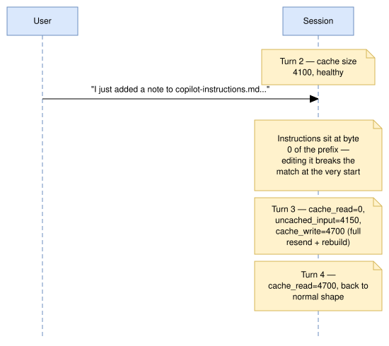
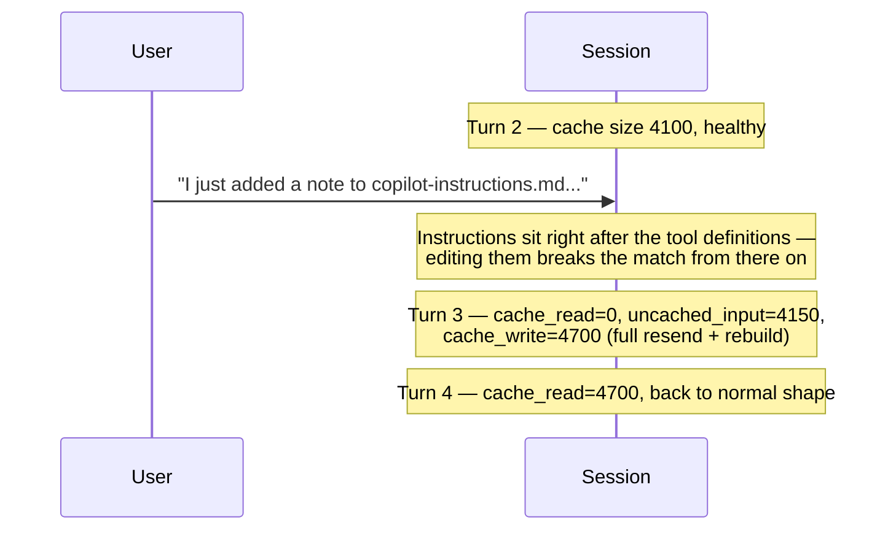

# Scenario 10: Editing Custom Instructions Mid-Session

> Extracted from [docs/agentic-coding-explained.md](../agentic-coding-explained.md#4-prompt--file-caching-and-how-it-saves-ai-credits), Section 4.

Cache matching works on a **contiguous prefix**, built in a fixed order: tool definitions, then the system prompt, then the conversation ([Anthropic: what invalidates the cache](https://platform.claude.com/docs/en/build-with-claude/prompt-caching#what-invalidates-the-cache)). The instructions live in the system prompt, right after the tool definitions. Editing
`copilot-instructions.md` (or an `AGENTS.md`-style file) mid-session means the match breaks **at the system prompt** — so every prior conversation turn, though unchanged, can't match anymore either (only the tool definitions ahead of it can still be read from cache, and only if a cache breakpoint sits right after them), since prefix matching can't "skip over" the changed part and resume
later. The result is a **full cache miss**: the next turn resends everything
(new instructions + all prior history) uncached, then a brand-new cache builds
from scratch. This is the same *mechanism* as [Scenario 5](05-mcp-tool-change.md)'s
MCP-tool-change example, triggered one block later in the prefix: a tool change also invalidates the tool definitions, so it is always a total miss, while an instructions edit is a total miss unless the tool block is cached on its own.

| Turn | What happens | Cache write | Cache read | Cache size after | Uncached input | Tool | Reasoning | Output text | **Turn total** | **Turn AI Credits** |
|---|---|---:|---:|---:|---:|---:|---:|---:|---:|---:|
| 1 | Normal turn; writes static prefix + own content | 3500 | 0 | 3500 | 500 | 0 | 150 | 150 | **4300** | **0.0289 AI Credits** |
| 2 | Normal turn; reads/extends the cache | 600 | 3500 | 4100 | 200 | 100 | 120 | 180 | **4700** | **0.0115 AI Credits** |
| 3 | **`copilot-instructions.md` is edited mid-session**: the change sits in the system prompt, right after the tool definitions, so the system prompt and all history miss — a full miss here, since nothing caches the tool block on its own | 4700 | 0 | 4700 | 4150 | 0 | 200 | 220 | **9270** | **0.0564 AI Credits** |
| 4 | Normal turn on the post-edit baseline; cache rebuilds under the updated instructions | 600 | 4700 | 5300 | 130 | 300 | 140 | 170 | **6040** | **0.0129 AI Credits** |
| 5 | Normal turn; no further disruption | 220 | 5300 | 5520 | 70 | 0 | 60 | 90 | **5740** | **0.0066 AI Credits** |

<!-- mermaid-source: diagrams/scenario-10-editing-custom-instructions-mid-session.drawio.svg

-->

Turn 3 (**0.0564 AI Credits**) is roughly 5x turn 2's cost — comparable in
scale to an MCP tool change ([Scenario 5](05-mcp-tool-change.md)), and for the same reason, one block apart: the tool definitions come first in the prefix, so a tool change invalidates *everything*, while an instructions edit invalidates the system prompt and everything after it — only a separately cached tool block could survive it ([Anthropic: what invalidates the cache](https://platform.claude.com/docs/en/build-with-claude/prompt-caching#what-invalidates-the-cache)). Turns 4-5 recover completely normal cache-growth behavior once the new
cache — now including the updated instructions — has been (re-)written.

**Sources** (checked 2026-11-03):

- [Anthropic: what invalidates the cache](https://platform.claude.com/docs/en/build-with-claude/prompt-caching#what-invalidates-the-cache): prefix order tools → system → messages
- [VS Code: custom instructions reference](https://code.visualstudio.com/docs/agents/reference/custom-instructions-reference): `copilot-instructions.md` / `AGENTS.md` inclusion settings

Fact-check: see [learn-scenarios-fact-check.md](../learn-scenarios-fact-check.md#per-scenario-verdicts). Open findings for this scenario: F-01, F-07, R-01.
