# Scenario 10: Editing Custom Instructions Mid-Session

> Extracted from [docs/agentic-coding-explained.md](../agentic-coding-explained.md#4-prompt--file-caching-and-how-it-saves-ai-credits), Section 4.

Cache matching works on a **contiguous prefix**, built in a fixed order: tool definitions, then the system prompt, then the conversation ([Anthropic: what invalidates the cache](https://platform.claude.com/docs/en/build-with-claude/prompt-caching#what-invalidates-the-cache)). The instructions live in the system prompt, right after the tool definitions. Editing
`copilot-instructions.md` (or an `AGENTS.md`-style file) mid-session means the match breaks **at the system prompt** — so every prior conversation turn, though unchanged, can't match anymore either (only the tool definitions ahead of it can still be read from cache, and only if a cache breakpoint sits right after them), since prefix matching can't "skip over" the changed part and resume
later. The result is a **full cache miss**: the next turn resends everything
(new instructions + all prior history) uncached, then a brand-new cache builds
from scratch. This is the same *mechanism* as [Scenario 5](05-mcp-tool-change.md)'s
MCP-tool-change example, triggered one block later in the prefix: a tool change also invalidates the tool definitions, so it is always a total miss, while an instructions edit is a total miss unless the tool block is cached on its own.

<!-- scenarios:generated:start -->
Simulated on Claude Sonnet 5.5 (and its cheaper sibling where a scenario switches models) with the real per-token prices in GitHub's Copilot price table, checked 2026-11-04. The figures come from the Learn simulator, not from a live session. Tool and Vision tokens are part of the input columns, not added to them.

| Turn | What happens | Cache write | Cache read | Cache size after | Uncached input | Tool (in input) | Vision (in input) | Reasoning | Output text | **Turn total** | **Turn AI Credits** |
|---|---|---:|---:|---:|---:|---:|---:|---:|---:|---:|---:|
| 1 | Normal first turn: writes the static system prompt and instructions plus this turn's own content. | 4000 | 0 | 4000 | 0 | 0 | 0 | 150 | 150 | **4300** | **1.30** |
| 2 | Normal turn: reads and extends the cache built by the first turn. | 300 | 4000 | 4300 | 0 | 100 | 0 | 120 | 180 | **4600** | **0.41** |
| 3 | Editing the custom instructions file changes the system prompt, which sits right after the tool definitions. The match breaks there, and all earlier conversation, though unchanged, can no longer match either, because a prefix match cannot skip a changed block and resume later. Only the tool definitions ahead of the change can still be read, and only if a breakpoint caches them alone. A new cache is then written under the updated instructions. | 2930 | 1800 | 4730 | 0 | 0 | 0 | 200 | 220 | **5150** | **1.17** |
| 4 | Normal turn on the post-edit baseline: the cache rebuilds under the updated instructions. | 580 | 4730 | 5310 | 0 | 300 | 0 | 140 | 170 | **5620** | **0.50** |
| 5 | The cache keeps growing normally under the new instructions. | 230 | 5310 | 5540 | 0 | 0 | 0 | 60 | 90 | **5690** | **0.26** |

Session total: **3.65 AI Credits** (≈ $0.0365); most expensive turn: **turn 1** (1.30 AI Credits).

Running totals by token type:

| Cumulative through turn | What happens | Cache write | Cache read | Uncached input | Tool (in input) | Vision (in input) | Reasoning | Output text | **Session total** | **Running AI Credits** |
|---|---|---:|---:|---:|---:|---:|---:|---:|---:|---:|
| 1 | Normal first turn: writes the static system prompt and instructions plus this turn's own content. | 4000 | 0 | 0 | 0 | 0 | 150 | 150 | **4300** | **1.30** |
| 2 | Normal turn: reads and extends the cache built by the first turn. | 4300 | 4000 | 0 | 100 | 0 | 270 | 330 | **8900** | **1.71** |
| 3 | Editing the custom instructions file changes the system prompt, which sits right after the tool definitions. The match breaks there, and all earlier conversation, though unchanged, can no longer match either, because a prefix match cannot skip a changed block and resume later. Only the tool definitions ahead of the change can still be read, and only if a breakpoint caches them alone. A new cache is then written under the updated instructions. | 7230 | 5800 | 0 | 100 | 0 | 470 | 550 | **14050** | **2.89** |
| 4 | Normal turn on the post-edit baseline: the cache rebuilds under the updated instructions. | 7810 | 10530 | 0 | 400 | 0 | 610 | 720 | **19670** | **3.39** |
| 5 | The cache keeps growing normally under the new instructions. | 8040 | 15840 | 0 | 400 | 0 | 670 | 810 | **25360** | **3.65** |

```mermaid
xychart-beta
    title "Tokens per turn by type (simulated)"
    x-axis [Turn1, Turn2, Turn3, Turn4, Turn5]
    y-axis "Tokens" 0 --> 6000
    bar "Cache write" [4000, 300, 2930, 580, 230]
    bar "Cache read" [0, 4000, 1800, 4730, 5310]
    bar "Uncached input" [0, 0, 0, 0, 0]
    bar "Tool" [0, 100, 0, 300, 0]
    bar "Vision" [0, 0, 0, 0, 0]
    bar "Reasoning" [150, 120, 200, 140, 60]
    bar "Output text" [150, 180, 220, 170, 90]
```

<!-- scenarios:generated:end -->

**Sources** (checked 2026-11-03):

- [Anthropic: what invalidates the cache](https://platform.claude.com/docs/en/build-with-claude/prompt-caching#what-invalidates-the-cache): prefix order tools → system → messages
- [VS Code: custom instructions reference](https://code.visualstudio.com/docs/agents/reference/custom-instructions-reference): `copilot-instructions.md` / `AGENTS.md` inclusion settings

Fact-check: see [learn-scenarios-fact-check.md](../learn-scenarios-fact-check.md#per-scenario-verdicts). Open findings for this scenario: F-01, F-07, R-01.
