# Scenario 11: A New File Type Silently Changes the Prompt

> Extracted from [docs/agentic-coding-explained.md](../agentic-coding-explained.md#4-prompt--file-caching-and-how-it-saves-ai-credits), Section 4.

Path-scoped `.instructions.md` files (`applyTo` globs) are included
**conditionally** — only when a turn actually touches a matching file — so
this layer can vary turn to turn rather than staying perfectly static. If
turns 1-2 never touch a matching file, that block isn't in the prompt at all;
the first turn that *does* touch one inserts it. If the client groups this
with the other stable instructions near the top of the prompt (the common
pattern), that insertion breaks the prefix match at that position, invalidating
everything cached after it — all prior conversation included — even though
none of that conversation actually changed.

This is a **silent** trigger: nothing about the user's message looks like a
deliberate config change (no explicit model/tool switch, no edited
instructions file), so an AI Credits spike from simply opening a new kind of
file can be genuinely surprising — and, unlike every other trigger in this
series, it carries **no trigger tag** in the turns table, since nothing about
the request itself was a recognized event.

<!-- scenarios:generated:start -->
Simulated on Claude Sonnet 5.5 (and its cheaper sibling where a scenario switches models) with the real per-token prices in GitHub's Copilot price table, checked 2026-11-04. The figures come from the Learn simulator, not from a live session. Tool and Vision tokens are part of the input columns, not added to them.

| Turn | What happens | Cache write | Cache read | Cache size after | Uncached input | Tool (in input) | Vision (in input) | Reasoning | Output text | **Turn total** | **Turn AI Credits** |
|---|---|---:|---:|---:|---:|---:|---:|---:|---:|---:|---:|
| 1 | Normal first turn: writes the static system prompt and instructions plus this turn's own content. No path-scoped instruction file applies yet, because no matching file type has been touched. | 4000 | 0 | 4000 | 0 | 0 | 0 | 150 | 150 | **4300** | **1.30** |
| 2 | Normal turn: reads and extends the cache built by the first turn. Still no matching file touched. | 300 | 4000 | 4300 | 0 | 100 | 0 | 120 | 180 | **4600** | **0.41** |
| 3 | The first turn to touch a matching file type silently pulls in a path-scoped instruction block that earlier turns never loaded. Nothing in the user's message looks like a configuration change, but the block sits near the top of the prompt, so inserting it breaks the prefix match there and invalidates everything cached after it, including conversation that did not change. The turn carries no visible trigger, which is the danger: it looks ordinary yet costs far more. | 3350 | 1800 | 5150 | 0 | 150 | 0 | 210 | 200 | **5560** | **1.27** |
| 4 | Normal turn under the newly included instruction block: the cache rebuilds under the new prefix. | 460 | 5150 | 5610 | 0 | 200 | 0 | 130 | 160 | **5900** | **0.46** |
| 5 | The cache keeps growing normally; nothing in the session ever flagged the earlier spike. | 220 | 5610 | 5830 | 0 | 0 | 0 | 70 | 100 | **6000** | **0.28** |

Session total: **3.72 AI Credits** (≈ $0.0372); most expensive turn: **turn 1** (1.30 AI Credits).

Running totals by token type:

| Cumulative through turn | What happens | Cache write | Cache read | Uncached input | Tool (in input) | Vision (in input) | Reasoning | Output text | **Session total** | **Running AI Credits** |
|---|---|---:|---:|---:|---:|---:|---:|---:|---:|---:|
| 1 | Normal first turn: writes the static system prompt and instructions plus this turn's own content. No path-scoped instruction file applies yet, because no matching file type has been touched. | 4000 | 0 | 0 | 0 | 0 | 150 | 150 | **4300** | **1.30** |
| 2 | Normal turn: reads and extends the cache built by the first turn. Still no matching file touched. | 4300 | 4000 | 0 | 100 | 0 | 270 | 330 | **8900** | **1.71** |
| 3 | The first turn to touch a matching file type silently pulls in a path-scoped instruction block that earlier turns never loaded. Nothing in the user's message looks like a configuration change, but the block sits near the top of the prompt, so inserting it breaks the prefix match there and invalidates everything cached after it, including conversation that did not change. The turn carries no visible trigger, which is the danger: it looks ordinary yet costs far more. | 7650 | 5800 | 0 | 250 | 0 | 480 | 530 | **14460** | **2.98** |
| 4 | Normal turn under the newly included instruction block: the cache rebuilds under the new prefix. | 8110 | 10950 | 0 | 450 | 0 | 610 | 690 | **20360** | **3.44** |
| 5 | The cache keeps growing normally; nothing in the session ever flagged the earlier spike. | 8330 | 16560 | 0 | 450 | 0 | 680 | 790 | **26360** | **3.72** |

```mermaid
xychart-beta
    title "Tokens per turn by type (simulated)"
    x-axis [Turn1, Turn2, Turn3, Turn4, Turn5]
    y-axis "Tokens" 0 --> 6000
    bar "Cache write" [4000, 300, 3350, 460, 220]
    bar "Cache read" [0, 4000, 1800, 5150, 5610]
    bar "Uncached input" [0, 0, 0, 0, 0]
    bar "Tool" [0, 100, 150, 200, 0]
    bar "Vision" [0, 0, 0, 0, 0]
    bar "Reasoning" [150, 120, 210, 130, 70]
    bar "Output text" [150, 180, 200, 160, 100]
```

<!-- scenarios:generated:end -->

**Sources** (checked 2026-11-03):

- [VS Code: custom instructions reference](https://code.visualstudio.com/docs/agents/reference/custom-instructions-reference): `applyTo` instructions attach automatically (setting-dependent)
- [Anthropic: what invalidates the cache](https://platform.claude.com/docs/en/build-with-claude/prompt-caching#what-invalidates-the-cache): a system-prompt change invalidates system + messages

Fact-check: see [learn-scenarios-fact-check.md](../learn-scenarios-fact-check.md#per-scenario-verdicts). Open findings for this scenario: N-05, R-01.
