# Scenario 12: Exploring Inline vs. Isolating in a Subagent

> Extracted from [docs/agentic-coding-explained.md](../agentic-coding-explained.md#9-worked-example-a-multi-turn-session-showing-every-token-type), Section 9 (subagent note), and [Section 7](../agentic-coding-explained.md#7-how-subagents-work-and-how-they-reduce-ai-credits-spend).

[Scenario 1](01-cache-basics-8-turn-session.md) and [Scenario 2](02-subagent-own-session.md)
already show what happens when the turn-2 investigation runs in an isolated
subagent: the parent pays only a short summary, while the subagent's own
trajectory stays off the parent's books entirely. This scenario replays the same task, but has that same investigation
happen **inline** in the parent session instead — exactly the counterfactual
the main doc computes in its note on Section 9 ("If that exploration had
happened inline in parent turn 2 instead...").

<!-- scenarios:generated:start -->
Simulated on Claude Sonnet 5.5 (and its cheaper sibling where a scenario switches models) with the real per-token prices in GitHub's Copilot price table, checked 2026-11-04. The figures come from the Learn simulator, not from a live session. Tool and Vision tokens are part of the input columns, not added to them.

| Turn | What happens | Cache write | Cache read | Cache size after | Uncached input | Tool (in input) | Vision (in input) | Reasoning | Output text | **Turn total** | **Turn AI Credits** |
|---|---|---:|---:|---:|---:|---:|---:|---:|---:|---:|---:|
| 1 | Same task and starting point as the cache-basics scenario. The difference begins in the next step. | 5450 | 0 | 5450 | 0 | 1400 | 0 | 300 | 250 | **6000** | **1.91** |
| 2 | The investigation runs inline instead of in a subagent, so the whole search-and-read trajectory is written into this session's own context and cache. It is a one-off cost for the turn, but it also becomes a permanent part of the prefix that every later turn must read. | 6440 | 5450 | 11890 | 0 | 6140 | 0 | 200 | 180 | **12270** | **2.04** |
| 3 | Implements the fix, but the cached prefix is now much larger than it would have been had the exploration been isolated, because the inline exploration is baked into it. | 930 | 11890 | 12820 | 0 | 400 | 0 | 250 | 280 | **13350** | **0.88** |
| 4 | Runs a verbose test suite. Every turn from here on inherits the extra context the inline exploration added, so cache reads stay permanently higher. | 2300 | 12820 | 15120 | 0 | 1800 | 0 | 150 | 300 | **15570** | **1.15** |
| 5 | Final turn. The inline path's running total ends noticeably higher than the isolated-subagent path through the same steps: the isolated version's exploration cost is bounded to one call, while the inline version taxes every later turn. | 360 | 15120 | 15480 | 0 | 0 | 0 | 30 | 90 | **15600** | **0.36** |

Session total: **6.35 AI Credits** (≈ $0.0635); most expensive turn: **turn 2** (2.04 AI Credits).

Running totals by token type:

| Cumulative through turn | What happens | Cache write | Cache read | Uncached input | Tool (in input) | Vision (in input) | Reasoning | Output text | **Session total** | **Running AI Credits** |
|---|---|---:|---:|---:|---:|---:|---:|---:|---:|---:|
| 1 | Same task and starting point as the cache-basics scenario. The difference begins in the next step. | 5450 | 0 | 0 | 1400 | 0 | 300 | 250 | **6000** | **1.91** |
| 2 | The investigation runs inline instead of in a subagent, so the whole search-and-read trajectory is written into this session's own context and cache. It is a one-off cost for the turn, but it also becomes a permanent part of the prefix that every later turn must read. | 11890 | 5450 | 0 | 7540 | 0 | 500 | 430 | **18270** | **3.96** |
| 3 | Implements the fix, but the cached prefix is now much larger than it would have been had the exploration been isolated, because the inline exploration is baked into it. | 12820 | 17340 | 0 | 7940 | 0 | 750 | 710 | **31620** | **4.84** |
| 4 | Runs a verbose test suite. Every turn from here on inherits the extra context the inline exploration added, so cache reads stay permanently higher. | 15120 | 30160 | 0 | 9740 | 0 | 900 | 1010 | **47190** | **5.99** |
| 5 | Final turn. The inline path's running total ends noticeably higher than the isolated-subagent path through the same steps: the isolated version's exploration cost is bounded to one call, while the inline version taxes every later turn. | 15480 | 45280 | 0 | 9740 | 0 | 930 | 1100 | **62790** | **6.35** |

```mermaid
xychart-beta
    title "Tokens per turn by type (simulated)"
    x-axis [Turn1, Turn2, Turn3, Turn4, Turn5]
    y-axis "Tokens" 0 --> 16000
    bar "Cache write" [5450, 6440, 930, 2300, 360]
    bar "Cache read" [0, 5450, 11890, 12820, 15120]
    bar "Uncached input" [0, 0, 0, 0, 0]
    bar "Tool" [1400, 6140, 400, 1800, 0]
    bar "Vision" [0, 0, 0, 0, 0]
    bar "Reasoning" [300, 200, 250, 150, 30]
    bar "Output text" [250, 180, 280, 300, 90]
```

<!-- scenarios:generated:end -->

**Sources** (checked 2026-11-03):

- [Claude Code: subagents](https://code.claude.com/docs/en/sub-agents): subagents keep exploration out of the parent context
- [VS Code: subagents (incl. selecting the model)](https://code.visualstudio.com/docs/agents/run/subagents#select-the-model-for-a-subagent): VS Code subagents
- [Anthropic: vision, resolution and token cost](https://platform.claude.com/docs/en/build-with-claude/vision): image token cost

Fact-check: see [learn-scenarios-fact-check.md](../learn-scenarios-fact-check.md#per-scenario-verdicts). Open findings for this scenario: F-02, R-06.
