# Scenario 13: Cache TTL — Surviving a Break with the 1-Hour Breakpoint

> Extracted from [docs/agentic-coding-explained.md](../agentic-coding-explained.md#171-how-long-does-the-cache-live-and-is-it-the-same-for-every-model), Section 17.1.

Anthropic's default cache lifetime is **5 minutes**, refreshed for free on
every cache hit — but a **1-hour TTL** is available as an explicit
breakpoint, at roughly **2x** the normal cache-write price. This scenario
replays [Scenario 9](09-cache-ttl-smoke-break.md)'s exact 10-turn arc and the
same 5+ minute smoke break between turns 7 and 8 — but this session pays the
1-hour-breakpoint premium on every cache write instead of the default rate.

<!-- scenarios:generated:start -->
Simulated on Claude Sonnet 5.5 (and its cheaper sibling where a scenario switches models) with the real per-token prices in GitHub's Copilot price table, checked 2026-11-04. The figures come from the Learn simulator, not from a live session. Tool and Vision tokens are part of the input columns, not added to them.

| Turn | What happens | Cache write | Cache read | Cache size after | Uncached input | Tool (in input) | Vision (in input) | Reasoning | Output text | **Turn total** | **Turn AI Credits** |
|---|---|---:|---:|---:|---:|---:|---:|---:|---:|---:|---:|
| 1 | Normal first turn: writes the static prefix plus this turn's own content. The session opts into the optional long-lived cache breakpoint instead of the short default, which costs a higher write rate but survives much longer idle gaps. | 3400 | 0 | 3400 | 0 | 0 | 0 | 0 | 200 | **3600** | **1.56** |
| 2 | Normal turn; reads and extends the cache from the first turn. Reads cost the same whichever breakpoint wrote them. | 350 | 3400 | 3750 | 0 | 0 | 0 | 0 | 150 | **3900** | **0.32** |
| 3 | Explores the code with a couple of tool calls; the cache keeps building under the long-lived breakpoint. | 550 | 3750 | 4300 | 0 | 300 | 0 | 0 | 180 | **4480** | **0.44** |
| 4 | Applies an edit and runs a quick check: a normal, healthy cache-building turn. | 780 | 4300 | 5080 | 0 | 500 | 0 | 0 | 200 | **5280** | **0.56** |
| 5 | Normal follow-up turn. | 280 | 5080 | 5360 | 0 | 0 | 0 | 0 | 160 | **5520** | **0.32** |
| 6 | Normal follow-up turn. | 260 | 5360 | 5620 | 0 | 0 | 0 | 0 | 150 | **5770** | **0.31** |
| 7 | Normal follow-up turn. The user then steps away for a break longer than the short default lifetime, but within the long-lived one. | 270 | 5620 | 5890 | 0 | 0 | 0 | 0 | 170 | **6060** | **0.33** |
| 8 | No cache miss. The same break that expires a default-lifetime cache leaves this one valid, so the turn reads the whole cache like any normal turn. | 300 | 5890 | 6190 | 0 | 0 | 0 | 0 | 170 | **6360** | **0.35** |
| 9 | Normal turn; the cache keeps growing uninterrupted. | 290 | 6190 | 6480 | 0 | 0 | 0 | 0 | 150 | **6630** | **0.33** |
| 10 | Normal turn. The higher write rate is paid on every write, not just the risky one; it pays off only when an idle gap actually exceeds the short default lifetime. | 240 | 6480 | 6720 | 0 | 0 | 0 | 0 | 120 | **6840** | **0.28** |

Session total: **4.80 AI Credits** (≈ $0.0480); most expensive turn: **turn 1** (1.56 AI Credits).

Running totals by token type:

| Cumulative through turn | What happens | Cache write | Cache read | Uncached input | Tool (in input) | Vision (in input) | Reasoning | Output text | **Session total** | **Running AI Credits** |
|---|---|---:|---:|---:|---:|---:|---:|---:|---:|---:|
| 1 | Normal first turn: writes the static prefix plus this turn's own content. The session opts into the optional long-lived cache breakpoint instead of the short default, which costs a higher write rate but survives much longer idle gaps. | 3400 | 0 | 0 | 0 | 0 | 0 | 200 | **3600** | **1.56** |
| 2 | Normal turn; reads and extends the cache from the first turn. Reads cost the same whichever breakpoint wrote them. | 3750 | 3400 | 0 | 0 | 0 | 0 | 350 | **7500** | **1.88** |
| 3 | Explores the code with a couple of tool calls; the cache keeps building under the long-lived breakpoint. | 4300 | 7150 | 0 | 300 | 0 | 0 | 530 | **11980** | **2.32** |
| 4 | Applies an edit and runs a quick check: a normal, healthy cache-building turn. | 5080 | 11450 | 0 | 800 | 0 | 0 | 730 | **17260** | **2.88** |
| 5 | Normal follow-up turn. | 5360 | 16530 | 0 | 800 | 0 | 0 | 890 | **22780** | **3.20** |
| 6 | Normal follow-up turn. | 5620 | 21890 | 0 | 800 | 0 | 0 | 1040 | **28550** | **3.51** |
| 7 | Normal follow-up turn. The user then steps away for a break longer than the short default lifetime, but within the long-lived one. | 5890 | 27510 | 0 | 800 | 0 | 0 | 1210 | **34610** | **3.84** |
| 8 | No cache miss. The same break that expires a default-lifetime cache leaves this one valid, so the turn reads the whole cache like any normal turn. | 6190 | 33400 | 0 | 800 | 0 | 0 | 1380 | **40970** | **4.19** |
| 9 | Normal turn; the cache keeps growing uninterrupted. | 6480 | 39590 | 0 | 800 | 0 | 0 | 1530 | **47600** | **4.52** |
| 10 | Normal turn. The higher write rate is paid on every write, not just the risky one; it pays off only when an idle gap actually exceeds the short default lifetime. | 6720 | 46070 | 0 | 800 | 0 | 0 | 1650 | **54440** | **4.80** |

```mermaid
xychart-beta
    title "Tokens per turn by type (simulated)"
    x-axis [Turn1, Turn2, Turn3, Turn4, Turn5, Turn6, Turn7, Turn8, Turn9, Turn10]
    y-axis "Tokens" 0 --> 7000
    bar "Cache write" [3400, 350, 550, 780, 280, 260, 270, 300, 290, 240]
    bar "Cache read" [0, 3400, 3750, 4300, 5080, 5360, 5620, 5890, 6190, 6480]
    bar "Uncached input" [0, 0, 0, 0, 0, 0, 0, 0, 0, 0]
    bar "Tool" [0, 0, 300, 500, 0, 0, 0, 0, 0, 0]
    bar "Vision" [0, 0, 0, 0, 0, 0, 0, 0, 0, 0]
    bar "Reasoning" [0, 0, 0, 0, 0, 0, 0, 0, 0, 0]
    bar "Output text" [200, 150, 180, 200, 160, 150, 170, 170, 150, 120]
```

<!-- scenarios:generated:end -->

**Sources** (checked 2026-11-03):

- [Anthropic: prompt caching pricing](https://platform.claude.com/docs/en/build-with-claude/prompt-caching#pricing): "Cache write tokens with a 1-hour TTL are 2 times the base input tokens price."
- [Anthropic: prompt caching](https://platform.claude.com/docs/en/build-with-claude/prompt-caching): mixing TTLs; reads priced the same

Fact-check: see [learn-scenarios-fact-check.md](../learn-scenarios-fact-check.md#per-scenario-verdicts). Open findings for this scenario: F-05, R-02.
