# Scenario 14: Cascading Triggers — A Model Switch Followed by a Cache-Expiry

> Extracted from [docs/agentic-coding-explained.md](../agentic-coding-explained.md#1712-combined-and-cascading-triggers-when-do-invalidations-stack), Section 17.12.

Sections 11-16 of the main doc each cover a single trigger in isolation — one
model switch, one TTL lapse, one fork. Real sessions don't always cooperate:
a model switch ([Scenario 4](04-model-switch.md)) can be followed, a couple of
turns later, by an idle gap that outlasts the *new* model's TTL
([Scenario 9](09-cache-ttl-smoke-break.md)'s trigger) — and the two don't just
add up, they compound, because the second miss re-pays the whole history at the new
model's uncached prices.

<!-- scenarios:generated:start -->
Simulated on Claude Sonnet 5.5 (and its cheaper sibling where a scenario switches models) with the real per-token prices in GitHub's Copilot price table, checked 2026-11-04. The figures come from the Learn simulator, not from a live session. Tool and Vision tokens are part of the input columns, not added to them.

| Turn | What happens | Model | Cache write | Cache read | Cache size after | Uncached input | Tool (in input) | Vision (in input) | Reasoning | Output text | **Turn total** | **Turn AI Credits** |
|---|---|---|---:|---:|---:|---:|---:|---:|---:|---:|---:|---:|
| 1 | Normal first turn: writes the static prefix plus this turn's own content. | claude-sonnet-5.5 | 3800 | 0 | 3800 | 0 | 0 | 0 | 150 | 150 | **4100** | **1.25** |
| 2 | Normal turn reusing and extending the first model's cache. | claude-sonnet-5.5 | 300 | 3800 | 4100 | 0 | 0 | 0 | 120 | 180 | **4400** | **0.41** |
| 3 | Model switch: the first model's cache is useless to the second, so the whole history plus the new message is resent uncached and the second model writes its own cache from scratch. | claude-haiku-5.5 | 4430 | 0 | 4430 | 0 | 0 | 0 | 250 | 300 | **4980** | **0.08** |
| 4 | Normal turn under the new model; its cache builds up again. The user then steps away for longer than the default cache lifetime. | claude-haiku-5.5 | 700 | 4430 | 5130 | 0 | 300 | 0 | 150 | 200 | **5480** | **0.03** |
| 5 | Second invalidation in a few turns: the idle gap outlives the cache, so the whole history since the switch is resent uncached, and the switch is never reverted. Both costs stack on one turn. | claude-haiku-5.5 | 5430 | 0 | 5430 | 0 | 0 | 0 | 200 | 180 | **5810** | **0.09** |
| 6 | The cache recovers to normal healthy growth, but only after paying for both triggers back to back. | claude-haiku-5.5 | 260 | 5430 | 5690 | 0 | 0 | 0 | 90 | 140 | **5920** | **0.02** |

Session total: **1.88 AI Credits** (≈ $0.0188); most expensive turn: **turn 1** (1.25 AI Credits).

Running totals by token type:

| Cumulative through turn | What happens | Cache write | Cache read | Uncached input | Tool (in input) | Vision (in input) | Reasoning | Output text | **Session total** | **Running AI Credits** |
|---|---|---:|---:|---:|---:|---:|---:|---:|---:|---:|
| 1 | Normal first turn: writes the static prefix plus this turn's own content. | 3800 | 0 | 0 | 0 | 0 | 150 | 150 | **4100** | **1.25** |
| 2 | Normal turn reusing and extending the first model's cache. | 4100 | 3800 | 0 | 0 | 0 | 270 | 330 | **8500** | **1.66** |
| 3 | Model switch: the first model's cache is useless to the second, so the whole history plus the new message is resent uncached and the second model writes its own cache from scratch. | 8530 | 3800 | 0 | 0 | 0 | 520 | 630 | **13480** | **1.75** |
| 4 | Normal turn under the new model; its cache builds up again. The user then steps away for longer than the default cache lifetime. | 9230 | 8230 | 0 | 300 | 0 | 670 | 830 | **18960** | **1.78** |
| 5 | Second invalidation in a few turns: the idle gap outlives the cache, so the whole history since the switch is resent uncached, and the switch is never reverted. Both costs stack on one turn. | 14660 | 8230 | 0 | 300 | 0 | 870 | 1010 | **24770** | **1.86** |
| 6 | The cache recovers to normal healthy growth, but only after paying for both triggers back to back. | 14920 | 13660 | 0 | 300 | 0 | 960 | 1150 | **30690** | **1.88** |

```mermaid
xychart-beta
    title "Tokens per turn by type (simulated)"
    x-axis [Turn1, Turn2, Turn3, Turn4, Turn5, Turn6]
    y-axis "Tokens" 0 --> 6000
    bar "Cache write" [3800, 300, 4430, 700, 5430, 260]
    bar "Cache read" [0, 3800, 0, 4430, 0, 5430]
    bar "Uncached input" [0, 0, 0, 0, 0, 0]
    bar "Tool" [0, 0, 0, 300, 0, 0]
    bar "Vision" [0, 0, 0, 0, 0, 0]
    bar "Reasoning" [150, 120, 250, 150, 200, 90]
    bar "Output text" [150, 180, 300, 200, 180, 140]
```

<!-- scenarios:generated:end -->

**Sources** (checked 2026-11-03):

- [Anthropic: cache diagnostics](https://platform.claude.com/docs/en/build-with-claude/cache-diagnostics): the cache is per-model
- [Anthropic: prompt caching](https://platform.claude.com/docs/en/build-with-claude/prompt-caching): 5-minute default lifetime
- [GitHub: Copilot models and pricing (AI credits, per-token prices)](https://docs.github.com/en/copilot/reference/copilot-billing/models-and-pricing): per-model token prices

Fact-check: see [learn-scenarios-fact-check.md](../learn-scenarios-fact-check.md#per-scenario-verdicts). Open findings for this scenario: F-06, R-01.
