# Scenario 15: An Image Attachment Invalidates the Cache

> Extracted from [docs/agentic-coding-explained.md](../agentic-coding-explained.md#173-what-to-avoid-behaviors-and-technologies-that-invalidate-the-cache), Section 17.3.

Section 17.3 of the main doc flags "images appearing/disappearing anywhere in
the conversation" as one of several things "explicitly documented (by
Anthropic) as invalidating triggers, even though none of them feel like
'changing the setup.'" [Scenario 1](01-cache-basics-8-turn-session.md) already
shows a screenshot adding **vision tokens** to a turn — but that's only half
the story. Attaching (or removing) an image also changes the *shape* of the
message content at the point it's inserted, which breaks the prefix match
there, independent of how many vision tokens the image itself costs.

<!-- scenarios:generated:start -->
Simulated on Claude Sonnet 5.5 (and its cheaper sibling where a scenario switches models) with the real per-token prices in GitHub's Copilot price table, checked 2026-11-04. The figures come from the Learn simulator, not from a live session. Tool and Vision tokens are part of the input columns, not added to them.

| Turn | What happens | Cache write | Cache read | Cache size after | Uncached input | Tool (in input) | Vision (in input) | Reasoning | Output text | **Turn total** | **Turn AI Credits** |
|---|---|---:|---:|---:|---:|---:|---:|---:|---:|---:|---:|
| 1 | Normal first turn: writes the static prefix plus this turn's own content. No image has appeared in the conversation yet. | 3800 | 0 | 3800 | 0 | 0 | 0 | 150 | 150 | **4100** | **1.25** |
| 2 | Normal turn; reads and extends the cache built by the first turn. | 650 | 3800 | 4450 | 0 | 300 | 0 | 120 | 180 | **4750** | **0.50** |
| 3 | An image appearing in the conversation invalidates the cache from the message content on, because it changes the shape of the content, not just its size. The old conversation cache is resent uncached and rewritten, on top of the image's own tokens. | 3064 | 3000 | 6064 | 0 | 0 | 1334 | 180 | 190 | **6434** | **1.17** |
| 4 | Normal turn; the image is now part of the cached content, with no further disruption. | 260 | 6064 | 6324 | 0 | 0 | 0 | 60 | 90 | **6474** | **0.28** |
| 5 | A second image later in the same session triggers the same invalidation again. The cost is per occurrence, so a session that attaches several screenshots pays it each time. | 3948 | 3000 | 6948 | 0 | 0 | 434 | 160 | 170 | **7278** | **1.35** |

Session total: **4.54 AI Credits** (≈ $0.0454); most expensive turn: **turn 5** (1.35 AI Credits).

Running totals by token type:

| Cumulative through turn | What happens | Cache write | Cache read | Uncached input | Tool (in input) | Vision (in input) | Reasoning | Output text | **Session total** | **Running AI Credits** |
|---|---|---:|---:|---:|---:|---:|---:|---:|---:|---:|
| 1 | Normal first turn: writes the static prefix plus this turn's own content. No image has appeared in the conversation yet. | 3800 | 0 | 0 | 0 | 0 | 150 | 150 | **4100** | **1.25** |
| 2 | Normal turn; reads and extends the cache built by the first turn. | 4450 | 3800 | 0 | 300 | 0 | 270 | 330 | **8850** | **1.75** |
| 3 | An image appearing in the conversation invalidates the cache from the message content on, because it changes the shape of the content, not just its size. The old conversation cache is resent uncached and rewritten, on top of the image's own tokens. | 7514 | 6800 | 0 | 300 | 1334 | 450 | 520 | **15284** | **2.92** |
| 4 | Normal turn; the image is now part of the cached content, with no further disruption. | 7774 | 12864 | 0 | 300 | 1334 | 510 | 610 | **21758** | **3.19** |
| 5 | A second image later in the same session triggers the same invalidation again. The cost is per occurrence, so a session that attaches several screenshots pays it each time. | 11722 | 15864 | 0 | 300 | 1768 | 670 | 780 | **29036** | **4.54** |

```mermaid
xychart-beta
    title "Tokens per turn by type (simulated)"
    x-axis [Turn1, Turn2, Turn3, Turn4, Turn5]
    y-axis "Tokens" 0 --> 7000
    bar "Cache write" [3800, 650, 3064, 260, 3948]
    bar "Cache read" [0, 3800, 3000, 6064, 3000]
    bar "Uncached input" [0, 0, 0, 0, 0]
    bar "Tool" [0, 300, 0, 0, 0]
    bar "Vision" [0, 0, 1334, 0, 434]
    bar "Reasoning" [150, 120, 180, 60, 160]
    bar "Output text" [150, 180, 190, 90, 170]
```

<!-- scenarios:generated:end -->

**Sources** (checked 2026-11-03):

- [Anthropic: what invalidates the cache](https://platform.claude.com/docs/en/build-with-claude/prompt-caching#what-invalidates-the-cache): images invalidate message blocks only (tools and system stay cached)
- [Anthropic: vision, resolution and token cost](https://platform.claude.com/docs/en/build-with-claude/vision): image token cost: ⌈w/28⌉×⌈h/28⌉
- [VS Code: vision in chat context](https://code.visualstudio.com/docs/chat/copilot-chat-context#vision): attaching images in VS Code chat

Fact-check: see [learn-scenarios-fact-check.md](../learn-scenarios-fact-check.md#per-scenario-verdicts). Open findings for this scenario: F-04, R-03, R-06.
