# Scenario 16: Toggling Extended Thinking Mid-Session

> Extracted from [docs/agentic-coding-explained.md](../agentic-coding-explained.md#173-what-to-avoid-behaviors-and-technologies-that-invalidate-the-cache), Section 17.3.

Alongside images, Section 17.3 of the main doc lists "reasoning
effort/thinking-budget changes, web-search or citation toggles, `tool_choice`
changes" as settings that invalidate the cache purely by being rendered into
the request shape — even though flipping one mid-task doesn't feel like
reconfiguring anything. This scenario shows the extended-thinking budget being
turned on, used, and turned back off within a single session.

<!-- scenarios:generated:start -->
Simulated on Claude Sonnet 5.5 (and its cheaper sibling where a scenario switches models) with the real per-token prices in GitHub's Copilot price table, checked 2026-11-04. The figures come from the Learn simulator, not from a live session. Tool and Vision tokens are part of the input columns, not added to them.

| Turn | What happens | Cache write | Cache read | Cache size after | Uncached input | Tool (in input) | Vision (in input) | Reasoning | Output text | **Turn total** | **Turn AI Credits** |
|---|---|---:|---:|---:|---:|---:|---:|---:|---:|---:|---:|
| 1 | Normal first turn: writes the static prefix plus this turn's own content. Extended thinking is off, so reasoning stays at its normal baseline. | 3800 | 0 | 3800 | 0 | 0 | 0 | 150 | 150 | **4100** | **1.25** |
| 2 | Normal turn reusing and extending the cache. | 300 | 3800 | 4100 | 0 | 0 | 0 | 120 | 180 | **4400** | **0.41** |
| 3 | Enabling extended thinking changes the request itself, which invalidates the conversation cache. Reasoning tokens also jump while the model spends a much larger budget deliberating. | 1380 | 3000 | 4380 | 0 | 0 | 0 | 900 | 250 | **5530** | **1.52** |
| 4 | Normal turn under the new, still elevated reasoning budget; the cache rebuilds under the current settings. | 550 | 4380 | 4930 | 0 | 200 | 0 | 400 | 220 | **5550** | **0.80** |
| 5 | Turning extended thinking back off invalidates the cache again, in the same way: any change to the thinking setting alters the request, in either direction. Toggling mid-task costs a full miss twice. | 2250 | 3000 | 5250 | 0 | 0 | 0 | 100 | 120 | **5470** | **0.81** |

Session total: **4.80 AI Credits** (≈ $0.0480); most expensive turn: **turn 3** (1.52 AI Credits).

Running totals by token type:

| Cumulative through turn | What happens | Cache write | Cache read | Uncached input | Tool (in input) | Vision (in input) | Reasoning | Output text | **Session total** | **Running AI Credits** |
|---|---|---:|---:|---:|---:|---:|---:|---:|---:|---:|
| 1 | Normal first turn: writes the static prefix plus this turn's own content. Extended thinking is off, so reasoning stays at its normal baseline. | 3800 | 0 | 0 | 0 | 0 | 150 | 150 | **4100** | **1.25** |
| 2 | Normal turn reusing and extending the cache. | 4100 | 3800 | 0 | 0 | 0 | 270 | 330 | **8500** | **1.66** |
| 3 | Enabling extended thinking changes the request itself, which invalidates the conversation cache. Reasoning tokens also jump while the model spends a much larger budget deliberating. | 5480 | 6800 | 0 | 0 | 0 | 1170 | 580 | **14030** | **3.19** |
| 4 | Normal turn under the new, still elevated reasoning budget; the cache rebuilds under the current settings. | 6030 | 11180 | 0 | 200 | 0 | 1570 | 800 | **19580** | **3.99** |
| 5 | Turning extended thinking back off invalidates the cache again, in the same way: any change to the thinking setting alters the request, in either direction. Toggling mid-task costs a full miss twice. | 8280 | 14180 | 0 | 200 | 0 | 1670 | 920 | **25050** | **4.80** |

```mermaid
xychart-beta
    title "Tokens per turn by type (simulated)"
    x-axis [Turn1, Turn2, Turn3, Turn4, Turn5]
    y-axis "Tokens" 0 --> 5000
    bar "Cache write" [3800, 300, 1380, 550, 2250]
    bar "Cache read" [0, 3800, 3000, 4380, 3000]
    bar "Uncached input" [0, 0, 0, 0, 0]
    bar "Tool" [0, 0, 0, 200, 0]
    bar "Vision" [0, 0, 0, 0, 0]
    bar "Reasoning" [150, 120, 900, 400, 100]
    bar "Output text" [150, 180, 250, 220, 120]
```

<!-- scenarios:generated:end -->

**Sources** (checked 2026-11-03):

- [Anthropic: thinking and prompt caching](https://platform.claude.com/docs/en/build-with-claude/thinking#thinking-and-prompt-caching): thinking config is rendered into the prompt; messages always invalidated, tools/system on some models
- [VS Code: configure thinking effort](https://code.visualstudio.com/docs/agent-customization/language-models#configure-thinking-effort-and-context-size): changing thinking effort in VS Code
- [OpenAI: reasoning (billed as output tokens)](https://developers.openai.com/api/docs/guides/reasoning): reasoning billed as output

Fact-check: see [learn-scenarios-fact-check.md](../learn-scenarios-fact-check.md#per-scenario-verdicts). Open findings for this scenario: N-02, R-01.
