# Scenario 17: Forking Twice — A Nested Branch from Within a Branch

> Extracted from [docs/agentic-coding-explained.md](../agentic-coding-explained.md#16-how-session-forking-affects-tokens-cache-and-ai-credits), Section 16.

[Scenario 8](08-session-forking.md) shows a single fork producing two branches
from one trunk. Nothing about forking is limited to happening once, or to
happening only at the original trunk: **a branch can fork again**, and the
new fork point becomes its own shared trunk — the original trunk plus
everything that branch had already added — for a fresh pair of sub-branches.

<!-- scenarios:generated:start -->
Simulated on Claude Sonnet 5.5 (and its cheaper sibling where a scenario switches models) with the real per-token prices in GitHub's Copilot price table, checked 2026-11-04. The figures come from the Learn simulator, not from a live session. Tool and Vision tokens are part of the input columns, not added to them.

| Turn | What happens | Cache write | Cache read | Cache size after | Uncached input | Tool (in input) | Vision (in input) | Reasoning | Output text | **Turn total** | **Turn AI Credits** |
|---|---|---:|---:|---:|---:|---:|---:|---:|---:|---:|---:|
| 1 | Normal first turn: writes the static prefix plus this turn's own content. This starts the shared trunk every branch inherits. | 3800 | 0 | 3800 | 0 | 0 | 0 | 150 | 150 | **4100** | **1.25** |
| 2 | Normal turn on the shared trunk; reads and extends the cache from the first turn. | 400 | 3800 | 4200 | 0 | 100 | 0 | 120 | 180 | **4500** | **0.44** |
| 3 | First fork point: a second, independent continuation starts from this exact prefix. This branch carries on, and may fork again later. | 300 | 4200 | 4500 | 0 | 0 | 0 | 140 | 160 | **4800** | **0.42** |
| 4 | Reads the shared trunk as a cache hit, then diverges with its own content. The other branch reads the same trunk independently. | 810 | 4500 | 5310 | 0 | 500 | 0 | 160 | 190 | **5660** | **0.60** |
| 5 | A second fork, from inside this branch. The nested fork point is itself a shared trunk for two new sub-branches, with the same mechanics one level deeper; the first fork's branch is unaffected. | 330 | 5310 | 5640 | 0 | 0 | 0 | 130 | 150 | **5920** | **0.42** |
| 6 | Reads the full nested trunk as a cache hit, then diverges with its own content. The parallel sub-branch reads the same trunk independently, so the trunk is paid for once, not once per branch. | 540 | 5640 | 6180 | 0 | 300 | 0 | 100 | 140 | **6420** | **0.43** |

Session total: **3.55 AI Credits** (≈ $0.0355); most expensive turn: **turn 1** (1.25 AI Credits).

Running totals by token type:

| Cumulative through turn | What happens | Cache write | Cache read | Uncached input | Tool (in input) | Vision (in input) | Reasoning | Output text | **Session total** | **Running AI Credits** |
|---|---|---:|---:|---:|---:|---:|---:|---:|---:|---:|
| 1 | Normal first turn: writes the static prefix plus this turn's own content. This starts the shared trunk every branch inherits. | 3800 | 0 | 0 | 0 | 0 | 150 | 150 | **4100** | **1.25** |
| 2 | Normal turn on the shared trunk; reads and extends the cache from the first turn. | 4200 | 3800 | 0 | 100 | 0 | 270 | 330 | **8600** | **1.69** |
| 3 | First fork point: a second, independent continuation starts from this exact prefix. This branch carries on, and may fork again later. | 4500 | 8000 | 0 | 100 | 0 | 410 | 490 | **13400** | **2.10** |
| 4 | Reads the shared trunk as a cache hit, then diverges with its own content. The other branch reads the same trunk independently. | 5310 | 12500 | 0 | 600 | 0 | 570 | 680 | **19060** | **2.70** |
| 5 | A second fork, from inside this branch. The nested fork point is itself a shared trunk for two new sub-branches, with the same mechanics one level deeper; the first fork's branch is unaffected. | 5640 | 17810 | 0 | 600 | 0 | 700 | 830 | **24980** | **3.12** |
| 6 | Reads the full nested trunk as a cache hit, then diverges with its own content. The parallel sub-branch reads the same trunk independently, so the trunk is paid for once, not once per branch. | 6180 | 23450 | 0 | 900 | 0 | 800 | 970 | **31400** | **3.55** |

```mermaid
xychart-beta
    title "Tokens per turn by type (simulated)"
    x-axis [Turn1, Turn2, Turn3, Turn4, Turn5, Turn6]
    y-axis "Tokens" 0 --> 6000
    bar "Cache write" [3800, 400, 300, 810, 330, 540]
    bar "Cache read" [0, 3800, 4200, 4500, 5310, 5640]
    bar "Uncached input" [0, 0, 0, 0, 0, 0]
    bar "Tool" [0, 100, 0, 500, 0, 300]
    bar "Vision" [0, 0, 0, 0, 0, 0]
    bar "Reasoning" [150, 120, 140, 160, 130, 100]
    bar "Output text" [150, 180, 160, 190, 150, 140]
```

<!-- scenarios:generated:end -->

**Sources** (checked 2026-11-03):

- [Claude Code: branch a session](https://code.claude.com/docs/en/sessions#branch-a-session): branching a session
- [Claude Code: subagents and the cache](https://code.claude.com/docs/en/prompt-caching#subagents-and-the-cache): a fork reads the parent's cache
- [VS Code: fork a chat session](https://code.visualstudio.com/docs/agents/run/sessions/manage-sessions#fork-a-chat-session): VS Code forking

Fact-check: see [learn-scenarios-fact-check.md](../learn-scenarios-fact-check.md#per-scenario-verdicts). No open findings.
