# Scenario 18: A Subagent Running a Cheaper Model

> Extracted from [docs/agentic-coding-explained.md](../agentic-coding-explained.md#7-how-subagents-work-and-how-they-reduce-ai-credits-spend), Section 7.

Section 7 of the main doc notes that "subagents can also run with a
**different, cheaper model** suited to the narrower task... while the parent
session keeps using a more capable (and expensive) model only for the tasks
that truly need it." [Scenario 2](02-subagent-own-session.md) shows a
subagent's isolation savings but keeps the same model as the parent
throughout. This scenario makes the model difference explicit: the parent
runs a capable, more expensive model; a narrow, mechanical search-and-summarize
subagent task runs on that model's cheaper sibling instead.

<!-- scenarios:generated:start -->
Simulated on Claude Sonnet 5.5 (and its cheaper sibling where a scenario switches models) with the real per-token prices in GitHub's Copilot price table, checked 2026-11-04. The figures come from the Learn simulator, not from a live session. Tool and Vision tokens are part of the input columns, not added to them.

| Turn | What happens | Cache write | Cache read | Cache size after | Uncached input | Tool (in input) | Vision (in input) | Reasoning | Output text | **Turn total** | **Turn AI Credits** |
|---|---|---:|---:|---:|---:|---:|---:|---:|---:|---:|---:|
| 1 | This subagent runs on a cheaper, faster model than its parent, a deliberate choice for a narrow, mechanical search task. Like any subagent it has its own isolated context; this first turn writes its own static prefix plus new content. | 1950 | 0 | 1950 | 0 | 500 | 0 | 150 | 110 | **2210** | **0.04** |
| 2 | Normal cache-building turn within the subagent's own session. | 910 | 1950 | 2860 | 0 | 700 | 0 | 120 | 90 | **3070** | **0.02** |
| 3 | Final subagent turn: synthesizes a compact summary that crosses back to the parent. Isolation keeps the exploration out of the parent's cache, and the cheaper model matches the task's real difficulty. | 140 | 2860 | 3000 | 0 | 0 | 0 | 80 | 160 | **3240** | **0.02** |

Session total: **0.08 AI Credits** (≈ $0.0008); most expensive turn: **turn 1** (0.04 AI Credits).

Running totals by token type:

| Cumulative through turn | What happens | Cache write | Cache read | Uncached input | Tool (in input) | Vision (in input) | Reasoning | Output text | **Session total** | **Running AI Credits** |
|---|---|---:|---:|---:|---:|---:|---:|---:|---:|---:|
| 1 | This subagent runs on a cheaper, faster model than its parent, a deliberate choice for a narrow, mechanical search task. Like any subagent it has its own isolated context; this first turn writes its own static prefix plus new content. | 1950 | 0 | 0 | 500 | 0 | 150 | 110 | **2210** | **0.04** |
| 2 | Normal cache-building turn within the subagent's own session. | 2860 | 1950 | 0 | 1200 | 0 | 270 | 200 | **5280** | **0.06** |
| 3 | Final subagent turn: synthesizes a compact summary that crosses back to the parent. Isolation keeps the exploration out of the parent's cache, and the cheaper model matches the task's real difficulty. | 3000 | 4810 | 0 | 1200 | 0 | 350 | 360 | **8520** | **0.08** |

```mermaid
xychart-beta
    title "Tokens per turn by type (simulated)"
    x-axis [Turn1, Turn2, Turn3]
    y-axis "Tokens" 0 --> 3000
    bar "Cache write" [1950, 910, 140]
    bar "Cache read" [0, 1950, 2860]
    bar "Uncached input" [0, 0, 0]
    bar "Tool" [500, 700, 0]
    bar "Vision" [0, 0, 0]
    bar "Reasoning" [150, 120, 80]
    bar "Output text" [110, 90, 160]
```

<!-- scenarios:generated:end -->

**Sources** (checked 2026-11-03):

- [Claude Code: subagents](https://code.claude.com/docs/en/sub-agents): `model:` accepts `haiku`, `sonnet`, … or `inherit`
- [VS Code: subagents (incl. selecting the model)](https://code.visualstudio.com/docs/agents/run/subagents#select-the-model-for-a-subagent): a subagent model may not exceed the main model's cost tier
- [Anthropic: cache limitations (minimum cacheable length)](https://platform.claude.com/docs/en/build-with-claude/prompt-caching#cache-limitations): minimum cacheable prefix length

Fact-check: see [learn-scenarios-fact-check.md](../learn-scenarios-fact-check.md#per-scenario-verdicts). Open findings for this scenario: F-03, N-03, N-04.
