# Learning Scenarios: Complete Reference

A single document with every Learn-mode scenario in full: the per-turn and
running-total tables and the token chart, generated by the Learn simulator on
Claude Sonnet 5.5 (see [the scenario index](README.md) for how, and
`npm run scenarios:docs` to regenerate). Each section is extracted from
[agentic-coding-explained.md](../agentic-coding-explained.md) and expands one
of its worked examples into a concrete, numbered session.

For a lighter-weight table linking out to the 18 separate per-scenario
docs instead, see [the scenario index](README.md). For how these scenarios
appear in the running app, see [User Guide § Learn mode](../UserGuide.md#learn-mode).

## Contents

1. [Scenario 1: Cache Basics — An 8-Turn Session](#scenario-1) — Baseline example: how every token type shows up turn by turn, and how the cache read/write shape emerges as a session grows.
2. [Scenario 2: The Subagent's Own Session](#scenario-2) — The subagent spawned in Scenario 1's turn 2, from the inside — its own isolated context/cache, invisible to and not repaid by the parent.
3. [Scenario 3: Context Compaction/Summarization](#scenario-3) — What happens to tokens, cache, and AI Credits when a session's history is compacted into a condensed summary partway through.
4. [Scenario 4: Changing the Model Mid-Session](#scenario-4) — Why switching models mid-session breaks the prompt cache — caches are scoped per model, so the new model starts cold.
5. [Scenario 5: Changing MCP Tools Mid-Session](#scenario-5) — How enabling/disabling an MCP server mid-session changes the tool-definitions block sent every turn, and its cache impact.
6. [Scenario 6: Claude Code's `/clear`](#scenario-6) — `/clear` drops the *visible* history for the next message but doesn't delete anything from disk — what that means for cache and tokens.
7. [Scenario 7: `/rewind` (or Editing a Previous Turn in VS Code)](#scenario-7) — Rolling a session back to an earlier turn and continuing from there, discarding (and often reverting) everything after that point.
8. [Scenario 8: Session Forking](#scenario-8) — Branching a new, independent session from a shared history point while the original session keeps going too.
9. [Scenario 9: Cache TTL — A 5+ Minute Smoke Break](#scenario-9) — Extends Scenario 1 to 10 turns to show a cache expiring mid-session after a 5+ minute idle gap, and the cost of rebuilding it.
10. [Scenario 10: Editing Custom Instructions Mid-Session](#scenario-10) — Editing `copilot-instructions.md`/`AGENTS.md` mid-session breaks the cache from the system prompt onward — the instructions sit right after the tool definitions, at the front of the prefix.
11. [Scenario 11: A New File Type Silently Changes the Prompt](#scenario-11) — A path-scoped `.instructions.md` file (`applyTo` glob) silently entering or leaving the prompt as different files get touched turn to turn.
12. [Scenario 12: Exploring Inline vs. Isolating in a Subagent](#scenario-12) — Contrasts Scenario 1/2's isolated-subagent exploration against doing the same investigation inline in the parent session.
13. [Scenario 13: Cache TTL — Surviving a Break with the 1-Hour Breakpoint](#scenario-13) — Replays Scenario 9's exact idle gap, but with the optional 1-hour TTL breakpoint (~2x normal cache-write price) instead of the default 5-minute one.
14. [Scenario 14: Cascading Triggers — A Model Switch Followed by a Cache-Expiry](#scenario-14) — What happens when two invalidation triggers stack — a model switch (Scenario 4) followed a few turns later by that new model's own TTL lapsing.
15. [Scenario 15: An Image Attachment Invalidates the Cache](#scenario-15) — An image appearing in the conversation invalidates the cache purely by changing the request shape.
16. [Scenario 16: Toggling Extended Thinking Mid-Session](#scenario-16) — Flipping the reasoning/thinking-budget setting mid-task invalidates the cache the same way an image attachment does.
17. [Scenario 17: Forking Twice — A Nested Branch from Within a Branch](#scenario-17) — Extends Scenario 8: a forked branch can itself fork again, making its own fork point a shared trunk for the next branch.
18. [Scenario 18: A Subagent Running a Cheaper Model](#scenario-18) — Extends Scenario 2: a subagent doing narrow, well-scoped work on a cheaper model than its parent, and the AI Credits saved by that split.

---

<!-- scenarios:generated:start -->

## Scenario 1: Cache Basics — An 8-Turn Session

> Extracted from [docs/agentic-coding-explained.md](../agentic-coding-explained.md#9-worked-example-a-multi-turn-session-showing-every-token-type), Section 9.

The example below is an illustrative (not literal) 8-turn session for the task
*"Add a caching layer to the API and write tests for it"*. It shows how each token
type shows up turn by turn, how cache reuse changes the mix as the session grows,
what a **subagent's own session** looks like when it's spawned mid-way through
(turn 2, see [Scenario 2](#scenario-2)), and what happens when the
user asks for a **git commit** at the end (turns 7-8).

Each turn both **reads** everything cached by prior turns and **writes** its own
new content (the new user message, tool results, reasoning, and reply) to the cache
so the *next* turn can read it back cheaply. That's why cache read isn't capped by
a single write — it's capped by the running **cache size**, i.e. the sum of every
write so far:

Simulated on Claude Sonnet 5.5 (and its cheaper sibling where a scenario switches models) with the real per-token prices in GitHub's Copilot price table, checked 2026-11-04. The figures come from the Learn simulator, not from a live session. Tool and Vision tokens are part of the input columns, not added to them.

| Turn | What happens | Cache write | Cache read | Cache size after | Uncached input | Tool (in input) | Vision (in input) | Reasoning | Output text | **Turn total** | **Turn AI Credits** |
|---|---|---:|---:|---:|---:|---:|---:|---:|---:|---:|---:|
| 1 | First turn: nothing is cached yet, so the whole prompt (instructions, tool definitions and this turn's content) is written to the cache. The file read and search results are small enough to count as ordinary input. | 4950 | 0 | 4950 | 0 | 0 | 0 | 300 | 250 | **5500** | **1.79** |
| 2 | Everything cached so far is reused. A screenshot adds image tokens. The subagent runs in its own isolated session with its own cache; only its compact summary lands here as tool-result tokens. | 1350 | 4950 | 6300 | 0 | 800 | 0 | 200 | 180 | **6680** | **0.77** |
| 3 | The conversation so far is read back from the cache, and this turn's new content is added so the next turn can reuse it. | 730 | 6300 | 7030 | 0 | 400 | 0 | 250 | 280 | **7560** | **0.78** |
| 4 | Tool tokens spike because the test runner's terminal output is verbose. This is the most common source of unexpectedly expensive turns, and it is unrelated to cache behaviour. | 2180 | 7030 | 9210 | 0 | 1800 | 0 | 150 | 300 | **9660** | **1.07** |
| 5 | Debugging adds another tool-token spike from re-running tests and searching logs, though smaller than the first verbose run. | 1030 | 9210 | 10240 | 0 | 600 | 0 | 220 | 260 | **10720** | **0.83** |
| 6 | No tool calls: a pure confirmation message that reuses the large existing cache, so this is among the cheapest turns of the session. | 340 | 10240 | 10580 | 0 | 0 | 0 | 50 | 120 | **10750** | **0.36** |
| 7 | A commit behaves like any other tool-using turn, with no special token type. It reads the session's largest cache so far and adds a moderate tool-token bump from the git output. | 1110 | 10580 | 11690 | 0 | 900 | 0 | 180 | 200 | **12070** | **0.76** |
| 8 | Final cheap turn: no tool calls, and the long cached history keeps it inexpensive. | 260 | 11690 | 11950 | 0 | 0 | 0 | 30 | 90 | **12070** | **0.30** |

Session total: **6.65 AI Credits** (≈ $0.0665); most expensive turn: **turn 1** (1.79 AI Credits).

Running totals by token type:

| Cumulative through turn | What happens | Cache write | Cache read | Uncached input | Tool (in input) | Vision (in input) | Reasoning | Output text | **Session total** | **Running AI Credits** |
|---|---|---:|---:|---:|---:|---:|---:|---:|---:|---:|
| 1 | First turn: nothing is cached yet, so the whole prompt (instructions, tool definitions and this turn's content) is written to the cache. The file read and search results are small enough to count as ordinary input. | 4950 | 0 | 0 | 0 | 0 | 300 | 250 | **5500** | **1.79** |
| 2 | Everything cached so far is reused. A screenshot adds image tokens. The subagent runs in its own isolated session with its own cache; only its compact summary lands here as tool-result tokens. | 6300 | 4950 | 0 | 800 | 0 | 500 | 430 | **12180** | **2.55** |
| 3 | The conversation so far is read back from the cache, and this turn's new content is added so the next turn can reuse it. | 7030 | 11250 | 0 | 1200 | 0 | 750 | 710 | **19740** | **3.33** |
| 4 | Tool tokens spike because the test runner's terminal output is verbose. This is the most common source of unexpectedly expensive turns, and it is unrelated to cache behaviour. | 9210 | 18280 | 0 | 3000 | 0 | 900 | 1010 | **29400** | **4.40** |
| 5 | Debugging adds another tool-token spike from re-running tests and searching logs, though smaller than the first verbose run. | 10240 | 27490 | 0 | 3600 | 0 | 1120 | 1270 | **40120** | **5.22** |
| 6 | No tool calls: a pure confirmation message that reuses the large existing cache, so this is among the cheapest turns of the session. | 10580 | 37730 | 0 | 3600 | 0 | 1170 | 1390 | **50870** | **5.58** |
| 7 | A commit behaves like any other tool-using turn, with no special token type. It reads the session's largest cache so far and adds a moderate tool-token bump from the git output. | 11690 | 48310 | 0 | 4500 | 0 | 1350 | 1590 | **62940** | **6.35** |
| 8 | Final cheap turn: no tool calls, and the long cached history keeps it inexpensive. | 11950 | 60000 | 0 | 4500 | 0 | 1380 | 1680 | **75010** | **6.65** |

```mermaid
xychart-beta
    title "Tokens per turn by type (simulated)"
    x-axis [Turn1, Turn2, Turn3, Turn4, Turn5, Turn6, Turn7, Turn8]
    y-axis "Tokens" 0 --> 12000
    bar "Cache write" [4950, 1350, 730, 2180, 1030, 340, 1110, 260]
    bar "Cache read" [0, 4950, 6300, 7030, 9210, 10240, 10580, 11690]
    bar "Uncached input" [0, 0, 0, 0, 0, 0, 0, 0]
    bar "Tool" [0, 800, 400, 1800, 600, 0, 900, 0]
    bar "Vision" [0, 0, 0, 0, 0, 0, 0, 0]
    bar "Reasoning" [300, 200, 250, 150, 220, 50, 180, 30]
    bar "Output text" [250, 180, 280, 300, 260, 120, 200, 90]
```

**Sources** (checked 2026-11-03):

- [Anthropic: prompt caching pricing](https://platform.claude.com/docs/en/build-with-claude/prompt-caching#pricing): cache write 1.25x / read 0.1x base input
- [Anthropic: prompt caching](https://platform.claude.com/docs/en/build-with-claude/prompt-caching): prefix reuse, 5-minute lifetime
- [Anthropic: vision, resolution and token cost](https://platform.claude.com/docs/en/build-with-claude/vision): image token cost
- [OpenAI: reasoning (billed as output tokens)](https://developers.openai.com/api/docs/guides/reasoning): reasoning billed as output
- [GitHub: Copilot models and pricing (AI credits, per-token prices)](https://docs.github.com/en/copilot/reference/copilot-billing/models-and-pricing): Copilot bills per token in AI credits

Fact-check: see [learn-scenarios-fact-check.md](../learn-scenarios-fact-check.md#per-scenario-verdicts). Open findings for this scenario: R-04, R-05, R-06.

---

## Scenario 2: The Subagent's Own Session

> Extracted from [docs/agentic-coding-explained.md](../agentic-coding-explained.md#9-worked-example-a-multi-turn-session-showing-every-token-type), Section 9 ("The subagent's own session" subsection). Companion to [Scenario 1](#scenario-1), where this subagent is spawned mid-way through parent turn 2.

The subagent spawned in parent turn 2 runs in its **own isolated context** — it has
its own system prompt, its own turns, and its own token usage, none of which is
visible to (or paid for again by) the parent session. Only its final summary
crosses back over, counted as tool tokens in the parent's turn 2 row.

Simulated on Claude Sonnet 5.5 (and its cheaper sibling where a scenario switches models) with the real per-token prices in GitHub's Copilot price table, checked 2026-11-04. The figures come from the Learn simulator, not from a live session. Tool and Vision tokens are part of the input columns, not added to them.

| Turn | What happens | Cache write | Cache read | Cache size after | Uncached input | Tool (in input) | Vision (in input) | Reasoning | Output text | **Turn total** | **Turn AI Credits** |
|---|---|---:|---:|---:|---:|---:|---:|---:|---:|---:|---:|
| 1 | The subagent has its own isolated context, separate from the parent session that spawned it. This first turn writes its own prefix plus new content like any session's first turn; nothing from the parent's cache is inherited or paid for again. | 2050 | 0 | 2050 | 0 | 600 | 0 | 180 | 120 | **2350** | **0.81** |
| 2 | A normal cache-building turn inside the subagent's own session. It reads back what its first turn wrote and adds a large tool-result spike from reading the matched files in full. | 1120 | 2050 | 3170 | 0 | 900 | 0 | 150 | 90 | **3410** | **0.54** |
| 3 | Final subagent turn: it writes the compact summary that crosses back to the parent session. The subagent's whole trajectory stays isolated from the parent; the parent only ever sees the small summary. | 140 | 3170 | 3310 | 0 | 0 | 0 | 100 | 200 | **3610** | **0.37** |

Session total: **1.72 AI Credits** (≈ $0.0172); most expensive turn: **turn 1** (0.81 AI Credits).

Running totals by token type:

| Cumulative through turn | What happens | Cache write | Cache read | Uncached input | Tool (in input) | Vision (in input) | Reasoning | Output text | **Session total** | **Running AI Credits** |
|---|---|---:|---:|---:|---:|---:|---:|---:|---:|---:|
| 1 | The subagent has its own isolated context, separate from the parent session that spawned it. This first turn writes its own prefix plus new content like any session's first turn; nothing from the parent's cache is inherited or paid for again. | 2050 | 0 | 0 | 600 | 0 | 180 | 120 | **2350** | **0.81** |
| 2 | A normal cache-building turn inside the subagent's own session. It reads back what its first turn wrote and adds a large tool-result spike from reading the matched files in full. | 3170 | 2050 | 0 | 1500 | 0 | 330 | 210 | **5760** | **1.35** |
| 3 | Final subagent turn: it writes the compact summary that crosses back to the parent session. The subagent's whole trajectory stays isolated from the parent; the parent only ever sees the small summary. | 3310 | 5220 | 0 | 1500 | 0 | 430 | 410 | **9370** | **1.72** |

```mermaid
xychart-beta
    title "Tokens per turn by type (simulated)"
    x-axis [Turn1, Turn2, Turn3]
    y-axis "Tokens" 0 --> 4000
    bar "Cache write" [2050, 1120, 140]
    bar "Cache read" [0, 2050, 3170]
    bar "Uncached input" [0, 0, 0]
    bar "Tool" [600, 900, 0]
    bar "Vision" [0, 0, 0]
    bar "Reasoning" [180, 150, 100]
    bar "Output text" [120, 90, 200]
```

**Sources** (checked 2026-11-03):

- [Claude Code: subagents](https://code.claude.com/docs/en/sub-agents): own context, returns only a summary
- [Claude Code: subagents and the cache](https://code.claude.com/docs/en/prompt-caching#subagents-and-the-cache): a subagent builds its own cache
- [VS Code: subagents (incl. selecting the model)](https://code.visualstudio.com/docs/agents/run/subagents#select-the-model-for-a-subagent): VS Code subagents
- [Anthropic: cache limitations (minimum cacheable length)](https://platform.claude.com/docs/en/build-with-claude/prompt-caching#cache-limitations): minimum cacheable prefix length

Fact-check: see [learn-scenarios-fact-check.md](../learn-scenarios-fact-check.md#per-scenario-verdicts). Open findings for this scenario: N-03, N-04.

---

## Scenario 3: Context Compaction/Summarization

> Extracted from [docs/agentic-coding-explained.md](../agentic-coding-explained.md#10-how-context-compactionsummarization-affects-tokens-cache-and-ai-credits), Section 10.

When a session's history grows close to the model's context-window limit, the
client (or the model itself) can **compact** it: instead of sending every raw past
message, it asks the model to produce a condensed summary of everything so far,
and that summary — not the original messages — becomes the new prefix for future
turns.

What this does to tokens/cache/AI Credits:

- **One-time spike on the compaction turn**: producing the summary requires
  reading the *entire* prior history (still a cache hit, if it hasn't expired) and
  generating a new chunk of output (the summary itself) — so that turn's output
  tokens (and reasoning) are larger than usual.
- **Cache invalidation from that point on**: the summary text is *new*, different
  content from the raw history it replaces — it doesn't byte-match the old cached
  prefix. So the old cache entry becomes useless; a **new, smaller cache** starts
  from the summary instead of the full raw transcript.
- **Fewer AI Credits afterward**: because the new prefix (summary + new turns) is much
  smaller than the raw history it replaced, every subsequent turn reads (and
  eventually re-writes) far fewer cached tokens — cutting the steady per-turn AI Credits
  growth at the price of losing verbatim detail from the compacted turns.

Simulated on Claude Sonnet 5.5 (and its cheaper sibling where a scenario switches models) with the real per-token prices in GitHub's Copilot price table, checked 2026-11-04. The figures come from the Learn simulator, not from a live session. Tool and Vision tokens are part of the input columns, not added to them.

| Turn | What happens | Cache write | Cache read | Cache size after | Uncached input | Tool (in input) | Vision (in input) | Reasoning | Output text | **Turn total** | **Turn AI Credits** |
|---|---|---:|---:|---:|---:|---:|---:|---:|---:|---:|---:|
| 1 | Normal first turn: writes the static prefix plus this turn's own content. | 3500 | 0 | 3500 | 0 | 0 | 0 | 150 | 150 | **3800** | **1.18** |
| 2 | Normal turn that reads and extends the existing cache. | 450 | 3500 | 3950 | 0 | 100 | 0 | 120 | 180 | **4250** | **0.45** |
| 3 | Compaction: this request reads the entire prior history once more from the cache and produces a much smaller summary. It costs extra output, but the summary replaces the history as the new conversation prefix. | 330 | 3950 | 4280 | 0 | 0 | 0 | 300 | 400 | **4980** | **0.82** |
| 4 | Builds on the much smaller post-compaction conversation. The summary differs from the raw history it replaced, so the old cached conversation no longer matches and is written again as a fresh, smaller prefix. | 480 | 3000 | 3480 | 0 | 0 | 0 | 100 | 120 | **3700** | **0.37** |
| 5 | The cache stays small compared to what it would have been without compaction; that is the point of the trade-off. | 180 | 3480 | 3660 | 0 | 0 | 0 | 60 | 90 | **3810** | **0.23** |

Session total: **3.04 AI Credits** (≈ $0.0304); most expensive turn: **turn 1** (1.18 AI Credits).

Running totals by token type:

| Cumulative through turn | What happens | Cache write | Cache read | Uncached input | Tool (in input) | Vision (in input) | Reasoning | Output text | **Session total** | **Running AI Credits** |
|---|---|---:|---:|---:|---:|---:|---:|---:|---:|---:|
| 1 | Normal first turn: writes the static prefix plus this turn's own content. | 3500 | 0 | 0 | 0 | 0 | 150 | 150 | **3800** | **1.18** |
| 2 | Normal turn that reads and extends the existing cache. | 3950 | 3500 | 0 | 100 | 0 | 270 | 330 | **8050** | **1.62** |
| 3 | Compaction: this request reads the entire prior history once more from the cache and produces a much smaller summary. It costs extra output, but the summary replaces the history as the new conversation prefix. | 4280 | 7450 | 0 | 100 | 0 | 570 | 730 | **13030** | **2.44** |
| 4 | Builds on the much smaller post-compaction conversation. The summary differs from the raw history it replaced, so the old cached conversation no longer matches and is written again as a fresh, smaller prefix. | 4760 | 10450 | 0 | 100 | 0 | 670 | 850 | **16730** | **2.81** |
| 5 | The cache stays small compared to what it would have been without compaction; that is the point of the trade-off. | 4940 | 13930 | 0 | 100 | 0 | 730 | 940 | **20540** | **3.04** |

```mermaid
xychart-beta
    title "Tokens per turn by type (simulated)"
    x-axis [Turn1, Turn2, Turn3, Turn4, Turn5]
    y-axis "Tokens" 0 --> 4000
    bar "Cache write" [3500, 450, 330, 480, 180]
    bar "Cache read" [0, 3500, 3950, 3000, 3480]
    bar "Uncached input" [0, 0, 0, 0, 0]
    bar "Tool" [0, 100, 0, 0, 0]
    bar "Vision" [0, 0, 0, 0, 0]
    bar "Reasoning" [150, 120, 300, 100, 60]
    bar "Output text" [150, 180, 400, 120, 90]
```

**Sources** (checked 2026-11-03):

- [Claude Code: manage context within a session](https://code.claude.com/docs/en/sessions#manage-context-within-a-session): `/compact` replaces history with a summary
- [Claude Code: compacting the conversation](https://code.claude.com/docs/en/prompt-caching#compacting-the-conversation): the compaction request reads the warm prefix from cache
- [Anthropic: on-demand compaction](https://platform.claude.com/docs/en/build-with-claude/compaction-on-demand): API compaction; the summary replaces the messages
- [VS Code: compact conversation context](https://code.visualstudio.com/docs/agents/run/sessions/manage-sessions#compact-conversation-context): VS Code automatic compaction and `/compact`

Fact-check: see [learn-scenarios-fact-check.md](../learn-scenarios-fact-check.md#per-scenario-verdicts). No open findings.

---

## Scenario 4: Changing the Model Mid-Session

> Extracted from [docs/agentic-coding-explained.md](../agentic-coding-explained.md#11-how-changing-the-model-mid-session-affects-tokens-cache-and-ai-credits), Section 11.

Prompt caches are scoped **per model** (and often per model *version*/tokenizer).
Switching models mid-session — e.g. from a cheaper model to a more capable one
starting at turn 3 — means the new model has never seen any of the previous
turns' cached prefix, no matter how well-cached it was under the old model.

What this does to tokens/cache/AI Credits:

- **Full cache miss on the switch turn**: the entire prior conversation must be
  resent to the new model as plain (uncached) input — none of the old model's
  cache carries over, because caches aren't shared across models.
- **Token counts can shift**: different models use different tokenizers, so the
  same text can require a different number of tokens under the new model.
- **New rates apply immediately**: if the new model is pricier (or cheaper), every
  token from the switch turn onward — including cache write/read — is billed at
  the *new* model's rates, not the old one's.
- **A fresh cache then builds up again** from the switch turn forward, under the
  new model, growing the same way as in [Scenario 1](#scenario-1)
  — just starting from zero.

This example switches from a cheaper model (turns 1-2) to its pricier, more capable sibling (turns 3-5), each billed at its own real per-token prices:

Simulated on Claude Sonnet 5.5 (and its cheaper sibling where a scenario switches models) with the real per-token prices in GitHub's Copilot price table, checked 2026-11-04. The figures come from the Learn simulator, not from a live session. Tool and Vision tokens are part of the input columns, not added to them.

| Turn | What happens | Model | Cache write | Cache read | Cache size after | Uncached input | Tool (in input) | Vision (in input) | Reasoning | Output text | **Turn total** | **Turn AI Credits** |
|---|---|---|---:|---:|---:|---:|---:|---:|---:|---:|---:|---:|
| 1 | Normal first turn on the starting model: writes the static prefix plus this turn's own content; nothing to read yet. | claude-haiku-5.5 | 3500 | 0 | 3500 | 0 | 0 | 0 | 150 | 150 | **3800** | **0.06** |
| 2 | Normal turn that reuses and extends the starting model's cache. | claude-haiku-5.5 | 350 | 3500 | 3850 | 0 | 0 | 0 | 120 | 180 | **4150** | **0.02** |
| 3 | Model switch: prompt caches are scoped per model, so the first model's cache is worthless to the new one. The whole prior history plus the new message is sent as uncached input and the new model writes its own first cache entry. The new model's prices apply from here on. | claude-sonnet-5.5 | 4180 | 0 | 4180 | 0 | 0 | 0 | 250 | 300 | **4730** | **1.59** |
| 4 | Behaves like a normal, healthy cache-building turn again, now under the new model's cache and prices. | claude-sonnet-5.5 | 420 | 4180 | 4600 | 0 | 0 | 0 | 150 | 200 | **4950** | **0.50** |
| 5 | The cache keeps growing normally under the new model, with no further disruption. | claude-sonnet-5.5 | 280 | 4600 | 4880 | 0 | 0 | 0 | 90 | 140 | **5110** | **0.35** |

Session total: **2.52 AI Credits** (≈ $0.0252); most expensive turn: **turn 3** (1.59 AI Credits).

Running totals by token type:

| Cumulative through turn | What happens | Cache write | Cache read | Uncached input | Tool (in input) | Vision (in input) | Reasoning | Output text | **Session total** | **Running AI Credits** |
|---|---|---:|---:|---:|---:|---:|---:|---:|---:|---:|
| 1 | Normal first turn on the starting model: writes the static prefix plus this turn's own content; nothing to read yet. | 3500 | 0 | 0 | 0 | 0 | 150 | 150 | **3800** | **0.06** |
| 2 | Normal turn that reuses and extends the starting model's cache. | 3850 | 3500 | 0 | 0 | 0 | 270 | 330 | **7950** | **0.08** |
| 3 | Model switch: prompt caches are scoped per model, so the first model's cache is worthless to the new one. The whole prior history plus the new message is sent as uncached input and the new model writes its own first cache entry. The new model's prices apply from here on. | 8030 | 3500 | 0 | 0 | 0 | 520 | 630 | **12680** | **1.68** |
| 4 | Behaves like a normal, healthy cache-building turn again, now under the new model's cache and prices. | 8450 | 7680 | 0 | 0 | 0 | 670 | 830 | **17630** | **2.17** |
| 5 | The cache keeps growing normally under the new model, with no further disruption. | 8730 | 12280 | 0 | 0 | 0 | 760 | 970 | **22740** | **2.52** |

```mermaid
xychart-beta
    title "Tokens per turn by type (simulated)"
    x-axis [Turn1, Turn2, Turn3, Turn4, Turn5]
    y-axis "Tokens" 0 --> 5000
    bar "Cache write" [3500, 350, 4180, 420, 280]
    bar "Cache read" [0, 3500, 0, 4180, 4600]
    bar "Uncached input" [0, 0, 0, 0, 0]
    bar "Tool" [0, 0, 0, 0, 0]
    bar "Vision" [0, 0, 0, 0, 0]
    bar "Reasoning" [150, 120, 250, 150, 90]
    bar "Output text" [150, 180, 300, 200, 140]
```

**Sources** (checked 2026-11-03):

- [Anthropic: cache diagnostics](https://platform.claude.com/docs/en/build-with-claude/cache-diagnostics): "The cache is per-model."
- [Claude Code: switching models](https://code.claude.com/docs/en/prompt-caching#switching-models): switching models reads the whole history uncached
- [VS Code: language models](https://code.visualstudio.com/docs/agents/concepts/language-models): switching models mid-chat
- [Anthropic: prompt caching](https://platform.claude.com/docs/en/build-with-claude/prompt-caching): usage fields: cache read, cache write and input are separate

Fact-check: see [learn-scenarios-fact-check.md](../learn-scenarios-fact-check.md#per-scenario-verdicts). Open findings for this scenario: R-01.

---

## Scenario 5: Changing MCP Tools Mid-Session

> Extracted from [docs/agentic-coding-explained.md](../agentic-coding-explained.md#12-how-changing-mcp-tools-mid-session-affects-tokens-cache-and-ai-credits), Section 12.

The list of available tools (including MCP server tools) — their names,
descriptions, and JSON schemas — is sent to the model as part of the request on
every turn, usually near the top of the prompt (close to the system prompt). If
the enabled toolset changes mid-session (a user enables/disables an MCP server,
or a custom agent swaps its tools) starting at turn 3, that block of the prefix
changes.

What this does to tokens/cache/AI Credits:

- **Full cache invalidation**: the tool definitions are the first block of the prefix, and Anthropic documents that modifying them "invalidates the entire cache" ([Anthropic: what invalidates the cache](https://platform.claude.com/docs/en/build-with-claude/prompt-caching#what-invalidates-the-cache)) — the system prompt and all of the prior conversation — even though the model and
  its rates stay exactly the same.
- **No rate change**: unlike a model switch, the per-token prices don't change —
  the extra AI Credits spend comes purely from losing the cache, not from a pricier model.
- **A new cache rebuilds** from the tool-change turn forward, under the new
  toolset, the same way a fresh session would.

This example changes the enabled MCP tools starting at turn 3, with the same model and prices throughout:

Simulated on Claude Sonnet 5.5 (and its cheaper sibling where a scenario switches models) with the real per-token prices in GitHub's Copilot price table, checked 2026-11-04. The figures come from the Learn simulator, not from a live session. Tool and Vision tokens are part of the input columns, not added to them.

| Turn | What happens | Cache write | Cache read | Cache size after | Uncached input | Tool (in input) | Vision (in input) | Reasoning | Output text | **Turn total** | **Turn AI Credits** |
|---|---|---:|---:|---:|---:|---:|---:|---:|---:|---:|---:|
| 1 | Normal first turn: writes the static prefix, including the currently enabled toolset, plus this turn's own content. | 3500 | 0 | 3500 | 0 | 0 | 0 | 150 | 150 | **3800** | **1.18** |
| 2 | Normal turn that reuses and extends the cache. | 450 | 3500 | 3950 | 0 | 100 | 0 | 120 | 180 | **4250** | **0.45** |
| 3 | The tool definitions come first in the prompt, so changing the enabled toolset invalidates everything after them: the prior cache no longer matches and the whole history is resent uncached. Prices stay the same, so this spike is smaller than a model switch's. | 5780 | 0 | 5780 | 0 | 0 | 0 | 200 | 220 | **6200** | **1.86** |
| 4 | Normal turn under the new toolset; it actually calls one of the newly enabled tools. | 730 | 5780 | 6510 | 0 | 400 | 0 | 130 | 160 | **6800** | **0.53** |
| 5 | The cache continues building normally under the new toolset, with no further disruption. | 230 | 6510 | 6740 | 0 | 0 | 0 | 70 | 100 | **6910** | **0.29** |

Session total: **4.31 AI Credits** (≈ $0.0431); most expensive turn: **turn 3** (1.86 AI Credits).

Running totals by token type:

| Cumulative through turn | What happens | Cache write | Cache read | Uncached input | Tool (in input) | Vision (in input) | Reasoning | Output text | **Session total** | **Running AI Credits** |
|---|---|---:|---:|---:|---:|---:|---:|---:|---:|---:|
| 1 | Normal first turn: writes the static prefix, including the currently enabled toolset, plus this turn's own content. | 3500 | 0 | 0 | 0 | 0 | 150 | 150 | **3800** | **1.18** |
| 2 | Normal turn that reuses and extends the cache. | 3950 | 3500 | 0 | 100 | 0 | 270 | 330 | **8050** | **1.62** |
| 3 | The tool definitions come first in the prompt, so changing the enabled toolset invalidates everything after them: the prior cache no longer matches and the whole history is resent uncached. Prices stay the same, so this spike is smaller than a model switch's. | 9730 | 3500 | 0 | 100 | 0 | 470 | 550 | **14250** | **3.49** |
| 4 | Normal turn under the new toolset; it actually calls one of the newly enabled tools. | 10460 | 9280 | 0 | 500 | 0 | 600 | 710 | **21050** | **4.02** |
| 5 | The cache continues building normally under the new toolset, with no further disruption. | 10690 | 15790 | 0 | 500 | 0 | 670 | 810 | **27960** | **4.31** |

```mermaid
xychart-beta
    title "Tokens per turn by type (simulated)"
    x-axis [Turn1, Turn2, Turn3, Turn4, Turn5]
    y-axis "Tokens" 0 --> 7000
    bar "Cache write" [3500, 450, 5780, 730, 230]
    bar "Cache read" [0, 3500, 0, 5780, 6510]
    bar "Uncached input" [0, 0, 0, 0, 0]
    bar "Tool" [0, 100, 0, 400, 0]
    bar "Vision" [0, 0, 0, 0, 0]
    bar "Reasoning" [150, 120, 200, 130, 70]
    bar "Output text" [150, 180, 220, 160, 100]
```

**Sources** (checked 2026-11-03):

- [Anthropic: what invalidates the cache](https://platform.claude.com/docs/en/build-with-claude/prompt-caching#what-invalidates-the-cache): tool definitions come first; changing them invalidates the entire cache
- [Claude Code: actions that invalidate the cache](https://code.claude.com/docs/en/prompt-caching#actions-that-invalidate-the-cache): Claude Code's tool search keeps the cache on MCP changes
- [VS Code: tools](https://code.visualstudio.com/docs/agents/run/tools): enabling/disabling tools; 128-tool limit

Fact-check: see [learn-scenarios-fact-check.md](../learn-scenarios-fact-check.md#per-scenario-verdicts). Open findings for this scenario: F-07, R-01.

---

## Scenario 6: Claude Code's `/clear`

> Extracted from [docs/agentic-coding-explained.md](../agentic-coding-explained.md#14-how-claude-codes-clear-affects-tokens-and-cache), Section 14.

`/clear` tells the client to drop the visible conversation history and start the
next message with an empty transcript — but it does **not** delete anything from
disk.

**Does it clear all cache, or keep instructions/tool definitions?** It clears only
the **conversation-history** portion of the context. The system prompt,
`CLAUDE.md`/instructions, and tool/MCP definitions are not "cached files" that
get wiped — they're just reloaded from disk and resent fresh on the very next
turn, exactly like session start. If that static block's content hasn't changed
and the provider's cache entry for it hasn't expired (TTL), it's often **still a
cache hit** right after `/clear` — only the old turn-by-turn conversation on top
of it is gone (and simply never resent again, so there's nothing to invalidate).

Why use it:

- **Starting a genuinely new, unrelated task** in the same terminal/session
  without paying to keep resending (and without the model being anchored to) a
  long, no-longer-relevant conversation.
- **It's free to invoke** — unlike compaction ([Scenario 3](#scenario-3)),
  there's no summarization step, so no extra reasoning/output tokens are spent
  condensing anything; the old turns are simply dropped.
- It trades away **all continuity** (nothing is retained, not even a summary),
  which is the key difference from compaction: `/clear` = full discard, no tax,
  no memory; compaction = partial discard, one-time tax, keeps the gist.

Simulated on Claude Sonnet 5.5 (and its cheaper sibling where a scenario switches models) with the real per-token prices in GitHub's Copilot price table, checked 2026-11-04. The figures come from the Learn simulator, not from a live session. Tool and Vision tokens are part of the input columns, not added to them.

| Turn | What happens | Cache write | Cache read | Cache size after | Uncached input | Tool (in input) | Vision (in input) | Reasoning | Output text | **Turn total** | **Turn AI Credits** |
|---|---|---:|---:|---:|---:|---:|---:|---:|---:|---:|---:|
| 1 | Normal first turn: writes the static prefix plus this turn's own content. | 3500 | 0 | 3500 | 0 | 0 | 0 | 150 | 150 | **3800** | **1.18** |
| 2 | Normal turn that reads and extends the cache built by the first turn. | 450 | 3500 | 3950 | 0 | 100 | 0 | 120 | 180 | **4250** | **0.45** |
| 3 | /clear drops only the conversation history. The static prefix (instructions and tool definitions) is reloaded unchanged and still matches the cache, so it is read rather than rewritten. Nothing is summarised and no extra output is paid: the old turns are simply never sent again. | 300 | 3000 | 3300 | 0 | 0 | 0 | 130 | 170 | **3600** | **0.40** |
| 4 | Normal turn on the new task; the cache builds up again from the post-clear baseline, far smaller than the old conversation would have grown to. | 290 | 3300 | 3590 | 0 | 0 | 0 | 90 | 110 | **3790** | **0.31** |
| 5 | The cache keeps growing normally under the new, unrelated task, still far smaller than the discarded conversation would have reached. | 180 | 3590 | 3770 | 0 | 0 | 0 | 60 | 90 | **3920** | **0.23** |

Session total: **2.56 AI Credits** (≈ $0.0256); most expensive turn: **turn 1** (1.18 AI Credits).

Running totals by token type:

| Cumulative through turn | What happens | Cache write | Cache read | Uncached input | Tool (in input) | Vision (in input) | Reasoning | Output text | **Session total** | **Running AI Credits** |
|---|---|---:|---:|---:|---:|---:|---:|---:|---:|---:|
| 1 | Normal first turn: writes the static prefix plus this turn's own content. | 3500 | 0 | 0 | 0 | 0 | 150 | 150 | **3800** | **1.18** |
| 2 | Normal turn that reads and extends the cache built by the first turn. | 3950 | 3500 | 0 | 100 | 0 | 270 | 330 | **8050** | **1.62** |
| 3 | /clear drops only the conversation history. The static prefix (instructions and tool definitions) is reloaded unchanged and still matches the cache, so it is read rather than rewritten. Nothing is summarised and no extra output is paid: the old turns are simply never sent again. | 4250 | 6500 | 0 | 100 | 0 | 400 | 500 | **11650** | **2.03** |
| 4 | Normal turn on the new task; the cache builds up again from the post-clear baseline, far smaller than the old conversation would have grown to. | 4540 | 9800 | 0 | 100 | 0 | 490 | 610 | **15440** | **2.33** |
| 5 | The cache keeps growing normally under the new, unrelated task, still far smaller than the discarded conversation would have reached. | 4720 | 13390 | 0 | 100 | 0 | 550 | 700 | **19360** | **2.56** |

```mermaid
xychart-beta
    title "Tokens per turn by type (simulated)"
    x-axis [Turn1, Turn2, Turn3, Turn4, Turn5]
    y-axis "Tokens" 0 --> 4000
    bar "Cache write" [3500, 450, 300, 290, 180]
    bar "Cache read" [0, 3500, 3000, 3300, 3590]
    bar "Uncached input" [0, 0, 0, 0, 0]
    bar "Tool" [0, 100, 0, 0, 0]
    bar "Vision" [0, 0, 0, 0, 0]
    bar "Reasoning" [150, 120, 130, 90, 60]
    bar "Output text" [150, 180, 170, 110, 90]
```

**Sources** (checked 2026-11-03):

- [Claude Code: manage context within a session](https://code.claude.com/docs/en/sessions#manage-context-within-a-session): `/clear` starts fresh; the old session is saved and resumable
- [Claude Code: how the cache is organized](https://code.claude.com/docs/en/prompt-caching#how-the-cache-is-organized): CLAUDE.md and memory are reloaded after `/clear`

Fact-check: see [learn-scenarios-fact-check.md](../learn-scenarios-fact-check.md#per-scenario-verdicts). Open findings for this scenario: N-01.

---

## Scenario 7: `/rewind` (or Editing a Previous Turn in VS Code)

> Extracted from [docs/agentic-coding-explained.md](../agentic-coding-explained.md#15-how-rewind-or-editing-a-previous-turn-in-vs-code-affects-tokens-and-cache), Section 15.

Claude Code's `/rewind`, and VS Code's equivalent — restoring a checkpoint or
editing an earlier user message and resubmitting — roll the conversation back to
an earlier turn and continue from there, discarding every turn after that point
(and often reverting the file edits those turns made).

What this does to tokens/cache/AI Credits:

- **The discarded turns' AI Credits are already spent** — rewinding doesn't
  refund the tokens/AI Credits already billed for the turns being thrown away.
  They're sunk.
- **Going forward, those discarded turns are never resent again**: the next turn
  resumes from the cache size *at the rewind point*, not from the (larger) cache
  size the abandoned branch had reached. That's the actual saving — it stops a
  bad turn from being read-and-billed-again in every future turn.
- **The prefix up to the rewind point is usually still a warm cache hit** (same
  model, same tools, same instructions) — so, unlike a model/tool switch, resuming
  doesn't force a full uncached resend; it picks up cheaply right where the good
  history left off.
- If the resubmitted message is **edited**, it's new content from that point
  on — a fresh branch starts from the rewind point, but still on top of the
  still-valid earlier cache.

Simulated on Claude Sonnet 5.5 (and its cheaper sibling where a scenario switches models) with the real per-token prices in GitHub's Copilot price table, checked 2026-11-04. The figures come from the Learn simulator, not from a live session. Tool and Vision tokens are part of the input columns, not added to them.

| Turn | What happens | Cache write | Cache read | Cache size after | Uncached input | Tool (in input) | Vision (in input) | Reasoning | Output text | **Turn total** | **Turn AI Credits** |
|---|---|---:|---:|---:|---:|---:|---:|---:|---:|---:|---:|
| 1 | Normal first turn: the static prefix and this turn's own content are written to the cache. | 4000 | 0 | 4000 | 0 | 0 | 0 | 150 | 150 | **4300** | **1.30** |
| 2 | Normal turn: reads the cached prefix and extends it with the new content. | 300 | 4000 | 4300 | 0 | 100 | 0 | 120 | 180 | **4600** | **0.41** |
| 3 | Wrong path: a misread stack trace sends the model to edit the wrong file. This turn's AI Credits are already billed and will not be refunded when it is rewound away. | 1880 | 4300 | 6180 | 0 | 1200 | 0 | 200 | 180 | **6560** | **0.89** |
| 4 | The rewind rolls back to the end of the second turn and continues with a corrected instruction. The abandoned step is never read again, so the request resumes from the earlier, smaller prefix, which is still a warm cache hit. The mistaken turn's cost is spent, but it never inflates any later request. | 660 | 4480 | 5140 | 0 | 300 | 0 | 140 | 160 | **5440** | **0.51** |
| 5 | Normal turn on the corrected branch: the mistaken detour never appears in this or any later request. | 220 | 5140 | 5360 | 0 | 0 | 0 | 70 | 100 | **5530** | **0.28** |

Session total: **3.39 AI Credits** (≈ $0.0339); most expensive turn: **turn 1** (1.30 AI Credits).

Running totals by token type:

| Cumulative through turn | What happens | Cache write | Cache read | Uncached input | Tool (in input) | Vision (in input) | Reasoning | Output text | **Session total** | **Running AI Credits** |
|---|---|---:|---:|---:|---:|---:|---:|---:|---:|---:|
| 1 | Normal first turn: the static prefix and this turn's own content are written to the cache. | 4000 | 0 | 0 | 0 | 0 | 150 | 150 | **4300** | **1.30** |
| 2 | Normal turn: reads the cached prefix and extends it with the new content. | 4300 | 4000 | 0 | 100 | 0 | 270 | 330 | **8900** | **1.71** |
| 3 | Wrong path: a misread stack trace sends the model to edit the wrong file. This turn's AI Credits are already billed and will not be refunded when it is rewound away. | 6180 | 8300 | 0 | 1300 | 0 | 470 | 510 | **15460** | **2.61** |
| 4 | The rewind rolls back to the end of the second turn and continues with a corrected instruction. The abandoned step is never read again, so the request resumes from the earlier, smaller prefix, which is still a warm cache hit. The mistaken turn's cost is spent, but it never inflates any later request. | 6840 | 12780 | 0 | 1600 | 0 | 610 | 670 | **20900** | **3.12** |
| 5 | Normal turn on the corrected branch: the mistaken detour never appears in this or any later request. | 7060 | 17920 | 0 | 1600 | 0 | 680 | 770 | **26430** | **3.39** |

```mermaid
xychart-beta
    title "Tokens per turn by type (simulated)"
    x-axis [Turn1, Turn2, Turn3, Turn4, Turn5]
    y-axis "Tokens" 0 --> 6000
    bar "Cache write" [4000, 300, 1880, 660, 220]
    bar "Cache read" [0, 4000, 4300, 4480, 5140]
    bar "Uncached input" [0, 0, 0, 0, 0]
    bar "Tool" [0, 100, 1200, 300, 0]
    bar "Vision" [0, 0, 0, 0, 0]
    bar "Reasoning" [150, 120, 200, 140, 70]
    bar "Output text" [150, 180, 180, 160, 100]
```

**Sources** (checked 2026-11-03):

- [Claude Code: rewinding the conversation](https://code.claude.com/docs/en/prompt-caching#rewinding-the-conversation): the next request hits the earlier cache entry
- [Claude Code: checkpointing](https://code.claude.com/docs/en/checkpointing): what rewind restores; Bash-only changes not tracked
- [VS Code: restore a checkpoint](https://code.visualstudio.com/docs/agents/run/review-code-edits#restore-a-checkpoint): VS Code checkpoints and editing a previous request

Fact-check: see [learn-scenarios-fact-check.md](../learn-scenarios-fact-check.md#per-scenario-verdicts). No open findings.

---

## Scenario 8: Session Forking

> Extracted from [docs/agentic-coding-explained.md](../agentic-coding-explained.md#16-how-session-forking-affects-tokens-cache-and-ai-credits), Section 16.

**Forking** creates a *new*, independent session that shares the same history up
to a chosen turn — but, unlike `/rewind` ([Scenario 7](#scenario-7)), the
**original session keeps existing and can keep going too**. Instead of choosing
one path and discarding the other, forking lets both continue in parallel from a
common checkpoint.

What this does to tokens/cache/AI Credits:

- **No invalidation at the fork point**: forking doesn't change any content — it
  just starts a second, independent continuation from the exact same prefix. That
  shared prefix (the "trunk") is still a valid, warm cache hit for **every**
  branch that reads it, as long as the same model/tools/instructions and the
  provider's cache TTL are still in effect.
- **Each branch pays its own cache-read AI Credits** to reuse the trunk — it
  isn't free, but it's the cheap cache-read rate, not a resend at full uncached
  price.
- **Branches diverge independently from the fork point on**: branch A's new
  turns build their own cache on top of the shared trunk; branch B does the same
  with its own turns. Neither branch's post-fork writes are visible to the other.
- **Versus `/rewind`**: rewind keeps one path and permanently throws away the
  other (its AI Credits are sunk, and it's gone for good). Forking keeps *both* —
  nothing is discarded, so exploring an alternative never means losing the
  original.
- **Versus starting a second session from scratch**: an unrelated fresh session
  would have to rebuild the same trunk from zero (paying full uncached price all
  over again). Forking reuses the trunk as a cache hit instead — this is the main
  AI Credits saving forking provides.

Why use it: to try **multiple alternative approaches from the same starting
point** and compare them (e.g. two different implementation strategies), to
**safely experiment** with a risky change while keeping the original session
intact as a live fallback (instead of `/rewind`'s all-or-nothing discard), or to
**parallelize** work — e.g. handing one branch to a teammate or a background
agent — from a context that's already warmed up.

Simulated on Claude Sonnet 5.5 (and its cheaper sibling where a scenario switches models) with the real per-token prices in GitHub's Copilot price table, checked 2026-11-04. The figures come from the Learn simulator, not from a live session. Tool and Vision tokens are part of the input columns, not added to them.

| Turn | What happens | Cache write | Cache read | Cache size after | Uncached input | Tool (in input) | Vision (in input) | Reasoning | Output text | **Turn total** | **Turn AI Credits** |
|---|---|---:|---:|---:|---:|---:|---:|---:|---:|---:|---:|
| 1 | Normal first turn: writes the static prefix and this turn's own content. This is the start of the shared trunk both branches inherit. | 4000 | 0 | 4000 | 0 | 0 | 0 | 150 | 150 | **4300** | **1.30** |
| 2 | Normal turn on the shared trunk: reads and extends the cache built by the first turn. | 300 | 4000 | 4300 | 0 | 100 | 0 | 120 | 180 | **4600** | **0.41** |
| 3 | Fork point: the user decides to compare two strategies. Nothing is invalidated; the next step starts a second, independent continuation from this exact prefix. | 540 | 4300 | 4840 | 0 | 0 | 0 | 140 | 160 | **5140** | **0.48** |
| 4 | Branch A reads the shared trunk as a cache hit, then diverges with its own content. A parallel branch would read the same trunk independently, and neither branch sees the other's later writes. Forking pays for the trunk once instead of rebuilding it in a second session. | 930 | 4840 | 5770 | 0 | 500 | 0 | 160 | 190 | **6120** | **0.63** |
| 5 | Normal follow-up in branch A, building on that branch's own cache. | 220 | 5770 | 5990 | 0 | 0 | 0 | 90 | 120 | **6200** | **0.32** |

Session total: **3.15 AI Credits** (≈ $0.0315); most expensive turn: **turn 1** (1.30 AI Credits).

Running totals by token type:

| Cumulative through turn | What happens | Cache write | Cache read | Uncached input | Tool (in input) | Vision (in input) | Reasoning | Output text | **Session total** | **Running AI Credits** |
|---|---|---:|---:|---:|---:|---:|---:|---:|---:|---:|
| 1 | Normal first turn: writes the static prefix and this turn's own content. This is the start of the shared trunk both branches inherit. | 4000 | 0 | 0 | 0 | 0 | 150 | 150 | **4300** | **1.30** |
| 2 | Normal turn on the shared trunk: reads and extends the cache built by the first turn. | 4300 | 4000 | 0 | 100 | 0 | 270 | 330 | **8900** | **1.71** |
| 3 | Fork point: the user decides to compare two strategies. Nothing is invalidated; the next step starts a second, independent continuation from this exact prefix. | 4840 | 8300 | 0 | 100 | 0 | 410 | 490 | **14040** | **2.19** |
| 4 | Branch A reads the shared trunk as a cache hit, then diverges with its own content. A parallel branch would read the same trunk independently, and neither branch sees the other's later writes. Forking pays for the trunk once instead of rebuilding it in a second session. | 5770 | 13140 | 0 | 600 | 0 | 570 | 680 | **20160** | **2.82** |
| 5 | Normal follow-up in branch A, building on that branch's own cache. | 5990 | 18910 | 0 | 600 | 0 | 660 | 800 | **26360** | **3.15** |

```mermaid
xychart-beta
    title "Tokens per turn by type (simulated)"
    x-axis [Turn1, Turn2, Turn3, Turn4, Turn5]
    y-axis "Tokens" 0 --> 6000
    bar "Cache write" [4000, 300, 540, 930, 220]
    bar "Cache read" [0, 4000, 4300, 4840, 5770]
    bar "Uncached input" [0, 0, 0, 0, 0]
    bar "Tool" [0, 100, 0, 500, 0]
    bar "Vision" [0, 0, 0, 0, 0]
    bar "Reasoning" [150, 120, 140, 160, 90]
    bar "Output text" [150, 180, 160, 190, 120]
```

**Sources** (checked 2026-11-03):

- [Claude Code: branch a session](https://code.claude.com/docs/en/sessions#branch-a-session): `/branch`, `/fork`, `--fork-session`
- [Claude Code: subagents and the cache](https://code.claude.com/docs/en/prompt-caching#subagents-and-the-cache): a fork reads the parent's cache
- [VS Code: fork a chat session](https://code.visualstudio.com/docs/agents/run/sessions/manage-sessions#fork-a-chat-session): VS Code `/fork` and Fork Conversation
- [Anthropic: prompt caching](https://platform.claude.com/docs/en/build-with-claude/prompt-caching): a cache entry is readable only after the first response starts

Fact-check: see [learn-scenarios-fact-check.md](../learn-scenarios-fact-check.md#per-scenario-verdicts). No open findings.

---

## Scenario 9: Cache TTL — A 5+ Minute Smoke Break

> Extracted from [docs/agentic-coding-explained.md](../agentic-coding-explained.md#172-10-turn-example-a-5-minute-smoke-break-between-turns-7-and-8), Section 17.2.

The example below extends [Scenario 1](#scenario-1)'s style
to 10 turns.
Turns 1-7 happen back-to-back and build a healthy, growing cache. Then the user
steps away for a **5+ minute smoke break** before turn 8 — long enough to exceed Anthropic's default 5-minute cache lifetime (see Section 17.1 of the main doc; other providers' caches can outlast it — OpenAI's in-memory caching keeps entries 5-10 minutes, and its 24-hour retention and Copilot's Gemini caching much longer).

> In the app's Claude Code harness this scenario's break is longer than an hour,
> because Claude Code keeps its cache that long. The numbers below use the
> 5-minute default.

Simulated on Claude Sonnet 5.5 (and its cheaper sibling where a scenario switches models) with the real per-token prices in GitHub's Copilot price table, checked 2026-11-04. The figures come from the Learn simulator, not from a live session. Tool and Vision tokens are part of the input columns, not added to them.

| Turn | What happens | Cache write | Cache read | Cache size after | Uncached input | Tool (in input) | Vision (in input) | Reasoning | Output text | **Turn total** | **Turn AI Credits** |
|---|---|---:|---:|---:|---:|---:|---:|---:|---:|---:|---:|
| 1 | Normal first turn: writes the static prefix and this turn's own content. | 3400 | 0 | 3400 | 0 | 0 | 0 | 0 | 200 | **3600** | **1.05** |
| 2 | Normal turn: reads and extends the cache from the first turn. | 250 | 3400 | 3650 | 0 | 0 | 0 | 0 | 150 | **3800** | **0.25** |
| 3 | Explores the code with a couple of tool calls; the cache keeps growing normally. | 510 | 3650 | 4160 | 0 | 300 | 0 | 0 | 180 | **4340** | **0.34** |
| 4 | Applies an edit and runs a quick check: a normal, healthy cache-building turn. | 740 | 4160 | 4900 | 0 | 500 | 0 | 0 | 200 | **5100** | **0.43** |
| 5 | Normal follow-up turn. | 390 | 4900 | 5290 | 0 | 0 | 0 | 0 | 160 | **5450** | **0.31** |
| 6 | Normal follow-up turn. | 370 | 5290 | 5660 | 0 | 0 | 0 | 0 | 150 | **5810** | **0.30** |
| 7 | Normal follow-up turn. The cache is healthy at this point; the user then steps away. | 440 | 5660 | 6100 | 0 | 0 | 0 | 0 | 170 | **6270** | **0.34** |
| 8 | The pause outlasted the cache's lifetime, so the provider evicted the entry and the whole history is resent as new input before a fresh cache is written. Nothing is lost from the conversation: this is not a clear or a rewind, only the cached copy expired, and this one turn pays to rebuild it. | 6370 | 0 | 6370 | 0 | 0 | 0 | 220 | 200 | **6790** | **2.01** |
| 9 | Normal turn: the cache written by the previous turn is read again and cost returns to its usual shape. | 260 | 6370 | 6630 | 0 | 0 | 0 | 0 | 150 | **6780** | **0.28** |
| 10 | Normal turn: cache growth has fully recovered. | 270 | 6630 | 6900 | 0 | 0 | 0 | 0 | 120 | **7020** | **0.25** |

Session total: **5.55 AI Credits** (≈ $0.0555); most expensive turn: **turn 8** (2.01 AI Credits).

Running totals by token type:

| Cumulative through turn | What happens | Cache write | Cache read | Uncached input | Tool (in input) | Vision (in input) | Reasoning | Output text | **Session total** | **Running AI Credits** |
|---|---|---:|---:|---:|---:|---:|---:|---:|---:|---:|
| 1 | Normal first turn: writes the static prefix and this turn's own content. | 3400 | 0 | 0 | 0 | 0 | 0 | 200 | **3600** | **1.05** |
| 2 | Normal turn: reads and extends the cache from the first turn. | 3650 | 3400 | 0 | 0 | 0 | 0 | 350 | **7400** | **1.30** |
| 3 | Explores the code with a couple of tool calls; the cache keeps growing normally. | 4160 | 7050 | 0 | 300 | 0 | 0 | 530 | **11740** | **1.64** |
| 4 | Applies an edit and runs a quick check: a normal, healthy cache-building turn. | 4900 | 11210 | 0 | 800 | 0 | 0 | 730 | **16840** | **2.07** |
| 5 | Normal follow-up turn. | 5290 | 16110 | 0 | 800 | 0 | 0 | 890 | **22290** | **2.37** |
| 6 | Normal follow-up turn. | 5660 | 21400 | 0 | 800 | 0 | 0 | 1040 | **28100** | **2.67** |
| 7 | Normal follow-up turn. The cache is healthy at this point; the user then steps away. | 6100 | 27060 | 0 | 800 | 0 | 0 | 1210 | **34370** | **3.01** |
| 8 | The pause outlasted the cache's lifetime, so the provider evicted the entry and the whole history is resent as new input before a fresh cache is written. Nothing is lost from the conversation: this is not a clear or a rewind, only the cached copy expired, and this one turn pays to rebuild it. | 12470 | 27060 | 0 | 800 | 0 | 220 | 1410 | **41160** | **5.02** |
| 9 | Normal turn: the cache written by the previous turn is read again and cost returns to its usual shape. | 12730 | 33430 | 0 | 800 | 0 | 220 | 1560 | **47940** | **5.30** |
| 10 | Normal turn: cache growth has fully recovered. | 13000 | 40060 | 0 | 800 | 0 | 220 | 1680 | **54960** | **5.55** |

```mermaid
xychart-beta
    title "Tokens per turn by type (simulated)"
    x-axis [Turn1, Turn2, Turn3, Turn4, Turn5, Turn6, Turn7, Turn8, Turn9, Turn10]
    y-axis "Tokens" 0 --> 7000
    bar "Cache write" [3400, 250, 510, 740, 390, 370, 440, 6370, 260, 270]
    bar "Cache read" [0, 3400, 3650, 4160, 4900, 5290, 5660, 0, 6370, 6630]
    bar "Uncached input" [0, 0, 0, 0, 0, 0, 0, 0, 0, 0]
    bar "Tool" [0, 0, 300, 500, 0, 0, 0, 0, 0, 0]
    bar "Vision" [0, 0, 0, 0, 0, 0, 0, 0, 0, 0]
    bar "Reasoning" [0, 0, 0, 0, 0, 0, 0, 220, 0, 0]
    bar "Output text" [200, 150, 180, 200, 160, 150, 170, 200, 150, 120]
```

**Sources** (checked 2026-11-03):

- [Anthropic: prompt caching](https://platform.claude.com/docs/en/build-with-claude/prompt-caching): 5-minute default lifetime, measured from the start of the request
- [OpenAI: prompt caching](https://developers.openai.com/api/docs/guides/prompt-caching): OpenAI in-memory 5-10 minutes; 24-hour default retention
- [GitHub: Copilot model hosting (prompt caching per provider)](https://docs.github.com/en/copilot/reference/ai-models/model-hosting): Copilot's Gemini caches are held up to 24 hours
- [Anthropic: prompt caching](https://platform.claude.com/docs/en/build-with-claude/prompt-caching): a miss bills the history once, as a cache write

Fact-check: see [learn-scenarios-fact-check.md](../learn-scenarios-fact-check.md#per-scenario-verdicts). Open findings for this scenario: F-08, R-01.

---

## Scenario 10: Editing Custom Instructions Mid-Session

> Extracted from [docs/agentic-coding-explained.md](../agentic-coding-explained.md#4-prompt--file-caching-and-how-it-saves-ai-credits), Section 4.

Cache matching works on a **contiguous prefix**, built in a fixed order: tool definitions, then the system prompt, then the conversation ([Anthropic: what invalidates the cache](https://platform.claude.com/docs/en/build-with-claude/prompt-caching#what-invalidates-the-cache)). The instructions live in the system prompt, right after the tool definitions. Editing
`copilot-instructions.md` (or an `AGENTS.md`-style file) mid-session means the match breaks **at the system prompt** — so every prior conversation turn, though unchanged, can't match anymore either (only the tool definitions ahead of it can still be read from cache, and only if a cache breakpoint sits right after them), since prefix matching can't "skip over" the changed part and resume
later. The result is a **full cache miss**: the next turn resends everything
(new instructions + all prior history) uncached, then a brand-new cache builds
from scratch. This is the same *mechanism* as [Scenario 5](#scenario-5)'s
MCP-tool-change example, triggered one block later in the prefix: a tool change also invalidates the tool definitions, so it is always a total miss, while an instructions edit is a total miss unless the tool block is cached on its own.

Simulated on Claude Sonnet 5.5 (and its cheaper sibling where a scenario switches models) with the real per-token prices in GitHub's Copilot price table, checked 2026-11-04. The figures come from the Learn simulator, not from a live session. Tool and Vision tokens are part of the input columns, not added to them.

| Turn | What happens | Cache write | Cache read | Cache size after | Uncached input | Tool (in input) | Vision (in input) | Reasoning | Output text | **Turn total** | **Turn AI Credits** |
|---|---|---:|---:|---:|---:|---:|---:|---:|---:|---:|---:|
| 1 | Normal first turn: writes the static system prompt and instructions plus this turn's own content. | 4000 | 0 | 4000 | 0 | 0 | 0 | 150 | 150 | **4300** | **1.30** |
| 2 | Normal turn: reads and extends the cache built by the first turn. | 300 | 4000 | 4300 | 0 | 100 | 0 | 120 | 180 | **4600** | **0.41** |
| 3 | Editing the custom instructions file changes the system prompt, which sits right after the tool definitions. The match breaks there, and all earlier conversation, though unchanged, can no longer match either, because a prefix match cannot skip a changed block and resume later. Only the tool definitions ahead of the change can still be read, and only if a breakpoint caches them alone. A new cache is then written under the updated instructions. | 2930 | 1800 | 4730 | 0 | 0 | 0 | 200 | 220 | **5150** | **1.17** |
| 4 | Normal turn on the post-edit baseline: the cache rebuilds under the updated instructions. | 580 | 4730 | 5310 | 0 | 300 | 0 | 140 | 170 | **5620** | **0.50** |
| 5 | The cache keeps growing normally under the new instructions. | 230 | 5310 | 5540 | 0 | 0 | 0 | 60 | 90 | **5690** | **0.26** |

Session total: **3.65 AI Credits** (≈ $0.0365); most expensive turn: **turn 1** (1.30 AI Credits).

Running totals by token type:

| Cumulative through turn | What happens | Cache write | Cache read | Uncached input | Tool (in input) | Vision (in input) | Reasoning | Output text | **Session total** | **Running AI Credits** |
|---|---|---:|---:|---:|---:|---:|---:|---:|---:|---:|
| 1 | Normal first turn: writes the static system prompt and instructions plus this turn's own content. | 4000 | 0 | 0 | 0 | 0 | 150 | 150 | **4300** | **1.30** |
| 2 | Normal turn: reads and extends the cache built by the first turn. | 4300 | 4000 | 0 | 100 | 0 | 270 | 330 | **8900** | **1.71** |
| 3 | Editing the custom instructions file changes the system prompt, which sits right after the tool definitions. The match breaks there, and all earlier conversation, though unchanged, can no longer match either, because a prefix match cannot skip a changed block and resume later. Only the tool definitions ahead of the change can still be read, and only if a breakpoint caches them alone. A new cache is then written under the updated instructions. | 7230 | 5800 | 0 | 100 | 0 | 470 | 550 | **14050** | **2.89** |
| 4 | Normal turn on the post-edit baseline: the cache rebuilds under the updated instructions. | 7810 | 10530 | 0 | 400 | 0 | 610 | 720 | **19670** | **3.39** |
| 5 | The cache keeps growing normally under the new instructions. | 8040 | 15840 | 0 | 400 | 0 | 670 | 810 | **25360** | **3.65** |

```mermaid
xychart-beta
    title "Tokens per turn by type (simulated)"
    x-axis [Turn1, Turn2, Turn3, Turn4, Turn5]
    y-axis "Tokens" 0 --> 6000
    bar "Cache write" [4000, 300, 2930, 580, 230]
    bar "Cache read" [0, 4000, 1800, 4730, 5310]
    bar "Uncached input" [0, 0, 0, 0, 0]
    bar "Tool" [0, 100, 0, 300, 0]
    bar "Vision" [0, 0, 0, 0, 0]
    bar "Reasoning" [150, 120, 200, 140, 60]
    bar "Output text" [150, 180, 220, 170, 90]
```

**Sources** (checked 2026-11-03):

- [Anthropic: what invalidates the cache](https://platform.claude.com/docs/en/build-with-claude/prompt-caching#what-invalidates-the-cache): prefix order tools → system → messages
- [VS Code: custom instructions reference](https://code.visualstudio.com/docs/agents/reference/custom-instructions-reference): `copilot-instructions.md` / `AGENTS.md` inclusion settings

Fact-check: see [learn-scenarios-fact-check.md](../learn-scenarios-fact-check.md#per-scenario-verdicts). Open findings for this scenario: F-01, F-07, R-01.

---

## Scenario 11: A New File Type Silently Changes the Prompt

> Extracted from [docs/agentic-coding-explained.md](../agentic-coding-explained.md#4-prompt--file-caching-and-how-it-saves-ai-credits), Section 4.

Path-scoped `.instructions.md` files (`applyTo` globs) are included
**conditionally** — only when a turn actually touches a matching file — so
this layer can vary turn to turn rather than staying perfectly static. If
turns 1-2 never touch a matching file, that block isn't in the prompt at all;
the first turn that *does* touch one inserts it. If the client groups this
with the other stable instructions near the top of the prompt (the common
pattern), that insertion breaks the prefix match at that position, invalidating
everything cached after it — all prior conversation included — even though
none of that conversation actually changed.

This is a **silent** trigger: nothing about the user's message looks like a
deliberate config change (no explicit model/tool switch, no edited
instructions file), so an AI Credits spike from simply opening a new kind of
file can be genuinely surprising — and, unlike every other trigger in this
series, it carries **no trigger tag** in the turns table, since nothing about
the request itself was a recognized event.

Simulated on Claude Sonnet 5.5 (and its cheaper sibling where a scenario switches models) with the real per-token prices in GitHub's Copilot price table, checked 2026-11-04. The figures come from the Learn simulator, not from a live session. Tool and Vision tokens are part of the input columns, not added to them.

| Turn | What happens | Cache write | Cache read | Cache size after | Uncached input | Tool (in input) | Vision (in input) | Reasoning | Output text | **Turn total** | **Turn AI Credits** |
|---|---|---:|---:|---:|---:|---:|---:|---:|---:|---:|---:|
| 1 | Normal first turn: writes the static system prompt and instructions plus this turn's own content. No path-scoped instruction file applies yet, because no matching file type has been touched. | 4000 | 0 | 4000 | 0 | 0 | 0 | 150 | 150 | **4300** | **1.30** |
| 2 | Normal turn: reads and extends the cache built by the first turn. Still no matching file touched. | 300 | 4000 | 4300 | 0 | 100 | 0 | 120 | 180 | **4600** | **0.41** |
| 3 | The first turn to touch a matching file type silently pulls in a path-scoped instruction block that earlier turns never loaded. Nothing in the user's message looks like a configuration change, but the block sits near the top of the prompt, so inserting it breaks the prefix match there and invalidates everything cached after it, including conversation that did not change. The turn carries no visible trigger, which is the danger: it looks ordinary yet costs far more. | 3350 | 1800 | 5150 | 0 | 150 | 0 | 210 | 200 | **5560** | **1.27** |
| 4 | Normal turn under the newly included instruction block: the cache rebuilds under the new prefix. | 460 | 5150 | 5610 | 0 | 200 | 0 | 130 | 160 | **5900** | **0.46** |
| 5 | The cache keeps growing normally; nothing in the session ever flagged the earlier spike. | 220 | 5610 | 5830 | 0 | 0 | 0 | 70 | 100 | **6000** | **0.28** |

Session total: **3.72 AI Credits** (≈ $0.0372); most expensive turn: **turn 1** (1.30 AI Credits).

Running totals by token type:

| Cumulative through turn | What happens | Cache write | Cache read | Uncached input | Tool (in input) | Vision (in input) | Reasoning | Output text | **Session total** | **Running AI Credits** |
|---|---|---:|---:|---:|---:|---:|---:|---:|---:|---:|
| 1 | Normal first turn: writes the static system prompt and instructions plus this turn's own content. No path-scoped instruction file applies yet, because no matching file type has been touched. | 4000 | 0 | 0 | 0 | 0 | 150 | 150 | **4300** | **1.30** |
| 2 | Normal turn: reads and extends the cache built by the first turn. Still no matching file touched. | 4300 | 4000 | 0 | 100 | 0 | 270 | 330 | **8900** | **1.71** |
| 3 | The first turn to touch a matching file type silently pulls in a path-scoped instruction block that earlier turns never loaded. Nothing in the user's message looks like a configuration change, but the block sits near the top of the prompt, so inserting it breaks the prefix match there and invalidates everything cached after it, including conversation that did not change. The turn carries no visible trigger, which is the danger: it looks ordinary yet costs far more. | 7650 | 5800 | 0 | 250 | 0 | 480 | 530 | **14460** | **2.98** |
| 4 | Normal turn under the newly included instruction block: the cache rebuilds under the new prefix. | 8110 | 10950 | 0 | 450 | 0 | 610 | 690 | **20360** | **3.44** |
| 5 | The cache keeps growing normally; nothing in the session ever flagged the earlier spike. | 8330 | 16560 | 0 | 450 | 0 | 680 | 790 | **26360** | **3.72** |

```mermaid
xychart-beta
    title "Tokens per turn by type (simulated)"
    x-axis [Turn1, Turn2, Turn3, Turn4, Turn5]
    y-axis "Tokens" 0 --> 6000
    bar "Cache write" [4000, 300, 3350, 460, 220]
    bar "Cache read" [0, 4000, 1800, 5150, 5610]
    bar "Uncached input" [0, 0, 0, 0, 0]
    bar "Tool" [0, 100, 150, 200, 0]
    bar "Vision" [0, 0, 0, 0, 0]
    bar "Reasoning" [150, 120, 210, 130, 70]
    bar "Output text" [150, 180, 200, 160, 100]
```

**Sources** (checked 2026-11-03):

- [VS Code: custom instructions reference](https://code.visualstudio.com/docs/agents/reference/custom-instructions-reference): `applyTo` instructions attach automatically (setting-dependent)
- [Anthropic: what invalidates the cache](https://platform.claude.com/docs/en/build-with-claude/prompt-caching#what-invalidates-the-cache): a system-prompt change invalidates system + messages

Fact-check: see [learn-scenarios-fact-check.md](../learn-scenarios-fact-check.md#per-scenario-verdicts). Open findings for this scenario: N-05, R-01.

---

## Scenario 12: Exploring Inline vs. Isolating in a Subagent

> Extracted from [docs/agentic-coding-explained.md](../agentic-coding-explained.md#9-worked-example-a-multi-turn-session-showing-every-token-type), Section 9 (subagent note), and [Section 7](../agentic-coding-explained.md#7-how-subagents-work-and-how-they-reduce-ai-credits-spend).

[Scenario 1](#scenario-1) and [Scenario 2](#scenario-2)
already show what happens when the turn-2 investigation runs in an isolated
subagent: the parent pays only a short summary, while the subagent's own
trajectory stays off the parent's books entirely. This scenario replays the same task, but has that same investigation
happen **inline** in the parent session instead — exactly the counterfactual
the main doc computes in its note on Section 9 ("If that exploration had
happened inline in parent turn 2 instead...").

Simulated on Claude Sonnet 5.5 (and its cheaper sibling where a scenario switches models) with the real per-token prices in GitHub's Copilot price table, checked 2026-11-04. The figures come from the Learn simulator, not from a live session. Tool and Vision tokens are part of the input columns, not added to them.

| Turn | What happens | Cache write | Cache read | Cache size after | Uncached input | Tool (in input) | Vision (in input) | Reasoning | Output text | **Turn total** | **Turn AI Credits** |
|---|---|---:|---:|---:|---:|---:|---:|---:|---:|---:|---:|
| 1 | Same task and starting point as the cache-basics scenario. The difference begins in the next step. | 5450 | 0 | 5450 | 0 | 1400 | 0 | 300 | 250 | **6000** | **1.91** |
| 2 | The investigation runs inline instead of in a subagent, so the whole search-and-read trajectory is written into this session's own context and cache. It is a one-off cost for the turn, but it also becomes a permanent part of the prefix that every later turn must read. | 6440 | 5450 | 11890 | 0 | 6140 | 0 | 200 | 180 | **12270** | **2.04** |
| 3 | Implements the fix, but the cached prefix is now much larger than it would have been had the exploration been isolated, because the inline exploration is baked into it. | 930 | 11890 | 12820 | 0 | 400 | 0 | 250 | 280 | **13350** | **0.88** |
| 4 | Runs a verbose test suite. Every turn from here on inherits the extra context the inline exploration added, so cache reads stay permanently higher. | 2300 | 12820 | 15120 | 0 | 1800 | 0 | 150 | 300 | **15570** | **1.15** |
| 5 | Final turn. The inline path's running total ends noticeably higher than the isolated-subagent path through the same steps: the isolated version's exploration cost is bounded to one call, while the inline version taxes every later turn. | 360 | 15120 | 15480 | 0 | 0 | 0 | 30 | 90 | **15600** | **0.36** |

Session total: **6.35 AI Credits** (≈ $0.0635); most expensive turn: **turn 2** (2.04 AI Credits).

Running totals by token type:

| Cumulative through turn | What happens | Cache write | Cache read | Uncached input | Tool (in input) | Vision (in input) | Reasoning | Output text | **Session total** | **Running AI Credits** |
|---|---|---:|---:|---:|---:|---:|---:|---:|---:|---:|
| 1 | Same task and starting point as the cache-basics scenario. The difference begins in the next step. | 5450 | 0 | 0 | 1400 | 0 | 300 | 250 | **6000** | **1.91** |
| 2 | The investigation runs inline instead of in a subagent, so the whole search-and-read trajectory is written into this session's own context and cache. It is a one-off cost for the turn, but it also becomes a permanent part of the prefix that every later turn must read. | 11890 | 5450 | 0 | 7540 | 0 | 500 | 430 | **18270** | **3.96** |
| 3 | Implements the fix, but the cached prefix is now much larger than it would have been had the exploration been isolated, because the inline exploration is baked into it. | 12820 | 17340 | 0 | 7940 | 0 | 750 | 710 | **31620** | **4.84** |
| 4 | Runs a verbose test suite. Every turn from here on inherits the extra context the inline exploration added, so cache reads stay permanently higher. | 15120 | 30160 | 0 | 9740 | 0 | 900 | 1010 | **47190** | **5.99** |
| 5 | Final turn. The inline path's running total ends noticeably higher than the isolated-subagent path through the same steps: the isolated version's exploration cost is bounded to one call, while the inline version taxes every later turn. | 15480 | 45280 | 0 | 9740 | 0 | 930 | 1100 | **62790** | **6.35** |

```mermaid
xychart-beta
    title "Tokens per turn by type (simulated)"
    x-axis [Turn1, Turn2, Turn3, Turn4, Turn5]
    y-axis "Tokens" 0 --> 16000
    bar "Cache write" [5450, 6440, 930, 2300, 360]
    bar "Cache read" [0, 5450, 11890, 12820, 15120]
    bar "Uncached input" [0, 0, 0, 0, 0]
    bar "Tool" [1400, 6140, 400, 1800, 0]
    bar "Vision" [0, 0, 0, 0, 0]
    bar "Reasoning" [300, 200, 250, 150, 30]
    bar "Output text" [250, 180, 280, 300, 90]
```

**Sources** (checked 2026-11-03):

- [Claude Code: subagents](https://code.claude.com/docs/en/sub-agents): subagents keep exploration out of the parent context
- [VS Code: subagents (incl. selecting the model)](https://code.visualstudio.com/docs/agents/run/subagents#select-the-model-for-a-subagent): VS Code subagents
- [Anthropic: vision, resolution and token cost](https://platform.claude.com/docs/en/build-with-claude/vision): image token cost

Fact-check: see [learn-scenarios-fact-check.md](../learn-scenarios-fact-check.md#per-scenario-verdicts). Open findings for this scenario: F-02, R-06.

---

## Scenario 13: Cache TTL — Surviving a Break with the 1-Hour Breakpoint

> Extracted from [docs/agentic-coding-explained.md](../agentic-coding-explained.md#171-how-long-does-the-cache-live-and-is-it-the-same-for-every-model), Section 17.1.

Anthropic's default cache lifetime is **5 minutes**, refreshed for free on
every cache hit — but a **1-hour TTL** is available as an explicit
breakpoint, at roughly **2x** the normal cache-write price. This scenario
replays [Scenario 9](#scenario-9)'s exact 10-turn arc and the
same 5+ minute smoke break between turns 7 and 8 — but this session pays the
1-hour-breakpoint premium on every cache write instead of the default rate.

Simulated on Claude Sonnet 5.5 (and its cheaper sibling where a scenario switches models) with the real per-token prices in GitHub's Copilot price table, checked 2026-11-04. The figures come from the Learn simulator, not from a live session. Tool and Vision tokens are part of the input columns, not added to them.

| Turn | What happens | Cache write | Cache read | Cache size after | Uncached input | Tool (in input) | Vision (in input) | Reasoning | Output text | **Turn total** | **Turn AI Credits** |
|---|---|---:|---:|---:|---:|---:|---:|---:|---:|---:|---:|
| 1 | Normal first turn: writes the static prefix plus this turn's own content. The session opts into the optional long-lived cache breakpoint instead of the short default, which costs a higher write rate but survives much longer idle gaps. | 3400 | 0 | 3400 | 0 | 0 | 0 | 0 | 200 | **3600** | **1.56** |
| 2 | Normal turn; reads and extends the cache from the first turn. Reads cost the same whichever breakpoint wrote them. | 350 | 3400 | 3750 | 0 | 0 | 0 | 0 | 150 | **3900** | **0.32** |
| 3 | Explores the code with a couple of tool calls; the cache keeps building under the long-lived breakpoint. | 550 | 3750 | 4300 | 0 | 300 | 0 | 0 | 180 | **4480** | **0.44** |
| 4 | Applies an edit and runs a quick check: a normal, healthy cache-building turn. | 780 | 4300 | 5080 | 0 | 500 | 0 | 0 | 200 | **5280** | **0.56** |
| 5 | Normal follow-up turn. | 280 | 5080 | 5360 | 0 | 0 | 0 | 0 | 160 | **5520** | **0.32** |
| 6 | Normal follow-up turn. | 260 | 5360 | 5620 | 0 | 0 | 0 | 0 | 150 | **5770** | **0.31** |
| 7 | Normal follow-up turn. The user then steps away for a break longer than the short default lifetime, but within the long-lived one. | 270 | 5620 | 5890 | 0 | 0 | 0 | 0 | 170 | **6060** | **0.33** |
| 8 | No cache miss. The same break that expires a default-lifetime cache leaves this one valid, so the turn reads the whole cache like any normal turn. | 300 | 5890 | 6190 | 0 | 0 | 0 | 0 | 170 | **6360** | **0.35** |
| 9 | Normal turn; the cache keeps growing uninterrupted. | 290 | 6190 | 6480 | 0 | 0 | 0 | 0 | 150 | **6630** | **0.33** |
| 10 | Normal turn. The higher write rate is paid on every write, not just the risky one; it pays off only when an idle gap actually exceeds the short default lifetime. | 240 | 6480 | 6720 | 0 | 0 | 0 | 0 | 120 | **6840** | **0.28** |

Session total: **4.80 AI Credits** (≈ $0.0480); most expensive turn: **turn 1** (1.56 AI Credits).

Running totals by token type:

| Cumulative through turn | What happens | Cache write | Cache read | Uncached input | Tool (in input) | Vision (in input) | Reasoning | Output text | **Session total** | **Running AI Credits** |
|---|---|---:|---:|---:|---:|---:|---:|---:|---:|---:|
| 1 | Normal first turn: writes the static prefix plus this turn's own content. The session opts into the optional long-lived cache breakpoint instead of the short default, which costs a higher write rate but survives much longer idle gaps. | 3400 | 0 | 0 | 0 | 0 | 0 | 200 | **3600** | **1.56** |
| 2 | Normal turn; reads and extends the cache from the first turn. Reads cost the same whichever breakpoint wrote them. | 3750 | 3400 | 0 | 0 | 0 | 0 | 350 | **7500** | **1.88** |
| 3 | Explores the code with a couple of tool calls; the cache keeps building under the long-lived breakpoint. | 4300 | 7150 | 0 | 300 | 0 | 0 | 530 | **11980** | **2.32** |
| 4 | Applies an edit and runs a quick check: a normal, healthy cache-building turn. | 5080 | 11450 | 0 | 800 | 0 | 0 | 730 | **17260** | **2.88** |
| 5 | Normal follow-up turn. | 5360 | 16530 | 0 | 800 | 0 | 0 | 890 | **22780** | **3.20** |
| 6 | Normal follow-up turn. | 5620 | 21890 | 0 | 800 | 0 | 0 | 1040 | **28550** | **3.51** |
| 7 | Normal follow-up turn. The user then steps away for a break longer than the short default lifetime, but within the long-lived one. | 5890 | 27510 | 0 | 800 | 0 | 0 | 1210 | **34610** | **3.84** |
| 8 | No cache miss. The same break that expires a default-lifetime cache leaves this one valid, so the turn reads the whole cache like any normal turn. | 6190 | 33400 | 0 | 800 | 0 | 0 | 1380 | **40970** | **4.19** |
| 9 | Normal turn; the cache keeps growing uninterrupted. | 6480 | 39590 | 0 | 800 | 0 | 0 | 1530 | **47600** | **4.52** |
| 10 | Normal turn. The higher write rate is paid on every write, not just the risky one; it pays off only when an idle gap actually exceeds the short default lifetime. | 6720 | 46070 | 0 | 800 | 0 | 0 | 1650 | **54440** | **4.80** |

```mermaid
xychart-beta
    title "Tokens per turn by type (simulated)"
    x-axis [Turn1, Turn2, Turn3, Turn4, Turn5, Turn6, Turn7, Turn8, Turn9, Turn10]
    y-axis "Tokens" 0 --> 7000
    bar "Cache write" [3400, 350, 550, 780, 280, 260, 270, 300, 290, 240]
    bar "Cache read" [0, 3400, 3750, 4300, 5080, 5360, 5620, 5890, 6190, 6480]
    bar "Uncached input" [0, 0, 0, 0, 0, 0, 0, 0, 0, 0]
    bar "Tool" [0, 0, 300, 500, 0, 0, 0, 0, 0, 0]
    bar "Vision" [0, 0, 0, 0, 0, 0, 0, 0, 0, 0]
    bar "Reasoning" [0, 0, 0, 0, 0, 0, 0, 0, 0, 0]
    bar "Output text" [200, 150, 180, 200, 160, 150, 170, 170, 150, 120]
```

**Sources** (checked 2026-11-03):

- [Anthropic: prompt caching pricing](https://platform.claude.com/docs/en/build-with-claude/prompt-caching#pricing): "Cache write tokens with a 1-hour TTL are 2 times the base input tokens price."
- [Anthropic: prompt caching](https://platform.claude.com/docs/en/build-with-claude/prompt-caching): mixing TTLs; reads priced the same

Fact-check: see [learn-scenarios-fact-check.md](../learn-scenarios-fact-check.md#per-scenario-verdicts). Open findings for this scenario: F-05, R-02.

---

## Scenario 14: Cascading Triggers — A Model Switch Followed by a Cache-Expiry

> Extracted from [docs/agentic-coding-explained.md](../agentic-coding-explained.md#1712-combined-and-cascading-triggers-when-do-invalidations-stack), Section 17.12.

Sections 11-16 of the main doc each cover a single trigger in isolation — one
model switch, one TTL lapse, one fork. Real sessions don't always cooperate:
a model switch ([Scenario 4](#scenario-4)) can be followed, a couple of
turns later, by an idle gap that outlasts the *new* model's TTL
([Scenario 9](#scenario-9)'s trigger) — and the two don't just
add up, they compound, because the second miss re-pays the whole history at the new
model's uncached prices.

Simulated on Claude Sonnet 5.5 (and its cheaper sibling where a scenario switches models) with the real per-token prices in GitHub's Copilot price table, checked 2026-11-04. The figures come from the Learn simulator, not from a live session. Tool and Vision tokens are part of the input columns, not added to them.

| Turn | What happens | Model | Cache write | Cache read | Cache size after | Uncached input | Tool (in input) | Vision (in input) | Reasoning | Output text | **Turn total** | **Turn AI Credits** |
|---|---|---|---:|---:|---:|---:|---:|---:|---:|---:|---:|---:|
| 1 | Normal first turn: writes the static prefix plus this turn's own content. | claude-sonnet-5.5 | 3800 | 0 | 3800 | 0 | 0 | 0 | 150 | 150 | **4100** | **1.25** |
| 2 | Normal turn reusing and extending the first model's cache. | claude-sonnet-5.5 | 300 | 3800 | 4100 | 0 | 0 | 0 | 120 | 180 | **4400** | **0.41** |
| 3 | Model switch: the first model's cache is useless to the second, so the whole history plus the new message is resent uncached and the second model writes its own cache from scratch. | claude-haiku-5.5 | 4430 | 0 | 4430 | 0 | 0 | 0 | 250 | 300 | **4980** | **0.08** |
| 4 | Normal turn under the new model; its cache builds up again. The user then steps away for longer than the default cache lifetime. | claude-haiku-5.5 | 700 | 4430 | 5130 | 0 | 300 | 0 | 150 | 200 | **5480** | **0.03** |
| 5 | Second invalidation in a few turns: the idle gap outlives the cache, so the whole history since the switch is resent uncached, and the switch is never reverted. Both costs stack on one turn. | claude-haiku-5.5 | 5430 | 0 | 5430 | 0 | 0 | 0 | 200 | 180 | **5810** | **0.09** |
| 6 | The cache recovers to normal healthy growth, but only after paying for both triggers back to back. | claude-haiku-5.5 | 260 | 5430 | 5690 | 0 | 0 | 0 | 90 | 140 | **5920** | **0.02** |

Session total: **1.88 AI Credits** (≈ $0.0188); most expensive turn: **turn 1** (1.25 AI Credits).

Running totals by token type:

| Cumulative through turn | What happens | Cache write | Cache read | Uncached input | Tool (in input) | Vision (in input) | Reasoning | Output text | **Session total** | **Running AI Credits** |
|---|---|---:|---:|---:|---:|---:|---:|---:|---:|---:|
| 1 | Normal first turn: writes the static prefix plus this turn's own content. | 3800 | 0 | 0 | 0 | 0 | 150 | 150 | **4100** | **1.25** |
| 2 | Normal turn reusing and extending the first model's cache. | 4100 | 3800 | 0 | 0 | 0 | 270 | 330 | **8500** | **1.66** |
| 3 | Model switch: the first model's cache is useless to the second, so the whole history plus the new message is resent uncached and the second model writes its own cache from scratch. | 8530 | 3800 | 0 | 0 | 0 | 520 | 630 | **13480** | **1.75** |
| 4 | Normal turn under the new model; its cache builds up again. The user then steps away for longer than the default cache lifetime. | 9230 | 8230 | 0 | 300 | 0 | 670 | 830 | **18960** | **1.78** |
| 5 | Second invalidation in a few turns: the idle gap outlives the cache, so the whole history since the switch is resent uncached, and the switch is never reverted. Both costs stack on one turn. | 14660 | 8230 | 0 | 300 | 0 | 870 | 1010 | **24770** | **1.86** |
| 6 | The cache recovers to normal healthy growth, but only after paying for both triggers back to back. | 14920 | 13660 | 0 | 300 | 0 | 960 | 1150 | **30690** | **1.88** |

```mermaid
xychart-beta
    title "Tokens per turn by type (simulated)"
    x-axis [Turn1, Turn2, Turn3, Turn4, Turn5, Turn6]
    y-axis "Tokens" 0 --> 6000
    bar "Cache write" [3800, 300, 4430, 700, 5430, 260]
    bar "Cache read" [0, 3800, 0, 4430, 0, 5430]
    bar "Uncached input" [0, 0, 0, 0, 0, 0]
    bar "Tool" [0, 0, 0, 300, 0, 0]
    bar "Vision" [0, 0, 0, 0, 0, 0]
    bar "Reasoning" [150, 120, 250, 150, 200, 90]
    bar "Output text" [150, 180, 300, 200, 180, 140]
```

**Sources** (checked 2026-11-03):

- [Anthropic: cache diagnostics](https://platform.claude.com/docs/en/build-with-claude/cache-diagnostics): the cache is per-model
- [Anthropic: prompt caching](https://platform.claude.com/docs/en/build-with-claude/prompt-caching): 5-minute default lifetime
- [GitHub: Copilot models and pricing (AI credits, per-token prices)](https://docs.github.com/en/copilot/reference/copilot-billing/models-and-pricing): per-model token prices

Fact-check: see [learn-scenarios-fact-check.md](../learn-scenarios-fact-check.md#per-scenario-verdicts). Open findings for this scenario: F-06, R-01.

---

## Scenario 15: An Image Attachment Invalidates the Cache

> Extracted from [docs/agentic-coding-explained.md](../agentic-coding-explained.md#173-what-to-avoid-behaviors-and-technologies-that-invalidate-the-cache), Section 17.3.

Section 17.3 of the main doc flags "images appearing/disappearing anywhere in
the conversation" as one of several things "explicitly documented (by
Anthropic) as invalidating triggers, even though none of them feel like
'changing the setup.'" [Scenario 1](#scenario-1) already
shows a screenshot adding **vision tokens** to a turn — but that's only half
the story. Attaching (or removing) an image also changes the *shape* of the
message content at the point it's inserted, which breaks the prefix match
there, independent of how many vision tokens the image itself costs.

Simulated on Claude Sonnet 5.5 (and its cheaper sibling where a scenario switches models) with the real per-token prices in GitHub's Copilot price table, checked 2026-11-04. The figures come from the Learn simulator, not from a live session. Tool and Vision tokens are part of the input columns, not added to them.

| Turn | What happens | Cache write | Cache read | Cache size after | Uncached input | Tool (in input) | Vision (in input) | Reasoning | Output text | **Turn total** | **Turn AI Credits** |
|---|---|---:|---:|---:|---:|---:|---:|---:|---:|---:|---:|
| 1 | Normal first turn: writes the static prefix plus this turn's own content. No image has appeared in the conversation yet. | 3800 | 0 | 3800 | 0 | 0 | 0 | 150 | 150 | **4100** | **1.25** |
| 2 | Normal turn; reads and extends the cache built by the first turn. | 650 | 3800 | 4450 | 0 | 300 | 0 | 120 | 180 | **4750** | **0.50** |
| 3 | An image appearing in the conversation invalidates the cache from the message content on, because it changes the shape of the content, not just its size. The old conversation cache is resent uncached and rewritten, on top of the image's own tokens. | 3064 | 3000 | 6064 | 0 | 0 | 1334 | 180 | 190 | **6434** | **1.17** |
| 4 | Normal turn; the image is now part of the cached content, with no further disruption. | 260 | 6064 | 6324 | 0 | 0 | 0 | 60 | 90 | **6474** | **0.28** |
| 5 | A second image later in the same session triggers the same invalidation again. The cost is per occurrence, so a session that attaches several screenshots pays it each time. | 3948 | 3000 | 6948 | 0 | 0 | 434 | 160 | 170 | **7278** | **1.35** |

Session total: **4.54 AI Credits** (≈ $0.0454); most expensive turn: **turn 5** (1.35 AI Credits).

Running totals by token type:

| Cumulative through turn | What happens | Cache write | Cache read | Uncached input | Tool (in input) | Vision (in input) | Reasoning | Output text | **Session total** | **Running AI Credits** |
|---|---|---:|---:|---:|---:|---:|---:|---:|---:|---:|
| 1 | Normal first turn: writes the static prefix plus this turn's own content. No image has appeared in the conversation yet. | 3800 | 0 | 0 | 0 | 0 | 150 | 150 | **4100** | **1.25** |
| 2 | Normal turn; reads and extends the cache built by the first turn. | 4450 | 3800 | 0 | 300 | 0 | 270 | 330 | **8850** | **1.75** |
| 3 | An image appearing in the conversation invalidates the cache from the message content on, because it changes the shape of the content, not just its size. The old conversation cache is resent uncached and rewritten, on top of the image's own tokens. | 7514 | 6800 | 0 | 300 | 1334 | 450 | 520 | **15284** | **2.92** |
| 4 | Normal turn; the image is now part of the cached content, with no further disruption. | 7774 | 12864 | 0 | 300 | 1334 | 510 | 610 | **21758** | **3.19** |
| 5 | A second image later in the same session triggers the same invalidation again. The cost is per occurrence, so a session that attaches several screenshots pays it each time. | 11722 | 15864 | 0 | 300 | 1768 | 670 | 780 | **29036** | **4.54** |

```mermaid
xychart-beta
    title "Tokens per turn by type (simulated)"
    x-axis [Turn1, Turn2, Turn3, Turn4, Turn5]
    y-axis "Tokens" 0 --> 7000
    bar "Cache write" [3800, 650, 3064, 260, 3948]
    bar "Cache read" [0, 3800, 3000, 6064, 3000]
    bar "Uncached input" [0, 0, 0, 0, 0]
    bar "Tool" [0, 300, 0, 0, 0]
    bar "Vision" [0, 0, 1334, 0, 434]
    bar "Reasoning" [150, 120, 180, 60, 160]
    bar "Output text" [150, 180, 190, 90, 170]
```

**Sources** (checked 2026-11-03):

- [Anthropic: what invalidates the cache](https://platform.claude.com/docs/en/build-with-claude/prompt-caching#what-invalidates-the-cache): images invalidate message blocks only (tools and system stay cached)
- [Anthropic: vision, resolution and token cost](https://platform.claude.com/docs/en/build-with-claude/vision): image token cost: ⌈w/28⌉×⌈h/28⌉
- [VS Code: vision in chat context](https://code.visualstudio.com/docs/chat/copilot-chat-context#vision): attaching images in VS Code chat

Fact-check: see [learn-scenarios-fact-check.md](../learn-scenarios-fact-check.md#per-scenario-verdicts). Open findings for this scenario: F-04, R-03, R-06.

---

## Scenario 16: Toggling Extended Thinking Mid-Session

> Extracted from [docs/agentic-coding-explained.md](../agentic-coding-explained.md#173-what-to-avoid-behaviors-and-technologies-that-invalidate-the-cache), Section 17.3.

Alongside images, Section 17.3 of the main doc lists "reasoning
effort/thinking-budget changes, web-search or citation toggles, `tool_choice`
changes" as settings that invalidate the cache purely by being rendered into
the request shape — even though flipping one mid-task doesn't feel like
reconfiguring anything. This scenario shows the extended-thinking budget being
turned on, used, and turned back off within a single session.

Simulated on Claude Sonnet 5.5 (and its cheaper sibling where a scenario switches models) with the real per-token prices in GitHub's Copilot price table, checked 2026-11-04. The figures come from the Learn simulator, not from a live session. Tool and Vision tokens are part of the input columns, not added to them.

| Turn | What happens | Cache write | Cache read | Cache size after | Uncached input | Tool (in input) | Vision (in input) | Reasoning | Output text | **Turn total** | **Turn AI Credits** |
|---|---|---:|---:|---:|---:|---:|---:|---:|---:|---:|---:|
| 1 | Normal first turn: writes the static prefix plus this turn's own content. Extended thinking is off, so reasoning stays at its normal baseline. | 3800 | 0 | 3800 | 0 | 0 | 0 | 150 | 150 | **4100** | **1.25** |
| 2 | Normal turn reusing and extending the cache. | 300 | 3800 | 4100 | 0 | 0 | 0 | 120 | 180 | **4400** | **0.41** |
| 3 | Enabling extended thinking changes the request itself, which invalidates the conversation cache. Reasoning tokens also jump while the model spends a much larger budget deliberating. | 1380 | 3000 | 4380 | 0 | 0 | 0 | 900 | 250 | **5530** | **1.52** |
| 4 | Normal turn under the new, still elevated reasoning budget; the cache rebuilds under the current settings. | 550 | 4380 | 4930 | 0 | 200 | 0 | 400 | 220 | **5550** | **0.80** |
| 5 | Turning extended thinking back off invalidates the cache again, in the same way: any change to the thinking setting alters the request, in either direction. Toggling mid-task costs a full miss twice. | 2250 | 3000 | 5250 | 0 | 0 | 0 | 100 | 120 | **5470** | **0.81** |

Session total: **4.80 AI Credits** (≈ $0.0480); most expensive turn: **turn 3** (1.52 AI Credits).

Running totals by token type:

| Cumulative through turn | What happens | Cache write | Cache read | Uncached input | Tool (in input) | Vision (in input) | Reasoning | Output text | **Session total** | **Running AI Credits** |
|---|---|---:|---:|---:|---:|---:|---:|---:|---:|---:|
| 1 | Normal first turn: writes the static prefix plus this turn's own content. Extended thinking is off, so reasoning stays at its normal baseline. | 3800 | 0 | 0 | 0 | 0 | 150 | 150 | **4100** | **1.25** |
| 2 | Normal turn reusing and extending the cache. | 4100 | 3800 | 0 | 0 | 0 | 270 | 330 | **8500** | **1.66** |
| 3 | Enabling extended thinking changes the request itself, which invalidates the conversation cache. Reasoning tokens also jump while the model spends a much larger budget deliberating. | 5480 | 6800 | 0 | 0 | 0 | 1170 | 580 | **14030** | **3.19** |
| 4 | Normal turn under the new, still elevated reasoning budget; the cache rebuilds under the current settings. | 6030 | 11180 | 0 | 200 | 0 | 1570 | 800 | **19580** | **3.99** |
| 5 | Turning extended thinking back off invalidates the cache again, in the same way: any change to the thinking setting alters the request, in either direction. Toggling mid-task costs a full miss twice. | 8280 | 14180 | 0 | 200 | 0 | 1670 | 920 | **25050** | **4.80** |

```mermaid
xychart-beta
    title "Tokens per turn by type (simulated)"
    x-axis [Turn1, Turn2, Turn3, Turn4, Turn5]
    y-axis "Tokens" 0 --> 5000
    bar "Cache write" [3800, 300, 1380, 550, 2250]
    bar "Cache read" [0, 3800, 3000, 4380, 3000]
    bar "Uncached input" [0, 0, 0, 0, 0]
    bar "Tool" [0, 0, 0, 200, 0]
    bar "Vision" [0, 0, 0, 0, 0]
    bar "Reasoning" [150, 120, 900, 400, 100]
    bar "Output text" [150, 180, 250, 220, 120]
```

**Sources** (checked 2026-11-03):

- [Anthropic: thinking and prompt caching](https://platform.claude.com/docs/en/build-with-claude/thinking#thinking-and-prompt-caching): thinking config is rendered into the prompt; messages always invalidated, tools/system on some models
- [VS Code: configure thinking effort](https://code.visualstudio.com/docs/agent-customization/language-models#configure-thinking-effort-and-context-size): changing thinking effort in VS Code
- [OpenAI: reasoning (billed as output tokens)](https://developers.openai.com/api/docs/guides/reasoning): reasoning billed as output

Fact-check: see [learn-scenarios-fact-check.md](../learn-scenarios-fact-check.md#per-scenario-verdicts). Open findings for this scenario: N-02, R-01.

---

## Scenario 17: Forking Twice — A Nested Branch from Within a Branch

> Extracted from [docs/agentic-coding-explained.md](../agentic-coding-explained.md#16-how-session-forking-affects-tokens-cache-and-ai-credits), Section 16.

[Scenario 8](#scenario-8) shows a single fork producing two branches
from one trunk. Nothing about forking is limited to happening once, or to
happening only at the original trunk: **a branch can fork again**, and the
new fork point becomes its own shared trunk — the original trunk plus
everything that branch had already added — for a fresh pair of sub-branches.

Simulated on Claude Sonnet 5.5 (and its cheaper sibling where a scenario switches models) with the real per-token prices in GitHub's Copilot price table, checked 2026-11-04. The figures come from the Learn simulator, not from a live session. Tool and Vision tokens are part of the input columns, not added to them.

| Turn | What happens | Cache write | Cache read | Cache size after | Uncached input | Tool (in input) | Vision (in input) | Reasoning | Output text | **Turn total** | **Turn AI Credits** |
|---|---|---:|---:|---:|---:|---:|---:|---:|---:|---:|---:|
| 1 | Normal first turn: writes the static prefix plus this turn's own content. This starts the shared trunk every branch inherits. | 3800 | 0 | 3800 | 0 | 0 | 0 | 150 | 150 | **4100** | **1.25** |
| 2 | Normal turn on the shared trunk; reads and extends the cache from the first turn. | 400 | 3800 | 4200 | 0 | 100 | 0 | 120 | 180 | **4500** | **0.44** |
| 3 | First fork point: a second, independent continuation starts from this exact prefix. This branch carries on, and may fork again later. | 300 | 4200 | 4500 | 0 | 0 | 0 | 140 | 160 | **4800** | **0.42** |
| 4 | Reads the shared trunk as a cache hit, then diverges with its own content. The other branch reads the same trunk independently. | 810 | 4500 | 5310 | 0 | 500 | 0 | 160 | 190 | **5660** | **0.60** |
| 5 | A second fork, from inside this branch. The nested fork point is itself a shared trunk for two new sub-branches, with the same mechanics one level deeper; the first fork's branch is unaffected. | 330 | 5310 | 5640 | 0 | 0 | 0 | 130 | 150 | **5920** | **0.42** |
| 6 | Reads the full nested trunk as a cache hit, then diverges with its own content. The parallel sub-branch reads the same trunk independently, so the trunk is paid for once, not once per branch. | 540 | 5640 | 6180 | 0 | 300 | 0 | 100 | 140 | **6420** | **0.43** |

Session total: **3.55 AI Credits** (≈ $0.0355); most expensive turn: **turn 1** (1.25 AI Credits).

Running totals by token type:

| Cumulative through turn | What happens | Cache write | Cache read | Uncached input | Tool (in input) | Vision (in input) | Reasoning | Output text | **Session total** | **Running AI Credits** |
|---|---|---:|---:|---:|---:|---:|---:|---:|---:|---:|
| 1 | Normal first turn: writes the static prefix plus this turn's own content. This starts the shared trunk every branch inherits. | 3800 | 0 | 0 | 0 | 0 | 150 | 150 | **4100** | **1.25** |
| 2 | Normal turn on the shared trunk; reads and extends the cache from the first turn. | 4200 | 3800 | 0 | 100 | 0 | 270 | 330 | **8600** | **1.69** |
| 3 | First fork point: a second, independent continuation starts from this exact prefix. This branch carries on, and may fork again later. | 4500 | 8000 | 0 | 100 | 0 | 410 | 490 | **13400** | **2.10** |
| 4 | Reads the shared trunk as a cache hit, then diverges with its own content. The other branch reads the same trunk independently. | 5310 | 12500 | 0 | 600 | 0 | 570 | 680 | **19060** | **2.70** |
| 5 | A second fork, from inside this branch. The nested fork point is itself a shared trunk for two new sub-branches, with the same mechanics one level deeper; the first fork's branch is unaffected. | 5640 | 17810 | 0 | 600 | 0 | 700 | 830 | **24980** | **3.12** |
| 6 | Reads the full nested trunk as a cache hit, then diverges with its own content. The parallel sub-branch reads the same trunk independently, so the trunk is paid for once, not once per branch. | 6180 | 23450 | 0 | 900 | 0 | 800 | 970 | **31400** | **3.55** |

```mermaid
xychart-beta
    title "Tokens per turn by type (simulated)"
    x-axis [Turn1, Turn2, Turn3, Turn4, Turn5, Turn6]
    y-axis "Tokens" 0 --> 6000
    bar "Cache write" [3800, 400, 300, 810, 330, 540]
    bar "Cache read" [0, 3800, 4200, 4500, 5310, 5640]
    bar "Uncached input" [0, 0, 0, 0, 0, 0]
    bar "Tool" [0, 100, 0, 500, 0, 300]
    bar "Vision" [0, 0, 0, 0, 0, 0]
    bar "Reasoning" [150, 120, 140, 160, 130, 100]
    bar "Output text" [150, 180, 160, 190, 150, 140]
```

**Sources** (checked 2026-11-03):

- [Claude Code: branch a session](https://code.claude.com/docs/en/sessions#branch-a-session): branching a session
- [Claude Code: subagents and the cache](https://code.claude.com/docs/en/prompt-caching#subagents-and-the-cache): a fork reads the parent's cache
- [VS Code: fork a chat session](https://code.visualstudio.com/docs/agents/run/sessions/manage-sessions#fork-a-chat-session): VS Code forking

Fact-check: see [learn-scenarios-fact-check.md](../learn-scenarios-fact-check.md#per-scenario-verdicts). No open findings.

---

## Scenario 18: A Subagent Running a Cheaper Model

> Extracted from [docs/agentic-coding-explained.md](../agentic-coding-explained.md#7-how-subagents-work-and-how-they-reduce-ai-credits-spend), Section 7.

Section 7 of the main doc notes that "subagents can also run with a
**different, cheaper model** suited to the narrower task... while the parent
session keeps using a more capable (and expensive) model only for the tasks
that truly need it." [Scenario 2](#scenario-2) shows a
subagent's isolation savings but keeps the same model as the parent
throughout. This scenario makes the model difference explicit: the parent
runs a capable, more expensive model; a narrow, mechanical search-and-summarize
subagent task runs on that model's cheaper sibling instead.

Simulated on Claude Sonnet 5.5 (and its cheaper sibling where a scenario switches models) with the real per-token prices in GitHub's Copilot price table, checked 2026-11-04. The figures come from the Learn simulator, not from a live session. Tool and Vision tokens are part of the input columns, not added to them.

| Turn | What happens | Cache write | Cache read | Cache size after | Uncached input | Tool (in input) | Vision (in input) | Reasoning | Output text | **Turn total** | **Turn AI Credits** |
|---|---|---:|---:|---:|---:|---:|---:|---:|---:|---:|---:|
| 1 | This subagent runs on a cheaper, faster model than its parent, a deliberate choice for a narrow, mechanical search task. Like any subagent it has its own isolated context; this first turn writes its own static prefix plus new content. | 1950 | 0 | 1950 | 0 | 500 | 0 | 150 | 110 | **2210** | **0.04** |
| 2 | Normal cache-building turn within the subagent's own session. | 910 | 1950 | 2860 | 0 | 700 | 0 | 120 | 90 | **3070** | **0.02** |
| 3 | Final subagent turn: synthesizes a compact summary that crosses back to the parent. Isolation keeps the exploration out of the parent's cache, and the cheaper model matches the task's real difficulty. | 140 | 2860 | 3000 | 0 | 0 | 0 | 80 | 160 | **3240** | **0.02** |

Session total: **0.08 AI Credits** (≈ $0.0008); most expensive turn: **turn 1** (0.04 AI Credits).

Running totals by token type:

| Cumulative through turn | What happens | Cache write | Cache read | Uncached input | Tool (in input) | Vision (in input) | Reasoning | Output text | **Session total** | **Running AI Credits** |
|---|---|---:|---:|---:|---:|---:|---:|---:|---:|---:|
| 1 | This subagent runs on a cheaper, faster model than its parent, a deliberate choice for a narrow, mechanical search task. Like any subagent it has its own isolated context; this first turn writes its own static prefix plus new content. | 1950 | 0 | 0 | 500 | 0 | 150 | 110 | **2210** | **0.04** |
| 2 | Normal cache-building turn within the subagent's own session. | 2860 | 1950 | 0 | 1200 | 0 | 270 | 200 | **5280** | **0.06** |
| 3 | Final subagent turn: synthesizes a compact summary that crosses back to the parent. Isolation keeps the exploration out of the parent's cache, and the cheaper model matches the task's real difficulty. | 3000 | 4810 | 0 | 1200 | 0 | 350 | 360 | **8520** | **0.08** |

```mermaid
xychart-beta
    title "Tokens per turn by type (simulated)"
    x-axis [Turn1, Turn2, Turn3]
    y-axis "Tokens" 0 --> 3000
    bar "Cache write" [1950, 910, 140]
    bar "Cache read" [0, 1950, 2860]
    bar "Uncached input" [0, 0, 0]
    bar "Tool" [500, 700, 0]
    bar "Vision" [0, 0, 0]
    bar "Reasoning" [150, 120, 80]
    bar "Output text" [110, 90, 160]
```

**Sources** (checked 2026-11-03):

- [Claude Code: subagents](https://code.claude.com/docs/en/sub-agents): `model:` accepts `haiku`, `sonnet`, … or `inherit`
- [VS Code: subagents (incl. selecting the model)](https://code.visualstudio.com/docs/agents/run/subagents#select-the-model-for-a-subagent): a subagent model may not exceed the main model's cost tier
- [Anthropic: cache limitations (minimum cacheable length)](https://platform.claude.com/docs/en/build-with-claude/prompt-caching#cache-limitations): minimum cacheable prefix length

Fact-check: see [learn-scenarios-fact-check.md](../learn-scenarios-fact-check.md#per-scenario-verdicts). Open findings for this scenario: F-03, N-03, N-04.
<!-- scenarios:generated:end -->
