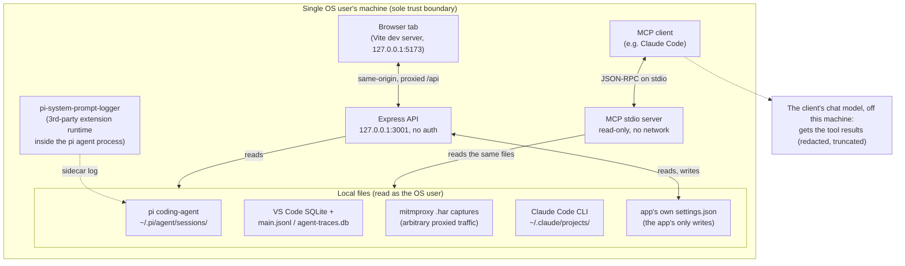

# Threat model

**Last changed:** 2026-11-12 · **Source:** https://github.com/raulkivi/agent-cost-analyzer

Verified by reading the code, not assumed from the architecture docs. Full
reviews at `78657f3` (2026-10-26) and `39efe7a` (2026-11-06); since then each
phase added its rows as it was built (Phase 14 in §4, Phase 15 in §4 and §6,
Phase 12 in §6.1, step 10.17 in §8). Updated 2026-11-12 at `9c43ac2`: the
user price versions read (§4), and the repository, ruleset and `release`
environment settings read through the GitHub API (§5.8, §8).

## 1. System summary

A local-only tool: an Express API (`packages/server`) reads session logs
from disk and serves them to a React SPA (`packages/web`) via Vite's dev
proxy. There is no remote backend, no user accounts, and no network egress
initiated by the app itself — every "data source" is a file already
sitting on the local disk (VS Code's SQLite session store, mitmproxy
`.har` captures, the pi coding-agent's own JSONL sessions, Claude Code
CLI's JSONL sessions). An optional stdio MCP server
(`packages/server/src/mcp/`, started by `scripts/mcp-server.sh`) reads the
same files for an MCP client such as Claude Code; it opens no port, but
its tool results go to that client's chat model.

<!-- mermaid-source: diagrams/1-system-summary.drawio.svg

-->

## 2. Assets

- **Session content**: prompts, source-code snippets, tool outputs, system
  prompts — potentially proprietary/sensitive, since this is a developer's
  real coding-agent history.
- **Captured HTTP traffic** (Analyze mode / mitmproxy): may contain
  provider auth headers, cookies, or other credentials if the user
  proxied real traffic.
- **The projects file** (`projects.json`, Phase 15): project names, client
  names, billing codes and the repositories each project contains. Medium
  sensitivity: it names clients. It is user-written, and the second file the
  app writes (§4).
- **Repository keys and folder paths** derived from sessions (Phase 15):
  remote names such as `github.com/org/app`, folder names and, on request,
  full local paths. They reveal what the user works on and for whom.
- **Published artefacts and their credentials:** the Marketplace publisher
  `raulkivi`, the Open VSX namespace, the `release` environment, the Entra ID
  federated credential, the Open VSX token, and the OAuth token the AI
  workflows use (§8). A compromise reaches every installed copy.
- **The app's own settings file**: active provider selection, retention
  threshold — low sensitivity, and the only file the app wrote before
  `projects.json`. On start
  (API or MCP server) it may also move a legacy settings folder
  (`copilot-cost-analyzer` or `gh-cp-chat-analyser`) to the current name,
  once (`migrate-legacy-app-settings-dir.ts`). The optional pi logger
  writes its own sidecar log inside the pi process.

## 3. Trust model (the actual design decision, not a gap)

The API has **no authentication** and the SPA has **no login**. This is
intentional: `server.ts` binds to `127.0.0.1:3001` and `vite.config.ts`
binds to `127.0.0.1` with a proxy to that same loopback address — so the
entire app is same-origin, loopback-only. The implicit trust boundary is
*"anything that can reach this machine's loopback interface as this OS
user is trusted"* — equivalent to any other localhost dev tool (Vite,
webpack-dev-server, Jupyter without a token, etc.).

**Implication worth stating explicitly**: any other process already
running as the same OS user (malware, a compromised VS Code extension, a
malicious npm postinstall script from an unrelated project) can read all
session data and flip settings via plain HTTP GET/PUT to
`127.0.0.1:3001` — no exploit needed, just network access. This isn't
something code review fixes; it's the accepted boundary of a single-user
local tool. The main risk is *regression*: if a future change binds to
`0.0.0.0` or adds permissive CORS, this silently becomes remotely/LAN
reachable. See recommendation §5.1.

The standalone MCP server opens no port. The MCP client starts it as a
child process of the same OS user and talks JSON-RPC over stdin/stdout,
so whoever can start it can already read the files directly. What it
adds is a data flow off the machine: tool results go to the client's
chat model (§4).

## 4. STRIDE by component (verified against code)

| Component | Threat | Verified finding |
|---|---|---|
| `GET/PUT /api/sessions/:id*`, `/api/log-providers/active` | Tampering / path traversal via `:id` | **Mitigated.** VS Code path resolution (`session-log-path.ts`) validates the id against `^[a-zA-Z0-9-]+$` before `path.join`. The other three providers (pi-agent, Claude Code, mitmproxy) never build a path from the incoming id at all — session IDs are content-hashes computed from files already enumerated on disk, and lookup is by matching against that pre-built list, not by joining user input into a path. `setActive` validates the id against the actual registered provider list (`UnknownLogProviderIdError` → 400). |
| `GET /api/sessions/:id/system-prompt` (SQLite lookup) | SQL injection | **Mitigated.** `getSessionRow`/`getTurnRows`/etc. use parameterized `db.prepare(...).get(?, ?)` — no string concatenation of the id into SQL. |
| Every route (`GET /api/sessions*`, `/api/audit`, HAR bodies, transcripts) | Information disclosure via DNS rebinding (attacker's hostname re-resolved to `127.0.0.1`, making their page same-origin) | **Mitigated.** `createLoopbackHostGuard` (`packages/server/src/http/loopback-host-guard.ts`) runs before every route and returns 403 unless `Host` is `localhost`/`127.0.0.1`/`[::1]` on port 3001 or the Vite dev port 5173 (architecture.md §11.2). Covered by `loopback-host-guard.test.ts` and `app.test.ts`. |
| `PUT /api/config/retention-threshold`, `PUT /api/log-providers/active` | Tampering, CSRF from a malicious webpage | **Mitigated by construction.** No CORS middleware is present, and both routes use non-simple methods/content types, so a cross-origin page cannot trigger a real PUT (blocked by the browser's CORS preflight, which the server never satisfies). HTML forms also can't emit PUT. Body values are type/range-validated before being written. |
| `PUT /api/projects` (Phase 15 step 15.3), the app's first write of user content | Tampering, CSRF, path traversal, oversized or malformed input | **Mitigated.** The same CSRF protection as the row above: no CORS middleware, and a JSON PUT can't be sent cross-origin without a preflight the server never answers. The body is the whole file and is validated against `projectsFileSchema` plus `validateProjectsFile` before anything is written; any problem rejects it (400, with the problems) and nothing changes. The file name is fixed (`projects.json` in the app's settings folder, `FileProjectStore`), so no request names a path. Writes go to a temporary file in the same folder, created with mode 0600, then renamed over the old file. `express.json`'s default 100 kB body limit applies, and reads refuse a file over 1 MiB. |
| `GET /api/projects`, `GET /api/repositories` (Phase 15 step 15.3) | Information disclosure: local folder paths, client names and billing codes | **Mitigated.** Behind the loopback host guard like every route. Repository keys never carry credentials: remotes are normalised (`remote-url-normalizer.ts`) before a key is built, a path containing `@` is rejected, and a property test covers it. The repository resolver only reads files under the session's own folder and its git directory (`.git`, `gitdir`, `commondir`, `config`), each limited to 256 KiB, with no `git` process and no network. These routes aren't exposed through MCP; the MCP tools that come later return repository keys, not local paths (plan §10.1.5). |
| `POST /api/statements/:projectId/:period/issue` (Phase 15 step 15.11), the app's second write | CSRF from a malicious webpage, path traversal, tampering with a frozen statement | **Mitigated.** A form POST is a "simple" cross-origin request with no preflight, so the route refuses anything that isn't `application/json` (415) and writes nothing; a JSON POST from another origin needs a preflight the server never answers (no CORS middleware). The project id and period key are checked against their schema patterns (`^[a-z0-9][a-z0-9-]{0,63}$`, `YYYY-MM` or a date range) before they become a path, and the project must exist in `projects.json`. The file goes to `statements/<project>/<period>.json` in the app's settings folder, created exclusively (`wx`, mode 0600, folder 0700), so an issued statement is never overwritten (409). Only an ended period can be issued (409). A stored file is parsed with `statementSchema` before use; a malformed one is an error, never trusted. |
| `GET /api/statements`, MCP `get_statement` (Phase 15 step 15.11) | Information disclosure: client names, billing codes, session titles | **Mitigated.** Behind the loopback host guard like every route; the MCP server is local stdio. Statements hold session ids and titles, never message text; the exports can leave titles out. `get_statement` is read-only and never issues. CSV exports neutralise a leading `= + - @` so a spreadsheet won't run a title or reason as a formula. |
| `GET /api/estimates`, MCP `estimate_cost` (Phase 15 step 15.12) | Information disclosure; a malformed query | **Mitigated.** Read-only, behind the loopback host guard like every route; the MCP server is local stdio. An estimate holds only totals, unit costs, counts and the project's name, never session titles or message text. The query goes through `estimateRequestSchema` (one target, one unit, a whole number of 1 or more, 4 or 12 weeks); anything else is a 400, and an unknown project a 404. |
| Web SPA rendering of session/turn content | Stored/DOM XSS via a malicious or prompt-injected LLM response captured through mitmproxy | **Mitigated.** No `dangerouslySetInnerHTML`, no markdown-to-raw-HTML pipeline (no `react-markdown`+`rehype-raw`, `marked`, or `DOMPurify` in the web package) was found. All captured content renders as React text nodes, which auto-escape. |
| mitmproxy HAR ingestion → `redactHeaders` | Information disclosure — captured credentials reaching the UI/exports | **Mitigated, one residual.** `harEntryToRawExchange` (`har.ts`) is the one seam every HAR entry passes on its way to a decoder. It passes on headers, bodies, the MIME type and the time, never the URL, so a key in a query string (`?key=...`) can't reach the UI or an export. `redact-headers.ts` strips a fixed list (`authorization`, `x-api-key`, `api-key`, `proxy-authorization`, `cookie`, `set-cookie`) and any header whose name looks like a credential (`CREDENTIAL_NAME_PATTERN`: `api-key`, `secret`, a name ending in `token`, `auth`, `security-token`), case-insensitively, at read time. Residual: a credential under a header name the pattern misses, or inside a request or response body, passes this seam as captured; the MCP server's `redactSecrets` still applies to what it returns (§5.4). |
| `packages/pi-system-prompt-logger` install | Privilege boundary crossing into a 3rd-party agent runtime | **Accepted.** This vendored extension runs inside `@earendil-works/pi-coding-agent`'s own process once installed via `npm run configure`, so installing it extends trust into that runtime. Re-check Dependabot alerts for the pi package on each pi upgrade. |
| Standalone MCP server (`packages/server/src/mcp/`, `scripts/mcp-server.sh`) | Information disclosure to a third-party model; prompt injection from logged content; argument injection | **Mitigated, with the data flow accepted.** Off unless the user registers it with an MCP client. It takes two optional command-line arguments (`stdio-args.ts`): `--project-billing-details` (a flag, §5.6) and `--app-views-html <path>` (also `=<path>`; the built views page, §6.1; a missing value is an error and a missing file is ignored). Unknown arguments are ignored and nothing is passed to a shell. Its only environment input is where to read, as for the API (the home directory, `APPDATA`, `XDG_CONFIG_HOME`, and `PI_SYSTEM_PROMPT_LOG_PATH` for the pi logger's sidecar), set by the same user who starts it. It opens no port and makes no network calls; stdout carries JSON-RPC only. All 21 model-visible tools (re-counted 2026-11-07: 21 `registerTool` calls, each with a `READ_ONLY` annotation), and the app-only `get_turn_series` when the views are served (§6.1), are annotated read-only, and their arguments are zod-checked (`maxTextChars` 200–20,000; session ids resolve through the same provider lookup as the API, so the path-traversal row above applies). It reads every provider, including mitmproxy captures. Free text it returns (prompts, responses, tool output excerpts) goes through `redactSecrets` and is truncated. Residual: (a) that redaction is pattern-based — GitHub, GitLab, npm, Hugging Face and Slack tokens, `sk-` keys, Stripe `sk_`/`rk_` keys, Google `AIza…` keys, AWS access keys, JWTs, private keys, bearer/basic credentials and `password=`/`api_key=`-style pairs — so a credential in another format can still reach the model (§5.4); (b) logged content is untrusted text, so a prompt injection captured in a session can reach the model as a tool result; the tools are read-only, so it can steer the chat but not act through this server. The replay tools (`replay_session`, `compare_models_for_session`, Phase 14) and `estimate_cost` with a `model` return numbers, model ids and turn indexes only, take the HTTP routes' limits (`replay-query-params.ts`: a model id of at most 100 characters from a vendor profile, at most 10 models) and refuse with a reason; an estimate on another model replays at most 200 sessions (`MAX_ESTIMATE_REPLAY_SESSIONS`). A replay is computed on request and never stored. Tests: `replay-tools.test.ts`, `mcp/security.test.ts`. |
| MCP attribution tools (`list_repositories`, `list_projects`, `attribution-tools.ts`, 2026-11-05) | Information disclosure of client names, billing codes and folder paths to the chat model; a prompt-injected session steering the tool arguments | **Mitigated, with the data flow accepted; one residual.** Both tools are read-only. `list_repositories` returns repository keys and folder *names* only: since 2026-11-07 it has no `includePaths` argument (an old one is ignored), so instructions in a session's logged text can't make the model fetch local paths; they stay in `GET /api/repositories`. `list_projects` returns ids, names and members; client names and billing codes only when the user launches the server with `--project-billing-details`, and in `get_statement`. Tests: `attribution-tools.test.ts`, `mcp/security.test.ts` (§5.6, done). |
| Agent Host and Copilot CLI event-log readers (`data-sources/agent-host/`, steps 10.13–10.15) | Path traversal through a session id; unbounded reads; hostile log content | **Mitigated.** Both path builders (`agentSessionDbPath`, `copilotEventLogPath`) test the id against `^[0-9A-Za-z][0-9A-Za-z-]*$` before joining and return `null` otherwise, the same pattern as the VS Code row above. One event-log line is capped at 8 MiB (`MAX_EVENT_LINE_CHARS`), and a line that doesn't parse is dropped. The Copilot home comes from `COPILOT_HOME` or the home directory, set by the user who starts the process. Content renders as React text (XSS row). |
| New read-only routes: `GET /api/price-book`, `/api/vendors`, `/api/learn/scenarios/:id/simulation` and `/comparison`, `/api/repositories` | Information disclosure; input handling | **Mitigated.** All sit behind the loopback host guard (`app.use(createLoopbackHostGuard…)` runs before `express.json()` and every route, re-read in `app.ts`). They serve bundled data and derived figures, and write nothing. The scenario `:id` and the `model`/`models` values are in-memory lookups, never a path; `app.test.ts` sends traversal-shaped ids to each (§5.7). |
| Price book and vendor profiles (`fixtures/price-book/`, `fixtures/vendor-profiles/`) | Tampering with prices to mislead spend figures; a user-supplied version file | **Accepted.** Bundled files are reviewed data edits with a cited source (CODEOWNERS covers every path, but no rule requires its review: §5.8). The weekly `vendor-prices` workflow only reports drift. A bundled file that fails its schema or cites no source stops startup. |
| User price versions (Phase 15 step 15.5: `channels.priceVersions` in `projects.json`; `UserPriceBookSource`, `CompositePriceBookSource`, `PriceBook.priceFor`) | Tampering with every priced figure through a user-written price; a version that silently replaces a bundled price or a billed figure | **Mitigated, one residual.** Standalone app and its MCP server only; the extension reads the bundled book alone (`createBundledPriceBookBeside`). They arrive only through `PUT /api/projects` (the row above: whole-file schema, 100 kB body, 0600 temp file and rename) or a hand edit of the file, both by the OS user. `priceVersionSchema` checks each version (ISO dates with `effectiveTo` after `effectiveFrom`, non-negative prices, ascending tiers, `promoEndsAt` only on a promo, a scope only on a contract), and `validateProjectsFile` refuses a duplicate id, an overlap and an unknown project. When the book loads, a user version that clashes with a bundled one (same id, or a list price over a bundled list price) is left out with a problem, so a user can't replace a bundled list price; only a contract, which is meant to win, applies over it (repository scope, then project, then unscoped). Prices change only the priced figure: billed comes from the log's own AI Credits and reported from the agent's own cost, and the preferred basis takes billed, then reported. Every priced figure names its `priceVersionIds`, and `GET /api/price-book` and `get_price_book` tag each version `origin: "user"`. A version's `note` is the user's own text and reaches the model through `get_price_book`. Residual: the web UI doesn't show that a priced figure came from a user version (§5.10). |
| Legacy settings folder move (`migrate-legacy-app-settings-dir.ts`) | Tampering with files outside the app's folder | **Mitigated.** Runs at start, takes no external input, and only renames the newest existing legacy folder to the current name under the same settings base; it does nothing if the current folder already exists, so it never merges into or overwrites one. |
| `GET /api/sessions/:id/replay` and `/replay/compare`, request-trace readers (Phase 14, steps 14.4–14.5: `app.ts`, `ApiService.getSessionReplay`/`compareSessionReplay`, `services/session-replay/replay-query-params.ts`; [plans/analyze-session-replay.md](plans/analyze-session-replay.md)) | Path traversal through the session id; denial of service by a costly simulation; a hostile log inflating figures | **Mitigated (step 14.5).** Both routes are GET only (any other method is unrouted, 404) and sit behind the loopback host guard like every route. The session id is resolved by the provider's existing lookup (as the first row), so no new path is built from input; the trace readers reuse the providers' own bounded readers and read no file the session view doesn't. The query is parsed by one zod module shared with the RPC and MCP: `model` is a trimmed, non-empty id of at most 100 characters, `models` (comma-separated or an array) is deduplicated and must hold 1–10 ids, `pricing` is `session-channel`, `copilot` or `api`, and anything else is a 400 before any read. `model` and `models` must then be model ids from a vendor profile (the service's allow-list, 400 with its reason otherwise; an unknown `provider` is 400 too); `models` is capped at 10 per compare, the session's own model included (`TooManyComparedModelsError`, 400). A trace over 20,000 requests is refused with a reason rather than simulated (enforced in `SessionReplayService`; the longest real traces seen are 484 requests, and a synthetic 20,000-request trace simulates in about 0.15 s, so a compare of 10 models stays within a few seconds); a session that exists but can't be replayed answers 404 with the reason, as a session with no captured system prompt does (the shared error set has no 422). The answer holds numbers, model ids and turn indexes only: `app.replay.test.ts` asserts no fixture, temp or home directory path and no file name reaches a response, error bodies included; any other failure goes to the generic internal-error path. Trace records are numbers only, schema-checked as non-negative integers; a figure a hostile log inflates stays labelled **Simulated** (`simulated: true` in every answer) and never changes a measured, billed or statement figure. Nothing is written. |
| Everything else reachable only via the API | Elevation of privilege | Not found. The server process only ever reads files under the invoking user's own home directory / configured dirs with that user's own OS privileges; no `sudo`, no `child_process.exec`, no setuid patterns anywhere in `packages/server`. |

## 5. Recommendations (priority order)

**5.1 (Low, preventive; done 2026-11-07) — Guard the loopback bind in
code.** `server.ts` calls `assertLoopbackBindHost(host)` before it listens,
so a bind to anything but `127.0.0.1`, `::1` or `localhost` fails at start
(`loopback-bind.test.ts`). The Host-header guard (§4) covers DNS rebinding.

**5.2 (Medium, concrete; done) — Widen credential redaction beyond the
fixed header denylist.** Header names that look like credentials are
stripped too (`CREDENTIAL_NAME_PATTERN`), and captured URLs are never passed
on, so query-string keys need no redaction (§4, HAR row). Extend the pattern
when a provider uses a header name it misses.

**5.3 (Info, no action needed) — Third-party runtime risk from
`pi-system-prompt-logger`.**
Installing the sidecar logger extends trust into
`@earendil-works/pi-coding-agent`'s runtime. No Dependabot alert is open
for it as of 2026-10-26; check again when pi is upgraded. `architecture.md`'s
pi sidecar section says so (2026-11-12).

**5.4 (Low, concrete; done 2026-10-27) — Widen `redactSecrets` for MCP
tool results.** Add a pattern whenever a new key format turns up, erring on
masking too much.

**5.5 (Medium, concrete; done 2026-11-07) — Pin the code-review plugin.**
`claude-code-review.yml` writes a one-plugin marketplace
(`pinned-review-plugins`) into the runner's temp folder that names the
plugin's source by `sha`. A PR can change it only by changing the workflow,
which the action checks against `main`. Dependabot doesn't bump it: bump
the sha by hand after reading the diff.

**5.6 (Medium, concrete; done 2026-11-07) — Keep paths, client names and
billing codes from the model.** `list_repositories` has no `includePaths`;
`list_projects` returns client names and billing codes only with
`--project-billing-details`; `get_statement` keeps them (§4).

**5.7 (Low, concrete; done 2026-11-07) — Verify the read routes' id
handling.** Scenario and model ids are in-memory lookups, never a path;
`app.test.ts` sends traversal-shaped ids to every such route.

**5.8 (Low, concrete; open, found 2026-11-06) — Release and repository
settings.** Read through the GitHub API on 2026-11-12:
- **Code-owner review is not required.** CODEOWNERS starts with
  `* @raulkivi`, so it covers every path, `fixtures/` and
  `services/pricing/` included, but `main` has no branch protection and its
  one ruleset (27004539) requires status checks only. Add "Require review
  from Code Owners" to the ruleset if a second maintainer joins; with one
  owner it would block every PR.
- **`ext-v*` tags are not protected:** no tag ruleset exists. Add one so
  only the owner can create or move a release tag.
- **`OVSX_PAT`** is still in use; delete it once the Open VSX trusted
  publisher is registered, as the workflow comment says.
- **Done:** the `release` environment requires the owner's review and
  deploys only from `ext-v*` tags.

**5.9 (Low, preventive; open, found 2026-11-06) — Keep the dev tooling
contained.**
The `extension-ui` job and the real-Copilot suite pull in a dev tree with 16
high findings (§7). Keep that job free of secrets and with
`persist-credentials: false` (both true today), check whether
`wdio-vscode-service` verifies the VS Code archive it downloads (not read),
and run the real-Copilot suite only with a dedicated test GitHub account
(§8).

**5.10 (Low, concrete; open, found 2026-11-12) — Show user prices as
the user's.** The web UI shows a priced figure without saying it came from a
user price version; only the price-book listing and `priceVersionIds` tell.
Label it where the figure is shown (§4, user price versions).

Nothing else in the reviewed surface (SQL access, path resolution,
settings writes, CSRF exposure, XSS exposure, DNS rebinding — the last
closed by the Host-header guard in §4 — and the MCP server's inputs)
showed an exploitable gap —
the existing patterns (parameterized queries, hash-based session IDs
instead of path concatenation, strict same-origin binding, no raw-HTML
rendering) are all real, deliberate mitigations already in place.

## 6. VS Code extension surfaces (AI Credits Analyzer)

The extension (`packages/vscode-extension`) runs the same analysis code
without the HTTP server: no port is opened, so sections 3 and 4's loopback
and CORS findings don't apply to it. It adds the surfaces below. The
trust boundary is VS Code's: the extension host (trusted code, running as
the OS user), the webview (untrusted content, treated like a web page) and
an optional MCP child process.

| Surface | Threat | Verified finding |
|---|---|---|
| Webview (`panel/panel-html.ts`, `panel/analyzer-panel.ts`) | XSS, script injection, data exfiltration from the UI | **Mitigated.** The page's CSP is `default-src 'none'; script-src 'nonce-<n>'; style-src <cspSource> 'unsafe-inline'; img-src <cspSource> data:; font-src <cspSource>; connect-src 'none'`. Scripts need the per-render nonce, which is validated as base64 before it is used. `connect-src 'none'` makes "no network from the UI" enforced rather than a convention. `localResourceRoots` is only the extension's `media/` folder, so the webview can't load the user's log files. `retainContextWhenHidden` is off. `style-src` allows inline styles, which is a residual risk only for styling, not script. |
| Webview to host RPC (`rpc/message-dispatcher.ts`) | A compromised or prompt-injected webview calling the host | **Mitigated.** The webview is treated as untrusted. Each request's `method` must be in the domain's allow-list (`apiMethodSchema`) and its params must pass that method's zod schema, else the host replies 400; ApiService validates the values again. Internal errors reach the webview only as a generic 500. `cancel` just makes the host drop a pending reply. `perfMark` is one-way: its name must be `first-render` or `data-ready`, its time a finite number between 0 and 24 hours, and a malformed one is dropped with no reply. |
| Host commands (`rpc/host-command-handler.ts`, `vscode/vscode-host-commands.ts`) | Using the webview to steer the editor | **Mitigated.** Only `openSetting`, `copyToClipboard` and `openTextDocument` exist, each with a zod-checked argument shape. `openSetting` is allowed only for the settings the current config status warns about plus the two Copilot logging settings, so the webview can't point the user at an arbitrary setting. `openTextDocument` text is capped at 5 Mi characters and the language is one of plaintext, markdown or json. |
| Read-only documents (`vscode/vscode-read-only-documents.ts`, `documents/read-only-document-store.ts`) | Editing or saving content by accident; unbounded memory | **Mitigated.** A system prompt or advice bundle opens through a `TextDocumentContentProvider` under its own URI scheme, so the editor can't edit or save it and no file is written. The backing store holds at most 20 documents and drops the oldest; each path is used once, so a stale link can't show a newer document. |
| Settings changes | Silent changes to the user's VS Code configuration | **Mitigated.** The extension never writes VS Code settings. The Setup view's Fix buttons and the webview's `openSetting` only open VS Code's Settings editor on the named setting (`workbench.action.openSettings`); the user makes the change. The extension's own state (active provider, retention threshold, walkthrough shown) is kept in `globalState`. |
| MCP child process (`mcp/stdio.ts`, `mcp/mcp-server-args.ts`, `mcp/mcp-server-definitions.ts`) | Argument injection, file reads outside VS Code's logs, network use, leaking data to a model | **Mitigated, with the data flow accepted.** VS Code starts `dist/mcp-stdio.js` itself, without a shell. Its one input is `--user-data-dir <path>`, checked before anything is read: exactly that flag and value, an absolute, already-normalized path (no `..`, no doubled or trailing separator, not the root, no control characters) that contains VS Code's `User` folder; otherwise it exits 2. The only environment variable the extension passes is `ELECTRON_RUN_AS_NODE=1`; the code reads no other environment input. stdout carries JSON-RPC only; diagnostics go to stderr. All tools are annotated read-only and the process makes no network calls and writes no files. Free text it returns is redacted and truncated first. By design, what a tool returns goes to whichever chat model the user is using, which is why the server is off by default. It serves 19 tools (20 with the views): sessions, audits, findings, repositories (remote keys only, credentials stripped, a local repository by its folder name), the price book, the cost analyses and the replay tools (numbers and model ids only). It also reads the vendor profiles and the bundled price book from the extension's own `media/` folder and, since Phase 12 A13, the MCP App views page from `dist/mcp-apps/views.html` (a fixed path next to the bundle, not an argument), and nothing else outside VS Code's logs. It has no billing tools. A test runs every standalone tool over generated folders and remote credentials and checks that none leaks either (`mcp/security.test.ts`). |
| `aiCreditsAnalyzer.mcp.enabled` | Workspace-controlled opt-in to the data flow above | **Mitigated, with a trusted-workspace case accepted.** The setting defaults to `false`, and is listed in `capabilities.untrustedWorkspaces.restrictedConfigurations`, so a workspace in Restricted Mode can't turn it on through `.vscode/settings.json`. A workspace the user has chosen to trust can, and that is accepted: trusting a workspace already lets it run code and tasks. Turning it off removes the server without a reload. |
| Test hooks (`diagnostics/test-hooks.ts`, `extension.ts`) | A command that exposes internals in a normal install | **Mitigated.** The `aiCreditsAnalyzer.internal.*` commands (timing marks, RPC trace, tree nodes, MCP definitions, and since step 10.16 `holdRequests`/`releaseRequests`) are registered only when VS Code runs the extension in `ExtensionMode.Test` or, since step 10.17 G3 (owner decision D5, 2026-11-11), in `ExtensionMode.Development` with the environment variable `AICA_TEST_HOOKS=1`, which only the real-Copilot suite sets for the VS Code it launches; `package.json` never contributes them. An installed copy runs in `Production` and has none, even with the variable set, and a plain F5 development host has none. Residual, accepted: a developer who sets the variable gets the hooks in their own development host. The extension returns no API object for other extensions. The `RequestGate` the hold hook drives is an optional dispatcher dependency; without it, `dispatch` awaits nothing. Manifest and bundle-load tests assert the hooks are absent in production (plan T4). |
| RPC allow-list growth (`rpc/message-dispatcher.ts`, Learn simulation, step 13.7) | A new webview-callable method widening the host's reach | **Mitigated.** Three methods were added, `getScenario`, `compareScenario` and `listVendorProfiles`. Each is read-only, its params go through the method's zod schema, and ApiService validates the values again. No write method and no host command was added. Phase 15's `PUT /api/projects` is not an RPC method; it stays on the HTTP side. |
| RPC allow-list growth (Phase 15 steps 15.9–15.12) | A webview-callable write | **Mitigated.** The cost methods, and `getCostEstimate` (step 15.12), are read-only. `issueStatement` and `saveProjects` (step 15.11) are the first write methods on the allow-list: their params go through their zod schemas (ApiService validates the projects file again, whole). The extension's ApiService has no statements or projects (D7, D19 of the Phase 15 plan; still so after step 15.14, which added no method), so both answer 404 and write nothing. |
| RPC allow-list growth (Phase 14, step 14.5) | A new webview-callable method widening the host's reach | **Mitigated (step 14.5).** Two read-only methods, `getSessionReplay` and `compareSessionReplay`, with the HTTP routes' params and limits (model ids from a vendor profile, at most 10 models), checked by their zod schemas and again by ApiService through the same `replay-query-params.ts` parser as the routes, so both transports refuse the same input with the same message and status. The extension wires the service over its Copilot-only registry and bundled price book (D5); without a price book the methods answer 404 "Session replay is not available in this product." No write method and no host command. |
| `openSetting` host command (`vscode/vscode-host-commands.ts`, 2026-11-04) | Steering the editor to an unintended setting or extension | **Mitigated.** The allow-list in `rpc/host-command-handler.ts` still runs first. The adapter now opens `@id:<setting>` (an exact match, not a fuzzy search); when Copilot Chat is not installed it searches the marketplace for the fixed id `GitHub.copilot-chat`; for an unregistered key it opens `settings.json` with `revealSetting` and `edit: false`. The user still makes every change; the extension writes no setting. |
| Agent Host stores via the extension (`copilot-log-paths.ts`, `agentHostUserDataDir`) | Reading outside VS Code's own data | **Mitigated.** The reader gets VS Code's user-data directory, the same one the MCP child's `--user-data-dir` check requires to contain `User`. Per-session paths follow the id check in §4. |
| Distribution (Marketplace and Open VSX, from 2026-11-03) | Impersonation, typosquatting, a poisoned update reaching users | **Partly mitigated.** The `raulkivi` publisher and the Open VSX namespace are claimed; the VSIX is built with `vsce package --no-dependencies` from an esbuild bundle, so no `node_modules` ships. Publishing is gated by the `release` environment (§8). Open: the minimum engine is `^1.146.0`, so users on older VS Code stay on an older, unpatched build. |

### 6.1 MCP App views (Phase 12, both products)

Both MCP servers can serve interactive views for `get_session_cost`,
`get_cost_rollup`, `list_findings`, `get_repository_cost`,
`get_project_cost`, `compare_costs`, `explain_cost_change`,
`replay_session`, `compare_models_for_session`, `get_price_changes`,
`get_session_audit`, `get_audit_rollup` and `list_sessions`, and the
standalone server also for `get_statement` and `estimate_cost`, to hosts
that support MCP Apps (VS Code Copilot Chat, Claude Desktop; design in
[plans/mcp-apps.md](plans/mcp-apps.md)). The trust boundary is the host's:
the server (trusted code, the OS user's process), the host (VS Code or
Claude Desktop, which owns the iframe) and the view (`packages/mcp-apps`,
one static HTML page, treated as a web page that shows untrusted text).
Status: Increment 3 (U1–U5 and U9–U15), released 2026-11-12 in extension 0.8.0 and app 0.12.0. The reviews
are in [plans/mcp-apps.md](plans/mcp-apps.md) §6.1: A14 for U1–U3, A23 for
U9–U11, A32 for U4, U5, U12–U15 and fullscreen.

| Surface | Threat | Verified finding |
|---|---|---|
| The iframe and its CSP (`mcp/apps/register-app-views.ts`, `packages/mcp-apps/vite.config.ts`) | The page reaching the network, loading code or embedding frames; exfiltrating what it shows | **Mitigated by the host's sandbox.** The host renders the page in a sandboxed iframe. The resource declares no `csp` domains (no `connectDomains`, no `resourceDomains`) and no `_meta.ui.domain`, so the spec's default CSP applies: no `connect-src`, no frames, no external resource. The build is one file (`vite-plugin-singlefile`) with scripts and CSS inline, fonts not bundled (headings ask for a local font, then the host's) and `assetsInlineLimit: 0`, so nothing is fetched at run time. `bundle-size.test.ts` asserts no external script, stylesheet, `@font-face` or `url(http…)`. The only way out is the host's postMessage channel, which the next rows limit. Residual: the guarantee rests on the host enforcing its sandbox and CSP; a host that doesn't is outside this app. Before each extension release the views run in a real VS Code Copilot Chat (wdio, step 10.17 G4); Claude Desktop can't be driven, so a Playwright fake host replays its recorded context (G5) |
| Host-supplied style variables and fonts (`theme/apply-host-theme.ts`) | The host (or anything posing as it over postMessage) injecting CSS or fonts that hide or spoof content | **Accepted, host trusted.** The view applies `applyHostStyleVariables`, `applyDocumentTheme` and `applyHostFonts` from ext-apps with the host's `hostContext.styles`. These can restyle the view, nothing more: they run in the same iframe and CSP, so they can't read data or reach the network, and the view's own labels ("Unknown", "estimate") are text in the DOM, not CSS. Every token has a fallback, so a host that sends none still gets a readable view |
| Data the view receives (`views/*`, `view-models/*`) | Logged text rendered as HTML or script; secrets in what is shown | **Mitigated.** The view gets only what the tools already return: `structuredContent` of the model-visible view tools listed above, plus `get_turn` (a prompt excerpt, token usage and tool-call outcomes), `get_session_cost`, `get_turn_series`, `list_findings`, `get_repository_cost`, `get_project_cost`, `get_price_changes` and `replay_session` when it drills down. That output has already gone through `redactSecrets` and truncation on the server (§4). Logged text can reach the view: a session title, a turn's prompt excerpt, a finding's explanation and its evidence; for U9–U11 also repository and project labels, vendor and model labels, unknown and not-explained reasons, and a provider's error. A tool's error text, which can quote the model's own arguments (an unknown project id), is shown by U9–U11 as a state in place of a chart. React renders every string as text; the code has no `dangerouslySetInnerHTML`. U9 and U10 recognise the extension's no-projects answer with the domain's `parseUnknownProjectIdText`, which accepts only a reason the domain knows, so a crafted project id can't make that state show its own text (A23). Increment 3 adds model ids, replay reasons and assumptions (U12), price-book model, channel, source ids and notes (U13), project, client, billing code and statement line text (U14), estimate targets, refusals and assumptions (U15), tool-call commands, tool names and session titles (U4) and session titles, models and repositories (U5); every view shows a tool's error text as text, capped at 500 characters. A price source is text, never a link: the views render no `<a>` and set no URL attribute. The A32 tests plant markup and an injected instruction in each of these fields and press every control (A32). Evidence is collapsed by default and shown as text. A view model keeps these fields under names marked display-only. Residual: redaction is pattern-based (§5.4), so a credential in another format shows in the view as it already does in the tool result |
| No forwarding to the model (`views/cost-rollup/AskAboutSession.tsx`, `host/app-host-port.ts`) | Prompt injection: instructions in logged text relayed into the chat by a click | **Mitigated.** The model never sees a drill-down result. The view's only message to the chat is `sendMessage` with `Analyse session <id>`, a fixed template that carries the session id and no other text (not the title, not an excerpt), and only for a plain id (`isPlainSessionId`). It is sent from one place, the `useAnalyse` hook that U2's "Ask about this session" and U5's per-row "Analyse" share, on a click. **Try, then fall back (owner, 2026-11-11):** VS Code advertises no `message` capability yet sends, so the button shows unless the host says `message: false`. A press sends once (the button is disabled while the host answers); a declined or failed send shows "Ask in the chat: Analyse session <id>" for the user to type and is never retried by the view. The fallback text is the same fixed template, shown, not sent. The view never calls `updateModelContext` (the port has no such method), and never calls `openLink` (the port has one, but no view uses it). `requestDisplayMode` (fullscreen, U2 and U9) is called from one hook with a literal mode. A static test (`no-forwarding.test.ts`) parses every shipped source and every `packages/web` module the views import, finds every host call site and HTML or network sink, and fails on an unreviewed tool, argument name or sink, or on an argument read from a display-text field. Each view's dynamic test presses every control with logged text planted in every field and checks what reached the port (A14 for U1–U3, A23 for U9–U11, A32 for U4, U5 and U12–U15) |
| The clipboard (`views/session-cost/CopyCommandButton.tsx`, `open-command.ts`) | Copying attacker-chosen text, such as a shell command, that the user then runs | **Mitigated.** Both hosts refuse `vscode://` links (A0), so U1's button copies the session title (owner decision A, mcp-apps.md §4.4) for the user to paste into the extension's **Open Session…** picker. The title comes from the logs, so it could be attacker-chosen text, but it is folded to one line without control characters, capped at 120 characters, and used as a picker search, not run; the copy needs a click and goes to the user, never to the model. The button shows only for the extension's brand (the standalone product has no panel to open) and only when the browser exposes `navigator.clipboard`; it needs a click. If the copy fails, the view shows the same text to select by hand |
| App-only tool (`get_turn_series`, `_meta.ui.visibility: ["app"]`) | A new tool the model could call, or a write path from a view | **Mitigated.** The tool is read-only (`READ_ONLY` annotations), takes a session id, an optional provider and `maxTurns` (1–2000, zod-checked, default 500), runs behind the same guard and `isError` handling as the other tools, and returns numbers, flags and event names only. Visibility `["app"]` keeps it out of the model's tool list, but it is still a tool on the server, so any client that lists tools can call it; it gives nothing the model-visible tools don't. The views call only read tools (`get_turn_series`, `get_turn`, `get_session_cost`, `list_findings`, from U10 `get_repository_cost` and `get_project_cost` with a row's own ids, period, basis, pricing and currency, from U11 `get_price_changes` with its period's `since` and `until`, only when both are ISO dates (`isPlainDate`), and from U12's compare mode `replay_session` with the result's session id and provider and a model id that passes `isPlainModelId`, else the row is disabled). U4, U5, U13 opened directly, U14 and U15 call none. Nothing a view does can write a file, a statement or a setting. A0 found no approval prompt for it in either host |
| The views file (`mcp/apps/resolve-app-views.ts`, `view-source.ts`, `stdio-args.ts`, `scripts/mcp-server.sh`) | Serving the wrong file; reading outside the build; failing in a way that breaks the server | **Mitigated, with the path accepted.** The standalone server serves the file named by `--app-views-html`; `scripts/mcp-server.sh` passes `packages/mcp-apps/dist/views.html` when it exists, and the user who registers the server could name another HTML file, which is then served to their own host (no more than they could do with the server's code). The extension's child serves `dist/mcp-apps/views.html` next to its bundle: a fixed path, not an argument, so its one input is still `--user-data-dir`. The file is read on each `resources/read` and the brand is inserted as an escaped JSON attribute (`injectBrand` escapes `& < > " '`), so the product name and version can't break out of the tag. **Missing file:** `resolveAppViews` finds no file, logs one line to stderr and returns no `appViews` option, so the server starts exactly as before: no resource, no `_meta.ui` on any tool, no `get_turn_series`, 21 and 19 tools. Tests: `resolve-app-views.test.ts`, `stdio.test.ts`, `mcp-stdio-bundle.test.ts` |
| Billing and write surfaces | A view that shows or changes billing data | **Mitigated.** U14 (`get_statement`) and U15 (`estimate_cost`) exist on the standalone server only. The extension's server has no billing tools and so never names a view for one (a `tools/list` test, A26), and both views render the neutral "No view for this result" state for the extension's brand, with none of the result. U14 has no issue, re-issue or export control and says statements are issued in the app; U14 and U15 make no host call (static test). No view has a write action: the clicks can start only read-tool drill-downs, the fixed `Analyse session <id>` message, the copy button and the fullscreen switch (A32) |

## 7. Residual risks

| Risk | Detail | Status |
|---|---|---|
| `npm audit` dev tree: 46 findings (16 high, 30 moderate) on 2026-11-12; `npm audit --omit=dev` reports 0 | Dev and test tools only; none ships in the VSIX or the app. They run on the owner's machine and in the `extension-ui` CI job (read-only token, no secrets, no persisted credentials). Exposure is a hostile VS Code archive or local-server request during a test run, not production. Most come from `wdio-vscode-service` 8.0.0 (no release since 2026-06-19, plan §5 R1 of vscode-ui-automation.md), which pins `fastify` `^4.28.1` and `@fastify/static` `^7.0.4`: `fastify` (fixed in 5.12.5), `find-my-way`, `@fastify/static` (fixed in 10.1.2), and `file-type` through its downloader. wdio 9's `@puppeteer/browsers` brings `extract-zip` 2.0.1 (**no patched version**) and `basic-ftp` 5.3.1 (fixed in 6.2.1). `eslint` 10.14.0, the latest, brings `minimatch` 10.2.6 (fixed in 11.0.1) through `@eslint/config-array`. None has a non-breaking fix: `npm audit fix --force` offers older majors (`@wdio/cli` 8.6.1, `@vscode/vsce` 3.9.1, `eslint` 9). The `@azure/msal-node` advisory (GHSA-xcx6-jx8p-x3h5, through `@vscode/vsce`), accepted 2026-10-27, is fixed since 2026-11-12: `@azure/identity` 4.14.1 takes `msal-node` 7. | **Accepted by the owner:** the 12 Dependabot alerts for this tree were dismissed as tolerable risk on 2026-11-06 (0 open on 2026-11-12). Replacing `wdio-vscode-service` (wdio 10, or Playwright `_electron`, the plan's fallback) is the only fix for most of the tree. |
| The real-Copilot test suite copies a signed-in VS Code profile (`test:ui:vscode:copilot`, plan §7) | Sign-in material (`User/`, `Local State`) copied to a temp dir, and held in a profile created with `--password-store=basic`, which keeps the key on disk instead of the OS keyring | **Accepted; run green 2026-11-11 (step 10.17 G3).** Owner's machine, opt-in (`COPILOT_E2E=1`), outside `npm test` and CI; the copy is deleted afterwards and nothing reads or prints the sign-in. Since G3 VS Code runs in normal mode (no `--extensionTestsPath`), so it reads the copy's storage from disk; `--shared-data-dir` keeps shared storage in the copy instead of the owner's `~/.vscode-shared`. The launcher writes one non-secret key into the copy's state (the panel model), a test-only agent file into its prompts folder, and a throwaway bridge extension that runs wdio-vscode-service's proxy: it evaluates what the service's WebSocket server sends, as the service's test runner did, and opens no port itself. Residual: another process of the same OS user can read a basic-store profile while it exists, and could connect to the service's WebSocket port first (wdio-vscode-service binds it on all interfaces, unchanged by G3); since owner decision D6 nothing is auto-approved: the chats run in a test-only agent whose only tools are the analyzer's read-only MCP tools (which VS Code runs without asking), MCP discovery from other apps' configs is off and terminal auto approve is off. Use a dedicated test account (§5.9). |

## 8. Supply chain, CI and release (new 2026-11-06)

Read from `.github/` at `39efe7a`, updated 2026-11-12. Repository settings
were read through the GitHub API; what is open is in §5.8.

| Surface | Threat | Verified finding |
|---|---|---|
| `release-extension.yml`: tag `ext-v*` to Marketplace, Open VSX and a GitHub Release | A malicious tag or build publishing to every installed copy; a stolen publishing credential | **Mostly mitigated.** The workflow's default token is `contents: read`; the publish job runs in the `release` environment (required reviewers, per the file's header) with `id-token: write`. The Marketplace sign-in is Entra ID OIDC with a federated credential, so no long-lived Azure secret exists. Open VSX still uses the secret `OVSX_PAT` until its trusted publisher is registered. Open: tag protection and the `OVSX_PAT` removal (§5.8). |
| Release evidence notes, `refs/notes/release-ui` (step 10.17 G2, 2026-11-11): the owner's real-Copilot run writes a git note on the commit; `release-extension.yml` fetches the ref and refuses an `ext-v*` tag whose commit has no passing note | A forged or stale note letting an untested commit release; the fetch needing a credential | **Self-gate, by design.** Anyone with push access can write the ref, so it guards the owner against releasing without the run, not against a malicious maintainer: forging a note needs push rights, which already allow worse (pushing the tag, editing the workflow). The judge binds the note to the tagged commit's full SHA, refuses a dirty tree and any failed, skipped or missing required test, and lists every problem. The run never pushes; the owner pushes the ref. The build job keeps `contents: read` and `persist-credentials: false`; on a public repository the notes fetch needs no token (checked 2026-11-11: an anonymous fetch of a missing ref fails with "couldn't find remote ref", which the step turns into a named error). The note holds commit, versions, model ids, test titles, skip reasons and AI Credits: no path, prompt text or sign-in. |
| `claude.yml`: `@claude` in an issue, comment or review | Prompt injection through issue or PR text reaching an agent that holds `CLAUDE_CODE_OAUTH_TOKEN` and OIDC | **Mitigated in part.** Default token `contents: read` (#92); job permissions are read-only plus `id-token: write`; the action is pinned by SHA; CODEOWNERS covers `.github/workflows/`, `CLAUDE.md` and `.claude/`; a Unicode-smuggling guard scans every PR. Not verified here: who may trigger it (the action's own check is assumed to require write access). The checkout persists no credential (`persist-credentials: false`, 2026-11-12): the job's token is `contents: read`, and the action sets its own token on the git remote before it pushes (its `git-config.ts`). |
| `claude-code-review.yml`: automatic review on every same-repository PR | The same, plus unpinned plugin code | **Mitigated.** Fork and Dependabot PRs are excluded, so untrusted forks never reach the token; `persist-credentials: false`; action pinned by SHA. The code-review plugin is pinned by sha in a marketplace the workflow writes (§5.5). |
| `vendor-prices.yml`: weekly fetch of GitHub's Copilot price table | Untrusted fetched text written into an issue; the workflow's token misused | **Mitigated.** `contents: read` plus `issues: write` on one job; `persist-credentials: false`; it only reports and never commits. An issue created with the workflow token doesn't trigger `claude.yml`, so a hostile `@claude` in the fetched table can't start an agent. This is the only place the project initiates network egress, and it is CI, not the shipped app. |
| `ci.yml` `extension-ui` (step 10.16) | A dev-tree vulnerability (§7) executing during the test run | **Mitigated in part.** `contents: read`, no secrets, `persist-credentials: false`, VS Code version pinned and cached. A required check since step 10.17 G1. Open: archive integrity (§5.9). |
| Required checks (ruleset 27004539 on `main`, step 10.17 G1; docs-only skip, #221) | A change merging without its tests; a PR passing as docs-only to skip the UI suites | **Mitigated, admin bypass accepted.** Nine checks are required: `test`, `extension`, `extension-ui`, `web-e2e`, `mcp-apps-e2e`, `scan`, both CodeQL Analyze jobs and `CodeQL`. Repository admins may bypass, which with one owner is the owner. A PR that changes only docs skips the heavy jobs, which then report as skipped and pass. `scripts/ci-change-scope.mjs` decides, fails safe (the jobs run unless it succeeds and says docs-only), counts the docs that tests read as code, and `test` always runs. |
| Dependency intake (`dependabot.yml`) | A compromised release reaching the tree quickly | **Mitigated.** npm and Actions updates are grouped weekly with a 7-day cooldown "for the window in which compromised releases are usually yanked"; majors are excluded from version updates, security fixes still arrive; every action is pinned by SHA. |
| Review gate (`CODEOWNERS`, #101) | A change to CI, release, dependencies, redaction or the MCP server merging unreviewed | **Partly verified.** The file lists these paths explicitly, owns itself and `docs/threat-model.md`. Its first line, `* @raulkivi`, covers every other path. It blocks nothing: no rule requires code-owner review (§5.8). |
| `scorecard.yml` | Drift in repository hygiene going unnoticed | **In place.** Runs the OpenSSF Scorecard and uploads SARIF; the action is pinned by SHA. |
