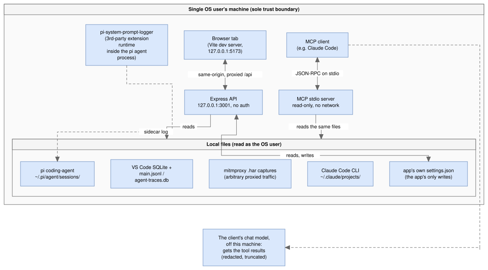
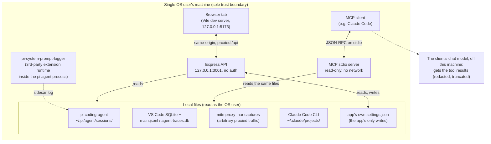

# Threat model

Reviewed against the codebase as of `78657f3` (2026-10-26). Verified by
reading the actual routes, SQL access, session-ID resolution, redaction
logic, network bindings and both MCP servers — not assumed from the
architecture docs alone. Sections 1–5 were first written against
`e7bd2c2` (2026-09-09) and re-checked at `78657f3`; in between, the
code gained the standalone MCP server, `/api/insights`, the turn route
and the settings folder move. Section 6 (the AI Credits Analyzer VS Code extension) was
reviewed against `5d3c7c1` (2026-10-24) by reading
`packages/vscode-extension/src` and re-checked at `78657f3` (steps 10.11
and 10.12 added no host command, RPC method or CSP change).

## 1. System summary

A local-only tool: an Express API (`packages/server`) reads session logs
from disk and serves them to a React SPA (`packages/web`) via Vite's dev
proxy. There is no remote backend, no user accounts, and no network egress
initiated by the app itself — every "data source" is a file already
sitting on the local disk (VS Code's SQLite session store, mitmproxy
`.har` captures, the pi coding-agent's own JSONL sessions, Claude Code
CLI's JSONL sessions). An optional stdio MCP server
(`packages/server/src/mcp/`, started by `scripts/mcp-server.sh`) reads the
same files for an MCP client such as Claude Code; it opens no port, but
its tool results go to that client's chat model.

<!-- mermaid-source: diagrams/1-system-summary.drawio.svg

-->

## 2. Assets

- **Session content**: prompts, source-code snippets, tool outputs, system
  prompts — potentially proprietary/sensitive, since this is a developer's
  real coding-agent history.
- **Captured HTTP traffic** (Analyze mode / mitmproxy): may contain
  provider auth headers, cookies, or other credentials if the user
  proxied real traffic.
- **The app's own settings file**: active provider selection, retention
  threshold — low sensitivity, and the only file the app writes. On start
  (API or MCP server) it may also move a legacy settings folder
  (`copilot-cost-analyzer` or `gh-cp-chat-analyser`) to the current name,
  once (`migrate-legacy-app-settings-dir.ts`). The optional pi logger
  writes its own sidecar log inside the pi process.

## 3. Trust model (the actual design decision, not a gap)

The API has **no authentication** and the SPA has **no login**. This is
intentional: `server.ts` binds to `127.0.0.1:3001` and `vite.config.ts`
binds to `127.0.0.1` with a proxy to that same loopback address — so the
entire app is same-origin, loopback-only. The implicit trust boundary is
*"anything that can reach this machine's loopback interface as this OS
user is trusted"* — equivalent to any other localhost dev tool (Vite,
webpack-dev-server, Jupyter without a token, etc.).

**Implication worth stating explicitly**: any other process already
running as the same OS user (malware, a compromised VS Code extension, a
malicious npm postinstall script from an unrelated project) can read all
session data and flip settings via plain HTTP GET/PUT to
`127.0.0.1:3001` — no exploit needed, just network access. This isn't
something code review fixes; it's the accepted boundary of a single-user
local tool. The main risk is *regression*: if a future change binds to
`0.0.0.0` or adds permissive CORS, this silently becomes remotely/LAN
reachable. See recommendation §5.1.

The standalone MCP server opens no port. The MCP client starts it as a
child process of the same OS user and talks JSON-RPC over stdin/stdout,
so whoever can start it can already read the files directly. What it
adds is a data flow off the machine: tool results go to the client's
chat model (§4).

## 4. STRIDE by component (verified against code)

| Component | Threat | Verified finding |
|---|---|---|
| `GET/PUT /api/sessions/:id*`, `/api/log-providers/active` | Tampering / path traversal via `:id` | **Mitigated.** VS Code path resolution (`session-log-path.ts`) validates the id against `^[a-zA-Z0-9-]+$` before `path.join`. The other three providers (pi-agent, Claude Code, mitmproxy) never build a path from the incoming id at all — session IDs are content-hashes computed from files already enumerated on disk, and lookup is by matching against that pre-built list, not by joining user input into a path. `setActive` validates the id against the actual registered provider list (`UnknownLogProviderIdError` → 400). |
| `GET /api/sessions/:id/system-prompt` (SQLite lookup) | SQL injection | **Mitigated.** `getSessionRow`/`getTurnRows`/etc. use parameterized `db.prepare(...).get(?, ?)` — no string concatenation of the id into SQL. |
| Every route (`GET /api/sessions*`, `/api/audit`, HAR bodies, transcripts) | Information disclosure via DNS rebinding (attacker's hostname re-resolved to `127.0.0.1`, making their page same-origin) | **Mitigated.** `createLoopbackHostGuard` (`packages/server/src/http/loopback-host-guard.ts`) runs before every route and returns 403 unless `Host` is `localhost`/`127.0.0.1`/`[::1]` on port 3001 or the Vite dev port 5173 (architecture.md §11.2). Covered by `loopback-host-guard.test.ts` and `app.test.ts`. |
| `PUT /api/config/retention-threshold`, `PUT /api/log-providers/active` | Tampering, CSRF from a malicious webpage | **Mitigated by construction.** No CORS middleware is present, and both routes use non-simple methods/content types, so a cross-origin page cannot trigger a real PUT (blocked by the browser's CORS preflight, which the server never satisfies). HTML forms also can't emit PUT. Body values are type/range-validated before being written. |
| Web SPA rendering of session/turn content | Stored/DOM XSS via a malicious or prompt-injected LLM response captured through mitmproxy | **Mitigated.** No `dangerouslySetInnerHTML`, no markdown-to-raw-HTML pipeline (no `react-markdown`+`rehype-raw`, `marked`, or `DOMPurify` in the web package) was found. All captured content renders as React text nodes, which auto-escape. |
| mitmproxy HAR ingestion → `redactHeaders` | Information disclosure — captured credentials reaching the UI/exports | **Real, partial gap.** `redact-headers.ts` redacts a fixed denylist (`authorization`, `x-api-key`, `api-key`, `proxy-authorization`, `cookie`, `set-cookie`) at *read* time. It does **not** cover: (a) API keys passed as URL query parameters (a real pattern for some providers, e.g. `?key=...`), and (b) non-standard vendor auth headers outside the fixed list. A user who captures traffic to a provider using either pattern will see the raw credential surfaced in the Turn Inspector / any exported session, even though they reasonably believe "sensitive headers are redacted." |
| `packages/pi-system-prompt-logger` install | Privilege boundary crossing into a 3rd-party agent runtime | **Accepted.** This vendored extension runs inside `@earendil-works/pi-coding-agent`'s own process once installed via `npm run configure`, so installing it extends trust into that runtime. Earlier upstream CVEs (predictable temp extension install paths → local privilege escalation; `auth.json` write race) were tracked as Dependabot alerts under the package's previous name, `@mariozechner/pi-coding-agent`; as of 2026-10-26 no Dependabot alert is open for the pi package. Re-check on each pi upgrade. |
| Standalone MCP server (`packages/server/src/mcp/`, `scripts/mcp-server.sh`) | Information disclosure to a third-party model; prompt injection from logged content; argument injection | **Mitigated, with the data flow accepted.** Off unless the user registers it with an MCP client. It takes no command-line arguments; its only environment input is where to read, as for the API (the home directory, `APPDATA`, `XDG_CONFIG_HOME`, and `PI_SYSTEM_PROMPT_LOG_PATH` for the pi logger's sidecar), set by the same user who starts it. It opens no port and makes no network calls; stdout carries JSON-RPC only. All 9 tools are annotated read-only, and their arguments are zod-checked (`maxTextChars` 200–20,000; session ids resolve through the same provider lookup as the API, so the path-traversal row above applies). It reads every provider, including mitmproxy captures. Free text it returns (prompts, responses, tool output excerpts) goes through `redactSecrets` and is truncated. Residual: (a) that redaction is pattern-based — GitHub tokens, `sk-` keys, AWS access keys, Slack tokens, JWTs, private keys, bearer/basic credentials and `password=`/`api_key=`-style pairs — so a credential in another format (for example a Google `AIza…` key) can reach the model (§5.4); (b) logged content is untrusted text, so a prompt injection captured in a session can reach the model as a tool result; the tools are read-only, so it can steer the chat but not act through this server. |
| Legacy settings folder move (`migrate-legacy-app-settings-dir.ts`) | Tampering with files outside the app's folder | **Mitigated.** Runs at start, takes no external input, and only renames the newest existing legacy folder to the current name under the same settings base; it does nothing if the current folder already exists, so it never merges into or overwrites one. |
| Everything else reachable only via the API | Elevation of privilege | Not found. The server process only ever reads files under the invoking user's own home directory / configured dirs with that user's own OS privileges; no `sudo`, no `child_process.exec`, no setuid patterns anywhere in `packages/server`. |

## 5. Recommendations (priority order)

**5.1 (Low, preventive; open as of 2026-10-26) — Guard the loopback-only
assumption in code, not just convention.**
Nothing currently stops a future change from adding `cors()` or changing
`host` to `0.0.0.0`, which would turn "trusted because it's loopback"
into "trusted because nothing" = an unauthenticated LAN service. Consider
a one-line startup assertion in `server.ts` (refuse to listen if `host`
isn't a loopback address) so this trust boundary can't drift silently.
`server.ts` still binds a hard-coded `127.0.0.1` with no such check. The
Host-header guard (§4) doesn't replace it: a non-browser client on the LAN
can send `Host: localhost:3001` itself.

**5.2 (Medium, concrete; header patterns done, query-string redaction n/a because captured URLs are not retained) — Widen credential redaction beyond the fixed
header denylist.**
Add query-string key redaction (common param names: `key`, `api_key`,
`apikey`, `access_token`) and let each vendor decoder (`decoders/
anthropic.ts`, `decoders/openai.ts`) declare its own additional sensitive
header/param names, since new providers may use headers the shared
denylist doesn't anticipate. This directly serves Analyze mode's stated
purpose (safely inspecting captured traffic) and is a small, testable
change consistent with the existing `redactHeaders`/decoder-registry
pattern.

**5.3 (Info, no action needed) — Third-party runtime risk from
`pi-system-prompt-logger`.**
Installing the sidecar logger extends trust into
`@earendil-works/pi-coding-agent`'s runtime. No Dependabot alert is open
for it as of 2026-10-26; check again when pi is upgraded. Worth a one-line
callout in `docs/architecture.md`'s existing pi-agent section.

**5.4 (Low, concrete) — Widen `redactSecrets` for MCP tool results.**
Tool results leave the machine (§4), so add patterns for common key
formats the list misses, starting with Google API keys (`AIza` plus 35
characters). Keep erring on masking too much.

Nothing else in the reviewed surface (SQL access, path resolution,
settings writes, CSRF exposure, XSS exposure, DNS rebinding — the last
closed by the Host-header guard in §4 — and the MCP server's inputs)
showed an exploitable gap —
the existing patterns (parameterized queries, hash-based session IDs
instead of path concatenation, strict same-origin binding, no raw-HTML
rendering) are all real, deliberate mitigations already in place.

## 6. VS Code extension surfaces (AI Credits Analyzer)

The extension (`packages/vscode-extension`) runs the same analysis code
without the HTTP server: no port is opened, so sections 3 and 4's loopback
and CORS findings don't apply to it. It adds the surfaces below. The
trust boundary is VS Code's: the extension host (trusted code, running as
the OS user), the webview (untrusted content, treated like a web page) and
an optional MCP child process.

| Surface | Threat | Verified finding |
|---|---|---|
| Webview (`panel/panel-html.ts`, `panel/analyzer-panel.ts`) | XSS, script injection, data exfiltration from the UI | **Mitigated.** The page's CSP is `default-src 'none'; script-src 'nonce-<n>'; style-src <cspSource> 'unsafe-inline'; img-src <cspSource> data:; font-src <cspSource>; connect-src 'none'`. Scripts need the per-render nonce, which is validated as base64 before it is used. `connect-src 'none'` makes "no network from the UI" enforced rather than a convention. `localResourceRoots` is only the extension's `media/` folder, so the webview can't load the user's log files. `retainContextWhenHidden` is off. `style-src` allows inline styles, which is a residual risk only for styling, not script. |
| Webview to host RPC (`rpc/message-dispatcher.ts`) | A compromised or prompt-injected webview calling the host | **Mitigated.** The webview is treated as untrusted. Each request's `method` must be in the domain's allow-list (`apiMethodSchema`) and its params must pass that method's zod schema, else the host replies 400; ApiService validates the values again. Internal errors reach the webview only as a generic 500. `cancel` just makes the host drop a pending reply. `perfMark` is one-way: its name must be `first-render` or `data-ready`, its time a finite number between 0 and 24 hours, and a malformed one is dropped with no reply. |
| Host commands (`rpc/host-command-handler.ts`, `vscode/vscode-host-commands.ts`) | Using the webview to steer the editor | **Mitigated.** Only `openSetting`, `copyToClipboard` and `openTextDocument` exist, each with a zod-checked argument shape. `openSetting` is allowed only for the settings the current config status warns about plus the two Copilot logging settings, so the webview can't point the user at an arbitrary setting. `openTextDocument` text is capped at 5 Mi characters and the language is one of plaintext, markdown or json. |
| Read-only documents (`vscode/vscode-read-only-documents.ts`, `documents/read-only-document-store.ts`) | Editing or saving content by accident; unbounded memory | **Mitigated.** A system prompt or advice bundle opens through a `TextDocumentContentProvider` under its own URI scheme, so the editor can't edit or save it and no file is written. The backing store holds at most 20 documents and drops the oldest; each path is used once, so a stale link can't show a newer document. |
| Settings changes | Silent changes to the user's VS Code configuration | **Mitigated.** The extension never writes VS Code settings. The Setup view's Fix buttons and the webview's `openSetting` only open VS Code's Settings editor on the named setting (`workbench.action.openSettings`); the user makes the change. The extension's own state (active provider, retention threshold, walkthrough shown) is kept in `globalState`. |
| MCP child process (`mcp/stdio.ts`, `mcp/mcp-server-args.ts`, `mcp/mcp-server-definitions.ts`) | Argument injection, file reads outside VS Code's logs, network use, leaking data to a model | **Mitigated, with the data flow accepted.** VS Code starts `dist/mcp-stdio.js` itself, without a shell. Its one input is `--user-data-dir <path>`, checked before anything is read: exactly that flag and value, an absolute, already-normalized path (no `..`, no doubled or trailing separator, not the root, no control characters) that contains VS Code's `User` folder; otherwise it exits 2. The only environment variable the extension passes is `ELECTRON_RUN_AS_NODE=1`; the code reads no other environment input. stdout carries JSON-RPC only; diagnostics go to stderr. All tools are annotated read-only and the process makes no network calls and writes no files. Free text it returns is redacted and truncated first. By design, what a tool returns goes to whichever chat model the user is using, which is why the server is off by default. |
| `aiCreditsAnalyzer.mcp.enabled` | Workspace-controlled opt-in to the data flow above | **Mitigated, with a trusted-workspace case accepted.** The setting defaults to `false`, and is listed in `capabilities.untrustedWorkspaces.restrictedConfigurations`, so a workspace in Restricted Mode can't turn it on through `.vscode/settings.json`. A workspace the user has chosen to trust can, and that is accepted: trusting a workspace already lets it run code and tasks. Turning it off removes the server without a reload. |
| Test hooks (`diagnostics/test-hooks.ts`, `extension.ts`) | A command that exposes internals in a normal install | **Mitigated.** The `aiCreditsAnalyzer.internal.*` commands (timing marks, RPC trace, tree nodes, MCP definitions) are registered only when VS Code runs the extension in `ExtensionMode.Test`, and `package.json` never contributes them. An installed copy has none, and the extension returns no API object for other extensions. |

## 7. Residual risks

| Risk | Detail | Status |
|---|---|---|
| `npm audit`: GHSA-xcx6-jx8p-x3h5 in `@azure/msal-node` 6.0.1 | Pulled in only by the dev-only `@vscode/vsce` through `@azure/identity`. It is never shipped in the VSIX (`vsce package --no-dependencies`, and the bundle is built by esbuild). Packaging never signs in. Publishing signs in through the `az` CLI credential, not the authorization-code flow the advisory affects. No `@azure/identity` version that vsce 4 accepts avoids it: re-checked 2026-10-26, vsce 4.0.0 (latest) takes `@azure/identity ^4.13.2`, and both 4.14.0 (latest) and 4.15.0-beta.1 require `msal-node ^6.0.0`; the fix is 7.1.0. `npm audit` reports "fix available", but `npm audit fix --dry-run` leaves the finding. | **Open, owner decision pending.** Recommendation: accept as dev-only and unreachable, and revisit when vsce updates its dependency. |
