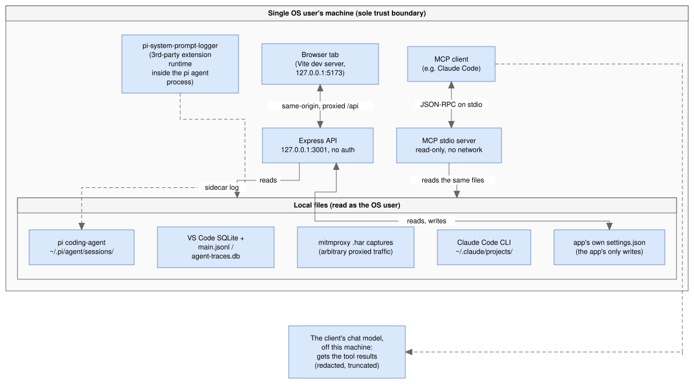
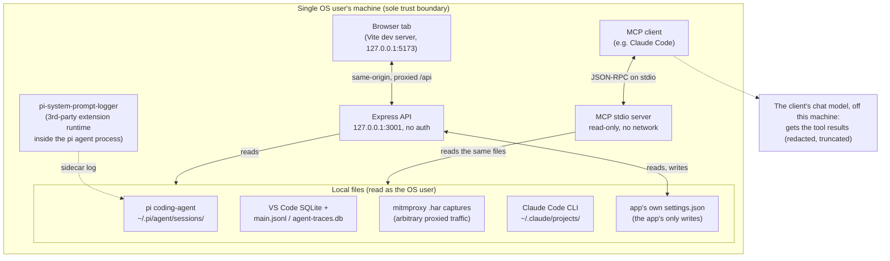

# Threat model

Reviewed against the codebase as of `78657f3` (2026-10-26). Verified by
reading the actual routes, SQL access, session-ID resolution, redaction
logic, network bindings and both MCP servers — not assumed from the
architecture docs alone. Sections 1–5 were first written against
`e7bd2c2` (2026-09-09) and re-checked at `78657f3`; in between, the
code gained the standalone MCP server, `/api/insights`, the turn route
and the settings folder move. Section 6 (the AI Credits Analyzer VS Code extension) was
reviewed against `5d3c7c1` (2026-10-24) by reading
`packages/vscode-extension/src` and re-checked at `78657f3` (steps 10.11
and 10.12 added no host command, RPC method or CSP change).

**Reassessed 2026-11-06 against `39efe7a`** (60 commits since `78657f3`):
routes, MCP tools, the extension's RPC and host commands, workflows,
dependabot, CODEOWNERS and `npm audit` were re-read; §4 and §6 gained rows,
§8 (supply chain, CI and release) is new, §5 and §7 are updated, and §9
lists what the planned Phase 15 steps must add. Two things were read from
plans, not code, and are marked "plan": the Phase 15 steps not built yet, and
the real-Copilot test suite, which was never run.

### What changed in the environment since `78657f3`

- **The extension is published** (Marketplace and Open VSX, 0.1.0 on
  2026-11-03, 0.2.1 now). It runs on other people's machines, so the webview,
  RPC and MCP-child findings in §6 now protect third parties, and a
  compromised publisher account or release pipeline reaches them (§8).
- **The data model grew** past session logs: a user-written projects file
  (client names, billing codes), a bundled price book and vendor profiles, a
  Learn simulator, Agent Host sessions and the Copilot CLI event log.
- **The MCP server grew** from 9 to 12 tools, adding repository and project
  attribution, cost basis and price-book tools. Each returns more about the
  user's work to the client's chat model.
- **Automation grew:** a weekly price-diff workflow, a UI-automation CI job,
  two AI workflows with write-capable OIDC, and CODEOWNERS.
- **Dependency risk moved to dev tooling:** `npm audit` shows 0 production
  findings and 48 in the dev tree (§7).

## 1. System summary

A local-only tool: an Express API (`packages/server`) reads session logs
from disk and serves them to a React SPA (`packages/web`) via Vite's dev
proxy. There is no remote backend, no user accounts, and no network egress
initiated by the app itself — every "data source" is a file already
sitting on the local disk (VS Code's SQLite session store, mitmproxy
`.har` captures, the pi coding-agent's own JSONL sessions, Claude Code
CLI's JSONL sessions). An optional stdio MCP server
(`packages/server/src/mcp/`, started by `scripts/mcp-server.sh`) reads the
same files for an MCP client such as Claude Code; it opens no port, but
its tool results go to that client's chat model.

<!-- mermaid-source: diagrams/1-system-summary.drawio.svg

-->

## 2. Assets

- **Session content**: prompts, source-code snippets, tool outputs, system
  prompts — potentially proprietary/sensitive, since this is a developer's
  real coding-agent history.
- **Captured HTTP traffic** (Analyze mode / mitmproxy): may contain
  provider auth headers, cookies, or other credentials if the user
  proxied real traffic.
- **The projects file** (`projects.json`, Phase 15): project names, client
  names, billing codes and the repositories each project contains. Medium
  sensitivity: it names clients. It is user-written, and the second file the
  app writes (§4).
- **Repository keys and folder paths** derived from sessions (Phase 15):
  remote names such as `github.com/org/app`, folder names and, on request,
  full local paths. They reveal what the user works on and for whom.
- **Published artefacts and their credentials:** the Marketplace publisher
  `raulkivi`, the Open VSX namespace, the `release` environment, the Entra ID
  federated credential, the Open VSX token, and the OAuth token the AI
  workflows use (§8). A compromise reaches every installed copy.
- **The app's own settings file**: active provider selection, retention
  threshold — low sensitivity, and the only file the app wrote before
  `projects.json`. On start
  (API or MCP server) it may also move a legacy settings folder
  (`copilot-cost-analyzer` or `gh-cp-chat-analyser`) to the current name,
  once (`migrate-legacy-app-settings-dir.ts`). The optional pi logger
  writes its own sidecar log inside the pi process.

## 3. Trust model (the actual design decision, not a gap)

The API has **no authentication** and the SPA has **no login**. This is
intentional: `server.ts` binds to `127.0.0.1:3001` and `vite.config.ts`
binds to `127.0.0.1` with a proxy to that same loopback address — so the
entire app is same-origin, loopback-only. The implicit trust boundary is
*"anything that can reach this machine's loopback interface as this OS
user is trusted"* — equivalent to any other localhost dev tool (Vite,
webpack-dev-server, Jupyter without a token, etc.).

**Implication worth stating explicitly**: any other process already
running as the same OS user (malware, a compromised VS Code extension, a
malicious npm postinstall script from an unrelated project) can read all
session data and flip settings via plain HTTP GET/PUT to
`127.0.0.1:3001` — no exploit needed, just network access. This isn't
something code review fixes; it's the accepted boundary of a single-user
local tool. The main risk is *regression*: if a future change binds to
`0.0.0.0` or adds permissive CORS, this silently becomes remotely/LAN
reachable. See recommendation §5.1.

The standalone MCP server opens no port. The MCP client starts it as a
child process of the same OS user and talks JSON-RPC over stdin/stdout,
so whoever can start it can already read the files directly. What it
adds is a data flow off the machine: tool results go to the client's
chat model (§4).

## 4. STRIDE by component (verified against code)

| Component | Threat | Verified finding |
|---|---|---|
| `GET/PUT /api/sessions/:id*`, `/api/log-providers/active` | Tampering / path traversal via `:id` | **Mitigated.** VS Code path resolution (`session-log-path.ts`) validates the id against `^[a-zA-Z0-9-]+$` before `path.join`. The other three providers (pi-agent, Claude Code, mitmproxy) never build a path from the incoming id at all — session IDs are content-hashes computed from files already enumerated on disk, and lookup is by matching against that pre-built list, not by joining user input into a path. `setActive` validates the id against the actual registered provider list (`UnknownLogProviderIdError` → 400). |
| `GET /api/sessions/:id/system-prompt` (SQLite lookup) | SQL injection | **Mitigated.** `getSessionRow`/`getTurnRows`/etc. use parameterized `db.prepare(...).get(?, ?)` — no string concatenation of the id into SQL. |
| Every route (`GET /api/sessions*`, `/api/audit`, HAR bodies, transcripts) | Information disclosure via DNS rebinding (attacker's hostname re-resolved to `127.0.0.1`, making their page same-origin) | **Mitigated.** `createLoopbackHostGuard` (`packages/server/src/http/loopback-host-guard.ts`) runs before every route and returns 403 unless `Host` is `localhost`/`127.0.0.1`/`[::1]` on port 3001 or the Vite dev port 5173 (architecture.md §11.2). Covered by `loopback-host-guard.test.ts` and `app.test.ts`. |
| `PUT /api/config/retention-threshold`, `PUT /api/log-providers/active` | Tampering, CSRF from a malicious webpage | **Mitigated by construction.** No CORS middleware is present, and both routes use non-simple methods/content types, so a cross-origin page cannot trigger a real PUT (blocked by the browser's CORS preflight, which the server never satisfies). HTML forms also can't emit PUT. Body values are type/range-validated before being written. |
| `PUT /api/projects` (Phase 15 step 15.3), the app's first write of user content | Tampering, CSRF, path traversal, oversized or malformed input | **Mitigated.** The same CSRF protection as the row above: no CORS middleware, and a JSON PUT can't be sent cross-origin without a preflight the server never answers. The body is the whole file and is validated against `projectsFileSchema` plus `validateProjectsFile` before anything is written; any problem rejects it (400, with the problems) and nothing changes. The file name is fixed (`projects.json` in the app's settings folder, `FileProjectStore`), so no request names a path. Writes go to a temporary file in the same folder, created with mode 0600, then renamed over the old file. `express.json`'s default 100 kB body limit applies, and reads refuse a file over 1 MiB. |
| `GET /api/projects`, `GET /api/repositories` (Phase 15 step 15.3) | Information disclosure: local folder paths, client names and billing codes | **Mitigated.** Behind the loopback host guard like every route. Repository keys never carry credentials: remotes are normalised (`remote-url-normalizer.ts`) before a key is built, a path containing `@` is rejected, and a property test covers it. The repository resolver only reads files under the session's own folder and its git directory (`.git`, `gitdir`, `commondir`, `config`), each limited to 256 KiB, with no `git` process and no network. These routes aren't exposed through MCP; the MCP tools that come later return repository keys, not local paths (plan §10.1.5). |
| Web SPA rendering of session/turn content | Stored/DOM XSS via a malicious or prompt-injected LLM response captured through mitmproxy | **Mitigated.** No `dangerouslySetInnerHTML`, no markdown-to-raw-HTML pipeline (no `react-markdown`+`rehype-raw`, `marked`, or `DOMPurify` in the web package) was found. All captured content renders as React text nodes, which auto-escape. |
| mitmproxy HAR ingestion → `redactHeaders` | Information disclosure — captured credentials reaching the UI/exports | **Real, partial gap.** `redact-headers.ts` redacts a fixed denylist (`authorization`, `x-api-key`, `api-key`, `proxy-authorization`, `cookie`, `set-cookie`) at *read* time. It does **not** cover: (a) API keys passed as URL query parameters (a real pattern for some providers, e.g. `?key=...`), and (b) non-standard vendor auth headers outside the fixed list. A user who captures traffic to a provider using either pattern will see the raw credential surfaced in the Turn Inspector / any exported session, even though they reasonably believe "sensitive headers are redacted." |
| `packages/pi-system-prompt-logger` install | Privilege boundary crossing into a 3rd-party agent runtime | **Accepted.** This vendored extension runs inside `@earendil-works/pi-coding-agent`'s own process once installed via `npm run configure`, so installing it extends trust into that runtime. Earlier upstream CVEs (predictable temp extension install paths → local privilege escalation; `auth.json` write race) were tracked as Dependabot alerts under the package's previous name, `@mariozechner/pi-coding-agent`; as of 2026-10-26 no Dependabot alert is open for the pi package. Re-check on each pi upgrade. |
| Standalone MCP server (`packages/server/src/mcp/`, `scripts/mcp-server.sh`) | Information disclosure to a third-party model; prompt injection from logged content; argument injection | **Mitigated, with the data flow accepted.** Off unless the user registers it with an MCP client. It takes no command-line arguments; its only environment input is where to read, as for the API (the home directory, `APPDATA`, `XDG_CONFIG_HOME`, and `PI_SYSTEM_PROMPT_LOG_PATH` for the pi logger's sidecar), set by the same user who starts it. It opens no port and makes no network calls; stdout carries JSON-RPC only. All 12 tools (re-counted 2026-11-06: 12 `registerTool` calls, 12 `READ_ONLY` annotations) are annotated read-only, and their arguments are zod-checked (`maxTextChars` 200–20,000; session ids resolve through the same provider lookup as the API, so the path-traversal row above applies). It reads every provider, including mitmproxy captures. Free text it returns (prompts, responses, tool output excerpts) goes through `redactSecrets` and is truncated. Residual: (a) that redaction is pattern-based — GitHub, GitLab, npm, Hugging Face and Slack tokens, `sk-` keys, Stripe `sk_`/`rk_` keys, Google `AIza…` keys, AWS access keys, JWTs, private keys, bearer/basic credentials and `password=`/`api_key=`-style pairs — so a credential in another format can still reach the model (§5.4); (b) logged content is untrusted text, so a prompt injection captured in a session can reach the model as a tool result; the tools are read-only, so it can steer the chat but not act through this server. |
| MCP attribution tools (`list_repositories`, `list_projects`, `attribution-tools.ts`, 2026-11-05) | Information disclosure of client names, billing codes and folder paths to the chat model; a prompt-injected session steering the tool arguments | **Mitigated, with the data flow accepted; one residual.** Both tools are read-only. `list_repositories` returns repository keys and folder *names*; full local paths come back only when the caller passes `includePaths: true`, which defaults to false. `list_projects` returns each project's name, client and billing code, with no opt-out. Residual: `includePaths` is a model-chosen argument, so instructions captured in a session's logged text can ask the model to set it (§5.6). |
| Agent Host and Copilot CLI event-log readers (`data-sources/agent-host/`, steps 10.13–10.15) | Path traversal through a session id; unbounded reads; hostile log content | **Mitigated.** Both path builders (`agentSessionDbPath`, `copilotEventLogPath`) test the id against `^[0-9A-Za-z][0-9A-Za-z-]*$` before joining and return `null` otherwise, the same pattern as the VS Code row above. One event-log line is capped at 8 MiB (`MAX_EVENT_LINE_CHARS`), and a line that doesn't parse is dropped. The Copilot home comes from `COPILOT_HOME` or the home directory, set by the user who starts the process. Content renders as React text (XSS row). |
| New read-only routes: `GET /api/price-book`, `/api/vendors`, `/api/learn/scenarios/:id/simulation` and `/comparison`, `/api/repositories` | Information disclosure; input handling | **Mostly mitigated, one item unverified.** All sit behind the loopback host guard (`app.use(createLoopbackHostGuard…)` runs before `express.json()` and every route, re-read in `app.ts`). They serve bundled data and derived figures, and write nothing. Not re-read at route level: how the scenario `:id` and the `modelId`/`modelIds` query values are resolved. Confirm it is a lookup in the bundled list, not a path (§5.7). |
| Price book and vendor profiles (`fixtures/price-book/`, `fixtures/vendor-profiles/`) | Tampering with prices to mislead spend figures; a user-supplied version file | **Accepted.** Bundled files are reviewed data edits with a cited source (CODEOWNERS covers `/scripts/` and `package.json`, not `fixtures/`: see §5.8). The weekly `vendor-prices` workflow only reports drift. The plan's user price versions are a future write path (§9). |
| Legacy settings folder move (`migrate-legacy-app-settings-dir.ts`) | Tampering with files outside the app's folder | **Mitigated.** Runs at start, takes no external input, and only renames the newest existing legacy folder to the current name under the same settings base; it does nothing if the current folder already exists, so it never merges into or overwrites one. |
| Everything else reachable only via the API | Elevation of privilege | Not found. The server process only ever reads files under the invoking user's own home directory / configured dirs with that user's own OS privileges; no `sudo`, no `child_process.exec`, no setuid patterns anywhere in `packages/server`. |

## 5. Recommendations (priority order)

**5.1 (Low, preventive; open, re-checked 2026-11-06: `server.ts` still has `const host = "127.0.0.1"` and no assertion) — Guard the loopback-only
assumption in code, not just convention.**
Nothing currently stops a future change from adding `cors()` or changing
`host` to `0.0.0.0`, which would turn "trusted because it's loopback"
into "trusted because nothing" = an unauthenticated LAN service. Consider
a one-line startup assertion in `server.ts` (refuse to listen if `host`
isn't a loopback address) so this trust boundary can't drift silently.
`server.ts` still binds a hard-coded `127.0.0.1` with no such check. The
Host-header guard (§4) doesn't replace it: a non-browser client on the LAN
can send `Host: localhost:3001` itself.

**5.2 (Medium, concrete; header patterns done, query-string redaction n/a because captured URLs are not retained) — Widen credential redaction beyond the fixed
header denylist.**
Add query-string key redaction (common param names: `key`, `api_key`,
`apikey`, `access_token`) and let each vendor decoder (`decoders/
anthropic.ts`, `decoders/openai.ts`) declare its own additional sensitive
header/param names, since new providers may use headers the shared
denylist doesn't anticipate. This directly serves Analyze mode's stated
purpose (safely inspecting captured traffic) and is a small, testable
change consistent with the existing `redactHeaders`/decoder-registry
pattern.

**5.3 (Info, no action needed) — Third-party runtime risk from
`pi-system-prompt-logger`.**
Installing the sidecar logger extends trust into
`@earendil-works/pi-coding-agent`'s runtime. No Dependabot alert is open
for it as of 2026-10-26; check again when pi is upgraded. Worth a one-line
callout in `docs/architecture.md`'s existing pi-agent section.

**5.4 (Low, concrete; done 2026-10-27) — Widen `redactSecrets` for MCP
tool results.**
Tool results leave the machine (§4), so `redactSecrets` now also masks
Google API keys, Stripe secret and restricted keys, npm, GitLab and
Hugging Face tokens. Add a pattern whenever a new key format turns up,
erring on masking too much.

**5.5 (Medium, concrete; open, found 2026-11-06) — Pin the code-review
plugin marketplace.**
`claude-code-review.yml` passes `plugin_marketplaces:
'https://github.com/anthropics/claude-code.git'` with no ref, so each run
executes whatever that repository's default branch holds, in a job that has
`CLAUDE_CODE_OAUTH_TOKEN` and `id-token: write`. Every other action is
pinned by SHA. Pin the marketplace to a commit if the action accepts a ref,
or vendor the plugin, and let Dependabot-style review bump it.

**5.6 (Medium, concrete; open, found 2026-11-06) — Take `includePaths` out
of the model's reach, and decide what `list_projects` may return.**
A captured session can carry instructions that make the chat model call
`list_repositories` with `includePaths: true` and so receive full local
paths. Options, cheapest first: drop the argument from the MCP tool and keep
paths in the API only; or make it a server-side setting the user turns on.
Separately, `list_projects` always returns client names and billing codes;
return project ids and names only unless the user opts in.

**5.7 (Low, concrete; open, found 2026-11-06) — Verify the new read routes'
id handling.**
Confirm that `GET /api/learn/scenarios/:id` (and `/simulation`,
`/comparison`) and the `modelId`/`modelIds` query values resolve against the
bundled lists and never reach a path join, and add a test like
`session-log-path.test.ts` for each.

**5.8 (Low, concrete; open, found 2026-11-06) — Release and repository
settings that the repository cannot show.**
- Confirm "Require review from Code Owners" is on for `main` (CODEOWNERS
  does nothing without it) and add `/packages/server/fixtures/` and
  `/packages/server/src/services/pricing/` to it, since a changed price
  changes every reported figure.
- Protect the `ext-v*` tag pattern, so only the owner can start a release.
- Delete `OVSX_PAT` once the Open VSX trusted publisher is registered, as the
  workflow comment says, and note the date here.
- Confirm the `release` environment still lists required reviewers.

**5.9 (Low, preventive; open, found 2026-11-06) — Keep the dev tooling
contained.**
The `extension-ui` job and the real-Copilot suite pull in a dev tree with 18
high findings (§7). Keep that job free of secrets and with
`persist-credentials: false` (both true today), check whether
`wdio-vscode-service` verifies the VS Code archive it downloads (not read),
and run the real-Copilot suite only with a dedicated test GitHub account
(§8).

Nothing else in the reviewed surface (SQL access, path resolution,
settings writes, CSRF exposure, XSS exposure, DNS rebinding — the last
closed by the Host-header guard in §4 — and the MCP server's inputs)
showed an exploitable gap —
the existing patterns (parameterized queries, hash-based session IDs
instead of path concatenation, strict same-origin binding, no raw-HTML
rendering) are all real, deliberate mitigations already in place.

## 6. VS Code extension surfaces (AI Credits Analyzer)

The extension (`packages/vscode-extension`) runs the same analysis code
without the HTTP server: no port is opened, so sections 3 and 4's loopback
and CORS findings don't apply to it. It adds the surfaces below. The
trust boundary is VS Code's: the extension host (trusted code, running as
the OS user), the webview (untrusted content, treated like a web page) and
an optional MCP child process.

| Surface | Threat | Verified finding |
|---|---|---|
| Webview (`panel/panel-html.ts`, `panel/analyzer-panel.ts`) | XSS, script injection, data exfiltration from the UI | **Mitigated.** The page's CSP is `default-src 'none'; script-src 'nonce-<n>'; style-src <cspSource> 'unsafe-inline'; img-src <cspSource> data:; font-src <cspSource>; connect-src 'none'`. Scripts need the per-render nonce, which is validated as base64 before it is used. `connect-src 'none'` makes "no network from the UI" enforced rather than a convention. `localResourceRoots` is only the extension's `media/` folder, so the webview can't load the user's log files. `retainContextWhenHidden` is off. `style-src` allows inline styles, which is a residual risk only for styling, not script. |
| Webview to host RPC (`rpc/message-dispatcher.ts`) | A compromised or prompt-injected webview calling the host | **Mitigated.** The webview is treated as untrusted. Each request's `method` must be in the domain's allow-list (`apiMethodSchema`) and its params must pass that method's zod schema, else the host replies 400; ApiService validates the values again. Internal errors reach the webview only as a generic 500. `cancel` just makes the host drop a pending reply. `perfMark` is one-way: its name must be `first-render` or `data-ready`, its time a finite number between 0 and 24 hours, and a malformed one is dropped with no reply. |
| Host commands (`rpc/host-command-handler.ts`, `vscode/vscode-host-commands.ts`) | Using the webview to steer the editor | **Mitigated.** Only `openSetting`, `copyToClipboard` and `openTextDocument` exist, each with a zod-checked argument shape. `openSetting` is allowed only for the settings the current config status warns about plus the two Copilot logging settings, so the webview can't point the user at an arbitrary setting. `openTextDocument` text is capped at 5 Mi characters and the language is one of plaintext, markdown or json. |
| Read-only documents (`vscode/vscode-read-only-documents.ts`, `documents/read-only-document-store.ts`) | Editing or saving content by accident; unbounded memory | **Mitigated.** A system prompt or advice bundle opens through a `TextDocumentContentProvider` under its own URI scheme, so the editor can't edit or save it and no file is written. The backing store holds at most 20 documents and drops the oldest; each path is used once, so a stale link can't show a newer document. |
| Settings changes | Silent changes to the user's VS Code configuration | **Mitigated.** The extension never writes VS Code settings. The Setup view's Fix buttons and the webview's `openSetting` only open VS Code's Settings editor on the named setting (`workbench.action.openSettings`); the user makes the change. The extension's own state (active provider, retention threshold, walkthrough shown) is kept in `globalState`. |
| MCP child process (`mcp/stdio.ts`, `mcp/mcp-server-args.ts`, `mcp/mcp-server-definitions.ts`) | Argument injection, file reads outside VS Code's logs, network use, leaking data to a model | **Mitigated, with the data flow accepted.** VS Code starts `dist/mcp-stdio.js` itself, without a shell. Its one input is `--user-data-dir <path>`, checked before anything is read: exactly that flag and value, an absolute, already-normalized path (no `..`, no doubled or trailing separator, not the root, no control characters) that contains VS Code's `User` folder; otherwise it exits 2. The only environment variable the extension passes is `ELECTRON_RUN_AS_NODE=1`; the code reads no other environment input. stdout carries JSON-RPC only; diagnostics go to stderr. All tools are annotated read-only and the process makes no network calls and writes no files. Free text it returns is redacted and truncated first. By design, what a tool returns goes to whichever chat model the user is using, which is why the server is off by default. |
| `aiCreditsAnalyzer.mcp.enabled` | Workspace-controlled opt-in to the data flow above | **Mitigated, with a trusted-workspace case accepted.** The setting defaults to `false`, and is listed in `capabilities.untrustedWorkspaces.restrictedConfigurations`, so a workspace in Restricted Mode can't turn it on through `.vscode/settings.json`. A workspace the user has chosen to trust can, and that is accepted: trusting a workspace already lets it run code and tasks. Turning it off removes the server without a reload. |
| Test hooks (`diagnostics/test-hooks.ts`, `extension.ts`) | A command that exposes internals in a normal install | **Mitigated.** The `aiCreditsAnalyzer.internal.*` commands (timing marks, RPC trace, tree nodes, MCP definitions, and since step 10.16 `holdRequests`/`releaseRequests`) are registered only when VS Code runs the extension in `ExtensionMode.Test`, and `package.json` never contributes them. An installed copy has none, and the extension returns no API object for other extensions. The `RequestGate` the hold hook drives is an optional dispatcher dependency; without it, `dispatch` awaits nothing. Manifest and bundle-load tests assert the hooks are absent in production (plan T4). |
| RPC allow-list growth (`rpc/message-dispatcher.ts`, Learn simulation, step 13.7) | A new webview-callable method widening the host's reach | **Mitigated.** Three methods were added, `getScenario`, `compareScenario` and `listVendorProfiles`. Each is read-only, its params go through the method's zod schema, and ApiService validates the values again. No write method and no host command was added. Phase 15's `PUT /api/projects` is not an RPC method; it stays on the HTTP side. |
| `openSetting` host command (`vscode/vscode-host-commands.ts`, 2026-11-04) | Steering the editor to an unintended setting or extension | **Mitigated.** The allow-list in `rpc/host-command-handler.ts` still runs first. The adapter now opens `@id:<setting>` (an exact match, not a fuzzy search); when Copilot Chat is not installed it searches the marketplace for the fixed id `GitHub.copilot-chat`; for an unregistered key it opens `settings.json` with `revealSetting` and `edit: false`. The user still makes every change; the extension writes no setting. |
| Agent Host stores via the extension (`copilot-log-paths.ts`, `agentHostUserDataDir`) | Reading outside VS Code's own data | **Mitigated.** The reader gets VS Code's user-data directory, the same one the MCP child's `--user-data-dir` check requires to contain `User`. Per-session paths follow the id check in §4. |
| Distribution (Marketplace and Open VSX, from 2026-11-03) | Impersonation, typosquatting, a poisoned update reaching users | **Partly mitigated.** The `raulkivi` publisher and the Open VSX namespace are claimed; the VSIX is built with `vsce package --no-dependencies` from an esbuild bundle, so no `node_modules` ships. Publishing is gated by the `release` environment (§8). Open: the minimum engine is `^1.145.0`, so users on older VS Code stay on an older, unpatched build. |

## 7. Residual risks

| Risk | Detail | Status |
|---|---|---|
| `npm audit`: GHSA-xcx6-jx8p-x3h5 in `@azure/msal-node` 6.0.1 | Pulled in only by the dev-only `@vscode/vsce` through `@azure/identity`. It is never shipped in the VSIX (`vsce package --no-dependencies`, and the bundle is built by esbuild). Packaging never signs in. Publishing signs in through the `az` CLI credential, not the authorization-code flow the advisory affects. No `@azure/identity` version that vsce 4 accepts avoids it: re-checked 2026-10-26, vsce 4.0.0 (latest) takes `@azure/identity ^4.13.2`, and both 4.14.0 (latest) and 4.15.0-beta.1 require `msal-node ^6.0.0`; the fix is 7.1.0. `npm audit` reports "fix available", but `npm audit fix --dry-run` leaves the finding. | **Accepted by the owner (2026-10-27)** as dev-only and unreachable. Revisit when vsce or `@azure/identity` moves to `msal-node` 7.1.0 or later. |
| `npm audit` dev tree: 48 findings (30 moderate, 18 high) at `39efe7a`; `npm audit --omit=dev` reports 0 | The high findings are `wdio-vscode-service` 8.0.0's chain (`fastify`, `@fastify/static` authorization bypass and path traversal, `find-my-way`, `extract-zip` symlink path traversal and arbitrary file write, `basic-ftp`, `@puppeteer/browsers`) plus `@wdio/*`, `webdriverio`, `mocha`/`glob` and the accepted `msal-node` row above. None ships in the VSIX or the app. They run on the owner's machine and in the `extension-ui` CI job (read-only token, no secrets, no persisted credentials). The plan (§5 R1 of vscode-ui-automation.md) already records that the service has had no merged commit since 2026-06-19. Exposure is a hostile VS Code archive or local-server request during a test run, not production. | **Open; owner decision.** Not yet accepted like the `msal-node` row. Record an acceptance here, or replace the service with Playwright `_electron` (the plan's fallback) if upstream stays idle. |
| The real-Copilot test suite copies a signed-in VS Code profile (`test:ui:vscode:copilot`, plan §7) | Sign-in material (`User/`, `Local State`) copied to a temp dir, and held in a profile created with `--password-store=basic`, which keeps the key on disk instead of the OS keyring | **Plan only; never run.** Owner's machine, opt-in (`COPILOT_E2E=1`), outside `npm test` and CI; the copy is deleted afterwards and nothing reads or prints the sign-in. Residual: another process of the same OS user can read a basic-store profile while it exists. Use a dedicated test account (§5.9). |

## 8. Supply chain, CI and release (new 2026-11-06)

Read from `.github/` at `39efe7a`. The repository can't show organisation or
branch settings; those are listed as open items in §5.8.

| Surface | Threat | Verified finding |
|---|---|---|
| `release-extension.yml`: tag `ext-v*` to Marketplace, Open VSX and a GitHub Release | A malicious tag or build publishing to every installed copy; a stolen publishing credential | **Mostly mitigated.** The workflow's default token is `contents: read`; the publish job runs in the `release` environment (required reviewers, per the file's header) with `id-token: write`. The Marketplace sign-in is Entra ID OIDC with a federated credential, so no long-lived Azure secret exists. Open VSX still uses the secret `OVSX_PAT` until its trusted publisher is registered. Open: tag protection and the `OVSX_PAT` removal (§5.8). |
| `claude.yml`: `@claude` in an issue, comment or review | Prompt injection through issue or PR text reaching an agent that holds `CLAUDE_CODE_OAUTH_TOKEN` and OIDC | **Mitigated in part.** Default token `contents: read` (#92); job permissions are read-only plus `id-token: write`; the action is pinned by SHA; CODEOWNERS covers `.github/workflows/`, `CLAUDE.md` and `.claude/`; a Unicode-smuggling guard scans every PR. Not verified here: who may trigger it (the action's own check is assumed to require write access). The checkout keeps its token ("@claude may push a branch"), yet the job grants `contents: read`: either the comment is stale or the action pushes with its own app token; settle it and, if stale, set `persist-credentials: false`. |
| `claude-code-review.yml`: automatic review on every same-repository PR | The same, plus unpinned plugin code | **Mitigated in part.** Fork and Dependabot PRs are excluded, so untrusted forks never reach the token; `persist-credentials: false`; action pinned by SHA. Open: the plugin marketplace is `https://github.com/anthropics/claude-code.git` with no ref (§5.5). |
| `vendor-prices.yml`: weekly fetch of GitHub's Copilot price table | Untrusted fetched text written into an issue; the workflow's token misused | **Mitigated.** `contents: read` plus `issues: write` on one job; `persist-credentials: false`; it only reports and never commits. An issue created with the workflow token doesn't trigger `claude.yml`, so a hostile `@claude` in the fetched table can't start an agent. This is the only place the project initiates network egress, and it is CI, not the shipped app. |
| `ci.yml` `extension-ui` (step 10.16) | A dev-tree vulnerability (§7) executing during the test run | **Mitigated in part.** `contents: read`, no secrets, `persist-credentials: false`, VS Code version pinned and cached, `continue-on-error`. Open: archive integrity (§5.9). |
| Dependency intake (`dependabot.yml`) | A compromised release reaching the tree quickly | **Mitigated.** npm and Actions updates are grouped weekly with a 7-day cooldown "for the window in which compromised releases are usually yanked"; majors are excluded from version updates, security fixes still arrive; every action is pinned by SHA. |
| Review gate (`CODEOWNERS`, #101) | A change to CI, release, dependencies, redaction or the MCP server merging unreviewed | **Partly verified.** The file lists these paths explicitly, owns itself and `docs/threat-model.md`. It only blocks a merge if branch protection requires code-owner review, which the repository can't show (§5.8). It does not list `fixtures/` or `services/pricing/` (§5.8). |
| `scorecard.yml` | Drift in repository hygiene going unnoticed | **In place.** Runs the OpenSSF Scorecard and uploads SARIF; the action is pinned by SHA. |

## 9. Forward look: what Phase 15 must add before it ships

Read from `docs/plans/cost-by-repository-and-project.md`; none of this is built.
Each step should add its rows to §4 in the same change, as step 15.0 did.

- **Statements (15.11): new writes and exports.** `StatementStore` is the third
  user-content write path. Reuse the `projects.json` pattern: fixed file
  name, whole-file schema validation, temp file at mode 0600 then rename,
  size limits. CSV export is a known injection route: project and client
  names starting with `=`, `+`, `-` or `@` become spreadsheet formulas, so
  prefix or quote them, and test it.
- **User price versions (15.5 onward).** A user-written price file is a
  tampering path for every figure. Validate with the `PriceVersion` schema,
  require a source field, label user versions in every output, and never let
  one override a `billed` figure.
- **MCP cross-cutting work (15.13).** `get_statement`, `estimate_cost` and the
  prompts return more of the user's billing detail to a third-party model.
  Apply §5.6 first: opt-in for client names, billing codes and paths. Add the
  planned §10.1.5 security tests (argument injection, redaction) for every new
  tool.
- **Extension tabs (15.14).** New webview views reuse the existing RPC
  allow-list; any new method needs the same schema check and a row in §6.
- **Phase 12 (MCP Apps views, planned).** Views rendered inside the MCP
  client are a new untrusted-content boundary with their own sandbox and CSP;
  reassess before building.
