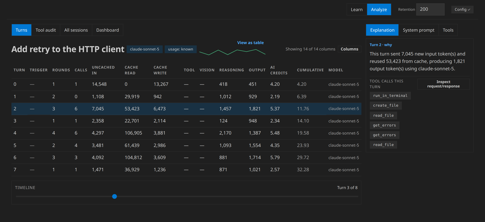
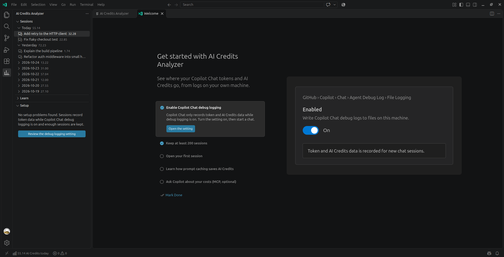
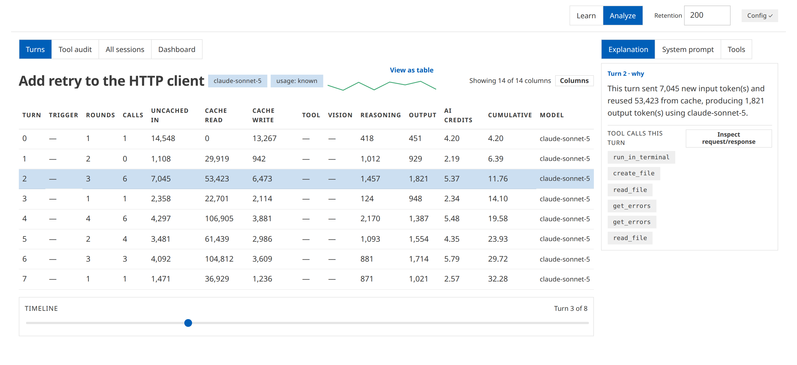
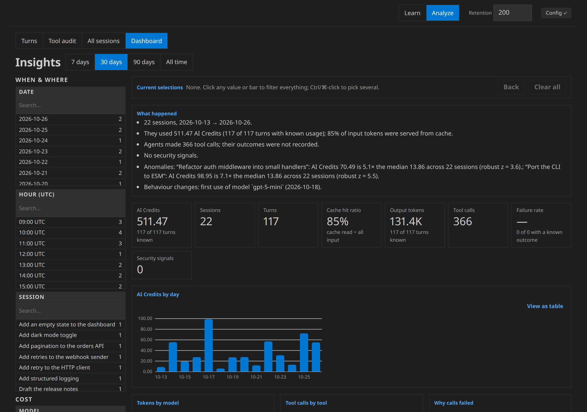
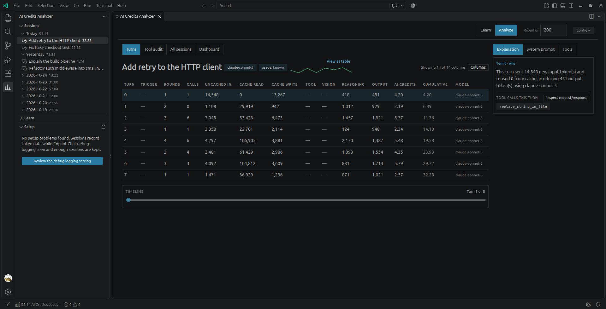
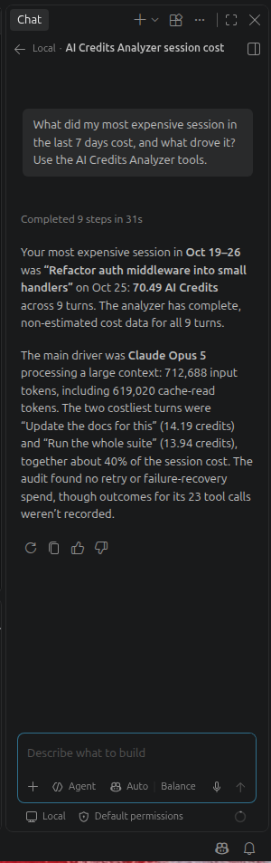
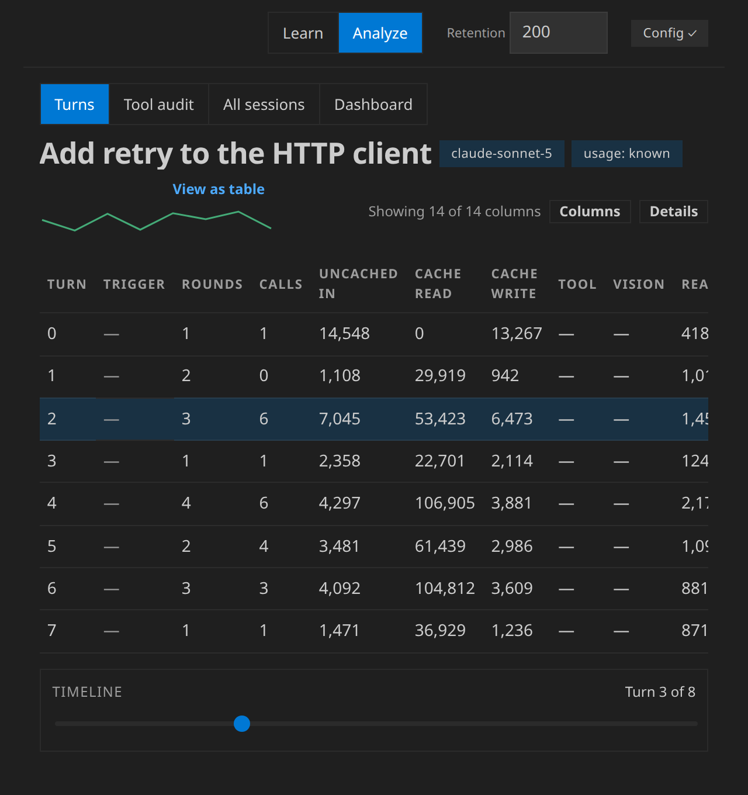
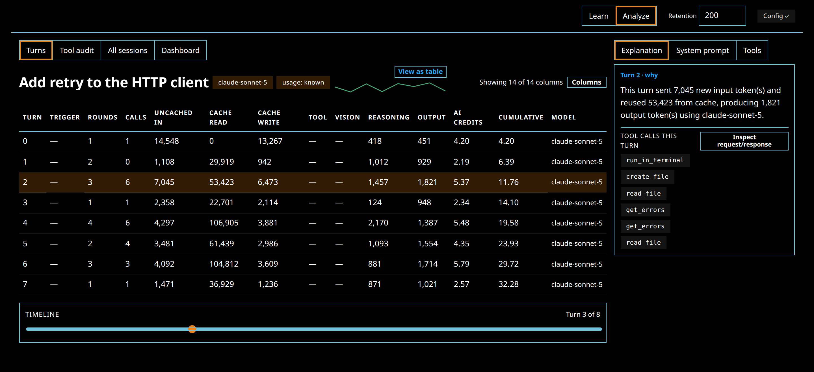

# AI Credits Analyzer: extension guide

AI Credits Analyzer is a VS Code extension that shows where your GitHub
Copilot Chat tokens and AI Credits go. It reads the logs Copilot Chat
writes on your own machine and shows each session turn by turn: prompt
caching, per-turn cost, tool-call failures and insights. It has the same
Learn and Analyze modes as Agent Cost Analyzer, the standalone app in this
repo, but reads only Copilot Chat's logs and runs inside VS Code.

Independent project; not affiliated with or endorsed by GitHub or
Microsoft.

This guide covers what is specific to the extension. The analysis views
themselves are shared with the standalone app and are described in the
[User Guide](UserGuide.md); this guide links to the right section rather
than repeating it. If you use Claude Code, the pi coding agent or
mitmproxy captures, use the standalone app instead (see the
[README](../README.md)).

## Requirements

- **VS Code:** the current stable release. Each extension release requires
  the VS Code version that was stable when it was published. On an older
  VS Code, the Marketplace offers the last extension version that still
  supports it.
- **GitHub Copilot Chat**, installed and signed in. The extension reads
  its logs; it doesn't need Copilot itself to analyze sessions you already
  have.
- **Copilot Chat debug file logging**, turned on. Without it, Copilot Chat
  records no token or AI Credits data. See
  [Turning on debug logging](#turning-on-debug-logging).

## Install and uninstall

### Install

Any of these installs the same extension, `raulkivi.ai-credits-analyzer`:

- **VS Code Marketplace:** open the Extensions view (Ctrl+Shift+X, or
  Cmd+Shift+X on macOS), search for **AI Credits Analyzer**, and select
  **Install**. From a terminal: `code --install-extension raulkivi.ai-credits-analyzer`.
- **Open VSX** (VSCodium and other editors that use Open VSX): search for
  **AI Credits Analyzer** in the editor's Extensions view, or install it
  from [open-vsx.org](https://open-vsx.org/extension/raulkivi/ai-credits-analyzer).
- **VSIX file:** download `ai-credits-analyzer-<version>.vsix` from a
  [GitHub Release](https://github.com/raulkivi/agent-cost-analyzer/releases).
  In the Extensions view, open the **…** menu, choose **Install from
  VSIX…** and pick the file, or run
  `code --install-extension ai-credits-analyzer-<version>.vsix`.

The extension is a single package with everything bundled. It doesn't
need Node.js, `npm install` or a checkout of this repo.

### Uninstall

In the Extensions view, select **AI Credits Analyzer**, then
**Uninstall**, and reload the window if VS Code asks. The extension never
writes Copilot Chat's logs or settings, so nothing there changes.
Settings you changed yourself (for example through a Fix button) are
Copilot Chat's own settings and stay as you set them. If you turned on
`aiCreditsAnalyzer.mcp.enabled`, that line stays in your `settings.json`
until you remove it; it has no effect once the extension is gone.

## First run

On its first start, the extension opens the **Get Started with AI Credits
Analyzer** walkthrough once, as an editor tab. It never shows a
notification for it. To open it again later, run **AI Credits Analyzer:
Open Get Started Walkthrough** from the Command Palette, or use the
**Get started** link in the Sessions view when it's empty.

The walkthrough has five steps. Each one is marked done when you make the
change it describes:

| Step | What it does | Marked done when |
|---|---|---|
| Enable Copilot Chat debug logging | Opens `github.copilot.chat.agentDebugLog.fileLogging.enabled` in the Settings editor | That setting changes |
| Keep at least 200 sessions | Opens `github.copilot.chat.agentDebugLog.fileLogging.maxRetainedSessionLogs` | That setting changes |
| Open your first session | Opens the analyzer panel | You open the panel or a session |
| Learn how prompt caching saves AI Credits | Opens the panel in Learn mode | You run **Open Learn Mode** |
| Ask Copilot about your costs (MCP, optional) | Opens `aiCreditsAnalyzer.mcp.enabled` | That setting changes |

### Turning on debug logging

Copilot Chat writes token and AI Credits usage only while its debug file
logging is on. It's off by default.

1. Open the **Setup** view in the AI Credits Analyzer side bar, or the
   walkthrough's first step.
2. Select **Fix** (or **Enable logging**) on the debug-logging row. The
   Settings editor opens on
   `github.copilot.chat.agentDebugLog.fileLogging.enabled`.
3. Turn it on. Then set
   `github.copilot.chat.agentDebugLog.fileLogging.maxRetainedSessionLogs`
   to at least 200, so Copilot Chat doesn't delete logs after its default
   of 50 sessions.
4. Reload the window (**Developer: Reload Window**), as the Setup row's
   own steps say.

Logging isn't retroactive: only sessions started after you turn it on have
per-turn numbers. Older sessions still appear, with their figures shown as
unknown.

### Agent Host sessions (VS Code 1.143 and later)

VS Code 1.143 makes the Copilot harness the default for new chats. Those
chats run through the Agent Host, which keeps its sessions in its own store
under VS Code's user-data folder. The extension lists them in the Sessions
view with their tokens and AI Credits, and they don't depend on the debug
logging settings above.

- Prompt and response text, tool calls and the system prompt of these
  sessions aren't available yet. The panel's turn inspector, system prompt
  inspector, tool inventory and tool audit say so, and show no figures for
  them.
- A chat that was opened but never sent has no turns, so it isn't listed.
- Sessions from the Local harness (the classic Copilot Chat store) and
  Agent Host sessions are listed together, newest first.
- The Setup view marks the two logging settings **Optional** while Agent
  Host sessions exist. Their message reads "Only affects chats run with the
  Local harness; Agent Host chats are unaffected."

## The analyzer panel

Run **AI Credits Analyzer: Open** (or select the graph icon in the Sessions
view's title bar, or the status-bar item) to open the analyzer as an
editor tab. It's the same app as the standalone Agent Cost Analyzer, with
these differences:

- There is no **Source** select. The extension reads only VS Code's
  Copilot Chat logs, so there's one log provider.
- It follows your VS Code color theme, including the high-contrast
  themes, and VS Code's UI font.
- Config warnings have buttons that open the exact setting (see
  [Fix buttons](#fix-buttons-and-what-they-change)).
- **Open prompt in editor** on the System prompt tab opens the captured
  system prompt as a read-only editor tab, so you can search and copy it
  with the editor's own tools.
- Copying from the panel (the advice prompt, error details) uses VS
  Code's clipboard.
- The insights dashboard covers Copilot Chat sessions only, so it has no
  Provider list box.
- The panel has no list of its own: pick a session in the **Sessions**
  view or a scenario in the **Learn** view in the side bar, and the panel
  gives that room to the turns.
- The panel follows your VS Code theme: its colours, font, form controls
  and scrollbars. It has no brand header of its own (the editor tab names
  it), and in High Contrast the selected option is outlined in the theme's
  active-border colour.

Everything else works as the [User Guide](UserGuide.md) describes:

| Panel area | Where it's described |
|---|---|
| Header with the **Learn / Analyze** switch, the **Config** button and the **Retention** field | [The shared layout](UserGuide.md#the-shared-layout), [Enabling full per-turn numbers](UserGuide.md#enabling-full-per-turn-numbers) |
| Learn mode: 18 sample sessions that explain caching and AI Credits | [Learn mode](UserGuide.md#learn-mode) |
| The 13-column turns table and timeline | [Picking a scenario and reading the turns table](UserGuide.md#picking-a-scenario-and-reading-the-turns-table), [The turns table in Analyze mode](UserGuide.md#the-turns-table-in-analyze-mode) |
| Explanation, System prompt and Tools tabs | [The three-tab right panel](UserGuide.md#the-three-tab-right-panel) |
| System prompt inspector | [The system prompt inspector](UserGuide.md#the-system-prompt-inspector) |
| Turn inspector (request and response per round) | [The turn inspector](UserGuide.md#the-turn-inspector) |
| **Tool audit** and **All sessions** views | [Auditing tool calls](UserGuide.md#auditing-tool-calls) |
| **Dashboard** view | [The insights dashboard](UserGuide.md#the-insights-dashboard) |
| Exporting an AI-advice bundle | [Exporting an AI-advice bundle](UserGuide.md#exporting-an-ai-advice-bundle) |

The panel opens in Learn mode. Switch to **Analyze** to see your own
sessions. The **Retention** field sets the minimum number of retained
session logs the Setup check asks for (200 by default). The extension
stores that value in its own VS Code storage; it doesn't change
Copilot Chat's setting.

Copilot Chat's debug log doesn't record whether a tool call succeeded, so
in the tool audit those calls show as **Unknown**, with the reason, rather
than counting as successes or failures.

## The side bar and status bar

The extension adds an **AI Credits Analyzer** icon to the Activity Bar. Its
side bar has three views: Sessions, Learn and Setup.

### Sessions view (`aiCreditsAnalyzer.sessions`)

Your Copilot Chat sessions, grouped by day: **Today**, **Yesterday**, then
dates (YYYY-MM-DD), newest first. Sessions with no start time go in an
**Undated** group at the end; the extension never makes up a date.

- Each row shows the session's title and its AI Credits total, rounded to
  2 decimals, or **AI Credits unknown** when the log has no cost data. An
  unknown cost is never shown as 0.
- A day's row shows the sum of the known costs and how many are unknown,
  for example `12.40 · 1 unknown`.
- Hover a session for its turn count, start time and model.
- Select a session to open the panel on it.
- Right-click a session for **Open Session**, **Show Tool Audit** and
  **Copy Advice Bundle**.
- The title bar has **Refresh** and **Open**.

The list loads when VS Code starts, when the view becomes visible, and
when you select **Refresh**. It doesn't watch files in the background, so
select **Refresh** after a chat to see new sessions. Refresh also finds
workspaces you opened for the first time after VS Code started.

When there are no sessions with token data yet, the view says so and
offers **Open Learn mode** and **Get started**.

### Learn view (`aiCreditsAnalyzer.learn`)

The 18 bundled Learn scenarios, grouped by what they teach (prompt
caching, cache TTL, compaction, model switches and so on). Each row shows
the scenario's turn count and AI Credits. Select a scenario to open it in
the panel's Learn mode, the same way the Sessions view opens a session.
The scenarios ship with the extension, so this view works before you have
any sessions of your own.

### Setup view (`aiCreditsAnalyzer.setup`)

One row per problem with your Copilot Chat logging settings, marked
**Required** or **Optional**, each with an inline **Fix** button (also on
the right-click menu). When nothing needs fixing, the view says "No setup
problems found" and links to the debug-logging setting. It updates when
either debug-logging setting changes, when the view becomes visible, and
on **Refresh**.

### Fix buttons and what they change

A Fix button opens the Settings editor on exactly the setting the row
names. A Copilot Chat setting that isn't registered (Copilot Chat is
disabled or not installed) opens the Extensions view on Copilot Chat
instead; any other setting the Settings editor can't show opens
settings.json at that setting. It doesn't change the setting itself: you make the change, and nothing is
changed without your click. The rows and the panel's config banner use
the same checks:

| Problem | Severity | Setting that opens | What to change |
|---|---|---|---|
| GitHub Copilot Chat is disabled or not installed | Required | `github.copilot.chat.agentDebugLog.fileLogging.enabled` | Fix opens the Extensions view on Copilot Chat: enable or install it, sign in if asked, then reload the window. Copilot writes no logs without it, even when every setting is right. Panel button: **Open Extensions** |
| Debug logging is off | Required | `github.copilot.chat.agentDebugLog.fileLogging.enabled` | Turn it on. Panel button: **Enable** |
| Too few sessions kept | Required | `github.copilot.chat.agentDebugLog.fileLogging.maxRetainedSessionLogs` | Set it to at least the **Retention** value (200 by default; Copilot Chat's default is 50). Panel button: **Change** |
| Cache-write and reasoning tokens unavailable | Optional | `github.copilot.chat.otel.dbSpanExporter.enabled` | Turn it on for two more per-turn figures. Panel button: **Enable** |

After a change, reload the window. Only sessions started afterwards get
the new data.

Settings are read through VS Code's own configuration, so a workspace
setting that overrides your user setting is taken into account.
Per-folder settings in a multi-root workspace aren't read.

### Status bar

The status-bar item shows the AI Credits of sessions that started today,
for example `12.40 AI Credits today`. It sums only known costs, and its
tooltip says how many of today's sessions have cost data ("3 of 5
sessions today have cost data"). Select it to open the panel.

- **AI Credits: unknown** means none of today's sessions has cost data.
- **AI Credits: setup needed** means a required setting is missing.
  Select it to open the Setup view.
- With no sessions today, the item is hidden.

The item updates on each refresh, not on a timer, so after midnight it
changes on the next refresh.

### Selection sync

Selecting a session in the Sessions view, or running **Open Session**,
**Show Tool Audit** or **Copy Advice Bundle** on it, opens the panel if
it's closed and selects that session, as a click in the panel's own list
would:

- **Open Session** shows its turns table.
- **Show Tool Audit** shows its **Tool audit** view.
- **Copy Advice Bundle** opens the advice dialog for it, where you preview
  and copy the bundle (chat message text is never included).

## Commands

Every command is in the **AI Credits Analyzer** category of the Command
Palette. Commands that need a session or a setting are run from the side
bar and are hidden from the Command Palette.

| Command | Id | What it does |
|---|---|---|
| Open | `aiCreditsAnalyzer.open` | Opens the analyzer panel |
| Refresh | `aiCreditsAnalyzer.refreshSessions` | Reloads the Sessions view, the Setup view and the status bar |
| Open Session | `aiCreditsAnalyzer.openSession` | Opens the panel on a session (side bar only) |
| Open Scenario | `aiCreditsAnalyzer.openScenario` | Opens the panel on a Learn scenario (Learn view only) |
| Show Tool Audit | `aiCreditsAnalyzer.showToolAudit` | Opens the panel on a session's tool audit (side bar only) |
| Copy Advice Bundle | `aiCreditsAnalyzer.copyAdviceBundle` | Opens the panel on a session with the advice dialog open (side bar only) |
| Fix Setting | `aiCreditsAnalyzer.fixSetting` | Opens the Settings editor on a setting a Setup row names, or the debug-logging setting (side bar and walkthrough only) |
| Open Learn Mode | `aiCreditsAnalyzer.openLearnMode` | Opens the panel, which starts in Learn mode |
| Open Get Started Walkthrough | `aiCreditsAnalyzer.openWalkthrough` | Opens the Get Started walkthrough |

**Fix Setting** opens only the Copilot Chat logging settings the setup
check judges and `aiCreditsAnalyzer.mcp.enabled`. Any other setting id is
refused.

## Settings

| Setting | Default | What it does |
|---|---|---|
| `aiCreditsAnalyzer.mcp.enabled` | `false` | Offers Copilot Chat a read-only MCP server over your Copilot Chat sessions. See [The MCP server](#the-mcp-server-for-copilot-agent-mode). |

That is the extension's only setting. It reads, but never writes, the
Copilot Chat settings listed under
[Fix buttons](#fix-buttons-and-what-they-change).

## The MCP server for Copilot agent mode

With the MCP server on, you can ask Copilot Chat in agent mode about your
own sessions: "what did my last session cost, and what drove it?", "which
commands keep failing, and why?", "did the agent do anything risky this
week?". It answers from the same local logs, and its numbers match the
panel's.

### Turning it on

1. Set `aiCreditsAnalyzer.mcp.enabled` to on in your **user** settings
   (or use the walkthrough's last step).
2. In Copilot Chat, switch to agent mode and open **Configure Tools**. The
   **AI Credits Analyzer** server is listed with its tools.

VS Code starts the server as a separate process using its own runtime, so
no Node.js install is needed. The extension doesn't offer the server
until the setting is on.

**Trust guard.** In Restricted Mode, a workspace you haven't trusted can't
turn the server on: VS Code ignores that workspace's value for
`aiCreditsAnalyzer.mcp.enabled`. Once you trust the workspace, its setting
applies. Your user setting always applies.

### What it offers

Nine read-only tools, the same ones the standalone app's MCP server has,
over Copilot Chat sessions only:

| Tool | What it returns |
|---|---|
| `list_log_providers` | The log source (only `vscode` here) and whether it has sessions |
| `list_sessions` | Sessions, most recent first, searchable by title and id and filterable by date |
| `get_turn` | One turn's prompt and response (redacted, truncated), usage and tool calls |
| `get_session_cost` | One session's tokens and AI Credits, cache hit ratio, spend per model and the most expensive turns |
| `get_cost_rollup` | Spend by model and day, and the most expensive sessions |
| `get_session_audit` | One session's tool-call audit |
| `list_tool_calls` | One session's tool calls, filtered and paged |
| `get_audit_rollup` | Tool-call totals, top failing commands and per-day counts across sessions |
| `list_findings` | Security, anomaly and behaviour-change findings, with redacted evidence |

Three prompts start common reviews: `audit_session`, `review_costs` and
`security_review`. A `null` figure means the log doesn't record it; the
tools never report it as 0. The User Guide's
[MCP section](UserGuide.md#querying-the-audit-from-claude-code-mcp) has
more on the tools.

### What goes to the model

When the server is on, whatever its tools return goes into the chat's
context, and so to whichever model the chat uses:

- costs: tokens, AI Credits and cache use per session, turn and day;
- tool calls and their outcomes;
- findings: security, anomaly and behaviour-change flags, with excerpts;
- turn text: your prompts and the model's responses.

Secrets found in that text are redacted first, and text is cut to a
bounded length. The server never writes files, runs commands or reaches
the network, and it reads only Copilot Chat's logs on the machine the
extension runs on.

### Turning it off

Set `aiCreditsAnalyzer.mcp.enabled` back to off. The server is removed
from the tool list right away, with no reload.

## Remote-SSH, WSL and Dev Containers

Copilot Chat writes its logs where its own extension host runs, which in
a remote window is the remote machine, WSL distribution or container. AI
Credits Analyzer is a workspace extension (`extensionKind: ["workspace"]`)
so it runs in the same place and reads the same logs. In a remote window,
install it on the remote side: in the Extensions view, the button reads
**Install in** followed by the remote's name.

There it finds the logs under the VS Code server's data folder (for
example `~/.vscode-server/data`), and the MCP server, when on, also runs
on the remote side. Sessions you had on your local machine aren't shown
in a remote window, and the other way round.

If the extension doesn't recognise the storage layout, it reads nothing
and logs a warning; it never falls back to another folder.

The manual check of Remote-SSH, WSL and Dev Containers in a real VS Code
hasn't been done yet, so treat remote use as untested for now.

## Accessibility

The panel and side bar are built to WCAG 2.2 AA and checked
automatically in dark, light and high-contrast themes.

- **Keyboard.** Everything works without a mouse. Arrow keys move through
  the session list and the turns table, and Enter opens. Escape closes
  the top dialog, drawer or inspector and returns focus to where you were.
  Focus outlines use your theme's focus color. In the system-prompt
  diagram, arrow keys move between sections (Left/Right along a level,
  Down to a child, Up to the parent, Home/End), and Enter or Space selects.
- **View as table.** Every chart has a **View as table** toggle that shows
  the same numbers as a table, with unknown values written as "unknown".
  Each chart also has a text summary for screen readers.
- **High contrast.** The panel uses your theme's colors and contrast
  borders. Severity and status are always shown with an icon and text,
  never with color alone.
- **Narrow panels.** The layout follows the panel's width, not the
  window's. From 700 to 1099 px wide, the right column becomes a drawer.
  Below 700 px, the turns table shows priority columns (Turn, Trigger, AI
  Credits, Cumulative), details open in a drawer, and the views are a
  select. The minimum width is 360 px. The table's column chooser lets
  you pick the visible columns, and it remembers your choice.
- **Reduced motion.** With your system's reduce-motion setting on,
  transitions and animated progress are turned off.
- **Loading.** Results that load in the background are announced to
  screen readers. Long loads (dashboard, tool audit, turn inspector) have
  a **Cancel** button.

## Troubleshooting

### No sessions in the Sessions view

- Copilot Chat may not have been used in this VS Code profile yet, or
  only before debug logging was on. Turn logging on (see
  [Turning on debug logging](#turning-on-debug-logging)), have a chat,
  then select **Refresh**.
- The view doesn't update by itself. Select **Refresh** after a chat.
- In a remote window, the extension shows the remote side's sessions
  only (see [Remote-SSH, WSL and Dev Containers](#remote-ssh-wsl-and-dev-containers)).
- If the panel's Analyze mode says no session store was found, Copilot
  Chat hasn't created its session store in this profile yet.

Learn mode works without any sessions.

### The Setup view says Copilot Chat is disabled or not installed

The check found no enabled GitHub Copilot Chat extension in this VS Code
profile, so no logs are written whatever the settings say. Select **Fix**
to open the Extensions view on Copilot Chat, enable or install it, and
reload the window if asked. The row clears on its own when the extension
is enabled.

### The Setup view says logging is off

Select **Fix** and turn the setting on, then reload the window. If the
row stays after that, check for a workspace setting that turns it off
again: workspace settings override user settings, and the check reads the
effective value.

### A cost shows as "unknown"

"Unknown" means the log doesn't contain that figure. It's never counted
as 0. Common reasons:

- the session was recorded before debug logging was on;
- Copilot Chat deleted the session's debug log (raise
  `github.copilot.chat.agentDebugLog.fileLogging.maxRetainedSessionLogs`);
- cache-write and reasoning tokens need the optional
  `github.copilot.chat.otel.dbSpanExporter.enabled` setting.

Totals add up only known costs and say how many are unknown, so you can
tell when a total leaves sessions out.

### The sessions don't load, or the database seems locked

The extension opens Copilot Chat's session database read-only and never
writes to it. If a read fails while Copilot Chat is busy with the
database, the view shows what failed, says nothing was changed, and
offers **Retry** (in the panel) or **Refresh** (in the Sessions view).
Try again after a moment. If a read keeps failing, use **Copy details**
on the error and open an issue.

The optional `agent-traces.db` is read the same way; when it can't be
read, cache-write and reasoning tokens show as unknown and everything
else still works.

### The MCP server isn't listed in agent mode

- Check that `aiCreditsAnalyzer.mcp.enabled` is on in your user settings.
- If it's on only in a workspace's settings, that workspace must be
  trusted (see the trust guard under
  [Turning it on](#turning-it-on)).
- Check you're in agent mode, and look under **Configure Tools**.
- If the extension didn't recognise VS Code's storage layout, it offers
  no server. The Extension Host output log then has a line starting with
  `AI Credits Analyzer: unrecognised VS Code storage layout`.

## Privacy and what the extension reads

- It reads only Copilot Chat's local log files on the machine where the
  extension runs.
- It makes no network requests and sends no telemetry.
- It never writes, moves or deletes your logs or Copilot Chat's settings.
  It stores only its own state (the Retention value and whether the
  walkthrough was shown) in VS Code's extension storage.
- Its panel loads no remote content.
- The MCP server is off by default. When you turn it on, it sends
  redacted session data to the chat model, as described in
  [What goes to the model](#what-goes-to-the-model).

### Exactly what it reads

The extension asks VS Code for its own storage folder and derives VS
Code's user-data folder from it, so the paths are right on Windows, macOS
and Linux, for Stable, Insiders and portable installs, and on remote
servers. Typical user-data folders are `~/.config/Code` (Linux),
`~/Library/Application Support/Code` (macOS), `%APPDATA%\Code` (Windows)
and `~/.vscode-server/data` (remote). Under that folder it reads:

| Path | What it is |
|---|---|
| `User/globalStorage/github.copilot-chat/session-store.db` | Copilot Chat's session list (SQLite, opened read-only) |
| `User/workspaceStorage/<workspace>/GitHub.copilot-chat/debug-logs/` | Each session's debug log, `main.jsonl`, with per-turn usage and AI Credits |
| `User/globalStorage/github.copilot-chat/agent-traces.db` | Optional: cache-write and reasoning tokens (SQLite, opened read-only) |
| `User/globalStorage/agent-host.db` | Agent Host session list, for VS Code 1.143 and later (SQLite, opened read-only) |
| `agentSessionData/<session>/session.db` | Agent Host turns, tokens and AI Credits per session (SQLite, opened read-only) |

Settings are read through VS Code's settings API, not from the file.
