# AI Credits Analyzer: extension guide

**Last changed:** 2026-11-13 · **Source:** https://github.com/raulkivi/agent-cost-analyzer

AI Credits Analyzer is a VS Code extension that shows where your GitHub
Copilot Chat tokens and AI Credits go. It reads the logs Copilot Chat
writes on your own machine and shows each session turn by turn: prompt
caching, per-turn cost, tool-call failures and insights. It has the same
Learn and Analyze modes as Agent Cost Analyzer, the standalone app in this
repo, but reads only Copilot Chat's logs and runs inside VS Code.

Independent project; not affiliated with or endorsed by GitHub or
Microsoft.

This guide covers what is specific to the extension. The analysis views
themselves are shared with the standalone app and are described in the
[User Guide](UserGuide.md); this guide links to the right section rather
than repeating it. If you use Claude Code, the pi coding agent or
mitmproxy captures, use the standalone app instead (see the
[README](../README.md)).

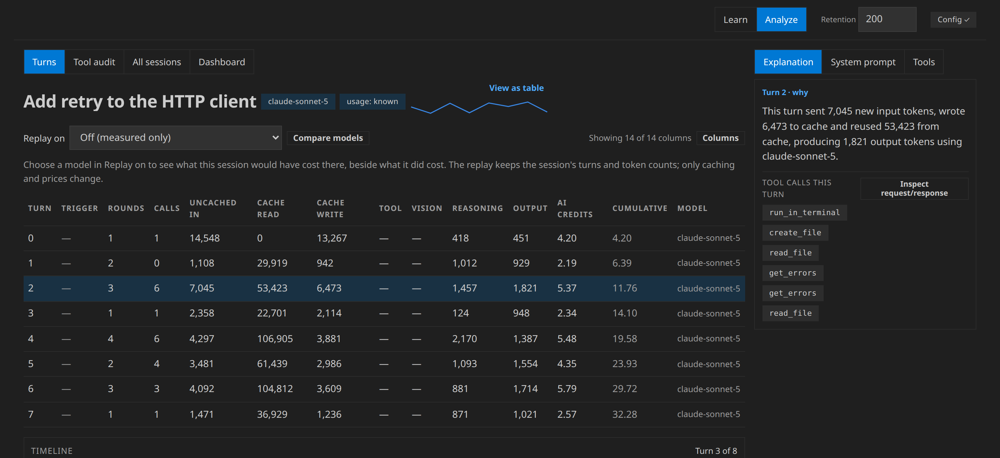

## Requirements

- **VS Code:** the current stable release. Each extension release requires
  the VS Code version that was stable when it was published. On an older
  VS Code, the Marketplace offers the last extension version that still
  supports it.
- **GitHub Copilot Chat**, installed and signed in. The extension reads
  its logs; it doesn't need Copilot itself to analyze sessions you already
  have.
- **Copilot Chat debug file logging**, turned on. Without it, Copilot Chat
  records no token or AI Credits data. See
  [Turning on debug logging](#turning-on-debug-logging).

## Install and uninstall

### Install

Any of these installs the same extension, `raulkivi.ai-credits-analyzer`:

- **VS Code Marketplace:** open the Extensions view (Ctrl+Shift+X, or
  Cmd+Shift+X on macOS), search for **AI Credits Analyzer**, and select
  **Install**. From a terminal: `code --install-extension raulkivi.ai-credits-analyzer`.
- **Open VSX** (VSCodium and other editors that use Open VSX): search for
  **AI Credits Analyzer** in the editor's Extensions view, or install it
  from [open-vsx.org](https://open-vsx.org/extension/raulkivi/ai-credits-analyzer).
- **VSIX file:** download `ai-credits-analyzer-<version>.vsix` from a
  [GitHub Release](https://github.com/raulkivi/agent-cost-analyzer/releases).
  In the Extensions view, open the **…** menu, choose **Install from
  VSIX…** and pick the file, or run
  `code --install-extension ai-credits-analyzer-<version>.vsix`.

The extension is a single package with everything bundled. It doesn't
need Node.js, `npm install` or a checkout of this repo.

### Uninstall

In the Extensions view, select **AI Credits Analyzer**, then
**Uninstall**, and reload the window if VS Code asks. The extension never
writes Copilot Chat's logs or settings, so nothing there changes.
Settings you changed yourself (for example through a Fix button) are
Copilot Chat's own settings and stay as you set them. If you turned on
`aiCreditsAnalyzer.mcp.enabled`, that line stays in your `settings.json`
until you remove it; it has no effect once the extension is gone.

## First run

On its first start, the extension opens the **Get Started with AI Credits
Analyzer** walkthrough once, as an editor tab. It never shows a
notification for it. To open it again later, run **AI Credits Analyzer:
Open Get Started Walkthrough** from the Command Palette, or use the
**Get started** link in the Sessions view when it's empty.

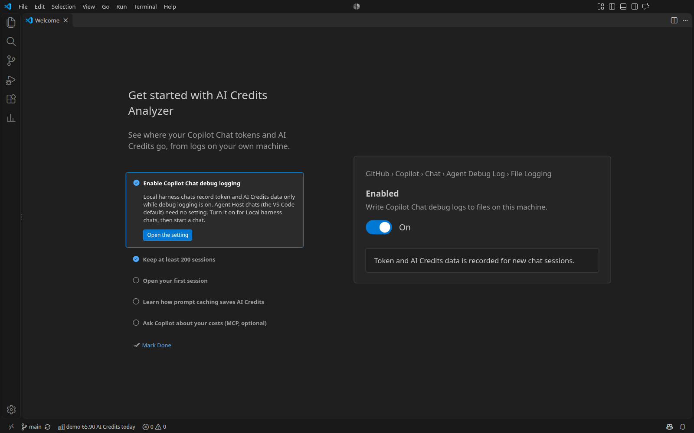

The walkthrough has five steps. Each one is marked done when you make the
change it describes:

| Step | What it does | Marked done when |
|---|---|---|
| Enable Copilot Chat debug logging | Opens `github.copilot.chat.agentDebugLog.fileLogging.enabled` in the Settings editor | That setting changes |
| Keep at least 200 sessions | Opens `github.copilot.chat.agentDebugLog.fileLogging.maxRetainedSessionLogs` | That setting changes |
| Open your first session | Opens the analyzer panel | You open the panel or a session |
| Learn how prompt caching saves AI Credits | Opens the panel in Learn mode | You run **Open Learn Mode** |
| Ask Copilot about your costs (MCP, optional) | Opens `aiCreditsAnalyzer.mcp.enabled` | That setting changes |

### Turning on debug logging

For chats run with the Local harness, Copilot Chat writes token and AI
Credits usage only while its debug file logging is on. It's off by default.
Agent Host chats don't need it (see
[Agent Host sessions](#agent-host-sessions-vs-code-1143-and-later)).

1. Open the **Setup** view in the AI Credits Analyzer side bar, or the
   walkthrough's first step.
2. Select **Fix** (or **Enable logging**) on the debug-logging row. The
   Settings editor opens on
   `github.copilot.chat.agentDebugLog.fileLogging.enabled`.
3. Turn it on. Then set
   `github.copilot.chat.agentDebugLog.fileLogging.maxRetainedSessionLogs`
   to at least 200, so Copilot Chat doesn't delete logs after its default
   of 50 sessions.
4. Reload the window (**Developer: Reload Window**), as the Setup row's
   own steps say.

Logging isn't retroactive: only sessions started after you turn it on have
per-turn numbers. Older sessions still appear, with their figures shown as
unknown.

### Agent Host sessions (VS Code 1.143 and later)

VS Code 1.143 makes the Copilot harness the default for new chats. Those
chats run through the Agent Host, which keeps its sessions in its own store
under VS Code's user-data folder. The extension lists them in the Sessions
view with their tokens and AI Credits, and they don't depend on the debug
logging settings above.

- Prompt and response text, the turn inspector, tool calls and the system
  prompt come from the Copilot CLI's event log, which the extension reads
  locally. The log is in `<COPILOT_HOME or ~/.copilot>/session-state/`, and
  the panel reads it only when you open a session.
- Uncached input, cache read, output and AI Credits come from the Agent
  Host's own per-session database.
- Cache-write and reasoning tokens come from the same log's per-call usage
  records, so they need Copilot CLI 1.0.95 or later. They're used only when
  the records add up to the turn's token totals; otherwise both show as
  unknown, with the reason. No setting is needed for them.
- Tool and vision tokens stay unknown.
- A session whose log is missing or unreadable shows its text, tool calls
  and system prompt as not available, and its cache-write and reasoning
  tokens as unknown, with the reason. It stays out of the tool audit counts.
- The Tools tab stays unavailable, since the Copilot CLI's log records no tool
  definitions.
- A chat that was opened but never sent has no turns, so it isn't listed.
- Sessions from the Local harness (the classic Copilot Chat store) and
  Agent Host sessions are listed together, newest first.
- The Setup view marks the two logging settings **Optional** once VS Code
  has an Agent Host store (`User/globalStorage/agent-host.db`). Their
  message reads "Only affects chats run with the
  Local harness; Agent Host chats are unaffected."

## The analyzer panel

Run **AI Credits Analyzer: Open** (or select the graph icon in the Sessions
view's title bar, or the status-bar item) to open the analyzer as an
editor tab. It's the same app as the standalone Agent Cost Analyzer, with
these differences:

- There is no **Source** select. The extension reads only VS Code's
  Copilot Chat logs, so there's one log provider.
- It follows your VS Code color theme, including the high-contrast
  themes, and VS Code's UI font.
- Config warnings have buttons that open the exact setting (see
  [Fix buttons](#fix-buttons-and-what-they-change)).
- **Open prompt in editor** on the System prompt tab opens the captured
  system prompt as a read-only editor tab, so you can search and copy it
  with the editor's own tools.
- Copying from the panel (the advice prompt, error details) uses VS
  Code's clipboard.
- The insights dashboard covers Copilot Chat sessions only, so it has no
  Provider list box.
- The dashboard's view switch offers **Overview**, **Cost over time** and
  **Compare**, by repository, vendor or model. **Project** and **Billing**
  (projects, statements and estimates) are only in the standalone Agent
  Cost Analyzer app, and the switch says so: the extension has no projects,
  so every session counts in **No project**.
- The panel has no list of its own: pick a session in the **Sessions**
  view or a scenario in the **Learn** view in the side bar, and the panel
  gives that room to the turns.
- The panel follows your VS Code theme: its colours, font, form controls
  and scrollbars. It has no brand header of its own (the editor tab names
  it), and in High Contrast the selected option is outlined in the theme's
  active-border colour.

Everything else works as the [User Guide](UserGuide.md) describes:

| Panel area | Where it's described |
|---|---|
| Header with the **Learn / Analyze** switch, the **Config** button and the **Retention** field | [The shared layout](UserGuide.md#the-shared-layout), [Enabling full per-turn numbers](UserGuide.md#enabling-full-per-turn-numbers) |
| Learn mode: 17 Copilot scenarios, simulated on a vendor and model you pick, that explain caching and AI Credits | [Learn mode](UserGuide.md#learn-mode) |
| The 13-column turns table and timeline | [Picking a scenario and reading the turns table](UserGuide.md#picking-a-scenario-and-reading-the-turns-table), [The turns table in Analyze mode](UserGuide.md#the-turns-table-in-analyze-mode) |
| Explanation, System prompt and Tools tabs | [The three-tab right panel](UserGuide.md#the-three-tab-right-panel) |
| System prompt inspector | [The system prompt inspector](UserGuide.md#the-system-prompt-inspector) |
| Turn inspector (request and response per round) | [The turn inspector](UserGuide.md#the-turn-inspector) |
| **Tool audit** and **All sessions** views | [Auditing tool calls](UserGuide.md#auditing-tool-calls) |
| **Dashboard** view | [The insights dashboard](UserGuide.md#the-insights-dashboard) |
| Subagent marker and **Subagent runs this turn** block | [Classic Copilot Chat subagent runs](UserGuide.md#classic-copilot-chat-subagent-runs) |
| **Cost over time** and **Compare** | [Cost over time and Compare](UserGuide.md#cost-over-time-and-compare); the cost basis and prices in [Cost by repository and project](UserGuide.md#cost-by-repository-and-project) |
| **Replay on** and **Compare models** (a session on another model, **Simulated**) | [Replaying a session on another model](#replaying-a-session-on-another-model) below, and in full in the [User Guide](UserGuide.md#replaying-a-session-on-another-model) |
| Exporting an AI-advice bundle | [Exporting an AI-advice bundle](UserGuide.md#exporting-an-ai-advice-bundle) |

The panel opens in Learn mode. Switch to **Analyze** to see your own
sessions. The **Retention** field sets the minimum number of retained
session logs the Setup check asks for (200 by default). The extension
stores that value in its own VS Code storage; it doesn't change
Copilot Chat's setting.

Copilot Chat's debug log doesn't record whether a tool call succeeded, so
in the tool audit those calls show as **Unknown**, with the reason, rather
than counting as successes or failures.

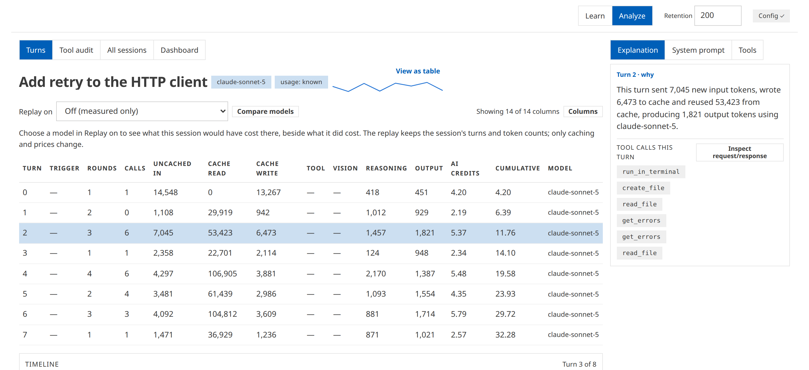

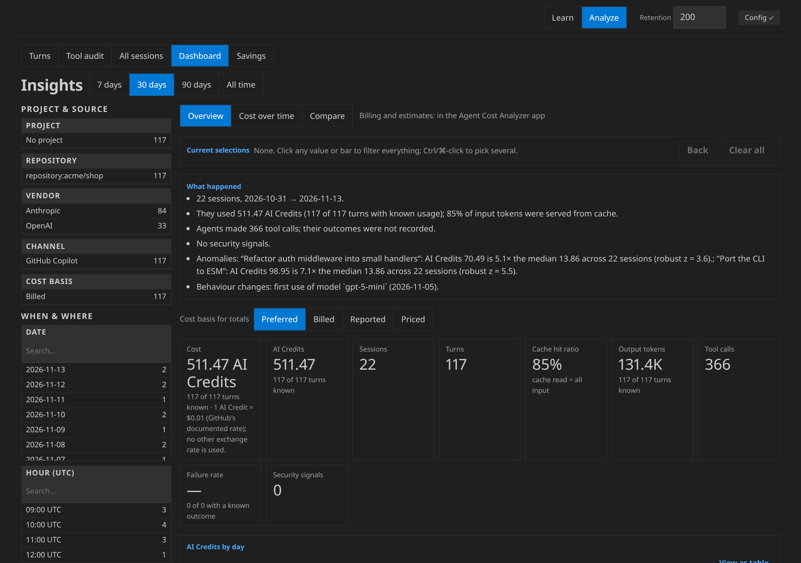

### Replaying a session on another model

In Analyze, open a Copilot session and pick a model in **Replay on**
(**Off (measured only)** by default; the session's own model is marked
**(this session)**). The panel shows what the session would have cost
about on that model, beside what it did cost. It works for local and
Agent Host sessions alike. The replay keeps the session's turns and token
counts; only caching and prices change.

- **Simulated columns.** The turns table gains a dashed
  **Simulated · *model*** group: cache outcome, cache read and cost. A
  turn that can't be replayed says why. The measured columns don't change.
- **Summary.** A strip above the table gives the measured and simulated
  totals, the difference, the coverage, the self-check on the session's
  own model and the prices used. **Replay summary** opens the detail as a
  dialog, with the assumptions behind the replay; Escape closes it.
- **Prices.** A Copilot session is priced at GitHub Copilot's prices, in
  AI Credits (hover a simulated cost for its USD), as of the session's
  date. The **Price channel** switch in the summary prices it at the
  model's vendor's API prices instead, in USD, from the extension's
  bundled price book.
- **Compare models.** The session's simulated total on up to 10 models,
  its own included, as a ranked table and bars. An unknown total reads
  "unknown", never 0.

What differs in the panel:

- **Compact panel.** Below 700 px wide, the table keeps the priority
  columns plus the simulated **Cost**; the other simulated figures are in
  the selected turn's **Details**. In a wider panel, the **Columns** button
  lists Simulated cache, Simulated cache read and Simulated cost; the cost
  can't be hidden. In Compare models, the bars go under the table in a
  narrow panel.
- **Themes.** The Simulated cells keep their dashed edge and **Simulated**
  label in Dark Modern, Light Modern and High Contrast; in High Contrast
  they use the theme's contrast border, with no fill.

A replay is computed when you ask for it and never stored. Agent mode can
ask for the same figures through `replay_session` and
`compare_models_for_session` ([What it offers](#what-it-offers)).

## The side bar and status bar

The extension adds an **AI Credits Analyzer** icon to the Activity Bar. Its
side bar has three views: Sessions, Learn and Setup.

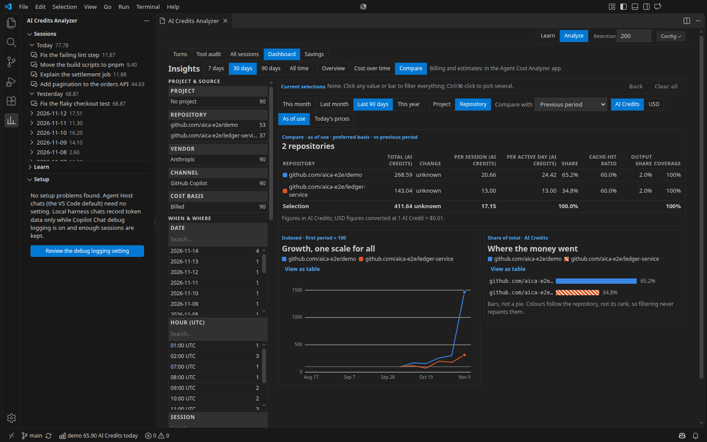

### Sessions view (`aiCreditsAnalyzer.sessions`)

Your Copilot Chat sessions, grouped by day or by repository. By day (the
default): **Today**, **Yesterday**, then
dates (YYYY-MM-DD), newest first. Sessions with no start time go in an
**Undated** group at the end; the extension never makes up a date.

- Each row shows the session's title and its AI Credits total, rounded to
  2 decimals, or **AI Credits unknown** when the log has no cost data. An
  unknown cost is never shown as 0.
- A day's row shows the sum of the known costs and how many are unknown,
  for example `12.40 · 1 unknown`.
- Hover a session for its turn count, start time and model. When a
  classic chat ran subagents, the tooltip adds "incl. 54.65 AI Credits from
  3 subagent runs" (or the reason when those are unknown).
- Select a session to open the panel on it.
- Right-click a session for **Open Session**, **Show Tool Audit** and
  **Copy Advice Bundle**.
- The title bar has **Refresh**, **Open** and the grouping toggle:
  **Group Sessions by Repository** (a repository icon) while sessions are
  grouped by day, **Group Sessions by Day** (a calendar icon) while they
  are grouped by repository. The choice is remembered in every workspace.

#### Grouped by repository

Each group is the repository a session's folder belongs to: its remote,
for example `github.com/example/portal-web`, or a repository with no
remote by its folder name, for example `scratch (local)` (the full path
on your machine is never shown). Groups with the highest known AI Credits
come first, and sessions whose folder isn't known, or isn't in a
repository, go in a **No repository** group at the end; hover it for the
reasons.

- A group's row shows the sum of its sessions' known costs and how many
  are unknown, as a day's row does. It totals every session in the group.
- Hover a group for its session count and total.
- Each session's row shows its cost and the day it started (**Today
  14:02**, **Yesterday** or a date).
- The group holding your newest session is expanded.

The list loads when VS Code starts, when the view becomes visible, and
when you select **Refresh**. It doesn't watch files in the background, so
select **Refresh** after a chat to see new sessions. Refresh also finds
workspaces you opened for the first time after VS Code started.

When the monthly allowance is set, the first row reads **This month**
with the state, for example `812.40 of 1,000 AI Credits · near limit`, and
**· 12 days left** beside it. VS Code's own filter hides that row while
you filter the view; the status-bar gauge stays visible. See
[Monthly allowance gauge](#monthly-allowance-gauge).

When there are no sessions with token data yet, the view says so and
offers **Open Learn mode** and **Get started**.

### Learn view (`aiCreditsAnalyzer.learn`)

The 17 bundled Learn scenarios that apply to Copilot, grouped by what they
teach (prompt caching, cache TTL, compaction, model switches and so on). The
Claude-only 1-hour cache scenario is hidden because Copilot users can't choose
it, and the `/clear` and `/rewind` scenarios use VS Code wording (a new chat,
restoring a checkpoint). Each row shows the scenario's turn count and AI
Credits on the default model. Select a scenario to open it in the panel's
Learn mode, the same way the Sessions view opens a session. The scenarios ship
with the extension, so this view works before you have any sessions of your
own.

In the panel the scenario is **simulated** on a vendor and model you pick
(Anthropic, OpenAI, Google or xAI), with a Cache column, a generated note per
turn, an assumptions popover, a sources footer and USD tooltips on AI Credits.
The extension stays offline: prices and cache rules ship as reviewed data with
their sources. See [Learn mode](UserGuide.md#learn-mode) for what each part
shows.

### Setup view (`aiCreditsAnalyzer.setup`)

One row per problem with your Copilot Chat logging settings, marked
**Required** or **Optional**, each with an inline **Fix** button (also on
the right-click menu). When nothing needs fixing, the view says "No setup
problems found" and links to the debug-logging setting. It updates when
either debug-logging setting changes, when the view becomes visible, and
on **Refresh**.

### Fix buttons and what they change

A Fix button opens the Settings editor on exactly the setting the row
names. A Copilot Chat setting that isn't registered (Copilot Chat is
disabled or not installed) opens the Extensions view on Copilot Chat
instead; any other setting the Settings editor can't show opens
settings.json at that setting. It doesn't change the setting itself: you make the change, and nothing is
changed without your click. The rows and the panel's config banner use
the same checks:

| Problem | Severity | Setting that opens | What to change |
|---|---|---|---|
| GitHub Copilot Chat is disabled or not installed | Required | `github.copilot.chat.agentDebugLog.fileLogging.enabled` | Fix opens the Extensions view on Copilot Chat: enable or install it, sign in if asked, then reload the window. Copilot writes no logs without it, even when every setting is right. Panel button: **Open Extensions** |
| Debug logging is off | Required | `github.copilot.chat.agentDebugLog.fileLogging.enabled` | Turn it on. Panel button: **Enable** |
| Too few sessions kept | Required | `github.copilot.chat.agentDebugLog.fileLogging.maxRetainedSessionLogs` | Set it to at least the **Retention** value (200 by default; Copilot Chat's default is 50). Panel button: **Change** |
| Cache-write and reasoning tokens unavailable | Optional | `github.copilot.chat.otel.dbSpanExporter.enabled` | Turn it on for two more per-turn figures in Local harness chats. Agent Host chats don't need it. Panel button: **Enable** |

Once VS Code has an Agent Host store, the debug-logging and retention rows
are Optional, since they only affect chats run with the Local harness.

After a change, reload the window. Only sessions started afterwards get
the new data.

Settings are read through VS Code's own configuration, so a workspace
setting that overrides your user setting is taken into account.
Per-folder settings in a multi-root workspace aren't read.

### Status bar

The status-bar item shows the AI Credits of sessions that started today,
for example `12.40 AI Credits today`. It sums only known costs, and its
tooltip says how many of today's sessions have cost data ("3 of 5
sessions today have cost data"). Select it to open the panel.

- **AI Credits: unknown** means none of today's sessions has cost data.
- **AI Credits: setup needed** means a required setting is missing.
  Select it to open the Setup view.
- With no sessions today, the item is hidden.

When the open folder is in a git repository, the item shows that
repository's AI Credits today, for example `portal-web 48.20 AI Credits
today`, and its tooltip adds every repository's total:

```
AI Credits today
portal-web (this workspace): 48.20
All repositories: 61.75
3 of 4 sessions today have cost data
```

A repository with no remote is named by its folder only. A multi-root
workspace adds up its folders' repositories (`portal-web +1`). If the
workspace's repository has no session today, the item shows every
repository's total and the tooltip says so. With no folder open, or one
outside a repository, it shows every repository's total.

The item updates on each refresh, and when you add or remove a workspace
folder, not on a timer, so after midnight it changes on the next refresh.

#### Monthly allowance gauge

Set `aiCreditsAnalyzer.monthlyAllowance.aiCredits` to your plan's monthly
AI Credits allowance. The **Set Monthly AI Credits Allowance** command opens
that setting in the Settings editor and changes nothing. Until the setting
is set, the gauge is hidden.

A second status-bar item, placed after today's, shows the month to date
against the allowance:

| State | Status bar text | Background |
|---|---|---|
| Normal | `312.40 of 1,000 AI Credits` | none |
| Near the limit (from `warnAtPercent`, 80 by default) | `812.40 of 1,000 AI Credits · near limit` | warning |
| Over the allowance (100 % or more) | `1,042.10 of 1,000 AI Credits · over` | error |
| Some sessions have no cost data | `at least 312.40 of 1,000 AI Credits` (also with `· near limit` or `· over`) | as above |
| No session this month has cost data | `AI Credits this month: unknown` | none |
| No sessions this month | `No sessions this month` | none |

- The figure comes first, so a narrow status bar keeps it. The level is
  in the words and the icon as well as the background colour.
- The percentage is in the tooltip and the screen-reader label, not in the
  bar.
- The tooltip gives the percentage, the AI Credits that remain ("up to",
  since the figure can be low), the days left (today counts), the period
  start, how many of the month's sessions have cost data and the oldest
  session counted.
- The period starts on `resetDay` (1 by default, 1 to 28) in your local
  time zone. Set it to match your GitHub billing page.
- The gauge never shows a notification, changes no setting and makes no
  network request. It doesn't project the month's total or show a run
  rate.
- Select the item to open the Sessions view.

The gauge is a lower bound on what is recorded here, not your bill. It
doesn't see:

- Subagent spend of classic Copilot Chat runs, until that is counted
  (the figure is low by that spend).
- Sessions whose logs Copilot has already pruned. Copilot keeps the last
  `maxRetainedSessionLogs` logs; the tooltip names the oldest session
  counted.
- Spend made elsewhere: github.com chat, the cloud coding agent, other
  machines, another VS Code user-data folder.
- Attribution by start day: a session that starts on the last day of a
  period and runs into the next counts wholly in the first.

### Selection sync

Selecting a session in the Sessions view, or running **Open Session**,
**Show Tool Audit** or **Copy Advice Bundle** on it, opens the panel if
it's closed and selects that session, as a click in the panel's own list
would:

- **Open Session** shows its turns table.
- **Show Tool Audit** shows its **Tool audit** view.
- **Copy Advice Bundle** opens the advice dialog for it, where you preview
  and copy the bundle (chat message text is never included).

## Commands

Every command is in the **AI Credits Analyzer** category of the Command
Palette. **Open Session…** is the one session command you can run from the
Palette: it asks which session to open (see below). The other commands that
need a session or a setting are run from the side bar and are hidden from
the Command Palette.

**Open Session…** with no session shows a picker of your sessions, newest
first. Each row is the session title, with the start time, provider and AI
Credits (Unknown when the log has none, never 0) beside it and the session id
below. Typing filters on all of those, so a pasted title or id finds its
session. Choosing a row opens it as the Sessions view does; Escape does
nothing; with no sessions you get a short message instead.

| Command | Id | What it does |
|---|---|---|
| Open | `aiCreditsAnalyzer.open` | Opens the analyzer panel |
| Refresh | `aiCreditsAnalyzer.refreshSessions` | Reloads the Sessions view, the Setup view and the status bar |
| Open Session | `aiCreditsAnalyzer.openSession` | Opens the panel on a session; from the Command Palette, asks which one |
| Open Scenario | `aiCreditsAnalyzer.openScenario` | Opens the panel on a Learn scenario (Learn view only) |
| Show Tool Audit | `aiCreditsAnalyzer.showToolAudit` | Opens the panel on a session's tool audit (side bar only) |
| Copy Advice Bundle | `aiCreditsAnalyzer.copyAdviceBundle` | Opens the panel on a session with the advice dialog open (side bar only) |
| Fix Setting | `aiCreditsAnalyzer.fixSetting` | Opens the Settings editor on a setting a Setup row names, or the debug-logging setting (side bar and walkthrough only) |
| Open Learn Mode | `aiCreditsAnalyzer.openLearnMode` | Opens the panel, which starts in Learn mode |
| Open Get Started Walkthrough | `aiCreditsAnalyzer.openWalkthrough` | Opens the Get Started walkthrough |
| Group Sessions by Repository | `aiCreditsAnalyzer.groupSessionsByRepository` | Groups the Sessions view by repository |
| Group Sessions by Day | `aiCreditsAnalyzer.groupSessionsByDay` | Groups the Sessions view by day (the default) |
| Set Monthly AI Credits Allowance | `aiCreditsAnalyzer.setMonthlyAllowance` | Opens the Settings editor on `aiCreditsAnalyzer.monthlyAllowance.aiCredits`; changes nothing |

**Fix Setting** opens only the Copilot Chat logging settings the setup
check judges and `aiCreditsAnalyzer.mcp.enabled`. Any other setting id is
refused.

## Settings

| Setting | Default | What it does |
|---|---|---|
| `aiCreditsAnalyzer.mcp.enabled` | `false` | Offers Copilot Chat a read-only MCP server over your Copilot Chat sessions. See [The MCP server](#the-mcp-server-for-copilot-agent-mode). |
| `aiCreditsAnalyzer.monthlyAllowance.aiCredits` | not set | Your plan's monthly allowance in AI Credits. Empty or 0 turns the monthly gauge off. User settings only. |
| `aiCreditsAnalyzer.monthlyAllowance.resetDay` | `1` | Day of the month (1 to 28) your billing period starts, in your local time zone. User settings only. |
| `aiCreditsAnalyzer.monthlyAllowance.warnAtPercent` | `80` | Percentage of the allowance at which the gauge warns. User settings only. |

The three monthly allowance settings are user-scope only: a workspace's
`.vscode/settings.json` cannot set them. The extension reads, but never
writes, them and the Copilot Chat settings listed under
[Fix buttons](#fix-buttons-and-what-they-change). The gauge is described
under [Monthly allowance gauge](#monthly-allowance-gauge).

## The MCP server for Copilot agent mode

With the MCP server on, you can ask Copilot Chat in agent mode about your
own sessions: "what did my last session cost, and what drove it?", "which
commands keep failing, and why?", "did the agent do anything risky this
week?". It answers from the same local logs, and its numbers match the
panel's.

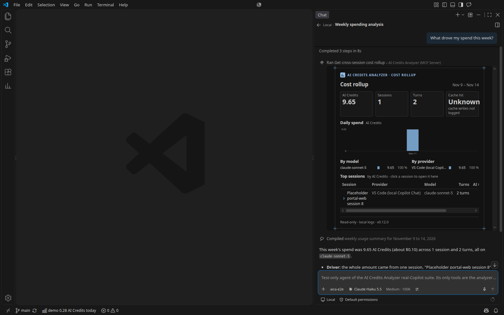

### Turning it on

1. Set `aiCreditsAnalyzer.mcp.enabled` to on in your **user** settings
   (or use the walkthrough's last step).
2. In Copilot Chat, switch to agent mode and open **Configure Tools**. The
   **AI Credits Analyzer** server is listed with its tools.

VS Code starts the server as a separate process using its own runtime, so
no Node.js install is needed. The extension doesn't offer the server
until the setting is on.

**Trust guard.** In Restricted Mode, a workspace you haven't trusted can't
turn the server on: VS Code ignores that workspace's value for
`aiCreditsAnalyzer.mcp.enabled`. Once you trust the workspace, its setting
applies. Your user setting always applies.

### What it offers

Nineteen read-only tools, the standalone app's MCP server's tools without
its billing ones (`get_statement` and `estimate_cost`), over Copilot Chat
sessions only. A twentieth, `get_turn_series`, is for the interactive views
below. It is marked app-only, so it is meant for the views, not for the model
or for you.

| Tool | What it returns |
|---|---|
| `list_log_providers` | The log source (only `vscode` here) and whether it has sessions |
| `list_sessions` | Sessions, most recent first, searchable by title and id and filterable by date |
| `get_turn` | One turn's prompt and response (redacted, truncated), usage and tool calls |
| `get_session_cost` | One session's tokens and AI Credits, cache hit ratio, spend per model and the most expensive turns |
| `get_cost_rollup` | Spend by model and day, and the most expensive sessions |
| `get_session_audit` | One session's tool-call audit |
| `list_tool_calls` | One session's tool calls, filtered and paged |
| `get_audit_rollup` | Tool-call totals, top failing commands and per-day counts across sessions |
| `list_findings` | Security, anomaly and behaviour-change findings, with redacted evidence |
| `list_repositories` | The repositories your Copilot sessions ran in, with sessions, turns and AI Credits (folder names only for local ones) |
| `list_projects` | No projects here: projects are edited in the standalone Agent Cost Analyzer app, and it says so |
| `get_price_book` | The dated GitHub Copilot and API prices the extension prices turns with |
| `get_price_changes` | When a model's price changed: documented, and observed from your billed AI Credits |
| `get_repository_cost` | One repository's cost over time, by model, with price-change markers |
| `get_project_cost` | One project's cost; with no projects, everything is in No project |
| `compare_costs` | Several repositories side by side: total, change, per session, per active day and share |
| `explain_cost_change` | Why a repository's cost changed between two periods: usage, price and mix effects |
| `replay_session` | One session replayed on another model: what it would have cost per turn and in total, beside what it did, with coverage and the self-check. **Simulated** |
| `compare_models_for_session` | One session's simulated total on up to 10 models, its own included. **Simulated** |

Four prompts start common reviews: `audit_session`, `review_costs`,
`security_review` and `explain_cost_change`. A `null` figure means the log doesn't record it; the
tools never report it as 0. A session whose latest turn started in the
last 15 minutes is marked `active`, with a sentence saying its figures
may still change: a running chat's log is not complete yet. The User Guide's
[MCP section](UserGuide.md#querying-the-audit-from-claude-code-mcp) has
more on the tools.

### Interactive views in Copilot Chat

Thirteen of the tools show an interactive view in the chat, next to the text
answer, when you ask about them in agent mode. VS Code may show a tool's name
with the server's name in front of it; the tool is the same:

| You ask about | Tool | The view shows |
|---|---|---|
| One session's cost | `get_session_cost` | Tiles (AI Credits, input, cache hit, output), AI Credits per turn as a chart with compaction and model-switch markers, the most expensive turns, and context overhead |
| This week's spend | `get_cost_rollup` | Tiles, spend per day, spend by model and provider, and the most expensive sessions |
| Anything risky | `list_findings` | Severity tiles and a table of findings, with filters |
| What a repository cost, over time | `get_repository_cost` | Cost tiles per basis, cost per day, week or month with price-change markers |
| Which repository costs the most | `compare_costs` | A table of total, change, cost per session, per active day and per turn, and cache hit, with share bars |
| Why a repository's cost changed | `explain_cost_change` | A waterfall of usage, price and mix effects, a table by model, the turns it could not explain and the documented price changes |
| What a project cost | `get_project_cost` | The reason there are no projects here, in place of a chart |
| What a session would have cost on other models | `compare_models_for_session`, `replay_session` | Each model's simulated total beside the measured one, with the own-model check; one model's replay turn by turn with the self-check, a chart and the turns not replayed. **Simulated** |
| When prices changed | `get_price_changes` | A timeline of documented and inferred price changes, with % per token type, sources and, for an inferred change, the weekly billed-against-priced figures |
| Why tool calls failed | `get_session_audit`, `get_audit_rollup` | The failure rate, failure categories, recovery cost in tokens, retried commands and calls by tool; over a date range also failed calls per day, top failing commands and the sessions |
| Which session to look at | `list_sessions` | A list of sessions with an **Analyse** button per row |

The billing tools (`get_statement`, `estimate_cost`) and their views are in
the standalone app only.

VS Code shows the views inline in the chat only (no fullscreen). They need
no setup beyond the MCP server being on: the views ship inside the
extension. They use the extension's name and colours and follow your VS Code
theme. Claude Code CLI keeps the text answer.

What you can click:

- **A top turn** opens that turn in place (prompt excerpt, tokens, AI
  Credits, event, tool calls). **Hide turn** closes it. A turn that ran
  classic subagents also lists them under **Subagent runs (N)**: agent,
  model, requests and AI Credits, with the reason for a run whose AI Credits
  are unknown.
- **A top session** in the spend view opens that session's cost view in
  place; **Back to cost rollup** returns.
- **The kind and minimum severity filters** in the findings view ask the
  server again. Evidence stays collapsed until you open it.
- **Ask about this session** (spend view) puts `Analyse session <id>` in
  the chat input; press Enter to send it (VS Code 1.146 doesn't send a
  view's message by itself). Only that fixed text goes to the model;
  titles, prompts and evidence never do. If Copilot Chat doesn't take the
  message, the view shows **Ask in the chat: Analyse session <id>** for you
  to type; it doesn't try again by itself.
- **Analyse** (session picker) puts the same fixed text for that row's
  session in the chat input and then reads **Sent**, or shows the text to
  type if the message isn't taken. The row itself is not a button.
- **A model** in the replay comparison replays the session on that model in
  place; **Back to model comparison** returns with focus on that model.
- **Price changes** in the cost change view opens the price timeline in
  place for its period, filtered to the (up to three) models with the
  largest price effect; **Back to cost change** returns without a new call.
- **View as table** (replay chart, failed calls per day in the audit) shows
  the chart's figures as a table, with **Unknown** where a figure isn't
  known.
- **Copy title to open in panel** (session cost view) copies the session
  title. VS Code doesn't let a chat view open links into the editor, so
  press Ctrl+Shift+P (Cmd+Shift+P on macOS), run **AI Credits Analyzer:
  Open Session…** and paste the title into the picker that opens; the list
  narrows to that session and Enter opens it. You can also open the session
  from the Sessions view.

- **A row** in the comparison opens that repository's cost over time in
  place. **Back to comparison** returns to the table with focus on the row
  you left. The chain stops there: this extension has no projects, and a
  repository's cost over time has no top sessions, so there is no drill-down
  into a session from it.
- **The currency control** in the cost over time view appears when the
  figures are in both AI Credits and USD.
- **A model row** in the cost change view opens to its token types, unit
  prices per 1M tokens and price versions. That view calls no tool.

**Cost over time, comparison and cost change.** Every money figure names its
basis and its currency.

- **Basis.** The cost over time view shows tiles for the preferred total
  (billed, then reported, then priced), then billed, reported and priced. The
  cost change view always uses the priced basis and says so.
- **Coverage.** A figure covering only some turns says "known for 12 of 40
  turns", and a day, week or month with only some turns known is drawn
  hatched. A figure with nothing known reads **Unknown**, never 0.
- **Currencies stay apart.** AI Credits come first, then USD with a "$".
  They are never added or converted.
- **No earlier figure.** A change against a period with nothing known reads
  "no earlier figure", never "from 0".
- **Price changes.** Changes in the price book are **documented**: a solid
  marker and a "documented" tag. Changes inferred from your billed AI Credits
  are **inferred**: a dashed marker and an "inferred" tag. The cost change
  view's **Price changes** button opens the price timeline.
- **The waterfall.** A rise uses your theme's danger colour and a fall its
  success colour, and each carries its written sign. The usage, price and mix
  effects add up to the change.
- **Not explained.** Turns with no price for their model are counted in the
  **Not explained** tile ("3 turns", "no price for these turns; not counted
  as 0"), listed with reasons, and left out of every number.
- **No projects.** Asking for a project's cost shows **No projects here**
  with this extension's reason in place of a chart: *AI Credits Analyzer has
  no projects: projects are edited in the standalone Agent Cost Analyzer app.
  Every turn is in No project; repositories are listed as usual.* A project
  comparison shows the same state. Ask about repositories instead.

**Replay, price changes, audits and the session picker.**

- **Replay is simulated.** Every replayed figure carries a **Simulated**
  tag: what the session would have cost about on that model, not what was
  billed. A model replayed for only some turns shows "≥" before its total
  and "partial"; a model with no price reads **Unknown**. The comparison
  opens with the own-model check and a replay with its self-check; a failed
  or missing check is an alert above the figures, which stay. Measured is
  solid (bar, or line with filled dots), simulated hatched or dashed with
  open diamonds; turns not replayed are a hatched gap, listed with reasons.
- **Price changes.** Documented and inferred changes share one timeline and
  stay apart by tag, by a solid or dashed diamond and rail, and a weekly
  table for an inferred change. A rise is written in red and a fall in
  green, each with its sign.
- **Tool-call audits.** The failure rate counts only calls with a known
  outcome; unknown outcomes are counted apart, and with none known the rate
  reads **Unknown**. Recovery cost is in tokens, "tokens, not AI Credits".
  Commands are shown as written, and nothing in the audit opens anything.
- **The session picker** shows title, short id, start, turns, model and
  repository, and no cost.

Fullscreen isn't offered in VS Code, so the Fullscreen button that Claude
Desktop shows on the spend and cost over time views doesn't appear here.

Clicking through a view calls the server through VS Code and costs no model
tokens. A figure the log doesn't record reads **Unknown**, never 0. The
[User Guide](UserGuide.md#interactive-views-in-the-chat) has the same views
for Claude Desktop.

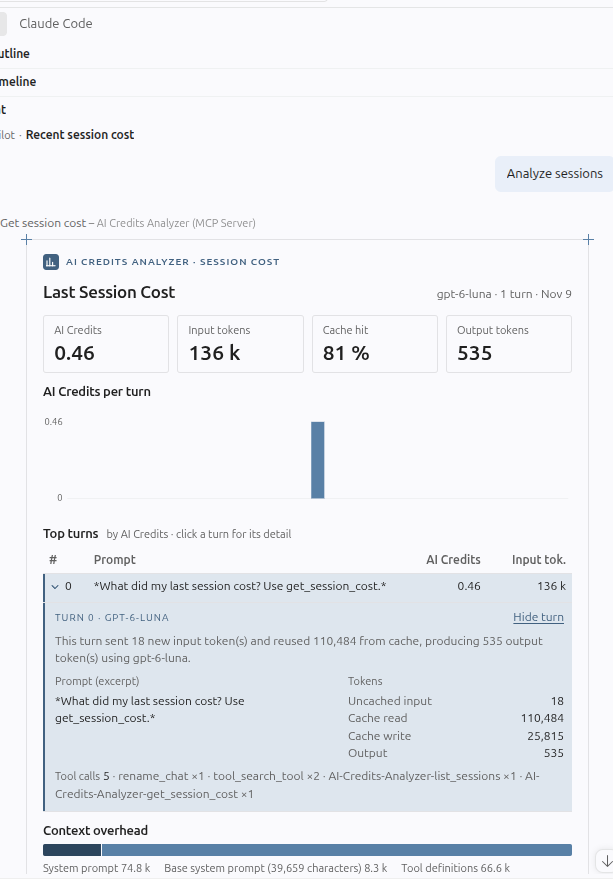

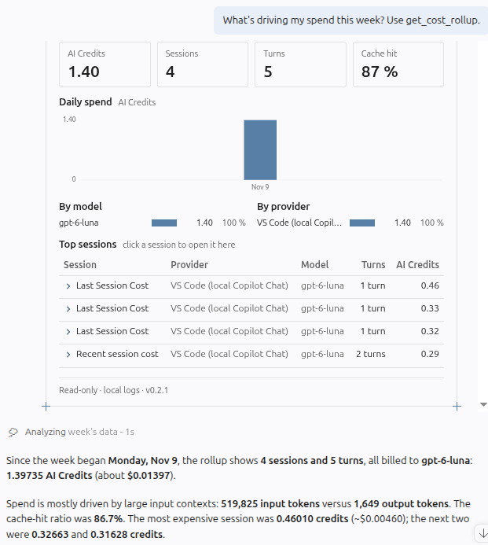

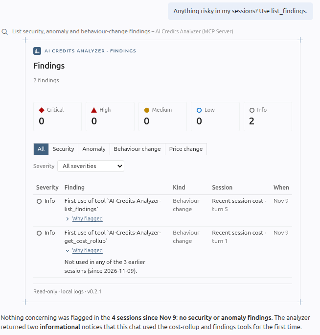

### What goes to the model

When the server is on, whatever its tools return goes into the chat's
context, and so to whichever model the chat uses:

- costs: tokens, AI Credits and cache use per session, turn and day;
- tool calls and their outcomes;
- findings: security, anomaly and behaviour-change flags, with excerpts;
- repositories: their remote names (`github.com/org/repo`), never a
  remote's credentials; a local repository by its folder name only;
- turn text: your prompts and the model's responses.

What you click inside an interactive view doesn't go to the model; only the
fixed `Analyse session <id>` message from **Ask about this session** or the
session picker's **Analyse** does.

Secrets found in that text are redacted first, and text is cut to a
bounded length. The server never writes files, runs commands or reaches
the network, and it reads only Copilot Chat's logs on the machine the
extension runs on.

### Turning it off

Set `aiCreditsAnalyzer.mcp.enabled` back to off. The server is removed
from the tool list right away, with no reload.

## Remote-SSH, WSL and Dev Containers

Copilot Chat writes its logs where its own extension host runs, which in
a remote window is the remote machine, WSL distribution or container. AI
Credits Analyzer is a workspace extension (`extensionKind: ["workspace"]`)
so it runs in the same place and reads the same logs. In a remote window,
install it on the remote side: in the Extensions view, the button reads
**Install in** followed by the remote's name.

There it finds the logs under the VS Code server's data folder (for
example `~/.vscode-server/data`), and the MCP server, when on, also runs
on the remote side. Sessions you had on your local machine aren't shown
in a remote window, and the other way round.

If the extension doesn't recognise the storage layout, it reads nothing
and logs a warning; it never falls back to another folder.

The manual check of Remote-SSH, WSL and Dev Containers in a real VS Code
hasn't been done yet, so treat remote use as untested for now.

## Accessibility

The panel and side bar are built to WCAG 2.2 AA and checked
automatically in dark, light and high-contrast themes.

- **Keyboard.** Everything works without a mouse. Arrow keys move through
  the session list and the turns table, and Enter opens. Escape closes
  the top dialog, drawer or inspector and returns focus to where you were.
  Focus outlines use your theme's focus color. In the system-prompt
  diagram, arrow keys move between sections (Left/Right along a level,
  Down to a child, Up to the parent, Home/End), and Enter or Space selects.
- **View as table.** Every chart has a **View as table** toggle that shows
  the same numbers as a table, with unknown values written as "unknown".
  Each chart also has a text summary for screen readers.
- **High contrast.** The panel uses your theme's colors and contrast
  borders. Severity and status are always shown with an icon and text,
  never with color alone.
- **Narrow panels.** The layout follows the panel's width, not the
  window's. From 700 to 1099 px wide, the right column becomes a drawer.
  Below 700 px, the turns table shows priority columns (Turn, Trigger, AI
  Credits, Cumulative, and the simulated Cost while a replay is shown),
  details open in a drawer, and the views are a
  select. The minimum width is 360 px. The table's column chooser lets
  you pick the visible columns, and it remembers your choice.
- **Reduced motion.** With your system's reduce-motion setting on,
  transitions and animated progress are turned off.
- **Loading.** Results that load in the background are announced to
  screen readers. Long loads (dashboard, tool audit, turn inspector) have
  a **Cancel** button.

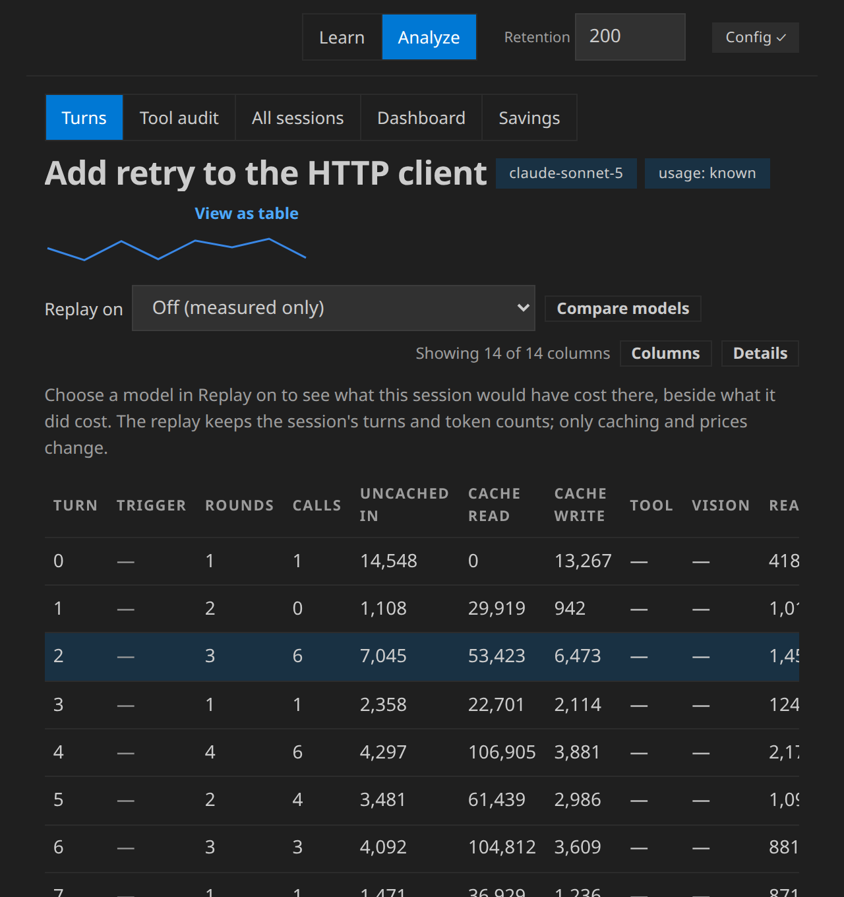

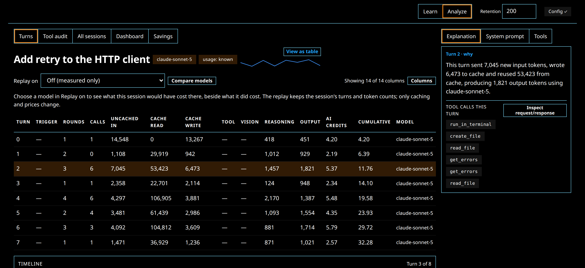

## Troubleshooting

### No sessions in the Sessions view

- Copilot Chat may not have been used in this VS Code profile yet, or
  only before debug logging was on. Turn logging on (see
  [Turning on debug logging](#turning-on-debug-logging)), have a chat,
  then select **Refresh**.
- The view doesn't update by itself. Select **Refresh** after a chat.
- In a remote window, the extension shows the remote side's sessions
  only (see [Remote-SSH, WSL and Dev Containers](#remote-ssh-wsl-and-dev-containers)).
- If the panel's Analyze mode says no session store was found, Copilot
  Chat hasn't created its session store in this profile yet.

Learn mode works without any sessions.

### The Setup view says Copilot Chat is disabled or not installed

The check found no enabled GitHub Copilot Chat extension in this VS Code
profile, so no logs are written whatever the settings say. Select **Fix**
to open the Extensions view on Copilot Chat, enable or install it, and
reload the window if asked. The row clears on its own when the extension
is enabled.

### The Setup view says logging is off

Select **Fix** and turn the setting on, then reload the window. If the
row stays after that, check for a workspace setting that turns it off
again: workspace settings override user settings, and the check reads the
effective value.

### A cost shows as "unknown"

"Unknown" means the log doesn't contain that figure. It's never counted
as 0. Common reasons:

- for Local harness chats, the session was recorded before debug logging
  was on;
- for Local harness chats, Copilot Chat deleted the session's debug log
  (raise `github.copilot.chat.agentDebugLog.fileLogging.maxRetainedSessionLogs`);
- for Local harness chats, a subagent run's debug log is missing, can't be
  read or matched to a turn, or the session has more than 200 of them (the
  panel names the reason);
- for Local harness chats, cache-write and reasoning tokens need the optional
  `github.copilot.chat.otel.dbSpanExporter.enabled` setting;
- for Agent Host chats, cache-write and reasoning tokens need per-call usage
  records (Copilot CLI 1.0.95 and later) that add up to the turn's totals,
  and tool and vision tokens are never recorded.

Totals add up only known costs and say how many are unknown, so you can
tell when a total leaves sessions out.

### The sessions don't load, or the database seems locked

The extension opens Copilot Chat's session database read-only and never
writes to it. If a read fails while Copilot Chat is busy with the
database, the view shows what failed, says nothing was changed, and
offers **Retry** (in the panel) or **Refresh** (in the Sessions view).
Try again after a moment. If a read keeps failing, use **Copy details**
on the error and open an issue.

The optional `agent-traces.db` is read the same way; when it can't be
read, cache-write and reasoning tokens show as unknown and everything
else still works.

### No interactive view appears

- Check the tool answered in agent mode: the view appears next to the result
  of `get_session_cost`, `get_cost_rollup` or `list_findings`, not other
  tools'.
- VS Code needs to be 1.109 or later to render MCP Apps (the extension
  requires 1.144, so a supported install has it).
- If the extension's build lacked the views file, the server runs without
  views and you see only text. Reinstall the extension from the Marketplace
  or Open VSX; a build from source needs `npm run build` first.

### The MCP server isn't listed in agent mode

- Check that `aiCreditsAnalyzer.mcp.enabled` is on in your user settings.
- If it's on only in a workspace's settings, that workspace must be
  trusted (see the trust guard under
  [Turning it on](#turning-it-on)).
- Check you're in agent mode, and look under **Configure Tools**.
- If the extension didn't recognise VS Code's storage layout, it offers
  no server. The Extension Host output log then has a line starting with
  `AI Credits Analyzer: unrecognised VS Code storage layout`.

## Privacy and what the extension reads

- It reads only Copilot Chat's local log files on the machine where the
  extension runs.
- It makes no network requests and sends no telemetry.
- It never writes, moves or deletes your logs or Copilot Chat's settings.
  It stores only its own state (the Retention value and whether the
  walkthrough was shown) in VS Code's extension storage.
- Its panel loads no remote content.
- The MCP server is off by default. When you turn it on, it sends
  redacted session data to the chat model, as described in
  [What goes to the model](#what-goes-to-the-model).

### Exactly what it reads

The extension asks VS Code for its own storage folder and derives VS
Code's user-data folder from it, so the paths are right on Windows, macOS
and Linux, for Stable, Insiders and portable installs, and on remote
servers. Typical user-data folders are `~/.config/Code` (Linux),
`~/Library/Application Support/Code` (macOS), `%APPDATA%\Code` (Windows)
and `~/.vscode-server/data` (remote). Under that folder it reads:

| Path | What it is |
|---|---|
| `User/globalStorage/github.copilot-chat/session-store.db` | Copilot Chat's session list (SQLite, opened read-only) |
| `User/workspaceStorage/<workspace>/GitHub.copilot-chat/debug-logs/` | Each session's debug log, `main.jsonl`, with per-turn usage and AI Credits |
| `User/workspaceStorage/<workspace>/GitHub.copilot-chat/debug-logs/<session>/runSubagent-*.jsonl`, `searchSubagent-*.jsonl` | Each classic subagent run's debug log next to `main.jsonl` (ids, labels, counts, models and AI Credits only) |
| `User/globalStorage/github.copilot-chat/debug-logs/` | The same debug logs for chats in a window with no folder open; those sessions show as "No repository" |
| `User/globalStorage/github.copilot-chat/agent-traces.db` | Optional: cache-write and reasoning tokens for Local harness chats (SQLite, opened read-only) |
| `User/globalStorage/agent-host.db` | Agent Host session list, for VS Code 1.143 and later (SQLite, opened read-only) |
| `agentSessionData/<session>/session.db` | Agent Host turns, tokens and AI Credits per session (SQLite, opened read-only) |
| `<COPILOT_HOME or ~/.copilot>/session-state/<sdkSessionId>/events.jsonl` | Agent Host turn text, tool calls, system prompt, and cache-write and reasoning tokens (per-call usage records), from the Copilot CLI's event log (read-only, opened when a session is shown) |

Settings are read through VS Code's settings API, not from the file.
