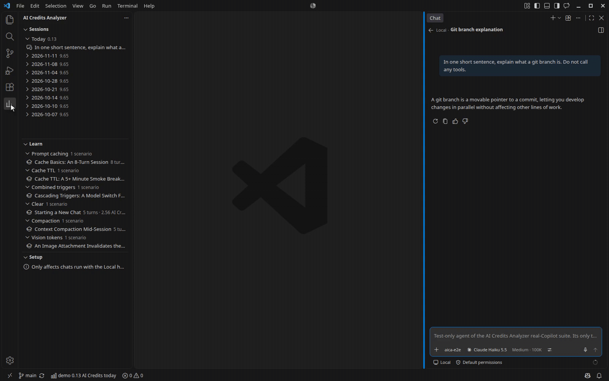
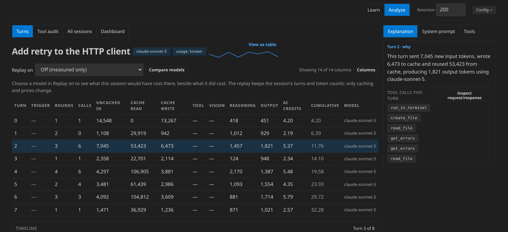
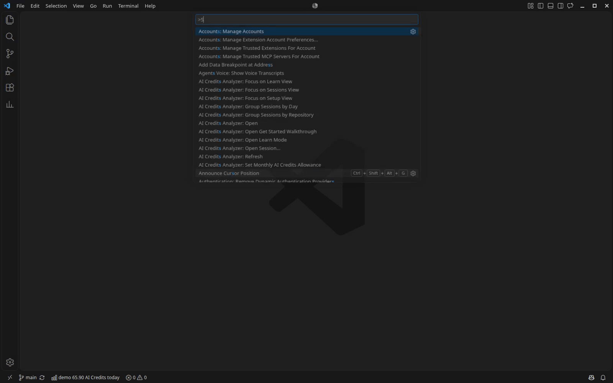
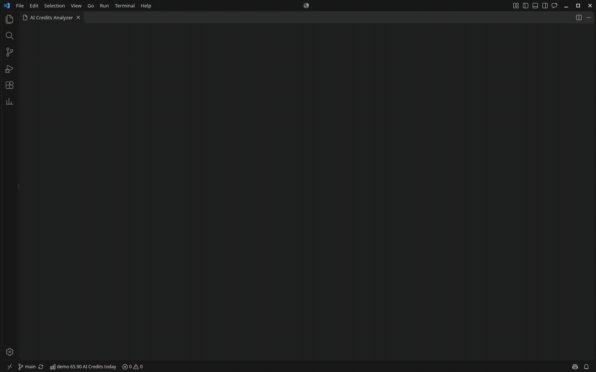
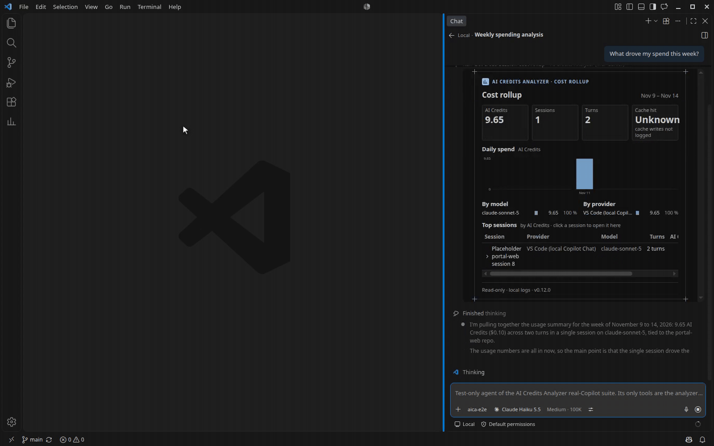
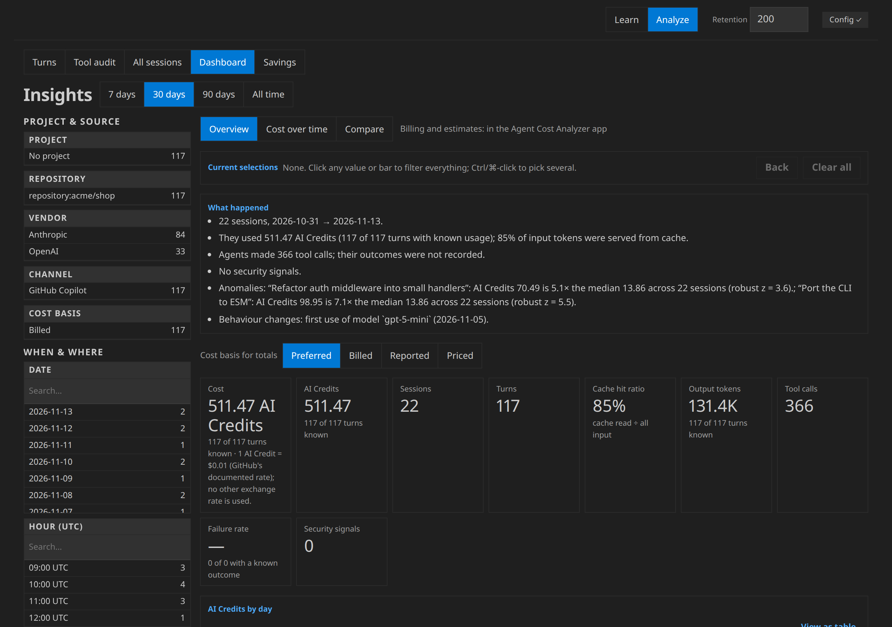
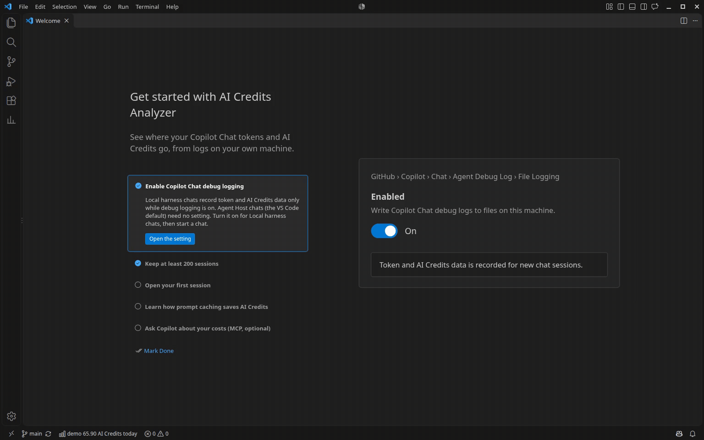
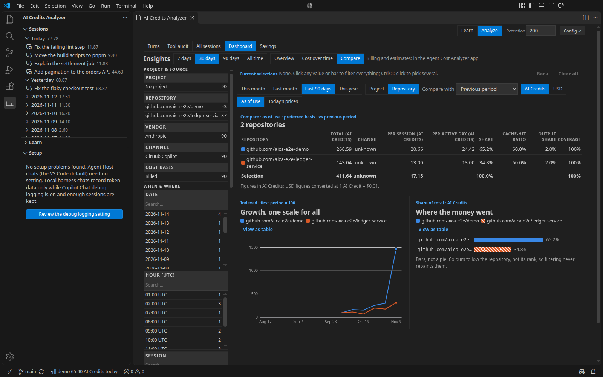

# AI Credits Analyzer

**Last changed:** 2026-11-14 · **Source:** https://github.com/raulkivi/agent-cost-analyzer

See where your GitHub Copilot Chat tokens and AI Credits go. AI Credits
Analyzer reads the logs Copilot Chat writes on your machine and shows each
session turn by turn: what each turn cost, how much prompt caching saved,
which tool calls failed and why, and how your usage changes over time.
Learn mode explains caching and AI Credits with sample sessions, so it's
useful before you have any data of your own.

AI Credits are GitHub Copilot's billing unit for premium requests (not
dollars). The figures come from Copilot Chat's own logs, not from
estimates.

This is an early pre-release; please
[report issues](https://github.com/raulkivi/agent-cost-analyzer/issues).
Independent project; not affiliated with or endorsed by GitHub or
Microsoft.

Using Claude Code, pi or mitmproxy captures? The standalone app,
[Agent Cost Analyzer](https://github.com/raulkivi/agent-cost-analyzer#readme),
reads those and Copilot Chat.

## Features

- **Analyzer panel.** Each session's turns in a table: uncached input,
  cache read and write, tool, vision, reasoning and output tokens, AI
  Credits per turn and a running total. A plain-language explanation of
  each turn, the system prompt broken into its parts, the tools that were
  loaded and used, and a request/response inspector per turn.
- **Sessions, Learn and Setup side bar.** Your Copilot Chat sessions
  grouped by day, or by the repository they ran in, with their AI Credits
  totals, and the Learn scenarios
  grouped by topic; pick one to open it in the panel. Setup lists any
  Copilot Chat logging setting that needs changing, with a Fix button that
  opens it.
- **Status bar.** Today's AI Credits for the open folder's repository,
  with every repository's total and how many of today's sessions have cost
  data in the tooltip.
- **Monthly AI Credits allowance gauge.** Set
  `aiCreditsAnalyzer.monthlyAllowance.aiCredits` to your plan's allowance,
  or run **Set Monthly AI Credits Allowance**. A second status-bar item
  then shows the month to date against it, with a warning near the limit
  (80 % by default) and when over. The first row of the Sessions view shows
  the same figures with the days left. It shows no notification and
  changes no setting.

  
- **Insights dashboard.** Spend by day and model, cache hit ratio, tool
  calls and failures, and signals to review: risky commands, unusual
  sessions and first-time use of a tool or model. **Cost over time** and
  **Compare** show each repository's cost by week or month, with the
  dates a model's price changed.
- **Savings report.** **Savings**, after **Dashboard** in the panel, ranks
  changes that would have cost less over your Copilot sessions: tools
  loaded but never used, cache lost after an idle gap, a model switched
  mid-session, repeated failed tool calls and, with **Include simulated**,
  a cheaper model. Each row has a range or "up to" figure per week in AI
  Credits, its coverage and **Copy text**. It adds no total and changes no
  setting or file.

  
- **Replay on another model.** Pick a model in **Replay on** to see what a
  session would have cost about there, beside what it did cost, in
  Simulated columns with a summary of coverage and assumptions. **Compare
  models** ranks up to 10 models. The session's own turns and token counts
  are kept; only caching and prices change. A classic chat is compared on
  the main agent only: its subagent runs are left out.
- **Subagent runs.** A classic Copilot Chat turn's AI Credits include the
  subagent runs it started. Open a turn to see each run's agent, model,
  requests and AI Credits, or why they are unknown.
- **Tool audit.** Every tool call in a session, why failed calls failed,
  and retried commands, plus a roll-up across sessions.
- **Learn mode.** 17 sample sessions, in the Learn view, that show how
  prompt caching, context compaction, model switches and other events
  change what a turn costs.
- **MCP server for Copilot agent mode** (off by default). Ask Copilot Chat
  "what did my last session cost?" and it answers from the same local logs
  through 19 read-only tools, including cost by repository, why it
  changed, and what a session would have cost on another model. The cost
  and findings tools also show interactive views in the chat: session
  cost, spend by day and model, findings, cost over time, a repository
  comparison, and why a cost changed.

  

An unknown figure is shown as unknown, never as 0.

## Getting started

1. Install **AI Credits Analyzer** from the Extensions view.
2. The **Get Started** walkthrough opens once. It walks you through the
   steps below. Reopen it any time with **AI Credits Analyzer: Open Get
   Started Walkthrough**.
3. Turn on Copilot Chat's debug file logging. Chats run with the Local
   harness record token and AI Credits data only while it's on, and it's
   off by default. Agent Host chats (below) don't need it.
   1. Open the **Setup** view in the AI Credits Analyzer side bar and
      select **Fix** on the debug-logging row. It opens
      `github.copilot.chat.agentDebugLog.fileLogging.enabled` in
      Settings; turn it on.
   2. Set
      `github.copilot.chat.agentDebugLog.fileLogging.maxRetainedSessionLogs`
      to 200 or more, so older logs aren't deleted.
   3. Run **Developer: Reload Window**.
4. Chat with Copilot as usual, then select **Refresh** in the **Sessions**
   view and pick a session.

Logging isn't retroactive: sessions from before you turned it on show
their figures as unknown.

VS Code 1.143 and later make the Copilot harness the default for new chats,
and those run through the Agent Host. Their sessions are listed with their
tokens and AI Credits. Their prompt and response text, turn inspector, tool
calls and system prompt come from the Copilot CLI's event log, read locally.
Cache-write and reasoning tokens come from the same log's per-call usage
records, which Copilot CLI 1.0.95 and later write. They're used only when the
records add up to the turn's token totals; otherwise both show as unknown,
with the reason. Tool and vision tokens stay unknown.
The Tools tab stays unavailable, since the log records no tool definitions.
If a session's log is missing or unreadable, its text, tool calls and
system prompt show as not available, and its cache-write and reasoning
tokens as unknown, with the reason.
Once VS Code has an Agent Host store, Setup marks the two logging settings
optional: "Only affects chats run with the Local harness; Agent Host chats
are unaffected."

## Commands

All commands are in the **AI Credits Analyzer** category.

| Command | What it does |
|---|---|
| Open | Opens the analyzer panel |
| Refresh | Reloads the Sessions and Setup views and the status bar |
| Open Learn Mode | Opens the panel in Learn mode |
| Open Get Started Walkthrough | Opens the walkthrough |
| Open Session… | From the Command Palette: pick a session, newest first. Also on a session in the Sessions view |
| Show Tool Audit, Copy Advice Bundle | On a session in the Sessions view |
| Open Scenario | On a scenario in the Learn view |
| Fix Setting | On a row in the Setup view: opens that setting |
| Group Sessions by Repository, Group Sessions by Day | Groups the Sessions view |
| Set Monthly AI Credits Allowance | Opens `aiCreditsAnalyzer.monthlyAllowance.aiCredits` in the Settings editor; changes nothing |

## Settings

| Setting | Default | What it does |
|---|---|---|
| `aiCreditsAnalyzer.mcp.enabled` | `false` | Offers Copilot Chat agent mode a read-only MCP server over your Copilot Chat sessions |
| `aiCreditsAnalyzer.monthlyAllowance.aiCredits` | not set | Your plan's monthly allowance in AI Credits; empty or 0 turns the gauge off |
| `aiCreditsAnalyzer.monthlyAllowance.resetDay` | `1` | Day of the month (1 to 28) your billing period starts |
| `aiCreditsAnalyzer.monthlyAllowance.warnAtPercent` | `80` | Percentage of the allowance at which the gauge warns |

## Privacy

- AI Credits Analyzer reads only Copilot Chat's log files on your machine
  (or on the remote host, in a remote window).
- It makes no network requests and sends no telemetry.
- It never writes, moves or deletes your logs or Copilot Chat's settings.
  Fix buttons only open a setting; you make the change.
- The MCP server is off until you turn on `aiCreditsAnalyzer.mcp.enabled`.
  When it's on, what its tools return goes to whichever model you chat
  with: costs, tool calls and their outcomes, findings with excerpts, and
  your prompts and the model's responses. Secrets in that text are
  redacted and the text is truncated first. The server is read-only and
  doesn't reach the network. In Restricted Mode, an untrusted workspace's
  settings can't turn it on.

[What the extension reads, file by file](https://github.com/raulkivi/agent-cost-analyzer/blob/main/docs/vscode-extension-guide.md#privacy-and-what-the-extension-reads).

## Requirements

- VS Code 1.146 or later. Each release of the extension requires the VS
  Code version that was stable when it was published.
- GitHub Copilot Chat. Chats run with the Local harness also need debug
  file logging turned on (see above).

## Documentation

- [Extension guide](https://github.com/raulkivi/agent-cost-analyzer/blob/main/docs/vscode-extension-guide.md):
  installing, every command and setting, the MCP server, remote windows,
  accessibility and troubleshooting.
- [User Guide](https://github.com/raulkivi/agent-cost-analyzer/blob/main/docs/UserGuide.md):
  the analysis views in detail.
- [Changelog](https://github.com/raulkivi/agent-cost-analyzer/blob/main/packages/vscode-extension/CHANGELOG.md)
- [Report an issue](https://github.com/raulkivi/agent-cost-analyzer/issues)

## Using Claude Code, pi or mitmproxy?

This extension reads GitHub Copilot Chat's logs only. For Claude Code CLI
sessions, pi coding agent sessions or mitmproxy captures of LLM API
traffic, use
[Agent Cost Analyzer](https://github.com/raulkivi/agent-cost-analyzer#readme),
the standalone app from the same repository. It has the same views and
reads VS Code Copilot Chat sessions too.

## License

[MIT](https://github.com/raulkivi/agent-cost-analyzer/blob/main/LICENSE)
